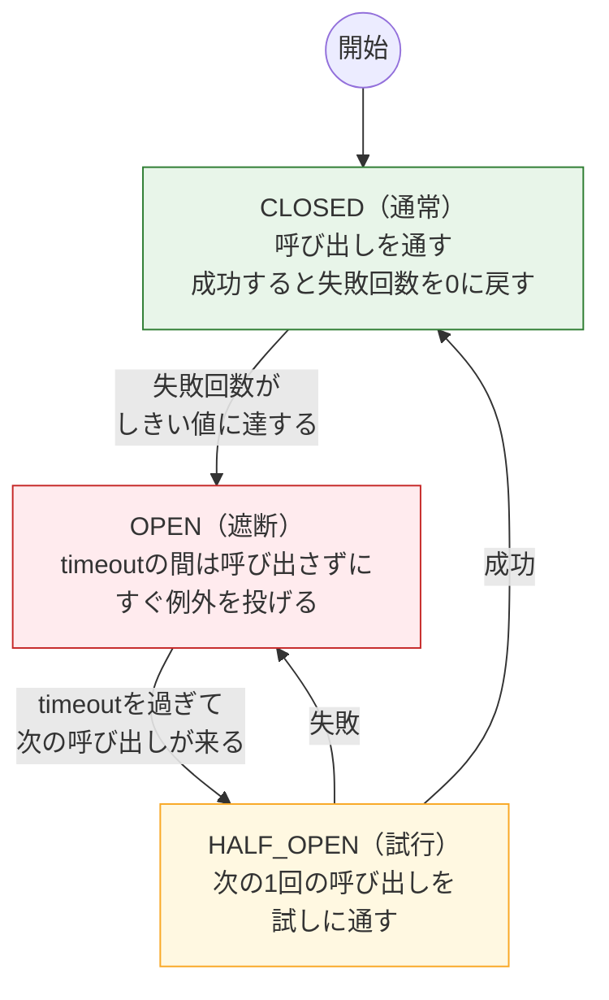

# 付録H: 並行処理とネットワークの発展的なパターン<small>サーキットブレーカー・Fork/Join・NIO</small>

書籍の第13章「例外処理」、第15章「マルチスレッドプログラミング」、第16章「ネットワークプログラミング」から移した、発展的なパターンの解説です。
本文では各パターンの考え方だけを説明し、まとまったコード例をこの付録に置いています。
本書の演習では使いません。

各節のコードは抜粋です。コンパイルして実行できる全文は`code/`の下にあります（Java 25。各ディレクトリで`javac *.java`のあと、`java クラス名`で実行します）。

## サーキットブレーカー（第13章）


連続して失敗が発生した場合、一定時間処理をブロックすることで、障害の拡大を防ぐパターンです（名前は、電流が流れすぎると回路を切る電気のブレーカー（circuit breaker）に由来します。ソフトウェアの設計パターンとしては、マイケル・ナイガード（Michael T. Nygard）の書籍『Release It!』（2007年）で広く知られるようになりました）。多数のサービスがネットワーク越しに呼び合うシステムでとくに重要です。

サーキットブレーカーは、次の3つの状態を切り替えながら動きます。

- CLOSED（通常）
    + 呼び出しをそのまま通す。失敗が続いて回数がしきい値に達すると、OPENに移る
- OPEN（遮断）
    + 決めた時間（timeout）が過ぎるまでは、相手を呼び出さずにすぐ例外を投げる。相手が回復するまで負荷をかけずに済む
- HALF_OPEN（試行）
    + timeoutを過ぎたあとの呼び出しを、試しに通す。成功すればCLOSEDに戻り、失敗すればまたOPENになる



コードの抜粋（コンパイルできる全文：[code/CircuitBreaker/](code/CircuitBreaker/)のCircuitBreaker.java）

```java
public class CircuitBreaker {
    private enum State {
        CLOSED,    // 通常状態
        OPEN,      // 遮断状態
        HALF_OPEN  // 半開状態（テスト中）
    }
    
    private State state = State.CLOSED;
    private int failureCount = 0;
    private long lastFailureTime = 0;
    
    private final int failureThreshold;
    private final long timeout;
    
    public CircuitBreaker(int failureThreshold, long timeoutMs) {
        this.failureThreshold = failureThreshold;
        this.timeout = timeoutMs;
    }
    
    public <T> T execute(Callable<T> operation) throws Exception {
        if (state == State.OPEN) {
            if (System.currentTimeMillis() - lastFailureTime > timeout) {
                state = State.HALF_OPEN;
            } else {
                throw new RuntimeException("サーキットブレーカーが開いています");
            }
        }
        
        try {
            T result = operation.call();
            onSuccess();
            return result;
        } catch (Exception e) {
            onFailure();
            throw e;
        }
    }
    
    private void onSuccess() {
        failureCount = 0;
        state = State.CLOSED;
    }
    
    private void onFailure() {
        failureCount++;
        lastFailureTime = System.currentTimeMillis();
        
        if (failureCount >= failureThreshold) {
            state = State.OPEN;
            System.err.println("サーキットブレーカーを開きました");
        }
    }
}
```

`onFailure`では、HALF_OPENで失敗したときも失敗回数がしきい値以上のままなので、すぐにOPENへ戻ります。
このクラスは1つのスレッドから使うことを前提にしているので、HALF_OPENでは次の1回の呼び出しの結果で状態が決まります。
複数のスレッドから同時に呼び出すと、HALF_OPENの間に複数の呼び出しが通ったり、状態の書き換えが食い違ったりするため、排他制御が必要です。
排他制御は第15章「マルチスレッドプログラミング」で学びます。複数のスレッドから使える形は、この付録の「リトライとサーキットブレーカーの並行版」で紹介します。

## Fork/Joinと並列ソートの時間の比較（第15章）

複数のスレッドで処理を分けても、データ量や処理の内容によっては速くならないことがあります。
効果は実際に時間を測って確かめます。
次の例は、配列のソートを`Arrays.sort`と`Arrays.parallelSort`で比べ、`ForkJoinPool`で大きな配列の合計を求めます（`ForkJoinPool`はJava 7で、`Arrays.parallelSort`はJava 8で加わりました）。

`RecursiveTask`を継承したクラスの`compute`メソッドは、範囲が小さければ直接計算し、大きければ2つに分けます。
分けた片方を`fork`で別のスレッドに任せ、もう片方を自分で計算してから、`join`で結果を待って足し合わせます。
第12章「Stream APIと高度なコレクション操作」で学んだ並列ストリームも、内部ではこのFork/Joinのしくみで処理を分けています。
並列ストリームの使い方と、逐次処理との時間の比べ方は第12章の「並列ストリームによるパフォーマンス向上」を参照してください。

コードの抜粋（コンパイルできる全文：[code/ParallelPerformanceExample/](code/ParallelPerformanceExample/)のParallelPerformanceExample.java）

```java
public class ParallelPerformanceExample {
        // ...
        
        // シングルスレッドソート
        long startTime = System.currentTimeMillis();
        Arrays.sort(array1);
        long singleThreadTime = System.currentTimeMillis() - startTime;
        
        // 並列ソート
        startTime = System.currentTimeMillis();
        Arrays.parallelSort(array2);
        long parallelTime = System.currentTimeMillis() - startTime;
        
        // ...
    
    // ForkJoinPoolを使った再帰的並列処理
    static class RecursiveSum extends RecursiveTask<Long> {
        private static final int THRESHOLD = 10_000;
        private final long[] array;
        private final int start, end;
        
        // ...
        @Override
        protected Long compute() {
            if (end - start <= THRESHOLD) {
                // 小さなタスクは直接計算
                long sum = 0;
                for (int i = start; i < end; i++) {
                    sum += array[i];
                }
                return sum;
            } else {
                // 大きなタスクは分割
                int mid = (start + end) / 2;
                RecursiveSum left = new RecursiveSum(array, start, mid);
                RecursiveSum right = new RecursiveSum(array, mid, end);
                
                left.fork(); // 左側を非同期実行
                long rightResult = right.compute(); // 右側を現在のスレッドで実行
                long leftResult = left.join(); // 左側の結果を待つ
                
                return leftResult + rightResult;
            }
        }
    }
    // ...
    public static void forkJoinExample() {
        int size = 100_000_000;
        long[] array = new long[size];
        Arrays.fill(array, 1);
        
        ForkJoinPool pool = new ForkJoinPool();
        
        long startTime = System.currentTimeMillis();
        Long result = pool.invoke(new RecursiveSum(array, 0, size));
        long time = System.currentTimeMillis() - startTime;
        // ...
}
```

## スレッドセーフなシングルトン（第15章）

シングルトンは、あるクラスのインスタンスを1つだけ作り、プログラム全体でそれを共有するデザインパターンです。
第8章「Javaの特殊なクラス形式」では、`enum`を使った書き方を学びました。
ここでは、複数のスレッドから同時に`getInstance()`を呼ばれても、インスタンスが1つだけになる書き方を比べます。

「インスタンスがまだなければ作る」という処理は、`count++`と同じく確認と更新の2段階に分かれます。
2つのスレッドが同時に`instance == null`を確かめると、両方がインスタンスを作ってしまいます。
全文の1つ目の方式は、`getInstance()`を`synchronized`メソッドにしてこれを防ぎます。
この方式には、インスタンスができたあとも呼び出すたびにロックを取るため遅くなるという欠点があります。
この方式のコードは抜粋では省略したので、全文で確かめてください。

コードの抜粋（コンパイルできる全文：[code/ThreadSafeSingletonExamples/](code/ThreadSafeSingletonExamples/)のThreadSafeSingletonExamples.java）

```java
public class ThreadSafeSingletonExamples {
    // ...
    
    // 2. ダブルチェックロッキング（高速だが複雑）
    static class DoubleCheckedSingleton {
        private static volatile DoubleCheckedSingleton instance;
        
        private DoubleCheckedSingleton() {}
        
        public static DoubleCheckedSingleton getInstance() {
            if (instance == null) {
                synchronized (DoubleCheckedSingleton.class) {
                    if (instance == null) {
                        instance = new DoubleCheckedSingleton();
                    }
                }
            }
            return instance;
        }
    }
    
    // 3. 静的内部クラスホルダー（推奨・遅延初期化）
    static class HolderSingleton {
        private HolderSingleton() {}
        
        private static class Holder {
            private static final HolderSingleton INSTANCE = new HolderSingleton();
        }
        
        public static HolderSingleton getInstance() {
            return Holder.INSTANCE;
        }
    }
    
    // 4. Enumシングルトン（もっとも安全）
    enum EnumSingleton {
        INSTANCE;
        
        public void doSomething() {
            IO.println("Enum singleton method");
        }
    }
    // ...
}
```

2つ目のダブルチェックロッキングは、ロックの外で一度`null`かどうかを確かめ、`null`のときだけロックを取ってもう一度確かめます。
インスタンスができたあとはロックを取らずに済みますが、`instance`に`volatile`を付けないと、ほかのスレッドが初期化の終わっていないオブジェクトを見てしまうことがあります（`volatile`を付けたダブルチェックロッキングが正しく動くと保証されたのは、Javaのメモリモデルが改められたJava 5からです）。
書き方を1か所でも間違えると正しく動かないので、ほかの方式で済むなら使いません。

3つ目は、静的な内部クラス`Holder`の`static final`フィールドにインスタンスを持たせる方式です。
JVMはクラスを最初に使うときに1回だけ初期化し、その初期化はスレッドセーフであることが保証されています。
そのため、`getInstance()`が初めて呼ばれて`Holder`クラスが使われたときに、インスタンスが1つだけ作られます。
ロックを書かずに、使うときまで作成を遅らせられるのが利点です。

4つ目の`enum`も、列挙子の初期化をJVMが1回だけ行うので、スレッドセーフです。
第8章で学んだとおり、もっとも簡潔に書けるので、遅延させる必要がなければこの方式を使います。

## 実践的な並行処理パターン（第15章）

ここでは、これまでに学んだ`ExecutorService`、`CompletableFuture`、Atomicクラスを組み合わせた例を2つ見ます。
どちらもコードが長いので、ここには要点だけを載せています。全文は`code/`の下にあります。

### 並列データ処理パイプライン

データの取得・変換・保存のように、処理をいくつかの段階（ステージ）に分けて順に適用する構成をパイプラインと呼びます。
次の例は、ステージを`Stage`インターフェイスで表し、`addStage`で登録した順に1つずつ適用します。

コードの抜粋（コンパイルできる全文：[code/ParallelDataPipeline/](code/ParallelDataPipeline/)のParallelDataPipeline.java）

```java
public class ParallelDataPipeline {
    
    // データ処理のステージ
    interface Stage<I, O> {
        O process(I input);
    }
    
    // 並列パイプライン
    static class Pipeline<T> {
        private final ExecutorService executor;
        private final List<Stage<?, ?>> stages;
        // ...
        
        public <O> Pipeline<O> addStage(Stage<T, O> stage) {
            stages.add(stage);
            return (Pipeline<O>) this;
        }
        
        public CompletableFuture<T> process(T input) {
            CompletableFuture<Object> result = CompletableFuture.completedFuture(input);
            
            for (Stage<?, ?> stage : stages) {
                result = result.thenApplyAsync(data -> 
                    ((Stage<Object, Object>) stage).process(data), executor);
            }
            
            return (CompletableFuture<T>) result;
        }
        
        // ...
    }
    // ...
    public static void main(String[] args) throws Exception {
        // ...
        // パイプライン構築
        CompletableFuture<String> future = pipeline
            .addStage(fetchStage)
            .addStage(transformStage)
            .addStage(saveStage)
            .process("http://example.com");
        
        // 結果取得
        String result = future.get();
        IO.println("Pipeline result: " + result);
        // ...
    }
}
```

`process`メソッドでは、`CompletableFuture.completedFuture`で入力を包み、ステージごとに`thenApplyAsync`をつなげます。
`thenApplyAsync`の第2引数にスレッドプールを渡しているので、各ステージはそのプールのスレッドで実行されます。
1つの入力については、前のステージが終わってから次のステージが動くので、順序は保たれます。
`process`を複数の入力について呼べば、それぞれの入力のステージが同じプールで並行して進みます。
`process`はすぐに`CompletableFuture`を返すので、呼び出した側は`get()`で結果を待つまで、ほかの処理を続けられます。

### リトライとサーキットブレーカーの並行版

第13章「例外処理」では、一時的な障害に備えるリトライと、失敗が続いたときに呼び出しを止めるサーキットブレーカーを学びました。
次の例は、この2つを複数のスレッドから使える形にしたものです。

コードの抜粋（コンパイルできる全文：[code/ResiliencePatterns/](code/ResiliencePatterns/)のResiliencePatterns.java）

```java
public class ResiliencePatterns {
    
    // リトライパターン
    static class RetryExecutor {
        // ...
        private <T> CompletableFuture<T> executeWithRetry(Callable<T> task, int attempt) {
            return CompletableFuture.supplyAsync(() -> {
                try {
                    return task.call();
                } catch (Exception e) {
                    if (attempt < maxRetries) {
                        IO.println("Retry attempt " + (attempt + 1) + 
                            " after " + retryDelay + "ms");
                        try {
                            Thread.sleep(retryDelay);
                        } catch (InterruptedException ie) {
                            Thread.currentThread().interrupt();
                        }
                        return executeWithRetry(task, attempt + 1).join();
                    }
                    throw new CompletionException(e);
                }
            });
        }
    }
    
    // サーキットブレーカーパターン
    static class CircuitBreaker {
        enum State { CLOSED, OPEN, HALF_OPEN }
        // ...
        public <T> T execute(Callable<T> task) throws Exception {
            State currentState = state.get();
            
            if (currentState == State.OPEN) {
                if (System.currentTimeMillis() - lastFailureTime.get() > timeout) {
                    state.set(State.HALF_OPEN);
                    currentState = State.HALF_OPEN;
                    IO.println("Circuit breaker: HALF_OPEN");
                } else {
                    throw new RuntimeException("Circuit breaker is OPEN");
                }
            }
            
            try {
                T result = task.call();
                if (currentState == State.HALF_OPEN) {
                    state.set(State.CLOSED);
                    IO.println("Circuit breaker: CLOSED");
                }
                failureCount.set(0); // 成功したら、連続した失敗の回数を0に戻す
                return result;
            } catch (Exception e) {
                failureCount.incrementAndGet();
                lastFailureTime.set(System.currentTimeMillis());
                
                if (failureCount.get() >= failureThreshold) {
                    state.set(State.OPEN);
                    IO.println("Circuit breaker: OPEN");
                }
                throw e;
            }
        }
    }
    // ...
}
```

`RetryExecutor`は、タスクを`CompletableFuture.supplyAsync`で別のスレッドに任せます。
タスクが例外をスローすると、`retryDelay`ミリ秒だけ待ってから回数を1つ増やして自分自身を呼び出し、最大で`maxRetries`回までやり直します。
それでも失敗したら、例外を`CompletionException`に包んでスローし、呼び出した側の`get()`に失敗を伝えます。
なお、この例では簡単にするため、やり直しを待つあいだ（`sleep`と`join`）もスレッドを占有したままにしています。
同時に多くのタスクをやり直すとプールのスレッドが足りなくなるので、実際のシステムでは待つあいだスレッドを手放す書き方にします。
待つ時間を試すたびに2倍にする指数バックオフにすれば、障害が続いているときに相手へ送る要求を減らせます。

`CircuitBreaker`は、状態を`AtomicReference`、連続した失敗の回数を`AtomicInteger`、最後に失敗した時刻を`AtomicLong`で持ちます。
複数のスレッドから`execute`を呼ばれても、それぞれの値の読み書きが壊れないようにするためです。
タスクが成功すると、失敗の回数を0に戻します。
連続した失敗の回数が`failureThreshold`に達するとOPENになり、`timeout`ミリ秒が過ぎるまではタスクを呼ばずにすぐ例外をスローします。
時間が過ぎるとHALF_OPENにして1回だけ試し、成功すればCLOSEDに戻します。
ただし、状態の確認と変更は1つのアトミックな操作になっていないので、HALF_OPENのときに複数のスレッドが同時に試すことがあります。
これを防ぐには、`compareAndSet`で状態を変えられたスレッドだけが試すようにします。

## NIOによるノンブロッキングI/O（第16章）

Java NIOを使用すると、単一スレッドで複数の接続を管理できるスケーラブルなネットワークプログラミングが可能です（NIOは、C言語から使う`select`やLinuxの`epoll`のように、OSが用意する多重化のしくみを内部で使います）。

NIOはNew I/Oの略で、Java 1.4で加わった`java.nio`パッケージのAPIです。
ノンブロッキングモードのチャネルと`Selector`は、その機能の一部です。
ノンブロッキングモードのチャネルは、読み書きできるデータがなくても待たずにすぐ戻ります。
`Selector`は、複数のチャネルのうち接続の受け付けや読み取りができるようになったものを教えてくれます。

以下のコードは、NIOのチャネルと`Selector`を使用したサーバーの実装例です。Selectorパターンを利用することで、単一のスレッドで複数のクライアント接続を効率的に管理できます。この方式では、接続ごとにスレッドを作るサーバーと違い、同時接続が増えてもスレッドの数は増えません。

コードの抜粋（コンパイルできる全文：[code/NIOServer/](code/NIOServer/)のNIOServer.java）

```java
public class NIOServer {
    private static final int PORT = 8080;
    
    public static void main(String[] args) throws IOException {
        Selector selector = Selector.open();
        ServerSocketChannel serverChannel = 
            ServerSocketChannel.open();
        serverChannel.bind(new InetSocketAddress(PORT));
        serverChannel.configureBlocking(false);
        serverChannel.register(selector, SelectionKey.OP_ACCEPT);
        
        IO.println("NIOサーバーが起動しました");
        
        while (true) {
            selector.select();
            Set<SelectionKey> selectedKeys = selector.selectedKeys();
            Iterator<SelectionKey> iter = selectedKeys.iterator();
            
            while (iter.hasNext()) {
                SelectionKey key = iter.next();
                
                if (key.isAcceptable()) {
                    register(selector, serverChannel);
                }
                
                if (key.isReadable()) {
                    answerWithEcho(key);
                }
                
                iter.remove();
            }
        }
    }
    
    private static void register(Selector selector, 
                                ServerSocketChannel serverChannel) 
            throws IOException {
        SocketChannel client = serverChannel.accept();
        client.configureBlocking(false);
        client.register(selector, SelectionKey.OP_READ);
    }
    
    private static void answerWithEcho(SelectionKey key) 
            throws IOException {
        SocketChannel client = (SocketChannel) key.channel();
        ByteBuffer buffer = ByteBuffer.allocate(256);
        int bytesRead = client.read(buffer);
        
        // -1はクライアントが接続を閉じたことを表す。閉じないと、
        // selectが同じチャネルを読み取り可能として返し続ける
        if (bytesRead == -1) {
            key.cancel();
            client.close();
            return;
        }
        
        if (buffer.position() > 0) {
            buffer.flip();
            client.write(buffer);
            buffer.clear();
        }
    }
}
```

`answerWithEcho`では、`read()`の戻り値が-1のときにチャネルを閉じています。
-1は、クライアントが接続を閉じたことを表します。
閉じずに放っておくと、`select()`がそのチャネルを読み取り可能として返し続け、サーバーが空回りします。
