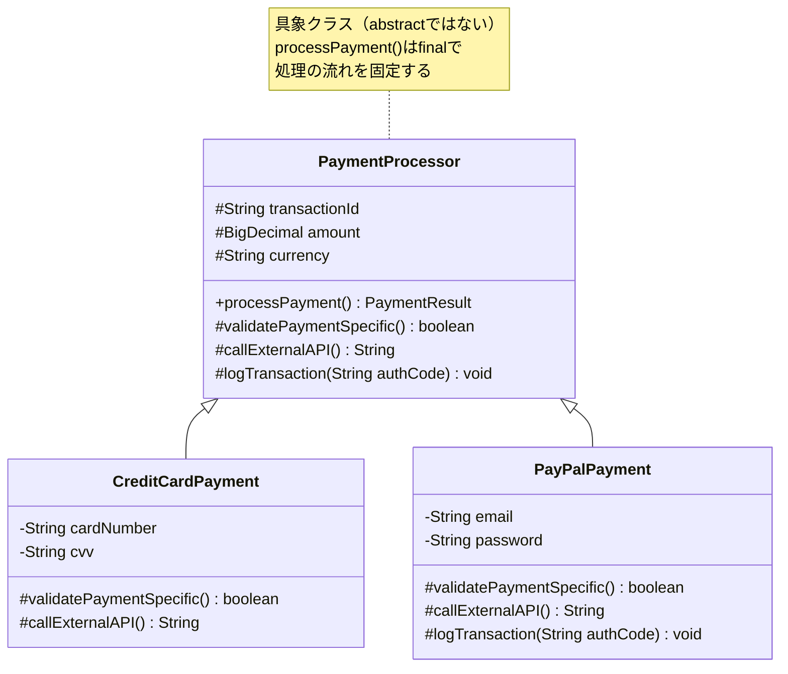
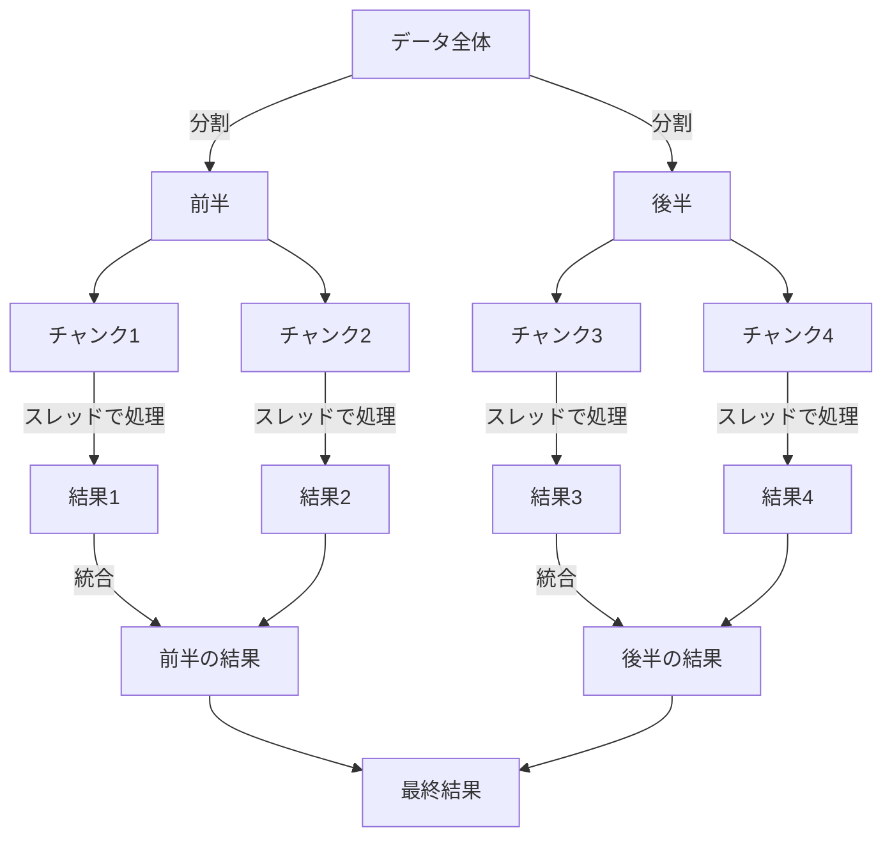
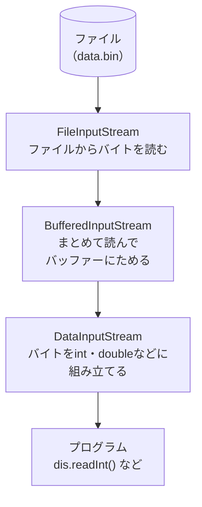

# 付録I: オブジェクト指向と言語機能の発展的な内容<small>設計パターン・言語機能のしくみ・入出力の応用</small>

書籍の第2〜14章から移した、発展的な内容の解説です。
本文には要点だけを残し、詳しい説明とまとまったコード例をこの付録に置いています。
本書の基礎課題では使いません。各章を一通り読んで演習を終えたあと、必要になったときに読んでください。

各節のコードは抜粋です。コンパイルして実行できる全文は`code/`の下にあります（Java 25。各ディレクトリで`javac *.java`のあと、`java クラス名`で実行します）。

## 目次

- 演算子の優先順位（第2章）
- オーバーロードの解決規則（第3章）
- 高度なコンストラクター設計（第4章）
- thisキーワードの高度な活用（第4章）
- 高度なメソッドオーバーロード設計（第4章）
- 継承設計の実践例：決済システム（第5章）
- 高度な設計パターン（第7章）
- enumを使ったデザインパターン（第8章）
- ネストされたRecord（第8章）
- 実践的な使用例：イテレーターパターン（第8章）
- 関数型プログラミングの実践例（第11章）
- 並列ストリームの内部動作（第12章）
- 複雑な処理パイプラインの実装（第12章）
- 例外情報の構造化記録（第13章）
- 例外処理戦略の実装例（第13章）
- バイナリファイルの高度な処理（第14章）
- オブジェクトの直列化（シリアライズ）（第14章）
- 構造化データの生成と保存（第14章）

## 演算子の優先順位（第2章）

第2章「Java基本文法」で学んだ算術・比較・論理・ビットなどの演算子を1つの式にいくつも並べると、どの演算子から先に計算するかで結果が変わります。
Javaの演算子には優先順位があり、式の評価順序を決定します。
優先順位が同じ演算子が並んだときに、左右のどちらから結び付けるかを決めるのが結合性です。
たとえば`a - b - c`は、`-`が左から右へ結合するので`(a - b) - c`と解釈されます。
代入の`a = b = 0`は右から左へ結合するので、`a = (b = 0)`と解釈されます。

次の表は主要な演算子の優先順位表です（上の行ほど優先順位が高い）。

| 演算子 | 説明 | 結合性 |
|--------|------|-------------|
| `()` `[]` `.` | 括弧、配列アクセス、メンバーアクセス | 左→右 |
| `++` `--`（後置） | 後置インクリメント/デクリメント | 左→右 |
| `++` `--`（前置） `+` `-` `!` `~` | 単項演算子 | 右→左 |
| `*` `/` `%` | 乗算、除算、剰余 | 左→右 |
| `+` `-` | 加算、減算 | 左→右 |
| `<<` `>>` `>>>` | シフト演算 | 左→右 |
| `<` `<=` `>` `>=` `instanceof` | 比較演算 | 左→右 |
| `==` `!=` | 等価演算 | 左→右 |
| `&` | ビットAND | 左→右 |
| `^` | ビットXOR | 左→右 |
| <code>\|</code> | ビットOR | 左→右 |
| `&&` | 論理AND | 左→右 |
| <code>\|\|</code> | 論理OR | 左→右 |
| `?:` | 条件（三項）演算子 | 右→左 |
| `=` `+=` `-=` など | 代入演算子 | 右→左 |

### 優先順位の実例

次のコードは、優先順位によって結果が変わる式の例です。
最後から2行目の文はコンパイルエラーになるので、このままではコンパイルできません（試すときはその行を消してください）。

```java
// 優先順位により結果が変わる例
int a = 2 + 3 * 4;     // 14 (3*4が先、その後+2)
int b = (2 + 3) * 4;   // 20 (括弧内が優先)

// 論理演算の優先順位
boolean result = true || false && false;  // true (&&が||より優先)
// 上記は true || (false && false) と解釈される

// 代入と比較の優先順位
int x = 5;
boolean check = x = 3 > 0;  // コンパイルエラー
boolean check2 = (x = 3) > 0;  // OK: x=3の後、3>0を評価
```

`x = 3 > 0`は、代入演算子の優先順位がもっとも低いため`x = (3 > 0)`と解釈されます。
`int`型の`x`に`boolean`型の値は代入できないので、コンパイルエラーになります。
C言語では比較の結果が整数の1になるため、同じ式でもコンパイルが通ります。

`true || false && false`は、`&&`が`||`より先に結び付くので、`true || (false && false)`になります。
`||`の左辺が`true`なので、短絡評価によって右辺の`false && false`は評価されず、結果は`true`です。

複雑な式では括弧を使用して意図を明確にすることを推奨します。
括弧は式の解釈を決めるだけなので、括弧を増やしても実行速度は変わりません。
本書としては、算術演算の`*`と`+`のように誰もが知っている組み合わせ以外は、括弧を付けて書くことを勧めます。
とくに、`&&`と`||`を混ぜた条件、ビット演算と比較を混ぜた式（`(flags & MASK) != 0`）、条件演算子を含む式は、括弧がないと読み手が優先順位を思い出す必要があります。

### C言語にない演算子

表のうち、C言語にない演算子が2つあります。
`>>>`は符号なし右シフトで、右にずらして空いた上位のビットを、符号にかかわらず0で埋めます（`>>`は符号のビットで埋めます）。
たとえば`-8 >> 1`は`-4`ですが、`-8 >>> 1`は`2147483644`になります。
Javaには符号なしの整数型がないので、この演算子が用意されています。
`instanceof`は、オブジェクトの型を調べる演算子で、第5章「継承とポリモーフィズム」で学びます。

## オーバーロードの解決規則（第3章）

第3章「オブジェクト指向の考え方」では、引数の型や数が違えば、同じ名前のメソッドをいくつも定義できること（オーバーロード）を学びました。
どのメソッドを呼び出すかは、コンパイラーが引数の型をもとにコンパイル時に決めます。
引数の型がどのメソッドにもぴったり合わないときは、型を変換すれば呼び出せるメソッドを探します。
このとき候補が複数あっても、コンパイラーは決まったルールに従って1つを選びます。
以下の優先順位でメソッドを選択します。

1. 完全一致（型変換なし）
2. プリミティブ型の拡大変換（`int` → `long`、`float` → `double`など）
3. オートボクシング（`int` → `Integer`など）
4. 可変長引数

上の段階で呼び出せるメソッドが見つかれば、下の段階は調べません。
たとえば`byte`の値を渡したとき、`int`を受け取るメソッドがあれば、拡大変換（第2段階）で呼び出せるので、`Integer`や可変長引数のメソッドは候補になりません。
同じ段階に候補が複数あるときは、より限定的な型（`long`より`int`のように、範囲の狭いほう）を受け取るメソッドが選ばれます。
なお、Java言語仕様（JLS 15.12.2）は1と2をまとめて最初の段階として扱い、そのなかでもっとも限定的なメソッドを選びます。
完全一致するメソッドはいつももっとも限定的なので、選ばれるメソッドは上の順序で考えたときと同じです。

オートボクシングは、基本型の値を、対応するクラス（ラッパークラス）のオブジェクトに自動で変換するしくみです。
`int`に対応するクラスは`Integer`で、第9章「コレクションフレームワーク」で学びます。

可変長引数は、`int... x`のように型の後ろに`...`を付けた引数で、同じ型の値をいくつでも（0個でも）受け取れます。
呼び出す側は`test(1, 2, 3)`のように値を並べて書き、メソッドのなかでは`x`を`int[]`の配列として扱います。
可変長引数は引数の並びの最後に1つだけ置けます。

コードの全文：[code/OverloadResolution/](code/OverloadResolution/)のOverloadResolution.java

```java
import java.util.Arrays;

public class OverloadResolution {
    public static void test(int x) {
        IO.println("int: " + x);
    }
    
    public static void test(long x) {
        IO.println("long: " + x);
    }
    
    public static void test(Integer x) {
        IO.println("Integer: " + x);
    }
    
    public static void test(int... x) {
        IO.println("可変長引数: " + Arrays.toString(x));
    }
    
    public static void main(String[] args) {
        byte b = 10;
        test(b);      // int版が呼ばれる（自動拡大変換）
        test(10);     // int版が呼ばれる（完全一致）
        test(10L);    // long版が呼ばれる（完全一致）
        test(Integer.valueOf(10)); // Integer版が呼ばれる
        test(1, 2, 3); // 可変長引数版が呼ばれる
    }
}
```

実行結果：

```
int: 10
int: 10
long: 10
Integer: 10
可変長引数: [1, 2, 3]
```

`test(b)`の`byte`型の値は、`int`版にも`long`版にも拡大変換で渡せます。
どちらも第2段階の候補ですが、`int`のほうが範囲が狭いので`int`版が選ばれます。
`test(Integer.valueOf(10))`は`Integer`型のオブジェクトを渡しているので、`Integer`版と完全一致します。
`test(1, 2, 3)`は引数が3つで、ほかのメソッドは引数を1つしか受け取らないため、可変長引数版だけが候補になります。

### 戻り値の型だけが違うメソッド

戻り値の型だけが異なるメソッドはオーバーロードできません。
呼び出す側は`calculate();`のように戻り値を使わずに呼び出すこともできるので、戻り値の型ではどちらを呼ぶか決められないからです。
次のコードはコンパイルエラーになります。

```java
public int calculate() { return 1; }
// エラー：戻り値の型だけでは区別できない
public double calculate() { return 1.0; }
```

## 高度なコンストラクター設計（第4章）

第3章「オブジェクト指向の考え方」では、コンストラクターの基本的な書き方を学びました。
第4章「カプセル化とクラス設計」では、オブジェクトが守るべき条件（不変条件）をコンストラクターとメソッドの入り口で守る考え方を学びました。
この節では、その考え方をコンストラクターに当てはめる2つの書き方を、まとまったコードで確かめます。
1つは、コンストラクターで引数を検証して不正なオブジェクトを作らせない書き方です。
もう1つは、`this(...)`でコンストラクターどうしをつなぎ、検証を1か所に集める書き方です。

### コンストラクターでのバリデーション

実務では、コンストラクターでの入力検証が重要です。
コンストラクターで値を確かめておけば、不正な状態のオブジェクトが作られることを防げます。
いったん作られたオブジェクトはいつも条件を満たしているので、そのオブジェクトを使うメソッドは、値をもう一度確かめずに済みます。

コードの全文：[code/ConstructorValidation/](code/ConstructorValidation/)のUser.java

```java
public class User {
    private final String email;
    private final String username;
    private final int age;
    
    public User(String email, String username, int age) {
        // メールアドレスの検証
        if (email == null || !email.contains("@")) {
            throw new IllegalArgumentException(
                    "有効なメールアドレスが必要です");
        }
        
        // ユーザー名の検証
        if (username == null || username.trim().length() < 3) {
            throw new IllegalArgumentException(
                    "ユーザー名は3文字以上である必要があります");
        }
        
        // 年齢の検証
        if (age < 0 || age > 150) {
            throw new IllegalArgumentException(
                    "年齢は0歳以上150歳以下である必要があります");
        }
        
        this.email = email;
        this.username = username.trim();
        this.age = age;
    }
}
```

3つのフィールドはどれも`final`なので、コンストラクターで一度だけ値を入れたら変えられません。
検証に通らない値を受け取ると、フィールドに代入する前に`IllegalArgumentException`を投げてコンストラクターを中断します。
`throw`で例外を投げると`new`の式そのものが失敗するので、呼び出した側には作りかけのオブジェクトが渡りません。
例外のしくみは第13章「例外処理」で詳しく学びます。

使用例は次のとおりです。

コードの全文：[code/ConstructorValidation/](code/ConstructorValidation/)のUserTest.java

```java
public class UserTest {
    public static void main(String[] args) {
        try {
            // 正常なユーザー作成
            User user1 = new User("user@example.com", "john_doe", 25);
            IO.println("ユーザー作成成功");
            
            // 不正なメールアドレス
            User user2 = new User("invalid-email", "jane_doe", 30);
        } catch (IllegalArgumentException e) {
            IO.println("エラー: " + e.getMessage());
        }
        
        try {
            // 短すぎるユーザー名
            User user3 = new User("test@example.com", "ab", 20);
        } catch (IllegalArgumentException e) {
            IO.println("エラー: " + e.getMessage());
        }
    }
}
```

実行結果：

```
ユーザー作成成功
エラー: 有効なメールアドレスが必要です
エラー: ユーザー名は3文字以上である必要があります
```

1つ目の`try`では、`user1`の作成に成功したあと、`user2`の作成でメールアドレスの検証に失敗し、`catch`へ移ります。
2つ目の`try`では、ユーザー名が2文字しかないので、ユーザー名の検証に失敗します。

### 検証をコンストラクターの1か所に集める

`this(...)`で同じクラスの別のコンストラクターを呼び出す書き方は、第4章の節「コンストラクターから別のコンストラクターを呼び出す」で説明しています。
上の`User`のように検証が必要なクラスでは、検証と代入を引数のもっとも多いコンストラクターに書き、ほかのコンストラクターは足りない値を補ってそれを`this(...)`で呼ぶだけにします。
こうすると、どのコンストラクターでオブジェクトを作っても、同じ検証を通ります。

## thisキーワードの高度な活用（第4章）

第3章では、フィールドと同じ名前の引数を区別するために`this.title = title;`のように書く、`this`の基本的な使い方を学びました。
`this`は「このメソッドを呼び出されたオブジェクト自身」を指す参照なので、フィールドを指すだけでなく、値として返したり、ほかのメソッドへ渡したりできます。
この節では、より実践的な`this`の活用パターンを3つ紹介します。

### ビルダーパターンでの活用

複雑なオブジェクト構築で、`this`を返すことで流暢なインターフェイスを実現できます。
流暢なインターフェイスは、英語ではfluent interfaceと呼びます。
2005年ごろにマーチン・ファウラーとエリック・エヴァンスが名付けた呼び名で、ここでの「インターフェイス」は第7章で学ぶ`interface`ではなく、クラスの使い方（API）を指します。

コードの全文：[code/EmailBuilder/](code/EmailBuilder/)のEmailBuilder.javaとEmailBuilderDemo.java

```java
public class EmailBuilder {
    private String to;
    private String subject;
    private String body;
    private boolean isHtml = false;
    
    public EmailBuilder to(String to) {
        this.to = to;
        return this;  // メソッドチェーンを可能にする
    }
    
    public EmailBuilder subject(String subject) {
        this.subject = subject;
        return this;
    }
    
    public EmailBuilder body(String body) {
        this.body = body;
        return this;
    }
    
    public EmailBuilder asHtml() {
        this.isHtml = true;
        return this;
    }
    
    public Email build() {
        return new Email(to, subject, body, isHtml);
    }
}

// 使用例：流暢なインターフェイス
Email email = new EmailBuilder()
    .to("user@example.com")
    .subject("重要なお知らせ")
    .body("<h1>こんにちは</h1>")
    .asHtml()
    .build();
```

これはビルダーパターンを使った流暢なインターフェイスの例です。
ここでは、メソッドが`this`を返すと呼び出しをつなげて書ける点に注目してください。
`new EmailBuilder()`で作ったオブジェクトの`to`を呼ぶと、そのオブジェクト自身が返るので、続けて`.subject(...)`を呼べます。
最後の`build()`だけが、集めた値から`Email`のオブジェクトを作って返します。
全文では、`Email`を宛先・件名・形式・本文を表示するだけのクラスとして定義しています。
ビルダーパターンそのものは、第6章「不変性とfinalキーワード」で不変オブジェクトを組み立てる方法として学びます。

### 高度なコンストラクターチェーン

実践的なクラス設計では、バリデーションロジックを1つのコンストラクターに集約し、他のコンストラクターはそれを呼び出します。
次の`DatabaseConfig`は、データベースへの接続の設定値（ホスト名、ポート番号、ユーザー名、最大接続数など）を持つクラスです。

コードの抜粋（コンパイルできる全文：[code/DatabaseConfig/](code/DatabaseConfig/)のDatabaseConfig.java）

```java
public class DatabaseConfig {
    private final String host;
    private final int port;
    private final String database;
    // ...
    // マスターコンストラクター（すべての検証をここに集約）
    public DatabaseConfig(String host, int port, String database, 
                         String username, String password, 
                         int maxConnections, int timeoutSeconds) {
        // 詳細な検証ロジック
        if (host == null || host.trim().isEmpty()) {
            throw new IllegalArgumentException("ホスト名は必須です");
        }
        if (port < 1 || port > 65535) {
            throw new IllegalArgumentException(
                    "ポート番号は1-65535の範囲で指定してください");
        }
        // ...
        this.host = host.trim();
        this.port = port;
        // ...
        this.timeoutSeconds = timeoutSeconds;
    }
    
    // 開発環境用のコンストラクター
    public DatabaseConfig(String host, String database) {
        this(host, 5432, database, "dev_user", "dev_password", 10, 30);
    }
    
    // 本番環境用のコンストラクター
    public DatabaseConfig(String host, int port, String database, 
                         String username, String password) {
        this(host, port, database, username, password, 100, 60);
    }
}
```

検証は引数がもっとも多いコンストラクターだけに書き、ほかのコンストラクターは`this(...)`でそれを呼び出します。
そのため、どのコンストラクターでオブジェクトを作っても、同じ検証を通ります。
開発環境用と本番環境用のコンストラクターは、省いた引数に環境ごとの標準の値（ポート番号、ユーザー名、最大接続数、タイムアウト）を補っています。
もし各コンストラクターに検証を書き写していたら、検証の条件を変えるときに書き直し忘れるおそれがあります。

### コールバックでのthis渡し

イベント処理やコールバックでは、`this`を使って現在のオブジェクトを別のオブジェクトへ渡します。
コールバックは、あとで呼び戻してもらう処理をあらかじめ渡しておくしくみです。
C言語では、関数ポインターを渡して呼び戻してもらう形でコールバックを書きます。
Javaではオブジェクトを渡し、受け取った側がそのメソッドを呼び出します（第11章「ラムダ式と関数型インターフェイス」で学ぶラムダ式を使うと、より短く書けます）。

コードの全文：[code/EventCallback/](code/EventCallback/)のEventProcessor.java

```java
public class EventProcessor {
    private String name;
    
    public EventProcessor(String name) {
        this.name = name;
    }
    
    public void startProcessing() {
        // 自分自身をイベントハンドラーに登録
        EventManager.register(this);
        IO.println(name + " が処理を開始しました");
    }
    
    public void handleEvent(String event) {
        IO.println(name + " がイベントを処理: " + event);
    }
}
class EventManager {
    private static EventProcessor[] processors = new EventProcessor[10];
    private static int count = 0;  // 登録済みの数
    
    public static void register(EventProcessor processor) {
        if (count < processors.length) {
            processors[count] = processor;
            count++;
        }
    }
    
    public static void fireEvent(String event) {
        for (int i = 0; i < count; i++) {
            processors[i].handleEvent(event);
        }
    }
}
```

`startProcessing`は、`EventManager.register(this)`を呼び出して、自分自身を`EventManager`に登録します。
あとで`EventManager.fireEvent`を呼ぶと、登録されたオブジェクトの`handleEvent`が呼び戻されます。
`EventManager`は、登録されたオブジェクトが`EventProcessor`であることだけを知っていて、どんな名前のオブジェクトが何個登録されたかは知りません。
このディレクトリのコードには`main`メソッドがないので、コンパイルだけを確かめられます。
動かすときは、たとえば次のように書きます。

```java
EventProcessor a = new EventProcessor("処理A");
EventProcessor b = new EventProcessor("処理B");
a.startProcessing();
b.startProcessing();
EventManager.fireEvent("ボタンが押された");
```

実行すると、次のように表示されます。
最後の2行が、`fireEvent`によって呼び戻された`handleEvent`の表示です。

```
処理A が処理を開始しました
処理B が処理を開始しました
処理A がイベントを処理: ボタンが押された
処理B がイベントを処理: ボタンが押された
```

## 高度なメソッドオーバーロード設計（第4章）

第3章では、引数の型や数が違えば同じ名前のメソッドをいくつも定義できること（メソッドオーバーロード）を学びました。
この節では、実用的なAPIデザインにおけるオーバーロードの活用パターンを紹介します。
1つは省いた引数にデフォルト値を補うオーバーロードで、もう1つは引数の型ごとのオーバーロードと、型が重なるときの注意です。

### デフォルト値を提供するオーバーロード

オーバーロードを使って、使いやすいAPIを設計できます。
C言語には関数のオーバーロードがありません。
そのため標準ライブラリでも、絶対値を求める関数を`int`用の`abs`、`long`用の`labs`、`double`用の`fabs`のように別の名前で用意しています。

次のサンプルの`Map<String, String>`は、キーと値を組にして保存する入れ物で、第9章「コレクションフレームワーク」で学びます。
ここでは、HTTPのヘッダー名と値の組をまとめて渡すための引数と考えてください。
HTTPはHyperText Transfer Protocolの略で、WebブラウザーとWebサーバーがやり取りするときの約束事です。
ヘッダーは、送るデータの前に付ける付加情報で、「名前: 値」の組を並べたものです。

コードの全文：[code/OverloadDefaults/](code/OverloadDefaults/)のHttpClient.java

```java
import java.util.Map;
import java.util.HashMap;

public class HttpClient {
    // フルスペックのメソッド
    public String get(String url, Map<String, String> headers,
            int timeoutMs) {
        // HTTP GET実装
        return "Response from " + url;
    }
    
    // ヘッダーのデフォルト値を提供
    public String get(String url, int timeoutMs) {
        return get(url, new HashMap<>(), timeoutMs);
    }
    
    // タイムアウトのデフォルト値も提供
    public String get(String url) {
        return get(url, 5000);  // 5秒のデフォルトタイムアウト
    }
}
```

利用者は、URLだけを渡す`get(url)`、タイムアウトも指定する`get(url, timeoutMs)`、ヘッダーまで指定する`get(url, headers, timeoutMs)`から、必要なものを選んで呼び出せます。
引数の少ないメソッドは、省いた引数にデフォルト値を補って、1つ多いメソッドを呼び出します。
実際の処理を書くのはもっとも引数の多いメソッドだけなので、処理を直すときもそこだけを直せば済みます。
これは、前の節で見た`this(...)`によるコンストラクターチェーンと同じ考え方です。

### 型ごとのオーバーロードと、引数の型が重なるときの注意

受け取る値の型ごとにメソッドを分けると、呼び出す側は型に合ったメソッドを意識せずに使えます。
ただし、引数の型が重なると、意図しないメソッドが選ばれることがあります。

コードの抜粋（コンパイルできる全文：[code/OverloadLogger/](code/OverloadLogger/)のLogger.java）

```java
public class Logger {
    // 文字列メッセージ
    public void log(String message) {
        IO.println("[INFO] " + message);
    }
    
    // 例外情報
    public void log(String message, Exception e) {
        IO.println("[ERROR] " + message + ": " + e.getMessage());
    }
    
    // レベル付きログ
    public void log(String level, String message) {
        IO.println("[" + level + "] " + message);
    }
    
    // フォーマット付きメッセージ
    // log(String, Object...)にすると、log("Hello %s", "World")が
    // レベル付きログのlog(String, String)に解決されるため、名前を分ける
    public void logf(String format, Object... args) {
        IO.println("[INFO] " + String.format(format, args));
    }
    // ...
}
```

`Object... args`は、第3章で学んだ可変長引数で、どんな型の値もいくつでも受け取れます。
フォーマット付きメッセージを`log(String format, Object... args)`というオーバーロードにすると、`log("Hello %s", "World")`は引数の型がぴったり合う`log(String level, String message)`のほうが呼び出されます。
コンパイラーは、可変長引数を使わずに呼び出せるメソッドを先に探すからです（この付録の「オーバーロードの解決規則」で説明しています）。
このように引数の型が重なるオーバーロードは、意図と違うメソッドが選ばれる原因になります。
そこで、フォーマット付きメッセージのメソッドは`logf`という別の名前にしています。

オーバーロードを設計するときの目安は次のとおりです。

- もっとも多機能なメソッドを1つ定義し、他はそれを呼び出す
- デフォルト値は意味のある値を選ぶ
- 引数の順序を統一する（URL → オプション → タイムアウトなど）
- `null`を渡されたときの動きを決めておく（`null`を受け付けないなら、もっとも多機能なメソッドの入り口で検証する）
- 引数の型が重なって呼び分けが紛らわしくなるときは、オーバーロードにせず名前を分ける

## 継承設計の実践例：決済システム（第5章）

第5章「継承とポリモーフィズム」で学んだ継承、メソッドのオーバーライド、`super`によって親クラスのメソッドを呼ぶ書き方を組み合わせると、処理の流れを親クラスで決め、流れのなかの一部だけを子クラスに任せる設計ができます。
この設計をテンプレートメソッドパターンといいます。
親クラスが処理の「型紙（テンプレート）」となるメソッドを持ち、その型紙のなかで呼ぶメソッドを子クラスがオーバーライドして中身を変えます。

実際のビジネスシステムでよく見られる決済処理を例に、継承を使った設計を見ていきましょう。
クレジットカードでもPayPalでも、決済は「入力を検証する、外部のサービスに決済を依頼する、結果を記録する」という同じ順序で進みます。
違うのは、何を検証するか、どのサービスを呼ぶか、何を記録するかです。
ここでは、抽象クラス（第7章「抽象クラスとインターフェイス」で学びます）を使わずに、具象クラスの継承とメソッドのオーバーライドによってテンプレートメソッドパターンを実現する方法を示します。

次の図は、この例のクラスの関係です。



`#`は`protected`、`-`は`private`、`+`は`public`を表します。

コードの抜粋（コンパイルできる全文：[code/PaymentTemplateMethod/](code/PaymentTemplateMethod/)のPaymentProcessor.java）

```java
// 決済処理の基底クラス：テンプレートメソッドパターンの実装
public class PaymentProcessor {
    // ...
    // テンプレートメソッド：決済処理の共通フロー
    public final PaymentResult processPayment() {
        // 1. 事前検証（共通処理）
        if (!validateCommonParameters()) {
            logError();
            return new PaymentResult(false, null, errorMessage);
        }
        
        // 2. 決済手段固有の検証（子クラスでオーバーライド可能）
        if (!validatePaymentSpecific()) {
            logError();
            return new PaymentResult(false, null, errorMessage);
        }
        
        // 3. 外部API呼び出し（子クラスでオーバーライド可能）
        String authorizationCode = callExternalAPI();
        if (authorizationCode == null) {
            logError();
            return new PaymentResult(false, null, errorMessage);
        }
        
        // 4. 処理結果の記録（共通処理）
        logTransaction(authorizationCode);
        
        return new PaymentResult(true, authorizationCode, "決済完了");
    }
    // ...
    // 子クラスでオーバーライドされることを想定したメソッド（デフォルト実装を提供）
    protected boolean validatePaymentSpecific() {
        // デフォルトでは追加の検証なし
        return true;
    }
    
    protected String callExternalAPI() {
        // デフォルトでは基本的な決済処理を実行
        // 実際の実装では外部決済サービスのAPIを呼び出す
        // エラーの場合はnullを返し、errorMessageを設定
        return "DEFAULT-" + System.currentTimeMillis();
    }
    
    // フックメソッド：子クラスでオーバーライドして処理を足せるメソッド
    protected void logTransaction(String authCode) {
        IO.println("取引ID: " + transactionId + " 承認コード: "
                + authCode);
    }
    // ...
}
```

これは決済処理の基底クラスで、テンプレートメソッドパターンを実装しています。
`processPayment()`メソッドが決済処理の共通フローを定義し、子クラスで特定の処理をオーバーライドできるようになっています。
抜粋で省いた部分には、`transactionId`（取引ID）・`amount`（金額）・`currency`（通貨）・`errorMessage`（エラーメッセージ）のフィールドとコンストラクターがあります。
ほかに、金額が正で上限以下かを確かめる共通の検証`validateCommonParameters()`、エラーを表示する`logError()`、子クラスからエラーメッセージを設定するための`setErrorMessage()`も省いています。

### テンプレートメソッドパターンの重要なポイント

このパターンでは、まず`processPayment()`メソッドが決済処理の標準的な流れを決めます。
検証、外部APIの呼び出し、結果の記録という順序は、すべての決済手段で共通です。
そのうえで、`validatePaymentSpecific()`や`callExternalAPI()`のように、子クラスがオーバーライドしてよいメソッドを用意します。
これらのメソッドが、決済手段ごとに処理を変えられる場所（拡張ポイント）になります。

一方、`processPayment()`には`final`を付けています。
`final`を付けたメソッドは子クラスでオーバーライドできないため、処理の流れそのものを子クラスが書き換えることはありません。
たとえば、子クラスが検証を飛ばして外部APIを呼ぶような流れには変えられません。
`final`の使い方は、第6章「不変性とfinalキーワード」で詳しく学びます。

また、拡張ポイントのメソッドには親クラスが基本的な動作（デフォルト実装）を用意しています。
子クラスは、カードの検証やAPIの認証など、決済手段に特有の処理が必要な場合だけオーバーライドすれば済みます。
`logTransaction()`のように、親クラスの処理に何かを足すためにオーバーライドするメソッドを、フックメソッドと呼ぶこともあります。

### 具体的な決済処理の実装例

金額は、`double`ではなく`java.math.BigDecimal`型で表しています。
`BigDecimal`は10進数の小数を誤差なく扱うクラスで、使い方は第6章で学びます。
ここでは、`new BigDecimal("5000")`のように数を文字列で渡して作ることだけ押さえておけば読めます。

コードの抜粋（コンパイルできる全文：[code/PaymentTemplateMethod/](code/PaymentTemplateMethod/)のCreditCardPayment.javaとPayPalPayment.java）

```java
// クレジットカード決済の実装
public class CreditCardPayment extends PaymentProcessor {
    private String cardNumber;
    private String cvv;
    
    public CreditCardPayment(String transactionId, BigDecimal amount,
            String currency, String cardNumber, String cvv) {
        super(transactionId, amount, currency);
        this.cardNumber = cardNumber;
        this.cvv = cvv;
    }
    
    @Override
    protected boolean validatePaymentSpecific() {
        // クレジットカード固有の検証
        if (cardNumber == null || cardNumber.length() != 16) {
            setErrorMessage("無効なカード番号です");
            return false;
        }
        if (cvv == null || cvv.length() != 3) {
            setErrorMessage("無効なCVVです");
            return false;
        }
        return true;
    }
    
    @Override
    protected String callExternalAPI() {
        // クレジットカード決済API呼び出しのシミュレーション
        IO.println("クレジットカード決済APIを呼び出し中...");
        
        // 実際の実装では外部APIを呼び出す
        // ここではシミュレーションとして、まれにエラーが発生する例を示す
        if (Math.random() < 0.1) {  // 10%の確率でエラー
            setErrorMessage("クレジットカード決済が拒否されました");
            return null;
        }
        
        return "CC-" + System.currentTimeMillis();
    }
}

// PayPal決済の実装
public class PayPalPayment extends PaymentProcessor {
    // ...
    @Override
    protected void logTransaction(String authCode) {
        // PayPalでは詳細なログを記録
        super.logTransaction(authCode);
        IO.println("PayPalアカウント: " + email);
    }
}
```

これらは決済処理の基底クラスを継承した具体的な実装例です。
`CreditCardPayment`は、カード番号とCVVの検証と、決済APIの呼び出し（のシミュレーション）をオーバーライドしています。
`PayPalPayment`の抜粋は`logTransaction()`をオーバーライドした部分で、`super.logTransaction()`で親クラスの記録処理を呼んでから、アカウントを追加で表示します。
省いた部分では、メールアドレスとパスワードの検証と、APIの呼び出しもオーバーライドしています。

このアプローチでは、`PaymentProcessor`は抽象クラスではなく具象クラスとして実装されており、すべてのメソッドにデフォルト実装が提供されています。
子クラスは各決済手段に固有の検証ロジック（クレジットカードの番号検証、PayPalのアカウント認証、銀行口座の残高確認など）が必要な場合に、これらのメソッドをオーバーライドして独自の振る舞いを実装できます。
新しい決済手段を加えるときも、`PaymentProcessor`を継承したクラスを1つ書き、必要なメソッドだけをオーバーライドすれば済み、`processPayment()`の流れには手を入れません。

### 決済処理の使用例

コードの抜粋（コンパイルできる全文：[code/PaymentTemplateMethod/](code/PaymentTemplateMethod/)のPaymentExample.java）

```java
import java.math.BigDecimal;

public class PaymentExample {
    public static void main(String[] args) {
        // クレジットカード決済の例
        CreditCardPayment ccPayment = new CreditCardPayment("TXN001",
                new BigDecimal("5000"), "JPY",
                "1234567890123456", "123");
        
        PaymentResult ccResult = ccPayment.processPayment();
        if (ccResult.isSuccess()) {
            IO.println("決済成功: " + ccResult.getAuthorizationCode());
        } else {
            IO.println("決済失敗: " + ccResult.getMessage());
        }
        
        // PayPal決済の例（メールアドレスが無効でエラーになる）
        PayPalPayment ppPayment = new PayPalPayment("TXN002",
                new BigDecimal("10000"), "JPY",
                "invalid-email", "pass123");
        
        PaymentResult ppResult = ppPayment.processPayment();
        // ...
    }
}
```

次は実行結果の一例です。クレジットカード決済は10%の確率で拒否されるため、実行するたびに結果が変わることがあります。
4行目の「決済エラー」は、`PaymentProcessor`の抜粋で省いた`logError()`メソッドが標準エラー出力（`System.err`）に表示したものです。

```
クレジットカード決済APIを呼び出し中...
取引ID: TXN001 承認コード: CC-1707123456789
決済成功: CC-1707123456789
決済エラー[TXN002]: 無効なメールアドレスです
決済失敗: 無効なメールアドレスです
```

PayPal決済では、メールアドレスに`@`がないので、子クラスの`validatePaymentSpecific()`が失敗を返します。
`processPayment()`はその時点でエラーを記録して結果を返すので、PayPalのAPIは呼び出されません。

### エラー処理の設計ポイント

この決済処理では、例外を使わずにエラーを扱っています。
検証メソッドは、成功したか失敗したかを`boolean`の戻り値で返します。
失敗したときは、その理由を`errorMessage`フィールドに入れておきます。
外部APIの呼び出しは、失敗すると`null`を返すので、呼び出し側は結果が`null`かどうかを調べてエラーと判断します。
最後に、成功か失敗か、承認コード、メッセージをまとめて`PaymentResult`クラスのオブジェクトに入れて返します。

第4章「カプセル化とクラス設計」では、不正な値を`throw`で知らせる書き方を使いました。
`throw`を使うと、エラーが起きた時点で処理を中断し、呼び出し側の`catch`へ移ります。
決済のように「失敗」も業務の結果の1つで、成功と同じように承認コードやメッセージを持たせて返したい処理では、この例のように結果をオブジェクトにまとめて返す設計も使えます。
例外のしくみは、第13章「例外処理」で詳しく学びます。

なお、エラーメッセージをフィールドに入れておく書き方は、1つのオブジェクトを1つのスレッドだけから使うことを前提にしています。
複数のスレッドが同じオブジェクトの`processPayment()`を同時に呼ぶと、ほかのスレッドが書いたメッセージを読んでしまうおそれがあります。
スレッドについては第15章「マルチスレッドプログラミング」で学びます。

## 高度な設計パターン（第7章）

第7章「抽象クラスとインターフェイス」では、Java 8でインターフェイスにdefaultメソッド（実装を持つメソッド）を書けるようになったことと、同じdefaultメソッドを持つ2つのインターフェイスを実装したときの衝突の解消のしかたを学びました。
インターフェイスの進化により、より洗練された設計パターンを実装できるようになりました。
この節では、defaultメソッドを使った4つの設計パターンとその実装例を紹介します。

- Mixinパターン
    + 小さな機能を持つインターフェイスをいくつも実装して、クラスに機能を足す
- トレイトパターン
    + 1つの能力を、最小限の抽象メソッドとそれを使うdefaultメソッドで組み立てる
- インターフェイス分離原則（ISP）
    + 使わないメソッドに依存させないように、インターフェイスを役割ごとに分ける
- バージョニング戦略
    + インターフェイスを継承して版を重ね、既存の実装クラスを壊さずにメソッドを増やす

defaultメソッドは、ラムダ式で使う関数型インターフェイスに機能を足すときにも使われます。
その例は、第11章「ラムダ式と関数型インターフェイス」で関数型インターフェイスを学んでから見ていきます。

### Mixinパターン

Mixinは、クラスに機能を「混ぜ込む」設計パターンです。
名前は、アイスクリームにナッツやチョコレートなどを混ぜ込む「ミックスイン」に由来するといわれます（1980年代に、Lispのオブジェクト指向拡張であるFlavorsで使われた用語です）。
Javaのクラスは親クラスを1つしか継承できませんが、インターフェイスはいくつでも実装できます。
Java 8のdefaultメソッドにより、インターフェイスが実装を持てるようになったので、複数のインターフェイスを実装するだけで、それぞれの機能をクラスに足せるようになりました。

コードの抜粋（コンパイルできる全文：[code/Mixin/](code/Mixin/)のTimestamped.java）

```java
// 複数の機能を提供するMixin
interface Timestamped {
    long getTimestamp();
    
    default boolean isExpired(long expirationTime) {
        return System.currentTimeMillis()
                - getTimestamp() > expirationTime;
    }
    
    default Duration getAge() {
        return Duration.ofMillis(System.currentTimeMillis()
                - getTimestamp());
    }
}

interface Identifiable {
    String getId();
    
    default String getFullIdentifier() {
        return getClass().getSimpleName() + "#" + getId();
    }
}
// ...
// 複数のMixinを組み合わせ
class Memo implements Timestamped, Identifiable, Versioned {
    // ...
    public void update(String newContent) {
        this.content = newContent;
        this.version++;
        
        // defaultメソッドを活用
        if (isExpired(3600000)) {  // 1時間
            IO.println("Memo " + getFullIdentifier() + " has expired");
        }
    }
}
```

`Timestamped`は「作成時刻を持つ」機能、`Identifiable`は「IDを持つ」機能を提供します。
どちらのインターフェイスも、実装クラスに求める抽象メソッドは`getTimestamp()`や`getId()`のような値を返すメソッド1つだけで、その値を使う便利なメソッドをdefaultメソッドとして用意しています。
抜粋で省いた`Versioned`は、版の番号を返す`getVersion()`を求め、版を比べる`isNewerThan()`と`isOlderThan()`をdefaultメソッドで提供するインターフェイスです。
`Memo`は3つのインターフェイスを実装し、抽象メソッドを実装するだけで、`isExpired()`や`getFullIdentifier()`をそのまま使えます。

`getAge()`が返す`Duration`は、時間の長さを表す標準ライブラリのクラスです。
`Duration`をはじめとする日付と時刻のAPIは、第6章の節「日付と時刻（java.time）」で学びました。
全文の`main`メソッドで各機能を使うと、次のように表示されます。
経過時間は実行するたびに変わるので、`main`メソッドでは1秒未満かどうかだけを表示しています。

実行結果：

```
=== Identifiableの機能 ===
memo1: Memo#M001
memo2: Memo#M002

=== Timestampedの機能 ===
memo1の経過時間は1秒未満？: true
memo1は期限切れ？: false

=== Versionedの機能 ===
memo1のバージョン: 2
memo2のバージョン: 1
memo1はmemo2より新しい？: true
```

### トレイトパターン

トレイトは、状態を持たない振る舞いの集合です。
インターフェイスとdefaultメソッドの組み合わせにより、Javaでもトレイトパターンを実現できます。

Javaのインターフェイスはフィールドを持てないので、MixinもトレイトもJavaでは同じ形、つまり抽象メソッドで最小限の値を求め、defaultメソッドで機能を足す形で書きます。
違いは重点の置き方です。
Mixinは、前の例の`Memo`のように、小さな機能をいくつも組み合わせてクラスに足すことに重点を置きます。
トレイトは、「大小を比べられる」のような1つの能力を、最小限のメソッドから組み立てることに重点を置きます。

次の`Measurable`は、比べる基準の値を返す`measure()`だけを実装クラスに求め、大小を比べるメソッドをdefaultメソッドとして提供します。
Javaの標準ライブラリにも、大小を比べる`compareTo()`を実装クラスに求める`Comparable`インターフェイスがあります。
`Comparable`は、第10章「ジェネリクス」で学ぶ型パラメーターを使って比べる相手の型を決めるため、ここでは`double`の値で比べる形にしました。

コードの抜粋（コンパイルできる全文：[code/Trait/](code/Trait/)のMeasurable.java）

```java
// 大きさを比べられるオブジェクトのトレイト（状態を持たず、振る舞いだけを提供する）
interface Measurable {
    // 比べる基準になる値（実装クラスが決める）
    double measure();

    default boolean isLessThan(Measurable other) {
        return measure() < other.measure();
    }

    default boolean isGreaterThan(Measurable other) {
        return measure() > other.measure();
    }
    // ...
    default boolean isBetween(Measurable lower, Measurable upper) {
        return isGreaterThan(lower) && isLessThan(upper);
    }
}

class Temperature implements Measurable {
    private final double celsius;

    public Temperature(double celsius) {
        this.celsius = celsius;
    }

    @Override
    public double measure() {
        return celsius;
    }

    public void checkRange() {
        Temperature freezing = new Temperature(0);
        Temperature boiling = new Temperature(100);

        if (this.isBetween(freezing, boiling)) {
            IO.println("水は液体状態です");
        }
    }
}
```

`Temperature`が実装したのは`measure()`の1つだけですが、`isLessThan()`・`isGreaterThan()`・`isBetween()`などをすべて使えます。
抜粋で省いた部分には、等しいかを調べるdefaultメソッドがあります。
重さや長さを表すクラスも、`measure()`を実装すれば同じ比べ方ができます。

### インターフェイス分離原則（ISP）の実践

インターフェイス分離原則は、クライアントが使用しないメソッドへの依存を強制してはならないという原則です。
英語ではInterface Segregation Principleで、ISPはその頭文字です。
オブジェクト指向の設計の5つの原則をまとめたSOLID原則（第4章で触れました）の「I」にあたります。

この例の`User`は、IDを持つ利用者のクラスとして全文に定義しています。

コードの抜粋（コンパイルできる全文：[code/InterfaceSegregation/](code/InterfaceSegregation/)のBadUserService.java）

```java
// 悪い例：肥大化したインターフェイス
interface BadUserService {
    void createUser(User user);
    void deleteUser(String id);
    void updateUser(User user);
    User findUser(String id);
    List<User> findAllUsers();
    void sendEmail(String userId, String message);
    void generateReport(String userId);
    void backupUserData(String userId);
}

// 良い例：責務ごとに分離されたインターフェイス
interface UserRepository {
    void save(User user);
    void delete(String id);
    User findById(String id);
    List<User> findAll();
}

interface UserNotificationService {
    void sendEmail(String userId, String message);
    
    default void sendWelcomeEmail(String userId) {
        sendEmail(userId, "ようこそ！サービスへの登録ありがとうございます。");
    }
    // ...
}
// ...
interface UserReportService {
    void generateReport(String userId);
    // ...
}
// ...
// 必要な機能だけを実装
class BasicUserService implements UserRepository,
        UserNotificationService {
    private Map<String, User> users = new HashMap<>();
    
    @Override
    public void save(User user) {
        users.put(user.getId(), user);
        sendWelcomeEmail(user.getId());  // defaultメソッドを活用
    }
    // ...
}
```

`BadUserService`を実装するクラスは、メールを送らないものでも`sendEmail()`を、レポートを作らないものでも`generateReport()`を、空の中身で書くことになります。
使う側も、利用者を探したいだけなのに8つのメソッドを持つ型に依存するので、レポートのメソッドが変わっただけで影響を受けることがあります。

役割ごとに`UserRepository`・`UserNotificationService`・`UserReportService`へ分けると、実装するクラスは必要な役割だけを選んで`implements`に並べられます。
`BasicUserService`は保存と通知だけを実装し、レポートの役割は持ちません。
使う側も、利用者を探すだけなら`UserRepository`型だけに依存すれば済みます。
`UserNotificationService`の`sendWelcomeEmail()`のように、役割のなかでよく使う処理をdefaultメソッドにしておくと、実装クラスは`sendEmail()`を実装するだけでその処理も使えます。

### バージョニング戦略

公開したインターフェイスに抽象メソッドを1つ足すと、そのインターフェイスを実装していたクラスはすべて、新しいメソッドを実装するまでコンパイルできなくなります。
インターフェイスを継承して版を重ね、新しいメソッドをdefaultメソッドで追加していくと、古い版に合わせて書いた実装クラスを壊さずにAPIを広げられます。
次の例の`ServiceConfig`は、タイムアウトなどの設定値を持つクラスです（全文に含めています）。

コードの抜粋（コンパイルできる全文：[code/InterfaceVersioning/](code/InterfaceVersioning/)のServiceV1.java）

```java
// API進化の管理
interface ServiceV1 {
    String process(String input);

    // 最初の版で用意した、以前の処理方法のメソッド
    default String oldProcess(String input) {
        return process(input);
    }
}

interface ServiceV2 extends ServiceV1 {
    // 新機能をdefaultメソッドで追加（後方互換性維持）
    default String processWithConfig(String input,
            ServiceConfig config) {
        // デフォルトでは設定を無視して従来の処理
        return process(input);
    }
}

interface ServiceV3 extends ServiceV2 {
    // さらなる拡張：まとめて処理する（バッチ処理）
    default String[] processBatch(String[] inputs) {
        String[] results = new String[inputs.length];
        for (int i = 0; i < inputs.length; i++) {
            results[i] = process(inputs[i]);
        }
        return results;
    }
    
    // 最初の版からあるメソッドを、この版で非推奨にする
    @Deprecated(since = "3.0", forRemoval = true)
    @Override
    default String oldProcess(String input) {
        System.err.println("警告: "
                + "oldProcessは非推奨です。processを使用してください。");
        return process(input);
    }
}

// 実装クラスは最小限の変更で新バージョンに対応
class ServiceImpl implements ServiceV3 {
    @Override
    public String process(String input) {
        return "Processed: " + input.toUpperCase();
    }
    // ...
}
```

`ServiceImpl`が実装しなければならないのは、最初の版からある`process()`だけです。
`processBatch()`のように後の版で追加したメソッドは、defaultメソッドの実装がそのまま使われます。
最初の版からある`oldProcess()`のように、使ってほしくなくなったメソッドには`@Deprecated`を付けて、非推奨であることを利用者に知らせます。
`@Deprecated`を付けたメソッドを呼ぶコードをコンパイルすると、コンパイラーが警告を出します。
`forRemoval = true`を書き添えると、将来削除する予定であることも伝えられます。
`since`と`forRemoval`の指定は、Java 9から使えます。
`since`には非推奨になった版を書きます。

## enumを使ったデザインパターン（第8章）

第8章「Javaの特殊なクラス形式」では、enum（列挙型）がフィールド・コンストラクター・メソッドを持てるクラスの一種であることを学びました。
enumの列挙子は、プログラムのなかで1つずつしか作られないオブジェクトです。
この性質を使うと、オブジェクトを1つだけに限るSingletonパターンを短く書けます。

### Singletonパターン

Singletonパターンは、あるクラスのインスタンスをプログラム全体で1つだけに限る設計です。
設定や接続のように、プログラムのなかに1つだけあればよく、複数あると食い違いが起きるものに使います。
enumの列挙子は、プログラムのなかで1つずつしか作られません。
enumのコンストラクターはいつも`private`扱いで、ほかのクラスから`new`で呼び出せないからです。
この性質をそのまま使うと、`enum`で簡潔なシングルトンを実装できます。
enumによるシングルトンは、ジョシュア・ブロックの『Effective Java』（第2版、2008年）で勧められたことで広く知られるようになりました。

次のサンプルの`Connection`は、データベースとの接続を表す`java.sql`パッケージのインターフェイスです（データベースの扱いは第24章「データベースプログラミング」で学びます）。
ここでは接続の処理そのものは扱わず、列挙子`INSTANCE`がただ1つのインスタンスとして接続を持ち続ける形に注目してください。

コードの全文：[code/EnumSingleton/](code/EnumSingleton/)のDatabaseConnection.java

```java
import java.sql.Connection;

public enum DatabaseConnection {
    INSTANCE;
    
    private Connection connection;
    
    DatabaseConnection() {
        this.connection = initializeConnection();
    }
    
    public Connection getConnection() {
        return connection;
    }
    
    private Connection initializeConnection() {
        // 接続の初期化ロジック
        return null; // 実際の実装では適切な接続を返す
    }
}
```

使う側は、`DatabaseConnection.INSTANCE.getConnection()`のように、列挙子を通してただ1つのインスタンスのメソッドを呼びます。
列挙子`INSTANCE`は、`DatabaseConnection`を最初に使ったときに1回だけ作られ、そのときにコンストラクターが接続を初期化します。
この例の`initializeConnection()`は接続を作らずに`null`を返すので、コンパイルだけを確かめる例です。

クラスでシングルトンを書くと、コンストラクターを`private`にして、インスタンスを持つ`static`フィールドと、それを返す`static`メソッドを用意します。
そのうえで、複数のスレッドから同時に最初の呼び出しがあったときにインスタンスが2つ作られないように配慮しなければなりません。
enumなら、列挙子を1回だけ作ることをJavaのしくみが保証するので、これらを自分で書かずに済みます。
クラスで書く方法とスレッドの扱いは、付録H「並行処理とネットワークの発展的なパターン」の「スレッドセーフなシングルトン」で比べています。

## ネストされたRecord（第8章）

第8章では、データをまとめて運ぶためのRecordを学びました。
Recordの部品（コンポーネント）には、`int`や`String`だけでなく、別のRecordも使えます。
Recordは他のRecordを含むことができ、複雑なデータ構造を表現できます。

次の例では、住所を表す`Address`を会社を表す`Company`が持ち、その`Company`を従業員を表す`Employee`が持っています。

コードの全文：[code/NestedRecord/](code/NestedRecord/)のAddress.java、Company.java、Employee.java

```java
public record Address(String street, String city, String country) {}

public record Company(String name, Address headquarters) {}

public record Employee(String name, String id, Company company) {
    // 従業員の勤務先と、その所在地を返す
    public String getFullAddress() {
        return String.format("%sの勤務先は%s（所在地: %s %s %s）",
                name, company.name(), company.headquarters().country(),
                company.headquarters().city(),
                company.headquarters().street());
    }
}
```

`company.headquarters().city()`のように、アクセサーをつないで内側のRecordの値を取り出せます。
Recordが自動で作る`toString()`は、内側のRecordの`toString()`も呼ぶので、入れ子になったデータをそのまま表示できます。
`equals()`も同じように内側のRecordの`equals()`を使うので、住所まで含めて同じ値を持つ`Employee`どうしは等しいと判定されます。

全文には、3つのRecordを組み立てて表示する`NestedRecordDemo.java`を付けています。

```java
Address address = new Address("丸の内1-1", "東京", "日本");
Company company = new Company("サンプル商事", address);
Employee employee = new Employee("山田太郎", "E001", company);

IO.println(employee);
IO.println(employee.getFullAddress());
// アクセサーをつないで、内側のRecordの値を取り出す
IO.println("所在地の都市: "
        + employee.company().headquarters().city());
```

実行結果：

```
Employee[name=山田太郎, id=E001, company=Company[name=サンプル商事, headquarters=Address[street=丸の内1-1, city=東京, country=日本]]]
山田太郎の勤務先はサンプル商事（所在地: 日本 東京 丸の内1-1）
所在地の都市: 東京
```

入れ子のRecordも、それぞれのコンポーネントは`final`で変えられません。
ただし、内側のオブジェクトがRecordでなくリストのような変更できるオブジェクトなら、その中身は変えられます。
その場合の守り方（防御的コピー）は、第6章「不変性とfinalキーワード」で学びました。

## 実践的な使用例：イテレーターパターン（第8章）

第8章では、名前を持たない内部クラス（匿名内部クラス）で、インターフェイスを実装したオブジェクトをその場で作る書き方を学びました。
この節では、匿名内部クラスを使って、入れ物の要素を順に取り出すイテレーターを作ります。

イテレーターは、入れ物にある要素を1つずつ順に取り出すためのオブジェクトです。
使う側は、入れ物の中身が配列なのか、ほかの形なのかを知らずに、「次の要素があるか」と「次の要素を取り出す」の2つの操作だけで要素をたどれます。
次のサンプルでは、文字列を持つ独自のリスト`StringList`が、匿名内部クラスでイテレーターを作って返します。
匿名内部クラスが、外側のクラスのフィールド（`elements`と`size`）を直接参照している点が、ここでの要点です。

コードの全文：[code/AnonymousIterator/](code/AnonymousIterator/)のStringList.java

```java
// 要素を1つずつ順に取り出すためのインターフェイス
interface StringIterator {
    boolean hasNext();
    String next();
}

public class StringList {
    private final String[] elements;
    private int size = 0;
    
    public StringList(int capacity) {
        elements = new String[capacity];
    }
    
    public void add(String element) {
        if (size < elements.length) {
            elements[size++] = element;
        }
    }
    
    public StringIterator iterator() {
        // 匿名内部クラスでStringIteratorを実装
        return new StringIterator() {
            private int index = 0;
            
            @Override
            public boolean hasNext() {
                return index < size;  // 外側のクラスのフィールドを直接参照
            }
            
            @Override
            public String next() {
                return elements[index++];
            }
        };
    }
    
    public static void main(String[] args) {
        StringList list = new StringList(5);
        list.add("りんご");
        list.add("みかん");
        list.add("ぶどう");
        
        StringIterator it = list.iterator();
        while (it.hasNext()) {
            IO.println(it.next());
        }
    }
}
```

実行結果：

```
りんご
みかん
ぶどう
```

`iterator()`を呼ぶたびに、新しい匿名内部クラスのオブジェクトが作られます。
このオブジェクトは自分のフィールド`index`で取り出す位置を覚え、外側の`StringList`のオブジェクトの`elements`と`size`を読みます。
匿名内部クラスのオブジェクトは、それを作った外側のオブジェクトへの参照を持っているので、`StringList.this.size`と書かなくても`size`だけで外側のフィールドを使えます。
`StringIterator`を返すので、使う側は`StringList`が配列で要素を持っていることを知らずに済みます。

Javaの標準ライブラリにも、同じ考え方の`Iterator`インターフェイスがあります。
第9章「コレクションフレームワーク」で学ぶコレクションは、`Iterator`を返すことで、拡張for文で要素を順に取り出せるようにしています。

## 関数型プログラミングの実践例（第11章）

第11章「ラムダ式と関数型インターフェイス」で学んだことを使って、実務に近い設計の例を紹介します。
多くは考え方を示すための断片的なコードで、全文は各コードの前に示した`code/`のディレクトリにあります。
Stream API（第12章）を使う例もあるので、最初はラムダ式をどこに渡しているかに注目して読んでください。
たとえば`list.stream().map(…).toList()`は、各要素を`map`に渡したラムダ式で変換し、結果を新しいリストに集める書き方です。

### 高階関数による処理の抽象化

高階関数（Higher-Order Function）は、関数を引数として受け取ったり、関数を戻り値として返したりする関数です。これにより、共通的な処理パターンを抽象化できます。

コードの抜粋（コンパイルできる全文：[code/HigherOrderFunction/](code/HigherOrderFunction/)のHigherOrderFunctionExample.java。`MarketData`などの補助の型はTradingTypes.java）

```java
public class HigherOrderFunctionExample {
    // 高階関数によるリスク管理の抽象化
    public <T, R> Function<T, R> withRiskManagement(
        Function<T, R> strategy,
        Predicate<T> riskCheck,
        R defaultValue) {
        return input -> {
            if (riskCheck.test(input)) {
                return strategy.apply(input);
            }
            return defaultValue;
        };
    }
    
    // 使用例：取引戦略にリスク管理を適用
    public void demonstrateHigherOrderFunction() {
        Function<MarketData, TradingDecision> baseStrategy = 
            data -> new TradingDecision(data.getPrice() > 100
            ? TradeType.BUY : TradeType.SELL);
            
        Function<MarketData, TradingDecision> safeStrategy = 
            withRiskManagement(
                baseStrategy,
                data -> data.getVolatility() < 0.5,  // リスクチェック
                TradingDecision.HOLD  // デフォルト値
            );
            
        // 実際の取引実行
        MarketData currentMarketData = new MarketData(120.0, 0.3);
        TradingDecision decision = safeStrategy.apply(currentMarketData);
        IO.println("安全な取引決定: " + decision);
        
        // 高リスクの場合
        MarketData highRiskData = new MarketData(90.0, 0.8);
        TradingDecision highRiskDecision =
                safeStrategy.apply(highRiskData);
        IO.println("高リスク時の決定: " + highRiskDecision);
    }
    // ...
}
```

実行結果：

```
安全な取引決定: TradingDecision{BUY}
高リスク時の決定: TradingDecision{HOLD}
```

`withRiskManagement`は、取引の戦略を表す関数とリスクを判定する条件を受け取り、条件を満たすときだけ戦略を適用する新しい関数を返します。
変動率が0.8の2つ目のデータは条件を満たさないので、戦略を適用せずに既定の値の`HOLD`を返します。

### 設計パターンを関数で書く

処理を受け取って別の処理を返す高階関数は、失敗した処理を呼び出し直す「再試行（リトライ）」にも使えます。
試したい処理をラムダ式で渡し、失敗したら何回か呼び出し直すメソッドは、例外の扱いとあわせて第13章「例外処理」の「リトライパターン」で書きます。

オブジェクト指向の設計パターンの一部も、振る舞いをラムダ式で渡すと、振る舞いごとのクラスを作らずに書けます。
イベントの型ごとのハンドラー、Webのミドルウェア、テンプレートメソッド、イベントソーシング、ファクトリ、ビルダーを関数で書いた例を用意しました。
それらの例は、付録B.02「プログラミングパラダイム」（[../b02-programming-paradigms/](../b02-programming-paradigms/)）で紹介しています。

### 関数合成によるビジネスロジックの設計

業務の処理を、入力から結果を返すだけの小さな関数に分けておくと、関数ごとに確かめやすく、組み替えもしやすくなります。
次のコードは、注文の検証、金額の計算、割引、消費税の加算、明細の文字列の作成を、それぞれ1つのメソッドにしています。

コードの抜粋（コンパイルできる全文：[code/OrderPipeline/](code/OrderPipeline/)のOrderPipeline.java）

```java
public class OrderPipeline {
    // 注文：品名、単価、数量、金額
    record Order(String item, int unitPrice, int quantity, int total) {}

    // 不正な注文なら例外をスローする
    static Order validate(Order order) {
        if (order.quantity() <= 0) {
            throw new IllegalArgumentException("数量が不正です: "
                    + order.quantity());
        }
        return order;
    }
    // ...
    public static void main(String[] args) {
        // 各段階の関数をandThenで1つの関数にまとめる
        Function<Order, Order> validate = OrderPipeline::validate;
        Function<Order, String> processOrder = validate
            .andThen(OrderPipeline::calculateSubtotal)
            .andThen(OrderPipeline::applyDiscount)
            .andThen(OrderPipeline::addTax)
            .andThen(OrderPipeline::toReceipt);
            // ...
    }
}
```

`calculateSubtotal`・`applyDiscount`・`addTax`・`toReceipt`は、受け取った注文から新しい`Order`や文字列を返すメソッドです（抜粋では省いたので、全文で確かめてください）。
メソッド参照のままでは`andThen`を呼び出せないので、最初の`validate`だけを`Function<Order, Order>`型の変数に入れています。

実行結果：

```
ノート × 5 = 1100円
電卓 × 3 = 11880円
エラー: 数量が不正です: 0
```

第11章の「関数の合成」で学んだ`andThen`で、5つの処理を1つの関数にまとめています。
`processOrder.apply(order)`と呼ぶと、5つの処理が順に適用されます。
電卓の注文は、金額12000円が10000円以上なので1割引きの10800円になり、消費税を加えて11880円になります。
数量が0の注文は、最初の`validate`で例外がスローされ、あとの処理は行われません。

### 実世界での応用例：リアクティブストリーム処理

動画配信サービスのNetflixは、大量のAPIリクエストを処理するために、関数型プログラミングとリアクティブストリームを活用してきました。
NetflixはMicrosoftのReactive Extensions（Rx）をJavaに移植したRxJavaを開発し、2013年にオープンソースとして公開しています。
ここでは、その考え方を、動画のおすすめを計算するサービスを題材に説明します。
おすすめを計算するには、利用者の情報、視聴履歴、人気の動画の3つを、それぞれ別のサービスから取得します。

同期的なアプローチでは、3つのサービスの呼び出しを順に待つため、応答までの時間は3つの待ち時間の合計になります。
リアクティブなアプローチでは、3つを同時に呼び出し、結果がそろったときに行う計算をラムダ式で渡しておきます。
そのため、待ち時間はもっとも遅い1つの分で済みます。
また、応答を待つ間にスレッドを占有しないため、同じ数のスレッドでより多くのリクエストを処理できます。
Javaでこのような処理を書くときは、Reactorなどの外部ライブラリを使います。
Java 9で、リアクティブストリームの共通のインターフェイスが`java.util.concurrent.Flow`として標準ライブラリに入りました。
ただし、`Flow`は処理を組み立てるメソッドを持たないので、実際にはライブラリと組み合わせて使います。

### 関数型プログラミングのベストプラクティス

ここまでの例のように、ラムダ式で処理を組み立てるときに気をつけたいことを2つ挙げます。
どちらも、第11章のまとめで挙げた心がけを、コードで確かめるものです。

#### ラムダ式を深く入れ子にしない

ラムダ式の本体にさらにラムダ式を書くと、どの処理がどの値を扱っているのかを追いにくくなります。
次のコードは、「名前:点数」を並べた行から行ごとの合計点を求める処理を、2通りに書いたものです。

コードの抜粋（コンパイルできる全文：[code/NestedLambda/](code/NestedLambda/)のNestedLambdaExample.java）

```java
public class NestedLambdaExample {
    public static void main(String[] args) {
        // 1行に「名前:点数」を並べたデータから、行ごとの合計点を求める
        List<String> lines =
                List.of("Alice:80,Bob:65", "Carol:90,Dave:70");

        // 悪い例：ラムダ式の中にラムダ式を重ねていて、何をしているか読み取りにくい
        List<Integer> bad = lines.stream()
            .map(line -> {
                return Arrays.stream(line.split(","))
                    .map(entry -> {
                        String[] parts = entry.split(":");
                        return Integer.parseInt(parts[1]);
                    })
                    .reduce(0, (a, b) -> {
                        return a + b;
                    });
            })
            .toList();

        // 良い例：処理に名前を付けたメソッドに分け、メソッド参照で渡す
        List<Integer> good = lines.stream()
            .map(NestedLambdaExample::sumScores)
            .toList();

        IO.println("悪い例: " + bad);
        IO.println("良い例: " + good);
    }

    // 1行の合計点を求める
    private static int sumScores(String line) {
        int total = 0;
        for (String entry : line.split(",")) {
            total += scoreOf(entry);
        }
        return total;
    }

    // 「名前:点数」から点数を取り出す
    private static int scoreOf(String entry) {
        return Integer.parseInt(entry.split(":")[1]);
    }
}
```

実行結果：

```
悪い例: [145, 160]
良い例: [145, 160]
```

2つの書き方の結果は同じです。
悪い例では、行を区切る処理、点数を取り出す処理、足し合わせる処理が1つの式に入れ子になっています。
よい例では、それぞれを`sumScores`と`scoreOf`という名前のメソッドに分けたので、メソッド名から処理の内容がわかります。
メソッドに分けると、`scoreOf("Alice:80")`のように1つずつ呼び出して確かめることもできます。

#### ラムダ式から外部の状態を変えない

第11章の「ラムダ式から参照できる変数と副作用」で、ラムダ式の外の変数への代入はできなくても、変数が指すオブジェクトの中身は変えられることを学びました。
次のコードは、文字列のリストを大文字に変換した結果を、2通りの方法で作ります。

コードの抜粋（コンパイルできる全文：[code/SideEffect/](code/SideEffect/)のSideEffectExample.java）

```java
public class SideEffectExample {
    public static void main(String[] args) {
        List<String> items = List.of("apple", "banana", "cherry");

        // 悪い例：ラムダ式の中から、外のリストを書き換えている（副作用）
        List<String> results = new ArrayList<>();
        items.forEach(item -> {
            results.add(processItem(item));
        });

        // 良い例：変換した結果を、新しいリストとして受け取る
        List<String> processed = items.stream()
            .map(SideEffectExample::processItem)
            .toList();

        IO.println("悪い例: " + results);
        IO.println("良い例: " + processed);
    }

    private static String processItem(String item) {
        return item.toUpperCase();
    }
}
```

実行結果：

```
悪い例: [APPLE, BANANA, CHERRY]
良い例: [APPLE, BANANA, CHERRY]
```

この例では、どちらも同じ結果になります。
しかし悪い例のラムダ式は、外にある`results`に要素を追加するので、呼び出す順序や回数によって結果が変わります。
たとえば、同じラムダ式を第12章で学ぶ並列ストリームの`forEach`に渡すと、複数のスレッドから同時に呼び出され、`ArrayList`への追加がぶつかって要素が欠けることがあります。
よい例のラムダ式は、受け取った値から新しい値を返すだけなので、どの順序で呼び出しても同じ結果になります。

### ラムダ式の内部実装とメモリ使用

ラムダ式を評価すると、関数型インターフェイスを実装したオブジェクトができます。
匿名クラスはコンパイルすると`Outer$1.class`のような別のクラスファイルになりますが、ラムダ式はなりません。
ラムダ式の本体は同じクラスのprivateメソッドになり、実行時に`invokedynamic`命令（Java 7で追加）を使ってオブジェクトを作ります。
次のコードは、同じラムダ式を2回評価してできたオブジェクトが、同じインスタンスかどうかを`==`で比べます。

コードの抜粋（コンパイルできる全文：[code/LambdaCapture/](code/LambdaCapture/)のLambdaCapture.java）

```java
public class LambdaCapture {
    public static void main(String[] args) {
        List<IntUnaryOperator> noCaptures = new ArrayList<>();
        List<IntUnaryOperator> captures = new ArrayList<>();

        // 同じラムダ式を2回評価して、できたオブジェクトを比べる
        for (int i = 1; i <= 2; i++) {
            // キャプチャなし：外側の変数を使わない
            noCaptures.add(x -> x * 2);

            // キャプチャあり：外側の変数multiplierを使う
            int multiplier = i;
            captures.add(x -> x * multiplier);
        }

        IO.println("キャプチャなし: 同じインスタンスか = "
            + (noCaptures.get(0) == noCaptures.get(1)));
        IO.println("キャプチャあり: 同じインスタンスか = "
            + (captures.get(0) == captures.get(1)));
    }
}
```

実行結果：

```
キャプチャなし: 同じインスタンスか = true
キャプチャあり: 同じインスタンスか = false
```

外側の変数をキャプチャしないラムダ式は、OpenJDKの実装では同じインスタンスを使い回します。
キャプチャするラムダ式は、評価するたびに、キャプチャした値を持つ新しいインスタンスを作ります。
ただし、インスタンスを使い回すかどうかは言語仕様で決められておらず、JVMの実装によって変わることがあります。
ラムダ式のオブジェクトを`==`で比べる処理を、プログラムの動作に使ってはいけません。
キャプチャによる性能の違いは小さいことが多いので、気になるときはJMH（Java Microbenchmark Harness）などのツールで測ってから判断します。
JMHはOpenJDKのプロジェクトとして開発されている、小さな処理の実行時間を測るためのツールで、JVMが実行中にコードを最適化する影響を考えて測定します。
ラムダ式が実行時にどのように作られるかは、付録B.01「JVMアーキテクチャとバイトコード」の「invokedynamic」（[../b01-jvm-architecture/](../b01-jvm-architecture/)）で、`javap`の出力とあわせて見ていきます。

## 並列ストリームの内部動作（第12章）

第12章「Stream APIと高度なコレクション操作」の「並列ストリームによるパフォーマンス向上」では、`.stream()`の代わりに`.parallelStream()`を使うか、作成済みのストリームに`parallel()`を呼ぶと、並列ストリームになることを学びました。
ここでは、並列ストリームの内部で何が起きているのかと、並列にして速くなったかを時間を測って確かめる方法を説明します。

並列ストリームは、JavaのFork/Joinフレームワークを使用して実装されています。
Fork/JoinフレームワークはJava 7で加わったしくみで、第15章「マルチスレッドプログラミング」でしくみを紹介し、コード例は付録H「並行処理とネットワークの発展的なパターン」の「Fork/Joinと並列ソートの時間の比較（第15章）」にあります。
並列ストリームは共通のスレッドプール（`ForkJoinPool.commonPool()`）を使います。
そのスレッド数は既定でCPUのコア数より1少なく、並列ストリームを呼び出したスレッドも処理に加わります。
処理の流れは次のようになります。

1. 分割（Split）
    + データを複数の小さなチャンクに分割
2. 処理（Process）
    + 各チャンクを異なるスレッドで並列に処理
3. 統合（Combine）
    + 各スレッドの結果を統合して最終結果を生成



次のコードは、0から1億未満までの整数の平方根の合計を、直列のストリームと並列ストリームで求め、それぞれにかかった時間を比べます。
時間は、処理の前後で`System.nanoTime()`の値を取り、差をミリ秒に直して求めます。

コード（コンパイルできる全文：[code/ParallelStreamTiming/](code/ParallelStreamTiming/)のParallelStreamExample.java）

```java
import java.util.stream.IntStream;

public class ParallelStreamExample {
    public static void main(String[] args) {
        int size = 100_000_000;

        // シーケンシャル処理の計測（経過時間はナノ秒で測る）
        long start = System.nanoTime();
        double sumSeq = IntStream.range(0, size)
            .mapToDouble(Math::sqrt)
            .sum();
        long seqTime = (System.nanoTime() - start) / 1_000_000;

        // 並列処理の計測
        start = System.nanoTime();
        double sumPar = IntStream.range(0, size)
            .parallel()
            .mapToDouble(Math::sqrt)
            .sum();
        long parTime = (System.nanoTime() - start) / 1_000_000;

        IO.println("シーケンシャル: " + seqTime + "ms");
        IO.println("並列: " + parTime + "ms");
        IO.println("高速化率: %.1f倍".formatted(
            (double) seqTime / parTime));
    }
}
```

実行結果：

```
シーケンシャル: 304ms
並列: 62ms
高速化率: 4.9倍
```

計測した時間と高速化率は、CPUのコア数や実行のたびに変わります。
また、先に測る直列の処理には、JITコンパイラーがコードを最適化する前の遅い時間も含まれるため、高速化率が大きめに出ることがあります。
正確に比べるには、同じ処理を何度か実行してから測ります。
並列ストリームが速くなりやすい条件は、第12章の「並列ストリームを使うとよい場合」にまとめています（データが多い・要素ごとの計算が重い・状態を共有しない・順序に縛られない）。

## 複雑な処理パイプラインの実装（第12章）

実際のアプリケーションでは、第12章で学んだ`filter`・`Collectors.groupingBy`・`Optional`などを組み合わせて、複雑な処理パイプラインを構築することがよくあります。
次の例は、名前・得点・身長を持つ学生（`Student`クラス）のリストから、85点以上の学生を身長で「高身長」（170cm以上）と「標準身長」に分け、グループごとに最高得点の学生の名前を求めます。

`groupingBy`の2番目の引数には、グループごとの集め方を渡します。
ここでは`Collectors.collectingAndThen`を使い、`maxBy`で最高得点の学生を`Optional<Student>`として求めたあと、`map`で名前に変換し、該当者がいなければ`orElse`で「該当者なし」にしています。

コードの抜粋（コンパイルできる全文：[code/ComplexStreamPipeline/](code/ComplexStreamPipeline/)のComplexProcessingExample.java。`Student`クラスはStudent.java）

```java
public class ComplexProcessingExample {
    public static void main(String[] args) {
        List<Student> students = Arrays.asList(
        // ...
        );
        
        // 複雑な処理：高得点者（85点以上）を身長でグループ化し、
        // 各グループで最高得点者の名前を取得
        Map<String, String> heightGroupTopScorers = students.stream()
            // 高得点者のみ
            .filter(s -> s.getScore() >= 85)
            // 身長でグループ化
            .collect(Collectors.groupingBy(
                s -> s.getHeight() >= 170 ? "高身長" : "標準身長",
                // グループ内での最高得点者を取得
                Collectors.collectingAndThen(
                    Collectors.maxBy((s1, s2) -> Integer.compare(
                            s1.getScore(), s2.getScore())),
                    opt -> opt.map(Student::getName).orElse("該当者なし")
                )
            ));
        
        IO.println("身長グループ別最高得点者:");
        heightGroupTopScorers.forEach((group, name) -> 
            IO.println(group + ": " + name));
            // ...
    }
}
```

実行結果：

```
身長グループ別最高得点者:
標準身長: Grace
高身長: Bob

身長グループ別平均点:
標準身長: 89.3点
高身長: 86.0点
```

全文では、続けて`Collectors.averagingInt`で身長のグループごとの平均点も求めています（実行結果の後半）。

`groupingBy`が返す`Map`の種類は仕様で決められておらず（現在の実装は`HashMap`です）、グループの表示順は保証されません。
順序をそろえたい場合は、`groupingBy`の2番目の引数に`TreeMap::new`を渡し、グループごとの集め方を3番目の引数にします。

同じ処理をforループで書くと、グループごとの最高得点者を覚えておく`Map`を用意し、要素ごとに比べて書き換える処理が要ります。
Streamのパイプラインでは、「絞り込む」「分ける」「グループごとにまとめる」という段階がそのまま式の形になるので、何を求めているかを上から順に読み取れます。


## 例外情報の構造化記録（第13章）

第13章「例外処理」の「例外処理とログ記録」では、`java.util.logging`の`Logger`で、例外の深刻さに応じたログレベルを選んで記録しました。
そこでは、ログのメッセージを人が読む文章として書いていました。
多数のサーバーのログを集めて検索・集計する本番環境では、メッセージを文章ではなく、項目の名前と値の組（構造化したデータ）として書いておくと、「この操作でこの例外が何回起きたか」を機械で数えられます。

次のコードは、操作名・例外・状況を表す`Map`を受け取り、JSON形式の1行のメッセージを組み立てて、`LogRecord`に例外と呼び出し元のクラス名・メソッド名を添えて記録します。

コードの抜粋（コンパイルできる全文：[code/StructuredExceptionLogger/](code/StructuredExceptionLogger/)のStructuredExceptionLogger.java）

```java
public class StructuredExceptionLogger {
    private static final Logger logger = 
        Logger.getLogger(StructuredExceptionLogger.class.getName());
    
    public static void logException(String operation,
            Exception exception, Map<String, Object> context) {
        // 構造化されたログエントリを作成
        LogRecord record = new LogRecord(Level.SEVERE, 
            createStructuredMessage(operation, exception, context));
        
        record.setThrown(exception);
        record.setSourceClassName(getCallerClassName());
        record.setSourceMethodName(getCallerMethodName());
        
        logger.log(record);
    }
    
    private static String createStructuredMessage(String operation,
            Exception exception, Map<String, Object> context) {
        StringBuilder sb = new StringBuilder();
        sb.append("{");
        sb.append("\"timestamp\":\"").append(Instant.now())
                .append("\",");
        sb.append("\"operation\":\"").append(operation).append("\",");
        sb.append("\"error_type\":\"")
                .append(exception.getClass().getName()).append("\",");
        sb.append("\"error_message\":\"").append(
                escapeJson(exception.getMessage())).append("\",");
        sb.append("\"context\":{");
        // ...
        sb.append("}}");
        return sb.toString();
    }
    // ...
}
```

`createStructuredMessage`は、操作名・例外の型・メッセージ・状況（`context`）を、JSON形式（第7章で紹介しました）の1行の文字列にまとめます。
項目の名前が決まっているので、ログを集めて検索したり集計したりしやすくなります。
抜粋で省いた部分では、`context`の各項目を`"名前":"値"`の形で並べ、`escapeJson`でメッセージに含まれる`"`や改行をエスケープしています。
呼び出し元のクラス名とメソッド名は、`Thread.currentThread().getStackTrace()`で得たスタックトレースから取り出しています。
実務ではJSON形式でログを書き出せるログのライブラリを使うことが多く、ここで文字列を自分で組み立てているのは、しくみを確かめるためです。

## 例外処理戦略の実装例（第13章）

第13章の「業務アプリケーションでの例外設計」では、利用者に知らせてやり直してもらえるビジネス例外（検査例外の`BusinessException`）と、業務の処理の途中では回復できないシステム例外（非検査例外の`SystemException`）を分けました。
ここでは、その方針を使った例外処理の実装例として、口座間の送金処理を示します。
入力の誤りや残高不足などのビジネス例外はそのまま呼び出し元に伝え、それ以外の予期しない例外は原因を保ったまま非検査例外に包んで投げ直します。
`Account`や`AccountRepository`などの補助の型（TransferSupport.java）と、送金を試す`main`メソッド（TransferDemo.java）は、全文にあります。

コードの抜粋（コンパイルできる全文：[code/TransferService/](code/TransferService/)のTransferService.java）

```java
public class TransferService {
    private static final Logger logger =
        Logger.getLogger(TransferService.class.getName());
        // ...
    public TransferResult transfer(String fromAccountId,
            String toAccountId, BigDecimal amount)
            throws BusinessException {
            // ...
        try {
            // 入力検証
            validateTransferRequest(fromAccountId, toAccountId, amount);
            
            // アカウント取得
            Account fromAccount =
                    accountRepository.findById(fromAccountId)
                .orElseThrow(() ->
                        new AccountNotFoundException(fromAccountId));
            
            Account toAccount = accountRepository.findById(toAccountId)
                .orElseThrow(() ->
                        new AccountNotFoundException(toAccountId));
            
            // ビジネスルールチェック
            checkBusinessRules(fromAccount, amount);
            
            // 送金実行
            fromAccount.withdraw(amount);
            toAccount.deposit(amount);
            
            // トランザクション記録
            Transaction transaction = new Transaction(
                fromAccountId, toAccountId, amount,
                TransactionType.TRANSFER);
            transactionRepository.save(transaction);
            // ...
        } catch (BusinessException e) {
            // ビジネス例外は記録してから呼び出し元に伝える
            logger.log(Level.WARNING, "送金処理でビジネスエラー: "
                    + e.getMessage());
            throw e;
        } catch (Exception e) {
            // 予期せぬエラー（DataAccessExceptionなども含む）
            logger.log(Level.SEVERE,
                    "送金処理中に予期せぬエラーが発生しました", e);
            // 非検査例外に包み、原因の例外を渡して投げ直す
            throw new RuntimeException(
                    "送金処理中に予期せぬエラーが発生しました", e);
        }
    }
    // ...
}
```

予期しない例外は、原因を保ったまま非検査例外に包んで投げ直しています。
この例では短くするため`RuntimeException`で包んでいますが、実際のアプリケーションでは、第13章の「ビジネス例外とシステム例外の分離」で定義した`SystemException`を継承したクラスで包むと、エラーIDや発生時刻もあわせて記録できます。

ビジネス例外の`catch`では`WARNING`、予期しない例外の`catch`では`SEVERE`と、ログレベルも例外の種類で分けています。
どちらの`catch`もログに書いてから投げ直しているので、呼び出し元では同じ例外を再びログに書かないようにします（二重に記録されるため）。


## バイナリファイルの高度な処理（第14章）

第14章「ファイルI/O」の「ファイルI/Oの基礎とストリーム」では、データをバイト単位で扱うバイトストリーム（`InputStream`/`OutputStream`）と、文字単位で扱う文字ストリーム（`Reader`/`Writer`）を学びました。
画像やゲームのセーブデータのようなバイナリファイルはバイトストリームで読み書きしますが、`FileOutputStream`の`write`が扱えるのはバイトだけです。
`int`や`double`の値をバイナリのまま保存するには、値をバイト列に分けたり、バイト列から値を組み立てたりする処理が要ります。
その処理を受け持つのが、この節で紹介する`DataOutputStream`と`DataInputStream`です。

### DataInputStream/DataOutputStreamによるプリミティブ型の読み書き

`DataInputStream`と`DataOutputStream`は、Javaのプリミティブデータ型（`int`, `double`, `boolean`など）や文字列を、プラットフォームに依存しないバイナリ形式で読み書きするために使用します。
数値を文字列に変換せずに保存するため、テキスト形式と比べてファイルサイズが小さくなり、変換処理も不要になります。

コード（コンパイルできる全文：[code/DataStream/](code/DataStream/)のDataStreamExample.java）

```java
import java.io.*;

public class DataStreamExample {
    public static void main(String[] args) throws IOException {
        String filename = "data.bin";
        
        // データの書き込み
        // DataOutputStreamは、プリミティブ型の値をバイナリ形式のまま保存する。
        // 型の情報は保存しないので、読むときに型と順序を合わせる
        try (DataOutputStream dos = new DataOutputStream(
                new BufferedOutputStream(
                new FileOutputStream(filename)))) {
            dos.writeInt(12345);
            dos.writeLong(9876543210L);
            dos.writeDouble(3.14159);
            dos.writeBoolean(true);
            dos.writeUTF("こんにちは、世界！");  // 修正UTF-8形式
            
            IO.println("データを書き込みました。");
        }
        
        // データの読み込み（書き込んだ順序と同じ順序で読む）
        try (DataInputStream dis = new DataInputStream(
                new BufferedInputStream(
                new FileInputStream(filename)))) {
            int intValue = dis.readInt();
            long longValue = dis.readLong();
            double doubleValue = dis.readDouble();
            boolean boolValue = dis.readBoolean();
            String strValue = dis.readUTF();
            
            IO.println("読み込んだデータ: %d, %d, %.5f, %b, %s".formatted(
                    intValue, longValue, doubleValue, 
                    boolValue, strValue));
        }
    }
}
```

実行結果：

```
データを書き込みました。
読み込んだデータ: 12345, 9876543210, 3.14159, true, こんにちは、世界！
```

これらのクラスを使うときは、いくつか注意する点があります。
まず、データは書き込んだときと同じ順序で読み込みます。
順序がずれると、正しい値を読み出せません。
また、`DataOutputStream`と`DataInputStream`は、常にビッグエンディアン（ネットワークバイトオーダー）で数値を読み書きします。
ビッグエンディアンは、数値の上位のバイトから順に書く順序です（逆に下位のバイトから書く順序をリトルエンディアンと呼びます）。
C言語で`int`をそのまま`fwrite`すると、CPUに合わせた順序（多くのPCではリトルエンディアン）で書き込まれるので、C言語のプログラムが書いたファイルを読むときは順序に注意します。
ビッグエンディアンとリトルエンディアンという呼び名は、『ガリバー旅行記』で卵を太い端と細い端のどちらから割るかで争う人々の話に由来します。
さらに、`writeUTF()`で書き込める文字列は、最大65535バイトまでです。

### BufferedInputStream/BufferedOutputStreamの活用

これらのクラスは、内部バッファーを持つことで、`FileInputStream`や`FileOutputStream`のパフォーマンスを向上させます。データをバッファーにまとめてから読み書きするため、OSへの読み書きの要求の回数を減らせます。とくに大量のデータを少しずつ読み書きする場合に有効です。

前の例では、`new DataInputStream(new BufferedInputStream(new FileInputStream(filename)))`のようにストリームを重ねています。外側のストリームが内側のストリームを包み、それぞれが1つの機能を受け持ちます。



`FileInputStream`はファイルからバイトを読むだけ、`BufferedInputStream`はまとめて読んでためておくだけ、`DataInputStream`はバイトから値を組み立てるだけを受け持ちます。
このように、1つの機能を持つストリームを重ねて機能を組み合わせる設計は、デコレーターパターンと呼ばれます。
外側のストリームを閉じると内側のストリームも閉じられるので、`try-with-resources`では外側の`DataInputStream`だけを宣言すれば足ります。

## オブジェクトの直列化（シリアライズ）（第14章）

Javaオブジェクトの状態をそのままバイト列に変換して保存するしくみを直列化（シリアライズ）、バイト列からオブジェクトを復元することを非直列化（デシリアライズ）と呼びます。オブジェクトの構造を保ったまま、簡単に保存・復元できる強力な機能です。
ただし、信頼できない相手から受け取ったデータを非直列化すると、攻撃者の意図したコードを実行される脆弱性につながることがあります。
Java 9では、読み込むクラスを制限する直列化フィルター（`ObjectInputFilter`）が加わりました。
直列化は、自分のプログラムが書いたファイルを読み戻す用途にとどめます。

直列化したいクラスには、`java.io.Serializable`インターフェイスを実装します。
`Serializable`はメソッドを1つも持たず、直列化してよいクラスであることを示す印の役割だけを持ちます。
そのクラスのオブジェクトを`ObjectOutputStream`で直列化し、`ObjectInputStream`で非直列化します。
パスワードのように保存したくないフィールドには`transient`修飾子を付けると、そのフィールドを直列化の対象から外せます。

コードの抜粋（コンパイルできる全文：[code/Serialization/](code/Serialization/)のSerializationExample.java）

```java
// Serializableを実装したクラス
class UserProfile implements Serializable {
    // クラスのバージョン管理用
    private static final long serialVersionUID = 1L;
    String name;
    transient String password; // 直列化されない
    LocalDateTime registrationDate;
    public UserProfile(String name, String pw) { 
        this.name = name; 
        this.password = pw; 
        this.registrationDate = LocalDateTime.now(); 
    }
    public String toString() { 
        return "User[name=" + name + ", pw=" + password + 
               ", date=" + registrationDate + "]"; 
    }
}

public class SerializationExample {
    public static void main(String[] args) {
        UserProfile user = new UserProfile("testuser", "secret123");
        String filename = "user.ser";

        // 1. 直列化してファイルに保存
        try (ObjectOutputStream oos = new ObjectOutputStream(
                new FileOutputStream(filename))) {
            oos.writeObject(user);
            IO.println("保存されたオブジェクト: " + user);
        } catch (IOException e) { e.printStackTrace(); }

        // 2. ファイルから非直列化して復元
        try (ObjectInputStream ois = new ObjectInputStream(
                new FileInputStream(filename))) {
            UserProfile loadedUser = (UserProfile) ois.readObject();
            IO.println("復元されたオブジェクト: " + loadedUser); 
            // passwordはnullになる
        } catch (IOException | ClassNotFoundException e) {
            e.printStackTrace();
        }
    }
}
```

実行結果：

```
保存されたオブジェクト: User[name=testuser, pw=secret123, date=2025-08-01T20:58:13.831566]
復元されたオブジェクト: User[name=testuser, pw=null, date=2025-08-01T20:58:13.831566]
```

`date`の値は、プログラムを実行した日時になります。

復元したオブジェクトでは、`transient`を付けた`password`だけが`null`になり、ほかのフィールドは保存したときの値に戻っています。
`LocalDateTime`のように、フィールドの型も`Serializable`を実装している必要があります。
直列化できない型のフィールドがあると、`writeObject`が`NotSerializableException`を投げます。

`serialVersionUID`はクラスの版を表す番号です。
書かないとクラスの内容から自動で計算されるため、フィールドを1つ足しただけで番号が変わり、以前に保存したデータを読むと`InvalidClassException`になります。
直列化するクラスには、このコードのように`serialVersionUID`を書いておきます。

直列化は手軽ですが、保存したファイルを人は読めず、Java以外のプログラムとも受け渡せません。
ほかのプログラムと受け渡すデータや長く残すデータは、CSV（第14章）やJSONのようなテキスト形式で保存するほうが扱いやすくなります。

## 構造化データの生成と保存（第14章）

第14章の「Text Blocks：複数行の文字列を読みやすく書く」で学んだText Blocksは、JSON、XML、SQL、HTMLなどの構造化データを文字列として作り、ファイルに保存するときにとくに役立ちます。
次のコードは、Text Blocksで書いたJSONのひな形に、`formatted()`メソッドで名前・年齢・日時の値を埋め込み、`Files.writeString`でファイルに保存します。
`formatted()`は、`String.format`と同じ書式（`%s`は文字列、`%d`は整数）で値を埋め込んだ新しい文字列を返します。

コードの抜粋（コンパイルできる全文：[code/TextBlockStructuredData/](code/TextBlockStructuredData/)のTextBlockStructuredData.java）

```java
public class TextBlockStructuredData {
    public static void main(String[] args) throws IOException {
        // 1. JSON データの生成
        String userName = "田中太郎";
        int userAge = 30;
        String timestamp = LocalDateTime.now()
                .format(DateTimeFormatter.ofPattern(
                        "yyyy-MM-dd'T'HH:mm:ss"));
        
        String jsonData = """
                {
                  "user": {
                    "name": "%s",
                    "age": %d,
                    "timestamp": "%s",
                    "preferences": {
                      "language": "Japanese",
                      "theme": "dark",
                      "notifications": true
                    }
                  },
                  "metadata": {
                    "version": "1.0",
                    "created": "%s"
                  }
                }
                """.formatted(userName, userAge, timestamp, timestamp);
        
        // JSONファイルとして保存
        Path jsonFile = Path.of("user_data.json");
        Files.writeString(jsonFile, jsonData);
        IO.println("=== JSON データを保存しました ===");
        IO.println(jsonData);
        
        // ...
    }
}
```

次は実行結果の抜粋です。

```
=== JSON データを保存しました ===
{
  "user": {
    "name": "田中太郎",
    "age": 30,
    "timestamp": "2025-08-01T21:02:54",
    "preferences": {
      "language": "Japanese",
      "theme": "dark",
      "notifications": true
    }
  },
  "metadata": {
    "version": "1.0",
    "created": "2025-08-01T21:02:54"
  }
}

...（SQL・HTML・XMLの出力は省略）

=== 生成されたファイル一覧 ===
app_config.xml       (706 bytes)
user_data.json       (291 bytes)
user_profile.html    (1170 bytes)
user_query.sql       (449 bytes)
```

全文では、JSONと同じようにSQL・HTML・XMLのテキストもText Blocksで作り、ファイルに保存しています。
JSONの日時は、プログラムを実行した日時になります。
ファイル一覧は、OSによって順序が変わらないように名前順に並べ替えて表示しています。


