# <b>1章</b> <span>Java入門と開発環境構築</span> <small>プログラミングの新たな世界への第一歩</small>

## 本章の学習目標

### この章で学ぶこと

1. Javaプログラムの書き方
    - 「Hello, World!!」から始めて、基本的なJavaコードの記述方法を学ぶ
2. プログラムの実行確認
    - 付録Aの手順でコンパイル・実行し、エラーが出たときの対処方法を覚える
3. Java言語の特徴
    - C言語との違いや、Javaならではの便利な機能を理解する
4. Java 25の簡潔な書き方
    - クラス宣言を省いて`main`メソッドだけを書く方法を知り、本書がクラスを書いてプログラムを組み立てる理由を理解する

### この章を始める前に

C言語の基礎（変数、関数、if文、ループ）を理解していれば準備OKです。

### 本書の考え方

オブジェクト指向プログラミングは、よく「現代のプログラミングの主流」と言われますが、実際にはプログラミングの歴史のなかで生まれた1つの考え方に過ぎません。
構造化プログラミングやモジュラープログラミングと同様に、それぞれの時代の課題を解決するために生まれた手法の1つです。

本書がJavaを選んだ理由は、オブジェクト指向を学ぶためだけではありません。
Javaは、将来さまざまなプログラミング言語を学ぶための優れた礎となる言語として有効だからです。

まず、Javaは機能が豊富です。
オブジェクト指向だけでなく、関数型プログラミング、並行処理、ネットワークプログラミングなど、現代のプログラミングで必要とされる多様な概念を1つの言語で学べます。
次に、Javaは型の扱いが厳密です。
型の概念をしっかり学んでおくと、他の言語を学ぶときにもスムーズに理解できます。
さらに、Javaは実用的な言語です。
企業システム、Webアプリケーション、科学技術計算など、実際の現場で広く使われているため、学んだ知識をすぐに活かせます。

本書は、読者の皆さんがプログラミングスキルを継続的に向上させ、将来どんな言語や技術に出会っても対応できる基礎力を身につけることを目標とします。
Javaを通じて学ぶ概念や考え方は、きっと他の言語を学ぶ際の強力な武器となるでしょう。

## 本書のGitHubリポジトリについて

本書の学習を効果的に進めるため、専用のGitHubリポジトリを用意しています。

リポジトリのURLは`https://github.com/Nagatani/techbook-java-primer`です。

### リポジトリに含まれる内容

このリポジトリには、本書での学習を支援するさまざまなリソースが収録されています。

#### 演習課題とサンプルコード
- 章末演習課題
    + 各章の理解度を確認するための実践的な課題
- サンプルコード
    + 本文で紹介されるコード例の完全版
- 解答例
    + 演習課題の参考解答とポイント解説

#### 付録資料
- 付録A: 開発環境構築の詳細手順
- 付録B: 技術的な詳細解説（Deep Dive）- 15セクション
    + B.01: JVMアーキテクチャとバイトコード
    + B.02: プログラミングパラダイム
    + B.03: ソフトウェア設計原則
    + B.04: 仮想メソッドテーブル
    + B.05: 不変性の設計パターン
    + B.06: コレクションの内部実装
    + B.07: 型消去とジェネリクス
    + B.08: Stream APIの内部実装
    + B.09: インターフェイスの進化
    + B.10: レコードとデータ指向プログラミング
    + B.11: Enumの高度な活用
    + B.12: 例外処理のパフォーマンス
    + B.13: NIO.2の高度な機能
    + B.14: Javaメモリモデル
    + B.15: テスト戦略
- 付録C: ソフトウェア工学の理論的基盤
- 付録D: 統合プロジェクト「学生管理システム」の段階的実装
- 付録E: データベースプログラミング（JDBC）
- 付録F: java.time API完全ガイド
- 付録G: 高度なビルドとデプロイメント技術
- 付録H: Java共通エラーガイド

### サンプルコードの全文について

本文のサンプルコードの多くは、コンパイルして実行できる全文をリポジトリの`sample-code/`ディレクトリで公開しています。
紙面には、全文のうち説明に必要な部分だけを抜き出して載せることがあります。

全文を公開しているサンプルコードには、キャプションに全文のファイル名と、掲載した行の範囲を示しています。
たとえば「サンプルコード5-19　PaymentExample.java（1〜35行目）」は、`sample-code/chapter05/05-19/PaymentExample.java`の1行目から35行目までを載せたものです。
ファイル名だけのときは、そのファイル全体を載せています。
抜き出した範囲のあいだを省いたところには、`// ...`という行を入れています。

コンパイルと実行の方法は、章ごとの`README.md`にまとめています。

### 継続的なサポート

リポジトリは本書の学習サポートとして継続的に更新します。

#### 正誤表の公開
書籍の内容に関する修正や補足情報は、リポジトリの[Issues](https://github.com/Nagatani/techbook-java-primer/issues)で随時公開されます。
学習中に疑問や問題を発見された場合は、こちらで最新の情報を確認してください。

#### 追加リソース
- FAQ
    + よくある質問と回答
- 技術アップデート
    + Javaの新バージョンに対応した補足情報
- 実践例の追加
    + 読者からの要望に基づく新しい実装例

## 本書の対象読者

本書は、プログラミングの基礎をC言語で学び、次のステップとして実践的なプログラミングスキルを身につけたい人を主な対象としています。
C言語でプログラミングの基礎を学んだ人とは、変数や関数、制御構造（if文、forループなど）、配列、ポインターの基本的な概念を理解し、簡単なプログラムを作成できるレベルの人を想定しています。
主に、大学1年生のときにC言語をプログラミングの入門言語として学んだ人に向けています。

本書では、オブジェクト指向を含むさまざまなプログラミングパラダイムを学びます。
オブジェクト指向は、プログラミングの歴史のなかで生まれた多くの手法の1つであり、状況に応じて使い分けることが大切です。
Javaを通じて、これらの多様な概念を実践的に学んでいきます。

さらに、単に基本的なJavaを学ぶだけでなく、モダンなJavaの機能を習得したい人にも対応しています。
Javaは継続的に進化しており、ラムダ式、Stream API、Recordクラス、パターンマッチング、Virtual Threads（軽量スレッド）など、オブジェクト指向に限らない多くの新機能が追加されています。
本書では、これらの現代的な機能とその応用もカバーし、実務で使える知識を身につけることを目標としています。

## 本書で学べること

本書を通じて、将来のプログラミングキャリアの土台となる実践的なスキルを身につけられます。
Javaは単なる1つのプログラミング言語ではなく、現代のプログラミングで必要とされるさまざまな概念を学ぶための優れた教材です。

まず、C言語との違いを意識したJavaの基本文法から始めます。
C言語経験者がつまずきやすいポイント（メモリ管理の違い、文字列の扱い方、配列の宣言方法など）を丁寧に解説し、スムーズな移行をサポートします。
C言語では文字配列として扱う文字列が、JavaではStringクラスというオブジェクトとして扱われ、より安全で便利な操作が可能になります。

オブジェクト指向プログラミングについても学びますが、これは数あるプログラミング手法の1つとして扱います。
クラスとオブジェクトの概念から始まり、継承、ポリモーフィズム、インターフェイス、抽象クラスなどを学習しますが、これらは状況に応じて使い分けるツールであることを常に意識します。

コレクションフレームワークとジェネリクスについても詳しく学びます。
これらはデータ構造を扱ううえで便利な機能で、List、Set、Mapなどの基本的なデータ構造の使い分け、ジェネリクスによる型安全なプログラミングの方法を習得します。

さらに、Java 8以降で導入されたモダンな機能、とくにラムダ式とStream APIについても学習します。
これらの機能は、関数型プログラミングの考え方をJavaに取り入れたもので、より簡潔で表現力の高いコードを書けるようになります。

実用的なアプリケーション開発の技術もカバーします。
GUIアプリケーションの開発では、Swingを使ったデスクトップアプリケーションの作成方法を学びます。
また、外部ライブラリの活用方法を学ぶことで、車輪の再発明を避け、開発時間を短縮できます。

高度なトピックとして、マルチスレッドプログラミングとネットワークプログラミングも取り上げます。
マルチコアCPUの性能を最大限に活用する並行処理の技術や、ネットワークを介したクライアント／サーバーアプリケーションの開発方法を学び、現代のソフトウェア開発に役立つ知識を身につけます。

本書の根底にある信念は、プログラミング言語は道具であり、大切なのは問題解決能力と継続的な学習能力を身につけることです。
Javaを通じて身につけた知識と経験は、Python、JavaScript、Go、Rustなど、将来どんな言語を学ぶ際にも必ず役立ちます。
本書は、そのような言語に依存しない普遍的なプログラミングスキルを身につけるための第一歩となることを目指しています。

### 学習のコツ

- 必ず手を動かしてコードを書き、実行結果を確認
- 各章の演習課題に必ず取り組む
    + ページ数の関係上、章末の演習課題はGitHub上で展開
- 定期的に前の章と関連付けて理解を深める

## C言語、Java、そして現代的ソフトウェア開発のしくみ

C言語の学習を終えた皆さんは、プログラミングの基礎固めができています。
`main`関数から始まり、文が順次実行され、データは変数に格納し、処理は関数としてまとめる。
この「手続き型プログラミング」の考え方は、コンピューターの動作原理に近く、処理の流れを理解しやすいという利点があります。

しかし、プログラムの規模が大きくなるにつれて、ある問題に直面します。
C言語で書かれた以下のコードを見てください。

<span class="listing-number">**サンプルコード1-1**</span>

```c
#include <stdio.h>

// 商品価格と消費税率をグローバル変数で定義
int price = 1000;
double tax_rate = 1.1;

// 税込価格を計算して表示する関数
void printPriceWithTax() {
    int total = price * tax_rate; // priceとtax_rateを参照
    printf("合計金額: %d円\n", total);
}

int main(void) {
    printPriceWithTax();
    return 0;
}
```
このコードでは、データ（`price`, `tax_rate`）と、それを利用する手続き（`printPriceWithTax`）がプログラム上で分離しています。
小規模なうちは問題ありませんが、何百もの関数と変数が登場する大規模な開発では、「どの関数がどのデータを変更する可能性があるのか」を追跡するのが非常に困難になります。
この「データと手続きの分離」こそが、ソフトウェアの複雑性を増大させ、バグの温床となる主要な原因の1つです。

本書でこれから学ぶJavaと「オブジェクト指向」は、この問題を解決するための強力なアプローチを提供します。

## Javaとオブジェクト指向：データと処理を一体化する

オブジェクト指向の基本的な考え方は、関連するデータとそれを操作する処理を「オブジェクト」という1つの単位にまとめることです。
これにより、プログラムの構造がより直感的で管理しやすくなります。

### 簡単な例：商品を表現する

C言語では商品情報と処理を別々に管理していましたが、Javaではこれらを1つの「クラス」にまとめます。

#### Javaでのオブジェクト指向アプローチ

次のコードには、オブジェクト指向の主要な原則が3つ表れています。
1つ目はカプセル化で、データ（name、price）を`private`にして外部から直接触れないように保護しています。
2つ目はデータと処理の一体化で、商品に関するデータとそれを扱うメソッドを同じクラスのなかに置いています。
3つ目は再利用性で、Productクラスはこのプログラム以外の場所でも使えます。

<span class="listing-number">**サンプルコード1-2**　Product.java</span>

```java
// Product.java
public class Product {
    private String name;  // ①
    private int price;    // ②
    
    public Product(String name, int price) { // ③
        this.name = name;
        this.price = price;
    }
    
    public int getPriceWithTax() {           // ④
        return (int)(price * 1.1);
    }
    
    public void display() {                  // ⑤
        IO.println(name + ": " + getPriceWithTax() + "円（税込）");
    }
}
```

<span class="listing-number">**サンプルコード1-3**　Main.java</span>

```java
// Main.java
public class Main {
    public static void main(String[] args) {
        Product pencil = new Product("鉛筆", 100); // ⑥
        pencil.display();                            // ⑦
    }
}
```

#### 実行結果

```
鉛筆: 110円（税込）
```

#### コードの構造解説
- ①② privateフィールド
    + 外部から直接アクセスできないデータ領域
- ③ コンストラクター
    + オブジェクト生成時の初期化処理
- ④ ビジネスロジック
    + 税込価格の計算処理
- ⑤ 表示処理
    + 商品情報の出力機能
- ⑥ オブジェクト生成
    + newキーワードでProductクラス（製品の名前や価格情報を持ち、税込み金額の計算処理、表示処理などの機能を持つ）のインスタンス（実体）を作成
- ⑦ メソッド呼び出し
    + オブジェクトの機能を実行（出力「鉛筆: 110円（税込）」）

Javaでは1つのファイルに複数のpublicクラスを定義できません。
上記の例では、Product.javaとMain.javaの2つのファイルに分けて保存してください。

#### C言語との違い

- C言語のアプローチ
    - データ（構造体）と処理（関数）が分離
    - 大規模になると、どの関数がどのデータを変更するか追跡が困難
    - グローバル変数による予期しない副作用のリスク

- Javaのアプローチ
    - データと処理を「クラス」という単位で一体化
    - `private`によりデータへの直接アクセスを制限（カプセル化）
    - オブジェクトごとに独立した状態を持っている

この違いがもっとも顕著に現れるのは、プログラムが大規模化したときです。
オブジェクト指向により、数百数千のクラスからなる大規模システムでも、各部分の責任範囲が明確になり、保守性と拡張性が向上します。
クラスやオブジェクトの書き方は、第3章から順に学びます。

## Javaの特徴

Javaは1995年にSun Microsystems社によって開発され、現在では世界中でもっとも広く使われているプログラミング言語の1つです。
その成功の背景には、設計段階から組み込まれた革新的な特徴があります。

もっとも重要な特徴はプラットフォーム独立性です。
「Write Once, Run Anywhere（一度書けば、どこでも動く）」という理念のもと、Windows、macOS、Linuxなど、異なるOSで同じJavaプログラムが動作します。

JVM（Java Virtual Machine）は、Javaプログラムの実行環境としていくつかの便利機能を提供します。
JavaソースコードはJavaコンパイラーによってバイトコードと呼ばれる中間言語に変換され、このバイトコードがJVM上で実行されます。
これにより、OSやハードウェアの違いを意識することなく、同じプログラムをさまざまな環境で動作させることができます。

さらに、JVMはセキュリティの面でも優れています。
サンドボックス環境と呼ばれる制限された実行環境により、悪意のあるコードがシステムに損害を与えることを防ぎます。
また、実行時最適化も重要な機能です。
JIT（Just-In-Time）コンパイラーは、プログラムの実行中に頻繁に使用される部分を検出し、それらをネイティブコードに変換することで、インタプリター型言語の柔軟性とコンパイル型言語の高速性を両立させています。

<div class="figure">



</div>

オブジェクト指向の採用も、Javaの成功要因の1つです。
前節で見たとおり、Javaではすべてのコードをクラスという単位で書き、データとそれを操作する処理をまとめます。

メモリ管理も重要なポイントです。
ガベージコレクション <span class="footnote">ガベージコレクション（Garbage Collection、GC）は、発音で言えばガーベジコレクションが正しいのですが、世間一般ではガベージの言い方が圧倒的多数という現実から、ガベージと書いています。</span> の導入は、プログラマーを煩雑なメモリ管理から解放しました。
C言語では`malloc()`と`free()`などを使って手動でメモリの確保と解放を行う必要がありましたが、解放忘れによるメモリリークや、二重解放によるクラッシュが頻発していました。
Javaでは使われなくなったメモリを自動的に回収するため、メモリリークやダングリングポインター（解放済みのメモリを指すポインター）といった問題が起きにくく、開発者はビジネスロジックの実装に集中できます。

なお、Javaには「参照」という概念がありますが、C言語のポインターとは異なり、メモリアドレスを直接操作することはできません。
これにより、ポインター関連のバグやセキュリティ脆弱性を防ぐことができます。

また、強い型付けという特徴により、Javaはコンパイル時に多くのエラーを検出します。
変数の型が明示的に宣言され、型の不一致はコンパイル時にエラーとなるため、実行時エラーを減らすことができます。
これは大規模なチーム開発において、コードの品質と安全性を保つうえで重要な役割を果たします。

さらに、Javaの豊富なライブラリエコシステムは、開発効率を向上させます。
標準ライブラリには、ファイル操作、ネットワーク通信、データベース接続、GUI開発など、現代のアプリケーション開発に必要な機能が網羅されています。
また、MavenやGradleなどのビルドツールを通じて、世界中の開発者が作成したサードパーティライブラリを簡単に利用できる環境が整っています。

### なぜJavaを学ぶのか

Javaは、その誕生から四半世紀以上が経過した現在でも、世界中でもっとも広く使用されているプログラミング言語の1つです。
とくに企業システム開発の分野では重要な役割を果たしています。
銀行の基幹システム、保険会社の契約管理システム、政府機関の公共サービスシステムなど、私たちの生活を支える重要なインフラストラクチャの多くがJavaで構築されています。
これは、Javaが提供する高い信頼性、拡張性、そして長期的なサポートが評価されているためです。

Webアプリケーション開発においても、Javaは主要な選択肢の1つです。
Spring BootやJakarta EEといった成熟したフレームワークにより、複雑なビジネスロジックを含むWebアプリケーションを素早く開発できます。

モバイル開発の分野では、AndroidアプリケーションがJavaで開発されてきた歴史があります。
現在の推奨言語はKotlinですが、既存のアプリの保守・改修ではJavaの知識が求められます。

ビッグデータ処理の分野でもJavaの重要性が増しています。
Apache HadoopやApache Sparkといった分散処理フレームワークの多くがJavaで実装されており、大規模データの処理・分析においてJavaの知識が役立ちます。

## 開発環境の準備

Javaプログラミングを始めるには、まず開発環境を整える必要があります。
C言語では主にコンパイラーとテキストエディターがあれば開発を始められましたが、現代のJava開発では、より統合された開発環境を使用することが一般的です。

本書では、JDK（Java Development Kit）として、OpenJDK 25（LTS版）を使用します。
本書のサンプルコードは、Java 25で加わった標準入出力の`IO`クラスを使うため、Java 25以降のJDKで動かしてください。
OpenJDKはオープンソース版のJava開発キットで、Oracle、Microsoft、Amazon、Red Hatなど複数のベンダーから提供されます。
JDKにはJavaコンパイラー（javac）、Java仮想マシン（JVM）、標準ライブラリ、開発に必要な各種ツールが含まれており、Javaプログラムの開発と実行に必要なすべてがそろっています。

開発効率を向上させるため、IDE（統合開発環境）としてIntelliJ IDEA Community Editionを使用します。
IDEは単なるテキストエディターではなく、コード補完、リファクタリング支援、デバッガー、ビルドツール統合など、現代的なソフトウェア開発に必要な機能が統合されたパワフルな開発環境です。
とくにIntelliJ IDEAは、Javaに特化した高度な支援機能により、初学者でもスムーズにコードを書けます。

開発環境の構築手順は、時期によって頻繁に変わる可能性があるため、下記リンク先を参照してください。
<br>
`https://github.com/Nagatani/techbook-java-primer/tree/main/appendix/a-environment-setup/`

## 最初のJavaプログラム

開発環境の準備ができたら、さっそく最初のJavaプログラムを作成してみましょう。

### Hello Worldプログラム

以下は、画面に「Hello, World!!」と表示するもっとも基本的なJavaプログラムです。

<span class="listing-number">**サンプルコード1-4**　HelloWorld.java</span>

```java
public class HelloWorld {
    public static void main(String[] args) {
        IO.println("Hello, World!!");
    }
}
```

#### 実行結果

```
Hello, World!!
```

このプログラムは、わずか5行ですが、Javaプログラミングの基本的な要素がすべて含まれています。
まず `public class HelloWorld` は、HelloWorldという名前のクラスを宣言しています。
Javaでは、すべてのコードはクラスのなかに記述し、このクラス名はファイル名（HelloWorld.java）と一致させます。

プログラムの実行は `public static void main(String[] args)` から始まります。
これはJavaプログラムのエントリポイント（開始点）となる特別なメソッドで、Javaランタイムはこのシグネチャ（署名）を持つメソッドを探して実行を開始します。
C言語のmain関数と同じ役割を果たしますが、必ずクラスのなかに定義する点が異なります。

実際の処理を行っているのは `IO.println("Hello, World!!")` です。
これは標準出力（通常は画面）に文字列を出力し、最後に改行を加えるメソッドです。
`IO`クラスの`println`メソッドを呼び出しています。
本書では、標準入出力にこの`IO`クラスを使います（本章の「画面に文字列を出力する方法」で詳しく説明します）。

> コンパイルと実行の方法や、標準入力の扱い方については、 `https://github.com/Nagatani/techbook-java-primer/tree/main/appendix/a-environment-setup/` を参照してください。

## Javaプログラムの基本構文

ここまでのサンプルコードを見て、「なぜこのような書き方をするのか？」という疑問を持つ人もいるでしょう。
章末の演習課題に取り組む前に、Javaプログラムの基本的な構文と文法要素を体系的に理解しておきましょう。

### クラスとmainメソッドの基本構造

Javaでは、すべてのコードは「クラス」という単位で記述します。
クラスは、関連するデータとそれを操作する処理をまとめたものです。

<span class="listing-number">**サンプルコード1-5**</span>

```java
public class クラス名 {
    public static void main(String[] args) {
        // ここにプログラムの処理を書く
    }
}
```

#### 重要なルール

- クラス名とファイル名は一致させる必要がある
  - `HelloWorld.java`というファイルには`public class HelloWorld`を定義
- 大文字・小文字は区別される
  - `HelloWorld`と`helloworld`は異なるものとして扱われる
- 1つのJavaファイルには1つのpublicクラスのみ定義可能

#### mainメソッドの構成要素

<span class="listing-number">**サンプルコード1-6**</span>

```java
public static void main(String[] args)
```

この1行には、以下の重要な要素が含まれています。

| 要素 | 説明 |
|------|------|
| `public` | どこからでも呼び出し可能であることを示すアクセス修飾子 |
| `static` | オブジェクトを作らなくても呼び出せることを示すキーワード |
| `void` | この処理が値を返さないことを示す戻り値の型 |
| `main` | プログラムの開始点として認識される特別なメソッド名 |
| `String[] args` | コマンドライン引数を受け取るためのパラメーター |

#### なぜこの書き方が必要なのか？

Javaランタイム（javaコマンド）は、指定されたクラスのなかから決まった形の`main`メソッドを探して、プログラムの実行を開始します。
`mian`のように名前を間違えたり、戻り値の型を`int`にしたりすると、プログラムの開始点として認識されません。

長くて面倒に感じる場合もありますが、どのキーワードにも意味があります。
なお、Java 25からは、`public`や`static`、`String[] args`を省いた書き方や、クラスの宣言そのものを省いた書き方もできるようになりました。
次の節で紹介します。

### Java 25の新しい書き方：クラス宣言を省いたプログラム

ここまで見てきたように、従来のJavaでは、1行の文字列を表示するだけのプログラムでも、クラスの宣言と`public static void main(String[] args)`を書く必要がありました。
初めてプログラムを書く人にとっては、まだ学んでいないキーワードがいくつも並ぶことになります。

そこでJava 25では、小さなプログラムを短く書くための機能が正式に加わりました（JEP 512「Compact Source Files and Instance Main Methods」）。
この機能は大きく2つに分けられます。

- インスタンスmainメソッド
    + `public`と`static`、引数の`String[] args`を省いて、`void main()`と書ける
- コンパクトソースファイル
    + クラスの宣言を書かずに、メソッドやフィールドをファイルに直接書ける

#### クラス宣言を省いたHello World

次のプログラムは、サンプルコード1-4のHello Worldを、Java 25の書き方で書き直したものです。

<span class="listing-number">**サンプルコード1-7**　Hello.java</span>

```java
void main() {
    IO.println("Hello, World!!");
}
```

#### 実行結果

```
Hello, World!!
```

このファイルには`class`も`public static`も出てきません。
ファイルに書いた`main`メソッドから実行が始まります。

実行するには、`javac`でコンパイルしてから`java`で実行する従来の手順のほかに、`java`コマンドにソースファイルを直接渡す方法も使えます。
ソースファイルを直接渡す方法はJava 11から使えるもので、コンパイルと実行を1回のコマンドで行います。

```bash
$ java Hello.java
Hello, World!!
```

#### フィールドやほかのメソッドも書ける

コンパクトソースファイルには、`main`以外のメソッドやフィールドも書けます。
また、`java.base`モジュールのクラスは、import文を書かずに使えます。
`java.base`モジュールは、`java.lang`や`java.util`、`java.io`など、Javaの基本的なパッケージをまとめたものです。
次の例では、`java.util`パッケージの`List`と`ArrayList`をimportせずに使っています。

<span class="listing-number">**サンプルコード1-8**　Greeting.java</span>

```java
String name = "Java 25";

void main() {
    List<String> words = new ArrayList<>(List.of("compact", "source", "file"));
    IO.println(greet(name));
    IO.println(words);
}

String greet(String who) {
    return "Hello, " + who + "!";
}
```

#### 実行結果

```
Hello, Java 25!
[compact, source, file]
```

クラスを宣言したプログラムで同じようにimportを省きたいときは、Java 25で加わった`import module java.base;`という書き方（モジュールのimport宣言）を使います。
本書のサンプルコードでは、どのクラスを使っているかがわかるように、従来どおりクラスごとにimport文を書きます。

#### 実際にはクラスが作られている

クラスの宣言を省いても、「Javaのコードはすべてクラスのなかに書く」という規則がなくなったわけではありません。
コンパイラーが、ファイル名と同じ名前のクラス（この例では`Hello`）を自動で用意し、ファイルに書いたメソッドやフィールドをそのクラスのメンバーにします。
コンパイルしてできた`Hello.class`の中身を`javap`コマンドで表示すると、`Hello`というクラスと`main`メソッドが確認できます。

```
$ javac Hello.java
$ javap Hello.class
Compiled from "Hello.java"
final class Hello {
  Hello();
  void main();
}
```

コンパクトソースファイルには制限もあります。
まず、パッケージの宣言を書けません。
書くと`compact source file should not have package declaration`というコンパイルエラーになります。
また、自動で作られるクラスを、ほかのクラスから使うことは想定されていません。
コンパクトソースファイルは、1つのファイルで完結する小さなプログラムのための書き方だからです。

#### クラスを宣言したプログラムでのインスタンスmainメソッド

`void main()`という短い形は、クラスを宣言したプログラムでも使えます。

<span class="listing-number">**サンプルコード1-9**　InstanceMain.java</span>

```java
public class InstanceMain {
    void main() {
        IO.println("staticを付けないmainメソッドから実行しました");
    }
}
```

#### 実行結果

```
staticを付けないmainメソッドから実行しました
```

`static`を付けていない`main`メソッドを実行するとき、`java`コマンドはまずそのクラスのオブジェクトを作り、そのオブジェクトの`main`メソッドを呼び出します。
オブジェクトとstaticの意味は、第3章と第4章で詳しく学習します。

従来の書き方とJava 25で加わった書き方を比べると、次のようになります。

| 項目 | 従来の書き方 | Java 25で加わった書き方 |
|------|------|------|
| クラスの宣言 | 必要 | 省略できる（コンパクトソースファイル） |
| mainメソッド | `public static void main(String[] args)` | `void main()`とも書ける |
| `java.util`などのimport | 使うクラスごとに必要 | コンパクトソースファイルでは不要 |
| 向いている用途 | 複数のクラスからなるプログラム全般 | 1ファイルで完結する小さなプログラム、文法の試し書き |

#### 本書での書き方

本書では、この新しい書き方を知識として紹介しますが、プログラムは基本的にクラスを宣言して組み立てます。
サンプルコードも、クラスを宣言し、`public static void main(String[] args)`から実行を始める従来の形式で書きます。
その理由は3つあります。

1つ目は、本書の主題がオブジェクト指向プログラミングだからです。
第3章以降では、複数のクラスを定義し、それらを組み合わせてプログラムを構築します。
最初からクラスを書くことに慣れておくと、その後の学習につながりやすくなります。

2つ目は、実際の開発で書くプログラムがクラスで構成されているからです。
パッケージ、ユニットテスト（第21章）、ビルドとデプロイ（第23章）といったしくみも、クラスを単位にしています。

3つ目は、これまでに書かれたJavaのコードを読めるようになってほしいからです。
書籍やWeb上の記事、ライブラリのコードの大部分は、クラスを宣言する従来の形式で書かれています。

一方で、コンパクトソースファイルは、文法の動きを少し試したいときや、計算の結果を手早く確かめたいときに便利です。
本文を読みながら自分で動作を試すときには、使ってかまいません。
ただし、演習課題の解答や複数のクラスを使うプログラムは、本書と同じくクラスを宣言した形で書いてください。

### 画面に文字列を出力する方法

Javaで画面（標準出力）に文字列を出力する方法はいくつかあります。
本書では、Java 25で標準ライブラリに加わった`IO`クラスのメソッドを使います。
`IO`クラスは`java.lang`パッケージにあるため、import文を書かずに使えます。

本書で使う標準入出力のメソッドは次の3つです。

| メソッド | 働き |
|------|------|
| `IO.println(値)` | 値を出力し、最後に改行する。引数を省くと改行だけを出力する |
| `IO.print(値)` | 値を出力する。改行はしない |
| `IO.readln(メッセージ)` | メッセージを表示し、キーボードから1行分の文字列を読み取る |

#### `IO.println`
この出力方法は、指定された文字列（String型の変数や式でもOK）を改行コードを末尾につけて出力する方法です。

<span class="listing-number">**サンプルコード1-10**</span>

```java
IO.println("Hello, World!!");
```

これをC言語でたとえるなら、以下のようになるはずです。

<span class="listing-number">**サンプルコード1-11**</span>

```c
printf("%s\n" , "Hello, World!!");
```

`\n`が自動的に追加されるイメージでよいでしょう。

#### `IO.print`
これは、`IO.println`で改行コードを末尾に追加しないバージョンです。

#### 書式を指定した出力
C言語のprintfのように書式を指定して出力したい場合は、文字列の`formatted`メソッドで書式どおりの文字列を作り、それを`IO.println`に渡します。
`%d`、`%f`、`%s`といった書式指定子は、C言語のprintfとほぼ同じように使えます。

<span class="listing-number">**サンプルコード1-12**　StandardOutput.java</span>

```java
public class StandardOutput {
    public static void main(String[] args) {
        IO.println("画面への出力には、「IO.printlnメソッド」を使用します。");
        IO.println("「IO.println」は末尾に改行コードも併せて出力します。");
        IO.println(); // 引数なしで改行のみ出力されます。
        IO.print("「IO.print」を使うと、末尾に改行は出力されません。");
        IO.print("改行は\\nで出力できます。\n");
        IO.print("\n");
        String message = "C言語のprintf関数のように書式を指定したい場合は、「formatted」を使います。";
        IO.println(message);
        IO.println("整数値: %d, 実数値: %f".formatted(10, 3.142592654d));
    }
}
```
#### 実行結果

```
画面への出力には、「IO.printlnメソッド」を使用します。
「IO.println」は末尾に改行コードも併せて出力します。

「IO.print」を使うと、末尾に改行は出力されません。改行は\nで出力できます。

C言語のprintf関数のように書式を指定したい場合は、「formatted」を使います。
整数値: 10, 実数値: 3.142593
```

> **コラム：System.out.printlnとIOクラス**{.column-section}
>
> Javaの解説書やWeb上の記事の多くは、画面への出力に`System.out.println`を使っています。
> これはJavaの最初の版からある書き方で、`System`クラスの`out`フィールド（標準出力を表すオブジェクト）が持つ`println`メソッドを呼び出しています。
> キーボードからの入力には、`java.util.Scanner`クラスに`System.in`（標準入力）を渡す方法が長く使われてきました。
>
> Java 25で加わった`IO`クラスは、こうした入出力を短く書くためのクラスです。
> `IO.println`は内部で`System.out`に出力するため、どちらで書いても出力結果は同じです。
> 本書では、`System`クラスの`out`フィールドやストリームといったしくみを学ぶ前でも入出力を書けるよう、`IO`クラスを使います。
>
> ただし、次の場面では本書でも`System`クラスを使います。
>
> - エラーメッセージを標準エラー出力へ書く場面（`System.err.println`）
>     + `IO`クラスには標準エラー出力へ書くメソッドがない
> - 出力先を`PrintStream`のオブジェクトとして受け渡す場面
>
> ほかの資料で`System.out.println(x)`を見かけたら`IO.println(x)`と、`System.out.printf(書式, 値)`は書式の末尾の`%n`を取って`IO.println(書式.formatted(値))`と読み替えてください。

## 標準入出力を扱うサンプルを動かしてみよう

ターミナルやコマンドプロンプトなど、黒い画面で動作するプログラムで、ユーザーからデータの入力ができるようになるためのサンプルコードを実行してみましょう。

<span class="listing-number">**サンプルコード1-13**　InputExample.java</span>

```java
public class InputExample {
    public static void main(String[] args) {
        // メッセージを表示して、1行分の文字列を入力してもらう
        String input = IO.readln("整数値を入力: ");

        // 文字列を整数に変換
        int number = Integer.parseInt(input);

        // 変換した値を使った処理の例
        IO.println("入力された値: " + number);
        IO.println("2倍の値: " + (number * 2));
    }
}
```

#### 実行結果
入力例として「123」を入力した場合の結果を示します。

```
整数値を入力: 123
入力された値: 123
2倍の値: 246
```

#### このコードのポイント

1. 入力の受け取り
    + `IO.readln("整数値を入力: ")`でメッセージを表示し、Enterキーまでの1行分の文字列を受け取る
2. 型変換
    + `IO.readln`の戻り値はつねにString型なので、`Integer.parseInt()`で文字列を整数に変換する

`Integer`クラスも`IO`クラスと同じ`java.lang`パッケージにあるため、import文を書かずに使えます。
ほかのパッケージのクラスを使うときに書くimport文は、第2章「Java基本文法」で学びます。

> **コラム：Integer.parseIntのエラーから学ぶ**{.column-section}
> 
> ### プログラミングにおけるエラーとの向き合い方
> 
> サンプルコード1-13で`IO.readln`を使った入力処理を学習しました。
> ここで気になるのは、`Integer.parseInt()`で文字列を整数に変換する際のエラーです。
> 数値以外の文字列を入力してEnterキーを押すと、ずらずらとエラーが出て、実行していたプログラムは停止します。
> これは正しい動作です。
> 
> #### よくあるエラーの例
> 
> <span class="listing-number">**サンプルコード1-14**</span>
>
> ```java
> String input = "";  // ユーザーが何も入力せずEnterを押した場合
> int number = Integer.parseInt(input);  // ここでエラー発生！
> ```
> 
> このような場合、以下のエラーが発生します。
> 
> ```
> Exception in thread "main" java.lang.NumberFormatException: For input string: ""
>     at java.base/java.lang.Integer.parseInt(Integer.java:662)
> ```
> 
> #### エラーメッセージの読み方
> 
> プログラミング初学者にとって、このようなエラーメッセージは怖く見えることがあります。
> しかし、実はエラーメッセージは「なぜ動かないか」を教えてくれる親切なメッセージなのです。
> 
> - `NumberFormatException`
>     + 数値の形式が正しくないという例外
> - `For input string: ""`
>     + 空文字列を数値に変換しようとした
> - スタックトレース
>     + エラーが発生した場所の履歴
> 
> #### 第1章での学習ポイント
> 
> 現時点では、以下の点を押さえておくとよいでしょう。
> 
> ##### 今は気にしなくてよいこと
> 
> - ユーザーが数字以外を入力する可能性への対処
> - 空文字列や特殊文字への対応
> - すべての異常入力をカバーする防御的プログラミング
> 
> ##### なぜ気にしなくてよいのか
> 
> 「整数値を入力してください」と書いてあるのに整数値以外が入力されることは考えなくてよいです。
> 
> また、プログラミング学習は段階的に進めることがポイントです。
> 第1章では「正しく動くプログラム」を作る喜びを体験することに焦点を当てましょう。
> さまざまな入力に対するエラー処理の詳細は第13章「例外処理」で体系的に学習します。
> 
> #### 実務での対処法（参考）
> 
> 実際の開発では、以下のような対処をします（詳細は後の章で）。
> 
> <span class="listing-number">**サンプルコード1-15**</span>
>
> ```java
> try {
>     int number = Integer.parseInt(input);
>     // 正常処理
> } catch (NumberFormatException e) {
>     IO.println("数値を入力してください");
> }
> ```
> 
> エラーは学習の機会です。
> エラーメッセージは敵ではなく、問題解決のヒントを与えてくれる味方として捉えると、プログラミングがより楽しくなります。

## よくあるエラーと対処法

Javaを始めたばかりの段階でつまずくのは、プログラムの中身よりも、環境の設定やコンパイル・実行の手順であることが多いです。
エラーメッセージには原因の手がかりが書かれているので、まずは英語のメッセージを落ち着いて読む習慣をつけましょう。
本章の内容で出会いやすいエラーは次のとおりです。

- JDKが見つからない（`javac`が認識されない）
    + JDKがインストールされていないか、環境変数PATHにJDKの`bin`ディレクトリが含まれていない
- クラス名とファイル名の不一致
    + `public class`の名前と`.java`ファイルの名前は、大文字・小文字まで一致させる必要がある
- mainメソッドのシグネチャの誤り
    + `public static void main(String[] args)`の形でないと、実行時にmainメソッドが見つからない
- クラスファイルが見つからない
    + コンパイルを忘れている、実行するディレクトリが違う、`java HelloWorld.class`のように拡張子を付けているといった原因がある
- `NumberFormatException`
    + 数値に変換できない文字列を`Integer.parseInt()`などに渡すと発生する（本章のコラム「Integer.parseIntのエラーから学ぶ」）

エラーメッセージの例と対処の手順に加えて、IntelliJ IDEAでのプロジェクト設定、コマンドラインでのコンパイル・実行の手順、`println()`を使ったデバッグの基本は、GitHubリポジトリにまとめています。
<br>
`https://github.com/Nagatani/techbook-java-primer/blob/main/appendix/h-common-errors/chapters/chapter01.md`

> **コラム：生成AIと初学者のプログラミング学習**{.column-section}
> 
> ### プログラミング学習における生成AIとの正しい付き合い方
> 
> ChatGPT、Claude、GitHub Copilotなどの生成AIツールの登場により、プログラミングの世界は大きく変わりました。
> これらのツールは経験豊富な開発者にとっては生産性を向上させる強力な味方となっています。
> しかし、プログラミングを学び始めたばかりの初学者にとって、生成AIによるコード生成は「毒」になることがあります。
> 
> それは、プログラミング学習の本質が「知識を蓄え、知識から考え、試行錯誤し、失敗から学ぶプロセス」にあるからです。
> 生成AIに頼りすぎると、このプロセスがスキップされ、コードの動作原理や設計思想を理解する機会を失ってしまいます。
> 
> #### 初学者にとっての危険性
> 
> 生成AIへの過度な依存がもたらす問題は深刻です。
> 
> - 基礎理解の欠如
>     + 生成されたコードがなぜ動くのか理解できない
>     + エラーが発生したときに対処方法がわからない
>     + 少し条件が変わっただけで応用できない
>     + 慣例としてやってはいけないことが判断できない（セキュリティの観点や、パフォーマンスの観点など）
> 
> - 問題解決能力の未発達
>     + アルゴリズムを自分で考える力が育たない
>     + デバッグスキルが身につかない
>     + プログラミングに必要な論理的思考力の発達が阻害される
> 
> #### 生成AIの建設的な活用方法
> 
> しかし、生成AIの使用をすべて否定するわけではありません。
> 「知識を補う」ツールとして使用する分には、学習を促進する優れたパートナーとなります。
> 
> - 推奨される使い方
>     - エラーメッセージの意味を理解するための補助
>     - 専門用語や概念の説明を求める
>     - 自分で書いたコードのレビューや改善提案を受ける
>     - 学習した内容の理解度確認
> 
> - 避けるべき使い方
>     - 課題の解答を直接生成させる
>     - 理解していないコードをコピー＆ペーストする
>     - 考える前に答えを求める
>     - エラーの原因を考えずに修正コードを生成させる
> 
> #### 具体的な使用例
> 
> ##### 例1：エラーメッセージの理解
> 
> 初学者がよく遭遇する`NumberFormatException`を例にします。
> エラーメッセージを見ても意味がわからないとき、生成AIに質問してみましょう。
> 
> ```
> 質問：「NumberFormatException: For input string: ""」というエラーが出ました。どういう意味ですか？
> ```
> 
> 生成AIは「空文字列を数値に変換しようとしたときに発生するエラー」という説明と、なぜそれが起きるのかを教えてくれます。
> ただし、修正コードをすぐに求めるのではなく、まず自分で解決方法を考えてみることが大切です。
> 
> ##### 例2：専門用語の理解
> 
> 本書で「カプセル化」という言葉が出てきても、すぐにはピンとこないことがあります。
> そんなときは以下のように質問します。
> 
> ```
> 質問：オブジェクト指向プログラミングの「カプセル化」とは何ですか？
> 簡単な例で説明してください。
> ```
> 
> 概念の説明を求めることで、教科書の内容をより深く理解できます。
> 
> ##### 例3：自分のコードの改善点を聞く
> 
> 自分で書いたコードが動くようになった後、よりよい書き方がないか確認します。
> 
> ```
> 質問：私が書いたこのコードは動作しますが、改善点はありますか？
> [自分のコードを貼り付ける]
> ```
> 
> これにより、コーディングスタイルや効率性について学べます。
> 重要なのは、まず自分でコードを書いて動かしてから質問することです。
> 
> #### プログラミングは「転びながら学ぶ」もの
> 
> プログラミングの学習は、自転車に乗ることを覚えるプロセスとよく似ています。
> 理論を知っているだけでは乗れるようになりません。
> 実際にペダルをこぎ、バランスを崩し、時には転びながら、身体でバランス感覚を覚えていく必要があります。
> 
> 同様に、プログラミングも自分でコードを書き、エラーと格闘し、デバッグを繰り返すなかで、真の理解とスキルが身についていきます。
> 生成AIは便利な「補助輪」として、必要なときに知識を補完する用途で活用しましょう。
> しかし、最終的には自分の力でペダルをこげるようになることが目標です。
> 
> 本書を通じて、皆さんが自分の力でコードを書き、問題を解決できる真のプログラマーへと成長することを願っています。

## まとめ

本章では、Javaの特徴と開発環境を確認し、最初のJavaプログラムを動かしました。

- Javaの特徴
    + Javaのプログラムはバイトコードにコンパイルされ、JVM上で動くため、OSに依存せずに実行できる
    + 不要になったメモリはガベージコレクションが自動的に解放する
    + データと処理をクラスにまとめるオブジェクト指向の考え方を言語として支える
- Javaプログラムの基本
    + プログラムはクラスとして書き、`main`メソッドから実行が始まる
    + `javac`でコンパイルし、`java`で実行する
    + Java 25では、クラスの宣言を省いたコンパクトソースファイルや`void main()`も書けるが、本書ではクラスを宣言してプログラムを組み立てる
- 標準入出力
    + `IO.println`で画面に出力し、`IO.readln`でキーボードからの入力を受け取る

次章では、C言語と比較しながらJavaの基本文法を学習します。

## 章末演習

### 演習課題へのアクセス
本章の演習課題は、GitHubリポジトリで提供されます。
<br>
`https://github.com/Nagatani/techbook-java-primer/tree/main/exercises/chapter01/`

### 課題構成
- 本章の基本概念の理解確認
- 応用的な実装練習
- 実践的な総合問題

詳細な課題内容と実装のヒントは、各課題フォルダー内のREADME.mdを参照してください。

#### Exercise01_HelloWorld.java

自分の名前と現在の年を表示するプログラムを作成します。

##### 実装のポイント
- クラス名とファイル名を一致させる
- mainメソッドのシグネチャを正確に記述
- IO.println()で文字列を出力

#### Exercise02_SelfIntroduction.java

変数を使って自己紹介を出力するプログラムを作成します。

##### 実装のポイント
- String型で名前を格納
- int型で年齢を格納
- 文字列連結（+演算子）を使って出力

#### Exercise03_BasicCalculation.java

基本的な算術演算を実践します。

##### 実装のポイント
- int型での整数演算
- double型での小数演算
- 整数除算の結果に注意（5 / 2 = 2になる）

#### Exercise04_DataTypes.java

各種データ型を理解し、使い分けます。

##### 実装のポイント
- boolean型でtrue/falseを扱う
- char型で1文字を扱う（シングルクォート使用）
- float型とdouble型の違いを理解（fサフィックス）

### 効果的な学習の進め方

効果的な学習の進め方は次のとおりです。

1. まずは自分で考える
   - エラーメッセージをしっかり読む
   - 本章のサンプルコードを参考にする
   - 5-10分考えてわからなければヒントを見る

2. コンパイルエラーが出たら
   - エラーメッセージの行番号を確認
   - セミコロン忘れ、大文字小文字の間違いをチェック
   - クラス名とファイル名の一致を確認

3. 動作確認のコツ
   - 期待する出力と実際の出力を比較
   - 変数の値を途中でprintlnを使って確認
   - 小さな部分から動作確認していく

### よくあるトラブルと解決方法

| 問題 | 原因 | 解決方法 |
|------|------|----------|
| "class not found" | コンパイルされていない | `javac ファイル名.java`を実行 |
| "cannot find symbol" | 変数名やメソッド名の間違い | スペルと大文字小文字を確認 |
| "';' expected" | セミコロン忘れ | 該当行の末尾にセミコロンを追加 |
| 文字化け | エンコーディングの問題 | UTF-8でファイルを保存 |

### 発展課題へのステップアップ

基礎課題を完了したら、発展課題に挑戦してみましょう。
発展課題では、次の内容を学習します。

- 複数の変数を組み合わせた処理
- ユーザー入力の受け取り（IO.readln使用）
- より実用的なプログラムの作成

難易度は上がりますが、基礎課題の知識を応用すれば解決できます。

#### 次のステップ
基礎課題が完了したら、第2章「Java基本文法」に進みましょう。
第2章では、変数・演算子・制御構造・配列・メソッドといったJavaの基本文法を学びます。

> ※ 本章の高度な内容については、付録B.01「JVMアーキテクチャとバイトコード」（`https://github.com/Nagatani/techbook-java-primer/tree/main/appendix/b01-jvm-architecture/`）を参照してください。
