# <b>2章</b> <span>Java基本文法</span> <small>変数・制御構造・メソッドの基礎</small>

## 本章の学習目標

### この章で学ぶこと

1. Javaの基本データ型と変数
    - 8つのプリミティブ型の使い分け
    - 変数の宣言と初期化の方法
    - 型変換（暗黙的・明示的）の理解
2. 演算子と制御構造
    - 各種演算子の使い方、if-else文、switch文、for文、while文による制御
3. 配列とメソッド
    - 配列の操作方法、staticメソッドの定義と呼び出し、コードの構造化
4. 文字列処理とコンソール入出力
    - Stringクラスの基本、IOクラスによる入出力、StringBuilderの活用

### この章を始める前に

第1章で開発環境を構築し、C言語で変数、条件分岐、ループ、関数を理解していれば準備は完了です。

Javaの文法はC言語と似ていますが、より安全で使いやすく設計されています。

## 基本データ型

Javaのデータ型システムは、プログラムの安全性と効率性を両立させるよう慎重に設計されています。Javaには8つの基本データ型（プリミティブ型）があり、これらは数値、文字、真偽値を表現するための基本的な構成要素です。C言語と比較すると、型のサイズがプラットフォームに依存しないという重要な違いがあります。

### 実践的な型選択の指針

初学者のかたにまず伝えたいのは、**実際のプログラミングでは整数には`int`、浮動小数点数には`double`を選ぶのが基本**ということです。

8つのプリミティブ型すべてを使い分ける必要はありません。

#### 初学者が最初に覚えるべき4つの型

実践的なJavaプログラミングでは、以下の4つの型で大部分のケースに対応できます。

- `int`
    + 整数全般（カウンタ、年齢、個数、インデックスなど）
- `double`
    + 小数を含む数値（金額、測定値、計算結果など）
- `boolean`
    + 真偽値（フラグ、条件の結果）
- `char`
    + 単一文字（評価記号、選択肢など）

残りの型（`byte`、`short`、`long`、`float`）は、特殊な要件がある場合にのみ使用します。

<span class="listing-number">**サンプルコード2-1**</span>

```java
// 基本的な型の使い方（推奨）
int age = 25;                     // 整数はint
int tokyoPopulation = 14000000;   // 大きな整数もまずはint
double piValue = 3.14159265359;   // 小数はdouble
double productPrice = 1980.50;    // 金額計算もdouble

char grade = 'A';                 // 単一文字
boolean isStudent = true;         // 真偽値

// 特殊なケースでのみ使用する型
long worldPopulation = 8000000000L; // intの範囲を超える場合のみlong
byte[] imageData = new byte[1024]; // バイナリデータ処理
```

#### なぜ`int`と`double`が基本なのか

`int`型は、Javaの標準的な整数型です。
配列のインデックスやループカウンタは`int`を前提にしており、多くのAPIも引数や戻り値に`int`を使います。
扱える範囲はおよそ-21億〜21億で、通常の用途にはこれで足ります。

`double`型は、Javaの標準的な浮動小数点型です。
`Math`クラスのメソッドは`double`を使います。
精度は約15桁あり、一般的な計算には十分です。
一方、`float`の精度は約7桁しかなく、精度不足になりやすい型です。

#### 他の型を使うべき場面

- `long`型
    + タイムスタンプ、ファイルサイズ、21億を超える値
- `byte`型
    + 画像データ、ネットワークパケット、バイナリファイル処理
- `short`型
    + 音声データ処理、レガシーシステムとの互換性が必要な場合
- `float`型
    + メモリ効率がきわめて重要で、精度を犠牲にできる場合（ゲーム開発など）

> ここで挙げたデータ型はあくまでも基本型です。とくに浮動小数点型である`float`と`double`では、小数点以下の数値が含まれる場合や大きな数字を扱う場合に丸め誤差が発生する可能性もあります。
> Javaでは、誤差が発生しなくなる計算方法があります。`BigDecimal`クラスなどが代表的です。現時点では解説しませんが、基本型だけでは対処しきれない問題もあることを知っておきましょう。

### 8つのプリミティブ型の仕様

参考として、Javaの8つのプリミティブ型の仕様を示します。
型名が太字のものは、最初に覚えるべき4つの型です。

| 型 | サイズ | 範囲 | デフォルト値 | 用途 |
|-----|--------|------|--------------|------|
| `byte` | 8ビット | -128 〜 127 | 0 | バイナリデータ |
| `short` | 16ビット | -32,768 〜 32,767 | 0 | レガシーシステム |
| **`int`** | 32ビット | -21億 〜 21億 | 0 | 整数の標準 |
| `long` | 64ビット | -9京 〜 9京 | 0L | 巨大な数値 |
| `float` | 32ビット | ±3.4×10³⁸（精度7桁） | 0.0f | 特殊用途 |
| **`double`** | 64ビット | ±1.7×10³⁰⁸（精度15桁） | 0.0d | 小数の標準 |
| **`char`** | 16ビット | Unicode文字 | `'\u0000'` | 文字 |
| **`boolean`** | - | `true`/`false` | `false` | 真偽値 |

### 重要な違い（C言語との比較）

- サイズの固定
    + Javaでは型のサイズが環境によらず固定（C言語はプラットフォーム依存）
- `char`型
    + 16ビットのUnicode対応（C言語は通常8ビットのASCII）
- `boolean`型
    + 専用の真偽値型（C言語では整数の0/1で代用）
- 初期値の保証
    + すべての型にデフォルト値が定義される

## 変数の宣言と初期化

Javaでは、すべての変数は使用前に宣言する必要があり、型の明示が必須です。これはC言語と同様ですが、Javaはより厳格な初期化ルールを持っています。ローカル変数は明示的に初期化しないと使用できません。また、`final`キーワードを使用することで、一度だけ値を設定できる定数を作成できます。さまざまな変数宣言のパターンを示します。

<span class="listing-number">**サンプルコード2-2**</span>

```java
// 宣言と同時に初期化
int count = 0;
String message = "Hello";

// 宣言後に初期化
double price;
price = 100.0;

// 定数の宣言（finalキーワード）
final double PI = 3.14159265359;
```

### 変数の命名規則

#### 基本的なルール
- 最初の文字は英字、`_`、`$`、またはUnicode文字（数字は不可）
- 2文字目以降は英字、数字、`_`、`$`、Unicode文字を使用可能
- Javaの予約語（`int`, `class`, `public`など）は使用不可
- Java 9以降では、単独の`_`（アンダースコア）は予約語となり使用不可

#### 慣例的なルール
- 変数名は小文字で始める（camelCase）
- 意味のある名前を付ける

<span class="listing-number">**サンプルコード2-3**</span>

```java
// 良い例
int studentAge = 20;
String userName = "yamada";
double totalPrice = 12500.0;

// 推奨されない例
int a = 20;              // 意味が不明
String _name = "yamada"; // アンダースコアで開始（慣例違反）
```

### 日本語変数名について

JavaはUnicodeをサポートしているため、技術的には日本語（ひらがな、カタカナ、漢字）を変数名として使用できます。ただし、絵文字は使用できません。

<span class="listing-number">**サンプルコード2-4**</span>

```java
// 日本語変数名の例
int 年齢 = 20;
String 氏名 = "田中太郎";
double 消費税率 = 0.10;
boolean 学生フラグ = true;

// 計算例
double 税込価格 = 1000 * (1 + 消費税率);
```

#### 日本語変数名のメリット

日本語の変数名を使うと、日本語話者には変数の意味が直感的にわかります。
業務や分野に固有の専門用語も、そのまま名前にできます。
プログラミングの初学者にとっては概念を理解しやすく、日本語で書かれた仕様書の用語と変数名をそろえやすいという利点もあります。
テストコードのメソッド名に日本語を使う例もあります。<span class="footnote">※ とくにテストコードのメソッド名を日本語で記述すると、何をテストしているかが明確になり、仕様書としての役割も果たします。たとえば`@Test void 消費税込み価格が正しく計算される()`のように書くことで、テストの意図が一目瞭然になります。</span>

#### 日本語変数名のデメリット

一方で、日本語の変数名には欠点もあります。
多国籍のチームで開発すると、日本語を読めない開発者はコードを理解できません。
オープンソースプロジェクトに貢献するときも妨げになります。

また、一部の開発ツールやエディタでは、日本語の名前の表示や入力に問題が起きることがあります。
バージョン管理システムで差分を表示したときに見づらくなることもあります。

さらに、JavaのAPIはすべて英語で書かれているため、自分で付けた日本語の名前と英語の名前がコードのなかで混ざります。
その結果、標準ライブラリのメソッド名やクラス名との統一感が失われます。

### コメントの書き方

コードの説明や覚書のためにコメントを使用します。コメントはコンパイル時に無視されます。

#### 単行コメント

//で始まる単行コメントは、その行の残りをすべてコメントとして扱います。簡潔な説明や一時的なメモに適しています。

<span class="listing-number">**サンプルコード2-5**</span>

```java
// これは単行コメントです
int age = 20;  // 変数の後にも書けます
```

#### 複数行コメント

/*と*/で囲まれた範囲は、複数行にわたるコメントとして扱われます。詳細な説明や一時的なコードの無効化に使用します。

<span class="listing-number">**サンプルコード2-6**</span>

```java
/*
 これは複数行にわたる
 コメントです
 */
int price = 1000;
```

#### JavaDocコメント（API文書化コメント）

JavaDocコメントは`/**`で始まり`*/`で終わる特殊なコメントで、クラスやメソッドの仕様を文書化するために使用します。このコメントは、`javadoc`ツールによってHTML形式のAPI仕様書に変換できます。

<span class="listing-number">**サンプルコード2-7**</span>

```java
/**
 * 数値を2倍にするメソッド
 * @param value 入力値
 * @return 2倍にした結果
 */
public static int doubleValue(int value) {
    return value * 2;
}
```

JavaDocコメントでは、`@param`（引数の説明）、`@return`（戻り値の説明）、`@throws`（例外の説明）などの特殊なタグを使用して、メソッドの仕様を詳細に記述できます。

<span class="footnote">※ JavaDocコメントの詳細な書き方や活用方法については、第22章「ドキュメントと外部ライブラリ」で詳しく解説します。</span>

### セミコロンの必要性

Javaでは、ほとんどの文の終わりにセミコロン（`;`）が必要です。

<span class="listing-number">**サンプルコード2-8**</span>

```java
int x = 10;                    // 変数宣言
IO.println("Hello");  // メソッド呼び出し
x = x + 5;                     // 代入
```

#### セミコロンが不要な場合

クラスやメソッドの宣言、ブロックの終わりなど、構造的な要素にはセミコロンは不要です。ブロック（{}）自体が文の区切りとして機能します。

<span class="listing-number">**サンプルコード2-9**　Sample.java</span>

```java
public class Sample {          // クラス宣言
    public static void main(String[] args) {  // メソッド宣言
        // 処理
    }                          // ブロックの終わり
}                              // クラスの終わり
```

## 演算子

Javaの演算子体系は、C言語の演算子をベースにしていますが、型安全性を高めるためのいくつかの重要な改良が加えられています。とくに注目すべきは、論理演算子における短絡評価の明確な仕様化と、文字列を連結する演算子（`+`）のオーバーロードです。Javaで利用可能な主要な演算子とその動作を示します。

#### 演算子の分類と実行例

Javaの演算子は目的別に分類され、それぞれ異なる動作と優先順位を持ちます。

<span class="listing-number">**サンプルコード2-10**</span>

```java
// 算術演算子
int a = 10, b = 3;
int sum = a + b;      // ① 13
int diff = a - b;     // ① 7
int prod = a * b;     // ① 30
int quot = a / b;     // ② 3
int rem = a % b;      // ③ 1

// インクリメント・デクリメント
int x = 5;
int y = x++;  // ④ y = 5, x = 6
int z = ++x;  // ⑤ z = 7, x = 7

// 比較演算子
boolean result1 = (a > b);   // ⑥ true
boolean result2 = (a == b);  // ⑥ false
boolean result3 = (a != b);  // ⑥ true

// 論理演算子
boolean p = true, q = false;
boolean and = p && q;        // ⑦ false
boolean or = p || q;         // ⑦ true
boolean not = !p;            // ⑦ false

// ビット演算子
int m = 5;    // 0101
int n = 3;    // 0011
int bitAnd = m & n;  // ⑧ 0001 = 1
int bitOr = m | n;   // ⑧ 0111 = 7
int bitXor = m ^ n;  // ⑧ 0110 = 6
```

#### 演算子の詳細動作

- ①　基本算術演算
    + 加算、減算、乗算は通常の数学演算と同じ。
- ②　整数除算
    + int同士の除算は小数部を切り捨て（10÷3=3）
- ③　剰余演算
    + 割り算の余りを返す（10÷3の余り1）
- ④　後置インクリメント
    + 値を使用してから1増加（yに5を代入後、xを6に）
- ⑤　前置インクリメント
    + 1増加してから値を使用（xを7にしてからzに代入）
- ⑥　比較演算
    + 2つの値を比較して真偽値を返す。
- ⑦　論理演算
    + &&と||は短絡評価（左辺で結果が確定したら右辺を評価しない）
- ⑧　ビット演算
    + 2進数のビット単位で論理演算を実行。

### 演算子の優先順位

Javaの演算子には優先順位があり、式の評価順序を決定します。以下は主要な演算子の優先順位表です（上位ほど優先順位が高い）。

| 演算子 | 説明 | 結合性 |
|--------|------|-------------|
| `()` `[]` `.` | 括弧、配列アクセス、メンバーアクセス | 左→右 |
| `++` `--` (後置) | 後置インクリメント/デクリメント | 左→右 |
| `++` `--` (前置) `+` `-` `!` `~` | 単項演算子 | 右→左 |
| `*` `/` `%` | 乗算、除算、剰余 | 左→右 |
| `+` `-` | 加算、減算 | 左→右 |
| `<<` `>>` `>>>` | シフト演算 | 左→右 |
| `<` `<=` `>` `>=` `instanceof` | 比較演算 | 左→右 |
| `==` `!=` | 等価演算 | 左→右 |
| `&` | ビットAND | 左→右 |
| `^` | ビットXOR | 左→右 |
| <code>\|</code> | ビットOR | 左→右 |
| `&&` | 論理AND | 左→右 |
| <code>\|\|</code> | 論理OR | 左→右 |
| `?:` | 条件（三項）演算子 | 右→左 |
| `=` `+=` `-=` など | 代入演算子 | 右→左 |

#### 優先順位の実例

<span class="listing-number">**サンプルコード2-11**</span>

```java
// 優先順位により結果が変わる例
int a = 2 + 3 * 4;     // 14 (3*4が先、その後+2)
int b = (2 + 3) * 4;   // 20 (括弧内が優先)

// 論理演算の優先順位
boolean result = true || false && false;  // true (&&が||より優先)
// 上記は true || (false && false) と解釈される

// 代入と比較の優先順位
int x = 5;
boolean check = x = 3 > 0;  // コンパイルエラー
boolean check2 = (x = 3) > 0;  // OK: x=3の後、3>0を評価
```

複雑な式では括弧を使用して意図を明確にすることを推奨します。コンパイラの最適化により、明示的な括弧の使用がパフォーマンスに悪影響を与えることはありません。

## 型変換

### 型変換の基本概念と設計思想

Javaの型変換システムは、プログラムの安全性を保証するために厳格に設計されています。C言語では暗黙的に行われていた多くの型変換が、Javaでは明示的なキャストを要求されます。これは一見煩雑に思えますが、予期しないデータ損失やバグを防ぐ重要なしくみです。

### 型変換の分類

型変換には、変換先の型が元の型の値の範囲を含む拡大変換（widening conversion）と、値の一部を失う可能性がある縮小変換（narrowing conversion）があります。

#### 拡大変換の特徴

拡大変換は、小さい型から大きい型への変換です。
`byte → short → int → long → float → double`の順に、左の型から右の型へ変換できます。
`char`も`int`以上の型へ変換できます。
変換先の型は元の値の範囲を表せるので、データを失わない安全な変換です。
そのため、拡大変換はキャストを書かなくても暗黙的に（自動的に）行われます。
ただし、`int`や`long`から`float`へ、`long`から`double`へ変換するときは、大きな値の下位の桁が丸められることがあります。

<div class="figure">



</div>

#### 縮小変換の特徴

縮小変換は、大きい型から小さい型への変換です。
変換先の型に収まらない値はデータの一部が失われるおそれがあるため、明示的なキャストを書かなければなりません。
キャストを書くことは、データが失われる可能性をプログラマーが承知したうえで、自分の責任で変換するという意思表示になります。

### 他言語との比較による理解

#### C言語との違い

<span class="listing-number">**サンプルコード2-12**</span>

```c
// C言語では暗黙的な変換が多い
double pi = 3.14159;
int truncated = pi;  // 警告は出るが、コンパイルは通る
```

C言語では、上記のような危険な変換も警告レベルで許可されますが、Javaではコンパイルエラーになります。


<span class="listing-number">**サンプルコード2-13**　TypeConversionExample.java</span>

```java
public class TypeConversionExample {
    public static void main(String[] args) {
        // 暗黙的な型変換（拡大変換）
        int i = 100;
        long l = i;        // OK: int → long（32ビット → 64ビット）
        double d = i;      // OK: int → double（整数 → 浮動小数点）
        
        IO.println("int: " + i);     // 100
        IO.println("long: " + l);    // 100
        IO.println("double: " + d);  // 100.0
        
        // 明示的な型変換（縮小変換）
        double pi = 3.14159;
        int truncated = (int) pi;  // 3（小数部分は切り捨て）
        
        // オーバーフローの例
        int largeInt = 130;
        byte smallByte = (byte) largeInt;  // -126（オーバーフロー）
        
        IO.println("元の値: " + largeInt);
        IO.println("byte変換後: " + smallByte);
        
        // 文字列との変換
        String str = "123";
        int num = Integer.parseInt(str);     // 文字列→整数
        String str2 = String.valueOf(num);   // 整数→文字列
        
        // 数値解析のエラー処理
        try {
            String invalidStr = "abc";
            int invalid = Integer.parseInt(invalidStr);  // NumberFormatException
        } catch (NumberFormatException e) {
            IO.println("数値変換エラー: " + e.getMessage());
        }
    }
}
```
実行結果：

```
int: 100
long: 100
double: 100.0
元の値: 130
byte変換後: -126
数値変換エラー: For input string: "abc"
```

最後の`try { ... } catch (NumberFormatException e) { ... }`は、実行中に起きたエラー（例外）に対処するための構文です。
`try`ブロックでエラーが起きると、処理が`catch`ブロックに移ります。
例外処理は第13章「例外処理」で詳しく学ぶので、ここではこの動きだけを押さえておけば十分です。

### 型変換の実践的な利点

#### 精度を考慮した計算

<span class="listing-number">**サンプルコード2-14**</span>

```java
// 整数同士の除算での落とし穴
int a = 5, b = 2;
double result1 = a / b;         // 2.0（整数除算後に変換）
double result2 = (double)a / b; // 2.5（浮動小数点除算）
```

#### メモリ効率の最適化

<span class="listing-number">**サンプルコード2-15**</span>

```java
// 大量のデータを扱う場合の型選択
byte[] imageData = new byte[1024 * 1024];  // 1MBのバイト配列
int[] inefficient = new int[1024 * 1024];   // 4MBの整数配列（非効率）
```

#### APIとの整合性

<span class="listing-number">**サンプルコード2-16**</span>

```java
// 多くのJava APIは特定の型を要求
Math.sqrt(25);        // double型を要求
Math.round(3.7f);     // float型を受け付ける
Collections.shuffle(list, new Random(42L));  // long型のシード
```

### 型変換のベストプラクティス

1. 必要最小限のキャスト
    + 型変換は最小限に抑え、設計段階でデータの性質に合った型を選択する
2. データ損失の確認
    + 縮小変換を行う前に、値の範囲を確認する
3. 例外処理の実装
    + 文字列から数値への変換では、NumberFormatExceptionをキャッチしてエラーメッセージを表示するなどの例外処理を実装する
4. 定数の型指定
    + リテラルには明示的な型サフィックスを使用（long型には`100L`、float型には`3.14f`、double型には`3.14d`またはサフィックスなし）

## コンソール入出力

### 標準入出力の設計思想

プログラムとユーザーの対話は、多くのアプリケーションにおいて基本的な要素です。Javaでは、標準入出力を扱うためのクラスが`java.lang`パッケージに用意されています。C言語の`printf()`や`scanf()`に相当する機能を提供しています。

第1章で説明したとおり、本書では標準入出力にJava 25の`IO`クラス（`IO.println`、`IO.print`、`IO.readln`）を使います。

### Javaの入出力設計の特徴

Javaのプログラムは、次の3つの標準入出力ストリームを使ってユーザーとやりとりします。

- 標準出力（画面への出力）
    + `IO.println`と`IO.print`で書く。どちらも内部では`System.out`に出力する
- 標準入力（キーボードからの入力）
    + `IO.readln`で1行ずつ読む。内部では`System.in`から読み取る
- 標準エラー出力
    + エラーメッセージの出力に使う。`IO`クラスにはないため`System.err.println`で書く

Javaの入力処理は型安全性を重視しています。
`IO.readln`はつねに文字列を返すので、数値として使うときは`Integer.parseInt`などで明示的に変換します。
変換できない入力は例外（`NumberFormatException`）として検出できるため、例外処理を使って入力を安全に扱えます。

また、Javaの入出力は国際化にも対応しています。
文字をUnicodeで扱うので多言語の文字を表示でき、ロケールの設定によって書式を制御できます。
文字エンコーディングの変換もJavaが自動で処理します。

### 他言語との比較

#### C言語との違い

<span class="listing-number">**サンプルコード2-17**</span>

```c
// #include <stdio.h> が必要

// C言語の入出力
printf("Hello, %s!\n", name);
scanf("%d", &age);  // バッファオーバーフローの危険性
```

<span class="listing-number">**サンプルコード2-18**　IOExample.java</span>

```java
public class IOExample {
    public static void main(String[] args) {
        // === 出力メソッドの使い分け ===
        IO.println("Hello, World!");      // 改行付き出力
        IO.print("改行なし");             // 改行なし出力
        IO.print("出力\n");               // 手動で改行を追加

        // formatted による書式付き出力（C言語のprintf風）
        IO.println("整数: %d, 浮動小数点: %.2f".formatted(10, 3.14159));
        IO.println("文字列: %-10s | 右寄せ: %10s".formatted("左寄せ", "右寄せ"));

        // === IO.readln による入力処理 ===
        // 文字列入力（メッセージを表示してから1行を読み取る）
        String name = IO.readln("名前を入力してください: ");

        // 整数入力（エラー処理付き）
        int age = 0;
        boolean validInput = false;
        while (!validInput) {
            String input = IO.readln("年齢を入力してください: ");
            try {
                age = Integer.parseInt(input);
                validInput = true;
            } catch (NumberFormatException e) {
                IO.println("エラー: 整数を入力してください");
            }
        }

        // 入力値の確認出力
        IO.println("%sさん（%d歳）、こんにちは！".formatted(name, age));
    }
}
```

#### 実行結果
名前に「田中太郎」、年齢に「abc」（エラー）→「25」を入力した場合の実行例を示します。

```
Hello, World!
改行なし出力
整数: 10, 浮動小数点: 3.14
文字列: 左寄せ        | 右寄せ:        右寄せ
名前を入力してください: 田中太郎
年齢を入力してください: abc
エラー: 整数を入力してください
年齢を入力してください: 25
田中太郎さん（25歳）、こんにちは！
```

C言語の`scanf("%d", &age)`は、入力を読むことと整数に変換することを1回で行います。Javaでは、`IO.readln`で1行を文字列として読み、`Integer.parseInt`で整数に変換するというように、2つの手順に分けて書きます。変換できない文字列が入力されると`NumberFormatException`が発生するので、`try-catch`で捕まえて入力をやり直してもらえます（例外処理は第13章で詳しく学習します）。

### 入力した文字列の変換

#### 1. 型ごとの変換メソッド

<span class="listing-number">**サンプルコード2-19**</span>

```java
// 各種データ型の入力（IO.readlnの戻り値はつねにString型）
int intValue = Integer.parseInt(IO.readln());           // 整数
double doubleValue = Double.parseDouble(IO.readln());   // 浮動小数点
boolean boolValue = Boolean.parseBoolean(IO.readln());  // 真偽値
String[] words = IO.readln().split(" ");                // 空白で区切った単語
String line = IO.readln();                              // 行全体
```

#### 2. 入力検証機能

<span class="listing-number">**サンプルコード2-20**</span>

```java
String input = IO.readln("整数を入力: ");

// 整数に変換できるかどうかを例外で判定する
try {
    int value = Integer.parseInt(input);
    IO.println("入力値: " + value);
} catch (NumberFormatException e) {
    IO.println("整数ではありません");
}
```

#### 3. 区切り文字で分ける

1行にまとめて入力された値は、`java.util.Scanner`クラスで区切り文字ごとに取り出せます。`Scanner`は文字列やファイルの中身を、区切り文字で分けながら読むためのクラスです（ファイルからの読み込みは第14章で扱います）。

<span class="listing-number">**サンプルコード2-21**</span>

```java
Scanner sc = new Scanner("apple,banana,orange");
sc.useDelimiter(",");  // カンマ区切りに変更

while (sc.hasNext()) {
    IO.println(sc.next());
}
// 出力: apple, banana, orange（各行）
```

### 入出力のベストプラクティス

#### 1. エラー処理の重要性
入力処理では必ず例外処理を実装し、ユーザーの誤入力に対して適切に対応することが重要です。次の例では、整数に変換できるまで入力を繰り返します。`strip()`で前後の空白を取り除いてから変換するので、「 42 」のような入力も受け付けます。

<span class="listing-number">**サンプルコード2-22**　SafeInputExample.java</span>

```java
public class SafeInputExample {
    public static void main(String[] args) {
        while (true) {
            String input = IO.readln("整数を入力してください: ");
            try {
                int number = Integer.parseInt(input.strip());
                IO.println("入力された数値: " + number);
                break;
            } catch (NumberFormatException e) {
                IO.println("エラー: 整数を入力してください");
            }
        }
    }
}
```

#### 2. 入力の終わりの扱い

`IO.readln`は、入力がもう残っていないとき（ファイルを標準入力にリダイレクトして最後まで読んだときや、キーボードでCtrl+D、WindowsではCtrl+Zを押したとき）に`null`を返します。行数が決まっていない入力は、`null`が返るまで読み続けます。

<span class="listing-number">**サンプルコード2-23**</span>

```java
String line;
int count = 0;
while ((line = IO.readln()) != null) {  // 入力の終わりでnullが返る
    count++;
}
IO.println(count + "行読みました");
```

#### 3. 1行単位の読み取り
`IO.readln`はEnterキーまでの1行をまとめて読み、行末の改行文字を含まない文字列を返します。そのため、C言語の`scanf`のように改行文字が入力に残って次の読み取りに影響することはありません。

#### 4. ロケールへの配慮
数値の書式は地域によって異なる（ドイツやフランスでは小数点がカンマ、千の位の区切りがピリオド）ため、国際化を考慮する場合はLocale.USやLocale.GERMANYなどのロケール設定が必要です。


## 制御構造

#### 事前説明
制御構造は、プログラムの流れ（フロー）を制御する基本的なしくみです。条件分岐と繰り返し処理により、プログラムに複雑な判断力と処理能力を与えることができます。Javaの制御構造は、C言語の優れた設計を継承しつつ、より安全で表現力豊かな機能を提供しています。

### 条件分岐

#### 事前説明
条件分岐は、プログラムが状況に応じて異なる処理を選択するしくみです。成績判定、ユーザー入力の検証、システム状態の確認など、実用的なプログラムには不可欠な機能です。

<span class="listing-number">**サンプルコード2-24**</span>

```java
// if文（C言語と同じ）
int score = 85;
if (score >= 90) {
    IO.println("優");
} else if (score >= 80) {
    IO.println("良");
} else if (score >= 70) {
    IO.println("可");
} else {
    IO.println("不可");
}
```

##### このコードで学習できる重要な概念

`else if`をつなげると、複数の条件を上から順に評価できます。
この書き方は、成績判定のように段階的に評価する処理に向いています。
このコードでは条件を`score >= 90`から順番に書いているので、上の条件に当てはまらなかった値だけが次の条件で判定されます。
その結果、判定の範囲が重ならず、どの点数がどの評価になるかが明確になります。

なお、Javaの条件式は必ず`boolean`型でなければなりません。
C言語のように整数を条件に使うと、コンパイルエラーになります。

### switch文とswitch式

switch文は、変数の値によって処理を分岐させる制御構造です。多数のif-else文を使用するよりも読みやすくなります。

<span class="listing-number">**サンプルコード2-25**　SwitchExample.java</span>

```java
// switch文の基本的な使い方
public class SwitchExample {
    public static void main(String[] args) {
        int grade = 85;
        String evaluation;
        
        switch (grade / 10) {
            case 10:
            case 9:
                evaluation = "優秀";
                break;
            case 8:
                evaluation = "良い";
                break;
            case 7:
                evaluation = "普通";
                break;
            default:
                evaluation = "要努力";
                break;
        }
        
        IO.println("評価: " + evaluation);
    }
}
```

実行結果：

```
評価: 良い
```

#### switch文の注意点

- 各caseの最後には`break`文を書く（忘れると次のcaseも実行される）
- `default`節で想定外の値に対応する
- 同じ処理をする複数の値は連続して記述できる

#### switch式（Java 14以降）

Java 14からは、switchを値を返す「式」として書けるようになりました。
サンプルコード2-25と同じ判定を、`->`（アロー）を使ったswitch式で書くと次のようになります。

<span class="listing-number">**サンプルコード2-26**</span>

```java
String evaluation = switch (grade / 10) {
    case 10, 9 -> "優秀";   // 複数の値はカンマで区切って並べる
    case 8 -> "良い";
    case 7 -> "普通";
    default -> "要努力";
};
```

switch式では`break`文を書きません。
`->`の右側を実行すると次のcaseへ進まないので、`break`の書き忘れによる意図しないfall-throughのバグを防げます。
また、switchが値を返すので、その結果を変数へ直接代入できます。
`->`を使った記法は短く書けるため、コードが読みやすく、保守もしやすくなります。

### 繰り返し処理

#### 事前説明
繰り返し処理（ループ）は、同じ処理を何度も実行するためのしくみです。配列の全要素を処理する、計算を指定回数繰り返す、条件が満たされるまで処理を続けるなど、プログラミングの基本的なパターンを実現します。Javaでは、用途に応じて3つの主要なループ構文を提供しています。

<span class="listing-number">**サンプルコード2-27**</span>

```java
// for文
for (int i = 0; i < 10; i++) {
    IO.println("i = " + i);
}

// 拡張for文（foreach）
int[] numbers = {1, 2, 3, 4, 5};
for (int num : numbers) {
    IO.println(num);
}

// while文
int count = 0;
while (count < 5) {
    IO.println("count = " + count);
    count++;
}
```

##### このコードで学習できる重要な概念

for文は、初期化（`int i = 0`）、条件（`i < 10`）、更新（`i++`）の3つの要素を1行にまとめて書きます。
3つが分かれて並んでいるので、ループが何回、どのように回るのかを読み取りやすくなっています。
for文のなかで宣言した変数`i`は、ループのなかでだけ有効です。
ループの外から`i`を使うとコンパイルエラーになるので、ループ用の変数を別の処理で誤って使うミスを防げます。

拡張for文（Java 5で導入）は、配列やコレクションの全要素を順に処理するための構文です。
インデックスを自分で管理せず、配列の要素を直接取り出せます。
そのため、インデックスの範囲を誤って`ArrayIndexOutOfBoundsException`を起こすことがありません。

while文は、条件が複雑な場合や、ループの回数が事前に決まらない場合に向いています。

##### 各ループの使い分けの指針

- for文
    + 繰り返し回数が明確で、カウンタ変数が必要な場合
- 拡張for文
    + 配列やコレクションの全要素を順次処理する場合
- while文
    + 複雑な条件や、繰り返し回数が動的に決まる場合

##### C言語との比較における重要なポイント

- 拡張for文はC言語にはない、Javaの重要な改良点である
- ループ変数のスコープがより厳密に管理されている
- 配列の範囲外へのアクセスは実行時に検査され、例外になる

## 配列

#### 事前説明
配列は、同じ型の複数のデータを一括で管理するための基本的なデータ構造です。学生の成績管理、商品の在庫管理、数値計算など、プログラミングの多くの場面で配列が活用されます。Javaの配列は、C言語の配列の利便性を継承しつつ、境界チェックや自動初期化により安全性を向上させています。

<span class="listing-number">**サンプルコード2-28**</span>

```java
// 配列の宣言と初期化
int[] numbers = {1, 2, 3, 4, 5};

// または
int[] scores = new int[10];  // 10要素の配列
scores[0] = 100;
scores[1] = 95;

// 配列の長さ
IO.println("配列の長さ: " + numbers.length);

// 多次元配列
int[][] matrix = {
    {1, 2, 3},
    {4, 5, 6},
    {7, 8, 9}
};
```

##### このコードで学習できる重要な概念

配列を初期化する方法は2つあります。
要素の値が決まっているときは`{1, 2, 3, 4, 5}`のようにリテラルで初期化し、要素数だけを決めて後から値を入れるときは`new`キーワードで作成します。

Javaの配列はオブジェクトなので、`length`で要素数を取得できます。
`new int[10]`で作成した配列の要素は、自動的に0で初期化されます。
そのため、C言語のように初期化していない値を読んで予期しない動作になることはありません。

2次元配列は「配列の配列」として作られます。
サンプルコード2-28の`matrix`のように、行列や表の形のデータをそのまま表現できます。

##### 配列操作の実用例

<span class="listing-number">**サンプルコード2-29**</span>

```java
// 配列の全要素を処理する安全な方法
int[] data = {10, 20, 30, 40, 50};

// インデックスを使用した従来の方法
for (int i = 0; i < data.length; i++) {
    IO.println("data[" + i + "] = " + data[i]);
}

// 拡張for文を使用した推奨方法
for (int value : data) {
    IO.println("値: " + value);
}
```

##### C言語との重要な違い

C言語では配列の要素数を別の変数で管理しますが、Javaでは`array.length`でいつでも正確な要素数を取得できます。

C言語で配列の範囲外にアクセスすると、セグメンテーション違反などでプログラムがクラッシュすることがあります。
Javaでは、範囲外へのアクセスを実行時に検査し、`ArrayIndexOutOfBoundsException`という例外として検出します。
メモリを壊したままプログラムが動き続けることはなく、例外として安全に処理できます。

配列のメモリの確保と解放はJVMが自動的に行います。
そのため、メモリリークやダングリングポインタの心配はありません。

また、Javaの配列の要素は必ずデフォルト値で初期化されます。
整数型は0、浮動小数点型は0.0、boolean型はfalse、char型は'\u0000'、オブジェクト型はnullです。

### 配列操作の応用例

<span class="listing-number">**サンプルコード2-30**</span>

```java
// 配列の要素を検索する
public static int findElement(int[] array, int target) {
    for (int i = 0; i < array.length; i++) {
        if (array[i] == target) {
            return i;  // 見つかった位置を返す
        }
    }
    return -1;  // 見つからなかった
}

// 配列の要素を合計する
public static int sumArray(int[] array) {
    int sum = 0;
    for (int value : array) {
        sum += value;
    }
    return sum;
}

// 配列をコピーする
int[] original = {1, 2, 3, 4, 5};
int[] copy = new int[original.length];
System.arraycopy(original, 0, copy, 0, original.length);

// またはArraysクラスを使用
import java.util.Arrays;
int[] copy2 = Arrays.copyOf(original, original.length);
```

#### 配列使用時の注意点

##### 1. サイズの固定性

一度作成した配列のサイズは変更できません。
実行中にサイズを変えたい場合は、後の章で学習する`ArrayList`などのコレクションを使います。

##### 2. 参照型としての配列

配列は参照型なので、配列変数を代入すると、配列の中身ではなく参照がコピーされます。
次のコードでは、`a`と`b`が同じ配列を指すため、`b`を通じて変更した値は`a`からも見えます。

<span class="listing-number">**サンプルコード2-31**</span>

```java
int[] a = {1, 2, 3};
int[] b = a;  // bはaと同じ配列を参照
b[0] = 100;   // a[0]も100になる
```

##### 3. 多次元配列の柔軟性

Javaの多次元配列は、各行の長さが異なってもかまいません。

<span class="listing-number">**サンプルコード2-32**</span>

```java
int[][] jaggedArray = {
    {1, 2},
    {3, 4, 5, 6},
    {7}
};
```


## メソッド（staticメソッドの基本）

### メソッドとは

メソッドは、特定の処理をまとめて名前を付け、必要なときに呼び出して使用するしくみです。

C言語の関数に相当しますが、Javaではすべてのメソッドはクラスのなかに定義します。

この章では、mainメソッドから直接呼び出すことができる「staticメソッド」の基本的な使い方を学習します。

<span class="listing-number">**サンプルコード2-33**　Calculator.java</span>

```java
public class Calculator {
    // メソッドの定義
    public static int add(int a, int b) {
        return a + b;
    }
    
    public static double divide(double a, double b) {
        if (b == 0) {
            IO.println("ゼロ除算エラー");
            return 0;
        }
        return a / b;
    }
    
    public static void main(String[] args) {
        int result = add(10, 5);
        IO.println("結果: " + result);
        
        double divResult = divide(10.0, 3.0);
        IO.println("除算結果: " + divResult);
    }
}
```

実行結果：

```
結果: 15
除算結果: 3.3333333333333335
```

### staticメソッドの基本構文

<span class="listing-number">**サンプルコード2-34**</span>

```java
public static 戻り値の型 メソッド名(引数リスト) {
    // メソッドの処理
    return 戻り値;  // 戻り値がある場合
}
```

- `public`
    + どこからでもアクセス可能
- `static`
    + クラスのインスタンスを作成せずに呼び出し可能
- 戻り値の型
    + メソッドが返す値の型（値を返さない場合は`void`）
- 引数リスト
    + メソッドに渡すデータ

### staticメソッドの特徴

staticメソッドは、mainメソッドから直接呼び出せます。
mainメソッドもstaticなので、同じクラスのなかのstaticメソッドをそのまま呼び出せるのです。
一方、staticを付けていないメソッドはmainメソッドから直接呼び出せません。
呼び出すには、そのメソッドを持つクラスをインスタンス化します。

同じ処理を何度も書く代わりに、メソッドとして定義しておけば、何度でも呼び出して再利用できます。
また、処理を機能ごとにメソッドへ分割すると、プログラムの構造がはっきりして読みやすくなります。

### C言語との比較における学習ポイント

C言語の関数と比べると、Javaのメソッドにはいくつかの違いがあります。
まず、Javaのメソッドは必ずクラスのなかに定義します。
C言語のようなグローバル関数はありません。
また、`public`や`private`などの修飾子を付けて、メソッドをどこから呼び出せるかを細かく制御できます。
`static`修飾子を付けたメソッドは、クラスのインスタンスを作らずに呼び出せます。
さらに、Javaには例外処理のしくみがあり、C言語よりもエラー処理を構造的に書けます。

### staticメソッドのまとめ

Javaでは、すべてのメソッドはクラスのなかに定義します。本章では、mainメソッドから呼び出すことができるstaticメソッドの基本的な使い方を学習しました。staticメソッドは、オブジェクトを生成せずに直接呼び出すことができ、手続き型プログラミングのスタイルでJavaプログラムを作成する際の基本となります。

第3章以降では、クラスとオブジェクトの概念を学び、インスタンスメソッドやコンストラクタを学習します。

## 文字列処理

### C言語とJavaの文字列処理の根本的な違い

Javaにおける文字列処理は、C言語のアプローチとは根本的に異なる設計思想にもとづいています。この違いを理解することは、C言語からJavaへ移行するうえできわめて重要です。

#### C言語の文字列処理の課題

<span class="listing-number">**サンプルコード2-35**</span>

```c
// #include <string.h> が必要
// #include <stdlib.h> が必要

// C言語での文字列処理
char str[100] = "Hello";
strcat(str, " World");  // バッファオーバーフローの危険性
int len = strlen(str);  // 毎回O(n)の計算コスト
char *copy = malloc(len + 1);
strcpy(copy, str);  // メモリリークの可能性
```

#### Javaの文字列処理の利点

<span class="listing-number">**サンプルコード2-36**</span>

```java
// Javaでの文字列処理
String str = "Hello";
str = str + " World";  // 安全な連結
int len = str.length();  // O(1)で取得
String copy = str;  // 参照のコピー（安全）
```

### 文字列設計の重要な違い

| 観点 | C言語 | Java |
|------|-------|------|
| メモリ管理 | 手動でメモリ確保・解放が必要 | 自動メモリ管理（ガベージコレクション） |
| 安全性 | バッファオーバーフロー、セグメンテーション違反のリスク | 境界チェックにより安全性を保証 |
| 文字列の表現 | char配列 + null終端文字 | Stringオブジェクト（長さ情報を内部保持） |
| 文字エンコーディング | プラットフォーム依存（ASCII、ShiftJIS等） | Unicode（UTF-16）で統一 |

### 実践的な比較例

#### 文字列の長さ取得

<span class="listing-number">**サンプルコード2-37**</span>

```c
// #include <string.h> が必要

// C言語 - O(n)の計算が必要
int len = strlen(str);  // 毎回文字列を走査
```

<span class="listing-number">**サンプルコード2-38**</span>

```java
// Java - O(1)で即座に取得
int len = str.length();  // 内部フィールドを返すだけ
```

#### 文字列の比較

<span class="listing-number">**サンプルコード2-39**</span>

```c
// #include <string.h> が必要

// C言語
if (strcmp(str1, str2) == 0) {
    // 等しい
}
```

<span class="listing-number">**サンプルコード2-40**</span>

```java
// Java
if (str1.equals(str2)) {
    // 等しい
}
```

#### 部分文字列の取得

<span class="listing-number">**サンプルコード2-41**</span>

```c
// #include <string.h> が必要

// C言語 - 手動でメモリ管理
char sub[10];
strncpy(sub, str + 5, 9);
sub[9] = '\0';
```

<span class="listing-number">**サンプルコード2-42**</span>

```java
// Java - 簡潔で安全
String sub = str.substring(5, 14);
```

### 文字列の基本

文字列オブジェクトの作成と基本操作は、Javaプログラミングにおいてもっとも頻繁に使用される機能の1つです。
以下のコード例では、文字列の作成、連結、長さの取得、個別文字へのアクセスという基本的な操作を示します。

<span class="listing-number">**サンプルコード2-43**</span>

```java
// 文字列の作成
String str1 = "Hello";
String str2 = new String("World");

// 文字列の連結
String message = str1 + " " + str2;  // "Hello World"

// 文字列の長さ
int length = message.length();  // 11

// 文字の取得
char firstChar = message.charAt(0);  // 'H'
```

このコードで注目すべき重要な概念は、文字列リテラル（`"Hello"`）と`new`キーワードを使用した文字列作成の違いです。文字列リテラルはJVMが管理する文字列プールに格納され、同じ内容の文字列は共有されます。これは、メモリ効率とパフォーマンスの最適化のための重要なしくみです。一方、`new String()`は常に新しいオブジェクトを作成するため、通常は文字列リテラルの使用が推奨されます。

### 文字列の比較

文字列の比較は、Javaプログラミングでもっとも誤解されやすい概念の1つです。C言語では`strcmp()`関数を使用していましたが、Javaではオブジェクトの比較という観点から、より慎重なアプローチが必要です。以下のコード例で、参照の比較と内容の比較の重要な違いを示します。

<span class="listing-number">**サンプルコード2-44**</span>

```java
String s1 = "Java";
String s2 = "Java";
String s3 = new String("Java");

// == は参照の比較（推奨されない）
boolean ref1 = (s1 == s2);    // true（文字列プール）
boolean ref2 = (s1 == s3);    // false

// equals() は内容の比較（推奨）
boolean content1 = s1.equals(s2);  // true
boolean content2 = s1.equals(s3);  // true

// 大文字小文字を無視した比較
boolean ignore = s1.equalsIgnoreCase("java");  // true
```

このコードは、Javaの文字列比較における重要な教訓を示しています。`==`演算子はオブジェクトの参照（メモリアドレス）を比較するため、文字列の内容が同じでも異なるオブジェクトであれば`false`を返します。とくに注意すべきは、文字列プールの存在により`s1 == s2`が`true`となる点です。これは偶然の一致であり、信頼すべきではありません。常に`equals()`メソッドを使用して文字列の内容を比較することが、バグのない堅牢なプログラムを作成する鍵となります。

### 便利な文字列操作メソッド

Javaの`String`クラスは、テキスト処理に必要な豊富なメソッドを提供しています。これらのメソッドは、Web開発でのユーザー入力の処理、データベースから取得した文字列の整形、ファイルの読み書きなど、実際の開発で頻繁に使用されます。以下のコード例で、もっとも重要な文字列操作メソッドを実践的に学習します。

<span class="listing-number">**サンプルコード2-45**</span>

```java
String text = "  Java Programming  ";

// 空白の除去
String trimmed = text.trim();  // "Java Programming"

// 大文字・小文字変換
String upper = text.toUpperCase();  // "  JAVA PROGRAMMING  "
String lower = text.toLowerCase();  // "  java programming  "

// 部分文字列の取得
String sub = text.substring(2, 6);  // "Java"

// 文字列の置換
String replaced = text.replace("Java", "Python");  // "  Python Programming  "

// 文字列の分割
String csv = "apple,banana,orange";
String[] fruits = csv.split(",");  // ["apple", "banana", "orange"]

// 文字列の検索
int index = text.indexOf("Pro");  // 7
boolean contains = text.contains("Java");  // true
```

これらのメソッドは、単なる文字列操作の道具ではなく、実際のビジネスロジックを実装するうえで不可欠な要素です。`trim()`メソッドはユーザー入力の前後の空白を除去してデータの一貫性を保ち、`split()`メソッドはCSVファイルの解析や構造化データの処理に使用されます。`indexOf()`と`contains()`は検索機能の実装に欠かせず、`replace()`はテンプレート処理やデータのサニタイゼーションで活用されます。重要なのは、これらすべてのメソッドが元の文字列を変更せず、新しい文字列を返すという点です。

### 文字列の不変性（Immutability）

Javaの文字列設計におけるもっとも重要な特徴の1つが不変性（Immutability）です。この設計思想は、最初は直感に反するように感じることがありますが、スレッドセーフティ、セキュリティ、パフォーマンスの観点からきわめて重要な役割を果たしています。文字列が不変であることにより、複数のスレッドが同じ文字列オブジェクトを安全に共有でき、予期しない変更によるバグを防ぐことができます。以下のコード例で、この重要な概念を実際に確認してみましょう。

<span class="listing-number">**サンプルコード2-46**</span>

```java
String str = "Hello";
str.concat(" World");  // str自体は変更されない
IO.println(str);  // "Hello"

// 新しい文字列を作成して代入する必要がある
str = str.concat(" World");
IO.println(str);  // "Hello World"
```

このコードは、`concat()`メソッドを呼び出しても元の文字列オブジェクトが変更されないことを示しています。これは、C言語の`strcat()`関数とは根本的に異なる動作です。Javaでは、文字列操作メソッドは常に新しい文字列オブジェクトを返し、元のオブジェクトはそのまま保持されます。この設計により、文字列を辞書のキーやハッシュマップのキーとして安全に使用でき、文字列プールによる最適化も可能になっています。

<div class="figure">



</div>

### StringBuilderによる高速な文字列操作

文字列の不変性は多くの利点をもたらしますが、頻繁な文字列操作が必要な場合にはパフォーマンスの問題を引き起こす可能性があります。なぜなら、文字列を連結するたびに新しいオブジェクトが作成され、古いオブジェクトはガベージコレクションの対象となるからです。この問題を解決するために、Javaは`StringBuilder`クラスを提供しています。`StringBuilder`は内部に可変長の文字配列を持ち、メモリの再割り当てを最小限に抑えながら文字列操作を行います。

<span class="listing-number">**サンプルコード2-47**</span>

```java
StringBuilder sb = new StringBuilder();
sb.append("Hello");
sb.append(" ");
sb.append("World");
sb.insert(5, ",");  // "Hello, World"
sb.reverse();       // "dlroW ,olleH"

String result = sb.toString();
```

このコードは、`StringBuilder`の威力を示しています。`append()`メソッドは既存の内容に文字列を追加し、`insert()`は指定位置に文字列を挿入し、`reverse()`は文字列全体を反転させます。これらの操作はすべて同じオブジェクト上で行われるため、メモリ効率が向上します。

`StringBuilder`を使用すべき典型的な場面は、ループ内での文字列連結です。
たとえば、1000個の要素を連結する場合、通常の文字列連結ではn*(n-1)/2回のコピー操作が発生し、1000要素では約50万回のコピーが必要になります。
`StringBuilder`を使用すれば、1回のオブジェクト作成で済みます。

また、ログファイルの生成、SQLクエリの動的構築、HTMLやXMLの生成など、大量の文字列操作を伴う処理でも`StringBuilder`は不可欠です。
ただし、2-3個の文字列連結や、変更頻度の低い場合は、可読性の観点から通常の文字列操作を使用することが推奨されます。


## import文の使い方

外部のクラスやライブラリを使用する際は`import`文が必要な場合があります。

<span class="listing-number">**サンプルコード2-48**　ImportExample.java</span>

```java
import java.util.Arrays;  // Arraysクラスを使用するための宣言

public class ImportExample {
    public static void main(String[] args) {
        // 空白で区切った整数を1行で入力してもらう
        String input = IO.readln("整数を空白で区切って入力してください: ");
        String[] items = input.split(" ");

        // 文字列の配列を整数の配列に変換
        int[] numbers = new int[items.length];
        for (int i = 0; i < items.length; i++) {
            numbers[i] = Integer.parseInt(items[i]);
        }

        // java.util.Arraysのメソッドで並べ替えて表示
        Arrays.sort(numbers);
        IO.println("並べ替えた結果: " + Arrays.toString(numbers));
    }
}
```

#### 実行結果（入力例：「42 7 19」を入力）

```
整数を空白で区切って入力してください: 42 7 19
並べ替えた結果: [7, 19, 42]
```

#### このコードのポイント
1. import文
    + `java.util.Arrays`をインポートして、配列を操作するメソッドを使えるようにする
2. 入力の受け取り
    + `IO.readln()`で1行分の文字列を取得し、`split(" ")`で空白ごとに分ける
3. 型変換
    + `Integer.parseInt()`で文字列を整数に変換
4. importしたクラスの利用
    + `Arrays.sort()`で並べ替え、`Arrays.toString()`で配列を文字列にする

基本パッケージは自動的にimport済みです。

- `java.lang`パッケージ（`String`, `System`, `Integer`, `IO`など）は自動的に利用可能
- そのため`IO.readln()`や`Integer.parseInt()`にはimport文は不要

## よくあるコンパイルエラーとその対処法

基本文法を学び始めると、コンパイルエラーに出会う機会が増えます。コンパイラは誤りを見つけた行番号と内容を表示するので、表示された行とその直前の行を確認するのが近道です。特に多いのは次の3つです。

- セミコロン忘れ
    + 文の末尾に`;`がないと`';'がありません`というエラーになる。エラーは次の行で報告されることもある
- 大文字・小文字の間違い
    + Javaは大文字と小文字を区別するため、`string`や`system.out`と書くとシンボルが見つからない
- クラス名とファイル名の不一致
    + `public class`の名前とファイル名が異なると、コンパイルできない

エラーメッセージの例と修正の手順は、GitHubリポジトリにまとめています。<br>
`https://github.com/Nagatani/techbook-java-primer/blob/main/appendix/h-common-errors/chapters/chapter02.md`

## まとめ

本章で学習した内容は、Javaプログラミングの基礎を形成する重要な要素です。基本的なデータ型から始まり、制御構造、配列、メソッド、文字列処理まで、幅広い概念を学習しました。

これらの概念は互いに関連し合い、より大きなプログラムを構築するための基盤となります。とくに重要なのは以下の点です。

1. 型安全性
    + Javaの強い型付けシステムは、多くのエラーをコンパイル時に検出し、実行時エラーを減らすことで安全なプログラムの作成を支援する
2. メソッドによる構造化
    + 処理を単一責任の原則にしたがってメソッドに分割することで、テストが容易で保守性と再利用性の高いコードを作成できる
3. 文字列処理の安全性
    + 不変性を持つStringクラスにより、スレッドセーフでメモリ効率のよい文字列操作が可能である

これらの基礎をしっかりと理解することで、次章以降で学ぶクラスとオブジェクトの概念、そしてより高度なJavaの機能の学習がスムーズに進みます。プログラミングは実践が重要ですので、各概念を学んだ後は必ず自分でコードを書いて試してみることをオススメします。

## 章末演習

### 演習課題へのアクセス
本章の演習課題は、GitHubリポジトリで提供されています。<br>
`https://github.com/Nagatani/techbook-java-primer/tree/main/exercises/chapter02/`

### 課題構成
- 本章の基本概念の理解確認
- 応用的な実装練習
- 実践的な総合問題

詳細な課題内容と実装のヒントは、各課題フォルダ内のREADME.mdを参照してください。

#### 実装のポイント
1. 基本データ型の使い分け
   - int、double、boolean、charの用途に応じた使い分け
   - 型変換（キャスト）の練習

2. 変数の宣言と初期化
   - ローカル変数の意味を表す命名（camelCase使用）
   - 定数（final）の活用

#### ControlFlowExercise.java - 制御構造の練習
目的： 条件分岐と繰り返し処理の基本をマスター。

##### 実装のポイント
1. 条件分岐の実装
   - if-else文での複数条件の処理
   - switch文を使った定数時間での分岐処理

2. 繰り返し処理の活用
   - for文での決まった回数の処理
   - while文での条件に基づく繰り返し
   - 拡張for文での配列の処理

#### ArrayExercise.java - 配列の練習
目的： 配列を使ったデータの管理と処理。

##### 実装のポイント
1. 配列の基本操作
   - 配列の宣言、初期化、要素へのアクセス
   - 配列の長さを使った安全な処理

2. 配列を使った計算
   - 合計、平均、最大値、最小値の算出
   - ソートや検索の基本アルゴリズム

### 発展課題へのステップアップ

基礎課題を完了したら、より実践的な発展課題に挑戦しましょう。

#### MethodExercise.java - メソッドの活用
##### 必要な知識
- メソッドの定義と呼び出し
- パラメータと戻り値
- メソッドのオーバーロード

##### 実装のヒント
- 計算処理を複数のメソッドに分割
- 共通処理をメソッドとして抽出
- 同じ名前で異なるパラメータのメソッドを作成

#### StringExercise.java - 文字列処理
##### 必要な知識
- Stringクラスの各種メソッド
- StringBuilderの活用
- 文字列の検索と置換

##### 実装のヒント
- 文字列の分割と結合
- 大文字・小文字の変換
- パターンマッチングの基礎

### よくあるつまずきポイントと解決策

| 問題 | 原因 | 解決方法 |
|------|------|----------|
| "non-static method cannot be referenced from static context" | staticメソッドから非staticメソッドを呼び出そうとした | オブジェクトを作成してからメソッドを呼び出す |
| NullPointerException | 初期化されていないオブジェクトを使用 | newでオブジェクトを作成してから使用 |
| ArrayIndexOutOfBoundsException | 配列の範囲外にアクセス | 配列のlengthを確認してループ条件を見直す |
| コンストラクタが見つからない | 引数の数や型が一致しない | コンストラクタの定義と呼び出しを確認 |

### デバッグのコツ

1. エラーメッセージを読む
   - エラーの種類と発生箇所（行番号）を確認
   - スタックトレースから問題の原因を特定

2. printlnデバッグ
   - 変数の値を途中で出力して確認
   - メソッドの呼び出し順序を追跡

3. 段階的な実装
   - 一度にすべてを実装せず、小さな単位で動作確認
   - コンパイル→実行→確認のサイクルを短く

### 学習を深めるための追加課題

余裕がある人は、以下の追加課題にも挑戦してみましょう。

1. データ検証の強化
   - 数値入力の範囲チェック
   - 文字列の妥当性検証（空文字、長さ制限など）

2. 機能の拡張
   - 配列データの高度な処理（ソート、検索、フィルタリング）
   - メソッドを活用した再利用可能なコード

3. 総合演習
   - 複数の概念を組み合わせた実践的なプログラム
   - 例として、簡単な計算機やテキスト解析ツールなど

次のステップ： 基礎課題が完了したら、第3章「オブジェクト指向の考え方」に進みましょう。第3章では、これまでのプログラミングとは異なる新しい考え方である「オブジェクト指向」について学びます。
