# <b>3章</b> <span>オブジェクト指向の考え方</span> <small>よりよいプログラミング技法を求めて</small>

## 本章の学習目標

### この章で学ぶこと

1. オブジェクト指向の基本概念
    - カプセル化
        - データと処理の一体化
    - 継承（考え方の紹介。詳しくは第5章）
        - 既存クラスの機能の再利用
    - ポリモーフィズム（考え方の紹介。詳しくは第5章）
        - 同じインターフェイスで異なる実装
2. クラスとオブジェクト
    - クラス（設計図）とオブジェクト（実体）の関係
    - コンストラクターによるオブジェクトの初期化
    - インスタンス変数とメソッドの定義
3. カプセル化の実践
    - privateとpublicによるアクセス制御
    - getterとsetterメソッドの活用
    - データの整合性保護
4. 静的メンバーとオブジェクトの配列
    - staticフィールドとstaticメソッド
    - オブジェクトの配列による複数データの管理

### この章を始める前に

第2章でJavaの基本文法を理解していれば準備完了です。
第2章まででは、C言語などの手続き型プログラミングでの開発とそれほど違いがありませんでした。
この章からは、新しい視点としてのオブジェクト指向を学びます。

## 章の構成

本章では、オブジェクト指向プログラミングの基本的な考え方と実装方法を学習します。
具体的には、以下の内容を順に学びます。

1. オブジェクト指向の背景
    - ソフトウェア開発の課題と解決アプローチ
2. オブジェクト指向の基本概念
    - 手続き型との違いと3つの基本原則
3. クラスとオブジェクト
    - 設計図と実体の関係性
4. カプセル化の実践
    - データ保護とアクセス制御
5. 静的メンバー
    - クラスレベルの共有データと処理
6. 配列の活用
    - データの集合を一元的に管理

オブジェクト指向は、大規模なソフトウェア開発において威力を発揮する1つの有効なアプローチです。
その考え方の基礎と実装技術を身につけます。

## なぜオブジェクト指向が必要なのか

### C言語での開発で直面する実務的な課題

C言語は優れた言語ですが、実際の開発現場では以下のような課題に直面します。

#### 実例：学生管理システムの開発

C言語で学生管理システムを開発する場合を考えてみましょう。

<span class="listing-number">**サンプルコード3-1**</span>

```c
// students.h
struct Student {
    int id;
    char name[50];
    double gpa;
    int year;
};

// students.c
void print_student(struct Student* s) {
    printf("ID: %d, Name: %s, GPA: %.2f\n", s->id, s->name, s->gpa);
}

void update_gpa(struct Student* s, double new_gpa) {
    s->gpa = new_gpa;
}

// main.c
int main() {
    struct Student student1 = {1001, "田中太郎", 3.5, 2};
    
    // 問題1: 誰でも直接データを変更できてしまう
    student1.gpa = -5.0;  // 不正な値でも設定可能
    
    // 問題2: 関連する関数がどこにあるか分かりにくい
    // print_student? display_student? show_student?
    
    return 0;
}
```

### 構造体と関数を分離することの限界

#### 1. データの保護ができない

構造体のメンバーは誰でも直接アクセスできるため、不正な値が設定されるリスクがあります。
たとえば、GPAに負の値を設定したり、学年に100を設定したりすることを防ぐには、すべてのアクセス箇所でチェックが必要です。

#### 2. 関連する関数の管理が困難
学生に関する関数（表示、更新、削除など）が増えると、どの関数がどの構造体に対応するのかわかりにくくなります。
命名規則で対応しても、大規模プロジェクトでは限界があります。

#### 3. 仕様変更時の影響範囲が大きい
構造体のメンバーを変更すると、その構造体を使用しているすべての関数を修正します。
たとえば、`name`を`first_name`と`last_name`に分割する場合、影響は広範囲に及びます。

### より実践的な例：銀行口座システム

構造体と関数を分離することにより発生する問題は、プロジェクトが大きくなるほど深刻になります。

<span class="listing-number">**サンプルコード3-2**</span>

```c
// C言語での実装の問題点
struct BankAccount {
    char account_number[20];
    double balance;
    char owner_name[50];
};

// グローバル変数や外部からの直接アクセスによる問題
void transfer_money(struct BankAccount* from, struct BankAccount* to, double amount) {
    // 残高チェックを忘れやすい
    from->balance -= amount;  // 残高がマイナスになる可能性
    to->balance += amount;
}

// 異なる開発者が独自の関数を作成
void withdraw_money(struct BankAccount* acc, double amount) {
    acc->balance -= amount;  // また残高チェックを忘れている！
}
```

このコードでは、`transfer_money`と`withdraw_money`がそれぞれ残高を直接書き換えています。
データと処理が分離しているため、同じ「残高を減らす」処理でも、開発者ごとに異なる実装ができあがります。
その結果、残高チェックのようなデータの検証がどこかで漏れ、バグの温床になります。
さらに、コードが大きくなると、どの関数がどのデータを操作しているのかを追いかけるのが難しくなり、保守にも苦労します。

### オブジェクト指向による解決

オブジェクト指向プログラミングは、これらの実務的な問題を解決するアプローチの1つです。
まず、構造体にあたるデータと、関数にあたる処理を1つのクラスにまとめます。
次に、`private`や`public`などのアクセス修飾子を使い、クラスの外からデータを直接書き換えられないように保護します。
こうして各クラスが自身のデータに責任を持つようにすると、関心ごとがクラス単位に分かれ、責任の所在がはっきりします。

この章では、C言語での開発経験を活かしながら、オブジェクト指向がどのようにこれらの課題を解決するかを実践的に学びます。

> プログラミングパラダイムの歴史的発展について詳しく知りたい人は、付録B.02「プログラミングパラダイム」（`https://github.com/Nagatani/techbook-java-primer/tree/main/appendix/b02-programming-paradigms/`）を参照してください。
> そこでは、ソフトウェアクライシスからオブジェクト指向の誕生までの歴史的経緯を詳しく解説しています。

## オブジェクト指向とは

オブジェクト指向という言葉<span class="footnote">「オブジェクト指向（object-oriented）」という言葉は、Smalltalkという言語を設計したアラン・ケイが使い始めたとされています。</span>は、実は多様な意味を持っています。
ソフトウェア開発のさまざまな工程で、オブジェクト指向の考え方が適用されているからです。

まず、システム設計の段階では、オブジェクト指向設計（OOD: Object-Oriented Design）が用いられます。
これは、システムをオブジェクトの集合として設計し、それらの関係性を定義する手法です。

同様に、要求分析の段階ではオブジェクト指向分析（OOA: Object-Oriented Analysis）が、問題領域をオブジェクトの観点から分析します。
これらは総称してオブジェクト指向分析設計（OOAD: Object-Oriented Analysis and Design）と呼ばれます。

しかし、本書が焦点を当てるのはオブジェクト指向プログラミング（OOP: Object-Oriented Programming）です。
これは、設計されたオブジェクトを実際にプログラミング言語で実装する技術です。

Javaは、OOPを実践するために設計された言語であり、クラス、継承、ポリモーフィズムなどのOOPの主要概念を言語レベルでサポートしています。

さらに幅広い視点では、開発方法論やプロジェクト管理手法としてのオブジェクト指向、そしてプログラミング言語仕様としてのオブジェクト指向も存在しますが、これらは本書の範囲を超える内容です。

## オブジェクト指向を学ぶ意義

オブジェクト指向は、プログラミングの歴史のなかで生まれた多くのアプローチの1つです。
本書では、オブジェクト指向を特別視するのではなく、問題解決のための便利なツールの1つとして学びます。

C言語でのプログラミングでも、構造的なプログラミングや、関数ライブラリを使った柔軟な開発は可能です。
極論を言ってしまえば、新たな道具としてオブジェクト指向を学ばなくても、たいていのプログラムは作れます。

### よりよく継続的な開発を行うために

C言語でも十分なプログラミングは可能ですが、現実のソフトウェア開発では、プログラムの作成は全体の一部にすぎません。
作成されたプログラムは、その後長期にわたる「保守・運用」のフェーズに入り、この期間は開発期間よりもはるかに長く、コストも大きくなるのが一般的です。

このような現実を踏まえると、プログラミング言語には単に動くプログラムを作る以上の要求が求められます。
まず、開発の効率化が重要です。
同じ機能を何度も実装するのではなく、既存のコードを再利用し、新たな機能をすばやく追加できる必要があります。

次に、保守性の向上が不可欠です。
要求の変化やバグ修正の際に、変更箇所が明確で、変更の影響範囲が限定されていることが理想です。
そして、品質の向上も欠かせません。
バグが少なく、意図が明確で、拡張性の高いコードを書けば、長期的な成功につながります。

これらの要求を満たすための強力なアプローチが、オブジェクト指向プログラミングなのです。

### 大規模で長期的に維持可能なプログラムを作る

「もっと効率よくしたい」という要望から、オブジェクト指向という考え方が登場しました。
より効率よくプログラミングを行い、保守運用を見据えた概念であることを理解してオブジェクト指向を学んでください。

実際、現代のプログラミングでは、オブジェクト指向だけでなく、さまざまなパラダイムを組み合わせて使うことが一般的です。
関数型プログラミング、並行プログラミング、リアクティブプログラミングなども併用されます。
オブジェクト指向は、これらのなかの1つのアプローチに過ぎません。

## オブジェクト指向の重要な用語と概念

ここからは、オブジェクト指向プログラミングで使用される重要な用語と概念を、実践的な例を交えて説明します。

### オブジェクトとは

オブジェクトは、コンピューターのメモリ上に展開された、プログラム内の「状態」と「振る舞い」を統合した存在です。
「状態」とは、オブジェクトが保持するデータを指し、変数やフィールドとして実装されます。
一方、「振る舞い」は、オブジェクトが実行できる処理内容であり、メソッド（関数）として実装されます。

重要なのは、これらの状態と振る舞いが別々に存在するのではなく、密接な関連を持って一体化されている点です。
たとえば、銀行口座オブジェクトであれば、残高（状態）と入金・出金操作（振る舞い）が1つのオブジェクトとして管理されることで、データの整合性を保ちやすくなります。

### クラスとは

オブジェクトはメモリ上に展開されて使用されます。
そのオブジェクトは、どんな状態を持って、どんな振る舞いをするのかを定義するのがクラスです。

よくある表現として、オブジェクトの設計図をクラスという言い方がされます。

### インスタンス（実体）とは
オブジェクトは、メモリ上に展開されて使用されます。
その状態をインスタンスと呼び、メモリ上に展開して使用できるようにすることをインスタンス化（実体化）と言います。

### クラス、インスタンス、オブジェクトの関係

オブジェクト指向プログラミングでは、「クラス」「インスタンス」「オブジェクト」という用語が頻繁に登場し、初学者にとって混乱の原因となることがあります。
これらの関係を明確に理解することが重要です。

クラスは、オブジェクトの設計図です。
建築にたとえれば、家の設計図にあたります。
クラスは、どのようなデータ（フィールド）を持ち、どのような操作（メソッド）ができるかを定義します。

インスタンスは、クラスをもとに実際に作成された具体的な実体です。
設計図から実際に建てられた家に相当します。
1つのクラスから複数のインスタンスを作成でき、それぞれが独立したデータを保持します。

<div class="figure">



</div>

オブジェクトという用語は、文脈によって意味が変わることに注意が必要です。
多くの場合、オブジェクトはインスタンスを指しますが、より幅広い概念を表す場合や、クラス自体を指す場合もあります。
「オブジェクト指向」という場合のオブジェクトは、より抽象的な概念を表しています。

なお、インスタンス化をしなくても使える状態や振る舞いもあります。
これらは「静的（static）なフィールド」「静的なメソッド」と呼ばれ、インスタンスではなくクラスに属します。
JVMがそのクラスをはじめて使うときに用意するので、`new`を書かなくても使えます。
これに対して、インスタンス化してから使うものを「インスタンスフィールド」「インスタンスメソッド」と呼びます。
staticは、本章の「static修飾子の詳細な理解」で学びます。

### クラスはどのように書くか

クラスには、データと、そのデータに対する処理をまとめて書きます。

「クラスは、C言語における構造体（struct）に、関数をつけられるようにしたもの」のようにイメージすると理解しやすいです<span class="footnote">C言語にクラスを加えたC++では、実際に`struct`でもクラスを定義できます。`struct`と`class`の違いは、メンバーの既定のアクセスが`public`か`private`かだけです。</span>。

### 役割ごとに分割する利点

役割ごとに分割することで、大規模なプログラムを作る際に管理しやすくなることがあります。
ただし、これは1つのアプローチに過ぎません。
WebアプリケーションではMVCパターン（Model-View-Controller）<span class="footnote">MVCは、1970年代の終わりにトリグヴ・リーンスカウグがXerox PARCのSmalltalkで、GUIのプログラムを組み立てるために考案した構成です。</span>、マイクロサービスではドメイン分割など、システムの特性に応じた分割方法が用いられます。
管理しやすいとは、複雑でなく、バグの発見・修正が容易なことを指します。

### main関数に処理を突っ込むのではなく

自分の作っているプログラムをよく分析して、どんな登場人物（データ）がいるか、それぞれどんな役割があるかで考え、クラスに分割しましょう。

ここでは、小さい子ども（あなたはその子を世話する親とする）の着替えを例に考えてみましょう。
小さい子どもに対して着替えの指示を出す場合、細かくすべてを指示する必要があるでしょうか。
たとえば「上着を着ているか確認する」「近づいてボタンを外す」「右腕から袖を抜いて脱がせる」といった手順を、毎回すべて指示するのは手間がかかります。

毎回、状態を確認しつつすべての行動を指示出しするのは面倒ではありませんか？
子どもには、「あなたは、着替えてください（服を）」というような命令で指示を出せて、結果だけ受け取ることができたらよいですね。

### 全部自分のプログラムでやろうとしない

自分が作ったクラスから、役割を持つほかのオブジェクトに対して指示を出すことで、関心の分離が可能となります。
大事なポイントとして、「処理をほかのオブジェクトにお任せする」ということが挙げられます。

### 処理をお任せすることと、お任せされる側の配慮

オブジェクトに処理をお任せする以上、そのオブジェクトの状態や振る舞いに外から干渉したくありません（お任せされる側も、干渉されたくありません）。
オブジェクトが持つ状態や、状態を変更する処理を外部から直接触られると、予期せぬ不具合や副作用が発生するからです。
そこで、意図しない操作をされたくない部分を、外部から操作できないようにします。

これを**カプセル化（隠ぺい）**といいます。

カプセル化をコードで書くとどうなるか、どんな効果があるかは、この章の「オブジェクト指向の3つの基本原則」で確かめます。

### 設計時に振る舞いの名前や入出力情報だけ決める
昨今のオブジェクト指向言語には、インターフェイスという概念があります。
インターフェイスにはクラスの振る舞いの名前や渡されるべきデータ型、振る舞いによる結果のデータ型だけを定義しておけます。
インターフェイスは、それ自体をデータ型としても使えます。
中身の実装より先に振る舞いの名前と入出力を決められることからもわかるように、オブジェクト指向はプログラミングの技法であるだけでなく、設計の考え方としての側面も強く持っています。

### オブジェクト指向言語でつまずきやすい継承

難しく考える必要はありません。
同じ状態、同じ振る舞いを持つクラスをそれぞれコピー&ペーストで作ると、管理が煩雑になってしまいます。

「似たデータ、似た処理をもつオブジェクトを、クラスの時点でまとめよう」として使用するのが継承という考え方になります。
単にまとめるための手段だと知っておきましょう。

### オブジェクト指向は効率よく開発を行うための考え方

大事な観点として、歴史をたどり、システム開発の効率を求めた結果、オブジェクト指向という体系ができたに過ぎません。

これは通過点であり、オブジェクト指向の考え方を学ぶことですべてのことが説明できる気になったりします<span class="footnote">Perlの作者ラリー・ウォールが挙げたプログラマーの三大美徳（怠惰・短気・傲慢）のうちの「傲慢」ですね。</span>が、これですべてを賄えることはありません。
本書では、オブジェクト指向という道具を学びます。
これはプログラミングテクニックの1つです。
システムの要求や規模に応じて使い分けられるよう、判断基準と実装方法を身につけましょう。

> **コラム：システム開発に「銀の弾丸などない」**{.column-section}
> 
> ### 「銀の弾丸はない」
> 
> フレッド・ブルックスが1986年の論文「銀の弾丸はない（No Silver Bullet）」で述べたように、ソフトウェア開発の複雑性を一挙に解決する「銀の弾丸」は存在しません。
> この論文は、ブルックスが1975年に著した『人月の神話』の1995年の増補版に収録されています。
> ここで言う「銀の弾丸」とは、システム開発におけるあらゆる問題を一挙に解決できるような、魔法のような特効薬や万能な解決策を指す比喩表現です。
> 過去の文献ではオブジェクト指向プログラミングが万能の解決策かのように言われることもありましたが、オブジェクト指向も例外ではありません。
> 
> オブジェクト指向を不適切に適用した場合、かえって問題を悪化させることがあります。
> たとえば、100行未満のスクリプトや単機能のコマンドラインツールにオブジェクト指向を無理に取り入れた場合です。
> シンプルな処理が複雑なクラス構造に埋もれてしまい、コードの記述量がかえって増えることがあります。
> また、バッチ処理やパイプライン処理のように、単機能の処理が連続して呼び出されるシステムでは問題が生じます。
> オブジェクト指向のオーバーヘッドが大きくなり、手続き型のアプローチのほうがメモリ使用量を抑えられる場合があります。
> さらに、過度な抽象化や継承の乱用は、コードの理解を困難にし、管理しきれない副作用を発生させる可能性があります。
> 
> 重要なのは、オブジェクト指向が有効な場面を見極め、適度に使用することです。
> 一般的に、以下の場合にオブジェクト指向が有効です。
> 
> 1. 複数の開発者が長期間保守するシステム
> 2. ドメインモデルが複雑なビジネスアプリケーション
> 3. 再利用可能なコンポーネントを作る場合
> 
> #### なぜ「銀の弾丸」は存在しないのか？
>
> 少し内容は逸れますが、システム開発の難しさは、本質的に複雑な問題を扱っていることに起因します。
> ブルックスはこの論文で、困難さを以下の2つに分類しました。
>
> 1. 本質的な困難さ (Essence)
>     - ソフトウェアが解決しようとする問題そのものの複雑さ、仕様の曖昧さ、満たすべき要求の多さなど、避けることのできない根源的な難しさ
> 2. 偶有的な困難さ (Accident)
>     - プログラミング言語の扱いにくさ、開発ツールの未熟さ、非効率な開発プロセスなど、技術や手法によって改善・解決できる副次的な難しさ
> 
> 過去数十年にわたり、プログラミング言語の進化、開発ツールの改善、新しい開発手法（アジャイルなど）の登場により、「偶有的な困難さ」は大きく改善されてきました。
> しかし、「本質的な困難さ」は依然として残っています。
> どのような画期的な技術や手法が登場したとしても、開発プロジェクトが直面する以下のような本質的な問題を消し去ることはできません。
> 
> - 要件の複雑さと変化
>     + 顧客の要求は複雑であり、開発の途中で変化することも少なくない
> - コミュニケーションの問題
>     + 関係者間の認識の齟齬や情報伝達の漏れ
> - 設計の難しさ
>     + 将来の変更を見越した、柔軟で堅牢なシステムを設計することの困難さ
> - 人間の思考の限界
>     + 複雑なシステム全体を一度に正確に把握することの難しさ
> 
> したがって、特定の1つの技術や方法論を導入すれば、すべての開発プロジェクトが必ず成功するという「銀の弾丸」は存在しないのです。
> 成功のためには、地道なコミュニケーション、慎重な設計、継続的な改善といった日々の努力が不可欠となります。

## オブジェクト指向の基本概念を実際のコードで理解する

ここまでに説明した考え方を、実際のJavaコードで確認しましょう。

### 学生の情報をクラスにまとめる

サンプルコード3-1では、C言語の構造体と関数で学生の情報を扱いました。
構造体のメンバーは誰でも書き換えられ、学生を表示する関数は構造体とは別の場所に置かれていました。
同じような学生の情報を、Javaのクラスで表すと次のようになります。

<span class="listing-number">**サンプルコード3-3**　Student.java、ObjectOrientedExample.java</span>

```java
public class Student {
    private String name;  // ①
    private int age;      // ①
    private double gpa;   // ①
    
    public Student(String name, int age, double gpa) {  // ②
        this.name = name;
        this.age = age;
        this.gpa = gpa;
    }
    
    public void printInfo() {  // ③
        IO.println("名前: " + name + ", 年齢: " + age + ", GPA: " + gpa);
    }
}

public class ObjectOrientedExample {
    public static void main(String[] args) {
        Student student = new Student("田中太郎", 20, 3.5);  // ④
        student.printInfo();  // ⑤
    }
}
```

#### 実行結果

```
名前: 田中太郎, 年齢: 20, GPA: 3.5
```

#### オブジェクト指向の利点の実現

①では、学生に関するすべての属性を`private`フィールドとして1か所に集め、外部から直接アクセスできないようにしています。
②のコンストラクターは、オブジェクトを生成する時点で必要なデータがすべて設定されることを保証します。
コンストラクターに書いた`this.name`は「このオブジェクトの`name`フィールド」を表し、同じ名前の引数`name`と区別するために付けています。
`this`のほかの使い方は、第4章「クラスとインスタンス」で学びます。
③の表示処理は`Student`クラスの内部に定義されているので、学生のデータとその操作の責任が同じクラスにあることがはっきりします。

使う側のコードも変わります。
④では、学生という概念を`Student`オブジェクトとしてそのままプログラムで表現しています。
そして⑤のように、外部からはメソッドを呼び出すだけで済み、クラス内部の複雑さを意識せずに使えます。

### オブジェクト指向の3つの基本原則

#### カプセル化

##### データ保護と制御されたアクセスの実現

カプセル化は、オブジェクトの内部データを外部から直接アクセスできないように保護し、入力値の検証やビジネスルールの適用を含むメソッドを通じてのみ操作を許可するしくみです。

<span class="listing-number">**サンプルコード3-4**　BankAccount.java</span>

```java
public class BankAccount {
    private double balance;  // ①
    
    public void deposit(double amount) {  // ②
        if (amount > 0) {
            balance += amount;
        }
    }
    
    public double getBalance() {  // ③
        return balance;
    }
}
```

#### 使用例

<span class="listing-number">**サンプルコード3-5**　BankAccountTest.java</span>

```java
// BankAccountTest.java
public class BankAccountTest {
    public static void main(String[] args) {
        BankAccount account = new BankAccount();
        IO.println("初期残高: " + account.getBalance() + "円");
        
        account.deposit(10000);
        IO.println("10000円入金後: " + account.getBalance() + "円");
        
        account.deposit(-5000);  // 負の値は無視される
        IO.println("負の値入金後: " + account.getBalance() + "円");
    }
}
```

#### 実行結果

```
初期残高: 0.0円
10000円入金後: 10000.0円
負の値入金後: 10000.0円
```

##### カプセル化の効果

①では、`private`修飾子によって残高のデータを外部から直接操作できないようにしています。
これで、クラスの外から残高に不正な値を設定することはできなくなります。
残高を変更する手段は、②の入金処理だけです。
入金処理は金額が正の値かどうかを確かめてから残高を更新するので、0以下の金額の入金は反映されません。
③のメソッドで残高を確認することはできますが、それを使って残高を書き換えることはできません。
こうして、残高のデータはつねに整合性が保たれます。

カプセル化の効果は、データを守ることだけではありません。
外部のコードはメソッドを呼び出すだけなので、残高の持ち方などクラスの内部を変えても、メソッドの名前・引数・戻り値が同じなら外部のコードを直さずに済みます。
また、フィールドを書き換える処理がクラスの内部に限られるため、値がおかしくなったときに原因を探す範囲が狭くなります。
この章で後に学ぶgetter/setterや`private`の使い方は、どれもこのカプセル化を実現するための書き方です。

<div class="figure">



</div>

#### 継承
##### コードの再利用と階層構造の構築

継承は、既存のクラス（親クラス）の機能を新しいクラス（子クラス）が引き継ぎ、さらに独自の機能を追加するしくみです。

次のサンプルでは、全体像をつかむために、第5章「継承とポリモーフィズム」で学ぶ`extends`と`protected`を先取りして使います。
ここでは文法の細部は気にせず、「BookはProductの属性とメソッドを引き継ぐ」という関係だけを読み取ってください。

<span class="listing-number">**サンプルコード3-6**　Product.java、Book.java</span>

```java
public class Product {
    protected String productId;  // ① protectedにより同一パッケージまたはサブクラスからアクセス可能
    protected String name;       // ①
    protected int price;         // ①
    
    public void displayInfo() {  // ②
        IO.println("商品名: " + name + ", 価格: " + price + "円");
    }
}

public class Book extends Product {  // ③
    protected String author;   // ④
    protected String isbn;     // ④
    
    public void displayBookInfo() {  // ⑤
        displayInfo();  // ②を呼び出し
        IO.println("著者: " + author + ", ISBN: " + isbn);
    }
}
```

#### 使用例

<span class="listing-number">**サンプルコード3-7**</span>

```java
// InheritanceTest.java
public class InheritanceTest {
    public static void main(String[] args) {
        Book book = new Book();
        book.productId = "B001";
        book.name = "Java入門";
        book.price = 2800;
        book.author = "田中太郎";
        book.isbn = "978-4-12345-678-9";
        
        book.displayBookInfo();
    }
}
```

#### 実行結果

```
商品名: Java入門, 価格: 2800円
著者: 田中太郎, ISBN: 978-4-12345-678-9
```

##### 継承による機能拡張

①では、商品ID、名前、価格のように、すべての商品に共通する属性を親クラスの`Product`で定義しています。
②の商品情報を表示する機能も親クラスで実装しているので、子クラスでもそのまま使えます。

③の`extends`キーワードは、「本は商品である」という関係（is-a関係）を表しています。
この1行によって、`Book`は`Product`の属性とメソッドを引き継ぎます。
そのうえで、④のように著者やISBNといった本だけが持つ情報を、子クラスで独自に定義しています。
⑤のメソッドは、親クラスから引き継いだ②の表示機能を呼び出したあと、本独自の情報を表示します。
このように、親クラスの機能を活かしながら、子クラス独自の機能を付け加えられます。

#### ポリモーフィズム

##### 同一インターフェイスによる多様な実装の統一的扱い

ポリモーフィズム（多態性）<span class="footnote">ギリシャ語のpoly（多くの）とmorph（形）を組み合わせた言葉で、「多くの形を持つこと」を意味します。</span>は、同じインターフェイスを通じて異なる実装を統一的に扱えるしくみです。
これにより、新しい実装を追加してもクライアントコードを変更する必要がありません。

ポリモーフィズムのしくみは第5章「継承とポリモーフィズム」で、次のサンプルの`interface`と`implements`は第7章「抽象クラスとインターフェイス」で詳しく学びます。
ここでは、`PaymentMethod`が「決済できる」というメソッドの約束だけを決め、各クラスがその中身を実装している、と読んでください。

<span class="listing-number">**サンプルコード3-8**　PaymentMethod.java、CreditCardPayment.java、BankTransferPayment.java</span>

```java
public interface PaymentMethod {  // ①
    void processPayment(double amount);
}

public class CreditCardPayment implements PaymentMethod {  // ②
    private String cardNumber;
    
    public void processPayment(double amount) {  // ③
        IO.println("クレジットカードで" + amount + "円を決済しました");
    }
}

public class BankTransferPayment implements PaymentMethod {  // ②
    private String accountNumber;
    
    public void processPayment(double amount) {  // ④
        IO.println("銀行振込で" + amount + "円を送金しました");
    }
}
```

#### 使用例

<span class="listing-number">**サンプルコード3-9**　PolymorphismTest.java</span>

```java
// PolymorphismTest.java
public class PolymorphismTest {
    public static void main(String[] args) {
        PaymentMethod[] payments = {
            new CreditCardPayment(),
            new BankTransferPayment()
        };
        
        double amount = 5000;
        for (PaymentMethod payment : payments) {
            payment.processPayment(amount);
        }
    }
}
```

#### 実行結果

```
クレジットカードで5000.0円を決済しました
銀行振込で5000.0円を送金しました
```

##### ポリモーフィズムのしくみ

①の`PaymentMethod`インターフェイスは、すべての決済方法が実装すべき共通のメソッドの仕様を定義しています。
②の2つのクラスは、どちらもこのインターフェイスを実装し、決済手段ごとに異なる中身を用意しています。
③にはクレジットカード決済のための処理を、④には銀行振込のための処理を書いています。
サンプルコード3-9では、どちらのオブジェクトも`PaymentMethod`型の配列に入れ、同じ`processPayment`の呼び出しで扱っています。

この設計により、`PaymentMethod`型の変数で異なる決済方法を統一的に扱えるため、新しい決済方法（新しいカード会社の決済、決済サービス、仮想通貨決済など）を追加しても既存のコードに影響を与えません。

## クラスの作成

オブジェクト指向プログラミングでは、クラスという設計図を作成し、その設計図からオブジェクト（インスタンス）を生成します。

### クラスの基本構造

クラスは主に以下の要素で構成されます。

1. フィールド（属性）
    + オブジェクトが持つデータ
2. メソッド（操作）
    + オブジェクトができる処理
3. コンストラクター
    + オブジェクトを初期化する特別なメソッド

これらの要素について、順に詳しく見ていきましょう。

### フィールド（属性）

フィールドは、オブジェクトが持つデータ（状態）を表す変数です。
クラスの内部で宣言し、そのクラスから作られる各オブジェクトが、自分専用のフィールドの値を持ちます。

#### フィールドの宣言構文

<span class="listing-number">**サンプルコード3-10**</span>

```java
アクセス修飾子 データ型 フィールド名;
アクセス修飾子 データ型 フィールド名 = 初期値;
```

次の`Student`クラスは、学生の情報をフィールドとして宣言した例です。

<span class="listing-number">**サンプルコード3-11**　Student.java</span>

```java
public class Student {
    // フィールドの宣言
    String name;           // 名前
    int age;              // 年齢
    double height;        // 身長（cm）
    boolean isActive;     // 在籍中かどうか
    
    // 初期値を持つフィールド
    String school = "東京大学";    // 学校名（初期値付き）
    int grade = 1;                // 学年（初期値: 1年生）
}
```

#### フィールドの重要なポイント
- フィールドは通常、クラスの最初に宣言する
- 各フィールドには型（String、int、doubleなど）が必要である
- 初期値を設定しない場合、デフォルト値が自動的に設定される
- フィールド名は意味がわかりやすい名前にする
- アクセス修飾子は省略できる。`private`と`public`の使い分けは、この章の「publicとprivate」の節で学ぶ

#### フィールドのデフォルト値

フィールドにプリミティブ型を指定する場合は、それぞれの型に合わせた初期値が代入されています。
それに対して、`String`をはじめとしたクラス型のフィールドの場合、初期値として`null`が代入されます。

これらは、メソッド内部で通常の変数として定義した際の「未初期化」の状態とは異なります<span class="footnote">C言語では、初期化していないローカル変数の値は不定で、そのまま使えてしまいます。Javaのコンパイラーは、値を代入する前のローカル変数を使うコードをコンパイルエラーにします。</span>。

<span class="listing-number">**サンプルコード3-12**　DefaultValueDemo.java</span>

```java
public class DefaultValueDemo {
    // 数値型のデフォルト値
    int intValue;         // 0
    double doubleValue;   // 0.0
    
    // その他の型のデフォルト値
    boolean boolValue;    // false
    char charValue;       // '\u0000'（値が0の文字）
    String stringValue;   // null
    
    public void showDefaults() {
        IO.println("int: " + intValue);        // 0
        IO.println("double: " + doubleValue);  // 0.0
        IO.println("boolean: " + boolValue);   // false
        IO.println("String: " + stringValue);  // null
    }
    
    public static void main(String[] args) {
        DefaultValueDemo demo = new DefaultValueDemo();
        demo.showDefaults();
    }
}
```

#### 実行結果

```
int: 0
double: 0.0
boolean: false
String: null
```

型ごとのデフォルト値をまとめると、次の表のとおりです。

| データ型 | デフォルト値 |
|---------|------------|
| byte, short, int, long | 0 |
| float, double | 0.0 |
| char | '\u0000' |
| boolean | false |
| 参照型（クラス、配列など） | null |

### メソッド（操作）の基礎

メソッドは、オブジェクトが「できること」を定義します。
C言語の関数と似ていますが、関数とデータ（フィールド）がそれぞれオブジェクトに属している点が異なります。

これにより、データとそれに対してできることをまとめて管理できます。

#### メソッドの宣言構文

<span class="listing-number">**サンプルコード3-13**</span>

```java
アクセス修飾子 戻り値の型 メソッド名(引数リスト) {
    // メソッドの処理
    return 戻り値;  // 戻り値がある場合
}
```

<span class="listing-number">**サンプルコード3-14**　Rectangle.java、RectangleExample.java</span>

```java
public class Rectangle {
    // フィールド
    private double width;
    private double height;
    
    // コンストラクタ（特別なメソッド）
    public Rectangle(double width, double height) {
        this.width = width;
        this.height = height;
    }
    
    // 戻り値があるメソッド
    public double calculateArea() {
        return width * height;
    }
    
    // 戻り値があるメソッド
    public double calculatePerimeter() {
        return 2 * (width + height);
    }
    
    // 戻り値がないメソッド（void）
    public void displayInfo() {
        IO.println("幅: " + width);
        IO.println("高さ: " + height);
        IO.println("面積: " + calculateArea());
        IO.println("周囲: " + calculatePerimeter());
    }
    
    // 引数を受け取るメソッド
    public void resize(double factor) {
        if (factor > 0) {
            width *= factor;
            height *= factor;
            IO.println(factor + "倍にリサイズしました");
        }
    }
}

// 使用例
public class RectangleExample {
    public static void main(String[] args) {
        // オブジェクトの作成
        Rectangle rect = new Rectangle(10.0, 5.0);
        
        // メソッドの呼び出し
        rect.displayInfo();
        
        // メソッドの戻り値を使用
        double area = rect.calculateArea();
        IO.println("面積は" + area + "です");
        
        // 引数付きメソッドの呼び出し
        rect.resize(2.0);
        rect.displayInfo();
    }
}
```

#### 実行結果

```
幅: 10.0
高さ: 5.0
面積: 50.0
周囲: 30.0
面積は50.0です
2.0倍にリサイズしました
幅: 20.0
高さ: 10.0
面積: 200.0
周囲: 60.0
```

#### メソッドの種類

##### 1. 戻り値がないメソッド（voidメソッド）

<span class="listing-number">**サンプルコード3-15**</span>

```java
public void printMessage() {
    IO.println("こんにちは！");
}
```

##### 2. 戻り値があるメソッド

<span class="listing-number">**サンプルコード3-16**</span>

```java
public int add(int a, int b) {
    return a + b;  // int型の値を返す
}
```

##### 3. 引数がないメソッド

<span class="listing-number">**サンプルコード3-17**</span>

```java
public void showSeparator() {
    IO.println("----------");
}
```

##### 4. 複数の引数を持つメソッド

<span class="listing-number">**サンプルコード3-18**</span>

```java
public double calculateBMI(double weight, double height) {
    return weight / (height * height);
}
```

### getter/setterメソッドの基本

オブジェクト指向プログラミングでは、フィールドを`private`にして直接アクセスを禁止し、`public`メソッドを通じてアクセスする方法が推奨されます。
これをアクセサーメソッド（getter/setter）パターンと呼びます<span class="footnote">`getXxx`・`setXxx`という名前の付け方は、JavaBeansという仕様の命名規約に由来します。`boolean`型の値を返すgetterは、`isXxx`という名前にするのが一般的です。</span>。

サンプルコード3-4の`getBalance`は、このうちのgetterにあたります。
値の取得（getter）と設定（setter）を別のメソッドにするので、getterだけを用意すれば「外部から読めるが書き換えられないデータ」も作れます。

<span class="listing-number">**サンプルコード3-19**　Person.java</span>

```java
public class Person {
    // privateフィールド
    private String name;
    private int age;
    
    // getter：フィールドの値を取得
    public String getName() {
        return name;
    }
    
    // setter：フィールドの値を設定
    public void setName(String name) {
        this.name = name;  // thisは現在のオブジェクトを指す
    }
    
    // 年齢のgetter
    public int getAge() {
        return age;
    }
    
    // 年齢のsetter（簡単な検証付き）
    public void setAge(int age) {
        if (age >= 0 && age <= 150) {
            this.age = age;
        } else {
            IO.println("無効な年齢です");
        }
    }
}
```

#### 使用例

<span class="listing-number">**サンプルコード3-20**　PersonTest.java</span>

```java
// PersonTest.java
public class PersonTest {
    public static void main(String[] args) {
        Person person = new Person();
        
        // setterを使ってデータを設定
        person.setName("山田太郎");
        person.setAge(25);
        
        // getterを使ってデータを取得
        IO.println("名前: " + person.getName());
        IO.println("年齢: " + person.getAge() + "歳");
        
        // 無効な年齢を設定してみる
        person.setAge(200);
    }
}
```

#### 実行結果

```
名前: 山田太郎
年齢: 25歳
無効な年齢です
```

#### getter/setterを使う利点

getter/setterを通すと、フィールドへのアクセスをクラスの側で制御できます。
この例のsetterのように、値を設定するときに検証を行い、無効な値を受け付けないようにもできます。
クラスの内部を変えても外部のコードに影響しにくい、値の書き換えの原因を探しやすいといった効果は、サンプルコード3-4の解説で述べたカプセル化の効果そのものです。

ただし、すべてのフィールドに機械的にgetter/setterを作成するのは避けましょう。
外部からのアクセスが本当に必要なフィールドにだけ用意し、オブジェクトの内部状態はできるだけ隠すのがよい設計です。

### コンストラクター（初期化メソッド）

コンストラクターは、オブジェクトを作成するときに自動的に呼ばれる特別なメソッドです。

<span class="listing-number">**サンプルコード3-21**　Book.java</span>

```java
public class Book {
    private String title;
    private String author;
    private int pages;
    
    // コンストラクター（クラス名と同じ名前）
    public Book(String title, String author, int pages) {
        this.title = title;
        this.author = author;
        this.pages = pages;
    }
    
    // 引数のないコンストラクター
    public Book() {
        this.title = "未設定";
        this.author = "不明";
        this.pages = 0;
    }
    
    public void displayInfo() {
        IO.println("タイトル: " + title);
        IO.println("著者: " + author);
        IO.println("ページ数: " + pages);
    }
}
```

#### 使用例

<span class="listing-number">**サンプルコード3-22**　BookTest.java</span>

```java
// BookTest.java
public class BookTest {
    public static void main(String[] args) {
        // 引数ありコンストラクタで作成
        Book book1 = new Book("Java入門", "田中太郎", 300);
        book1.displayInfo();
        
        IO.println("---");
        
        // デフォルトコンストラクタで作成
        Book book2 = new Book();
        book2.displayInfo();
    }
}
```

#### 実行結果

```
タイトル: Java入門
著者: 田中太郎
ページ数: 300
---
タイトル: 未設定
著者: 不明
ページ数: 0
```

### メソッドオーバーロード（同じ名前のメソッド）

Javaでは、同じ名前のメソッドを複数定義できます。
これを「メソッドオーバーロード」と呼びます。

<span class="listing-number">**サンプルコード3-23**　PrintHelper.java、OverloadExample.java</span>

```java
public class PrintHelper {
    // 文字列を出力
    public void print(String message) {
        IO.println(message);
    }
    
    // 整数を出力
    public void print(int number) {
        IO.println("数値: " + number);
    }
    
    // 2つの値を出力
    public void print(String label, int value) {
        IO.println(label + ": " + value);
    }
}

// 使用例
public class OverloadExample {
    public static void main(String[] args) {
        PrintHelper helper = new PrintHelper();
        
        // 同じprintという名前だが、引数によって異なるメソッドが呼ばれる
        helper.print("こんにちは");          // String版
        helper.print(42);                   // int版
        helper.print("年齢", 20);           // String, int版
    }
}
```

#### 実行結果

```
こんにちは
数値: 42
年齢: 20
```

#### メソッドオーバーロードの詳細

メソッドオーバーロードは、同じ名前で異なるパラメーターを持つメソッドを複数定義できる強力な機能です。
これにより、似た機能を持つメソッドに統一的な名前を付けることができ、コードの可読性と使いやすさが向上します。

##### C言語との決定的な違い

C言語では関数名は一意でなければならず、パラメーターが違っても別の名前を付ける必要がありました<span class="footnote">C11で加わった`_Generic`を使うと、引数の型によって呼び出す関数を切り替えるマクロは書けます。ただし、関数そのものは別の名前で定義します。</span>。
以下の例でこの制約を確認できます。

<span class="listing-number">**サンプルコード3-24**</span>

```c
// C言語では別々の名前が必要
int add_int(int a, int b);
double add_double(double a, double b);
int add_three_ints(int a, int b, int c);
```

一方、Javaではすべて同じ名前で定義できます。

<span class="listing-number">**サンプルコード3-25**</span>

```java
public int add(int a, int b) { return a + b; }
public double add(double a, double b) { return a + b; }
public int add(int a, int b, int c) { return a + b + c; }
```

##### オーバーロードのメリット

オーバーロードを使うと、利用者は1つのメソッド名を覚えるだけで、さまざまな引数の組み合わせに対応できます。
たとえば標準ライブラリの`Math.max`は、`Math.max(int, int)`や`Math.max(double, double)`のように、引数の型が違っても同じ名前で提供されています。

どのメソッドを呼び出すかは、コンパイラーが引数の型をもとにコンパイル時に決めます。
該当するメソッドがなければコンパイルエラーになるので、型の誤りを実行する前に見つけられます。

さらに、既存のメソッドを変更せずに、新しい引数の組み合わせのメソッドを追加できます。
すでにあるメソッドを呼び出しているコードはそのまま動くので、互換性を保ったまま機能を拡張できます。

##### オーバーロードの解決規則

Javaコンパイラーはメソッド選択の際に特定のルールに従います。
以下の優先順位でメソッドを選択します。

1. 完全一致（型変換なし）
2. プリミティブ型の拡大変換（`int` → `long`、`float` → `double`など）
3. オートボクシング（`int` → `Integer`など）
4. 可変長引数

<span class="listing-number">**サンプルコード3-26**</span>

```java
import java.util.Arrays;

public class OverloadResolution {
    public static void test(int x) {
        IO.println("int: " + x);
    }
    
    public static void test(long x) {
        IO.println("long: " + x);
    }
    
    public static void test(Integer x) {
        IO.println("Integer: " + x);
    }
    
    public static void test(int... x) {
        IO.println("可変長引数: " + Arrays.toString(x));
    }
    
    public static void main(String[] args) {
        byte b = 10;
        test(b);      // int版が呼ばれる（自動拡大変換）
        test(10);     // int版が呼ばれる（完全一致）
        test(10L);    // long版が呼ばれる（完全一致）
        test(Integer.valueOf(10)); // Integer版が呼ばれる
        test(1, 2, 3); // 可変長引数版が呼ばれる
    }
}
```

#### 実行結果

```
int: 10
int: 10
long: 10
Integer: 10
可変長引数: [1, 2, 3]
```

> 戻り値の型だけが異なるメソッドはオーバーロードできません。
> 次のコードはコンパイルエラーになります。
>
> <span class="listing-number">**サンプルコード3-27**</span>
>
> ```java
> public int calculate() { return 1; }
> public double calculate() { return 1.0; }  // エラー：戻り値の型だけでは区別できない
> ```

##### コンストラクターのオーバーロード

コンストラクターもメソッドと同じようにオーバーロードできます。
サンプルコード3-21の`Book`クラスは、引数が3つのコンストラクターと引数のないコンストラクターを持ち、`new`に渡す引数によってどちらを呼び出すかが決まります。
コンストラクターから同じクラスの別のコンストラクターを呼び出す`this(...)`の書き方は、第4章「クラスとインスタンス」で学びます。

## クラスとオブジェクト

### クラスの定義

クラス設計では、そのオブジェクトが「何を知っているか（属性）」と「何ができるか（操作）」を決めます。
ここでは、サンプルコード3-21の`Book`クラスを育てながら、クラスの定義とオブジェクトの使い方を確かめます。
まず、本の属性に価格を加え、タイトル・著者・価格を読み取るgetterと、価格を変えるsetterを用意します。
引数のないコンストラクターは、価格を0にする行を足しただけなので省略しています<span class="footnote">省略した部分を含む全文は`https://github.com/Nagatani/techbook-java-primer/tree/main/sample-code/chapter03/03-28/`にあります。</span>。

<span class="listing-number">**サンプルコード3-28**　Book.java（1〜13、23〜49行目）</span>

```java
public class Book {
    private String title;
    private String author;
    private int pages;
    private double price;  // 追加：価格
    
    // 価格も受け取るようにしたコンストラクター
    public Book(String title, String author, int pages, double price) {
        this.title = title;
        this.author = author;
        this.pages = pages;
        this.price = price;
    }
    // ...
    public void displayInfo() {
        IO.println("タイトル: " + title);
        IO.println("著者: " + author);
        IO.println("ページ数: " + pages);
        IO.println("価格: " + price + "円");
    }
    
    // getter（読み取り用）
    public String getTitle() {
        return title;
    }
    
    public String getAuthor() {
        return author;
    }
    
    public double getPrice() {
        return price;
    }
    
    // setter（価格だけは変更できる）
    public void setPrice(double price) {
        if (price >= 0) {
            this.price = price;
        }
    }
}
```

#### このクラス定義から学ぶ重要な概念

コンストラクターはオブジェクトを作成するときに必要な情報をすべて受け取るため、情報が欠けた不完全なオブジェクトは生まれません。
本の情報を表示する`displayInfo`は、`Book`クラス自身が担当しています。
「本は自分の情報を表示できる」という、自然な責任の分担です。

フィールドはすべて`private`にし、アクセスのさせ方をフィールドごとに決めています。
読み取り専用にしたいタイトルと著者にはgetterだけを用意し、変更してよい価格にはgetterに加えて`setPrice`というsetterを用意しています。
`setPrice`は価格が0以上かどうかを確かめてから値を変えるので、「価格は0以上」というビジネスルールをクラスの内部で守れます。

### オブジェクトの作成と使用

クラスを定義しただけでは、まだ実際にデータを保存したり処理を実行したりできません。
クラスは「設計図」であり、実際に動作するプログラムを作るには、その設計図からオブジェクト（インスタンス）を作成します。

次のプログラムは、サンプルコード3-28の`Book`クラスから2つのオブジェクトを作成し、それぞれを操作します。

<span class="listing-number">**サンプルコード3-29**　BookTest.java</span>

```java
public class BookTest {
    public static void main(String[] args) {
        // オブジェクトの作成（インスタンス化）
        Book book1 = new Book("Java入門", "田中太郎", 300, 2800.0);
        Book book2 = new Book("データ構造", "佐藤花子", 250, 3200.0);
        
        // メソッドの呼び出し
        book1.displayInfo();
        IO.println("---");
        book2.displayInfo();
        
        // 価格の変更
        book1.setPrice(2500.0);
        IO.println("変更後の価格: " + book1.getTitle() + " - " + book1.getPrice() + "円");
    }
}
```

#### 実行結果

```
タイトル: Java入門
著者: 田中太郎
ページ数: 300
価格: 2800.0円
---
タイトル: データ構造
著者: 佐藤花子
ページ数: 250
価格: 3200.0円
変更後の価格: Java入門 - 2500.0円
```

変数`book1`と`book2`には、オブジェクトそのものではなく、`new`で作られたオブジェクトを指す参照が入ります。
`int`などのプリミティブ型の変数が値をそのまま持つのとは異なり、C言語のポインターに近い考え方です<span class="footnote">ただし、Javaの参照には、C言語のポインターのような演算はありません。加算して隣のメモリを指すことも、アドレスを数値として取り出すこともできません。</span>。

<div class="figure">



</div>

#### このプログラムから学ぶオブジェクト指向の重要な概念

`new Book(...)`は、メモリ上に`Book`オブジェクト用の領域を確保し、コンストラクターを呼び出してオブジェクトを初期化します<span class="footnote">確保した領域はどの変数からも参照されなくなると、第1章で触れたガベージコレクションが解放します。C言語の`free`に当たる処理は書きません。</span>。
こうして、クラスという「型」から具体的な「実体」ができあがります。
`book1`と`book2`は同じ`Book`クラスから作られていますが、それぞれが独立したデータを持っています。
そのため、一方のオブジェクトの状態を変更しても、もう一方には影響しません。

`book1.displayInfo()`という書き方は、`book1`オブジェクトに「自分の情報を表示して」というメッセージを送っている、と読めます<span class="footnote">送れるメッセージは、`Book`クラスで定義されたメソッドだけです。定義されていないメソッドを呼び出すコードはコンパイルの時点でエラーになるので、不正な操作を防げます。</span>。
メッセージを受け取ったオブジェクトは、自分の責任の範囲で処理を実行します。
同じように`book1.setPrice(2500.0)`を呼び出すと、`book1`オブジェクトの内部の状態が変わり、その変更はオブジェクトが存在する限り保たれます。

## publicとprivate - アクセス修飾子の基本

ここまでの例では、フィールドやメソッドの前に`public`や`private`というキーワードを使ってきました。
これらは「アクセス修飾子」と呼ばれ、クラスのメンバー（フィールドやメソッド）へのアクセスを制御する重要なしくみです。

### アクセス修飾子の基本的な使い分け

本章では、もっとも基本的な2つのアクセス修飾子について学習します。
`protected`と、修飾子を付けないパッケージプライベートを含めたアクセス修飾子の全体は、第4章「クラスとインスタンス」で学びます。

1. public修飾子
    - どこからでもアクセス可能
    - 他のクラスから自由に使用できる
    - 主にメソッドで使用（クラスの機能を外部に公開）
2. private修飾子
    - 同じクラス内からのみアクセス可能
    - 外部から直接アクセスできない
    - 主にフィールドで使用（データを保護）

<span class="listing-number">**サンプルコード3-30**　Student.java</span>

```java
public class Student {
    // privateフィールド - クラス内部でのみアクセス可能
    private String name;
    private int age;
    private double gpa;
    
    // publicコンストラクタ - 外部からオブジェクト作成可能
    public Student(String name, int age, double gpa) {
        this.name = name;
        this.age = age;
        this.gpa = gpa;
    }
    
    // publicメソッド - 外部から呼び出し可能
    public void introduce() {
        IO.println("私は" + name + "です。" + age + "歳です。");
    }
    
    // privateメソッド - クラス内部でのみ使用
    private boolean isAdult() {
        return age >= 20;
    }
    
    // publicメソッドからprivateメソッドを呼び出す
    public void checkStatus() {
        if (isAdult()) {
            IO.println("成人です");
        } else {
            IO.println("未成年です");
        }
    }
}
```

#### 使用例

<span class="listing-number">**サンプルコード3-31**　StudentAccessTest.java</span>

```java
// StudentAccessTest.java
public class StudentAccessTest {
    public static void main(String[] args) {
        Student student = new Student("山田太郎", 22, 3.8);
        
        // publicメソッドは呼び出せる
        student.introduce();
        student.checkStatus();
        
        // privateフィールドには直接アクセスできない
        // IO.println(student.name); // コンパイルエラー
        
        // privateメソッドも直接呼び出せない
        // student.isAdult(); // コンパイルエラー
    }
}
```

#### 実行結果

```
私は山田太郎です。22歳です。
成人です
```

### なぜprivateを使うのか？

フィールドをprivateにする理由を具体例で見てみましょう。

<span class="listing-number">**サンプルコード3-32**　Product.java、BadExample.java</span>

```java
public class Product {
    // publicフィールドの問題点
    public double price;     // 誰でも直接変更できる
    public int stock;        // 在庫数も自由に変更可能
}

// 使用例（問題のある使い方）
public class BadExample {
    public static void main(String[] args) {
        Product product = new Product();
        
        // 問題1: 負の価格を設定できてしまう
        product.price = -100.0;
        
        // 問題2: 在庫数を不正に操作できる
        product.stock = -50;
        
        // 問題3: データの整合性が保てない
        product.stock = 1000000;  // 現実的でない在庫数
    }
}
```

`Product`クラスのフィールドが`public`なので、使う側のコードはどんな値でも代入でき、負の価格や在庫数も入ってしまいます。
`Product`クラスの側には、それを防ぐ手段がありません。

フィールドを`private`にし、値を変える操作をメソッドに限れば、メソッドの内部で値を確かめてから代入できます。
これが「オブジェクト指向の3つの基本原則」で学んだカプセル化です。
サンプルコード3-4の`BankAccount`の入金処理や、サンプルコード3-19の`Person`の`setAge`が、その書き方の例です。

## static修飾子の詳細な理解

第2章では、mainメソッドから直接呼び出せるstaticメソッドの基本を学習しました。
ここでは、オブジェクト指向プログラミングの文脈におけるstatic修飾子の意味と使い方を、より体系的に理解します。

### staticとは何か

static修飾子は、フィールドやメソッドが「クラスに属する」ことを示します<span class="footnote">C言語の`static`は、関数内の変数の値を呼び出しをまたいで保つ、または変数や関数を同じファイルのなかだけで使えるようにする修飾子です。同じ綴りでも、Javaの`static`とは意味が異なります。</span>。
通常のフィールドやメソッド（インスタンスメンバー）が各オブジェクトごとに存在するのに対し、staticメンバーはクラス全体で1つだけ存在します。

### staticメソッドの例

<span class="listing-number">**サンプルコード3-33**　MathHelper.java、StaticExample.java</span>

```java
public class MathHelper {
    // staticメソッド - オブジェクトを作らずに使える
    public static int add(int a, int b) {
        return a + b;
    }
    
    public static double calculateCircleArea(double radius) {
        return 3.14159 * radius * radius;
    }
}

// 使用例
public class StaticExample {
    public static void main(String[] args) {
        // newを使わずに直接呼び出し
        int sum = MathHelper.add(5, 3);
        IO.println("合計: " + sum);
        
        double area = MathHelper.calculateCircleArea(10.0);
        IO.println("円の面積: " + area);
    }
}
```

#### 実行結果

```
合計: 8
円の面積: 314.159
```

#### staticの特徴

- `クラス名.メソッド名()`で呼び出す
- オブジェクトを作る必要がない（インスタンス化して変数に入れる必要がない）
- ユーティリティメソッドに便利

> ユーティリティメソッドは、特定のオブジェクトの状態に依存せず、引数のみに基づいて処理を行うメソッドです。
> 数学計算、文字列処理、データ変換など、汎用的な機能を提供します。
> Javaの標準ライブラリでは、`Math.max()`、`Math.sqrt()`、`Integer.parseInt()`などがユーティリティメソッドの典型例です。
> これらのメソッドは、オブジェクトを作成せずに直接呼び出せるため、staticメソッドとして実装されています。

### staticフィールド（クラス共有変数）

<span class="listing-number">**サンプルコード3-34**　StaticMemberExample.java</span>

```java
// StaticMemberExample.java
class Tool {
    // インスタンスメンバー（各Toolインスタンスが個別に持つ）
    String name;

    // クラスメンバー（Toolクラス全体で共有される）
    static int toolCount = 0;

    // コンストラクタ
    public Tool(String name) {
        this.name = name;
        toolCount++; // インスタンスが作られるたびに、共有カウンタを増やす
        IO.println(this.name + " が作成されました。現在のツール総数: " + toolCount);
    }

    // インスタンスメソッド
    public void showName() {
        IO.println("このツールの名前は " + this.name + " です。");
    }

    // クラスメソッド
    public static void showToolCount() {
        // IO.println(this.name); // エラー！ staticメソッド内ではインスタンスメンバー(name)は使えない
        IO.println("作成されたツールの総数は " + toolCount + " です。");
    }
}

public class StaticMemberExample {
    public static void main(String[] args) {
        IO.println("--- ツール作成前 ---");
        // インスタンスがなくてもクラスメソッドは呼び出せる
        Tool.showToolCount();

        IO.println("\n--- ツール作成 ---");
        Tool hammer = new Tool("ハンマー");
        Tool wrench = new Tool("レンチ");

        IO.println("\n--- 各ツールの情報表示 ---");
        hammer.showName(); // インスタンスメソッドの呼び出し
        wrench.showName();

        IO.println("\n--- ツール総数の再確認 ---");
        // クラス名経由でのアクセスが推奨
        Tool.showToolCount();
    }
}
```

#### 実行結果

```
--- ツール作成前 ---
作成されたツールの総数は 0 です。

--- ツール作成 ---
ハンマー が作成されました。現在のツール総数: 1
レンチ が作成されました。現在のツール総数: 2

--- 各ツールの情報表示 ---
このツールの名前は ハンマー です。
このツールの名前は レンチ です。

--- ツール総数の再確認 ---
作成されたツールの総数は 2 です。
```

### staticとインスタンスメンバーの違い

#### インスタンスメンバー
- 各オブジェクトが独自に持つ
- `new`でオブジェクトを作成してから使用
- `this`参照が使える
- オブジェクトの状態を表現

#### staticメンバー
- クラス全体で1つだけ存在
- クラス名経由で直接アクセス
- `this`参照は使えない
- クラス全体の共通情報を表現

<div class="figure">


</div>

### staticを使う具体的な場面

#### ユーティリティメソッド

<span class="listing-number">**サンプルコード3-35**　MathUtils.java</span>

```java
public class MathUtils {
    public static double calculateDistance(double x1, double y1, double x2, double y2) {
        return Math.sqrt(Math.pow(x2 - x1, 2) + Math.pow(y2 - y1, 2));
    }
}
```

#### ファクトリメソッド

<span class="listing-number">**サンプルコード3-36**　Student.java</span>

```java
public class Student {
    private String name;
    private int age;
    
    private Student(String name, int age) {
        this.name = name;
        this.age = age;
    }
    
    public static Student createStudent(String name, int age) {
        if (age < 0 || age > 150) {
            throw new IllegalArgumentException("Invalid age");
        }
        return new Student(name, age);
    }
}
```

このようなstaticメソッドをファクトリメソッドと呼びます<span class="footnote">ジョシュア・ブロックの『Effective Java』は、これを「staticファクトリメソッド」と呼び、デザインパターンのFactory Methodパターンとは別のものだと断っています。</span>。
この例では、コンストラクターを`private`にして、オブジェクトは`createStudent`を通してだけ作れるようにしています。
年齢が範囲外のときの`throw new IllegalArgumentException(...)`は、不正な引数を受け取ったことを呼び出し元に知らせて処理を中断する書き方です。
詳しくは第13章「例外処理」で学びます。

#### 定数の定義

<span class="listing-number">**サンプルコード3-37**　Constants.java</span>

```java
public class Constants {
    public static final double PI = 3.14159265359;
    public static final int MAX_RETRY_COUNT = 3;
}
```

`static`と`final`の両方を付けたフィールドは、クラスに1つだけあり、値を変更できない定数になります。
`final`は第2章で定数の宣言に使いました。
詳しくは第6章「不変性とfinalキーワード」で学びます。

### staticの設計上の注意点

`static`は便利ですが、使いすぎには注意してください。
staticメソッドに処理を集めすぎると、テストが難しくなる場合があり、オブジェクト指向の柔軟性も失われます。

また、`static`なメンバーにはなるべく状態を持たせないようにします。
staticフィールドは慎重に使い、とくに値を書き換えられるstaticフィールドは避けましょう。

使い分けの目安は、責任の分担です。
オブジェクトの振る舞いはインスタンスメソッドで書き、特定のオブジェクトに依存しないユーティリティ的な処理はstaticメソッドで書きます。

### まとめ

static修飾子は強力な機能ですが、オブジェクト指向プログラミングの基本原則と相反する場合があります。
用途に応じて正しく使用することで、よりよい設計のプログラムを作成できます。
第7章以降では、インターフェイスや抽象クラスと組み合わせた、より高度なstatic活用パターンを学習します。

## オブジェクトの配列

### オブジェクト配列の基本

第2章で基本的な配列の使い方を学習しました。
ここでは、オブジェクト指向プログラミングの文脈で重要な「オブジェクトの配列」について学習します。

プリミティブ型の配列とは異なり、オブジェクトの配列は参照の配列として実装されます。
これは、配列の各要素がオブジェクトそのものではなく、オブジェクトへの参照を保持することを意味します。

### オブジェクト配列の宣言と初期化

<span class="listing-number">**サンプルコード3-38**</span>

```java
// オブジェクト配列の宣言
Student[] students;  // Studentクラスの配列

// 配列の初期化（参照の配列を作成）
students = new Student[5];  // 5人分のStudent参照を保持できる配列

// 各要素にオブジェクトを代入
students[0] = new Student("田中太郎", 20, 3.5);
students[1] = new Student("佐藤花子", 21, 3.8);
// students[2]〜students[4]はnullのまま
```

ここで注意したいのは、`new Student[5]`は`Student`オブジェクトを5個作るのではない、という点です。
作られるのは、`Student`への参照を5個入れられる配列です。
そのため、配列を作った直後の各要素は`null`で、まだどのオブジェクトも指していません。
各要素には、`new`で作ったオブジェクトを1つずつ代入します。

### オブジェクト配列の操作

<span class="listing-number">**サンプルコード3-39**</span>

```java
public class StudentArrayExample {
    public static void main(String[] args) {
        // オブジェクト配列の作成と初期化
        Student[] students = new Student[3];
        
        // 各要素にオブジェクトを代入
        students[0] = new Student("田中太郎", 20, 3.5);
        students[1] = new Student("佐藤花子", 21, 3.8);
        students[2] = new Student("鈴木一郎", 19, 3.2);
        
        // オブジェクト配列の反復処理
        IO.println("学生一覧:");
        for (Student student : students) {
            student.display();  // 各オブジェクトのメソッドを呼び出し
        }
        
        // GPAの平均を計算
        double totalGpa = 0;
        for (Student student : students) {
            totalGpa += student.getGpa();
        }
        double averageGpa = totalGpa / students.length;
        IO.println("\n平均GPA: " + averageGpa);
    }
}
```

#### Studentクラスの定義（簡略版）
実行に必要なStudentクラスを以下に示します。

<span class="listing-number">**サンプルコード3-40**　Student.java</span>

```java
class Student {
    private String name;
    private int age;
    private double gpa;
    
    public Student(String name, int age, double gpa) {
        this.name = name;
        this.age = age;
        this.gpa = gpa;
    }
    
    public void display() {
        IO.println("名前: " + name + ", 年齢: " + age + ", GPA: " + gpa);
    }
    
    public double getGpa() {
        return gpa;
    }
}
```

#### 実行結果

```
学生一覧:
名前: 田中太郎, 年齢: 20, GPA: 3.5
名前: 佐藤花子, 年齢: 21, GPA: 3.8
名前: 鈴木一郎, 年齢: 19, GPA: 3.2

平均GPA: 3.5
```

### オブジェクト配列のnullチェック

オブジェクト配列を操作する際のもっとも重要な注意点は、nullチェックです。

配列を`new`で初期化を行うと、配列の要素それぞれの初期値は`null`です。
すべての要素に実体化されたオブジェクトが格納されているとは限らないので、配列の要素の中身を走査する場合は必ずnullチェックを行いましょう<span class="footnote">null参照は、1965年にトニー・ホーアがALGOL Wという言語に導入したものです。ホーアは後に、これを「10億ドルの過ち」と呼んでいます。</span>。

<span class="listing-number">**サンプルコード3-41**　NullCheckExample.java</span>

```java
public class NullCheckExample {
    public static void main(String[] args) {
        Student[] students = new Student[5];
        students[0] = new Student("田中", 20, 3.5);
        students[1] = new Student("佐藤", 21, 3.8);
        // students[2]〜[4]はnull
        
        // nullチェックを忘れるとNullPointerExceptionが発生
        for (int i = 0; i < students.length; i++) {
            if (students[i] != null) {  // nullチェックが必須
                students[i].display();
            }
        }
    }
}
```

#### 実行結果

```
名前: 田中, 年齢: 20, GPA: 3.5
名前: 佐藤, 年齢: 21, GPA: 3.8
```

### クラス型配列とプリミティブ型配列の違い

クラス型の配列の初期値は`null`でしたが、プリミティブ型の配列の場合は、それぞれの型の初期値が代入されています。
プリミティブ型を指定した配列には、`null`は入りません。

<span class="listing-number">**サンプルコード3-42**</span>

```java
// プリミティブ型の配列
int[] numbers = new int[5];     // 各要素は0で初期化される
IO.println(numbers[0]); // 0が表示される

// オブジェクトの配列
Student[] students = new Student[5]; // 各要素はnullで初期化される
IO.println(students[0]);     // nullが表示される
```

<div class="figure">



</div>

### まとめ

オブジェクト配列は、複数のオブジェクトを一括管理するための重要なデータ構造です。
プリミティブ型の配列とは異なり、参照の配列であることを理解し、nullチェックを忘れずに行うことが重要です。

より柔軟なオブジェクト管理が必要な場合は、第9章で学習するコレクションフレームワーク（`ArrayList`など）の使用を検討してください。

## 実用的なクラス設計例

### 例1：図書管理システム

「クラスとオブジェクト」の節で育てた`Book`クラス（サンプルコード3-28）を、図書館の蔵書として使えるようにします。
貸出状況を表すフィールドと、貸出・返却のメソッドを加えます。
ここでは加えた部分だけを示し、変えていない部分は省略しています<span class="footnote">省略した部分を含む全文は`https://github.com/Nagatani/techbook-java-primer/tree/main/sample-code/chapter03/03-43/`にあります。</span>。

<span class="listing-number">**サンプルコード3-43**　Book.java（1〜6、47〜66行目）</span>

```java
public class Book {
    private String title;
    private String author;
    private int pages;
    private double price;
    private boolean isAvailable = true;  // 追加：貸出できるかどうか
    // ...
    // 追加：本を借りる（貸出中なら借りられない）
    public boolean borrow() {
        if (isAvailable) {
            isAvailable = false;
            return true;
        }
        return false;
    }
    
    // 追加：本を返す
    public void returnBook() {
        isAvailable = true;
    }
    
    // 追加：貸出状況を含めた本の情報
    public String getInfo() {
        String status = isAvailable ? "貸出可能" : "貸出中";
        return "%s (%s) [%s]".formatted(title, author, status);
    }
}
```

#### 使用例

<span class="listing-number">**サンプルコード3-44**　BookLibraryTest.java</span>

```java
// BookLibraryTest.java
public class BookLibraryTest {
    public static void main(String[] args) {
        Book book = new Book("Java入門", "田中太郎", 300, 2800.0);
        
        IO.println(book.getInfo());
        
        // 本を借りる
        if (book.borrow()) {
            IO.println("貸出処理が完了しました");
        }
        IO.println(book.getInfo());
        
        // もう一度借りようとする
        if (!book.borrow()) {
            IO.println("この本は貸出中です");
        }
        
        // 本を返却
        book.returnBook();
        IO.println("返却処理が完了しました");
        IO.println(book.getInfo());
    }
}
```

#### 実行結果

```
Java入門 (田中太郎) [貸出可能]
貸出処理が完了しました
Java入門 (田中太郎) [貸出中]
この本は貸出中です
返却処理が完了しました
Java入門 (田中太郎) [貸出可能]
```

加えた`isAvailable`フィールドは、宣言のときに`true`を初期値として与えているので、コンストラクターを変えずに「貸出可能」の状態から始まります。
貸出状況を変えられるのは`borrow`と`returnBook`だけで、`borrow`は貸出中の本を貸し出さないので、二重貸出は起きません。
このように、クラスを育てるときも、データとそれを扱う処理を同じクラスに加えていきます。

### 例2：ショッピングカート

ECサイトのショッピングカート機能を実装したクラスです。
商品の追加、合計金額の計算（税込）、カート内容の表示など、ショッピングに必要な基本機能を提供します。

カートに入れた商品は、`CartItem`クラスのオブジェクトにして、前の節で学んだオブジェクトの配列に入れます。
配列の大きさは作るときに決まるので、実際に入っている商品の数を`itemCount`で数えています。
配列の大きさに使う`MAX_ITEMS`は、サンプルコード3-37と同じ`static final`の定数です。

<span class="listing-number">**サンプルコード3-45**　ShoppingCart.java、CartItem.java（1〜14行目）</span>

```java
public class ShoppingCart {
    private static final int MAX_ITEMS = 10;  // カートに入れられる商品の種類の上限
    private CartItem[] items;
    private int itemCount;  // カートに入っている商品の種類の数
    private double taxRate;
    
    public ShoppingCart(double taxRate) {
        this.items = new CartItem[MAX_ITEMS];
        this.itemCount = 0;
        this.taxRate = taxRate;
    }
    
    public boolean addItem(String name, double price, int quantity) {
        if (itemCount >= items.length) {
            return false;  // カートがいっぱい
        }
        items[itemCount] = new CartItem(name, price, quantity);
        itemCount++;
        return true;
    }
    
    public double calculateTotal() {
        double subtotal = 0;
        for (int i = 0; i < itemCount; i++) {
            subtotal += items[i].getSubtotal();
        }
        return subtotal * (1 + taxRate);
    }
    
    public void displayCart() {
        IO.println("=== ショッピングカート ===");
        for (int i = 0; i < itemCount; i++) {
            IO.println(items[i].getDescription());
        }
        IO.println("合計（税込）: %.2f円".formatted(calculateTotal()));
    }
}

public class CartItem {
    private String name;
    private double price;
    private int quantity;
    
    public CartItem(String name, double price, int quantity) {
        this.name = name;
        this.price = price;
        this.quantity = quantity;
    }
    
    public double getSubtotal() {
        return price * quantity;
    }
```

#### 使用例

<span class="listing-number">**サンプルコード3-46**</span>

```java
// ShoppingCartTest.java
public class ShoppingCartTest {
    public static void main(String[] args) {
        ShoppingCart cart = new ShoppingCart(0.10); // 消費税10%
        
        cart.addItem("ノートPC", 98000, 1);
        cart.addItem("マウス", 3500, 2);
        cart.addItem("キーボード", 8500, 1);
        
        cart.displayCart();
    }
}
```
#### 実行結果

```
=== ショッピングカート ===
ノートPC - 98000.00円 × 1 = 98000.00円
マウス - 3500.00円 × 2 = 7000.00円
キーボード - 8500.00円 × 1 = 8500.00円
合計（税込）: 125050.00円
```

カートがいっぱいのときは、`addItem`が`false`を返して商品を追加しません。
要素を必要なだけ追加できる入れ物（`ArrayList`など）は、第9章「コレクションフレームワーク」で学びます。

## `==`と`equals`の違い

文字列などのオブジェクトが「等しい」かどうかを調べる方法は2つあります。
`==`演算子は、2つの変数が同じオブジェクトを指しているか（参照が同じか）を比べます。
`equals`メソッドは、2つのオブジェクトの中身が等しいかを比べます。

<span class="listing-number">**サンプルコード3-47**　StringComparison.java</span>

```java
public class StringComparison {
    public static void main(String[] args) {
        String str1 = new String("Hello");
        String str2 = new String("Hello");
        String str3 = str1;
        
        // ==演算子：参照の比較
        IO.println(str1 == str2);  // false（異なるオブジェクト）
        IO.println(str1 == str3);  // true（同じオブジェクトを参照）
        
        // equalsメソッド：値の比較
        IO.println(str1.equals(str2));  // true（同じ値）
        IO.println(str1.equals(str3));  // true（同じ値）
    }
}
```

<div class="figure">



</div>

`str1`と`str2`はどちらも`"Hello"`という中身ですが、`new`で別々に作ったオブジェクトなので、`==`で比べると`false`になります。
文字列の中身を比べるときは、`==`ではなく`equals`を使ってください。

自分で作ったクラスの`equals`は、そのままでは`==`と同じく参照を比べます。
中身で比べるように`equals`を定義し直す方法と、それと組で定義する`hashCode`、オブジェクトを文字列にする`toString`は、第5章の節「`Object`クラスのメソッド（toString・equals・hashCode）」で学びます。

## モダンJavaにおけるオブジェクト指向

Java 16以降には、本章で学んだクラスを簡潔に、安全に書くための機能が加わっています<span class="footnote">レコードと`instanceof`のパターンマッチングはJava 16で、シールクラスはJava 17で正式な機能になりました。</span>。
主なものは次の3つです。

- レコード（`record`）
    + 値を保持するだけの不変なクラスを短く宣言でき、コンストラクターや値を取り出すメソッドなどをコンパイラーが用意する
- `instanceof`のパターンマッチング
    + オブジェクトの型を調べると同時に、その型の変数として取り出せる
- シールクラス（`sealed`）
    + そのクラスを継承できるクラスを限定できる

どれも、本章で学んだクラスの基本と、第5章で学ぶ継承を土台にした機能です。
`instanceof`のパターンマッチングは第5章「継承とポリモーフィズム」で、レコードとシールクラスは第8章「Javaの特殊なクラス形式」で学びます。

## よくあるエラーと対処法

オブジェクト指向の考え方に慣れないうちは、クラスとインスタンスの区別や、`static`の有無による違いでエラーが起きやすくなります。
本章の内容に関連して出会いやすいエラーは次のとおりです。

- クラスとインスタンスの混同
    + インスタンスメソッドをクラス名から呼び出そうとすると、コンパイルエラーになる。`new`でインスタンスを作ってから呼び出す
- staticとnon-staticの混同
    + `static`メソッドからは、インスタンスを経由しないとインスタンスのフィールドやメソッドを使えない
- 基本的な構文エラー
    + セミコロンや波括弧の対応、メソッドの戻り値の型の書き忘れなど

誤ったコードと修正したコード、エラーに出会ったときの基本的な対処の手順は、GitHubリポジトリにまとめています。
<br>
`https://github.com/Nagatani/techbook-java-primer/blob/main/appendix/h-common-errors/chapters/chapter03.md`

## まとめ

本章では、オブジェクト指向プログラミングの基本的な考え方と、クラスを使った実装方法を学習しました。

- オブジェクト指向の考え方
    + データと処理を1つのクラスにまとめ、処理をオブジェクトにお任せする
    + カプセル化・継承・ポリモーフィズムが3つの基本原則である
    + オブジェクト指向は万能ではなく、問題に応じて使い分ける道具の1つである
- クラスの構成要素
    + フィールド、メソッド、コンストラクターでクラスを定義し、`new`でインスタンスを生成する
    + getter/setterを通じてフィールドにアクセスし、メソッドオーバーロードで同じ名前の処理を使い分ける
- アクセス制御とstatic
    + `private`で内部のデータを隠し、`public`で必要な操作だけを公開する
    + `static`なメンバーはインスタンスではなくクラスに属する
- オブジェクトの配列
    + オブジェクトの配列は参照の配列であり、要素ごとにインスタンスを生成する必要がある

次章「クラスとインスタンス」では、本章で触れたカプセル化をさらに深めます。
具体的には、次の内容を扱います。

- アクセス修飾子（`public`、`private`、`protected`、パッケージプライベート）の詳細
- 完全なカプセル化の実現方法（BankAccountの段階的改善例）
- データ検証とバリデーション
- 防御的プログラミング
- パッケージシステムとクラスの組織化

## 章末演習

### 演習課題へのアクセス
本章の演習課題は、GitHubリポジトリで提供されています。
<br>
`https://github.com/Nagatani/techbook-java-primer/tree/main/exercises/chapter03/`

### 課題構成

演習課題は、難易度ごとに次のフォルダーに分かれています。

- 基礎課題（`basic/`）
    + 人（Person）、本（Book）、円（Circle）、学生（Student）、長方形（Rectangle）、銀行口座（BankAccount）、時刻（Time）を表す7つのクラスの実装
- 発展課題（`advanced/`）
    + 図書管理システム（BookとLibraryの連携）と成績管理プログラム（StudentとGradeBookの連携）。オブジェクトの配列で複数のオブジェクトを管理する
- 解答例（`solutions/`）
    + 基礎課題の解答例（発展課題は`advanced/`のプログラムが解答例を兼ねる）

詳細な課題内容と実装のヒントは、各課題フォルダー内のREADME.mdを参照してください<span class="footnote">各課題フォルダーは`https://github.com/Nagatani/techbook-java-primer/tree/main/exercises/chapter03/`の下の`basic/`・`advanced/`・`challenge/`です。</span>。

### よくある実装ミスと対策

| ミスの種類 | 症状 | 対策 |
|------------|------|------|
| フィールドの初期化忘れ | NullPointerException | コンストラクターで確実に初期化 |
| thisの使い忘れ | 引数とフィールドの混同 | 同名の場合は必ずthisを使用 |
| staticの誤用 | "non-static variable" エラー | インスタンスメソッドではstaticを外す |
| アクセス修飾子の誤り | privateフィールドに直接アクセス | ゲッターメソッドを使用 |

### 次のステップ

課題が完了したら、第4章「クラスとインスタンス」に進みましょう。
第4章では、より高度なクラス設計と、複数クラスの連携について学びます。

> ※ 本章の高度な内容については、付録B.03「ソフトウェア設計原則」（`https://github.com/Nagatani/techbook-java-primer/tree/main/appendix/b03-software-design-principles/`）を参照してください。
