# <b>4章</b> <span>クラスとインスタンス</span> <small>オブジェクトの生成と連携</small>

## 本章の学習目標

### この章で学ぶこと

1. カプセル化の実践
    - アクセス修飾子（public、private、protected）の使い分け
    - getter/setterメソッドによる安全なデータアクセス
    - データ検証とバリデーションの実装
2. コンストラクターの活用
    - コンストラクターでの入力検証
    - thisキーワードによる別のコンストラクターの呼び出しとメソッドチェーン
    - コンストラクターのオーバーロード
3. クラス設計のベストプラクティス
    - 単一責任の原則に基づく設計
    - finalフィールドで変えてはいけない値を守る設計
    - 責任の明確なメソッド設計
4. パッケージシステム
    - パッケージの概念と命名規則
    - import文の効果的な使い方
    - クラスの組織化とアクセス制御

### この章を始める前に

第3章でクラスとオブジェクトの基本を理解していれば準備完了です。本章では、実践的で安全なクラス設計の技術を身につけます。

## なぜカプセル化が重要なのか

### 銀行口座クラスの復習と発展

第3章では基本的なクラスの作り方を学習しました。本章では、実践的なカプセル化の技術を、銀行口座クラスの段階的な改善を通じて学んでいきます。

まずは、カプセル化を適用していない問題のあるクラスから始めて、段階的に改善していく過程を見ていきましょう。

以下のコードは、カプセル化を適用していない銀行口座クラスの例です。
このコードは一見動作しますが、実際のシステムでは深刻なセキュリティリスクとデータ整合性の問題を引き起こします。各問題点をコメントで示しています。

<span class="listing-number">**サンプルコード4-1**　BankAccountV0.java、ProblemDemo.java</span>

```java
// 初期バージョン：カプセル化なし（問題のある設計）
public class BankAccountV0 {
    public String accountNumber;
    public double balance;
    
    public BankAccountV0(String accountNumber, double initialBalance) {
        this.accountNumber = accountNumber;
        this.balance = initialBalance;
    }
}

// 使用例
public class ProblemDemo {
    public static void main(String[] args) {
        BankAccountV0 account = new BankAccountV0("123456", 10000);
        
        // 問題1: 直接残高を変更できてしまう
        account.balance = -1000;  // 不正な値の設定が可能
        
        // 問題2: 口座番号を後から変更できてしまう
        account.accountNumber = "999999";  // 口座番号の改ざん
        
        // 問題3: 取引履歴が残らない
        account.balance += 5000;  // 入金の記録がない
    }
}
```

これはカプセル化を適用していない問題のある設計例です。

#### このコードの問題点

このクラスは、すべてのフィールドがpublicです。
そのため、クラスの外から誰でもフィールドを読み書きでき、カプセル化がまったく働いていません。
負の残高のような不正な値を代入しても、それを防ぐ仕組みがないので、データの整合性を保てません。
また、値はフィールドへの代入で直接変わるため、誰がいつ値を変えたのかを記録できません。
さらに、入金や出金のルールはクラスに書かれていないので、クラスを使う側のコードに書くことになります。

これらの問題を解決するために、カプセル化という技術を使います。本章では、このBankAccountクラス<span class="footnote">本章の例では、話を簡単にするため残高を`double`型で表しています。`double`は0.1のような値を正確に表せないため、実務の金額計算では`java.math.BigDecimal`クラスや、円単位の`long`型を使います。</span>を段階的に改善しながら、実践的なカプセル化の技術を身につけていきます。

## カプセル化とアクセス制御

### カプセル化の基本概念

カプセル化は、関連するデータ（フィールド）と処理（メソッド）を1つのクラスにまとめ、外部から直接アクセスできないよう保護する技術です。これにより、オブジェクトの内部状態を安全に管理できます。

### アクセス修飾子の詳細

第3章では、`public`と`private`の2つのアクセス修飾子を学びました。
ここでは、残りの`protected`とパッケージプライベートを加えた4つのアクセス修飾子の全体を見ていきます。

Javaのアクセス制御は、カプセル化を実現する重要な機能です。Javaは4つのアクセス修飾子を提供しており、これらをパッケージ構造や継承関係に応じて使い分けると、クラスの内部実装を隠蔽しながら必要な機能だけを外部に公開できます。各修飾子は、フィールドとメソッドの可視性を段階的に制御し、オブジェクト指向設計の原則である「必要最小限の公開」を実現します。

#### アクセス修飾子の可視性マトリックス

| 修飾子 | 同じクラス | 同じパッケージ | サブクラス（別パッケージ） | それ以外（別パッケージ） | 説明 |
|--------|-----------|---------------|---------------------------|-------------------------|------|
| `private` | ○ | × | × | × | 同じクラス内からのみアクセス可能 |
| (なし)※ | ○ | ○ | × | × | 同じパッケージ内からのみアクセス可能 |
| `protected` | ○ | ○ | ○ | × | 同じパッケージまたはサブクラスからアクセス可能 |
| `public` | ○ | ○ | ○ | ○ | どこからでもアクセス可能 |

※ 修飾子を記述しない場合（デフォルトアクセス、package-privateとも呼ばれる）

<div class="figure">



</div>

#### アクセス修飾子の使い分け原則

基本は`private`です。
フィールドは原則として`private`にし、外部から値を読み取る必要があればgetterを、変更する必要があればsetterを用意します。
`public`は慎重に使い、外部APIとして公開しなければならないメソッドだけに付けます。

`protected`は、サブクラスからアクセスさせたいメソッドやフィールドに付けます。
`protected`を付けると、そのクラスが継承されることを前提に設計されていると読み手に伝わります。
パッケージプライベートは、関連する複数のクラスが密に連携する場面で使います。
たとえば、データアクセス層の内部処理を、同じパッケージのクラスどうしだけで共有するときです。

#### 各アクセス修飾子の詳細と使用例

##### `private`の使用例

<span class="listing-number">**サンプルコード4-2**　BankAccount.java</span>

```java
public class BankAccount {
    private double balance;      // 外部から直接変更不可
    private String accountId;    // 内部管理用ID
    
    public void deposit(double amount) {
        if (amount > 0) {
            balance += amount;   // 同じクラス内からは可視
            logTransaction();    // プライベートメソッドの呼び出し
        }
    }
    
    private void logTransaction() {  // 内部処理専用メソッド
        // トランザクションログの記録
    }
}

// テスト用のクラス
class BankAccountTest {
    public static void main(String[] args) {
        BankAccount account = new BankAccount();
        
        // フィールドは直接アクセスできない
        // account.balance = 1000; // コンパイルエラー
        
        // publicメソッドを通じて操作
        account.deposit(5000);
        // getBalanceメソッドは未実装のため、残高は表示できません
        IO.println("入金処理が完了しました");
        
        // privateメソッドは呼び出せない
        // account.logTransaction(); // コンパイルエラー
    }
}
```

実行結果：

```
入金処理が完了しました
```

##### パッケージプライベート（デフォルト）の使用例

<span class="listing-number">**サンプルコード4-3**　DataProcessor.java</span>

```java
package com.example.internal;

public class DataProcessor {
    String processId;     // 同じパッケージ内からアクセス可能
    
    void processInternal() {  // パッケージ内協調用メソッド
        // 内部処理
    }
}

// 同じパッケージ内の別クラス
class ProcessorHelper {
    void assist(DataProcessor processor) {
        processor.processId = "PROC-001";     // OK: 同じパッケージ
        processor.processInternal();           // OK: 同じパッケージ
    }
}
```

##### `protected`の使用例

次のサンプルの`extends Vehicle`は、「`Vehicle`の機能を引き継いだクラス（サブクラス）として`Car`を作る」という意味で、継承と呼びます。
継承は第5章「継承とポリモーフィズム」で学びます。
ここでは、サブクラスの`Car`から親の`Vehicle`の`protected`メンバーを使える点だけを読み取ってください。

<span class="listing-number">**サンプルコード4-4**</span>

```java
package com.example.base;

public class Vehicle {
    protected String engineType;     // サブクラスからアクセス可能
    protected int maxSpeed;
    
    protected void startEngine() {   // サブクラスで利用可能
        IO.println("Engine started: " + engineType);
    }
}

// 別パッケージのサブクラス
package com.example.cars;
import com.example.base.Vehicle;

public class Car extends Vehicle {
    public void initialize() {
        engineType = "V6";          // OK: protected継承
        maxSpeed = 200;             // OK: protected継承
        startEngine();              // OK: protectedメソッド
    }
}
```

使用例と実行結果：

<span class="listing-number">**サンプルコード4-5**</span>

```java
// VehicleTest.java
import com.example.cars.Car;

public class VehicleTest {
    public static void main(String[] args) {
        Car car = new Car();
        car.initialize();
        
        // protectedメンバーは別パッケージから直接アクセスできない
        // IO.println(car.engineType); // コンパイルエラー
    }
}
```

実行結果：

```
Engine started: V6
```

##### `public`の使用例

<span class="listing-number">**サンプルコード4-6**　MathUtils.java</span>

```java
public class MathUtils {
    public static final double PI = 3.14159;  // 公開定数
    
    public static int add(int a, int b) {     // 公開ユーティリティメソッド
        return a + b;
    }
    
    public boolean isPositive(int number) {   // 公開インスタンスメソッド
        return number > 0;
    }
}

class MathUtilsTest {
    public static void main(String[] args) {
        // publicな定数へのアクセス
        IO.println("PI = " + MathUtils.PI);
        
        // publicなstaticメソッドの呼び出し
        int sum = MathUtils.add(10, 20);
        IO.println("10 + 20 = " + sum);
        
        // publicなインスタンスメソッドの呼び出し
        MathUtils utils = new MathUtils();
        IO.println("5は正の数？ " + utils.isPositive(5));
        IO.println("-3は正の数？ " + utils.isPositive(-3));
    }
}
```

実行結果：

```
PI = 3.14159
10 + 20 = 30
5は正の数？ true
-3は正の数？ false
```

### getter/setterメソッドのベストプラクティス

第3章では、getter/setterメソッドの基本的な書き方を学びました。
getter/setterメソッド（アクセサーメソッドとも呼ばれます）は、カプセル化の実装で中心的な役割を果たします。
フィールドの値を取得・設定するだけでなく、データの整合性を保証し、将来の変更に対する柔軟性を提供します。
以下の例では、プライベートフィールドへの安全なアクセスを提供する標準パターンを示します。

不正な値を受け取ったときは、`throw new IllegalArgumentException("…")`で処理を中断し、呼び出し側の`try { … } catch (IllegalArgumentException e) { … }`でエラーメッセージを受け取ります。
この例外のしくみは第13章「例外処理」で詳しく学びます。
ここでは、「`throw`でエラーを知らせると、`catch`ブロックの処理に移る」という流れだけを押さえてください。

<span class="listing-number">**サンプルコード4-7**　Product.java</span>

```java
public class Product {
    private String name;
    private double price;
    
    // getter：値を取得
    public String getName() {
        return name;
    }
    
    public double getPrice() {
        return price;
    }
    
    // setter：データ検証付きで値を設定
    public void setName(String name) {
        if (name == null || name.trim().isEmpty()) {
            throw new IllegalArgumentException("商品名は必須です");
        }
        this.name = name;
    }
    
    public void setPrice(double price) {
        if (price < 0) {
            throw new IllegalArgumentException("価格は負の値にできません");
        }
        this.price = price;
    }
}

class ProductTest {
    public static void main(String[] args) {
        Product product = new Product();
        
        try {
            // 正常なデータ設定
            product.setName("ノートPC");
            product.setPrice(98000);
            IO.println("商品名: " + product.getName());
            IO.println("価格: " + product.getPrice() + "円");
            
            // 不正なデータの検証
            product.setName("");  // 例外が発生
        } catch (IllegalArgumentException e) {
            IO.println("エラー: " + e.getMessage());
        }
        
        try {
            product.setPrice(-1000);  // 例外が発生
        } catch (IllegalArgumentException e) {
            IO.println("エラー: " + e.getMessage());
        }
    }
}
```

実行結果：

```
商品名: ノートPC
価格: 98000.0円
エラー: 商品名は必須です
エラー: 価格は負の値にできません
```

### データ検証の重要性

プログラミングで、データの状態を常に有効に保つことはきわめて重要です。オブジェクト指向では、これをカプセル化とsetterメソッドによる検証で実現します。setterメソッドは単なる値の代入ではなく、オブジェクトの不変条件（invariant）を守るゲートキーパーとしての役割を担います。範囲チェック、nullチェック、ビジネスルールの検証を実装すると、バグの早期発見と予防が可能になり、システム全体の信頼性が向上します。以下の例では、実務でよく使用される検証パターンを示します。

<span class="listing-number">**サンプルコード4-8**　Employee.java</span>

```java
public class Employee {
    private String name;
    private int age;
    private double salary;
    
    public void setAge(int age) {
        if (age < 18 || age > 100) {
            throw new IllegalArgumentException("年齢は18歳以上100歳以下で入力してください");
        }
        this.age = age;
    }
    
    public void setSalary(double salary) {
        if (salary < 0) {
            throw new IllegalArgumentException("給与は負の値にできません");
        }
        this.salary = salary;
    }
}
```

これはデータ検証パターンの例です。

## 実践的なクラス設計例

### 銀行口座クラスの段階的な改善

先ほどの問題のあるBankAccountV0を、カプセル化の原則にしたがって段階的に改善していきましょう。

#### ステップ1: 基本的なカプセル化（BankAccountV1）

まず、フィールドをprivateにして、publicメソッドを通じてのみアクセスできるようにします。

<span class="listing-number">**サンプルコード4-9**　BankAccountV1.java</span>

```java
public class BankAccountV1 {
    private String accountNumber;
    private double balance;
    
    public BankAccountV1(String accountNumber, double initialBalance) {
        this.accountNumber = accountNumber;
        this.balance = initialBalance;
    }
    
    public void deposit(double amount) {
        balance += amount;
    }
    
    public void withdraw(double amount) {
        balance -= amount;
    }
    
    public double getBalance() {
        return balance;
    }
}
```

使用例と実行結果：

<span class="listing-number">**サンプルコード4-10**　BankAccountV1Test.java</span>

```java
// BankAccountV1Test.java
public class BankAccountV1Test {
    public static void main(String[] args) {
        BankAccountV1 account = new BankAccountV1("123456", 10000);
        
        IO.println("初期残高: " + account.getBalance());
        
        account.deposit(5000);
        IO.println("5000円入金後: " + account.getBalance());
        
        account.withdraw(3000);
        IO.println("3000円出金後: " + account.getBalance());
        
        // 問題：負の金額でも処理される
        account.deposit(-1000);
        IO.println("負の金額入金後: " + account.getBalance());
    }
}
```

実行結果：

```
初期残高: 10000.0
5000円入金後: 15000.0
3000円出金後: 12000.0
負の金額入金後: 11000.0
```

#### 改善点
- フィールドがprivateになり、直接アクセスできない
- メソッドを通じてのみ操作可能

#### 残る問題
- 負の金額でも入金・出金できてしまう
- 残高不足でも出金できてしまう
- 初期残高が負の値でも設定できる

#### ステップ2: 基本的な検証を追加（BankAccountV2）

<span class="listing-number">**サンプルコード4-11**　BankAccountV2.java</span>

```java
public class BankAccountV2 {
    private String accountNumber;
    private double balance;
    
    public BankAccountV2(String accountNumber, double initialBalance) {
        if (initialBalance < 0) {
            throw new IllegalArgumentException("初期残高は0以上にしてください");
        }
        this.accountNumber = accountNumber;
        this.balance = initialBalance;
    }
    
    public void deposit(double amount) {
        if (amount <= 0) {
            throw new IllegalArgumentException("入金額は正の値にしてください");
        }
        balance += amount;
    }
    
    public boolean withdraw(double amount) {
        if (amount <= 0) {
            return false;
        }
        if (balance >= amount) {
            balance -= amount;
            return true;
        }
        return false;
    }
    
    public double getBalance() {
        return balance;
    }
}
```

使用例と実行結果：

<span class="listing-number">**サンプルコード4-12**　BankAccountV2Test.java</span>

```java
// BankAccountV2Test.java
public class BankAccountV2Test {
    public static void main(String[] args) {
        try {
            BankAccountV2 account = new BankAccountV2("123456", 10000);
            IO.println("初期残高: " + account.getBalance());
            
            // 正常な入金
            account.deposit(5000);
            IO.println("5000円入金後: " + account.getBalance());
            
            // 出金の成功
            if (account.withdraw(3000)) {
                IO.println("3000円出金成功: " + account.getBalance());
            }
            
            // 残高不足の出金
            if (!account.withdraw(20000)) {
                IO.println("20000円出金失敗（残高不足）");
            }
            
            // 不正な入金額
            account.deposit(-1000);
        } catch (IllegalArgumentException e) {
            IO.println("エラー: " + e.getMessage());
        }
    }
}
```

実行結果：

```
初期残高: 10000.0
5000円入金後: 15000.0
3000円出金成功: 12000.0
20000円出金失敗（残高不足）
エラー: 入金額は正の値にしてください
```

#### 改善点
- コンストラクターで初期値を検証
- 入金時に金額を検証
- 出金時に残高と金額を確認

#### 残る問題
- 口座番号のフィールドが`final`でなく、クラスのなかからあとで書き換えられる
- 口座番号を外部から読み取るgetterがない
- 取引履歴が残らない
- 口座番号の検証がない

#### ステップ3: 完全なカプセル化（BankAccountV3）

取引履歴の保存には、第9章「コレクションフレームワーク」で学ぶ`List`と`ArrayList`を使います。
`List<String>`は、文字列を必要なだけ追加できる、配列に似た入れ物と考えてください。

<span class="listing-number">**サンプルコード4-13**　BankAccountV3.java（3〜8、16〜42、52〜56行目）</span>

```java
public class BankAccountV3 {
    private final String accountNumber;  // finalで不変にする
    private double balance;
    private List<String> transactionHistory;
    
    public BankAccountV3(String accountNumber, double initialBalance) {
        // ...
        
        this.accountNumber = accountNumber;
        this.balance = initialBalance;
        this.transactionHistory = new ArrayList<>();
        this.transactionHistory.add("口座開設: 初期残高 " + initialBalance + "円");
    }
    
    public void deposit(double amount) {
        if (amount <= 0) {
            throw new IllegalArgumentException("入金額は正の値にしてください");
        }
        balance += amount;
        transactionHistory.add("入金: " + amount + "円");
    }
    
    public boolean withdraw(double amount) {
        if (amount <= 0) {
            return false;
        }
        if (balance >= amount) {
            balance -= amount;
            transactionHistory.add("出金: " + amount + "円");
            return true;
        }
        transactionHistory.add("出金失敗（残高不足）: " + amount + "円");
        return false;
    }
    // ...
    // 防御的コピーで履歴を返す
    public List<String> getTransactionHistory() {
        return new ArrayList<>(transactionHistory);
    }
}
```

使用例と実行結果：

<span class="listing-number">**サンプルコード4-14**</span>

```java
// BankAccountV3Test.java
public class BankAccountV3Test {
    public static void main(String[] args) {
        BankAccountV3 account = new BankAccountV3("123456", 10000);
        
        IO.println("口座番号: " + account.getAccountNumber());
        IO.println("初期残高: " + account.getBalance());
        
        // 入金
        account.deposit(5000);
        IO.println("\n5000円入金後の残高: " + account.getBalance());
        
        // 出金成功
        if (account.withdraw(3000)) {
            IO.println("3000円出金成功後の残高: " + account.getBalance());
        }
        
        // 出金失敗
        if (!account.withdraw(20000)) {
            IO.println("20000円出金失敗（残高不足）");
        }
        
        // 取引履歴の表示
        IO.println("\n取引履歴:");
        for (String transaction : account.getTransactionHistory()) {
            IO.println("  " + transaction);
        }
    }
}
```

実行結果：

```
口座番号: 123456
初期残高: 10000.0

5000円入金後の残高: 15000.0
3000円出金成功後の残高: 12000.0
20000円出金失敗（残高不足）

取引履歴:
  口座開設: 初期残高 10000.0円
  入金: 5000.0円
  出金: 3000.0円
  出金失敗（残高不足）: 20000.0円
```

#### 完成した設計の特徴

BankAccountV3では、口座番号のフィールドにfinalを付けたので、口座を作ったあとは口座番号を変えられません。
口座番号、初期残高、入金額、出金額といった入力はすべて検証し<span class="footnote">口座番号と初期残高を検証する部分と、残高・口座番号のgetterは、サンプルコード4-13では省いています。全文は`https://github.com/Nagatani/techbook-java-primer/tree/main/sample-code/chapter04/04-13/`にあります。</span>、成功した取引も失敗した取引も履歴に記録します。
また、`getTransactionHistory`は内部のリストをそのまま返さず、コピーを返します。
これを防御的コピーと呼びます。
呼び出し側が受け取ったリストを書き換えても、口座の内部にある履歴は変わりません。
防御的コピーは、第6章「不変性とfinalキーワード」で不変オブジェクトの設計とあわせて詳しく学びます。

### クラス設計のベストプラクティス

ここまでの改善で使った考え方を、クラス設計の原則として整理します。
これらはオブジェクト指向設計の実践から生まれた指針で、保守しやすく信頼できるソフトウェアを作る助けになります。
ただし、唯一の正解ではありません<span class="footnote">バッチ処理やデータ変換処理では関数型プログラミングのイミュータブルなデータ構造が、シンプルなスクリプトでは手続き型の直接的な関数呼び出しが向く場合もあります。</span>。

もっとも基本的な原則は単一責任の原則です。
1つのクラスは1つの明確な責任だけを持つようにします。
変更の理由が1つに限られるので、クラスを理解しやすく、保守しやすくなります。
単一責任の原則は、SOLID原則<span class="footnote">単一責任（Single Responsibility）、開放閉鎖（Open-Closed）、リスコフの置換（Liskov Substitution）、インターフェイス分離（Interface Segregation）、依存性逆転（Dependency Inversion）の5つの頭文字を並べた名前です。ロバート・C・マーチンがまとめた原則で、SOLIDという呼び名はマイケル・フェザーズが付けました。</span>と呼ばれるオブジェクト指向設計の5つの原則の1つです。

次に重要なのはデータの隠蔽です。
クラスの内部状態をprivateで保護し、必要な操作だけをpublicメソッドとして公開します。
こうしておけば、実装の詳細を変更しても、クラスを使う側のコードに影響しません。
カプセル化は単にデータを隠す技術ではなく、変更の影響をクラスの内側に閉じ込める設計技術です。

入力検証も欠かせません。
外部から受け取る値は、setterメソッドやコンストラクターで検証し、不正なデータがオブジェクトの状態を壊さないようにします。
また、意味のある名前を使うと、コードが読みやすく保守しやすくなります。
クラス名は名詞、メソッド名は動詞で始めるという慣習に従い、役割がわかる名前を選びます。

最後に、不変条件を守ります。
不変条件とは、オブジェクトの生成から破棄まで常に満たされるべき条件（「残高は0以上」など）です。
不変条件を明確に決め、すべての操作でこれを保つように設計すると、オブジェクトの整合性を保証できます。

## パッケージシステムとクラスの組織化

### パッケージの概念と必要性

Javaにおけるパッケージは、関連するクラスやインターフェイスをグループ化するための仕組みです。大規模なプロジェクトでは数百から数千のクラスが存在することがあり、フラットな構造ではクラス名の衝突や依存関係の把握が困難になります。パッケージは、こうした問題を解決するためにいくつかの役割を果たします。

まず、パッケージは名前空間になります。
パッケージが異なれば、同じ名前のクラスを作れます。
次に、パッケージはアクセス制御の単位になります。
修飾子を付けないクラスやメンバーは、同じパッケージのクラスからだけ使えます。
また、機能や責任ごとにクラスをパッケージに分けると、プロジェクトの構造が論理的に整理されます。
さらに、パッケージ単位でクラスを配布し、ほかのプログラムで再利用できます。

### パッケージの命名規則

Javaの言語仕様では、パッケージ名の衝突を避けるため、インターネットドメイン名を逆順にした命名規則が推奨されています<span class="footnote">`java`で始まるパッケージ名は標準ライブラリのために取ってあります。自作のクラスに`package java.myapp;`のような名前を付けると、実行時に`SecurityException`（Prohibited package name）になります。</span>。

<span class="listing-number">**サンプルコード4-15**</span>

```java
// ドメイン名: example.com
// パッケージ名: com.example.プロジェクト名.モジュール名
package com.example.myapp.service;

// ドメイン名: ac.jp（教育機関）
// パッケージ名: jp.ac.大学名.プロジェクト名
package jp.ac.university.research;
```

#### 命名規則のポイント

- すべて小文字を使用
- ドメイン名を逆順に記述
- 意味のある階層構造を作成
- Javaの予約語は使用しない

### パッケージとディレクトリ構造

パッケージ名はファイルシステムのディレクトリ構造と対応している必要があります。

```
src/
└── com/
    └── example/
        └── myapp/
            ├── model/
            │   ├── User.java
            │   └── Product.java
            ├── service/
            │   ├── UserService.java
            │   └── ProductService.java
            └── util/
                └── DateUtils.java
```

### import文の使い方

パッケージに含まれるクラスを使用する際は、完全限定名かimport文を使用します。

<span class="listing-number">**サンプルコード4-16**</span>

```java
// 完全限定名での使用
java.util.List<String> names = new java.util.ArrayList<>();

// import文を使用した場合
import java.util.List;
import java.util.ArrayList;

List<String> names = new ArrayList<>();
```

import文には、次の3つの種類があります<span class="footnote">このほかに、第1章で紹介したモジュールのimport宣言（`import module java.base;`）がJava 25で加わりました。本書のコードでは使わず、クラスごとにimport文を書きます。</span>。

#### 単一型インポート

インポートするクラスを1つずつ指定します。

<span class="listing-number">**サンプルコード4-17**</span>

```java
import java.time.LocalDate;  // LocalDateクラスのみインポート
```

#### オンデマンドインポート

`*`を使い、パッケージに含まれるすべてのクラスをまとめてインポートします。
サブパッケージのクラスは含みません。

<span class="listing-number">**サンプルコード4-18**</span>

```java
import java.util.*;  // java.utilパッケージのすべてのクラスをインポート
```

#### 静的インポート

`import static`<span class="footnote">静的インポートは、2004年に公開されたJava 5（J2SE 5.0）で加わりました。</span>を使うと、クラスのstaticなフィールドやメソッドを、クラス名を付けずに書けます。

<span class="listing-number">**サンプルコード4-19**</span>

```java
import static java.lang.Math.PI;
import static java.lang.Math.sqrt;

double circumference = 2 * PI * radius;  // Math.PI と書く必要がない
double result = sqrt(16);                 // Math.sqrt と書く必要がない
```

### import文の注意点

異なるパッケージに同名のクラスが存在する場合、明示的な指定が必要です。
次の例の`java.awt.List`<span class="footnote">`java.awt.List`は、項目を並べて選ばせる画面部品のクラスです。GUIの部品は第17章「GUIプログラミングの基礎」で学びます。</span>は、`java.util.List`とは別のクラスです。

<span class="listing-number">**サンプルコード4-20**　Example.java</span>

```java
import java.util.*;
import java.awt.*;

public class Example {
    // コンパイルエラー: List はどちらのパッケージか不明
    // List myList;  
    
    // 解決策1: 完全限定名を使用
    java.util.List<String> utilList;
    java.awt.List awtList;
    
    // 解決策2: 片方のみimport
    // import java.util.List;
    // List<String> utilList;  // java.util.List
    // java.awt.List awtList;  // 完全限定名
}
```

### パッケージ構成のベストプラクティス

効果的なパッケージ構成は、プロジェクトの保守性と拡張性を大きく向上させます。

```
com.example.myapp/
├── model/          // ドメインモデル（エンティティ）
├── service/        // ビジネスロジック（処理の中核となる業務ルール）
├── repository/     // データアクセス層
├── controller/     // UIコントローラ
├── util/          // ユーティリティクラス
└── exception/     // カスタム例外
```

#### 設計原則

パッケージを分けるときは、関連する機能を同じパッケージにまとめます（機能的凝集性）。
各パッケージには、データアクセス、ビジネスロジック、UIのような役割を1つずつ明確に持たせます。
パッケージどうしの循環依存も避けます。
循環依存とは、パッケージAがBを使い、BもAを使うような相互の依存です。
1つのパッケージに入れるクラスの数は、5～20個程度を目安にします。

## コンストラクターとthisキーワード

### 高度なコンストラクター設計

第3章ではコンストラクターの基本的な書き方を学びました。本章では、実践的なアプリケーション開発で必要となる、より高度なコンストラクター設計パターンを学習します。

#### コンストラクターでのバリデーション

実務では、コンストラクターでの入力検証が重要です。不正な状態のオブジェクトが作られることを防ぎます。

<span class="listing-number">**サンプルコード4-21**　User.java</span>

```java
public class User {
    private final String email;
    private final String username;
    private final int age;
    
    public User(String email, String username, int age) {
        // メールアドレスの検証
        if (email == null || !email.contains("@")) {
            throw new IllegalArgumentException("有効なメールアドレスが必要です");
        }
        
        // ユーザー名の検証
        if (username == null || username.trim().length() < 3) {
            throw new IllegalArgumentException("ユーザー名は3文字以上である必要があります");
        }
        
        // 年齢の検証
        if (age < 0 || age > 150) {
            throw new IllegalArgumentException("年齢は0歳以上150歳以下である必要があります");
        }
        
        this.email = email;
        this.username = username.trim();
        this.age = age;
    }
}
```

使用例と実行結果：

<span class="listing-number">**サンプルコード4-22**　UserTest.java</span>

```java
// UserTest.java
public class UserTest {
    public static void main(String[] args) {
        try {
            // 正常なユーザー作成
            User user1 = new User("user@example.com", "john_doe", 25);
            IO.println("ユーザー作成成功");
            
            // 不正なメールアドレス
            User user2 = new User("invalid-email", "jane_doe", 30);
        } catch (IllegalArgumentException e) {
            IO.println("エラー: " + e.getMessage());
        }
        
        try {
            // 短すぎるユーザー名
            User user3 = new User("test@example.com", "ab", 20);
        } catch (IllegalArgumentException e) {
            IO.println("エラー: " + e.getMessage());
        }
    }
}
```

実行結果：

```
ユーザー作成成功
エラー: 有効なメールアドレスが必要です
エラー: ユーザー名は3文字以上である必要があります
```

#### コンストラクターから別のコンストラクターを呼び出す

第3章で学んだように、クラスには複数のコンストラクターを定義できます（コンストラクターのオーバーロード）。
コンストラクターで`this(...)`と書くと、同じクラスの別のコンストラクターを呼び出せます。
次の例では、引数の少ないコンストラクターが、足りない値を補ってすべての引数を受け取るコンストラクターを呼び出しています。

<span class="listing-number">**サンプルコード4-23**　Book.java</span>

```java
public class Book {
    private String title;
    private String author;
    private int pages;
    private double price;
    
    // コンストラクター1：すべてのフィールドを初期化
    public Book(String title, String author, int pages, double price) {
        this.title = title;
        this.author = author;
        this.pages = pages;
        this.price = price;
    }
    
    // コンストラクター2：必須フィールドのみ
    public Book(String title, String author) {
        this(title, author, 0, 0.0);  // 他のコンストラクターを呼び出す
    }
    
    // コンストラクター3：タイトルのみ
    public Book(String title) {
        this(title, "Unknown", 0, 0.0);
    }
}
```

これはコンストラクターオーバーロードの例です。

### thisキーワードの高度な活用

第3章では`this`の基本的な使い方を学びました。ここでは、より実践的で高度な`this`の活用パターンを学習します。

#### ビルダーパターンでの活用

複雑なオブジェクト構築で、`this`を返すことで流暢なインターフェイス<span class="footnote">英語ではfluent interfaceと呼びます。2005年ごろにマーチン・ファウラーとエリック・エヴァンスが名付けた呼び名で、ここでの「インターフェイス」は第7章で学ぶ`interface`ではなく、クラスの使い方（API）を指します。</span>を実現できます。

<span class="listing-number">**サンプルコード4-24**</span>

```java
public class EmailBuilder {
    private String to;
    private String subject;
    private String body;
    private boolean isHtml = false;
    
    public EmailBuilder to(String to) {
        this.to = to;
        return this;  // メソッドチェーンを可能にする
    }
    
    public EmailBuilder subject(String subject) {
        this.subject = subject;
        return this;
    }
    
    public EmailBuilder body(String body) {
        this.body = body;
        return this;
    }
    
    public EmailBuilder asHtml() {
        this.isHtml = true;
        return this;
    }
    
    public Email build() {
        return new Email(to, subject, body, isHtml);
    }
}

// 使用例：流暢なインターフェイス
Email email = new EmailBuilder()
    .to("user@example.com")
    .subject("重要なお知らせ")
    .body("<h1>こんにちは</h1>")
    .asHtml()
    .build();
```

これはビルダーパターンを使った流暢なインターフェイスの例です。
ここでは、メソッドが`this`を返すと呼び出しをつなげて書ける点に注目してください。
ビルダーパターンそのものは、第6章「不変性とfinalキーワード」で不変オブジェクトを組み立てる方法として学びます。

#### 高度なコンストラクターチェーン

実践的なクラス設計では、バリデーションロジックを1つのコンストラクターに集約し、他のコンストラクターはそれを呼び出します。

<span class="listing-number">**サンプルコード4-25**　DatabaseConfig.java（1〜4、9〜18、24〜26、31〜44行目）</span>

```java
public class DatabaseConfig {
    private final String host;
    private final int port;
    private final String database;
    // ...
    
    // マスターコンストラクター（すべての検証をここに集約）
    public DatabaseConfig(String host, int port, String database, 
                         String username, String password, 
                         int maxConnections, int timeoutSeconds) {
        // 詳細な検証ロジック
        if (host == null || host.trim().isEmpty()) {
            throw new IllegalArgumentException("ホスト名は必須です");
        }
        if (port < 1 || port > 65535) {
        // ...
        
        this.host = host.trim();
        this.port = port;
        // ...
        this.timeoutSeconds = timeoutSeconds;
    }
    
    // 開発環境用のコンストラクター
    public DatabaseConfig(String host, String database) {
        this(host, 5432, database, "dev_user", "dev_password", 10, 30);
    }
    
    // 本番環境用のコンストラクター
    public DatabaseConfig(String host, int port, String database, 
                         String username, String password) {
        this(host, port, database, username, password, 100, 60);
    }
}
```

これは複数のコンストラクターで検証ロジックを集約する例です。

#### コールバックでのthis渡し

イベント処理やコールバック関数で、現在のオブジェクトを別のオブジェクトへ渡す場合に使用します<span class="footnote">C言語では、関数ポインターを渡して呼び戻してもらう形でコールバックを書きます。Javaではオブジェクトを渡し、受け取った側がそのメソッドを呼び出します。第11章「ラムダ式と関数型インターフェイス」で学ぶラムダ式を使うと、より短く書けます。</span>。

<span class="listing-number">**サンプルコード4-26**　EventProcessor.java</span>

```java
public class EventProcessor {
    private String name;
    
    public EventProcessor(String name) {
        this.name = name;
    }
    
    public void startProcessing() {
        // 自分自身をイベントハンドラーに登録
        EventManager.register(this);
        IO.println(name + " が処理を開始しました");
    }
    
    public void handleEvent(String event) {
        IO.println(name + " がイベントを処理: " + event);
    }
}
class EventManager {
    private static EventProcessor[] processors = new EventProcessor[10];
    private static int count = 0;  // 登録済みの数
    
    public static void register(EventProcessor processor) {
        if (count < processors.length) {
            processors[count] = processor;
            count++;
        }
    }
    
    public static void fireEvent(String event) {
        for (int i = 0; i < count; i++) {
            processors[i].handleEvent(event);
        }
    }
}
```

### 高度なメソッドオーバーロード設計

第3章でメソッドオーバーロードの基本を学びました。ここでは、実用的なAPIデザインにおけるオーバーロードの活用パターンを学習します。

#### デフォルト値を提供するオーバーロード

オーバーロード<span class="footnote">C言語には関数のオーバーロードがありません。そのため標準ライブラリでも、絶対値を求める関数を`int`用の`abs`、`long`用の`labs`、`double`用の`fabs`のように別の名前で用意しています。</span>を使って、使いやすいAPIを設計できます。

次のサンプルの`Map<String, String>`は、キーと値を組にして保存する入れ物で、第9章「コレクションフレームワーク」で学びます。
ここでは、HTTP<span class="footnote">HyperText Transfer Protocolの略で、WebブラウザーとWebサーバーがやり取りするときの約束事です。ヘッダーは、送るデータの前に付ける付加情報で、「名前: 値」の組を並べたものです。</span>のヘッダー名と値の組をまとめて渡すための引数と考えてください。

<span class="listing-number">**サンプルコード4-27**　HttpClient.java</span>

```java
import java.util.Map;
import java.util.HashMap;

public class HttpClient {
    // フルスペックのメソッド
    public String get(String url, Map<String, String> headers, int timeoutMs) {
        // HTTP GET実装
        return "Response from " + url;
    }
    
    // ヘッダーのデフォルト値を提供
    public String get(String url, int timeoutMs) {
        return get(url, new HashMap<>(), timeoutMs);
    }
    
    // タイムアウトのデフォルト値も提供
    public String get(String url) {
        return get(url, 5000);  // 5秒のデフォルトタイムアウト
    }
}
```

#### 型安全性を高めるオーバーロード

異なるデータ型に対応しながら、型安全性を維持します。

<span class="listing-number">**サンプルコード4-28**　Logger.java</span>

```java
public class Logger {
    // 文字列メッセージ
    public void log(String message) {
        IO.println("[INFO] " + message);
    }
    
    // 例外情報
    public void log(String message, Exception e) {
        IO.println("[ERROR] " + message + ": " + e.getMessage());
    }
    
    // レベル付きログ
    public void log(String level, String message) {
        IO.println("[" + level + "] " + message);
    }
    
    // フォーマット付きメッセージ
    // log(String, Object...)にすると、log("Hello %s", "World")が
    // レベル付きログのlog(String, String)に解決されるため、名前を分ける
    public void logf(String format, Object... args) {
        IO.println("[INFO] " + String.format(format, args));
    }
    
    // ログレベルを表す定数
    public static final String LOG_DEBUG = "DEBUG";
    public static final String LOG_INFO = "INFO";
    public static final String LOG_WARN = "WARN";
    public static final String LOG_ERROR = "ERROR";
}
```

フォーマット付きメッセージを`log(String format, Object... args)`というオーバーロードにすると、`log("Hello %s", "World")`は引数の型がぴったり合う`log(String level, String message)`のほうが呼び出されます。
このように引数の型が重なるオーバーロードは、意図と違うメソッドが選ばれる原因になります。
そこで、フォーマット付きメッセージのメソッドは`logf`という別の名前にしています。

オーバーロードを設計するときの目安は次のとおりです。

- もっとも多機能なメソッドを1つ定義し、他はそれを呼び出す
- デフォルト値は意味のある値を選ぶ
- 引数の順序を統一する（URL → オプション → タイムアウトなど）
- null安全性を考慮する

## 設計上やってしまいやすい問題とその解決方法

オブジェクト指向プログラミングを学び始めた開発者が陥りやすい設計上の問題と、その解決方法について詳しく説明します。これらは実行時エラーではなく、設計品質に関わる問題です。

### 1. 神クラス（Godクラス）の問題

#### 問題の概要
神クラス<span class="footnote">英語ではGod objectやGod classと呼びます。何でも知っていて何でもする「全知全能」のクラスという皮肉を込めた名前で、避けるべき設計（アンチパターン）の代表例です。</span>とは、あまりにも多くの責任を持ち、多くの機能を詰め込んだ巨大なクラスのことです。
初心者は「すべてを1つのクラスにまとめれば管理が楽」と考えがちですが、実際には逆効果となります。

#### 問題のあるコード例

<span class="listing-number">**サンプルコード4-29**</span>

```java
// 一つのクラスに責任を詰め込みすぎた例
public class UserManager {
    private String username;
    private String password;
    private String email;
    
    // データベース操作
    public void saveToDatabase() { /* ... */ }
    public void deleteFromDatabase() { /* ... */ }
    
    // メール送信
    public void sendWelcomeEmail() { /* ... */ }
    public void sendPasswordResetEmail() { /* ... */ }
    
    // ログイン処理
    public boolean authenticate(String password) { /* ... */ }
    public void generateSession() { /* ... */ }
    
    // レポート生成
    public void generateUserReport() { /* ... */ }
    public void exportToCSV() { /* ... */ }
}
```

#### なぜこれが問題なのか

1つのクラスが大きくなりすぎると、どこに何が書いてあるのかを把握しにくくなり、保守が難しくなります。
このクラスはデータベースやメール送信など多くのものに依存しているため、単体テスト<span class="footnote">クラスやメソッドを1つずつ取り出して、期待どおりに動くかを確かめるテストです。第21章「ユニットテストと品質保証」で学びます。</span>も書きにくくなります。
また、機能どうしが密に結びついているので、一部の機能だけを取り出して再利用できません。
1か所を変更すると、思わぬ箇所に影響が出るおそれもあります。
さらに、複数の開発者が同じクラスを修正することになり、変更が競合しやすくなります。

#### 解決方法：責任の分離
<span class="listing-number">**サンプルコード4-30**</span>

```java
// 責任を分離したクラス設計
public class User {
    private String username;
    private String password;
    private String email;
    
    // コンストラクター、getter、setter
    public User(String username, String password, String email) {
        this.username = username;
        this.password = password;
        this.email = email;
    }
    
    // 基本的なユーザー操作のみ
    public boolean validatePassword(String password) {
        return this.password.equals(password);
    }
}

public class UserRepository {
    public void save(User user) { /* データベース操作 */ }
    public void delete(String username) { /* データベース操作 */ }
}

public class EmailService {
    public void sendWelcomeEmail(User user) { /* メール送信 */ }
    public void sendPasswordResetEmail(User user) { /* メール送信 */ }
}

public class AuthenticationService {
    public boolean authenticate(User user, String password) { /* 認証処理 */ }
    public String generateSession(User user) { /* セッション生成 */ }
}
```

#### 解決策のメリット

責任を分けると、各クラスの役割がはっきりするので、修正すべき箇所を見つけやすくなります。
各クラスを独立してテストできるようになり、たとえばEmailServiceはUser以外のエンティティでも再利用できます。
変更の影響も局所化されます。
データベースの扱いを変えても、影響を受けるのはUserRepositoryだけです。
また、異なる開発者が異なるクラスを担当できるので、並行して開発を進めやすくなります。

#### 解決策のデメリット

一方で、クラスの数が増えるため、管理するファイルも増えます。
最初の設計にも時間がかかります。
クラスを細かく分けすぎると、かえって全体が複雑になります。
また、増えたクラスを整理するために、パッケージの分け方もはっきり決めておかなければなりません。

分け方の目安は、関連する機能は同じクラスに集めて凝集度を高く保ち、クラス間の依存は最小限にして結合度を低く保つことです。
新しい機能を追加したときに、どこまで影響が及ぶかも予測しておきます。
チームの規模も考えに入れます。
小規模な開発なら、ほどほどの分割で十分です。

### 2. 過度なgetter/setterの使用

#### 問題の概要
すべてのフィールドに機械的にgetterとsetterを作成することは、カプセル化の意味を失わせ、単なるデータ構造と変わらなくなってしまいます。

#### 問題のあるコード例

<span class="listing-number">**サンプルコード4-31**</span>

```java
public class BankAccount {
    private double balance;
    
    public double getBalance() { return balance; }
    public void setBalance(double balance) { this.balance = balance; }
}

// 使用例での問題
BankAccount account = new BankAccount();
account.setBalance(1000.0);
double currentBalance = account.getBalance();
account.setBalance(currentBalance - 100.0);  // 直接残高操作
```

#### なぜこれが問題なのか

このクラスでは、残高をどう増減させるかというルールが、BankAccountを使う側のあちこちに散らばります。
`setBalance`には負の残高のような、業務上ありえない値も設定できてしまいます。
残高操作のルールを変えるときは、`setBalance`を呼んでいるすべての箇所を修正しなければなりません。
また、どんな操作で残高が変わったのかがクラスにはわからないので、操作履歴や監査ログを残せません。
さらに、複数のスレッド<span class="footnote">スレッドは、1つのプログラムで並行して進む処理の流れです。第15章「マルチスレッドプログラミング」で学びます。</span>から同時に使うと、`getBalance`で読んでから`setBalance`で書き戻すまでの間に別のスレッドが残高を変え、その変更が失われることがあります。

#### 解決方法：意味のあるメソッドの提供
<span class="listing-number">**サンプルコード4-32**　BankAccount.java</span>

```java
public class BankAccount {
    private double balance;
    
    public BankAccount(double initialBalance) {
        if (initialBalance < 0) {
            throw new IllegalArgumentException("初期残高は0以上にしてください");
        }
        this.balance = initialBalance;
    }
    
    // 残高の取得は許可
    public double getBalance() { return balance; }
    
    // 直接設定は不可、代わりにビジネスロジックメソッドを提供
    public void deposit(double amount) {
        if (amount <= 0) {
            throw new IllegalArgumentException("入金額は0より大きい必要があります");
        }
        this.balance += amount;
    }
    
    public boolean withdraw(double amount) {
        if (amount <= 0) {
            throw new IllegalArgumentException("出金額は0より大きい必要があります");
        }
        if (this.balance < amount) {
            return false;  // 残高不足
        }
        this.balance -= amount;
        return true;
    }
}
```

#### 解決策のメリット

`deposit`と`withdraw`を用意すると、残高操作のルールが1か所に集まります。
金額の検証もこれらのメソッドが行うので、残高が不正な状態になるのを防げます。
ルールを変えるときに修正する箇所も、これらのメソッドに限られます。
履歴の記録や通知のような機能も、同じ場所に追加するだけで済みます。
テストでも、残高操作のルールをこれらのメソッドに絞って確かめられます。

#### 解決策のデメリット

一方で、用意したメソッドで想定していない特殊なケースには対応しにくくなることがあります。
操作の種類が増えると、そのぶんメソッドも増えます。
クラスを使う側は、どんな操作が用意されているのかを覚えなければなりません。
また、制限を強くしすぎると、本当に必要な操作まで禁じてしまうおそれがあります。

#### getter/setter設計のベストプラクティス

1. getterの設計指針
    - 内部状態を公開してもよいかを慎重に検討
    - 必要なら防御的コピーを返す（コレクションなど）
    - 計算結果を返すメソッドも検討（getTotal()など）
2. setterの設計指針
    - 本当に外部から変更可能にすべきか検討
    - 検証ロジックを必ず含める
    - イミュータブルオブジェクトの使用も検討
3. 代替案の検討
    - ビルダーパターンでの初期化
    - ファクトリメソッドでの生成
    - コンストラクターでの完全な初期化

### 3. 防御的プログラミングの欠如

#### 問題の概要
外部から渡されたオブジェクトをそのまま保持したり、内部のオブジェクトをそのまま返したりすると、意図しない変更を許してしまう問題です。

#### 問題のあるコード例

<span class="listing-number">**サンプルコード4-33**</span>

```java
import java.util.ArrayList;
import java.util.List;

public class Team {
    private List<String> members;
    
    public Team(List<String> members) {
        this.members = members;  // 参照をそのまま保存
    }
    
    public List<String> getMembers() {
        return members;  // 内部リストを直接返す
    }
}

// 使用例での問題
List<String> originalList = new ArrayList<>();
originalList.add("Alice");
Team team = new Team(originalList);
originalList.add("Bob");  // Teamの内部状態が変更される！

List<String> teamMembers = team.getMembers();
teamMembers.clear();  // Teamの内部状態が破壊される！
```

#### なぜこれが問題なのか

Teamは受け取ったリストの参照をそのまま保持し、getterでも内部のリストをそのまま返しています。
そのため、外部のコードがTeamの内部状態を直接操作でき、カプセル化が壊れています。
Teamとは関係のない箇所でリストを変更しただけで、Teamの中身も変わってしまいます。
これでは、クラスが守るべき条件（不変条件）を保てません。
不具合が起きたときも、どこでリストが変更されたのかを突き止めにくくなります。
また、複数のスレッドが同じリストを同時に変更するおそれもあり、スレッドセーフではありません。

#### 解決方法：防御的コピー

解決するには、コンストラクターで受け取ったリストをそのまま保存せず、`new ArrayList<>(members)`でコピーを作って保存します。
getterでも、内部のリストではなくコピーを返します。
サンプルコード4-13の`getTransactionHistory`と同じ防御的コピーです。
こうすると、外部でリストを変更してもTeamの中身は変わらず、メンバーを変更する手段をTeamのメソッドに限定できます。

防御的コピーの実装例と、どのような場合にコピーが必要になるかは、第6章「不変性とfinalキーワード」で詳しく学びます。

## よくあるエラーと対処法

クラスを自分で定義してインスタンスを扱うようになると、コンストラクターや参照に関するエラーが増えます。中でも`NullPointerException`は、Javaでもっとも頻繁に出会う実行時エラーのひとつです。本章の内容に関連して出会いやすいエラーは次のとおりです。

- コンストラクターに関するエラー
    + 引数付きのコンストラクターを定義すると、引数なしのデフォルトコンストラクターは自動では作られない
- `NullPointerException`
    + 初期化されていない参照（`null`）に対してメソッドを呼び出したり、フィールドを参照したりすると発生する
- メソッドのオーバーロードの問題
    + 引数の型だけが異なるメソッドで、どれを呼び出すかがあいまいになるとコンパイルエラーになる
- 参照の共有による意図しない変更
    + 配列やリストなどの参照をそのまま受け渡すと、外部から内部の状態を書き換えられてしまう。防御的コピーで防ぐ

エラーの例と修正したコード、`NullPointerException`の調べ方などのデバッグのヒントは、GitHubリポジトリにまとめています。<br>
`https://github.com/Nagatani/techbook-java-primer/blob/main/appendix/h-common-errors/chapters/chapter04.md`

## まとめ

本章では、オブジェクト指向プログラミングの中核となるカプセル化とクラス設計について学習しました。

### 学習した重要概念

1. カプセル化
    - データと処理を1つのクラスにまとめる
    - privateフィールドとpublicメソッドによるアクセス制御
    - データの整合性と安全性の確保
2. アクセス修飾子
    - `private`は同じクラス内からだけアクセスできる
    - パッケージプライベート（デフォルト）は同じパッケージ内からアクセスできる
    - `protected`は同じパッケージとサブクラスからアクセスできる
    - `public`はどこからでもアクセスできる
3. 実践的なクラス設計
    - BankAccountの段階的改善（V0→V1→V2→V3）
    - getter/setterによる安全なデータアクセス
    - バリデーションによるデータ検証
    - 防御的コピーによる内部状態の保護
4. コンストラクターとthisキーワード
    - コンストラクターでの入力検証
    - `this(...)`による別のコンストラクターの呼び出しと、検証ロジックの集約
    - `return this`によるメソッドチェーンと、コールバックへのthisの受け渡し
    - メソッドオーバーロードによる柔軟なAPI設計
5. パッケージシステム
    - 機能別・層別によるクラスの組織化
    - ドメイン名を逆にした一意な名前空間
    - import文による明示的な依存関係の表現

### 次章への展望

第5章「継承とポリモーフィズム」では、本章で学んだクラス設計の技術をさらに発展させ、クラス間の関係性を表現する方法を学びます。継承により既存のクラスを拡張し、ポリモーフィズムにより柔軟で拡張性の高いプログラムを作成する技術を習得します。

## 章末演習

### 演習課題へのアクセス
本章の演習課題は、GitHubリポジトリで提供されます。<br>
`https://github.com/Nagatani/techbook-java-primer/tree/main/exercises/chapter04/`

### 課題構成
- 本章の基本概念の理解確認
- 応用的な実装練習
- 実践的な総合問題

詳細な課題内容と実装のヒントは、各課題フォルダー内のREADME.mdを参照してください<span class="footnote">各課題フォルダーは`https://github.com/Nagatani/techbook-java-primer/tree/main/exercises/chapter04/`の下の`basic/`・`advanced/`・`challenge/`です。</span>。
