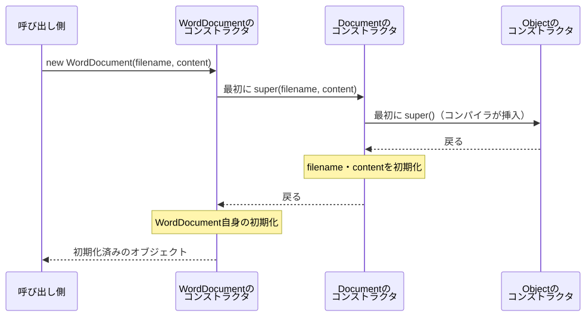
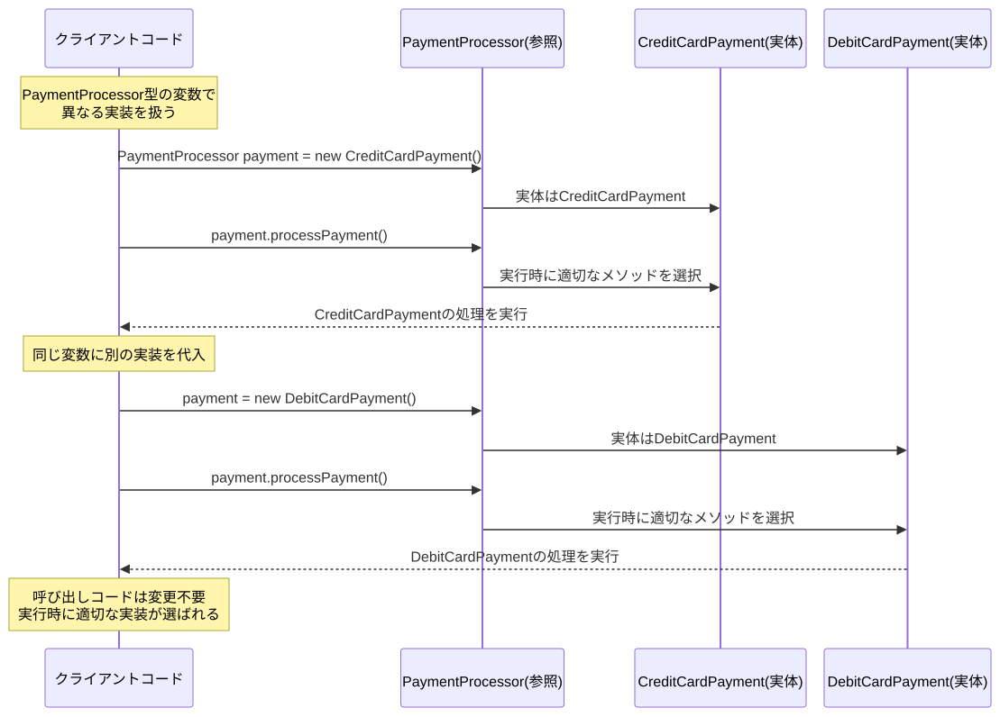

# <b>5章</b> <span>継承とポリモーフィズム</span> <small>コードの再利用と柔軟性の実現</small>

## 本章の学習目標

### この章で学ぶこと

1. 継承の基本
    - extendsキーワードによるクラスの継承
    - is-a関係の理解と、それに沿った継承の設計
    - superキーワードによる親クラスへのアクセス
2. メソッドオーバーライド
    - @Overrideアノテーションの活用
    - 親クラスの機能の特殊化
    - コンストラクター連鎖（super()の呼び出し）
    - Objectクラスのメソッド（toString・equals・hashCode）のオーバーライド
3. ポリモーフィズムの実践
    - 親クラス型での子クラスインスタンスの扱い
    - 動的バインディングによる柔軟な設計
    - テンプレートメソッドパターンの実装
4. 型変換と型判定
    - アップキャストとダウンキャスト
    - instanceof演算子による型判定
    - 安全なキャストの実装パターン

### この章を始める前に

第4章でカプセル化とクラス設計を理解していれば準備完了です。継承とポリモーフィズムにより、より柔軟で拡張性の高いプログラムを作成できるようになります。

## なぜ継承とポリモーフィズムが必要なのか

### コード重複の問題

ソフトウェア開発において、似たような機能を持つクラスを複数作成する場面は頻繁に発生します。たとえば、企業の給与計算システムを考えてみましょう。正社員、契約社員、アルバイトなど、雇用形態は異なりますが、「給与を計算する」という基本的な機能は共通しています。

継承を使わない場合、各雇用形態ごとに同じようなコードを繰り返し書くことになります。

この方法では、同じロジックが複数の箇所に散らばります。
そのため、計算のルールが1つ変わるだけで、散らばったすべての箇所を書き換えなければならず、保守が難しくなります。
コピー&ペーストのときのミスや修正漏れがあると、箇所ごとに処理が食い違い、バグの温床にもなります。
さらに、新しい雇用形態を追加するときも、既存のコードを参考にしながら一から書くことになるため、拡張しにくい構造です。

### 継承が解決する課題

継承は、このようなコード重複の問題を根本的に解決します。共通の機能を親クラスに集約し、各子クラスでは差分のみを実装することで、重要な利点が得られます。

DRY原則（Don't Repeat Yourself）を実現できます。共通コードを一箇所に集約することで、同じロジックを複数箇所に書く必要がなくなります。

変更の局所化も重要な利点です。共通機能の修正が親クラスの変更だけで完了するため、保守性が向上します。また、階層的な抽象化により、概念の階層関係をコードで表現できます。

### ポリモーフィズムがもたらす柔軟性

ポリモーフィズム（多態性）は、継承と組み合わせることで真価を発揮します。
親クラスの型で扱えば、同じ呼び出し方のまま、子クラスごとに異なる処理を実行させられます。

この性質は、2つの設計原則につながります。
1つは開放閉鎖原則です。
「拡張に対して開いており、修正に対して閉じている」という原則で、新しい種類を追加するときに既存のコードを書き換えずに済む設計を指します。
給与計算の例なら、新しい雇用形態の子クラスを追加しても、全員の給与をまとめて計算する側のコードは変えずに済みます。
もう1つは依存関係逆転の原則です。
処理を使う側が、具体的な子クラスではなく、より抽象的な親クラスの型に依存するように作るという原則です。
使う側は親クラスの型だけを知っていればよいので、渡すオブジェクトを替えるだけで、実行時に振る舞いを切り替えられます。
どちらの原則も、このあとの図形描画システムの例（サンプルコード5-10、5-11）で具体的に確かめます。

## 継承の基本

第3章では、継承を「既存のクラスの機能を新しいクラスが引き継ぐ仕組み」として紹介しました。
ここでは、継承の書き方と、継承を使ってよい関係について学びます。

### 継承の書き方：`extends`

Javaで継承を行うには、子クラスの宣言時に`extends`キーワードを使います。

#### 継承の基本構文と継承される要素

<span class="listing-number">**サンプルコード5-1**　Employee.java、Manager.java、Developer.java</span>

```java
public class Employee {  // 親クラス（スーパークラス）
    String employeeId;   // ①
    String name;         // ①

    void work() {        // ②
        IO.println(this.name + "が業務を実行中");
    }
}

public class Manager extends Employee {  // ③
    void conductMeeting() {  // ④
        IO.println(this.name + "が会議を主宰");
    }
}

public class Developer extends Employee {  // ③
    String primaryLanguage;  // ⑤

    void writeCode() {  // ④
        IO.println(this.name + "が" + primaryLanguage + "でコーディング中");
    }
}
```

使用例：

<span class="listing-number">**サンプルコード5-2**　EmployeeTest.java</span>

```java
public class EmployeeTest {
    public static void main(String[] args) {
        // Managerの使用例
        Manager manager = new Manager();
        manager.employeeId = "M001";
        manager.name = "山田部長";
        manager.work();  // 継承したメソッド
        manager.conductMeeting();  // Manager固有のメソッド
        
        IO.println();
        
        // Developerの使用例
        Developer developer = new Developer();
        developer.employeeId = "D001";
        developer.name = "鈴木開発者";
        developer.primaryLanguage = "Java";
        developer.work();  // 継承したメソッド
        developer.writeCode();  // Developer固有のメソッド
    }
}
```

実行結果：

```
山田部長が業務を実行中
山田部長が会議を主宰

鈴木開発者が業務を実行中
鈴木開発者がJavaでコーディング中
```

#### 継承の仕組みと効果

- ①　フィールドの継承
    + employeeId、nameというフィールドは自動的にすべての子クラスに引き継がれる
- ②　メソッドの継承
    + work()メソッドも同様に、すべての子クラスで利用可能になる
- ③　extends宣言
    + `extends Employee`により、ManagerとDeveloperはEmployeeクラスのすべての非privateメンバーを継承
- ④　固有メソッドの追加
    + 各子クラスは継承した機能に加えて、独自のメソッドを定義可能
- ⑤　固有フィールドの追加
    + Developerクラスは継承したフィールドに加えて、primaryLanguage（主要プログラミング言語）を独自に持つ

### is-a関係

継承は、クラス間に「is-a関係」（〜は〜の一種である）が成り立つ場合に使うのが適切です。

- 「マネージャー（Manager） `is-a` 従業員（Employee）」
- 「開発者（Developer） `is-a` 従業員（Employee）」

このような関係が成り立つ場合、継承の利用を検討します。一方、「プロジェクト（Project） `has-a` タスク（Task）」のような「has-a関係」の場合は、継承ではなく、フィールドとして持つ（コンポジション）方が適切です。

### 継承の実践例

RPGゲームのキャラクターシステムを例に、継承を実際に使用した実装例です。親クラスのフィールドやメソッドを子クラスで活用し、独自の機能を追加する方法を示しています。

<span class="listing-number">**サンプルコード5-3**　Character.java、Hero.java、Wizard.java、Main.java</span>

```java
// 親クラス
public class Character {
    String name;
    int hp;

    public void attack() {
        IO.println(name + "の攻撃！（HP: " + hp + "）");
    }
}

// 子クラス：勇者
public class Hero extends Character {
    public void specialMove() {
        IO.println(name + "は必殺技を放った！");
    }
}

// 子クラス：魔法使い
public class Wizard extends Character {
    int mp; // 子クラス独自のフィールド

    public void castSpell() {
        IO.println(name + "は魔法を唱えた！（MP: " + mp + "）");
    }
}

public class Main {
    public static void main(String[] args) {
        Hero hero = new Hero();
        hero.name = "勇者"; // 親クラスのフィールドを利用
        hero.hp = 100;

        Wizard wizard = new Wizard();
        wizard.name = "魔法使い";
        wizard.hp = 70;
        wizard.mp = 50; // 子クラス独自のフィールド

        hero.attack();       // 親クラスのメソッドを利用
        hero.specialMove();  // 子クラス独自のメソッド

        wizard.attack();     // 親クラスのメソッドを利用
        wizard.castSpell();  // 子クラス独自のメソッド
    }
}
```

実行結果：

```
勇者の攻撃！（HP: 100）
勇者は必殺技を放った！
魔法使いの攻撃！（HP: 70）
魔法使いは魔法を唱えた！（MP: 50）
```

`Hero`と`Wizard`には`name`・`hp`フィールドや`attack`メソッドを書いていませんが、親クラスの`Character`から受け継いでいるので使えます。

## メソッドのオーバーライド

継承の強力な機能の1つが、メソッドのオーバーライド (Method Overriding) です。

オーバーライドとは、親クラスで定義されたメソッドを、子クラスで再定義（上書き）することです。これにより、子クラスは親クラスの基本的な振る舞いを引き継ぎつつ、自身の特性に合わせた具体的な振る舞いを実装できます。

たとえば、`User`クラスの`processRequest()`メソッドは基本的なリクエスト処理を行います。しかし、「管理者」は追加のセキュリティチェックを行い、「ゲストユーザー」は制限付きの処理のみを行うなど、ユーザータイプによって処理内容が異なります。これをオーバーライドで表現します。

### オーバーライドのルール

メソッドオーバーライドを正しく行うためには、いくつかの大切なルールを守ることがポイントです。まずもっとも基本的なルールとして、メソッド名、引数の型・数・順序が親クラスのメソッドと一致していることが大切です。このシグネチャ（メソッド名とパラメーターリスト）が一致しない場合、それはオーバーライドではなく、単なる新しいメソッドの定義とみなされます。

次に、戻り値の型についても制約があります。基本的には、親クラスのメソッドと同じ型を返す必要があります。ただし、Java 5以降では共変戻り値型（covariant return type）がサポートされ、より具体的な（サブクラスの）型を返すことも許可されています。これにより、型安全性を保ちながらより精密な設計が可能になります。

さらに、アクセス修飾子に関する大切なルールがあります。オーバーライドするメソッドのアクセス修飾子は、親クラスのメソッドよりも制限を緩くすることしかできません。たとえば、親クラスのメソッドが`protected`である場合、子クラスでは`protected`のままにするか`public`に変更できますが、`private`には変更できません。この制約は、親クラスの型を通して呼び出せるメソッドが、子クラスのインスタンスでも必ず呼び出せることを保証するためのものです。

### `@Override`アノテーション

オーバーライドを行う際は、メソッドの直前に`@Override`というアノテーションを付けることが強く推奨されます。

これは、コンパイラーに対して「このメソッドは親クラスのメソッドをオーバーライドする意図で書いています」と伝える目印です。もし、タイプミスなどでオーバーライドのルールを満たせていない場合、コンパイラーがエラーを検知してくれます。

### `super`キーワード

子クラスのオーバーライドしたメソッド内から、親クラスの同名メソッドを呼び出したい場合があります。その際に使うのが`super`キーワードです。

`super.メソッド名()`とすることで、親クラスのメソッドを呼び出せます。これにより、親クラスの共通処理を活かしつつ、子クラス独自の処理を追加できます。

#### 実践例：`attack`メソッドのオーバーライド

<span class="listing-number">**サンプルコード5-4**　Character.java、Wizard.java（1〜15、20行目）、Knight.java、CharacterOverrideTest.java（1〜3、17〜20、24〜28行目）</span>

```java
// 親クラス
public class Character {
    String name;
    int hp;

    public Character(String name, int hp) {
        this.name = name;
        this.hp = hp;
    }

    public void attack() {
        IO.println(this.name + "の攻撃！");
    }
}

// 子クラス
public class Wizard extends Character {
    int mp;

    public Wizard(String name, int hp, int mp) {
        // super()で親クラスのコンストラクターを呼び出す
        super(name, hp); 
        this.mp = mp;
    }

    // attackメソッドをオーバーライド
    @Override
    public void attack() {
        IO.println(this.name + "は杖で殴った！");
    }
    // ...
}

// 子クラス
public class Knight extends Character {
    public Knight(String name, int hp) {
        super(name, hp);
    }

    // attackメソッドをオーバーライドし、親の処理も利用する
    @Override
    public void attack() {
        super.attack(); // 親クラスのattack()を呼び出す
        IO.println("追加で剣を振るった！"); // 子クラス独自の処理を追加
    }
}

// 使用例
public class CharacterOverrideTest {
    public static void main(String[] args) {
        // ...
        // ポリモーフィズムの例
        Character polymorphicWizard = new Wizard("賢者", 80, 20);
        polymorphicWizard.attack();  // Wizardのattackメソッドが呼ばれる
        // polymorphicWizard.castSpell();  // コンパイルエラー：Character型にはcastSpellメソッドがない
        // ...
        // superで親クラスのメソッドを呼び出す例
        Knight knight = new Knight("騎士", 120);
        knight.attack();  // 親クラスのattack()に続けて、Knight独自の処理が実行される
    }
}
```

実行結果：

```
戦士の攻撃！

魔法使いは杖で殴った！
魔法使いは魔法を唱えた！

賢者は杖で殴った！

騎士の攻撃！
追加で剣を振るった！
```

### コンストラクターと`super()`

子クラスのコンストラクターでは、子クラスのフィールドを使う前に、親クラスのコンストラクターを呼び出します。これは`super()`を使って行います。
`super(...)`は、以前はコンストラクターの先頭に書く決まりでした。
Java 25からは、引数の検査のように作成中のオブジェクト（`this`）を使わない処理であれば、`super(...)`の前に書けます（JEP 513）。

子クラスのコンストラクターに`super()`を書かなかった場合は、コンパイラーが親クラスの引数なしのコンストラクターを呼び出すコード（`super()`）を自動で挿入します。
ただし、親クラスに引数なしのコンストラクターがない場合は、自動で挿入した`super()`の呼び出し先がありません。
そのため、子クラスのコンストラクターで`super(...)`を明示的に書いて引数を渡さないと、コンパイルエラーになります。

コンストラクターは、子から親へ順に呼ばれ、親の初期化が終わってから子の初期化が進みます。次の図は、サンプルコード5-4の`Wizard`を作るときの流れです。

<div class="figure">



</div>

## ポリモーフィズム（多態性）

ポリモーフィズム (Polymorphism) は、ギリシャ語で「多くの形を持つ」という意味で、プログラミングにおける柔軟性を実現する概念です。オブジェクト指向では継承とオーバーライドを通じて実現されますが、関数型プログラミングではパラメトリックポリモーフィズムやアドホックポリモーフィズムなど、異なる形で実現されます。

ポリモーフィズムとは、同じ型の変数や同じメソッド呼び出しが、実行時のオブジェクトの種類によって異なる振る舞いをする性質を指します。

継承とオーバーライドは、このポリモーフィズムを実現するための土台となります。

### 親クラスの型で子クラスのインスタンスを扱う

Javaでは、親クラス型の変数に、その子クラスのインスタンスを代入できます。これをアップキャストと呼びます。

<span class="listing-number">**サンプルコード5-5**</span>

```java
// 親クラス型の変数に、子クラスのインスタンスを代入
User user1 = new RegularUser("U001", "user1@example.com");
User user2 = new AdminUser("A001", "admin@example.com", "SuperAdmin");
User user3 = new GuestUser("session123");
```

このとき、変数`user1`, `user2`, `user3`はすべて`User`型として扱われます。しかし、それぞれの変数が実際に指し示しているオブジェクトの実体は`RegularUser`, `AdminUser`, `GuestUser`と異なります。

### 同じ呼び出しで、異なる振る舞いを実現する

ここからがポリモーフィズムの真骨頂です。これらの`User`型の変数に対して`processRequest()`メソッドを呼び出すと、何が起こるでしょうか。

<span class="listing-number">**サンプルコード5-6**</span>

```java
user1.processRequest("READ"); // 実行結果: ユーザー U001 が READ をリクエストしました
user2.processRequest("DELETE"); // 実行結果: 管理者権限での処理: DELETE
                               //         セキュリティチェックを実行中...
user3.processRequest("WRITE"); // 実行結果: ユーザー guest_session123 が WRITE をリクエストしました
                              //         ゲストユーザーのため、一部機能が制限されています
```

`user2.processRequest()`という同じ呼び出し方にもかかわらず、Javaの実行環境は`user2`が実際に`AdminUser`オブジェクトを指していることを認識します。そして、`AdminUser`クラスでオーバーライドされた`processRequest()`メソッドを自動的に呼び出します。これがポリモーフィズムです。

### ポリモーフィズムの利点

この性質を利用すると、非常に柔軟で拡張性の高いプログラムを書くことができます。たとえば、さまざまなユーザーをまとめて管理する配列を考えてみましょう。

<span class="listing-number">**サンプルコード5-7**</span>

```java
public class UserManagementSystem {
    public static void main(String[] args) {
        // 親クラスの配列に、さまざまな子クラスのインスタンスを格納できる
        User[] users = new User[3];
        users[0] = new RegularUser("U001", "user1@example.com");
        users[1] = new AdminUser("A001", "admin@example.com", "SuperAdmin");
        users[2] = new GuestUser("session123");

        // 全ユーザーのリクエストを処理
        for (User user : users) {
            // user変数の型はUserだが、実行時には
            // 実際のインスタンスのprocessRequest()が呼び出される
            user.processRequest("READ"); 
        }
    }
}
```

実行結果：

```
ユーザー U001 が READ をリクエストしました
管理者権限での処理: READ
セキュリティチェックを実行中...
ユーザー guest_session123 が READ をリクエストしました
ゲストユーザーのため、一部機能が制限されています
```

この`for`ループのなかでは、`user`が`RegularUser`なのか`AdminUser`なのかを一切気にしません。ただ`processRequest()`を呼び出すだけで、各ユーザータイプに応じた処理が自動的に実行されます。

もし将来、「プレミアムユーザー `PremiumUser`」という新しいユーザータイプを追加したくなっても、`UserManagementSystem`クラスのコードは一切変更しません。`PremiumUser`クラスを作成し、`User`を継承して`processRequest()`をオーバーライドし、`users`配列に追加するだけで、新しいユーザータイプも問題なく動作します。これがポリモーフィズムがもたらす拡張性です。

### ポリモーフィズムのBefore/After比較

ポリモーフィズムを使わない場合と使った場合の違いを、実際のコードで比較してみましょう。

#### Before：ポリモーフィズムを使わない場合

<span class="listing-number">**サンプルコード5-8**　UserSystemBefore.java（1〜18、26〜47行目）</span>

```java
// 型ごとに別々の処理を書く必要がある
public class UserSystemBefore {
    public static void main(String[] args) {
        RegularUser regular = new RegularUser("U001", "user1@example.com");
        AdminUser admin = new AdminUser("A001", "admin@example.com", "SuperAdmin");
        GuestUser guest = new GuestUser("session123");
        
        // それぞれの型に応じたリクエスト処理
        IO.println("=== 全ユーザーのリクエスト処理（ポリモーフィズムなし）===");
        
        // RegularUserの処理
        regular.processRequest("READ");
        
        // AdminUserの処理
        admin.processRequest("DELETE");
        
        // GuestUserの処理
        guest.processRequest("WRITE");
        // ...
        // 新しいユーザータイプを追加するたびに、ここにコードを追加する必要がある
        // PremiumUser premium = new PremiumUser("P001", "premium@example.com");
        // premium.processRequest("CREATE");
    }
    
    // アクセス権限を確認する場合も型別処理が必要
    public static boolean checkAccessPermission(RegularUser regular, AdminUser admin, GuestUser guest, String resource) {
        // 各型ごとに個別に処理
        if (regular != null) {
            return resource.equals("READ") || resource.equals("WRITE");
        }
        if (admin != null) {
            return true; // 管理者はすべてのリソースにアクセス可能
        }
        if (guest != null) {
            return resource.equals("READ"); // ゲストは読み取りのみ
        }
        
        // 新しい型が増えるたびに、このメソッドも修正が必要
        return false;
    }
}
```

実行結果：

```
=== 全ユーザーのリクエスト処理（ポリモーフィズムなし）===
ユーザー U001 が READ をリクエストしました
管理者権限での処理: DELETE
セキュリティチェックを実行中...
ユーザー guest_session123 が WRITE をリクエストしました
ゲストユーザーのため、一部機能が制限されています

=== アクセス権限チェック ===
Regular user READ権限: true
Admin user DELETE権限: true
Guest user WRITE権限: false
```

#### After：ポリモーフィズムを使った場合

<span class="listing-number">**サンプルコード5-9**　User.java（1〜4、11〜13、15〜31行目）、UserSystemAfter.java（1〜18、27〜42、53行目）</span>

```java
// 親クラスに共通インターフェイスを定義
public class User {
    protected String userId;
    protected String email;
    // ...
    public void processRequest(String action) {
        IO.println("ユーザー " + userId + " が " + action + " をリクエストしました");
    }
    // ...
    public boolean hasPermission(String resource) {
        // デフォルトでは読み取り権限のみ
        return resource.equals("READ");
    }
    
    public void notify(String message) {
        // 通知を送信
        IO.println(userId + " への通知: " + message);
    }
    
    public boolean isActive() {
        return true; // デフォルトではアクティブ
    }
    
    public String getUserId() { return userId; }
    public String getEmail() { return email; }
}

// 統一的な処理で全ての型を扱える
public class UserSystemAfter {
    public static void main(String[] args) {
        // ポリモーフィズム：親クラスの型で管理
        User[] users = {
            new RegularUser("U001", "user1@example.com"),
            new AdminUser("A001", "admin@example.com", "SuperAdmin"),
            new GuestUser("session123")
            // 新しいユーザータイプを追加しても、以下のコードは変更不要
            // new PremiumUser("P001", "premium@example.com")
        };
        
        IO.println("=== 全ユーザーのリクエスト処理（ポリモーフィズムあり）===");
        
        // 統一的な処理で全員を扱える
        for (User user : users) {
            user.processRequest("READ"); // 実際の型に応じた処理が自動的に呼ばれる
        }
        // ...
    }
    
    // アクセス権限チェックも拡張性が高い
    public static boolean checkAccessPermission(User[] users, String resource) {
        boolean hasPermission = true;
        
        // 型を意識せずに処理できる
        for (User user : users) {
            if (!user.hasPermission(resource)) {
                hasPermission = false;
                IO.println(user.getUserId() + " には " + resource + " 権限がありません");
            }
        }
        
        return hasPermission;
    }
    // ...
}
```

実行結果：

```
=== 全ユーザーのリクエスト処理（ポリモーフィズムあり）===
ユーザー U001 が READ をリクエストしました
管理者権限での処理: READ
セキュリティチェックを実行中...
ユーザー guest_session123 が READ をリクエストしました
ゲストユーザーのため、一部機能が制限されています

=== DELETE権限のチェック ===
U001 には DELETE 権限がありません
guest_session123 には DELETE 権限がありません

=== 通知の送信 ===
U001 への通知: システムメンテナンスのお知らせ
U001 に通知を送信しました
A001 への通知: システムメンテナンスのお知らせ
A001 に通知を送信しました
guest_session123 への通知: システムメンテナンスのお知らせ
guest_session123 に通知を送信しました
```

#### ポリモーフィズムの利点まとめ

2つのコードを比べると、ポリモーフィズムの利点がわかります。
Beforeでは、ユーザーの型ごとに変数を用意し、`checkAccessPermission()`も型ごとの条件分岐で書いていました。
Afterでは、型ごとの条件分岐がなくなり、`User`型の配列を1つのループで処理するだけのシンプルなコードになっています。

この違いは、新しい型を追加するときに効いてきます。
`PremiumUser`を追加しても、`User`型を使って書いた呼び出し側のコード（クライアントコード）は変更しなくて済みます。
処理を追加したり変更したりするときも、手を入れる場所が型ごとのクラスにまとまっているので、保守が楽になります。
また、`checkAccessPermission()`のように`User`型を受け取るメソッドは、どの種類のユーザーにも使える汎用的なメソッドとして再利用できます。
しかも、変数や引数の型は`User`型と決まっているので、コンパイラーが型をチェックしてくれます。

<div class="figure">



</div>

### ポリモーフィズムの実践例：図形描画システム

より実践的な例として、図形描画システムを考えてみましょう。

#### Before：ポリモーフィズムを使わない場合

次のサンプルの`enum ShapeType`は、図形の種類を表す定数をまとめたもので、C言語の列挙型と同じように使えます。
Javaの列挙型は第8章「Javaの特殊なクラス形式」で詳しく学びます。

<span class="listing-number">**サンプルコード5-10**　DrawingAppBefore.java（1〜28、42〜53、65〜72行目）</span>

```java
// 図形の種類を列挙型で管理
enum ShapeType {
    CIRCLE, RECTANGLE, TRIANGLE
}

// すべての図形データを1つのクラスで管理（悪い設計）
class ShapeData {
    ShapeType type;
    // 円の属性
    double radius;
    // 長方形の属性
    double width, height;
    // 三角形の属性
    double base, triangleHeight;
    
    double calculateArea() {
        switch (type) {
            case CIRCLE:
                return Math.PI * radius * radius;  // Math.PIは円周率の定数
            case RECTANGLE:
                return width * height;
            case TRIANGLE:
                return 0.5 * base * triangleHeight;
            default:
                return 0;
        }
    }
    
    // ...
}

// 使用例
public class DrawingAppBefore {
    public static void main(String[] args) {
        ShapeData[] shapes = new ShapeData[3];
        
        // 円を作成
        shapes[0] = new ShapeData();
        shapes[0].type = ShapeType.CIRCLE;
        shapes[0].radius = 5.0;
        
        // ...
        
        // すべての図形を描画
        for (ShapeData shape : shapes) {
            shape.draw();
            IO.println("面積: " + shape.calculateArea());
        }
    }
}
```

実行結果：

```
円を描画：半径 = 5.0
面積: 78.53981633974483
長方形を描画：幅 = 10.0, 高さ = 20.0
面積: 200.0
三角形を描画：底辺 = 15.0, 高さ = 8.0
面積: 60.0
```

#### After：ポリモーフィズムを使った場合

<span class="listing-number">**サンプルコード5-11**　DrawingAppAfter.java（1〜31、75〜89、98〜118行目）</span>

```java
// 基底クラス
class Shape {
    double calculateArea() {
        // デフォルトの実装（面積0を返す）
        return 0.0;
    }
    
    void draw() {
        // デフォルトの実装
        IO.println("基本的な図形を描画");
    }
}

// 円クラス
class Circle extends Shape {
    private double radius;
    
    public Circle(double radius) {
        this.radius = radius;
    }
    
    @Override
    double calculateArea() {
        return Math.PI * radius * radius;  // Math.PIは円周率の定数
    }
    
    @Override
    void draw() {
        IO.println("円を描画：半径 = " + radius);
    }
}
// ...
// 使用例
public class DrawingAppAfter {
    public static void main(String[] args) {
        Shape[] shapes = {
            new Circle(5.0),
            new Rectangle(10.0, 20.0),
            new Triangle(15.0, 8.0)
        };
        
        // すべての図形を描画（型を意識しない）
        for (Shape shape : shapes) {
            shape.draw();
            IO.println("面積: " + shape.calculateArea());
        }
        
        // ...
    }
}

// 新しい図形の追加が容易
class Pentagon extends Shape {
    private double side;
    
    public Pentagon(double side) {
        this.side = side;
    }
    
    @Override
    double calculateArea() {
        return 0.25 * Math.sqrt(5 * (5 + 2 * Math.sqrt(5))) * side * side;
    }
    
    @Override
    void draw() {
        IO.println("五角形を描画：一辺 = " + side);
    }
}
```

実行結果：

```
円を描画：半径 = 5.0
面積: 78.53981633974483
長方形を描画：幅 = 10.0, 高さ = 20.0
面積: 200.0
三角形を描画：底辺 = 15.0, 高さ = 8.0
面積: 60.0

=== 新しい図形を追加 ===
五角形を描画：一辺 = 5.0
面積: 43.01193501472417
```

#### ポリモーフィズムがもたらす設計上の利点

Afterでは、五角形の`Pentagon`クラスを追加しても、`Shape`クラスや図形を描画するループは書き換えていません。
新しい機能の追加（拡張）には開いていて、既存のコードの修正には閉じているこの性質を、Open/Closed原則（開放閉鎖原則）と呼びます。
Beforeでは、図形を1種類増やすたびに`ShapeData`の`switch`文に`case`を足さなければなりませんでした。

また、Afterの各図形クラスは、自分自身の描画と面積計算だけを受け持ちます。
1つのクラスに1つの責任だけを持たせるこの考え方を、単一責任原則と呼びます。
図形を描画するループのような上位の処理は`Shape`型だけを知っていればよく、円や長方形の計算方法といった細部には依存しません。
これは依存関係逆転の原則にもつながる考え方です。

図形クラスどうしが独立しているため、図形クラスを1つずつ切り離してテストできます。
複数の開発者が、別々の図形クラスを同時に開発することもできます。

## `instanceof`演算子とキャスト

親クラスの型でオブジェクトを扱っていると、そのオブジェクトがもともとどの具体的な子クラスのインスタンスだったかを知り、その子クラス独自の機能を使いたくなることがあります。

たとえば、`User`型の変数`user`が、もし`AdminUser`だったら`performAdminTask()`メソッドを呼びたい、という場合です。

<span class="listing-number">**サンプルコード5-12**</span>

```java
User user = new AdminUser("A001", "admin@example.com", "SuperAdmin");
// user.performAdminTask(); // コンパイルエラー！
```
これはコンパイルエラーになります。なぜなら、コンパイラーは変数`user`を`User`型としてしか認識しておらず、`User`クラスには`performAdminTask()`メソッドが定義されていないからです。

### `instanceof`演算子：型の調査

`instanceof`演算子を使うと、あるオブジェクトが特定のクラス（またはそのサブクラス）のインスタンスであるかどうかを調べることができます。

`変数 instanceof クラス名` の形で使用し、結果は`boolean`値（`true`または`false`）で返されます。

### キャスト：型変換

オブジェクトが特定の子クラスのインスタンスであることがわかったら、その変数の型を一時的に子クラスの型に変換できます。これをダウンキャストと呼びます。

`(変換したい型)変数` のように記述します。

<span class="listing-number">**サンプルコード5-13**</span>

```java
public class UserAccessControl {
    public static void main(String[] args) {
        User[] users = {
            new RegularUser("U001", "user1@example.com"),
            new AdminUser("A001", "admin@example.com", "SuperAdmin"),
            new GuestUser("session123")
        };

        for (User user : users) {
            user.processRequest("READ"); // これはポリモーフィズムでOK

            // もし、ユーザーがAdminUserだったら、特別に管理タスクを実行
            if (user instanceof AdminUser) {
                // userをAdminUser型にダウンキャストする
                AdminUser admin = (AdminUser) user; 
                admin.performAdminTask();
            }
        }
    }
}
```

実行結果：

```
ユーザー U001 が READ をリクエストしました

管理者権限での処理: READ
セキュリティチェックを実行中...
管理者タスクを実行: SuperAdmin レベルの権限で処理

ユーザー guest_session123 が READ をリクエストしました
ゲストユーザーのため、一部機能が制限されています
```

注意： `instanceof`でチェックせずにいきなりキャストしようとすると、もしオブジェクトがその型でなかった場合に`ClassCastException`という実行時エラーが発生します。必ず`instanceof`で確認してからキャストするのが安全です。

<div class="figure">



</div>

#### モダンJavaのパターンマッチング

Java 16から、`instanceof`とキャストをより簡潔に書ける「`instanceof`のパターンマッチング」が導入されました。

<span class="listing-number">**サンプルコード5-14**</span>

```java
// 従来の書き方
if (user instanceof AdminUser) {
    AdminUser admin = (AdminUser) user;
    admin.performAdminTask();
}

// パターンマッチングを使った書き方 (Java 16以降)
if (user instanceof AdminUser admin) {
    // instanceofがtrueの場合、キャスト済みのadmin変数が使える
    admin.performAdminTask();
}
```
この新しい書き方を使うと、より安全で読みやすいコードになります。

## `Object`クラスのメソッド（toString・equals・hashCode）

### すべてのクラスの親になる`Object`クラス

`extends`を書かずに宣言したクラスは、自動的に`java.lang.Object`クラスを継承します。
そのため、Javaのすべてのクラスは、直接または間接に`Object`の子クラスです。
コンストラクターの呼び出し順の図で、最後に`Object`のコンストラクターが呼ばれていたのはこのためです。

`Object`クラスには、すべてのオブジェクトが持つ基本的なメソッドが定義されています。
本書でよく使うのは次の3つです。

- `toString()`
    + オブジェクトを表す文字列を返す
- `equals(Object obj)`
    + 引数のオブジェクトと等しいかどうかを返す
- `hashCode()`
    + オブジェクトから計算した整数（ハッシュ値）を返す

`Object`クラスでのこれらの実装は、どのクラスにも当てはまる最低限のものです。
自分で作ったクラスでは、これらをオーバーライドして、そのクラスに合った振る舞いにします。

<span class="listing-number">**サンプルコード5-15**　Student.java</span>

```java
import java.util.Objects;

public class Student {
    private String id;    // 学籍番号
    private String name;  // 名前
    
    public Student(String id, String name) {
        this.id = id;
        this.name = name;
    }
    
    @Override
    public String toString() {
        return "Student[id=" + id + ", name=" + name + "]";
    }
    
    @Override
    public boolean equals(Object obj) {
        if (this == obj) {  // ①
            return true;
        }
        if (obj == null || getClass() != obj.getClass()) {  // ②
            return false;
        }
        Student other = (Student) obj;  // ③
        return Objects.equals(id, other.id);
    }
    
    @Override
    public int hashCode() {
        return Objects.hashCode(id);  // ④
    }
}
```

### `toString`：オブジェクトを文字列にする

`IO.println`にオブジェクトを渡したり、文字列と`+`で連結したりすると、そのオブジェクトの`toString()`が呼ばれます。
`Object`クラスの`toString()`は、`Student@1b6d3586`のように「クラス名@ハッシュ値の16進数」を返すだけで、中身はわかりません。
サンプルコード5-15のようにオーバーライドしてフィールドの値を含む文字列を返すと、表示やデバッグのときに中身を確かめやすくなります。

### `equals`：中身が等しいかを判定する

第3章の節「`==`と`equals`の違い」で、文字列の中身は`equals`で比べることを学びました。
`String`クラスは`equals`をオーバーライドして、文字の並びを比べるようにしています。
一方、`Object`クラスの`equals`は`==`と同じく参照を比べます。
そのため、`equals`をオーバーライドしていないクラスでは、中身が同じでも別のオブジェクトなら`false`になります。

サンプルコード5-15の`equals`は、学籍番号が同じなら等しいと判定します。

- ①　同じオブジェクトとの比較
    + 自分自身と比べている場合は、すぐに`true`を返す
- ②　`null`や別のクラスとの比較
    + 引数が`null`の場合や、別のクラスのオブジェクトの場合は`false`を返す（`getClass()`は、オブジェクトの実際のクラスを返す`Object`クラスのメソッド）
- ③　フィールドの比較
    + 引数を`Student`型にダウンキャストして学籍番号を比べる（②で同じクラスだと確かめたので、キャストは失敗しない）

`Objects.equals(a, b)`は、どちらかが`null`でも例外を起こさずに比べられる、標準ライブラリのメソッドです。
引数の型は`Object`にします。
`equals(Student obj)`と書くと、オーバーライドではなくオーバーロードになり、`@Override`を付けていればコンパイルエラーで気づけます。

### `hashCode`：`equals`と組でオーバーライドする

`hashCode()`は、オブジェクトから計算した`int`の値（ハッシュ値）を返します。
第9章で学ぶ`HashSet`や`HashMap`は、要素をハッシュ値で振り分けて保存し、同じハッシュ値を持つ要素どうしを`equals`で比べて目的の要素を探します。
そのため、`equals`をオーバーライドしたら、必ず`hashCode`もオーバーライドして、次の決まり（契約）を守ります。

1. `equals`で等しいと判定される2つのオブジェクトは、同じ`hashCode`を返す
2. `hashCode`が同じでも、`equals`で等しいとは限らない（ハッシュ値の衝突）
3. プログラムの実行中、`equals`で使うフィールドが変わらない限り、同じオブジェクトの`hashCode`は同じ値を返す

サンプルコード5-15の④では、`equals`で比べている学籍番号だけからハッシュ値を計算しています。
`Objects.hashCode(id)`は、`id`が`null`なら0を、そうでなければ`id.hashCode()`を返します。
`equals`で比べない名前をハッシュ値の計算に混ぜると、学籍番号が同じで名前が違う2つのオブジェクトが別のハッシュ値になり、契約の1つめを守れません。

次のプログラムで、3つのメソッドの動きを確かめます。

<span class="listing-number">**サンプルコード5-16**　ObjectMethodsDemo.java</span>

```java
public class ObjectMethodsDemo {
    public static void main(String[] args) {
        Student s1 = new Student("S001", "田中太郎");
        Student s2 = new Student("S001", "田中太郎");
        Student s3 = new Student("S002", "佐藤花子");
        
        IO.println(s1);                 // toString()が呼ばれる
        IO.println("s1 == s2: " + (s1 == s2));
        IO.println("s1.equals(s2): " + s1.equals(s2));
        IO.println("s1.equals(s3): " + s1.equals(s3));
        IO.println("ハッシュ値が同じ: " + (s1.hashCode() == s2.hashCode()));
    }
}
```

実行結果：

```
Student[id=S001, name=田中太郎]
s1 == s2: false
s1.equals(s2): true
s1.equals(s3): false
ハッシュ値が同じ: true
```

`s1`と`s2`は別々に`new`したオブジェクトなので`==`では`false`ですが、学籍番号が同じなので`equals`は`true`を返し、ハッシュ値も一致します。
なお、第8章で学ぶレコードでは、この3つのメソッドをコンパイラーが自動で用意します。

## 実践的な継承設計パターン

ここまでで、継承の書き方、オーバーライド、ポリモーフィズム、型の判定とキャストを学びました。
この節では、これらを組み合わせた実践的な継承設計のパターンと、継承を使うべきでない場面を見ていきます。

継承は単なるコードの再利用手段ではなく、システムの拡張性と保守性を向上させる設計技法です。本章では、現実的なビジネス要件に対応できる継承階層の設計方法と、それを支えるポリモーフィズムの実践的な活用法を習得します。

### 高度な継承設計における共通課題

実践的なソフトウェア開発では、単純な継承から複雑なドメインモデルまで、さまざまなレベルの継承設計が求められます。とくに企業システムやWebアプリケーションでは、ビジネスルールの変化に対応できる柔軟な継承階層の設計が大切です。

本章では、これまで学んだ基礎知識を活用して、実践的な設計課題に取り組みます。
具体的には次のような課題を扱います。

- テンプレートメソッドパターン
    + 共通アルゴリズムの骨格を定義し、詳細を子クラスに委ねる設計
- 継承とコンポジションの使い分け
    + 継承を使うべきでない場面と、フィールドとして持つ（委譲する）設計による解決
- リスコフ置換原則の実践
    + 安全で予測可能な継承階層の構築
- 拡張性を考慮した設計
    + 将来の要件変更に対応できる柔軟な構造

### 継承設計の実践例：決済システム

実際のビジネスシステムでよく見られる決済処理を例に、段階的な継承設計の改善プロセスを見ていきましょう。ここでは、抽象クラスを使わずに、具象クラスの継承とメソッドのオーバーライドによってテンプレートメソッドパターンを実現する方法を示します。

<div class="figure">



</div>

<span class="listing-number">**サンプルコード5-17**　PaymentProcessor.java（3〜4、17〜42、57〜74、84行目）</span>

```java
// 決済処理の基底クラス：テンプレートメソッドパターンの実装
public class PaymentProcessor {
    // ...
    // テンプレートメソッド：決済処理の共通フロー
    public final PaymentResult processPayment() {
        // 1. 事前検証（共通処理）
        if (!validateCommonParameters()) {
            logError();
            return new PaymentResult(false, null, errorMessage);
        }
        
        // 2. 決済手段固有の検証（子クラスでオーバーライド可能）
        if (!validatePaymentSpecific()) {
            logError();
            return new PaymentResult(false, null, errorMessage);
        }
        
        // 3. 外部API呼び出し（子クラスでオーバーライド可能）
        String authorizationCode = callExternalAPI();
        if (authorizationCode == null) {
            logError();
            return new PaymentResult(false, null, errorMessage);
        }
        
        // 4. 処理結果の記録（共通処理）
        logTransaction(authorizationCode);
        
        return new PaymentResult(true, authorizationCode, "決済完了");
    }
    // ...
    // 子クラスでオーバーライドされることを想定したメソッド（デフォルト実装を提供）
    protected boolean validatePaymentSpecific() {
        // デフォルトでは追加の検証なし
        // 子クラスでオーバーライド可能
        return true;
    }
    
    protected String callExternalAPI() {
        // デフォルトでは基本的な決済処理を実行
        // 実際の実装では外部決済サービスのAPIを呼び出す
        // エラーの場合はnullを返し、errorMessageを設定
        return "DEFAULT-" + System.currentTimeMillis();
    }
    
    // フックメソッド：子クラスでオーバーライド可能
    protected void logTransaction(String authCode) {
        IO.println("取引ID: " + transactionId + " 承認コード: " + authCode);
    }
    // ...
}
```

これは決済処理の基底クラスで、テンプレートメソッドパターンを実装しています。processPayment()メソッドが決済処理の共通フローを定義し、子クラスで特定の処理をオーバーライドできるようになっています。

#### テンプレートメソッドパターンの重要なポイント

このパターンでは、まず`processPayment()`メソッドが決済処理の標準的な流れを決めます。
検証、外部APIの呼び出し、結果の記録という順序は、すべての決済手段で共通です。
そのうえで、`validatePaymentSpecific()`や`callExternalAPI()`のように、子クラスがオーバーライドしてよいメソッドを用意します。
これらのメソッドが、決済手段ごとに処理を変えられる場所（拡張ポイント）になります。

一方、`processPayment()`には`final`を付けています。
`final`を付けたメソッドは子クラスでオーバーライドできないため、処理の流れそのものを子クラスが書き換えることはありません。
`final`の使い方は、第6章「不変性とfinalキーワード」で詳しく学びます。

また、拡張ポイントのメソッドには親クラスが基本的な動作（デフォルト実装）を用意しています。
子クラスは、カードの検証やAPIの認証など、決済手段に特有の処理が必要な場合だけオーバーライドすれば済みます。

#### 具体的な決済処理の実装例

<span class="listing-number">**サンプルコード5-18**　CreditCardPayment.java（3〜43行目）、PayPalPayment.java（3〜4、43〜50行目）</span>

```java
// クレジットカード決済の実装
public class CreditCardPayment extends PaymentProcessor {
    private String cardNumber;
    private String cvv;
    
    public CreditCardPayment(String transactionId, BigDecimal amount, 
                           String currency, String cardNumber, String cvv) {
        super(transactionId, amount, currency);
        this.cardNumber = cardNumber;
        this.cvv = cvv;
    }
    
    @Override
    protected boolean validatePaymentSpecific() {
        // クレジットカード固有の検証
        if (cardNumber == null || cardNumber.length() != 16) {
            setErrorMessage("無効なカード番号です");
            return false;
        }
        if (cvv == null || cvv.length() != 3) {
            setErrorMessage("無効なCVVです");
            return false;
        }
        return true;
    }
    
    @Override
    protected String callExternalAPI() {
        // クレジットカード決済API呼び出しのシミュレーション
        IO.println("クレジットカード決済APIを呼び出し中...");
        
        // 実際の実装では外部APIを呼び出す
        // ここではシミュレーションとして、まれにエラーが発生する例を示す
        if (Math.random() < 0.1) {  // 10%の確率でエラー
            setErrorMessage("クレジットカード決済が拒否されました");
            return null;
        }
        
        return "CC-" + System.currentTimeMillis();
    }
}

// PayPal決済の実装
public class PayPalPayment extends PaymentProcessor {
    // ...
    
    @Override
    protected void logTransaction(String authCode) {
        // PayPalでは詳細なログを記録
        super.logTransaction(authCode);
        IO.println("PayPalアカウント: " + email);
    }
}
```

これらは決済処理基底クラスを継承した具体的な実装例です。CreditCardPaymentはクレジットカード特有の検証を、PayPalPaymentはPayPal特有の検証を実装し、それぞれの決済方法に応じたAPI呼び出しをシミュレートしています。

このアプローチでは、`PaymentProcessor`は抽象クラスではなく具象クラスとして実装されており、すべてのメソッドにデフォルト実装が提供されています。子クラスは各決済手段に固有の検証ロジック（クレジットカードの番号検証、PayPalのアカウント認証、銀行口座の残高確認など）が必要な場合に、これらのメソッドをオーバーライドして独自の振る舞いを実装できます。

#### 例外を使わない決済処理の使用例

<span class="listing-number">**サンプルコード5-19**　PaymentExample.java（1〜35行目）</span>

```java
import java.math.BigDecimal;

public class PaymentExample {
    public static void main(String[] args) {
        // クレジットカード決済の例
        CreditCardPayment ccPayment = new CreditCardPayment(
            "TXN001", 
            new BigDecimal("5000"), 
            "JPY",
            "1234567890123456",
            "123"
        );
        
        PaymentResult ccResult = ccPayment.processPayment();
        if (ccResult.isSuccess()) {
            IO.println("決済成功: " + ccResult.getAuthorizationCode());
        } else {
            IO.println("決済失敗: " + ccResult.getMessage());
        }
        
        // PayPal決済の例（エラーケース）
        PayPalPayment ppPayment = new PayPalPayment(
            "TXN002",
            new BigDecimal("10000"),
            "JPY",
            "invalid-email",  // 無効なメールアドレス
            "pass123"
        );
        
        PaymentResult ppResult = ppPayment.processPayment();
        if (ppResult.isSuccess()) {
            IO.println("決済成功: " + ppResult.getAuthorizationCode());
        } else {
            IO.println("決済失敗: " + ppResult.getMessage());
        }
```

次は実行結果の一例です。クレジットカード決済は10%の確率で拒否されるため、実行するたびに結果が変わることがあります。

```
クレジットカード決済APIを呼び出し中...
取引ID: TXN001 承認コード: CC-1707123456789
決済成功: CC-1707123456789
決済エラー[TXN002]: 無効なメールアドレスです
決済失敗: 無効なメールアドレスです
```

#### エラー処理の設計ポイント

この決済処理では、例外を使わずにエラーを扱っています。
検証メソッドは、成功したか失敗したかを`boolean`の戻り値で返します。
失敗したときは、その理由を`errorMessage`フィールドに入れておきます。
外部APIの呼び出しは、失敗すると`null`を返すので、呼び出し側は結果が`null`かどうかを調べてエラーと判断します。
最後に、成功か失敗か、承認コード、メッセージをまとめて`PaymentResult`クラスのオブジェクトに入れて返します。

このように設計すれば、例外処理を学ぶ前でも、エラーの状態を呼び出し側へ伝えるテンプレートメソッドパターンを実装できます。

### 段階的リファクタリング：重複コードから継承へ

実際の開発では、最初から理想的な継承構造を設計することは難しく、重複コードを発見してから継承を導入することがよくあります。その過程を段階的に見てみましょう。

#### ステップ1：重複コードの発見

実際の開発現場でよく見られる、独立して作成されたクラス間でのコード重複を示します。WordDocumentクラスとPDFDocumentクラスで、同じようなフィールドとメソッドが重複して実装されています。このような重複は保守性を低下させ、バグの温床となるため、継承を使ってリファクタリングします。

<span class="listing-number">**サンプルコード5-20**　WordDocument.java、PDFDocument.java</span>

```java
public class WordDocument {
    private String filename;     // ①
    private String content;      // ①
    private long fileSize;       // ①
    
    public WordDocument(String filename, String content) {
        this.filename = filename;
        this.content = content;
    }
    
    public void open() {         // ②
        IO.println(filename + " を開いています");
    }
    
    public void save() {         // ③
        fileSize = content.length();
        IO.println(filename + " を保存しました: " + fileSize + "バイト");
    }
    
    public void close() {        // ④
        content = null;
        IO.println(filename + " を閉じました");
    }
}

public class PDFDocument {
    private String filename;     // ①と重複
    private String content;      // ①と重複
    private long fileSize;       // ①と重複
    private int pageCount;       // ⑤
    
    public PDFDocument(String filename, String content, int pageCount) {  // ①の初期化も重複
        this.filename = filename;
        this.content = content;
        this.pageCount = pageCount;
    }
    
    public void open() {         // ②と完全重複
        IO.println(filename + " を開いています");
    }
    
    public void save() {         // ③と完全重複
        fileSize = content.length();
        IO.println(filename + " を保存しました: " + fileSize + "バイト");
    }
    
    public void close() {        // ④と完全重複
        content = null;
        IO.println(filename + " を閉じました");
    }
    
    public void generatePDF() {  // ⑥
        IO.println("PDF形式で " + pageCount + " ページを生成");
    }
}
```

これらのクラスを使用した例：

<span class="listing-number">**サンプルコード5-21**　DocumentTest.java</span>

```java
public class DocumentTest {
    public static void main(String[] args) {
        // WordDocumentの操作
        WordDocument word = new WordDocument("report.docx", "これはWordドキュメントの内容です");
        word.open();
        word.save();
        word.close();
        
        IO.println();
        
        // PDFDocumentの操作  
        PDFDocument pdf = new PDFDocument("manual.pdf", "これはPDFドキュメントの内容です", 10);
        pdf.open();
        pdf.save();
        pdf.generatePDF();
        pdf.close();
    }
}
```

実行結果：

```
report.docx を開いています
report.docx を保存しました: 18バイト
report.docx を閉じました

manual.pdf を開いています
manual.pdf を保存しました: 17バイト
PDF形式で 10 ページを生成
manual.pdf を閉じました
```

#### 重複コードの分析

- ①　共通フィールド
    + filename、content、fileSizeというドキュメントの基本属性がWordDocumentとPDFDocumentで重複して定義されている
- ②　ファイルオープン処理
    + open()メソッドの実装が両クラスで同一
- ③　保存処理
    + save()メソッドでfileSizeを計算し、メッセージ出力する処理が重複
- ④　クローズ処理
    + close()メソッドでcontentをnullにし、メッセージを出力するロジックが重複
- ⑤　固有フィールド
    + pageCount（ページ数）はPDF特有の属性として追加
- ⑥　固有メソッド
    + generatePDF()はPDF特有の機能として実装

<span class="listing-number">**サンプルコード5-22**　ExcelDocument.java</span>

```java
public class ExcelDocument {
    private String filename;
    private String content;
    private long fileSize;
    
    public ExcelDocument(String filename, String content) {
        this.filename = filename;
        this.content = content;
    }
    
    // また同じメソッドの重複！
    public void open() {
        IO.println(filename + " を開いています");
    }
    
    public void save() {
        fileSize = content.length();
        IO.println(filename + " を保存しました: " + fileSize + "バイト");
    }
    
    public void close() {
        content = null;
        IO.println(filename + " を閉じました");
    }
}
```

これは重複コードの問題を示す例です。3つのドキュメントクラスで同じメソッドが繰り返し実装されています。

#### ステップ2：共通部分の抽出

<span class="listing-number">**サンプルコード5-23**　Document.java</span>

```java
// 共通部分を親クラスとして抽出
public class Document {
    protected String filename;
    protected String content;
    protected long fileSize;
    
    public Document(String filename, String content) {
        this.filename = filename;
        this.content = content;
        this.fileSize = content != null ? content.length() : 0;
    }
    
    // 共通メソッドを親クラスに移動
    public void open() {
        IO.println(filename + " を開いています");
    }
    
    public void save() {
        fileSize = content != null ? content.length() : 0;
        IO.println(filename + " を保存しました: " + fileSize + "バイト");
    }
    
    public void close() {
        content = null;
        IO.println(filename + " を閉じました");
    }
    
    // ゲッターとセッター
    public String getFilename() { return filename; }
    public long getFileSize() { return fileSize; }
}
```

#### ステップ3：子クラスの再実装

<span class="listing-number">**サンプルコード5-24**　WordDocument.java、PDFDocument.java、ExcelDocument.java</span>

```java
// リファクタリング後：重複が除去された
public class WordDocument extends Document {
    public WordDocument(String filename, String content) {
        super(filename, content);
    }
    
    // WordDocument固有の機能があれば追加
    public void applyTemplate(String templateName) {
        IO.println(filename + " にテンプレート " + templateName + " を適用");
    }
}

public class PDFDocument extends Document {
    private int pageCount;
    
    public PDFDocument(String filename, String content, int pageCount) {
        super(filename, content);
        this.pageCount = pageCount;
    }
    
    // saveメソッドをオーバーライド（PDFは圧縮効率が高い）
    @Override
    public void save() {
        fileSize = (content != null ? content.length() : 0) / 2; // PDFは圧縮される
        IO.println(filename + " をPDF形式で保存: " + fileSize + "バイト");
    }
    
    public void generatePDF() {
        if (pageCount > 0) {
            IO.println("PDF形式で " + pageCount + " ページを生成");
        } else {
            IO.println("ページ数が指定されていません");
        }
    }
}

public class ExcelDocument extends Document {
    public ExcelDocument(String filename, String content) {
        super(filename, content);  // ①
    }
    
    @Override  // ②
    public void save() {
        fileSize = content != null ? content.length() * 2 : 0;  // ③
        IO.println(filename + " をExcel形式で保存: " + fileSize + "バイト（メタデータ含む）");
    }
    
    public void createChart() {  // ④
        IO.println(filename + " にグラフを作成");
    }
}
```

リファクタリング後の使用例：

<span class="listing-number">**サンプルコード5-25**　RefactoredDocumentTest.java</span>

```java
public class RefactoredDocumentTest {
    public static void main(String[] args) {
        // リファクタリング後の使用例
        WordDocument word = new WordDocument("report.docx", "これはWordドキュメントの内容です");
        word.open();
        word.save();
        word.applyTemplate("ビジネスレポート");
        word.close();
        
        IO.println();
        
        PDFDocument pdf = new PDFDocument("manual.pdf", "これはPDFドキュメントの内容です", 10);
        pdf.open();
        pdf.save();  // オーバーライドされたメソッド
        pdf.generatePDF();
        pdf.close();
        
        IO.println();
        
        ExcelDocument excel = new ExcelDocument("data.xlsx", "これはExcelドキュメントの内容です");
        excel.open();
        excel.save();  // オーバーライドされたメソッド
        excel.createChart();
        excel.close();
    }
}
```

実行結果：

```
report.docx を開いています
report.docx を保存しました: 18バイト
report.docx にテンプレート ビジネスレポート を適用
report.docx を閉じました

manual.pdf を開いています
manual.pdf をPDF形式で保存: 8バイト
PDF形式で 10 ページを生成
manual.pdf を閉じました

data.xlsx を開いています
data.xlsx をExcel形式で保存: 38バイト（メタデータ含む）
data.xlsx にグラフを作成
data.xlsx を閉じました
```

#### オーバーライドと特化機能の実装

- ①　親クラスのコンストラクター呼び出し
    + super()により、親クラスの初期化処理を適切に実行
- ②　オーバーライドアノテーション
    + @Overrideによりコンパイラーが親クラスのメソッドを正しくオーバーライドしていることを検証
- ③　特化した振る舞い
    + Excelファイルはメタデータを含むため、ファイルサイズが大きくなるよう設定
- ④　固有メソッドの追加
    + createChart()はExcel特有の機能として、親クラスには存在しないメソッドを追加

#### リファクタリングの効果

継承を導入したリファクタリングによって、コードの重複がなくなり、保守しやすくなります。
同じコードを複数の場所に書かずに済むので、修正漏れによるバグが減ります。
共通機能の変更も、親クラスを1か所直すだけで、すべての子クラスに反映されます。

また、各ドキュメントタイプの特性をオーバーライドで表現できます。
親クラスと同じメソッド名で呼び出せる形を保ったまま、子クラスごとに独自の処理を持たせられます。
新しいドキュメントタイプを追加するときも、親クラスを継承し、異なる部分だけをオーバーライドすれば済みます。
ただし、継承の階層が深くなるとコードを追いにくくなります。
そのような場合は、このあとで学ぶコンポジションや、第7章で学ぶインターフェイスの活用も検討します。

### 継承の誤用例：よくある間違い

継承を誤用すると、論理的に破綻したコードになってしまいます。実際の開発現場でよく見られる誤用パターンをいくつか見てみましょう。

#### 誤用例1：スタックがArrayListを継承

以下のコードは、継承の誤用の典型例です。スタック（後入れ先出しのデータ構造）を実装するためにArrayListを継承していますが、これによりArrayListの全メソッドが公開され、スタックの原則を破る操作が可能になってしまいます。この問題と解決策を見ていきましょう。

`ArrayList<String>`は、第4章でも使った、文字列を必要なだけ追加できる入れ物です（第9章「コレクションフレームワーク」で学びます）。
`pop`と`peek`の`throw new EmptyStackException()`は、スタックが空のときに処理を中断してエラーを知らせる書き方です（第13章「例外処理」で学びます）。

<span class="listing-number">**サンプルコード5-26**　MyStack.java（1、5〜16、23行目）、StackProblem.java</span>

```java
// 悪い例：実装の詳細を継承してしまう
// ...
public class MyStack extends ArrayList<String> {
    public void push(String item) {
        add(item);
    }
    
    public String pop() {
        if (isEmpty()) {
            throw new EmptyStackException();
        }
        return remove(size() - 1);
    }
    
    // ...
}

// 問題点が露呈する使用例
public class StackProblem {
    public static void main(String[] args) {
        MyStack stack = new MyStack();
        stack.push("first");
        stack.push("second");
        stack.push("third");
        
        // ArrayListのメソッドが露出してしまう
        stack.add(1, "WRONG!"); // スタックの途中に要素を挿入できてしまう
        stack.remove(0); // スタックの底から要素を削除できてしまう
        stack.clear(); // スタック全体をクリアできてしまう
        
        // スタックの約束（LIFO）が破られる
    }
}
```

#### 解決策：コンポジションを使用

<span class="listing-number">**サンプルコード5-27**　MyStack.java</span>

```java
// 良い例：内部実装を隠蔽
import java.util.ArrayList;
import java.util.EmptyStackException;

public class MyStack {
    private final ArrayList<String> elements = new ArrayList<>(); // privateで隠蔽
    
    public void push(String item) {
        elements.add(item);
    }
    
    public String pop() {
        if (isEmpty()) {
            throw new EmptyStackException();
        }
        return elements.remove(elements.size() - 1);
    }
    
    public String peek() {
        if (isEmpty()) {
            throw new EmptyStackException();
        }
        return elements.get(elements.size() - 1);
    }
    
    public boolean isEmpty() {
        return elements.isEmpty();
    }
    
    public int size() {
        return elements.size();
    }
    // ArrayListの他のメソッドは公開されない
}
```

このMyStackクラスは、コンポジションを使用してArrayListを内部に保持し、スタックに必要な機能のみを公開しています。
これにより、ArrayListのスタック操作に不要なメソッド（add、removeなど）が外部に公開されることを防いでいます。

#### 誤用例2：従業員の権限階層での問題

以下の例は、継承設計の一般的な落とし穴である「すべてのサブクラスが親クラスの振る舞いを持つ」という誤った仮定を示しています。
この設計はリスコフ置換原則に違反します。
リスコフ置換原則とは、親クラスの型で扱っている箇所に子クラスのインスタンスを渡しても、プログラムが正しく動き続けなければならないという原則です。

<span class="listing-number">**サンプルコード5-28**　Employee.java、SystemAdministrator.java、RegularEmployee.java、EmployeeManagementSystem.java</span>

```java
// 悪い例：すべての従業員がシステム管理権限を持つという誤った前提
public class Employee {
    protected String employeeId;
    protected String name;
    
    public Employee(String employeeId, String name) {
        this.employeeId = employeeId;
        this.name = name;
    }
    
    public void modifySystemSettings() {
        IO.println(name + " がシステム設定を変更しました");
    }
}

public class SystemAdministrator extends Employee {
    public SystemAdministrator(String employeeId, String name) {
        super(employeeId, name);
    }
    // modifySystemSettingsメソッドを適切に継承
}

public class RegularEmployee extends Employee {
    public RegularEmployee(String employeeId, String name) {
        super(employeeId, name);
    }
    
    @Override
    public void modifySystemSettings() {
        // 一般従業員にはシステム管理権限がない！
        throw new UnsupportedOperationException("権限がありません");
    }
}

// 使用時の問題
public class EmployeeManagementSystem {
    public static void performSystemMaintenance(Employee[] employees) {
        for (Employee employee : employees) {
            employee.modifySystemSettings(); // 一般従業員で例外が発生！
        }
    }
}
```

`RegularEmployee`の`modifySystemSettings()`にある`throw new UnsupportedOperationException(...)`は、「この操作には対応していない」ことを表す例外を発生させ、処理をその場で中断させる文です。
例外の発生と扱い方は、第13章「例外処理」で詳しく学びます。

この問題は、すべての従業員がシステム管理権限を持つという誤った仮定に基づいた継承設計の典型的な例です。
一般従業員は従業員ですがシステム管理権限を持たないため、`modifySystemSettings()`メソッドで例外を投げることになります。
`Employee`型として扱っている`performSystemMaintenance`に`RegularEmployee`を渡すと処理が止まるので、リスコフ置換原則に違反しています。

この問題を適切に解決するためには、継承階層を見直し、共通の振る舞いのみを親クラスに定義してください。よりよい解決策として、インターフェイスを使用した設計がありますが、これについては第7章「抽象クラスとインターフェイス」で詳しく説明します。

> 注意: 継承を使用する際は、「is-a」の関係だけでなく、すべての子クラスが親クラスの振る舞いを適切に実装できるかを慎重に検討してください。

#### 誤用例3：正方形と長方形の問題

有名な例として「正方形と長方形」の問題も見てみましょう。これはリスコフ置換原則（LSP）違反の典型例です。

<span class="listing-number">**サンプルコード5-29**　Rectangle.java（1〜5、11〜17、22行目）、Square.java、RectangleSquareTest.java（1〜11、21〜32行目）</span>

```java
// 問題のあるコード：数学的には正方形は長方形の一種だが...
public class Rectangle {
    protected int width;
    protected int height;
    
    // ...
    public void setWidth(int width) {
        this.width = width;
    }
    
    public void setHeight(int height) {
        this.height = height;
    }
    // ...
}

// 正方形を長方形として継承すると問題が発生
public class Square extends Rectangle {
    public Square(int size) {
        super(size, size);
    }
    
    // 正方形では幅と高さは常に同じでなければならない
    @Override
    public void setWidth(int width) {
        this.width = width;
        this.height = width; // 高さも同じ値に！
    }
    
    @Override
    public void setHeight(int height) {
        this.width = height; // 幅も同じ値に！
        this.height = height;
    }
}

// 使用例でリスコフ置換原則違反を確認
public class RectangleSquareTest {
    // 長方形を扱う一般的なメソッド
    public static void testRectangle(Rectangle rect) {
        rect.setWidth(5);
        rect.setHeight(10);
        
        // 期待される面積: 5 × 10 = 50
        int expectedArea = 50;
        int actualArea = rect.getArea();
        
        // ...
    }
    
    public static void main(String[] args) {
        IO.println("=== 長方形のテスト ===");
        Rectangle rectangle = new Rectangle(3, 4);
        testRectangle(rectangle);
        
        IO.println("\n=== 正方形のテスト ===");
        Square square = new Square(5);
        testRectangle(square);
    }
}
```

実行結果：

```
=== 長方形のテスト ===
幅を5、高さを10に設定
期待される面積: 50
実際の面積: 50
✓ テスト成功

=== 正方形のテスト ===
幅を5、高さを10に設定
期待される面積: 50
実際の面積: 100
✗ テスト失敗！
```

`testRectangle`は幅を5、高さを10に設定し、面積が50になることを期待しています。
しかし、`Square`の`setHeight(10)`は幅も10に変えてしまうため、正方形を渡すと面積は100になります。
このように、`Square`は`Rectangle`の期待される振る舞いを壊しており、`Rectangle`の代わりに使えません。
これがリスコフ置換原則の違反です。

この問題の根本的な原因は、数学的な関係（正方形は長方形の一種）とオブジェクト指向の継承関係が必ずしも一致しないことにあります。継承は「振る舞いの継承」であり、単なる概念的な関係ではありません。

この問題を解決する方法として、継承ではなくインターフェイスやコンポジションを使用する設計があります。

次のコードは、第7章で学ぶインターフェイス（`interface`）を使った解決策です。
`interface Shape`は「`getArea()`メソッドを持つ」という約束だけを決めた型で、`implements Shape`と書いたクラスはその約束どおりに`getArea()`を実装します。
ここでは、`Rectangle`と`Square`が継承の関係を持たず、それぞれが独立に`getArea()`を実装している点だけを読み取ってください。

<span class="listing-number">**サンプルコード5-30**　Shape.java</span>

```java
// 解決策の例：インターフェイスを使用
interface Shape {
    double getArea();
}

class Rectangle implements Shape {
    private int width;
    private int height;
    
    public Rectangle(int width, int height) {
        this.width = width;
        this.height = height;
    }
    
    @Override
    public double getArea() {
        return width * height;
    }
    
    // setterは矩形の特性に従う
    public void setWidth(int width) { this.width = width; }
    public void setHeight(int height) { this.height = height; }
}

class Square implements Shape {
    private int side;
    
    public Square(int side) {
        this.side = side;
    }
    
    @Override
    public double getArea() {
        return side * side;
    }
    
    // 正方形固有のsetter
    public void setSide(int side) { this.side = side; }
}
```

インターフェイスの書き方と使い方は、第7章「抽象クラスとインターフェイス」で詳しく解説します。

> 重要: 継承を使用する際は、親クラスの契約（期待される振る舞い）を子クラスが満たせるかを確認することが重要です。

#### 誤用例4：多重継承の代替として無理な継承

Javaは多重継承をサポートしないため、複数の能力を持つオブジェクトを表現するために無理な継承階層を作ることがあります。これは設計の柔軟性を損ないます。

<span class="listing-number">**サンプルコード5-31**　Employee.java、ReportingEmployee.java、ApprovingEmployee.java</span>

```java
// 悪い例：「レポート作成可能」と「承認権限」を無理に継承で表現
public class Employee {
    public void work() { /* ... */ }
    public void attendMeeting() { /* ... */ }
}

public class ReportingEmployee extends Employee {
    public void generateReport() { /* ... */ }
}

public class ApprovingEmployee extends Employee {
    public void approveRequest() { /* ... */ }
}

// 問題：マネージャーはレポート作成も承認もできる、アナリストはレポート作成のみ
// どちらを継承すればよい？
```

この問題は、Javaが単一継承しかサポートしないことによる制約を示しています。複数の能力を持つオブジェクトを表現しようとすると、継承階層が複雑になり、設計の柔軟性が失われます。

たとえば、マネージャー（Manager）はレポートを作成することもできるし承認権限も持っていますが、`ReportingEmployee`と`ApprovingEmployee`のどちらか一方しか継承できません。結果として、どちらかの能力を諦めるか、複雑な継承階層を作ることになってしまいます。

この問題を解決するもっとも効果的な方法は、インターフェイスを使用して能力を表現することです。インターフェイスを使えば、クラスは必要な能力を選択的に実装でき、継承階層をシンプルに保つことができます。この設計手法については、第7章「抽象クラスとインターフェイス」で詳しく説明します。

> ポイント: 継承は強力な機能ですが、すべての問題を解決できるわけではありません。とくに複数の異なる能力を持つオブジェクトを表現する場合は、継承以外の設計手法を検討してください。

## 例外処理の基礎（補足）

本章では継承とポリモーフィズムに焦点を当てましたが、継承を使う際には例外処理に関する重要なルールがあります。

> 例外処理の基本概念（try-catch構文、例外の種類など）については、第13章「例外処理」で詳しく説明しています。ここでは継承に関連する例外処理のルールのみを取り上げます。

### 継承における例外処理の注意点

メソッドをオーバーライドする際、親クラスのメソッドが投げる例外より広い例外を投げることはできません。

<span class="listing-number">**サンプルコード5-32**</span>

```java
import java.io.IOException;

class Parent {
    void doSomething() throws IOException {
        // 処理
    }
}

class Child extends Parent {
    @Override
    void doSomething() throws IOException {  // OK
        // IOException以下の例外のみ宣言可能
    }
    
    // @Override
    // void doSomething() throws Exception {  // コンパイルエラー
    //     // より広い例外は宣言できない
    // }
}
```

これは例外処理におけるオーバーライドの制約を示す例です。子クラスは親クラスよりも広い例外（Exception > IOException）を投げることはできません。

この基本的な例外処理の知識があれば、本書の残りの章でもより実践的なコードを理解できるでしょう。第13章では、例外処理の詳細な仕組みやベストプラクティスを学習します。

※ 本章の高度な内容については、付録B.04「仮想メソッドテーブル」（`https://github.com/Nagatani/techbook-java-primer/tree/main/appendix/b04-virtual-method-table/`）を参照してください。

## よくあるエラーと対処法

継承を使うと、親クラスと子クラスのあいだの約束事を守らないことによるエラーが起きます。本章の内容に関連して出会いやすいエラーは次のとおりです。

- `super()`の呼び出しに関するエラー
    + 親クラスに引数なしのコンストラクターがない場合、子クラスのコンストラクターで`super(...)`を明示的に呼び出す必要がある
- オーバーライドの制約違反
    + アクセス修飾子を狭めたり、戻り値の型を互換性のない型に変えたりするとコンパイルエラーになる
- `ClassCastException`
    + 実際の型と互換性のない型へキャストすると実行時に発生する。`instanceof`で型を確かめてからキャストする

エラーの例と修正したコード、継承階層を確かめるデバッグのヒントは、GitHubリポジトリにまとめています。<br>
`https://github.com/Nagatani/techbook-java-primer/blob/main/appendix/h-common-errors/chapters/chapter05.md`

## まとめ

本章では、継承とポリモーフィズムを使って、クラスどうしの関係を表現する方法を学習しました。

- 継承
    + `extends`で親クラスのフィールドとメソッドを引き継ぎ、子クラスで機能を追加する
    + 継承は「is-a」の関係が成り立つときに使い、成り立たないときはコンポジション（委譲）を選ぶ
- メソッドのオーバーライド
    + 子クラスで親クラスのメソッドを再定義し、`@Override`でコンパイラーに確認させる
    + `super`で親クラスのコンストラクターやメソッドを呼び出せる
- ポリモーフィズム
    + 親クラス型の変数で子クラスのインスタンスを扱い、実際の型に応じたメソッドが呼ばれる
    + 新しい子クラスを追加しても、呼び出し側のコードを変更せずに済む
- `instanceof`とキャスト
    + 子クラス固有の機能が必要なときは、`instanceof`で型を確認してからキャストする
    + パターンマッチングを使うと、型の確認とキャストを1つの式で書ける
- `Object`クラスのメソッド
    + すべてのクラスは`Object`を継承し、`toString`・`equals`・`hashCode`をオーバーライドして使う
    + `equals`をオーバーライドしたら、同じフィールドから計算する`hashCode`もオーバーライドする
- 継承と例外
    + オーバーライドしたメソッドは、親クラスのメソッドより広い検査例外を投げられない

次章では、オブジェクトの状態を変更できないようにする不変性と`final`キーワードを学習します。

## 章末演習

### 演習課題へのアクセス
本章の演習課題は、GitHubリポジトリで提供されています。<br>
`https://github.com/Nagatani/techbook-java-primer/tree/main/exercises/chapter05/`

### 課題構成
- 本章の基本概念の理解確認
- 応用的な実装練習
- 実践的な総合問題

課題では、次の内容を練習します。

- 継承を使ったクラス階層の設計と実装
- メソッドのオーバーライドによる振る舞いの特殊化
- ポリモーフィズムを活用した柔軟なプログラム設計
- instanceof演算子とキャストの安全な使用

### 基礎課題のヒント

PayrollSystem（給与計算システム）の課題では、次の点を実装します。

- Employeeクラスを親クラスとして設計
- 正社員、アルバイト、派遣社員などの子クラスを実装
- calculateSalary()メソッドをオーバーライドして各雇用形態に応じた給与計算を実装
- 配列を使って異なる型の従業員を一括管理

### 実装のポイント

1. 親クラスの設計
    + 共通属性（名前、社員番号）を定義
2. オーバーライドの活用
    + 給与計算ロジックは子クラスで実装
3. ポリモーフィズムの実践
    + Employee[]配列で全従業員を管理
4. 型判定の活用
    + 子クラス固有の機能が必要な場合にinstanceofで特定の処理を実行

詳細な課題内容と実装のヒントは、GitHubリポジトリの各課題フォルダー内のREADME.mdを参照してください。

基礎課題が完了したら、第6章「不変性とfinalキーワード」に進みましょう。
