# <b>6章</b> <span>不変性とfinalキーワード</span> <small>安全で予測可能なコードの設計</small>

## 本章の学習目標

### この章で学ぶこと

1. 不変性の概念理解
    - 不変オブジェクトの定義と重要性、スレッドセーフティとの関係、実践的メリット
2. finalキーワードの活用
    - final変数・メソッド・クラスの使い分けと使う場面
3. 不変オブジェクトの設計
    - 設計ルール、防御的コピー、ビルダーパターンの活用
4. 実践的な実装技術
    - 可変オブジェクトの安全な扱い、Recordによる不変クラスの簡潔な書き方
5. 日付と時刻の扱い
    - 標準ライブラリの不変クラス`java.time`による日付・時刻の作成、計算、差、表示と読み取り
6. 数値の正確な計算
    - 標準ライブラリの不変クラス`BigDecimal`・`BigInteger`による誤差のない計算、丸め、比較

### この章を始める前に

第4章のカプセル化と第5章の継承を理解していれば準備完了です。

## 不変性の概念と重要性

本章では、オブジェクトの状態を変更できないようにする「不変性（Immutability）」という設計概念と、それを実現するための`final`キーワードについて学習します。

不変性は、一度作成されたオブジェクトの状態が変更できないという性質です。この概念は、バグの少ない堅牢なプログラムを作成するうえで非常に重要な役割を果たします。

### なぜ不変性が重要なのか

可変オブジェクトは、プログラムの複雑性を増大させ、予期しないバグの原因となることがあります。とくに以下のような状況で問題が顕著になります。

#### 1. マルチスレッド環境での競合状態

複数のスレッドが同じ可変オブジェクトのフィールドを同時に更新する場合の競合状態を示します。
`getX()`で値を読んで`setX()`で書き戻す操作は同期化されていないため、複数のスレッドが同時に行うと更新が失われ、期待した結果が得られません。

スレッド（`Thread`）は第15章「マルチスレッドプログラミング」で、`() -> { … }`という書き方（ラムダ式）は第11章「ラムダ式と関数型インターフェイス」で詳しく学びます。
ここでは、「2つの処理が同時に動き、同じオブジェクトを書き換えている」ことだけを読み取ってください。

<span class="listing-number">**サンプルコード6-1**　MutablePoint.java（1〜4、11〜15行目）、ThreadSafetyProblem.java（1〜21、31〜34行目）</span>

```java
// 可変オブジェクトの問題例
public class MutablePoint {
    private int x;
    private int y;
    // ...
    public void setX(int x) { this.x = x; }
    public void setY(int y) { this.y = y; }
    public int getX() { return x; }
    public int getY() { return y; }
}

// マルチスレッド環境での競合状態の例
public class ThreadSafetyProblem {
    public static void main(String[] args) {
        MutablePoint point = new MutablePoint(0, 0);
        
        // 複数のスレッドが同じオブジェクトを変更
        Thread t1 = new Thread(() -> {
            for (int i = 0; i < 1000; i++) {
                point.setX(point.getX() + 1);
            }
        });
        
        Thread t2 = new Thread(() -> {
            for (int i = 0; i < 1000; i++) {
                point.setX(point.getX() + 1);
            }
        });
        
        t1.start();
        t2.start();
        
        // ...
        // 期待値: 2000, 実際の値: 予測不可能（2000より小さくなることがある）
        IO.println("X座標: " + point.getX());
    }
}
```

表示される値は実行するたびに変わります。
次は実行結果の一例です。

```
X座標: 1328
```

#### 2. 意図しない副作用

以下のコードは、可変オブジェクトの参照を直接返すことで発生する副作用の問題を示しています。
`getLocation`メソッドが内部状態への参照を返すため、呼び出し側が意図せず`Employee`オブジェクトの内部状態を変更できてしまいます。
これはカプセル化の破壊につながる深刻な問題です。

<span class="listing-number">**サンプルコード6-2**</span>

```java
// 可変オブジェクトを返すメソッドの問題
public class Employee {
    private MutablePoint location = new MutablePoint(0, 0);
    
    public MutablePoint getLocation() {
        return location;  // 可変オブジェクトへの参照を返す
    }
}

// 呼び出し側のコード
Employee emp = new Employee();
MutablePoint loc = emp.getLocation();
loc.setX(100);  // Employeeの内部状態が外部から変更される！
```

### 不変オブジェクトによる解決

これらの問題を解決するのが、不変オブジェクトです。

<span class="listing-number">**サンプルコード6-3**　ImmutablePoint.java</span>

```java
// 不変オブジェクトの実装
public final class ImmutablePoint {
    private final int x;
    private final int y;
    
    public ImmutablePoint(int x, int y) {
        this.x = x;
        this.y = y;
    }
    
    public int getX() { return x; }
    public int getY() { return y; }
    
    // setterメソッドは存在しない
    
    // 値を変更したい場合は新しいオブジェクトを作成
    public ImmutablePoint withX(int newX) {
        return new ImmutablePoint(newX, this.y);
    }
    
    public ImmutablePoint withY(int newY) {
        return new ImmutablePoint(this.x, newY);
    }
}
```

`ImmutablePoint`にはsetterメソッドがなく、値を変えたいときは`withX()`や`withY()`で新しいオブジェクトを作ります。
一度作ったオブジェクトの状態は変わらないので、プログラムの動きを予測しやすくなります。

状態が変わらないことから、いくつかの利点が生まれます。
まず、複数のスレッドが同じオブジェクトを同期化なしで共有しても、そのオブジェクトの状態が途中で書き換えられて壊れることはありません。
この性質をスレッドセーフティと呼びます。
ただし、サンプルコード6-1のように共有している値を更新し続ける処理は、不変オブジェクトにしただけでは正しくなりません。
新しいオブジェクトに差し替える操作が重なると、やはり更新が失われるからです。
このような処理に必要な同期化は、第15章で学びます。
また、作ったオブジェクトを保存しておき、あとでそのまま使い回す（キャッシュする）ことも安全にできます。
バグを調べるときも、どこで状態が変わったのかを追いかける必要がないので、デバッグが楽になります。

## finalキーワードの3つの用途

`final`キーワードは、Javaで「変更不可」を表現するための重要な機能です。`final`は以下の3つの場所で使用でき、それぞれ異なる意味を持ちます。

### final変数（定数と不変フィールド）

`final`を変数に付けると、その変数は一度だけ初期化でき、その後は変更できなくなります<span class="footnote">C言語の`const`に近い働きです。Javaでも`const`は予約語になっていますが、使い道は決められておらず、書くとコンパイルエラーになります。</span>。

次のサンプルの`List<String>`（文字列を順に並べて持つリスト）は、第9章「コレクションフレームワーク」で学びます。
ここでは、拡張for文で配列と同じように要素を1つずつ取り出せる、と読んでください。
今の日時を表す`LocalDateTime`は、本章の節「日付と時刻（java.time）」で学びます。

<span class="listing-number">**サンプルコード6-4**　ImportJob.java</span>

```java
import java.time.LocalDateTime;
import java.util.List;

// データの取り込み作業を表すクラス
public class ImportJob {
    // クラス定数（static final）
    public static final int MAX_LINES = 10000;
    public static final String DEFAULT_ENCODING = "UTF-8";
    
    // インスタンス定数（finalフィールド）
    private final String id;
    private final LocalDateTime createdAt;
    
    public ImportJob(String id) {
        this.id = id;
        this.createdAt = LocalDateTime.now();  // コンストラクターで初期化
    }
    
    // finalローカル変数
    public void process(List<String> data) {
        final int size = data.size();
        // size = 10;  // コンパイルエラー： final変数は変更不可
        
        for (String item : data) {
            IO.println(item + " (total: " + size + ")");
        }
    }
}
```

#### final変数の初期化タイミング

`final`のフィールドは、次のどちらかの場所で1回だけ初期化します。

- 宣言時
    + `final int x = 10;`
- コンストラクター内
    + インスタンスフィールドの場合

このほか、`{ … }`や`static { … }`と書く初期化のためのブロック（初期化子）のなかでも初期化できますが、本書では使いません。
`final`のローカル変数は、宣言時に初期化するほか、宣言のあとで1回だけ代入することもできます。

#### finalが固定するのは参照だけ

配列やリストのような参照型の変数に`final`を付けたとき、変更できなくなるのは「どのオブジェクトを指すか」（参照）だけです。
指している先のオブジェクトの中身は、`final`を付けても変えられます。
たとえば`final int[] scores = {80, 90};`と宣言すると、`scores = new int[3];`はコンパイルエラーになりますが、`scores[0] = 100;`はそのまま実行できます。
フィールドの`List`も同じで、`final`のフィールドが持つリストに、外から要素を足したり消したりできます。

そのため、`final`を付けただけでは不変オブジェクトになりません。
サンプルコード6-3の`ImmutablePoint`が不変なのは、フィールドが`int`で、中身を変えられるオブジェクトを指していないからです。
リストなどの変更できるオブジェクトをフィールドに持つ不変クラスの作り方は、次の節と節「防御的コピーとビルダーパターン」で学びます。

### finalメソッド（オーバーライドの禁止）

`final`をメソッドに付けると、サブクラスでそのメソッドをオーバーライドできなくなります。

<span class="listing-number">**サンプルコード6-5**　AuthenticationService.java</span>

```java
public class AuthenticationService {
    // テンプレートメソッドパターンでfinalを使用
    public final boolean authenticate(String username, String password) {
        // 認証の基本フローは変更させない
        if (!validateInput(username, password)) {
            return false;
        }
        
        // 具体的な認証方法はサブクラスで実装
        return doAuthenticate(username, password);
    }
    
    // サブクラスでオーバーライド可能
    protected boolean doAuthenticate(String username, String password) {
        // デフォルト実装
        return false;
    }
    
    private boolean validateInput(String username, String password) {
        return username != null && !username.isEmpty() 
            && password != null && !password.isEmpty();
    }
}
```

`authenticate()`は、入力を確かめてから実際の認証を行うという手順を決めているメソッドです。
`final`を付けたので、サブクラスは`doAuthenticate()`で認証の方法を変えられますが、入力の確認を飛ばすように`authenticate()`を書き換えることはできません。
第5章の決済処理（サンプルコード5-17）で、`processPayment()`に`final`を付けたのと同じ形です。

メソッドに`final`を付けるのは、このように処理の順序や確認の手順をサブクラスに崩されたくないときです。
すべてのメソッドに付けると、サブクラスで振る舞いを変える余地がなくなるので、守りたい手順を決めるメソッドに絞って付けます。

### finalクラス（継承の禁止）

`final`をクラスに付けると、そのクラスを継承できなくなります。

標準ライブラリの`String`クラスは、`public final class String`と宣言されている`final`クラスの代表例です<span class="footnote">C言語の文字列は`char`の配列なので、あとから1文字ずつ書き換えられます。Javaの`String`は不変で、内容を変えるように見えるメソッドも、新しい文字列を作って返します。</span>。
`class MyString extends String { }`のように継承しようとすると、コンパイルエラーになります。

サンプルコード6-3の`ImmutablePoint`も、`public final class ImmutablePoint`と宣言しました。
`class ColoredPoint extends ImmutablePoint { }`のように継承しようとすると、コンパイラーは次のエラーを報告します<span class="footnote">javacのメッセージは環境の言語設定で変わります。英語の環境では`error: cannot inherit from final ImmutablePoint`と表示されます。付録Eは英語の表示で載せています。</span>。

```
ColoredPoint.java:1: エラー: final ImmutablePointからは継承できません
class ColoredPoint extends ImmutablePoint { }
                           ^
エラー1個
```

不変クラスは、このように通常`final`にします。

クラスを`final`にすると、サブクラスを作れなくなります。
そのため、悪意のあるサブクラスがメソッドをオーバーライドして動作を書き換えることを防げます。
不変クラスの場合は、サブクラスに値を変えるメソッドやフィールドを足されて、不変であるという前提が崩れることも防げます。
また、「このクラスは継承して使うことを想定していない」という設計者の意図を、コードではっきり示せます<span class="footnote">処理を速くする目的で`final`を付ける必要はありません。いまのJVMは、実行中にサブクラスが読み込まれていなければ、`final`のないクラスでも同じようにメソッド呼び出しを最適化します。</span>。

## 不変オブジェクトの設計パターン

不変オブジェクトを正しく設計するには、いくつかの重要なルールを守る必要があります。

### 不変クラスの基本ルール

1. クラスをfinalにする
    + 継承を防ぐ
2. すべてのフィールドをprivate finalにする
    + 外部からの直接アクセスと変更を防ぐ
3. setterメソッドを提供しない
    + 状態変更の手段を提供しない
4. コンストラクターで初期化を完了する
    + すべてのフィールドをコンストラクターで設定
5. 防御的コピーを行う
    + 可変オブジェクトをフィールドに持つ場合

ルール5の防御的コピーは、節「finalが固定するのは参照だけ」で見た問題への対策です。
リストのような変更できるオブジェクトを受け取ったまま保持したり、そのまま返したりすると、クラスの外と内で同じオブジェクトを共有します。
すると、外から中身を書き換えられます。
そこで、コンストラクターで受け取るときと、getterで返すときに、中身を写した別のオブジェクトを作ります。

<div class="figure">



</div>

### 実践例：不変な`ImmutablePerson`クラス

<span class="listing-number">**サンプルコード6-6**　ImmutablePerson.java（5〜12、20〜28、37〜51、73行目）</span>

```java
// 完全な不変クラスの例
public final class ImmutablePerson {
    private final String name;
    private final int age;
    private final List<String> hobbies;
    
    public ImmutablePerson(String name, int age, List<String> hobbies) {
        // パラメーターの検証
        // ...
        this.name = name.trim();
        this.age = age;
        // 防御的コピー：外部のリストが変更されても影響を受けない
        this.hobbies = hobbies != null 
            ? new ArrayList<>(hobbies) 
            : new ArrayList<>();
    }
    
    // getterメソッドのみ提供（setterは存在しない）
    // ...
    public List<String> getHobbies() {
        // 防御的コピー：内部リストへの参照を返さない
        return new ArrayList<>(hobbies);
    }
    
    // 値を変更したい場合は新しいオブジェクトを作成
    public ImmutablePerson withAge(int newAge) {
        return new ImmutablePerson(this.name, newAge, this.hobbies);
    }
    
    public ImmutablePerson addHobby(String hobby) {
        List<String> newHobbies = new ArrayList<>(this.hobbies);
        newHobbies.add(hobby);
        return new ImmutablePerson(this.name, this.age, newHobbies);
    }
    // ...
}
```

`new ArrayList<>(hobbies)`は、`hobbies`と同じ要素を持つ新しいリスト（`ArrayList`）を作ります。
`ArrayList`は第9章で学びます。
ここでは「リストの中身を別のリストに写す」と読んでください。

本文では省きましたが、全文<span class="footnote">全文は`https://github.com/Nagatani/techbook-java-primer/tree/main/sample-code/chapter06/06-06/`にあります。</span>にはオブジェクトの内容を比べる`equals()`と`hashCode()`、文字列にする`toString()`のオーバーライドもあります。
書き方は、第5章の節「`Object`クラスのメソッド（toString・equals・hashCode）」で学んだとおりです。
不変オブジェクトでは、内容が等しいかどうかが作ったあとに変わらないので、`equals()`と`hashCode()`の結果も変わりません。

### 不変オブジェクトの使用例

<span class="listing-number">**サンプルコード6-7**　ImmutableExample.java（5〜26行目）</span>

```java
public class ImmutableExample {
    public static void main(String[] args) {
        List<String> hobbies =
                new ArrayList<>(Arrays.asList("読書", "映画鑑賞"));
        ImmutablePerson person =
                new ImmutablePerson("田中太郎", 25, hobbies);
        
        // コンストラクターに渡したリストを変更しても、オブジェクトには影響しない
        hobbies.add("スポーツ");
        IO.println(person.getHobbies()); // [読書, 映画鑑賞]
        
        // 値を変更したい場合は新しいオブジェクトを作成
        ImmutablePerson olderPerson = person.withAge(26);
        IO.println("元の人: " + person); // age=25
        IO.println("新しい人: " + olderPerson); // age=26
        
        ImmutablePerson personWithNewHobby =
                person.addHobby("プログラミング");
        IO.println("元の趣味: " + person.getHobbies());
        IO.println("新しい趣味: " + personWithNewHobby.getHobbies());
    }
}
```

実行結果：

```
[読書, 映画鑑賞]
元の人: ImmutablePerson{name='田中太郎', age=25, hobbies=[読書, 映画鑑賞]}
新しい人: ImmutablePerson{name='田中太郎', age=26, hobbies=[読書, 映画鑑賞]}
元の趣味: [読書, 映画鑑賞]
新しい趣味: [読書, 映画鑑賞, プログラミング]
```

#### 不変オブジェクトの重要な特性

この例の最初では、コンストラクターに渡したリスト`hobbies`に「スポーツ」を足していますが、`person`の趣味は変わりません。
`ImmutablePerson`のコンストラクターが、受け取ったリストをコピーして持っているためです。
また、`withAge()`や`addHobby()`を呼んでも元の`person`は変わらず、変更した内容は新しいオブジェクトに入ります。
スレッドセーフティやデバッグのしやすさといった利点は、節「不変オブジェクトによる解決」で述べたとおりです。

ほかにも、作ったあとに内容が変わらないので、不変オブジェクトは`HashMap`のキー（第9章で学びます）として安全に使えます。
さらに、メソッドが引数のオブジェクトを書き換える心配がないので、副作用のないコードを書きやすくなります。
これは、第11章で学ぶ関数型プログラミングの考え方と相性のよい性質です。

### Recordで不変なクラスを簡潔に書く

Java 16以降では、Record（レコード）という書き方で、不変なクラスを短く書けます。
次の1行で、サンプルコード6-3のように`private final`なフィールド、コンストラクター、値を取り出すメソッドを持つクラスになります。

<span class="listing-number">**サンプルコード6-8**</span>

```java
// x と y を持つ不変なクラス（値は point.x()、point.y() で取り出す）
public record Point(int x, int y) { }
```

Recordの書き方や、コンパイラーが自動で作るメソッド、値の検証のしかたは、第8章「Javaの特殊なクラス形式」で詳しく学びます。
本章で学んだ不変クラスのルールを知っておくと、Recordが何を代わりに書いてくれるのかがわかります。

## 防御的コピーとビルダーパターン

### 何をコピーするか

サンプルコード6-6では、リストのフィールドを防御的コピーしました。
ここでは、フィールドの種類ごとにコピーが要るかどうかを見ていきます。
次の`DateRange`は、開始日と終了日の`LocalDate`はそのまま持ち、休日のリストだけをコピーします。
休日を配列で返すメソッドもあります。

<span class="listing-number">**サンプルコード6-9**　DateRange.java（5〜13、22〜40行目）</span>

```java
// 防御的コピーの実装例
public final class DateRange {
    private final LocalDate startDate;
    private final LocalDate endDate;
    private final List<LocalDate> holidays;
    
    public DateRange(LocalDate start, LocalDate end,
            List<LocalDate> holidays) {
        // パラメーターの検証
        // ...
        this.startDate = start;  // LocalDateは不変なのでコピー不要
        this.endDate = end;
        
        // 防御的コピー：外部のリストが変更されても影響を受けない
        this.holidays = holidays != null 
            ? new ArrayList<>(holidays) 
            : new ArrayList<>();
    }
    
    public List<LocalDate> getHolidays() {
        // 防御的コピー：内部リストの参照を返さない
        return new ArrayList<>(holidays);
    }
    
    // 配列で返す場合も、新しい配列を作って返す
    public LocalDate[] getHolidaysAsArray() {
        return holidays.toArray(new LocalDate[0]);
    }
}
```

#### 防御的コピーのコストと注意点

防御的コピーは、呼び出されるたびに新しいリストや配列を作ります。
要素の数に比例した時間とメモリがかかるので、要素の多いリストを返すgetterを何度も呼ぶ処理では負担になります。
`LocalDate`や`String`のような不変オブジェクトはコピーせずに共有してかまわないので、コピーするのは可変なものだけにします。

`new ArrayList<>(holidays)`がコピーするのはリストの入れ物だけで、要素は同じオブジェクトを指したままです。
これを浅いコピーといいます。
`DateRange`の要素の`LocalDate`は不変なので浅いコピーで十分ですが、要素がサンプルコード6-1の`MutablePoint`のような可変オブジェクトなら、要素も1つずつコピーする深いコピーが必要です。
そうしないと、取り出した要素の中身を書き換えられてしまいます。

コピーの代わりに、変更できないリストを返す方法もあります。
`Collections.unmodifiableList(リスト)`は、元のリストを包んだ読み取り専用のビューを返します。
ビューに要素を追加しようとすると例外（`UnsupportedOperationException`）が発生しますが、元のリストを変更すると、その変更はビューからも見えます。
一方、`List.copyOf(リスト)`は、変更できない新しいリストを作るコピーなので、元のリストを変更しても影響を受けません<span class="footnote">`List.copyOf`はJava 10で加わったメソッドです。要素に`null`を含むリストを渡すと、例外（`NullPointerException`）が発生します。</span>。
例外の扱いは、第13章「例外処理」で学びます。

<span class="listing-number">**サンプルコード6-10**　ViewVsCopy.java</span>

```java
import java.util.ArrayList;
import java.util.Collections;
import java.util.List;

public class ViewVsCopy {
    public static void main(String[] args) {
        List<String> original = new ArrayList<>();
        original.add("読書");
        
        // 読み取り専用のビュー
        List<String> view = Collections.unmodifiableList(original);
        List<String> copy = List.copyOf(original);  // 変更できないコピー
        
        original.add("登山");  // 元のリストに要素を追加する
        
        IO.println("ビュー: " + view);
        IO.println("コピー: " + copy);
    }
}
```

実行結果：

```
ビュー: [読書, 登山]
コピー: [読書]
```

不変クラスのように、元のリストをクラスの内部だけで持ち、クラス自身も変更しない場合は、getterでビューを返せばコピーの手間を省けます。
サンプルコード6-6・6-9のgetterも、毎回`new ArrayList<>(...)`を作る代わりに、`Collections.unmodifiableList(holidays)`を返す形や、コンストラクターで`List.copyOf`したリストをそのまま返す形に置き換えられます。
一方、コンストラクターが受け取ったリストは呼び出し元があとから変更しうるので、`List.copyOf`や`new ArrayList<>(...)`でコピーしてから保持します。

### ビルダーパターンによる不変オブジェクトの構築

複雑な不変オブジェクトを構築する際、コンストラクターの引数が多くなりすぎる問題があります。ビルダーパターンはこの問題を解決します<span class="footnote">ビルダーパターンは、1994年の書籍『オブジェクト指向における再利用のためのデザインパターン』（いわゆるGoF本）が挙げた23のパターンの1つです。本章の形は、ジョシュア・ブロックの『Effective Java』が紹介して広まった変形です。</span>。

次のサンプルでは、`Book`クラスの内側に`static class Builder`というクラスを宣言しています。
クラスの内側に`static`を付けて宣言するクラス（静的ネストクラス）は、第8章で学びます。
ここでは、`Book`に付属するクラスで、外からは`Book.Builder`という名前で使える、と読んでください。

<span class="listing-number">**サンプルコード6-11**　Book.java（3〜7、13〜17、22〜30、36〜37、44〜52、80〜83、89行目）</span>

```java
// ビルダーパターンを使った不変オブジェクトの構築
public final class Book {
    private final String isbn;
    private final String title;
    private final String author;
    // ...
    // プライベートコンストラクター
    private Book(Builder builder) {
        this.isbn = builder.isbn;
        this.title = builder.title;
        this.author = builder.author;
        // ...
    }
    
    public static class Builder {
        // 必須パラメーター
        private final String isbn;
        private final String title;
        
        // オプションパラメーター（デフォルト値を設定）
        private String author = "Unknown";
        // ...
        // 必須パラメーターのコンストラクター
        public Builder(String isbn, String title) {
            // ...
            this.isbn = isbn;
            this.title = title;
        }
        
        // オプションパラメーターのセッター（メソッドチェーン）
        public Builder author(String author) {
            this.author = author;
            return this;
        }
        // ...
        public Book build() {
            return new Book(this);
        }
    }
    // ...
}
```

### ビルダーパターンの使用例

<span class="listing-number">**サンプルコード6-12**　BuilderExample.java</span>

```java
public class BuilderExample {
    public static void main(String[] args) {
        Book book1 = new Book.Builder("978-4-123456-78-9",
                "Javaプログラミング入門")
            .author("山田太郎")
            .publisher("サンプル出版")
            .publicationYear(2024)
            .pages(350)
            .genre("プログラミング")
            .build();
        
        // 必須パラメーターのみで構築
        Book book2 =
                new Book.Builder("978-4-987654-32-1", "データベース設計")
            .build();
        
        // 一部のオプションパラメーターを設定
        Book book3 =
                new Book.Builder("978-4-111111-11-1", "アルゴリズム入門")
            .author("鈴木花子")
            .pages(280)
            .build();
        
        IO.println("Book 1: " + book1.getTitle() + " by "
                + book1.getAuthor());
        IO.println("Book 2: " + book2.getTitle() + " by "
                + book2.getAuthor());
        IO.println("Book 3: " + book3.getTitle() + " by "
                + book3.getAuthor());
    }
}
```

実行結果：

```
Book 1: Javaプログラミング入門 by 山田太郎
Book 2: データベース設計 by Unknown
Book 3: アルゴリズム入門 by 鈴木花子
```

#### ビルダーパターンの利点

ビルダーパターンでは、`.author("山田太郎")`や`.pages(350)`のように、メソッド名で何を設定しているかがわかります。
引数を並べるだけのコンストラクターに比べて、どの値がどのパラメーターなのかが読み取りやすくなります。

また、必須のパラメーター（ISBNとタイトル）は`Builder`のコンストラクターで受け取り、それ以外はメソッドで必要なものだけを設定します。
そのため、`book2`のように必須のパラメーターだけで作ることも、`book3`のように一部だけを設定して作ることもできます。

`build()`で作った`Book`オブジェクトには、値を変更する手段がありません。
ビルダーで値を組み立てている途中だけ変更でき、できあがったオブジェクトは不変のまま使えます。
さらに、オブジェクトを作る段階で値が正しいかを検証できます。
サンプルコード6-11の全文<span class="footnote">全文は`https://github.com/Nagatani/techbook-java-primer/tree/main/sample-code/chapter06/06-11/`にあります。</span>では、`Builder`のコンストラクターがISBNとタイトルが空でないかを確かめています。

## 日付と時刻（java.time）

本章で学んだ不変オブジェクトの考え方は、Javaの標準ライブラリでも使われています。
その代表が、Java 8で加わった、日付と時刻を扱う`java.time`パッケージのクラスです。
サンプルコード6-9の`DateRange`で使った`LocalDate`もその1つで、以降の章でも日時の記録や期間の計算に使います。
ここでは、本書を読むのに必要な範囲に絞って使い方を説明します<span class="footnote">タイムゾーンや古いAPIとの相互変換などの詳しい解説とサンプルコードは、`https://github.com/Nagatani/techbook-java-primer/tree/main/appendix/java-time-api/`にあります。</span>。

### 古いDateとCalendarの問題

Java 8より前は、日付と時刻を`java.util.Date`と`java.util.Calendar`で扱っていました。
これらは可変なので、フィールドに持つと防御的コピーが欠かせず、コピーを忘れると外部から日付を書き換えられてしまいます。
月を0〜11で数えるなど、誤りを招きやすい設計もありました。
新しく書くプログラムでは、不変な`java.time`のクラスを使います。

### 主なクラス

`java.time`には、表したいものごとにクラスが分かれています。

| クラス | 表すもの | 例 |
|---|---|---|
| `LocalDate` | 日付（年月日） | 2026-04-01 |
| `LocalTime` | 時刻（時分秒） | 09:00 |
| `LocalDateTime` | 日付と時刻 | 2026-04-08T09:00 |
| `Instant` | 時間の流れのなかの1点（タイムゾーンによらない） | ログの記録時刻、処理時間の計測 |
| `Duration` | 時・分・秒で表す時間の長さ | 90分 |
| `Period` | 年・月・日で表す期間 | 19年8か月 |

`Local`の付くクラスは、タイムゾーンの情報を持ちません。
1つの地域のなかで使う予定や締め切りは、`LocalDate`や`LocalDateTime`で表せば足ります<span class="footnote">複数のタイムゾーンにまたがる時刻は、`ZonedDateTime`（タイムゾーン付きの日時）や`Instant`で扱います。本書のプログラムでは使いません。</span>。

### 作成と計算

日付と時刻のオブジェクトは、`of`（値を指定する）、`parse`（`2026-04-14`の形の文字列から読む）、`now`（今の日時）で作ります。
`plusDays`や`minusMonths`などの計算メソッドは、本章の`ImmutablePoint`の`withX`と同じく、元のオブジェクトを変えずに新しいオブジェクトを返します。

<span class="listing-number">**サンプルコード6-13**　DateBasics.java（6〜27行目）</span>

```java
public class DateBasics {
    public static void main(String[] args) {
        // 作り方: of（値を指定）、parse（ISO 8601の文字列から）、now（今の日時）
        // 月は1〜12で指定する
        LocalDate entrance = LocalDate.of(2026, 4, 1);
        LocalDate deadline = LocalDate.parse("2026-04-14");
        LocalDateTime lecture = LocalDateTime.of(2026, 4, 8, 9, 0);
        LocalTime start = lecture.toLocalTime();

        // 計算は新しいオブジェクトを返す（entranceは変わらない）
        LocalDate oneWeekLater = entrance.plusWeeks(1);
        IO.println("入学日: " + entrance + "、1週間後: " + oneWeekLater);
        IO.println("入学日の曜日: " + entrance.getDayOfWeek());
        IO.println("前期の終わり: " + entrance.plusMonths(4).minusDays(1));
        IO.println("初回の講義: " + lecture + "（開始 " + start + "）");

        // 比べる
        IO.println("締め切りは1週間後より後か: "
                + deadline.isAfter(oneWeekLater));
        IO.println("うるう年か: " + LocalDate.of(2028, 1, 1).isLeapYear());
    }
}
```

実行結果：

```
入学日: 2026-04-01、1週間後: 2026-04-08
入学日の曜日: WEDNESDAY
前期の終わり: 2026-07-31
初回の講義: 2026-04-08T09:00（開始 09:00）
締め切りは1週間後より後か: true
うるう年か: true
```

月は、1〜12の数で指定します。
`plusMonths(4)`のように月をまたぐ計算では、月末の日数やうるう年をクラスが考えてくれます。
計算結果を使うときは、`LocalDate later = entrance.plusWeeks(1);`のように戻り値を受け取ります。
戻り値を受け取らずに`entrance.plusWeeks(1);`とだけ書いても、`entrance`は変わりません。

### 日付と時刻の差

2つの日付や時刻の差は、目的に応じて3つの方法で求めます。

- 日数などの1つの単位で求める
    + `ChronoUnit.DAYS.between(開始, 終了)`
- 年・月・日に分けて求める（日付どうし）
    + `Period.between(開始, 終了)`
- 時・分・秒の長さで求める（時刻どうし）
    + `Duration.between(開始, 終了)`

<span class="listing-number">**サンプルコード6-14**　DateDifference.java（8〜32行目）</span>

```java
public class DateDifference {
    public static void main(String[] args) {
        LocalDate borrowed = LocalDate.of(2026, 4, 20);
        // 返却期限は14日後
        LocalDate due = borrowed.plusDays(14);
        LocalDate returned = LocalDate.of(2026, 5, 9);

        // 日数の差はChronoUnit.DAYS.betweenで求める
        long overdue = ChronoUnit.DAYS.between(due, returned);
        IO.println("返却期限: " + due + "、延滞: " + Math.max(overdue, 0)
                + "日");

        // 年・月・日に分けた期間はPeriod（日付どうし）
        Period age = Period.between(LocalDate.of(2006, 7, 15),
                LocalDate.of(2026, 4, 1));
        IO.println("年齢: " + age.getYears() + "歳" + age.getMonths()
                + "か月");

        // 時・分・秒の長さはDuration（時刻どうし）
        Duration exam = Duration.between(
            LocalDateTime.of(2026, 7, 27, 9, 0),
            LocalDateTime.of(2026, 7, 27, 10, 30));
        IO.println("試験時間: " + exam.toMinutes() + "分（" + exam + "）");
    }
}
```

実行結果：

```
返却期限: 2026-05-04、延滞: 5日
年齢: 19歳8か月
試験時間: 90分（PT1H30M）
```

`between`は「終了 − 開始」を求めるので、終了のほうが早いと負の値になります。
`Duration`をそのまま表示すると、`PT1H30M`（1時間30分）のようなISO 8601の形になります。

### 表示と読み取り

日付を決まった形で表示したり、文字列から読み取ったりするには、`DateTimeFormatter`を使います。
`ofPattern`に書式を渡して作り、`format`で表示し、`parse`で読み取ります。
`DateTimeFormatter`も不変なので、定数にして何度も使えます。

<span class="listing-number">**サンプルコード6-15**　DateFormatting.java（8〜37行目）</span>

```java
public class DateFormatting {
    // DateTimeFormatterも不変なので、定数にして使い回せる
    private static final DateTimeFormatter JAPANESE =
        DateTimeFormatter.ofPattern("yyyy年M月d日(E)", Locale.JAPANESE);
    // 既定の読み取り方（SMART）は、2月30日のような日を月末に丸めてしまう
    private static final DateTimeFormatter SMART =
            DateTimeFormatter.ofPattern("yyyy/MM/dd");
    // 入力の検査には、存在しない日を拒むSTRICTを使う（年はuuuuで書く）
    private static final DateTimeFormatter STRICT =
        DateTimeFormatter.ofPattern("uuuu/MM/dd")
        .withResolverStyle(ResolverStyle.STRICT);

    public static void main(String[] args) {
        // 表示
        IO.println(LocalDate.of(2026, 4, 1).format(JAPANESE));
        IO.println("SMARTで2026/02/30 → "
                + LocalDate.parse("2026/02/30", SMART));

        // 読み取れない文字列はDateTimeParseException（第13章で学ぶ例外）
        for (String input : new String[] {"2026/02/28", "2026/02/30",
                "2026-02-28"}) {
            try {
                IO.println(input + " → " + LocalDate.parse(input,
                        STRICT).format(JAPANESE));
            } catch (DateTimeParseException e) {
                IO.println(input + " → 日付として読み取れません");
            }
        }
    }
}
```

実行結果：

```
2026年4月1日(水)
SMARTで2026/02/30 → 2026-02-28
2026/02/28 → 2026年2月28日(土)
2026/02/30 → 日付として読み取れません
2026-02-28 → 日付として読み取れません
```

書式の`yyyy`は年、`MM`は2桁の月、`M`は桁をそろえない月、`dd`は2桁の日、`d`は桁をそろえない日、`E`は曜日を表します。
曜日を日本語で表示するには、`Locale.JAPANESE`を指定します。

読み取りの既定の方法（SMART）は、2月30日のような存在しない日を月末に丸めてしまいます。
利用者の入力を検査するときは`withResolverStyle(ResolverStyle.STRICT)`を指定し、年を`uuuu`で書きます<span class="footnote">STRICTでは`yyyy`が「紀元のなかの年」を表すので、紀元を表す`G`がない書式では読み取れません。紀元によらない年を表す`uuuu`を使います。</span>。
書式に合わない文字列は`DateTimeParseException`になります。
例外の受け止め方（`try`〜`catch`）は、第13章で学びます。

> **コラム：タイムゾーンと「2038年問題」**{.column-section}
>
> 多くのシステムは、時刻を「1970年1月1日0時0分0秒（UTC）からの秒数」という1つの数で持っています。
> この秒数を符号付きの32ビット整数で持つと、表せる最後の時刻は2038年1月19日3時14分7秒（UTC）です。
> その1秒後を32ビットに入れると値があふれて負になり、時刻は1901年12月13日に戻ってしまいます。
> これが「2038年問題」で、時刻を32ビットで持つプログラムやデータの形式は、この日までに対応しておく必要があります。
>
> Javaの`Instant`は秒数を64ビットで持つので、10億年先まで表せます。
> ただし、`Instant`の秒数を`int`の変数や32ビットの列に入れてしまえば、同じ問題が起きます。
> 型を選んだ意味は、保存する側の型まで含めて初めて生きてきます。
>
> もう1つ、現場でよく問題になるのがタイムゾーンです。
> 2026年1月1日0時（UTC）は、東京では1月1日9時、ニューヨークでは前の年の12月31日19時です。
> 夏時間のある地域では、存在しない時刻もあります。
> ニューヨークでは2026年3月8日の2時台が飛ばされるので、2時30分を指定すると3時30分に読み替えられます。
>
> こうしたことから、複数の地域で使われるシステムでは、時刻をUTCの`Instant`で保存し、画面に表示するときにだけ利用者のタイムゾーンへ変換する、という作り方が定石になっています。
> 時刻は見た目以上に奥が深く、「日付の処理は自分で計算せず、標準ライブラリに任せる」のが、経験を積んだエンジニアほど守っている約束です。

## 数値の正確な計算（BigDecimal）

標準ライブラリには、`java.time`のほかにも、計算に使う不変クラスがあります。
第2章で基本データ型を学んだとき、`double`の計算には丸め誤差が出ること、誤差を出さずに計算するには`BigDecimal`クラスを使うことに触れました。
ここでは、`java.math`パッケージの`BigDecimal`と`BigInteger`の使い方を説明します。
どちらも不変クラスで、計算のメソッドは元のオブジェクトを変えずに新しいオブジェクトを返します。

### doubleで計算すると何が起こるか

`double`は、数を2進数の小数で表します。
10進数の0.1は2進数では無限に続く小数になるため、`double`の0.1は、0.1にごく近い別の値です。
このわずかなずれが計算のたびに積み重なり、0.1を10回足しても1.0になりません。
金額のように1円の差も許されない計算に`double`を使うと、合計が合わない、等しいはずの値が等しくならないといった誤りが起こります。

`BigDecimal`は、数を10進数の桁の並びと、小数点以下の桁数（スケール）の組で表すクラスです。
0.1をそのまま0.1として持てるので、足し算・引き算・掛け算を誤差なく計算できます。

<span class="listing-number">**サンプルコード6-16**　DecimalBasics.java（4〜32行目）</span>

```java
public class DecimalBasics {
    public static void main(String[] args) {
        // doubleで0.1を10回足す
        double sum = 0.0;
        for (int i = 0; i < 10; i++) {
            sum += 0.1;
        }
        IO.println("double: 0.1を10回足す → " + sum);
        IO.println("double: 1.0と等しいか → " + (sum == 1.0));
        IO.println("double: 1.10 - 1.00 → " + (1.10 - 1.00));

        // BigDecimalは文字列から作る
        BigDecimal tenth = new BigDecimal("0.1");
        BigDecimal total = BigDecimal.ZERO;
        for (int i = 0; i < 10; i++) {
            // addは新しいオブジェクトを返すので、戻り値を受け取る
            total = total.add(tenth);
        }
        IO.println("BigDecimal: 0.1を10回足す → " + total);
        BigDecimal price = new BigDecimal("1.10");
        IO.println("BigDecimal: 1.10 - 1.00 → "
                + price.subtract(new BigDecimal("1.00")));

        // doubleの値から作ると、doubleの誤差まで受け継ぐ
        IO.println("new BigDecimal(0.1) → " + new BigDecimal(0.1));
        IO.println("BigDecimal.valueOf(0.1) → "
                + BigDecimal.valueOf(0.1));
    }
}
```

実行結果：

```
double: 0.1を10回足す → 0.9999999999999999
double: 1.0と等しいか → false
double: 1.10 - 1.00 → 0.10000000000000009
BigDecimal: 0.1を10回足す → 1.0
BigDecimal: 1.10 - 1.00 → 0.10
new BigDecimal(0.1) → 0.1000000000000000055511151231257827021181583404541015625
BigDecimal.valueOf(0.1) → 0.1
```

`BigDecimal`のオブジェクトは、`new BigDecimal("0.1")`のように、数を表す文字列から作ります。
`new BigDecimal(0.1)`のように`double`の値を渡すと、`double`の0.1が持つ誤差まで正確に写し取ってしまいます。
`double`の値から作るときは、`BigDecimal.valueOf(0.1)`を使います<span class="footnote">`valueOf`は、`double`の値を`Double.toString`で文字列にしてから`BigDecimal`を作ります。そのため、プログラムに`0.1`と書いた値は0.1になります。</span>。
整数からは`BigDecimal.valueOf(100)`で作れます。
0・1・10は、定数`BigDecimal.ZERO`・`BigDecimal.ONE`・`BigDecimal.TEN`として用意されています。

計算には演算子（`+`や`*`）ではなく、`add`（足し算）、`subtract`（引き算）、`multiply`（掛け算）、`divide`（割り算）のメソッドを使います。
これらのメソッドは`java.time`の`plusDays`と同じく、元のオブジェクトを変えずに、結果を新しいオブジェクトとして返します。
`total.add(tenth);`とだけ書いても`total`は変わらないので、`total = total.add(tenth);`のように戻り値を受け取ります。

`1.10 - 1.00`の結果が`0.10`と表示されるのは、`BigDecimal`がスケールも値の一部として持っているからです。
足し算と引き算の結果のスケールは、2つの数のスケールのうち大きいほうになります。

### 丸めと割り算

掛け算の結果のスケールは、2つの数のスケールの和になります。
1234円に税率`0.10`を掛けると、小数点以下2桁の`123.40`になります。
金額を円単位にそろえるときは、`setScale(桁数, 丸め方)`で小数点以下の桁数を指定します。

割り算では、結果が割り切れないことがあります。
10000を3で割ると3333.333…と無限に続くので、`BigDecimal`はそのままでは結果を表せません。
`divide(割る数, 桁数, 丸め方)`のように、結果の小数点以下の桁数と丸め方を指定します。

<span class="listing-number">**サンプルコード6-17**　DecimalRounding.java（5〜33行目）</span>

```java
public class DecimalRounding {
    public static void main(String[] args) {
        BigDecimal price = new BigDecimal("1234");
        BigDecimal taxRate = new BigDecimal("0.10");

        // 掛け算の結果は、小数点以下の桁数が2つの数の桁数の和になる
        BigDecimal tax = price.multiply(taxRate);
        IO.println("消費税（計算どおり）: " + tax);
        // setScaleで小数点以下の桁数をそろえる（ここでは円未満を切り捨て）
        BigDecimal roundedTax = tax.setScale(0, RoundingMode.DOWN);
        IO.println("消費税（円未満切り捨て）: " + roundedTax);
        IO.println("税込み価格: " + price.add(roundedTax));

        // 割り切れない割り算は、桁数と丸め方を指定する
        BigDecimal bill = new BigDecimal("10000");
        BigDecimal people = new BigDecimal("3");
        IO.println("1人あたり（小数点以下2桁）: "
                + bill.divide(people, 2, RoundingMode.HALF_UP));
        IO.println("1人あたり（円未満切り上げ）: "
                + bill.divide(people, 0, RoundingMode.UP));

        // 桁数を指定しないと、ArithmeticException（第13章で学ぶ例外）になる
        try {
            IO.println(bill.divide(people));
        } catch (ArithmeticException e) {
            IO.println("桁数を指定しない割り算 → " + e.getMessage());
        }
    }
}
```

実行結果：

```
消費税（計算どおり）: 123.40
消費税（円未満切り捨て）: 123
税込み価格: 1357
1人あたり（小数点以下2桁）: 3333.33
1人あたり（円未満切り上げ）: 3334
桁数を指定しない割り算 → Non-terminating decimal expansion; no exact representable decimal result.
```

桁数を指定せずに`divide(people)`と書くと、割り切れないときに`ArithmeticException`が発生します。
メッセージの「Non-terminating decimal expansion」は、小数が終わらないという意味です。
割り切れる割り算は桁数を指定しなくても計算できますが、割る数によっては例外になります。
割り算には、桁数と丸め方を指定する習慣をつけましょう。

丸め方は、`java.math.RoundingMode`の定数で指定します<span class="footnote">`RoundingMode`は列挙型（enum）です。列挙型は第8章で学びます。ここでは、決まった選択肢から1つを選ぶための定数と考えてください。</span>。
主な丸め方と、2.5と-2.5を整数に丸めた結果を示します。

| 丸め方 | 意味 | 2.5 | -2.5 |
|---|---|---|---|
| `HALF_UP` | 四捨五入 | 3 | -3 |
| `HALF_EVEN` | ちょうど半分のときは偶数の側へ丸める | 2 | -2 |
| `DOWN` | 切り捨て（0に近づける） | 2 | -2 |
| `UP` | 切り上げ（0から遠ざける） | 3 | -3 |
| `FLOOR` | 小さいほう（負の無限大の方向）へ丸める | 2 | -3 |
| `CEILING` | 大きいほう（正の無限大の方向）へ丸める | 3 | -2 |

負の数では、`DOWN`と`FLOOR`、`UP`と`CEILING`の結果が変わります。
返金のように負の金額を扱うときは、0の方向と数の大小のどちらを基準に丸めるのかを確かめて選びます。
`HALF_EVEN`は、四捨五入をくり返したときに結果が大きいほうへ偏るのを防ぐ丸め方で、銀行家の丸めとも呼ばれます。

### 値の比較

`BigDecimal`の値の大小は、`compareTo`で比べます。
`a.compareTo(b)`は、`a`が`b`より小さければ負の数、等しければ0、大きければ正の数を返します。
`<`や`>`はオブジェクトには使えず、`==`は値ではなく参照を比べるので、`BigDecimal`の比較には使いません。

注意したいのは`equals`です。
第5章で学んだ`equals`は、`BigDecimal`では値とスケールの両方が同じときだけ`true`を返します。
そのため、数として等しい`2.0`と`2.00`も、`equals`では等しくないと判定します。
数として等しいかを調べるときは、`a.compareTo(b) == 0`と書きます<span class="footnote">`HashSet`や`HashMap`（第9章で学びます）も`equals`で要素を比べるので、`2.0`と`2.00`は別の要素になります。スケールをそろえてから入れるには、末尾の0を取り除く`stripTrailingZeros()`を使います。</span>。

<span class="listing-number">**サンプルコード6-18**　DecimalComparison.java（5〜31行目）</span>

```java
public class DecimalComparison {
    public static void main(String[] args) {
        BigDecimal a = new BigDecimal("2.0");
        BigDecimal b = new BigDecimal("2.00");

        // equalsは値と小数点以下の桁数（スケール）の両方を比べる
        IO.println("2.0.equals(2.00) → " + a.equals(b));
        // compareToは値だけを比べ、小さければ負、等しければ0、大きければ正
        IO.println("2.0.compareTo(2.00) → " + a.compareTo(b));
        boolean isLess = a.compareTo(new BigDecimal("2.01")) < 0;
        IO.println("2.0は2.01より小さいか → " + isLess);

        // longの最大値に1を足すと、longはあふれて負の値になる
        long max = Long.MAX_VALUE;
        IO.println("long: " + max + " + 1 → " + (max + 1));
        // BigIntegerはあふれない
        BigInteger big = BigInteger.valueOf(max).add(BigInteger.ONE);
        IO.println("BigInteger: " + max + " + 1 → " + big);

        // 30の階乗はlongに収まらない
        BigInteger factorial = BigInteger.ONE;
        for (int i = 2; i <= 30; i++) {
            factorial = factorial.multiply(BigInteger.valueOf(i));
        }
        IO.println("30の階乗 → " + factorial);
    }
}
```

実行結果：

```
2.0.equals(2.00) → false
2.0.compareTo(2.00) → 0
2.0は2.01より小さいか → true
long: 9223372036854775807 + 1 → -9223372036854775808
BigInteger: 9223372036854775807 + 1 → 9223372036854775808
30の階乗 → 265252859812191058636308480000000
```

### 大きな整数（BigInteger）

`int`や`long`には扱える範囲があり、範囲を超えた計算結果はあふれて（オーバーフローして）、まったく違う値になります。
サンプルコード6-18の後半のように、`long`の最大値に1を足すと負の数になりますが、Javaはあふれたことを知らせません。
`long`の範囲（約±922京）を超える整数は、`java.math.BigInteger`で扱います。
`BigInteger`には実用上、桁数の上限がありません<span class="footnote">仕様では、およそ±2の21億乗の範囲の値を扱えることになっています。実際には、使えるメモリの量が先に上限になります。</span>。
`BigDecimal`と同じく`add`や`multiply`で計算し、結果は新しいオブジェクトとして返ります。

範囲を超えないかを確かめたいだけなら、`Math.addExact`や`Math.multiplyExact`を使う方法もあります。
これらのメソッドは、結果があふれるときに`ArithmeticException`を発生させます。

### どの型を使うか

`BigDecimal`と`BigInteger`は、基本型の計算よりも時間がかかり、メモリも多く使います。
誤差やあふれが許されない計算でだけ使い、それ以外は`int`・`long`・`double`で計算します。
目的ごとの使い分けは次のとおりです。

- 金額など、10進数の小数を誤差なく扱う計算
    + `BigDecimal`
- 円単位など、最小の単位が決まっている金額
    + 最小の単位を1とした`long`（`BigDecimal`より書き方が簡単で、計算も速い）
- `long`の範囲を超える整数
    + `BigInteger`
- 測定値や平均値など、わずかな誤差を許せる計算
    + `double`

データベースの`DECIMAL`型の列は、第24章で`BigDecimal`として読み書きします。

> **コラム：お金の計算は「型」より「決まりごと」が難しい**{.column-section}
>
> 金額を`double`で持たず`BigDecimal`か整数で持つ、というところまでは、多くの現場で当たり前になっています。
> 実際の開発でエンジニアが頭を悩ませるのは、その先の「どこで、どう丸めるか」です。
>
> 98円の商品を3つ買い、10%の消費税を1円未満切り捨てで計算するとします。
> 品目ごとに税を計算して切り捨ててから足すと、9円が3つで27円です。
> 3つを合計した294円に税を掛けてから切り捨てると、29円になります。
> どちらも`BigDecimal`で誤差なく計算していますが、結果は2円違います。
>
> どちらが正しいかは、プログラムの側では決められません。
> 請求書の書き方、会計の規則、取引先との約束といった業務の決まりで決まります。
> 切り捨てか四捨五入か、丸めるのは明細の行ごとか合計か、といった点を、エンジニアは業務の担当者に確かめ、仕様書に書いてから実装します。
> 確かめずに「たぶんこうだろう」で作ると、テストでは誰も気づかず、本番で請求額が合わないという問い合わせになって返ってきます。
>
> 計算の誤差は型を選べば防げますが、決まりごとの誤りは、聞かなければ防げません。
> わからないことを、わからないまま実装しないのも、エンジニアの大事な仕事です。

## よくあるエラーと対処法

不変性を意識したコードでは、コンパイラーが検出するエラーよりも、コンパイルは通るのに不変性が崩れている誤りのほうが問題になります。本章の内容に関連して出会いやすい誤りは次のとおりです。

- final変数の再代入と未初期化
    + `final`変数に2回代入したり、コンストラクターで初期化し忘れたりするとコンパイルエラーになる
- 可変なフィールドの露出
    + getterが内部のリストや配列をそのまま返すと、外部から中身を書き換えられる
- 防御的コピーの実装忘れ
    + コンストラクターで受け取った可変オブジェクトをコピーせずに保持すると、呼び出し元の変更が伝わってしまう
- final配列・コレクションの誤解
    + `final`が固定するのは参照だけで、配列やリストの中身は変更できる
- 継承による不変性の破綻
    + クラスを`final`にしないと、サブクラスで可変な振る舞いを追加されるおそれがある
- 不必要な防御的コピー
    + 変更されない値までコピーすると、性能が落ちる
- `BigDecimal`の扱いの誤り
    + `add`の戻り値を受け取らないと値は変わらない。`double`の値から`new BigDecimal(0.1)`で作ると誤差を受け継ぎ、`equals`は`2.0`と`2.00`を等しくないと判定する

誤ったコードと修正したコード（コンパイルできる全文を含む）、不変性を確かめるデバッグのヒントは、GitHubリポジトリにまとめています。<br>
`https://github.com/Nagatani/techbook-java-primer/blob/main/appendix/e-common-errors/chapters/chapter06.md`

## まとめ

本章では、Javaにおける不変性とfinalキーワードの重要性について学習しました。

### 学習した主な内容

1. 不変オブジェクトの概念
    + 一度作成されたら状態が変更できないオブジェクト
    + 同期化なしでスレッド間で共有でき、キャッシュやデバッグもしやすい
    + `HashMap`のキーとして安全に使える
2. finalキーワードの3つの用途
    + 変数、メソッド、クラスへの適用
3. 防御的コピー
    + 可変オブジェクトを安全に扱う技術
4. ビルダーパターン
    + 複雑な不変オブジェクトを構築する設計パターン
5. 日付と時刻（`java.time`）
    + `LocalDate`などは不変で、計算すると新しいオブジェクトを返す。差は`ChronoUnit`・`Period`・`Duration`、表示と読み取りは`DateTimeFormatter`
6. 数値の正確な計算（`BigDecimal`・`BigInteger`）
    + `BigDecimal`は文字列から作り、割り算には桁数と丸め方を指定する。値の比較には`compareTo`を使う。`long`を超える整数は`BigInteger`で扱う

不変性は、堅牢で保守性の高いJavaプログラムを作成するための重要な設計原則です。
とくに並行プログラミングや大規模システムの開発において、その価値が発揮されます。

## 章末演習

### 演習課題へのアクセス
本章の演習課題は、GitHubリポジトリで提供されています。<br>
`https://github.com/Nagatani/techbook-java-primer/tree/main/exercises/chapter06/`

### 課題の概要

1. 基礎課題
    + 不変なPointクラスで、基本的な不変オブジェクトを実装する
2. 発展課題
    + 防御的コピーを使い、コレクションを持つクラスを不変にする
3. チャレンジ課題
    + ビルダーパターンで、不変オブジェクトを柔軟に構築する

詳細な課題内容と実装のヒントは、GitHubリポジトリの各課題フォルダー内のREADME.mdを参照してください<span class="footnote">各課題フォルダーは`https://github.com/Nagatani/techbook-java-primer/tree/main/exercises/chapter06/`の下の`basic/`・`advanced/`・`challenge/`です。</span>。

### 次のステップ

基礎課題が完了したら、第7章「抽象クラスとインターフェイス」に進みましょう。

本章の発展的な内容については、付録B.05「不変性の設計パターン」を参照してください<span class="footnote">`https://github.com/Nagatani/techbook-java-primer/tree/main/appendix/b05-immutability-patterns/`</span>。
