# <b>7章</b> <span>抽象クラスとインターフェイス</span> <small>柔軟なシステム設計の契約的なプログラミングの基礎</small>

## 本章の学習目標

### この章で学ぶこと

1. 抽象クラスの理解
    - 抽象メソッドと具象メソッドの使い分け、テンプレートメソッドパターン
2. インターフェイスの活用
    - 契約としての設計、複数実装、is-a関係とcan-do関係の違い
3. Java 8以降の機能
    - defaultメソッド、staticメソッド、ダイヤモンド継承問題
4. 設計パターンの実践
    - Factoryパターン、Mixinパターンの実装

### この章を始める前に

第5章の継承と第6章のfinalキーワードを理解していれば準備完了です。

## 抽象化の必要性

これまでの章で、継承を使うとクラスの機能を再利用できることを学びました。しかし、親クラスの段階では、具体的な処理内容を決められない場合があります。

たとえば、「図形」クラスを考えてみましょう。すべての図形（円、長方形、三角形など）には「面積を計算する」という共通の機能が考えられます。しかし、親クラスである「図形」の段階で、面積の具体的な計算方法を実装することはできません。円の面積は「半径 × 半径 × π」ですが、長方形は「幅 × 高さ」であり、計算方法がまったく異なるからです。

このように、共通の機能（概念）は存在するが、その具体的な実装は子クラスに任せたい、という場合に利用するのが抽象クラスとインターフェイスです。これらは、プログラムの「抽象度」を上げ、より柔軟で拡張性の高い設計を実現するための機能です。ただし、これらはオブジェクト指向特有の手法であり、関数型プログラミングでは高階関数や型クラスを使って同様の抽象化を実現します。

## 抽象クラスと抽象メソッド

抽象クラス (Abstract Class) とは、不完全な部分を持つ、インスタンス化できないクラスのことです。その不完全な部分が抽象メソッドです。

抽象メソッド (Abstract Method) とは、実装（メソッドの中身の処理）を持たないメソッドのことです。`abstract`修飾子を付け、メソッドの定義（名前、引数、戻り値の型）だけを宣言します。

### 抽象クラスのルール

抽象クラスには、いくつかのルールがあります。
まずもっとも基本的なルールとして、1つでも抽象メソッドを持つクラスは、抽象クラスとして`abstract`修飾子を付けて宣言しなければなりません。
これはJavaの言語仕様で定められた強制的なルールであり、コンパイラはこのルールに従わないコードをエラーとして扱います。

次に、抽象クラスは`new`キーワードを使ってインスタンスを生成できないという制約があります。
これは、抽象クラスが不完全な定義（抽象メソッド）を含んでいるからで、
実装がないメソッドを持つオブジェクトを作成することは論理的に不可能だからです。

さらに、抽象クラスを継承した子クラスには、親クラスのすべての抽象メソッドをオーバーライドして具体的に実装します。
もし1つでも実装しない抽象メソッドが残っている場合、その子クラスもまた抽象クラスとして宣言します。
このメカニズムにより、抽象メソッドの実装を強制し、設計上の契約を確実に守らせることができます。

### 実践例：`Shape`抽象クラス

「図形」の例を抽象クラスで実装してみましょう。

以下のコードは、図形を表す抽象クラスShapeの実装例です。すべての図形に共通する属性（名前）と振る舞い（表示メソッド）は具体的に実装し、個々の図形で異なる計算方法（面積計算）は抽象メソッドとして定義しています。これにより、共通部分のコード重複を避けながら、子クラスに必要な実装を強制できます。

<span class="listing-number">**サンプルコード7-1**　Shape.java</span>

```java
// 抽象クラス Shape
public abstract class Shape {
    private String name;

    public Shape(String name) {
        this.name = name;
    }

    public String getName() {
        return this.name;
    }

    // 抽象メソッド：実装は子クラスに強制される
    public abstract double getArea();

    // 通常のメソッドも持てる
    public void display() {
        IO.println("これは " + getName() + " です。");
        IO.println("面積は " + getArea() + " です。");
    }
}
```

実行結果：

```
これは 円 です。
面積は 78.53981633974483 です。

これは 長方形 です。
面積は 24.0 です。
```

`Shape`クラスは`getArea()`メソッドの具体的な計算方法を知らないため、このメソッドを抽象メソッドとして宣言します。

### 抽象クラスの継承

子クラスである`Circle`と`Rectangle`は、`Shape`クラスを継承し、それぞれの方法で`getArea()`メソッドを実装します。

<span class="listing-number">**サンプルコード7-2**　Circle.java、Rectangle.java</span>

```java
// Circle.java
public class Circle extends Shape {
    private double radius;

    public Circle(double radius) {
        super("円"); // 親クラスのコンストラクタを呼び出す
        this.radius = radius;
    }

    // 抽象メソッドの実装
    @Override
    public double getArea() {
        return this.radius * this.radius * Math.PI;
    }
}

// Rectangle.java
public class Rectangle extends Shape {
    private double width;
    private double height;

    public Rectangle(double width, double height) {
        super("長方形");
        this.width = width;
        this.height = height;
    }

    // 抽象メソッドの実装
    @Override
    public double getArea() {
        return this.width * this.height;
    }
}
```

### 抽象クラスの利用

抽象クラスはインスタンス化できませんが、親クラスとしてポリモーフィズムを活用することはできます。

<span class="listing-number">**サンプルコード7-3**　Main.java</span>

```java
// Main.java
public class Main {
    public static void main(String[] args) {
        // Shape shape = new Shape("図形"); // コンパイルエラー！ 抽象クラスはインスタンス化できない

        Shape circle = new Circle(10.0);
        Shape rectangle = new Rectangle(5.0, 8.0);

        circle.display();    // 円のgetArea()が呼ばれる
        rectangle.display(); // 長方形のgetArea()が呼ばれる
    }
}
```

抽象クラスは、共通の性質（フィールドや実装済みのメソッド）を持ちつつ、一部の振る舞いだけを子クラスに強制したい場合に非常に有効です。

## インターフェイス：振る舞いの契約

インターフェイス (Interface) は、クラスがどのような振る舞い（メソッド）を持つべきかを定めた「契約」です。

インターフェイスは、メソッドのシグネチャ（名前、引数、戻り値の型）と定数のみを定義でき、
インスタンスフィールドを持つことはできません。
実装は一切持たず、クラスが実装すべきメソッドの仕様だけを列挙します。

### インターフェイスのルール

1.  `interface`キーワードを使って宣言する。
2.  定義できるメンバーは、抽象メソッド、定数 (`public static final`)、そしてJava 8から追加された`default`メソッドと`static`メソッドのみ。
3.  インターフェイスもインスタンス化できない。
4.  クラスは`implements`キーワードを使ってインターフェイスを実装する。
5.  インターフェイスを実装したクラスは、そのインターフェイスが持つすべての抽象メソッドを実装しなければならない。
6.  クラスは複数のインターフェイスを同時に実装できる（`implements InterfaceA, InterfaceB`のようにカンマで区切る）。

6番目の性質は、クラスの単一継承とは異なる大きな特徴です。

<div class="figure">



</div>

### 実践例：`Exportable`と`Archivable`インターフェイス

以下のコードは、異なる機能を表す2つのインターフェイスの定義例です。Exportableインターフェイスはエクスポート機能を、Archivableインターフェイスはアーカイブ機能を契約として定義しています。これらのインターフェイスを実装するクラスは、それぞれの機能を提供することを保証します。

<span class="listing-number">**サンプルコード7-4**　Exportable.java、Archivable.java</span>

```java
// Exportable.java
public interface Exportable {
    // インターフェイス内のメソッドは自動的に public abstract になる
    void exportToFormat(String format);
}

// Archivable.java
public interface Archivable {
    void archiveToStorage(String location);
}
```

### インターフェイスの実装

`implements`キーワードを使って、クラスにインターフェイスの振る舞いを実装します。

<span class="listing-number">**サンプルコード7-5**　Document.java</span>

```java
// Document.java
// ExportableとArchivableの両方のインターフェイスを実装する
public class Document implements Exportable, Archivable {
    private String title;
    private String content;

    public Document(String title, String content) {
        this.title = title;
        this.content = content;
    }

    // Exportableインターフェイスのメソッドの実装
    @Override
    public void exportToFormat(String format) {
        IO.println(this.title + "を" + format + "形式でエクスポートします。");
    }

    // Archivableインターフェイスのメソッドの実装
    @Override
    public void archiveToStorage(String location) {
        IO.println(this.title + "を" + location + "にアーカイブします。");
    }
}
```

実行結果：

```
技術仕様書をPDF形式でエクスポートします。
技術仕様書をHTML形式でエクスポートします。
技術仕様書をバックアップサーバーにアーカイブします。
技術仕様書をクラウドストレージにアーカイブします。
```

インターフェイスは、共通の機能（契約）を、継承関係にない異なるクラス間で実現したい場合に非常に強力です。たとえば、「エクスポート可能(`Exportable`)」という性質は、「ドキュメント」だけでなく「レポート」や「データセット」など、まったく異なるクラスも持つことができます。

## 抽象クラス vs インターフェイス

どちらも「実装を子クラスに強制する」という点で似ていますが、明確な使い分けがあります。

| 特徴 | 抽象クラス | インターフェイス |
| :--- | :--- | :--- |
| 目的 | is-a関係。共通の基盤・性質を共有する | can-do関係。特定の能力・振る舞いを実装する |
| 継承/実装 | `extends` (単一継承のみ) | `implements` (複数実装が可能) |
| メンバー | インスタンスフィールド、コンストラクタ、実装済みメソッド、抽象メソッド | 定数、抽象メソッド、default/staticメソッド |
| 使い分け | 密接に関連するクラス階層を構築したい場合。<br>共通のコードや状態を共有させたい | 無関係なクラスに共通の機能を持たせたい場合。<br>APIの「契約」を定義したい |

#### 経験則
* 迷ったら、まずはインターフェイスで考える。インターフェイスのほうが柔軟性が高い
* 子クラス間で共通のコードやフィールドをどうしても共有したい場合に、抽象クラスを検討する

## Java 8以降のインターフェイス進化

Java 8以降、インターフェイスは大きく進化し、より柔軟な設計が可能になりました。
この進化により、既存のAPIを破壊することなく新機能を追加でき、コードの重複を減らし、
さまざまな設計パターンを実現できるようになりました。
これは関数型プログラミングの影響を受けたJavaの進化の一例です。

この節と次の「高度な設計パターン」のサンプルには、後の章で学ぶ機能が出てきます。
主なものは、コレクション（`List`、`Map`。第9章）、ジェネリクス（`<E>`、`<T>`。第10章）、ラムダ式と`Function`・`Predicate`（第11章）、`Optional`（第12章）です。
初めて読むときは、defaultメソッドやstaticメソッドといったインターフェイスの構造に注目し、これらの機能は各章を学んだあとに読み返してください。

### defaultメソッドの活用

defaultメソッドは、既存のインターフェイスに新しいメソッドを追加しても、既存の実装クラスが壊れないようにするための重要な機能です。

<span class="listing-number">**サンプルコード7-6**　Collection.java</span>

```java
import java.util.Iterator;
import java.util.function.Predicate;

// 既存のインターフェイス（多くの実装クラスが存在）
public interface Collection<E> extends Iterable<E> {
    int size();
    boolean isEmpty();
    boolean contains(Object o);
    Iterator<E> iterator();
    // ... 他の既存メソッド
    
    // Java 8で追加されたdefaultメソッドの例
    // 注：Stream APIは第12章で詳しく学習します
    // ここでは別のdefaultメソッドの例を示します
    default boolean containsAll(Collection<?> c) {
        for (Object e : c) {
            if (!contains(e)) {
                return false;
            }
        }
        return true;
    }
    
    default boolean removeIf(Predicate<? super E> filter) {
        boolean removed = false;
        Iterator<E> each = iterator();
        while (each.hasNext()) {
            if (filter.test(each.next())) {
                each.remove();
                removed = true;
            }
        }
        return removed;
    }
}

// 既存の実装クラスは変更不要
// （size()などの既存メソッドの実装は省略するため、ここではabstractにしている）
abstract class MyCollection<E> implements Collection<E> {
    // defaultメソッドを実装しなくても、デフォルト実装が使われる
}
```

この例は`default`メソッドの大きな利点を実証しています。
Java 8のリリース時点で、`Collection`インターフェイスを実装する無数のクラスがすでに存在していました。
`ArrayList`、`HashSet`、`TreeMap`などのクラスです。
新しいメソッドを`default`として追加することで、既存コードを一切変更することなく、
すべてのコレクションで新機能を利用できるようになりました。
これにより、APIの後方互換性を保ちながら機能を拡張できるようになりました。

#### テンプレートメソッドパターンの実現

`default`メソッドの強力な応用例として、テンプレートメソッドパターンをインターフェイスで実現できるようになりました。従来このパターンは抽象クラスでしか実装できませんでしたが、インターフェイスでも実現可能になったことで、より柔軟な設計が可能になりました。このパターンは、処理の大枠（アルゴリズムの骨格）を定義しつつ、個別のステップを実装クラスに委ねる場合に非常に有効です。

<span class="listing-number">**サンプルコード7-7**　DataProcessor.java</span>

```java
// インターフェイスでテンプレートメソッドパターン
public interface DataProcessor {
    // テンプレートメソッド
    default void process() {
        var data = loadData();
        var validated = validate(data);
        if (validated) {
            var processed = transform(data);
            save(processed);
            onSuccess();
        } else {
            onError("Validation failed");
        }
    }
    
    // 抽象メソッド（サブクラスで実装）
    Object loadData();
    boolean validate(Object data);
    Object transform(Object data);
    void save(Object data);
    
    // フックメソッド（オプション）
    default void onSuccess() {
        IO.println("Processing completed successfully");
    }
    
    default void onError(String message) {
        System.err.println("Error: " + message);
    }
}
```

このパターンにより、データ処理の共通フローを一箇所で定義し、具体的な処理内容は実装クラスに委ねることができます。フックメソッド（`onSuccess`、`onError`）は独自の後処理が必要な場合にオーバーライドできるため、柔軟性と再利用性を両立できます。

### 多重継承問題の解決

#### ダイヤモンド問題

複数のインターフェイスが同じdefaultメソッドを持つ場合、どちらを使うかの問題が発生します。

<span class="listing-number">**サンプルコード7-8**　A.java</span>

```java
// ダイヤモンド継承の例
interface A {
    default void method() {
        IO.println("A");
    }
}

interface B extends A {
    @Override
    default void method() {
        IO.println("B");
    }
}

interface C extends A {
    @Override
    default void method() {
        IO.println("C");
    }
}

// ダイヤモンド問題：BとCの両方を継承
class D implements B, C {
    // コンパイルエラー：どちらのmethod()を使うか不明
    
    // 解決策：明示的にオーバーライド
    @Override
    public void method() {
        // 特定のインターフェイスのメソッドを呼び出す
        B.super.method();  // Bのdefaultメソッドを使用
        // または
        // C.super.method();  // Cのdefaultメソッドを使用
        // または独自実装
    }
}
```

<div class="figure">



</div>

#### 継承の優先順位規則

同じ名前のメソッドが複数の場所にあるとき、Javaは3つの規則を順に当てはめて、どれを呼び出すかを決めます。
規則1は、クラスが常に優先されるというものです。
実装クラスや親クラスにメソッドがあれば、インターフェイスのdefaultメソッドよりもそちらを使います。
規則2は、より具体的なインターフェイスが優先されるというものです。
インターフェイスどうしが継承関係にあれば、サブインターフェイスのメソッドを使います。
この2つの規則でも決まらない場合（規則3）は、コンパイルエラーになります。
このときは、実装クラスでメソッドを明示的にオーバーライドします。

<span class="listing-number">**サンプルコード7-9**　BaseClass.java</span>

```java
// 規則1：クラスが常に優先
class BaseClass {
    public void method() {
        IO.println("BaseClass");
    }
}

interface BaseInterface {
    default void method() {
        IO.println("BaseInterface");
    }
}

class Derived extends BaseClass implements BaseInterface {
    // BaseClassのmethod()が自動的に使われる（インターフェイスより優先）
}

// 規則2：より具体的なインターフェイスが優先
interface Parent {
    default void method() {
        IO.println("Parent");
    }
}

interface Child extends Parent {
    @Override
    default void method() {
        IO.println("Child");
    }
}

class Implementation implements Parent, Child {
    // Childのmethod()が自動的に使われる（より具体的）
}
```

### staticメソッドの活用

インターフェイスの`static`メソッドは、そのインターフェイスに関連するユーティリティ機能を提供する強力な手段です。これにより、関連する機能を1つのインターフェイス内にまとめ、使いやすいAPIを設計できます。とくに、ファクトリメソッドや共通的なユーティリティ処理を提供する場合に威力を発揮します。

<span class="listing-number">**サンプルコード7-10**</span>

```java
import java.util.List;

public interface JsonSerializable {
    String toJson();
    
    // ファクトリメソッド
    static <T extends JsonSerializable> String serializeList(List<T> items) {
        StringBuilder sb = new StringBuilder("[");
        for (int i = 0; i < items.size(); i++) {
            if (i > 0) {
                sb.append(",");
            }
            sb.append(items.get(i).toJson());
        }
        sb.append("]");
        return sb.toString();
    }
    
    // ユーティリティメソッド
    static String escapeJson(String input) {
        return input.replace("\"", "\\\"")
                   .replace("\n", "\\n")
                   .replace("\r", "\\r");
    }
}

// 使用例
List<User> users = List.of(new User("Alice"), new User("Bob"));
String json = JsonSerializable.serializeList(users);
```

実行結果：

```
Serialized users: [{"name":"Alice"},{"name":"Bob"}]
Special user JSON: {"name":"Charlie \"The Boss\" Smith\nNew line"}
```

この設計により、JSONシリアライゼーション機能を実装するクラスは`toJson()`メソッドを実装するだけで、リスト全体のシリアライゼーションや文字列エスケープなどの便利な機能を自動的に利用できるようになります。

### 実践的な活用例：防御的プログラミング

`default`メソッドは、防御的プログラミングの実装においても非常に有効です。実装クラスが不正な値や例外的な状態を返す可能性がある場合でも、インターフェイス側で安全なラッパーメソッドを提供することで、呼び出し側のコードをより安全で使いやすくできます。これはとくに、外部ライブラリとの境界や、信頼性の異なる複数の実装が存在する場合に大切です。

<span class="listing-number">**サンプルコード7-11**　DefensiveInterface.java</span>

```java
import java.util.*;

interface DefensiveInterface {
    List<String> getItems();
    
    // 防御的なdefaultメソッド
    default List<String> getSafeItems() {
        List<String> items = getItems();
        return items != null ? new ArrayList<>(items) : Collections.emptyList();
    }
    
    default Optional<String> getFirstItem() {
        List<String> items = getSafeItems();
        return items.isEmpty() ? Optional.empty() : Optional.of(items.get(0));
    }
    
    default Iterator<String> iterateItems() {
        return getSafeItems().iterator();
    }
    
    // バリデーション付きメソッド
    default boolean addItem(String item) {
        if (item == null || item.trim().isEmpty()) {
            return false;
        }
        getItems().add(item);
        return true;
    }
}
```

実行結果：

```
=== 安全でない実装のテスト ===
getSafeItems(): []
getFirstItem(): Optional.empty

=== 安全な実装のテスト ===
Items: [Item 1, Item 2]
First item: Optional[Item 1]

イテレータでのアクセス:
  - Item 1
  - Item 2
```

このパターンにより、実装クラスが`null`を返したり、変更可能なリストを直接公開したりしても、呼び出し側は常に安全で一貫したAPIを使用できます。また、`Optional`やバリデーションを使用することで、現代的で安全なJavaコードの作法を推進できます。

## 高度な設計パターン

インターフェイスの進化により、より洗練された設計パターンを実装できるようになりました。ここでは実践的な設計パターンとその実装例を紹介します。

### Mixinパターン

Mixinは、クラスに機能を「混ぜ込む」設計パターンです。Java 8のdefaultメソッドにより、複数の機能を組み合わせた柔軟な設計が可能になりました。

<span class="listing-number">**サンプルコード7-12**　Timestamped.java（3〜22、36〜37、59〜68行目）</span>

```java
// 複数の機能を提供するMixin
interface Timestamped {
    long getTimestamp();
    
    default boolean isExpired(long expirationTime) {
        return System.currentTimeMillis() - getTimestamp() > expirationTime;
    }
    
    default Duration getAge() {
        return Duration.ofMillis(System.currentTimeMillis() - getTimestamp());
    }
}

interface Identifiable {
    String getId();
    
    default String getFullIdentifier() {
        return getClass().getSimpleName() + "#" + getId();
    }
}
// ...
// 複数のMixinを組み合わせ
class Document implements Timestamped, Identifiable, Versioned {
    // ...
    public void update(String newContent) {
        this.content = newContent;
        this.version++;
        
        // デフォルトメソッドを活用
        if (isExpired(3600000)) {  // 1時間
            IO.println("Document " + getFullIdentifier() + " has expired");
        }
    }
}
```

実行結果：

```
=== Identifiableの機能 ===
doc1: Document#DOC001
doc2: Document#DOC002

=== Timestampedの機能 ===
doc1の経過時間: 19ms
doc1は期限切れ？: false

=== Versionedの機能 ===
doc1のバージョン: 2
doc2のバージョン: 1
doc1はdoc2より新しい？: true

=== 組み合わせた使用 ===
Document#DOC001 (version 2, age: 23ms)
```

### トレイトパターン

トレイトは、状態を持たない振る舞いの集合です。インターフェイスとdefaultメソッドの組み合わせにより、Javaでもトレイトパターンを実現できます。

<span class="listing-number">**サンプルコード7-13**　ComparableTrait.java（1〜14、27〜30、37〜50行目）</span>

```java
// 比較可能オブジェクトのトレイト
interface ComparableTrait<T> extends Comparable<T> {
    
    default boolean isLessThan(T other) {
        return compareTo(other) < 0;
    }
    
    default boolean isGreaterThan(T other) {
        return compareTo(other) > 0;
    }
    
    default boolean isEqualTo(T other) {
        return compareTo(other) == 0;
    }
    // ...
}

// 使用例
class Temperature implements ComparableTrait<Temperature> {
    // ...
    @Override
    public int compareTo(Temperature other) {
        return Double.compare(this.celsius, other.celsius);
    }
    
    public void checkRange() {
        Temperature freezing = new Temperature(0);
        Temperature boiling = new Temperature(100);
        
        if (this.isBetween(freezing, boiling)) {
            IO.println("水は液体状態です");
        }
    }
}
```

### インターフェイス分離原則（ISP）の実践

インターフェイス分離原則は、クライアントが使用しないメソッドへの依存を強制してはならないという原則です。

<span class="listing-number">**サンプルコード7-14**　BadUserService.java（3〜28、33、49〜57、78行目）</span>

```java
// 悪い例：肥大化したインターフェイス
interface BadUserService {
    void createUser(User user);
    void deleteUser(String id);
    void updateUser(User user);
    User findUser(String id);
    List<User> findAllUsers();
    void sendEmail(String userId, String message);
    void generateReport(String userId);
    void backupUserData(String userId);
}

// 良い例：責務ごとに分離されたインターフェイス
interface UserRepository {
    void save(User user);
    void delete(String id);
    User findById(String id);
    List<User> findAll();
}

interface UserNotificationService {
    void sendEmail(String userId, String message);
    
    default void sendWelcomeEmail(String userId) {
        sendEmail(userId, "ようこそ！サービスへの登録ありがとうございます。");
    }
    // ...
}
// ...
// 必要な機能だけを実装
class BasicUserService implements UserRepository, UserNotificationService {
    private Map<String, User> users = new HashMap<>();
    
    @Override
    public void save(User user) {
        users.put(user.getId(), user);
        sendWelcomeEmail(user.getId());  // defaultメソッドを活用
    }
    // ...
}
```

### 関数型インターフェイスとの統合

defaultメソッドを使って、関数型インターフェイスを拡張し、より豊かな機能を提供できます。

<span class="listing-number">**サンプルコード7-15**　FunctionEnhancementDemo.java（5〜13、35〜40、53〜75行目）</span>

```java
@FunctionalInterface
interface EnhancedFunction<T, R> extends Function<T, R> {
    
    // Function<T, R>のapplyメソッドは抽象メソッド
    
    // 条件付き適用
    default EnhancedFunction<T, R> when(Predicate<T> condition, R defaultValue) {
        return t -> condition.test(t) ? this.apply(t) : defaultValue;
    }
    // ...
    
    // メモ化（結果のキャッシュ）
    default EnhancedFunction<T, R> memoized() {
        Map<T, R> cache = new ConcurrentHashMap<>();
        return t -> cache.computeIfAbsent(t, this::apply);
    }
    // ...
}

// 使用例
public class FunctionEnhancementDemo {
    public static void main(String[] args) {
        // 高価な計算を行う関数
        EnhancedFunction<Integer, Double> expensiveComputation = n -> {
            IO.println("計算中: " + n);
            return Math.sqrt(n) * Math.PI;
        };
        
        // 機能を組み合わせて使用
        Function<Integer, Double> optimizedFunction = expensiveComputation
            .when(n -> n > 0, -1.0)  // 正の数のみ計算
            .memoized()              // 結果をキャッシュ
            .timed(time -> IO.println("実行時間: " + time + "ns"));
        
        // 同じ値で複数回呼び出し
        IO.println(optimizedFunction.apply(16));  // 計算実行
        IO.println(optimizedFunction.apply(16));  // キャッシュから取得
        IO.println(optimizedFunction.apply(-5));  // デフォルト値を返す
    }
}
```

### バージョニング戦略

APIの進化を管理するための戦略的なアプローチです。

<span class="listing-number">**サンプルコード7-16**　ServiceV1.java（7〜17、26〜32、40〜64行目）</span>

```java
// API進化の管理
interface ServiceV1 {
    String process(String input);
}

interface ServiceV2 extends ServiceV1 {
    // 新機能をdefaultメソッドで追加（後方互換性維持）
    default String processWithOptions(String input, Map<String, String> options) {
        // デフォルトではオプションを無視して従来の処理
        return process(input);
    }
    // ...
}

interface ServiceV3 extends ServiceV2 {
    // さらなる拡張：非同期処理
    default CompletableFuture<String> processAsync(String input) {
        return CompletableFuture.supplyAsync(() -> process(input));
    }
        // ...
        return results;
    }
    
    // 非推奨メソッドの管理
    @Deprecated(since = "3.0", forRemoval = true)
    default String oldProcess(String input) {
        System.err.println("警告: oldProcessは非推奨です。processを使用してください。");
        return process(input);
    }
}

// 実装クラスは最小限の変更で新バージョンに対応
class ServiceImpl implements ServiceV3 {
    @Override
    public String process(String input) {
        return "Processed: " + input.toUpperCase();
    }
    
    // オプションで新機能をオーバーライド
    @Override
    public String processWithOptions(String input, Map<String, String> options) {
        String timeout = options.getOrDefault("timeout", "1000");
        return "Processed with timeout " + timeout + ": " + input.toUpperCase();
    }
}
```

## Factoryパターン：オブジェクト生成の抽象化

### Factoryパターンとは

Factoryパターンは、オブジェクトの生成を専門に行うクラス（ファクトリー）を用意することで、オブジェクト生成のロジックをカプセル化するデザインパターンです。これにより、クライアントコードは具体的なクラスに依存することなく、インターフェイスや抽象クラスを通じてオブジェクトを利用できます。

### Simple Factory パターン

もっとも基本的なFactoryパターンの実装例を見てみましょう。

<div class="figure">



</div>

<span class="listing-number">**サンプルコード7-17**　ShapeFactory.java（3〜10、17〜20、26、68〜77、90〜94行目）、FactoryDemo.java（3〜20行目）</span>

```java
// 共通のインターフェイス
interface Shape {
    void draw();
    double getArea();
}

// 具体的な実装クラス
class Circle implements Shape {
    // ...
    @Override
    public void draw() {
        IO.println("○ 半径 " + radius + " の円を描画");
    }
    // ...
}
// ...
// ファクトリークラス
public class ShapeFactory {
    public static Shape createShape(String type, double... params) {
        switch (type.toLowerCase()) {
            case "circle":
                if (params.length != 1) {
                    throw new IllegalArgumentException("円には半径が必要です");
                }
                return new Circle(params[0]);
                
                // ...
            default:
                throw new IllegalArgumentException("不明な図形タイプ: " + type);
        }
    }
}

// 使用例
public class FactoryDemo {
    public static void main(String[] args) {
        // ファクトリーを使って図形を生成
        Shape circle = ShapeFactory.createShape("circle", 5.0);
        Shape rectangle = ShapeFactory.createShape("rectangle", 4.0, 6.0);
        Shape triangle = ShapeFactory.createShape("triangle", 3.0, 4.0);
        
        // 具体的なクラスを知らなくても使える
        List<Shape> shapes = List.of(circle, rectangle, triangle);
        
        for (Shape shape : shapes) {
            shape.draw();
            IO.println("面積: " + shape.getArea());
            IO.println();
        }
    }
}
```

### Factory Method パターン

より高度なFactoryパターンとして、Factory Methodパターンがあります。これは、オブジェクト生成のインターフェイスを定義し、サブクラスがどのクラスをインスタンス化するかを決定します。

<div class="figure">



</div>

<span class="listing-number">**サンプルコード7-18**　DocumentFactory.java（1〜21、29〜42、52行目）</span>

```java
// 抽象ファクトリークラス
abstract class DocumentFactory {
    // Factory Method - サブクラスで実装
    public abstract Document createDocument();
    
    // テンプレートメソッド
    public Document newDocument() {
        Document doc = createDocument();
        doc.open();
        return doc;
    }
}

// 具体的なファクトリー
class WordDocumentFactory extends DocumentFactory {
    @Override
    public Document createDocument() {
        return new WordDocument();
    }
}

// ...
// ドキュメントインターフェイス
interface Document {
    void open();
    void save();
    void close();
}

// 具体的なドキュメント実装
class WordDocument implements Document {
    @Override
    public void open() {
        IO.println("Word文書を開いています...");
    }
    
    // ...
}
```

### Factoryパターンの利点

Factoryパターンを使うと、クライアントコード（オブジェクトを利用する側のコード）は具体的なクラスに依存しなくなり、両者の結合度が下がります。
そのため、新しい型を追加しても、既存のクライアントコードには手を入れずに済みます。
また、オブジェクト生成の詳細をファクトリー内に隠せるので、生成の手順が複雑でも、利用する側はそれを意識しなくてよくなります。
さらに、オブジェクトを生成する方法がファクトリーに集まるため、プログラム全体で生成のしかたを統一できます。

### 実践的な使用例：データベース接続

<span class="listing-number">**サンプルコード7-19**　DatabaseConnectionFactory.java（3〜32、57〜68、79行目）</span>

```java
// データベース接続インターフェイス
interface DatabaseConnection {
    void connect();
    void executeQuery(String sql);
    void close();
}

// 具体的な実装
class MySQLConnection implements DatabaseConnection {
    private String connectionString;
    
    public MySQLConnection(String host, int port, String database) {
        this.connectionString = String.format("mysql://%s:%d/%s", host, port, database);
    }
    
    @Override
    public void connect() {
        IO.println("MySQLに接続: " + connectionString);
    }
    
    @Override
    public void executeQuery(String sql) {
        IO.println("MySQLでクエリ実行: " + sql);
    }
    
    @Override
    public void close() {
        IO.println("MySQL接続を閉じる");
    }
}
// ...
// データベース接続ファクトリー
public class DatabaseConnectionFactory {
    public static DatabaseConnection createConnection(String type, String host, int port, String database) {
        switch (type.toUpperCase()) {
            case "MYSQL":
                return new MySQLConnection(host, port, database);
            case "POSTGRESQL":
                return new PostgreSQLConnection(host, port, database);
            default:
                throw new IllegalArgumentException("サポートされていないデータベース: " + type);
        }
    }
    // ...
}
```

Factoryパターンは、オブジェクト指向設計において非常に重要なパターンの1つです。適切に使用することで、保守性と拡張性の高いシステムを構築できます。

## よくあるエラーと対処法

抽象クラスとインターフェイスは、実装すべきメソッドの約束を定めるしくみです。そのため、約束を満たしていないことによるコンパイルエラーが中心になります。本章の内容に関連して出会いやすいエラーは次のとおりです。

- 抽象クラスのインスタンス化
    + 抽象クラスは`new`で直接インスタンス化できない
- 抽象メソッドやインターフェイスのメソッドの実装忘れ
    + すべての抽象メソッドを実装しないと、そのクラスも抽象クラスにしなければならない
- 多重継承とダイヤモンド問題
    + 複数のインターフェイスが同じシグネチャのdefaultメソッドを持つ場合、実装クラスでオーバーライドして解決する
- defaultメソッドとstaticメソッドの混同
    + インターフェイスのstaticメソッドは継承されないため、インターフェイス名を付けて呼び出す
- 抽象クラスとインターフェイスの使い分けの誤り
    + 状態を共有するなら抽象クラス、振る舞いの約束だけならインターフェイスを選ぶ
- `@Override`の省略
    + メソッド名や引数の誤りに気づけなくなる。オーバーライドするメソッドには必ず付ける

誤ったコードと修正したコード（コンパイルできる全文を含む）、トラブルシューティングの進め方は、GitHubリポジトリにまとめています。<br>
`https://github.com/Nagatani/techbook-java-primer/blob/main/appendix/h-common-errors/chapters/chapter07.md`

## まとめ

本章では、抽象クラスとインターフェイスを使って、クラスの振る舞いを契約として定める方法を学習しました。

- 抽象クラス
    + `abstract`で宣言し、共通の処理を具象メソッドとして持ちながら、子クラスに実装させたい処理を抽象メソッドとして定める
    + 抽象クラスからはインスタンスを直接生成できない
- インターフェイス
    + クラスが「何ができるか」を契約として定め、1つのクラスが複数のインターフェイスを実装できる
    + 抽象クラスは「is-a」の関係、インターフェイスは「can-do」の関係を表すのに向いている
- Java 8以降のインターフェイス
    + `default`メソッドで既存の実装クラスを壊さずに機能を追加でき、`static`メソッドで関連するユーティリティをまとめられる
    + 複数のインターフェイスが同じ`default`メソッドを持つ場合は、実装クラスで明示的にオーバーライドする
- 設計パターン
    + Factoryパターンでオブジェクトの生成方法を隠し、利用側を具体的なクラスから切り離す

次章では、列挙型とレコードという特殊なクラス形式を学習します。

## 章末演習

### 演習課題へのアクセス
本章の演習課題は、GitHubリポジトリで提供されています。<br>
`https://github.com/Nagatani/techbook-java-primer/tree/main/exercises/chapter07/`

### 課題構成
- 本章の基本概念の理解確認
- 応用的な実装練習
- 実践的な総合問題

詳細な課題内容と実装のヒントは、各課題フォルダ内のREADME.mdを参照してください。
- DrawableインターフェイスでSVG出力機能を追加

### PaymentSystem（支払い）課題
- PaymentMethodインターフェイスで戦略パターンを実装
- CreditCard、BankTransfer、DigitalWalletを実装
- 支払い手数料の計算をdefaultメソッドで共通化

詳細はGitHubリポジトリのREADMEを参照してください。

次のステップ： 第8章「Javaの特殊なクラス形式」へ進みましょう。
