# <b>7章</b> <span>抽象クラスとインターフェイス</span> <small>契約による柔軟なシステム設計</small>

## 本章の学習目標

### この章で学ぶこと

1. 抽象クラスの理解
    - 抽象メソッドと具象メソッドの使い分け
2. インターフェイスの活用
    - 契約としての設計、複数実装、is-a関係とcan-do関係の違い
3. Java 8以降の機能
    - defaultメソッドとテンプレートメソッドパターン、staticメソッド、ダイヤモンド問題
4. 設計パターンの実践
    - Factoryパターン、Mixinパターンの実装

### この章を始める前に

第5章の継承と第6章のfinalキーワードを理解していれば準備完了です。

## 抽象化の必要性

これまでの章で、継承を使うとクラスの機能を再利用できることを学びました。しかし、親クラスの段階では、具体的な処理内容を決められない場合があります。

たとえば、「図形」クラスを考えてみましょう。すべての図形（円、長方形、三角形など）には「面積を計算する」という共通の機能が考えられます。しかし、親クラスである「図形」の段階で、面積の具体的な計算方法を実装することはできません。円の面積は「半径 × 半径 × π」ですが、長方形は「幅 × 高さ」であり、計算方法がまったく異なるからです。

このように、共通の機能（概念）は存在するが、その具体的な実装は子クラスに任せたい、という場合に利用するのが抽象クラスとインターフェイスです。これらは、プログラムの「抽象度」を上げ、より柔軟で拡張性の高い設計を実現するための機能です<span class="footnote">これらはオブジェクト指向に特有の手法です。関数型プログラミングでは、関数を引数に取る高階関数や、Haskellの型クラスのようなしくみを使って同様の抽象化を実現します。</span>。

## 抽象クラスと抽象メソッド

抽象クラス（Abstract Class）とは、不完全な部分を持つ、インスタンス化できないクラスのことです。その不完全な部分が抽象メソッドです。

抽象メソッド（Abstract Method）とは、実装（メソッドの中身の処理）を持たないメソッドのことです。`abstract`修飾子を付け、メソッドの定義（名前、引数、戻り値の型）だけを宣言します。

### 抽象クラスのルール

抽象クラスには、いくつかのルールがあります。
まずもっとも基本的なルールとして、1つでも抽象メソッドを持つクラスは、抽象クラスとして`abstract`修飾子を付けて宣言しなければなりません<span class="footnote">逆に、抽象メソッドを1つも持たないクラスにも`abstract`を付けられます。共通の処理だけを持ち、それ自体のインスタンスは作らせたくない親クラスに使います。</span>。
これはJavaの言語仕様で定められた強制的なルールであり、コンパイラーはこのルールに従わないコードをエラーとして扱います。

次に、`abstract`を付けたクラスは、抽象メソッドの有無にかかわらず、`new`キーワードを使ってインスタンスを生成できません。
抽象メソッドを持つクラスのインスタンスを作れてしまうと、中身のないメソッドを呼び出せることになるからです。

さらに、抽象クラスを継承した子クラスでは、親クラスのすべての抽象メソッドをオーバーライドして実装しなければなりません。
1つでも実装していない抽象メソッドが残る場合は、その子クラスも抽象クラスとして宣言します。
このメカニズムにより、抽象メソッドの実装を強制し、設計上の契約を確実に守らせられます。

### 実践例：`Shape`抽象クラス

「図形」の例を抽象クラスで実装してみましょう。

以下のコードは、図形を表す抽象クラスShapeの実装例です。すべての図形に共通する属性（名前）と振る舞い（表示メソッド）は具体的に実装し、個々の図形で異なる計算方法（面積計算）は抽象メソッドとして定義しています。これにより、共通部分のコード重複を避けながら、子クラスに必要な実装を強制できます。

<span class="listing-number">**サンプルコード7-1**　Shape.java</span>

```java
// 抽象クラス Shape
public abstract class Shape {
    private String name;

    public Shape(String name) {
        this.name = name;
    }

    public String getName() {
        return this.name;
    }

    // 抽象メソッド：実装は子クラスに強制される
    public abstract double getArea();

    // 通常のメソッドも持てる
    public void display() {
        IO.println("これは " + getName() + " です。");
        IO.println("面積は " + getArea() + " です。");
    }
}
```

`Shape`クラスは`getArea()`メソッドの具体的な計算方法を知らないため、このメソッドを抽象メソッドとして宣言します。

### 抽象クラスの継承

子クラスである`Circle`と`Rectangle`は、`Shape`クラスを継承し、それぞれの方法で`getArea()`メソッドを実装します。

<span class="listing-number">**サンプルコード7-2**　Circle.java、Rectangle.java</span>

```java
public class Circle extends Shape {
    private double radius;

    public Circle(double radius) {
        super("円"); // 親クラスのコンストラクターを呼び出す
        this.radius = radius;
    }

    // 抽象メソッドの実装
    @Override
    public double getArea() {
        return this.radius * this.radius * Math.PI;
    }
}

public class Rectangle extends Shape {
    private double width;
    private double height;

    public Rectangle(double width, double height) {
        super("長方形");
        this.width = width;
        this.height = height;
    }

    @Override
    public double getArea() {
        return this.width * this.height;
    }
}
```

### 抽象クラスの利用

抽象クラスはインスタンス化できませんが、親クラスとしてポリモーフィズムを活用することはできます。

<span class="listing-number">**サンプルコード7-3**　Main.java</span>

```java
public class Main {
    public static void main(String[] args) {
        // コンパイルエラー！ 抽象クラスはインスタンス化できない
        // Shape shape = new Shape("図形");

        Shape circle = new Circle(10.0);
        Shape rectangle = new Rectangle(5.0, 8.0);

        circle.display();    // 円のgetArea()が呼ばれる
        rectangle.display(); // 長方形のgetArea()が呼ばれる
    }
}
```

実行結果：

```
これは 円 です。
面積は 314.1592653589793 です。
これは 長方形 です。
面積は 40.0 です。
```

抽象クラスは、共通の性質（フィールドや実装済みのメソッド）を持ちつつ、一部の振る舞いだけを子クラスに強制したい場合に非常に有効です。

## インターフェイス：振る舞いの契約

第5章では、レポートも承認もできるマネージャーのように、複数の能力をクラスの継承では表せないことを見ました。
インターフェイス（Interface）は、クラスがどのような振る舞い（メソッド）を持つべきかを定めた「契約」<span class="footnote">ソフトウェアの部品どうしの約束を「契約」と見る考え方は、バートランド・メイヤーが提唱し、自ら設計したEiffel言語に取り入れた「契約による設計」（Design by Contract）で広まりました。</span>です。

インターフェイスの中心は、メソッドのシグネチャ（名前、引数、戻り値の型）<span class="footnote">厳密には、Javaの言語仕様でのシグネチャはメソッド名と引数の型の組で、戻り値の型を含みません。戻り値の型だけが異なるメソッドをオーバーロードできないのは、シグネチャが同じになるためです。</span>と定数です。インスタンスフィールドは持てません。
抽象メソッドには実装を書かず、クラスが実装すべきメソッドの仕様だけを列挙します。
ただし、あとで説明する`default`メソッドと`static`メソッド（Java 8以降）、`private`メソッド（Java 9以降）には、インターフェイスでも実装を書けます。
`private`メソッドは、いくつかの`default`メソッドで共通する処理をまとめるためのもので、実装クラスからは呼び出せません。

### インターフェイスのルール

1.  `interface`キーワードを使って宣言する
2.  主なメンバーは、抽象メソッド、定数（`public static final`）、Java 8から追加された`default`メソッドと`static`メソッド、Java 9から追加された`private`メソッド
3.  インターフェイスもインスタンス化できない
4.  クラスは`implements`キーワードを使ってインターフェイスを実装する
5.  インターフェイスを実装したクラスは、そのインターフェイスが持つすべての抽象メソッドを実装しなければならない
6.  クラスは複数のインターフェイスを同時に実装できる（`implements InterfaceA, InterfaceB`のようにカンマで区切る）

6番目の性質は、クラスの単一継承とは異なる大きな特徴です。

### 実践例：`Exportable`と`Archivable`インターフェイス

以下のコードは、異なる機能を表す2つのインターフェイスの定義例です。Exportableインターフェイスはエクスポート機能を、Archivableインターフェイスはアーカイブ機能を契約として定義しています。これらのインターフェイスを実装するクラスは、それぞれの機能を提供することを保証します。

<span class="listing-number">**サンプルコード7-4**　Exportable.java、Archivable.java</span>

```java
public interface Exportable {
    // インターフェイス内のメソッドは自動的に public abstract になる
    void exportToFormat(String format);
}

public interface Archivable {
    void archiveToStorage(String location);
}
```

### インターフェイスの実装

`implements`キーワードを使って、クラスにインターフェイスの振る舞いを実装します。

<span class="listing-number">**サンプルコード7-5**　TextDocument.java</span>

```java
// ExportableとArchivableの両方のインターフェイスを実装する
public class TextDocument implements Exportable, Archivable {
    private String title;
    private String content;

    public TextDocument(String title, String content) {
        this.title = title;
        this.content = content;
    }

    // Exportableインターフェイスのメソッドの実装
    @Override
    public void exportToFormat(String format) {
        IO.println(this.title + "を" + format + "形式でエクスポートします。");
    }

    // Archivableインターフェイスのメソッドの実装
    @Override
    public void archiveToStorage(String location) {
        IO.println(this.title + "を" + location + "にアーカイブします。");
    }
}
```

インターフェイスは、共通の機能（契約）を、継承関係にない異なるクラス間で実現したい場合に非常に強力です。たとえば、「エクスポート可能（`Exportable`）」という性質は、「ドキュメント」だけでなく「レポート」や「データセット」など、まったく異なるクラスも持てます。

次の図は、サンプルコード7-4・7-5のインターフェイスとクラスの関係に、`Exportable`だけを実装するクラスの例（`Report`と`DataSet`）を加えたものです。
点線の三角の矢印は「インターフェイスを実装する」ことを表します。
`TextDocument`は2つのインターフェイスを実装し、`Report`と`DataSet`は継承の関係がなくても、同じ`Exportable`として扱えます。

<div class="figure">



</div>

## 抽象クラス vs インターフェイス

どちらも「メソッドの実装を、継承・実装するクラスに強制する」という点で似ていますが、明確な使い分けがあります。

| 特徴 | 抽象クラス | インターフェイス |
| :--- | :--- | :--- |
| 目的 | is-a関係。共通の基盤・性質を共有する | can-do関係。特定の能力・振る舞いを実装する |
| 継承/実装 | `extends`（単一継承のみ） | `implements`（複数実装が可能） |
| メンバー | インスタンスフィールド、コンストラクター、実装済みメソッド、抽象メソッド | 定数、抽象メソッド、default/static/privateメソッド |
| 使い分け | 密接に関連するクラス階層を構築したい場合。<br>共通のコードや状態を共有させたい | 無関係なクラスに共通の機能を持たせたい場合。<br>APIの「契約」を定義したい |

### 経験則

- 迷ったら、まずはインターフェイスで考える
    + インターフェイスのほうが柔軟性が高い
- 子クラス間で共通のコードやフィールドをどうしても共有したい場合に、抽象クラスを検討する

## Java 8以降のインターフェイス進化

Java 8以降、インターフェイスは大きく進化し<span class="footnote">Java 8は2014年3月に公開されました。続くJava 9では、defaultメソッドどうしの共通の処理をまとめるための`private`メソッドも、インターフェイスに書けるようになりました。</span>、より柔軟な設計が可能になりました。
この進化により、既存のAPIを破壊することなく新機能を追加でき、コードの重複を減らし、
さまざまな設計パターンを実現できるようになりました。
defaultメソッドは、同じJava 8で加わったラムダ式（第11章）やStream API（第12章）を、既存のコレクションから使えるようにするためにも導入されました。

この節と次の「高度な設計パターン」の一部のサンプルでは、第6章でも使った`List<String>`のようなリストと、キーと値の組を持つ`Map`を使います。
どちらも第9章「コレクションフレームワーク」で学びます。
ここでは、defaultメソッドやstaticメソッドといったインターフェイスの構造に注目して読んでください。

### defaultメソッドの活用

defaultメソッドは、既存のインターフェイスに新しいメソッドを追加しても、既存の実装クラスが壊れないようにするための重要な機能です。

<span class="listing-number">**サンプルコード7-6**　DefaultMethodDemo.java</span>

```java
// 最初の版から、多くのクラスが実装しているインターフェイス
interface Greeting {
    String message();

    // あとの版で追加したdefaultメソッド
    // 実装クラスを書き換えなくても、すべての実装クラスで使える
    default String messageTo(String name) {
        return name + "さん、" + message();
    }
}

// defaultメソッドを追加する前から存在する実装クラス（変更していない）
class MorningGreeting implements Greeting {
    @Override
    public String message() {
        return "おはようございます";
    }
}

public class DefaultMethodDemo {
    public static void main(String[] args) {
        Greeting greeting = new MorningGreeting();
        IO.println(greeting.message());
        IO.println(greeting.messageTo("田中"));
    }
}
```

実行結果：

```
おはようございます
田中さん、おはようございます
```

`MorningGreeting`は`messageTo()`を実装していませんが、`Greeting`のdefaultメソッドがそのまま使われます。
もし`messageTo()`を通常の抽象メソッドとして追加していたら、`Greeting`を実装しているすべてのクラスがコンパイルエラーになっていたところです。

Javaの標準ライブラリも、この方法で機能を広げてきました。
Java 8のリリース時点で、コレクション（第9章で学ぶ`ArrayList`や`HashSet`など）が実装する`Collection`インターフェイスには、すでに数多くの実装クラスがありました。
そこで、条件に合う要素をまとめて取り除く`removeIf`などのメソッドを`default`として追加し<span class="footnote">`Iterable`の`forEach`、`List`の`sort`、第12章で学ぶ`Collection`の`stream`も、Java 8でdefaultメソッドとして加わったものです。</span>、既存のクラスを変更せずに新しい機能を使えるようにしました。
このように、defaultメソッドを使うと、APIの後方互換性を保ちながら機能を拡張できます。

#### テンプレートメソッドパターンの実現

`default`メソッドの強力な応用例として、テンプレートメソッドパターンをインターフェイスで実現できるようになりました。
第5章ではこのパターンをクラスの継承で実現しましたが、クラスは1つしか継承できません。
インターフェイスで書けば、ほかのクラスを継承しているクラスにも同じ処理の骨格を与えられます。
このパターンは、処理の大枠（アルゴリズムの骨格）を定義しつつ、個別のステップを実装クラスに委ねる場合に非常に有効です。

<span class="listing-number">**サンプルコード7-7**　DataProcessor.java</span>

```java
// インターフェイスでテンプレートメソッドパターン
public interface DataProcessor {
    // テンプレートメソッド
    default void process() {
        Object data = loadData();
        boolean validated = validate(data);
        if (validated) {
            Object processed = transform(data);
            save(processed);
            onSuccess();
        } else {
            onError("Validation failed");
        }
    }
    
    // 抽象メソッド（実装クラスで実装）
    Object loadData();
    boolean validate(Object data);
    Object transform(Object data);
    void save(Object data);
    
    // フックメソッド（オプション）
    default void onSuccess() {
        IO.println("Processing completed successfully");
    }
    
    default void onError(String message) {
        System.err.println("Error: " + message);
    }
}
```

このパターンにより、データ処理の共通フローを1か所で定義し、具体的な処理内容は実装クラスに委ねられます。フックメソッド（`onSuccess`、`onError`）は独自の後処理が必要な場合にオーバーライドできるため、柔軟性と再利用性を両立できます。

ただし、defaultメソッドには`final`を付けられません。
第5章の決済処理では`processPayment()`に`final`を付けて流れを守りましたが、インターフェイス版の`process()`は、実装クラスがオーバーライドして流れを書き換えられます。
処理の順序を必ず守らせたいときは、第5章のようにクラスで書き、テンプレートメソッドに`final`を付けます。

### 多重継承問題の解決

#### ダイヤモンド問題

複数のインターフェイスが同じdefaultメソッドを持つ場合、どちらを使うかの問題が発生します<span class="footnote">継承の関係を図に描くとひし形（diamond）になることから、この名前があります。第5章の脚注で触れたC++の「菱形継承問題」と同じものです。C++は仮想継承（virtual継承）というしくみで対処します。</span>。

<span class="listing-number">**サンプルコード7-8**　A.java</span>

```java
// ダイヤモンド継承の例
interface A {
    default void method() {
        IO.println("A");
    }
}

interface B extends A {
    @Override
    default void method() {
        IO.println("B");
    }
}

interface C extends A {
    @Override
    default void method() {
        IO.println("C");
    }
}

// ダイヤモンド問題：BとCの両方を継承
class D implements B, C {
    // オーバーライドしないと、どちらのmethod()を使うか決まらずコンパイルエラーになる
    // 解決策：明示的にオーバーライド
    @Override
    public void method() {
        // 特定のインターフェイスのメソッドを呼び出す
        B.super.method();  // Bのdefaultメソッドを使用
        // または
        // C.super.method();  // Cのdefaultメソッドを使用
        // または独自実装
    }
}
```

<div class="figure">



</div>

#### 継承の優先順位規則

同じ名前のメソッドが複数の場所にあるとき、Javaは3つの規則を順に当てはめて、どれを呼び出すかを決めます。
規則1は、クラスが常に優先されるというものです。
実装クラスや親クラスにメソッドがあれば、インターフェイスのdefaultメソッドよりもそちらを使います。
規則2は、より具体的なインターフェイスが優先されるというものです。
インターフェイスどうしが継承関係にあれば、サブインターフェイスのメソッドを使います。
この2つの規則でも決まらない場合（規則3）は、コンパイルエラーになります。
このときは、実装クラスでメソッドを明示的にオーバーライドします。

<span class="listing-number">**サンプルコード7-9**　BaseClass.java</span>

```java
// 規則1：クラスが常に優先
class BaseClass {
    public void method() {
        IO.println("BaseClass");
    }
}

interface BaseInterface {
    default void method() {
        IO.println("BaseInterface");
    }
}

class Derived extends BaseClass implements BaseInterface {
    // BaseClassのmethod()が自動的に使われる（インターフェイスより優先）
}

// 規則2：より具体的なインターフェイスが優先
interface Parent {
    default void method() {
        IO.println("Parent");
    }
}

interface Child extends Parent {
    @Override
    default void method() {
        IO.println("Child");
    }
}

class Implementation implements Parent, Child {
    // Childのmethod()が自動的に使われる（より具体的）
}
```

### staticメソッドの活用

インターフェイスの`static`メソッドは、そのインターフェイスに関連するユーティリティ機能を提供する強力な手段です。これにより、関連する機能を1つのインターフェイス内にまとめ、使いやすいAPIを設計できます。とくに、第3章で学んだファクトリメソッドや共通のユーティリティ処理を提供する場合に威力を発揮します。

<span class="listing-number">**サンプルコード7-10**　JsonSerializable.java、JsonDemo.java</span>

```java
public interface JsonSerializable {
    String toJson();
    
    // 複数のオブジェクトをJSONの配列にまとめるユーティリティメソッド
    static String serializeAll(JsonSerializable[] items) {
        StringBuilder sb = new StringBuilder("[");
        for (int i = 0; i < items.length; i++) {
            if (i > 0) {
                sb.append(",");
            }
            sb.append(items[i].toJson());
        }
        sb.append("]");
        return sb.toString();
    }
    
    // ユーティリティメソッド
    static String escapeJson(String input) {
        return input.replace("\\", "\\\\")  // 先に「\」自身をエスケープする
                   .replace("\"", "\\\"")
                   .replace("\n", "\\n")
                   .replace("\r", "\\r");
    }
}

public class JsonDemo {
    public static void main(String[] args) {
        User[] users = { new User("Alice"), new User("Bob") };
        IO.println("Serialized users: "
                + JsonSerializable.serializeAll(users));

        User special = new User("Charlie \"The Boss\" Smith\nNew line");
        IO.println("Special user JSON: " + special.toJson());
    }
}
```

実行結果：

```
Serialized users: [{"name":"Alice"},{"name":"Bob"}]
Special user JSON: {"name":"Charlie \"The Boss\" Smith\nNew line"}
```

`User`クラス（全文に含めています）<span class="footnote">サンプルコード7-10の全文は`https://github.com/Nagatani/techbook-java-primer/tree/main/sample-code/chapter07/07-10/`にあります。</span>は、`toJson()`で`JsonSerializable.escapeJson()`を使って名前をエスケープしています。
インターフェイスのstaticメソッドは、このように`インターフェイス名.メソッド名()`の形で呼び出します。
インターフェイスのstaticメソッドは実装クラスに継承されないので、`User.escapeJson()`のように実装クラスの名前や、その変数からは呼び出せません。

この設計により、JSON<span class="footnote">JavaScript Object Notationの略で、`{"name": "田中"}`のように、データを名前と値の組で書き表す文字列の形式です。JavaScriptの書き方をもとにしていますが、言語を問わずデータのやり取りに使われます。</span>シリアライゼーション機能を実装するクラスは`toJson()`メソッドを実装するだけで、複数のオブジェクトをまとめる処理や文字列エスケープなどの便利な機能を利用できるようになります。

### 実践的な活用例：防御的プログラミング

`default`メソッドは、防御的プログラミングの実装においても非常に有効です。実装クラスが不正な値や例外的な状態を返す可能性がある場合でも、インターフェイス側で安全なラッパーメソッドを提供することで、呼び出し側のコードをより安全で使いやすくできます。これはとくに、外部ライブラリとの境界や、信頼性の異なる複数の実装が存在する場合に大切です。

<span class="listing-number">**サンプルコード7-11**　DefensiveInterface.java</span>

```java
import java.util.ArrayList;
import java.util.List;

interface DefensiveInterface {
    List<String> getItems();
    
    // 防御的なdefaultメソッド：nullの代わりに空のリストを返し、
    // 内部のリストではなくコピーを渡す
    default List<String> getSafeItems() {
        List<String> items = getItems();
        return items != null ? new ArrayList<>(items)
                : new ArrayList<>();
    }
    
    // 要素がないときは、nullではなく引数の既定値を返す
    default String getFirstItemOrDefault(String defaultValue) {
        List<String> items = getSafeItems();
        return items.isEmpty() ? defaultValue : items.get(0);
    }
    
    // バリデーション付きメソッド：追加できないときはfalseを返す
    default boolean addItem(String item) {
        if (item == null || item.trim().isEmpty()) {
            return false;
        }
        List<String> items = getItems();
        if (items == null) {
            return false;  // リストを持たない実装には追加できない
        }
        items.add(item);
        return true;
    }
}
```

全文の`DefensiveDemo`<span class="footnote">サンプルコード7-11の全文は`https://github.com/Nagatani/techbook-java-primer/tree/main/sample-code/chapter07/07-11/`にあります。</span>は、`null`を返す実装と、リストを持つ実装（`addItem()`で空文字列を渡しても追加されない）の2つでこれらのメソッドを呼び出します。

実行結果：

```
=== nullを返す実装 ===
getSafeItems(): []
getFirstItemOrDefault(): (なし)

=== リストを持つ実装 ===
getSafeItems(): [Item 1, Item 2]
getFirstItemOrDefault(): Item 1
```

このパターンにより、実装クラスが`null`を返しても、`getSafeItems()`を通して受け取る呼び出し側は、空のリストかコピーを受け取るので安全に使えます。
ただし、`getItems()`もインターフェイスのメソッドなので`public`で、呼び出し側はそれを直接呼べます。
`addItem()`も、`getItems()`が内部の変更できるリストを返すことを前提にしています。
インターフェイスはフィールドを持てないので、defaultメソッドだけでは内部のリストを守り切れません。
データそのものを守るには、第6章で学んだように、クラスのなかでリストを`private`に持ち、防御的コピーをします。
`getFirstItemOrDefault()`は、要素がないときに`null`ではなく呼び出し側が指定した値を返すので、呼び出し側で`null`を確かめる処理が要りません。
値がないことをより明確に表す`Optional`というクラスもあり、第12章で学びます。

## 高度な設計パターン

インターフェイスの進化により、より洗練された設計パターンを実装できるようになりました。ここでは実践的な設計パターンとその実装例を紹介します。

defaultメソッドは、ラムダ式で使う関数型インターフェイスに機能を足すときにも使われます。
その例は、第11章「ラムダ式と関数型インターフェイス」で関数型インターフェイスを学んでから見ていきます。

### Mixinパターン

Mixinは、クラスに機能を「混ぜ込む」設計パターンです<span class="footnote">名前は、アイスクリームにナッツやチョコレートなどを混ぜ込む「ミックスイン」に由来するといわれます。1980年代に、Lispのオブジェクト指向拡張であるFlavorsで使われた用語です。</span>。Java 8のdefaultメソッドにより、複数の機能を組み合わせた柔軟な設計が可能になりました。

<span class="listing-number">**サンプルコード7-12**　Timestamped.java（3〜24、38〜39、61〜70行目）</span>

```java
// 複数の機能を提供するMixin
interface Timestamped {
    long getTimestamp();
    
    default boolean isExpired(long expirationTime) {
        return System.currentTimeMillis()
                - getTimestamp() > expirationTime;
    }
    
    default Duration getAge() {
        return Duration.ofMillis(System.currentTimeMillis()
                - getTimestamp());
    }
}

interface Identifiable {
    String getId();
    
    default String getFullIdentifier() {
        return getClass().getSimpleName() + "#" + getId();
    }
}
// ...
// 複数のMixinを組み合わせ
class Memo implements Timestamped, Identifiable, Versioned {
    // ...
    public void update(String newContent) {
        this.content = newContent;
        this.version++;
        
        // defaultメソッドを活用
        if (isExpired(3600000)) {  // 1時間
            IO.println("Memo " + getFullIdentifier() + " has expired");
        }
    }
}
```

`getAge()`が返す`Duration`は、時間の長さを表す標準ライブラリのクラスです<span class="footnote">`Duration`をはじめとする日付と時刻のAPIは、第6章の節「日付と時刻（java.time）」で学びました。</span>。
全文の`main`メソッド<span class="footnote">サンプルコード7-12の全文は`https://github.com/Nagatani/techbook-java-primer/tree/main/sample-code/chapter07/07-12/`にあります。</span>で各機能を使うと、次のように表示されます。
経過時間は実行するたびに変わるので、`main`メソッドでは1秒未満かどうかだけを表示しています。

実行結果：

```
=== Identifiableの機能 ===
memo1: Memo#M001
memo2: Memo#M002

=== Timestampedの機能 ===
memo1の経過時間は1秒未満？: true
memo1は期限切れ？: false

=== Versionedの機能 ===
memo1のバージョン: 2
memo2のバージョン: 1
memo1はmemo2より新しい？: true
```

### トレイトパターン

トレイトは、状態を持たない振る舞いの集合です。インターフェイスとdefaultメソッドの組み合わせにより、Javaでもトレイトパターンを実現できます。

Javaのインターフェイスはフィールドを持てないので、MixinもトレイトもJavaでは同じ形、つまり抽象メソッドで最小限の値を求め、defaultメソッドで機能を足す形で書きます。
違いは重点の置き方です。
Mixinは、サンプルコード7-12の`Memo`のように、小さな機能をいくつも組み合わせてクラスに足すことに重点を置きます。
トレイトは、「大小を比べられる」のような1つの能力を、最小限のメソッドから組み立てることに重点を置きます。

次の`Measurable`は、比べる基準の値を返す`measure()`だけを実装クラスに求め、大小を比べるメソッドをdefaultメソッドとして提供します。
Javaの標準ライブラリにも、大小を比べる`compareTo()`を実装クラスに求める`Comparable`インターフェイスがあります。
`Comparable`は、第10章「ジェネリクス」で学ぶ型パラメーターを使って比べる相手の型を決めるため、ここでは`double`の値で比べる形にしました。

<span class="listing-number">**サンプルコード7-13**　Measurable.java（1〜12、18〜43行目）</span>

```java
// 大きさを比べられるオブジェクトのトレイト（状態を持たず、振る舞いだけを提供する）
interface Measurable {
    // 比べる基準になる値（実装クラスが決める）
    double measure();

    default boolean isLessThan(Measurable other) {
        return measure() < other.measure();
    }

    default boolean isGreaterThan(Measurable other) {
        return measure() > other.measure();
    }
    // ...
    default boolean isBetween(Measurable lower, Measurable upper) {
        return isGreaterThan(lower) && isLessThan(upper);
    }
}

class Temperature implements Measurable {
    private final double celsius;

    public Temperature(double celsius) {
        this.celsius = celsius;
    }

    @Override
    public double measure() {
        return celsius;
    }

    public void checkRange() {
        Temperature freezing = new Temperature(0);
        Temperature boiling = new Temperature(100);

        if (this.isBetween(freezing, boiling)) {
            IO.println("水は液体状態です");
        }
    }
}
```

### インターフェイス分離原則（ISP）の実践

インターフェイス分離原則<span class="footnote">英語ではInterface Segregation Principleで、ISPはその頭文字です。第4章で触れたSOLID原則の「I」にあたります。</span>は、クライアントが使用しないメソッドへの依存を強制してはならないという原則です。

この例の`User`は、サンプルコード7-10の`User`とは別に、IDを持つクラスとして全文に定義しています。

<span class="listing-number">**サンプルコード7-14**　BadUserService.java（3〜28、33、35〜36、47、49〜58、79行目）</span>

```java
// 悪い例：肥大化したインターフェイス
interface BadUserService {
    void createUser(User user);
    void deleteUser(String id);
    void updateUser(User user);
    User findUser(String id);
    List<User> findAllUsers();
    void sendEmail(String userId, String message);
    void generateReport(String userId);
    void backupUserData(String userId);
}

// 良い例：責務ごとに分離されたインターフェイス
interface UserRepository {
    void save(User user);
    void delete(String id);
    User findById(String id);
    List<User> findAll();
}

interface UserNotificationService {
    void sendEmail(String userId, String message);
    
    default void sendWelcomeEmail(String userId) {
        sendEmail(userId, "ようこそ！サービスへの登録ありがとうございます。");
    }
    // ...
}
// ...
interface UserReportService {
    void generateReport(String userId);
    // ...
}
// ...
// 必要な機能だけを実装
class BasicUserService implements UserRepository,
        UserNotificationService {
    private Map<String, User> users = new HashMap<>();
    
    @Override
    public void save(User user) {
        users.put(user.getId(), user);
        sendWelcomeEmail(user.getId());  // defaultメソッドを活用
    }
    // ...
}
```

`BadUserService`を実装するクラスは、メールを送らないものでも`sendEmail()`を、レポートを作らないものでも`generateReport()`を、空の中身で書くことになります。
使う側も、利用者を探したいだけなのに8つのメソッドを持つ型に依存するので、レポートのメソッドが変わっただけで影響を受けることがあります。

役割ごとに`UserRepository`・`UserNotificationService`・`UserReportService`へ分けると、実装するクラスは必要な役割だけを選んで`implements`に並べられます。
`BasicUserService`は保存と通知だけを実装し、レポートの役割は持ちません。
使う側も、利用者を探すだけなら`UserRepository`型だけに依存すれば済みます。

### バージョニング戦略

インターフェイスを継承して版を重ね、新しいメソッドをdefaultメソッドで追加していくと、古い版に合わせて書いた実装クラスを壊さずにAPIを広げられます。
次の例の`ServiceConfig`は、タイムアウトなどの設定値を持つクラスです（全文に含めています）<span class="footnote">サンプルコード7-15の全文は`https://github.com/Nagatani/techbook-java-primer/tree/main/sample-code/chapter07/07-15/`にあります。</span>。

<span class="listing-number">**サンプルコード7-15**　ServiceV1.java（1〜45、53行目）</span>

```java
// API進化の管理
interface ServiceV1 {
    String process(String input);

    // 最初の版で用意した、以前の処理方法のメソッド
    default String oldProcess(String input) {
        return process(input);
    }
}

interface ServiceV2 extends ServiceV1 {
    // 新機能をdefaultメソッドで追加（後方互換性維持）
    default String processWithConfig(String input,
            ServiceConfig config) {
        // デフォルトでは設定を無視して従来の処理
        return process(input);
    }
}

interface ServiceV3 extends ServiceV2 {
    // さらなる拡張：まとめて処理する（バッチ処理）
    default String[] processBatch(String[] inputs) {
        String[] results = new String[inputs.length];
        for (int i = 0; i < inputs.length; i++) {
            results[i] = process(inputs[i]);
        }
        return results;
    }
    
    // 最初の版からあるメソッドを、この版で非推奨にする
    @Deprecated(since = "3.0", forRemoval = true)
    @Override
    default String oldProcess(String input) {
        System.err.println("警告: "
                + "oldProcessは非推奨です。processを使用してください。");
        return process(input);
    }
}

// 実装クラスは最小限の変更で新バージョンに対応
class ServiceImpl implements ServiceV3 {
    @Override
    public String process(String input) {
        return "Processed: " + input.toUpperCase();
    }
    // ...
}
```

`ServiceImpl`が実装しなければならないのは、最初の版からある`process()`だけです。
`processBatch()`のように後の版で追加したメソッドは、defaultメソッドの実装がそのまま使われます。
最初の版からある`oldProcess()`のように、使ってほしくなくなったメソッドには`@Deprecated`を付けて、非推奨であることを利用者に知らせます。
`forRemoval = true`を書き添えると、将来削除する予定であることも伝えられます<span class="footnote">`since`と`forRemoval`の指定は、Java 9から使えます。`since`には非推奨になった版を書きます。</span>。

## Factoryパターン：オブジェクト生成の抽象化

### Factoryパターンとは

Factoryパターンは、オブジェクトの生成を専門に行うクラス（ファクトリ）を用意することで、オブジェクト生成のロジックをカプセル化するデザインパターン<span class="footnote">Factory Methodは第6章で触れたGoF本の23のパターンの1つですが、次に紹介するSimple Factoryは同書に含まれていません。</span>です。これにより、クライアントコードは具体的なクラスに依存することなく、インターフェイスや抽象クラスを通じてオブジェクトを利用できます。

### Simple Factoryパターン

もっとも基本的なFactoryパターンの実装例を見てみましょう。
図形を表す共通の型は、サンプルコード7-1の抽象クラス`Shape`と区別するため、`Figure`という名前のインターフェイスにしています。
`CircleFigure`などの実装クラスは`Figure`を実装し、ファクトリの`FigureFactory`がこれらを生成します。

<div class="figure">



</div>

<span class="listing-number">**サンプルコード7-16**　FigureFactory.java（3〜10、17〜20、26、68〜77、91〜96行目）、FactoryDemo.java</span>

```java
// 共通のインターフェイス
interface Figure {
    void draw();
    double getArea();
}

// 具体的な実装クラス
class CircleFigure implements Figure {
    // ...
    @Override
    public void draw() {
        IO.println("○ 半径 " + radius + " の円を描画");
    }
    // ...
}
// ...
// ファクトリクラス
public class FigureFactory {
    public static Figure createFigure(String type, double... params) {
        switch (type.toLowerCase()) {
            case "circle":
                if (params.length != 1) {
                    throw new IllegalArgumentException(
                            "円には半径が必要です");
                }
                return new CircleFigure(params[0]);
                // ...
            default:
                throw new IllegalArgumentException("不明な図形タイプ: "
                        + type);
        }
    }
}

public class FactoryDemo {
    public static void main(String[] args) {
        // ファクトリを使って図形を生成
        Figure circle = FigureFactory.createFigure("circle", 5.0);
        Figure rectangle =
                FigureFactory.createFigure("rectangle", 4.0, 6.0);
        Figure triangle =
                FigureFactory.createFigure("triangle", 3.0, 4.0);
        
        // 具体的なクラスを知らなくても使える
        Figure[] figures = { circle, rectangle, triangle };
        
        for (Figure figure : figures) {
            figure.draw();
            IO.println("面積: " + figure.getArea());
            IO.println();
        }
    }
}
```

### Factory Methodパターン

より高度なFactoryパターンとして、Factory Methodパターンがあります。このパターンでは、親クラスがオブジェクトを生成するメソッドを定め、どのクラスのインスタンスを作るかはサブクラスが決めます。
名前は似ていますが、第3章で学んだファクトリメソッド（オブジェクトを作って返す`static`メソッド）とは別のものです。

<div class="figure">



</div>

<span class="listing-number">**サンプルコード7-17**　DocumentFactory.java（1〜20、30〜41、52行目）</span>

```java
// ファクトリの抽象クラス
abstract class DocumentFactory {
    // Factory Method - サブクラスで実装
    public abstract Document createDocument();
    
    // テンプレートメソッド
    public Document newDocument() {
        Document doc = createDocument();
        doc.open();
        return doc;
    }
}

// 具体的なファクトリ
class WordDocumentFactory extends DocumentFactory {
    @Override
    public Document createDocument() {
        return new WordDocument();
    }
}
// ...
interface Document {
    void open();
    void save();
    void close();
}

// 具体的なドキュメント実装
class WordDocument implements Document {
    @Override
    public void open() {
        IO.println("Word文書を開いています...");
    }
    // ...
}
```

### Factoryパターンの利点

Factoryパターンを使うと、クライアントコード（オブジェクトを利用する側のコード）は具体的なクラスに依存しなくなり、両者の結合度が下がります。
そのため、新しい型を追加しても、既存のクライアントコードには手を入れずに済みます。
また、オブジェクト生成の詳細をファクトリ内に隠せるので、生成の手順が複雑でも、利用する側はそれを意識しなくてよくなります。
さらに、オブジェクトを生成する方法がファクトリに集まるため、プログラム全体で生成のしかたを統一できます。

Javaで実際にデータベースへ接続するときに使う標準ライブラリのJDBC（Java Database Connectivity）でも、`DriverManager.getConnection()`が、接続先のURLに合った接続のオブジェクトを返すファクトリとして働きます。
JDBCは第24章「データベースプログラミング」で学びます。

## よくあるエラーと対処法

抽象クラスとインターフェイスは、実装すべきメソッドの約束を定めるしくみです。そのため、約束を満たしていないことによるコンパイルエラーが中心になります。本章の内容に関連して出会いやすいエラーは次のとおりです。

- 抽象クラスのインスタンス化
    + 抽象クラスは`new`で直接インスタンス化できない
- 抽象メソッドやインターフェイスのメソッドの実装忘れ
    + すべての抽象メソッドを実装しないと、そのクラスも抽象クラスにしなければならない
- 多重継承とダイヤモンド問題
    + 複数のインターフェイスが同じシグネチャのdefaultメソッドを持つ場合、実装クラスでオーバーライドして解決する
- defaultメソッドとstaticメソッドの混同
    + インターフェイスのstaticメソッドは継承されないため、インターフェイス名を付けて呼び出す
- 抽象クラスとインターフェイスの使い分けの誤り
    + 状態を共有するなら抽象クラス、振る舞いの約束だけならインターフェイスを選ぶ
- `@Override`の省略
    + メソッド名や引数の誤りに気づけなくなる。オーバーライドするメソッドには必ず付ける

誤ったコードと修正したコード（コンパイルできる全文を含む）、トラブルシューティングの進め方は、GitHubリポジトリにまとめています。<br>
`https://github.com/Nagatani/techbook-java-primer/blob/main/appendix/e-common-errors/chapters/chapter07.md`

## まとめ

本章では、抽象クラスとインターフェイスを使って、クラスの振る舞いを契約として定める方法を学習しました。

- 抽象クラス
    + `abstract`で宣言し、共通の処理を具象メソッドとして持ちながら、子クラスに実装させたい処理を抽象メソッドとして定める
    + 抽象クラスからはインスタンスを直接生成できない
- インターフェイス
    + クラスが「何ができるか」を契約として定め、1つのクラスが複数のインターフェイスを実装できる
    + 抽象クラスは「is-a」の関係、インターフェイスは「can-do」の関係を表すのに向いている
- Java 8以降のインターフェイス
    + `default`メソッドで既存の実装クラスを壊さずに機能を追加でき、`static`メソッドで関連するユーティリティをまとめられる
    + 複数のインターフェイスが同じ`default`メソッドを持つ場合は、実装クラスで明示的にオーバーライドする
- 設計パターン
    + Mixinでは、抽象メソッドで最小限の値を求め、`default`メソッドで機能を足すインターフェイスを組み合わせる
    + Factoryパターンでオブジェクトの生成方法を隠し、利用側を具体的なクラスから切り離す

次章では、列挙型・レコード・内部クラスという特殊なクラス形式を学習します。

## 章末演習

### 演習課題へのアクセス
本章の演習課題は、GitHubリポジトリで提供されています。<br>
`https://github.com/Nagatani/techbook-java-primer/tree/main/exercises/chapter07/`

### 課題の概要

1. 基礎課題
    + 抽象クラスShapeを継承して、円と長方形の面積を求める
    + 継承の関係にない従業員と請求書のクラスにPayableインターフェイスを実装し、Payable型の配列で支払い金額を合計する
    + 飛ぶ・泳ぐ・歩くという行動や、通知とログの機能をインターフェイスに分けて組み合わせる
2. 発展課題
    + 抽象クラスで成績の付け方を切り替える
    + レンタルと販売をインターフェイスに分け、商品ごとに組み合わせる
3. チャレンジ課題
    + 抽象クラスとインターフェイスを組み合わせて、コンビニのレジを作る

詳細な課題内容と実装のヒントは、GitHubリポジトリの各課題フォルダー内のREADME.mdを参照してください<span class="footnote">各課題フォルダーは`https://github.com/Nagatani/techbook-java-primer/tree/main/exercises/chapter07/`の下の`basic/`・`advanced/`・`challenge/`です。</span>。

### 次のステップ

基礎課題が完了したら、第8章「Javaの特殊なクラス形式」に進みましょう。
