# <b>8章</b> <span>Javaの特殊なクラス形式</span> <small>列挙型・レコード・内部クラスの使いどころ</small>

## 本章の学習目標

### この章で学ぶこと

1. 列挙型（Enum）
    - 取りうる値が決まっている定数を`int`ではなくenumで定義し、`switch`で場合分けできる
    - 列挙子にフィールドとメソッドを持たせ、列挙子ごとに処理を変えられる
2. レコード（Record）
    - データを運ぶための不変なクラスを、Recordで短く定義できる
    - コンパクトコンストラクターで、作るときの値を検証できる
3. sealedインターフェイスとパターンマッチング
    - sealedインターフェイスとRecordを組み合わせ、`default`のない`switch`ですべての場合を尽くせる
4. 型の選び方
    - 新しく型を作るときに、enum・Record・ふつうのクラスのどれにするかを理由を付けて選べる
5. 内部クラス
    - 4種類の内部クラスの違いを説明し、外部クラスのインスタンスを使わないときに静的ネストクラスを選べる

### この章を始める前に

第3章のstatic final定数、第6章のfinalキーワード、第7章のインターフェイスを理解していれば準備完了です。
この章で扱うenum・Record・内部クラスは、どれも目的に合わせて使う特別なクラスの書き方です。
ふつうのクラスで同じものを書くより書くことが少なく、enumやRecordでは、ありえない値や書き忘れをコンパイラーが見つけてくれます。

## 列挙型（Enum）

初めて読むときは、基本のenum（節「基本的な構文と使い方」）を書けるようになれば十分です。
EnumSetとEnumMapは、列挙子の集まりを扱いたくなったときに戻ってください。

### enumとは？

`enum`（列挙型）は、決まったいくつかの値だけを取りうる型を定義するための、特殊なクラスです<span class="footnote">enumはJava 5（2004年）で導入されました。C言語のenumは整数に名前を付けるだけで`int`の値と混ぜて使えますが、Javaのenumはクラスなので、ほかの型の値と取り違えることはありません。</span>。たとえば、「曜日（月、火、水、木、金、土、日）」や「信号の色（赤、青、黄）」のように、値の範囲が限定されているものを扱うのに最適です。

### なぜenumが必要なのか？

`enum`がない場合、このような定数は`public static final int`フィールドとして定義することが一般的でした。しかし、この方法には問題があります。
まず、値の型はただの`int`なので、`setSignal(100)`のように無効な値も渡せてしまいます。
また、`int`という型からは、その値が「信号の色」を表すことが読み取れません。
さらに、変数の値を表示しても`0`としか出力されず、それが「赤」を意味するのかわかりません。

C言語の`enum`は整数の定数に名前を付けるだけですが、Javaの`enum`はクラスの一種で、フィールドやメソッドも持てます。
講義でも、Javaの`enum`がここまで多機能なことに驚く学生は多くいます。

`enum`は、これらの問題をすべて解決します。`enum`で定義された各要素（列挙子）は、その`enum`型のユニークなインスタンスとして扱われ、型安全性を保証します。

### 基本的な構文と使い方

以下のコードは、曜日を表す列挙型の最も基本的な定義例です。`enum`キーワードの後ろに型の名前を書き、列挙子をカンマで区切って波括弧で囲みます。各列挙子（`SUNDAY`、`MONDAY`など）は、`DayOfWeek`型のインスタンスとして1つずつ自動的に生成されます。

<span class="listing-number">**サンプルコード8-1**　DayOfWeek.java</span>

```java
public enum DayOfWeek {
    SUNDAY, MONDAY, TUESDAY, WEDNESDAY, THURSDAY, FRIDAY, SATURDAY
}
```

これだけで、`DayOfWeek`という新しい型が作られ、その型が取りうる値は定義された7つの曜日に限定されます。

<span class="listing-number">**サンプルコード8-2**　EnumExample.java</span>

```java
public class EnumExample {
    public static void main(String[] args) {
        DayOfWeek today = DayOfWeek.WEDNESDAY;
        IO.println("今日は " + today + " です。");
        // 列挙型のtoString()は既定で列挙子の名前を返す（"WEDNESDAY"と表示）
        
        // 型安全なので、不正な値はコンパイルエラーになる
        // DayOfWeek tomorrow = "Thursday"; // エラー
    }
}
```

実行結果：

```
今日は WEDNESDAY です。
```

### enumの便利な機能

Javaの`enum`は、暗黙的に`java.lang.Enum`クラスを継承しており、便利なメソッドが標準で提供されています<span class="footnote">このうち`values()`と`valueOf(String)`は`Enum`クラスにはなく、コンパイラーがenumごとに自動で追加する静的メソッドです。</span>。

- `values()`
    + すべての列挙子を定義順に格納した配列を返す
- `valueOf(String name)`
    + 指定された名前の列挙子を返す
- `name()`
    + 列挙子の名前（定義した通りの文字列）を返す
- `ordinal()`
    + 列挙子の定義順序（ゼロから始まる）を返す

`ordinal()`の番号は、列挙子を並べ替えたり途中に足したりすると変わります。
ファイルやデータベースに保存する値や計算には使わず、保存するときは`name()`の文字列を使い、読み込むときに`valueOf`で列挙子に戻します。

<span class="listing-number">**サンプルコード8-3**　EnumMethodsExample.java</span>

```java
public class EnumMethodsExample {
    public static void main(String[] args) {
        // すべての曜日を出力
        for (DayOfWeek day : DayOfWeek.values()) {
            IO.println(day.ordinal() + ": " + day.name());
        }
        
        // 文字列からenumへの変換
        DayOfWeek friday = DayOfWeek.valueOf("FRIDAY");
        IO.println("金曜日: " + friday);
    }
}
```

実行結果：

```
0: SUNDAY
1: MONDAY
2: TUESDAY
3: WEDNESDAY
4: THURSDAY
5: FRIDAY
6: SATURDAY
金曜日: FRIDAY
```

### フィールドとメソッドを持つenum

`enum`は単なる定数の集合ではなく、フィールドやメソッドを持つことができます。
`int`の定数で惑星を表すと、質量を求めるには`switch (planet) { case MERCURY: return 3.303e+23; ... }`のような分岐を書き、半径にも同じ分岐をもう1つ書くことになります。
次の`Planet`のようにフィールドを持つenumにすれば、値は列挙子の宣言に並べておけるので、`planet.surfaceGravity()`と呼ぶだけで済み、`switch`は要りません。

<div class="figure">



</div>

<span class="listing-number">**サンプルコード8-4**　Planet.java（1〜14、24〜29行目）</span>

```java
public enum Planet {
    MERCURY(3.303e+23, 2.4397e6),
    VENUS(4.869e+24, 6.0518e6),
    EARTH(5.976e+24, 6.37814e6),
    MARS(6.421e+23, 3.3972e6);
    
    private final double mass;   // 質量（kg）
    private final double radius; // 半径（m）
    
    // コンストラクター（暗黙的にprivate）
    Planet(double mass, double radius) {
        this.mass = mass;
        this.radius = radius;
    }
    // ...
    // 表面重力を計算
    public double surfaceGravity() {
        double G = 6.67300E-11; // 万有引力定数
        return G * mass / (radius * radius);
    }
}
```

### switch文とenumの組み合わせ

`switch`文の`case`には、列挙子の名前をそのまま書けます。
次の例では、第2章で学んだ`->`（アロー）の形で書いています。
`int`の定数と違い、`handleSignal`には信号の色以外の値を渡せません。

<span class="listing-number">**サンプルコード8-5**　TrafficLight.java</span>

```java
public class TrafficLight {
    public enum Color {
        RED, YELLOW, GREEN
    }
    
    public void handleSignal(Color color) {
        switch (color) {
            case RED -> IO.println("停止してください");
            case YELLOW -> IO.println("注意して進んでください");
            case GREEN -> IO.println("進んでください");
        }
    }
}
```

実行結果：

```
信号のテスト:
停止してください
注意して進んでください
進んでください
```

この実行結果は、GitHubの全文に付けた`TrafficLightDemo.java`<span class="footnote">サンプルコード8-5の全文は`https://github.com/Nagatani/techbook-java-primer/tree/main/sample-code/chapter08/08-05/`にあります。</span>で、すべての色について`handleSignal`を呼んだときのものです。

### 列挙子ごとのメソッド実装

各列挙子でメソッドをオーバーライドすることで、列挙子ごとに異なる振る舞いをさせることができます。

<span class="listing-number">**サンプルコード8-6**　Operation.java（1〜5、14〜31行目）</span>

```java
public enum Operation {
    PLUS("+") {
        @Override
        public double apply(double x, double y) { return x + y; }
    },
    // ...
    DIVIDE("/") {
        @Override
        public double apply(double x, double y) { return x / y; }
    };

    private final String symbol;
    
    Operation(String symbol) {
        this.symbol = symbol;
    }
    
    public abstract double apply(double x, double y);
    
    @Override
    public String toString() {
        return symbol;
    }
}
```

実行結果：

```
x = 6.0, y = 2.0
6.000000 + 2.000000 = 8.000000
6.000000 - 2.000000 = 4.000000
6.000000 * 2.000000 = 12.000000
6.000000 / 2.000000 = 3.000000
```

この実行結果は、GitHubの全文に付けた`OperationDemo.java`<span class="footnote">サンプルコード8-6の全文は`https://github.com/Nagatani/techbook-java-primer/tree/main/sample-code/chapter08/08-06/`にあります。</span>で、6.0と2.0に4つの演算を適用したときのものです。

このように、列挙子ごとに処理の中身を差し替えられるようにする設計を、Strategyパターン（戦略パターン）と呼びます。
支払い方法ごとに処理を変える`PaymentStrategy`の例を、全文に用意しています<span class="footnote">`https://github.com/Nagatani/techbook-java-primer/tree/main/sample-code/chapter08/08-06/`の`PaymentStrategy.java`です。</span>。

列挙子の後ろの`{ … }`は、その列挙子だけが持つクラスの本体です。
`Operation`には本体のない`public abstract double apply(…)`があり、これは第7章で学んだ抽象メソッドと同じ意味を持ちます。
各列挙子は、自分の本体でこの抽象メソッドを実装します。
どれか1つでも`apply`の実装を書き忘れると、コンパイルエラーになります<span class="footnote">列挙子の本体は、その列挙子のためだけに作られる名前のないクラスになります。このようなクラスを匿名クラスといい、本章の後半で学びます。</span>。

### enumを使ったデザインパターン {.advanced}

enumの列挙子はプログラムのなかで1つずつしか作られないので、列挙子を1つだけ持つenumを書くと、インスタンスをプログラム全体で1つに限るSingletonパターンを簡潔に実装できます。
クラスで書くときに必要な、コンストラクターを隠す工夫や複数のスレッドへの配慮を、enumのしくみが代わりに引き受けます。
詳しい説明とコード例は付録I「オブジェクト指向と言語機能の発展的な内容」の「enumを使ったデザインパターン」にあります<span class="footnote">`https://github.com/Nagatani/techbook-java-primer/tree/main/appendix/i-language-advanced/`</span>。

ただし、シングルトンはテストで差し替えにくく、状態を隠し持つので、本書の課題では使いません。
1つで足りるオブジェクトも、`main`で作って引数で渡します（第21章）。

### インターフェイスの実装

`enum`はインターフェイスを実装することもできます。

<span class="listing-number">**サンプルコード8-7**　Printable.java、DocumentType.java（1〜7、14〜20行目）</span>

```java
public interface Printable {
    void print();
}

public enum DocumentType implements Printable {
    PDF {
        @Override
        public void print() {
            IO.println("PDFドキュメントを印刷します");
        }
    },
    // ...
    TEXT {
        @Override
        public void print() {
            IO.println("テキストファイルを印刷します");
        }
    }
}
```

### EnumSetとEnumMap

Java標準ライブラリには、`enum`専用の高速なコレクションクラスが用意されています<span class="footnote">`EnumSet`は内部で、各列挙子を1ビットに対応させたビットの並びとして集合を表します。C言語で`READ | WRITE`のようにビットフラグを組み合わせる書き方を、型安全にしたものと考えられます。</span>。
コレクション（`Set`や`Map`）は第9章で学びます。
ここでは、`EnumSet`は列挙子の集まり、`EnumMap`は列挙子ごとに値を対応づける表、と読んでください。
`EnumSet<Permission>`の`<Permission>`は、入れる要素の型を表します。

<span class="listing-number">**サンプルコード8-8**　EnumCollectionExample.java</span>

```java
import java.util.EnumSet;
import java.util.EnumMap;

public class EnumCollectionExample {
    public enum Permission {
        READ, WRITE, EXECUTE, DELETE
    }
    
    public static void main(String[] args) {
        // EnumSet: enum専用の高速なSet実装
        EnumSet<Permission> adminPermissions =
                EnumSet.allOf(Permission.class);
        EnumSet<Permission> userPermissions =
                EnumSet.of(Permission.READ, Permission.WRITE);
        
        IO.println("管理者権限: " + adminPermissions);
        IO.println("ユーザー権限: " + userPermissions);
        
        // EnumMap: enumをキーとする高速なMap実装
        EnumMap<Permission, String> permissionDescriptions =
                new EnumMap<>(Permission.class);
        permissionDescriptions.put(Permission.READ, "読み取り権限");
        permissionDescriptions.put(Permission.WRITE, "書き込み権限");
        permissionDescriptions.put(Permission.EXECUTE, "実行権限");
        permissionDescriptions.put(Permission.DELETE, "削除権限");
        
        for (Permission p : Permission.values()) {
            IO.println(p + ": " + permissionDescriptions.get(p));
        }
    }
}
```

実行結果：

```
管理者権限: [READ, WRITE, EXECUTE, DELETE]
ユーザー権限: [READ, WRITE]
READ: 読み取り権限
WRITE: 書き込み権限
EXECUTE: 実行権限
DELETE: 削除権限
```

### enumのベストプラクティス

名前の付け方には、次の慣習があります。

- enum型名
    + 単数形の名詞（`Status`、`Color`など）
- 列挙子名
    + すべて大文字でアンダースコア区切り（`PENDING`、`IN_PROGRESS`など）

enumが向いているのは、取りうる値の集合を明確に定義でき、その集合がめったに変わらない場合です。
無効な値をコンパイル時に防ぎたいときのように、型安全性が重要な場面でも効果を発揮します。

反対に、プログラムの実行中に値の集合が変化する場合は、enumを避けます。
列挙子はソースコードに書いて定義するため、あとから値を増やしたり減らしたりできないからです。
データベースや外部のシステムから受け取る値で、相手の側で値が増えることがある場合も同じです。
enumは定義していない値を表せないので、新しい値を受け取ったときに処理できなくなります。

## レコード（Record）

初めて読むときは、Recordの宣言とコンパクトコンストラクター（節「カスタムコンストラクターとバリデーション」）を書けるようになれば十分です。
withメソッド、DTOとValue Objectの使用例、データ指向プログラミングは、あとで戻って読めば足ります。

### Recordとは？

Recordは、Java 16で正式に導入された<span class="footnote">Java 14と15では、プレビュー機能（試験的に提供する機能）として先に公開されていました。</span>、不変（immutable）なデータを保持する簡潔なクラスを定義するための機能です。

これまで、データを保持するためだけのクラス（データクラスやデータキャリアと呼ばれる）を作るには、多くの定型的なコード（ボイラープレートコード）が必要でした。

- `private final`なフィールド
- 全フィールドを初期化するコンストラクター
- 全フィールドのgetter（アクセサーメソッド）
- `equals()`・`hashCode()`・`toString()`メソッドのオーバーライド

Recordは、これらの定型コードをコンパイラーが自動的に生成してくれます。

フィールドを`private final`にしてsetterを持たせないという不変クラスのルールは、第6章「不変性とfinalキーワード」で学びました。
`equals()`・`hashCode()`・`toString()`をオーバーライドする理由と書き方は、第5章の節「`Object`クラスのメソッド（toString・equals・hashCode）」で学んでいます。
Recordは、これらを手で書く代わりにコンパイラーに任せるしくみです。

### 基本的な構文

以下のコードは、Recordの最も簡潔な定義例です。recordキーワードを使って、名前と年齢を持つPersonクラスを1行で定義しています。この短い定義から、コンパイラーは自動的にコンストラクター、アクセサーメソッド、equals()、hashCode()、toString()などの必要なメソッドをすべて生成します。

<span class="listing-number">**サンプルコード8-9**　Person.java</span>

```java
public record Person(String name, int age) {}
```

Recordの名前の後ろの括弧に書いた`name`と`age`を、Recordの成分（record component）と呼びます。
これだけで、コンパイラーが次のクラスを定義したのとほぼ同じ意味になります（メソッドの中身は省略しています）。

<span class="listing-number">**サンプルコード8-10**　Person.java（3〜17、21〜25、27〜31、33〜34行目）</span>

```java
public final class Person {
    private final String name;  // ①
    private final int age;      // ①
    
    public Person(String name, int age) {  // ②
        this.name = name;
        this.age = age;
    }
    
    public String name() { return this.name; }  // ③
    public int age() { return this.age; }       // ③
    
    @Override
    public boolean equals(Object o) {  // ④
        // 全フィールドを比較する実装
        // ...
    }
    
    @Override
    public int hashCode() {  // ⑤
        // 全フィールドから計算する実装
        // ...
    }
    
    @Override
    public String toString() {  // ⑥
        // 全フィールドを表示する実装
        // ...
    }
}
```

### 自動生成される要素の詳細

- ① 不変フィールド
    + 全フィールドがprivate finalとして宣言される
- ② 正準コンストラクター
    + 全フィールドを初期化する標準的なコンストラクター
- ③ アクセサーメソッド
    + フィールド名と同じ名前のメソッド（従来のgetXxx()形式ではない）
    + 第3章のgetterの習慣で`getName()`と書きかけても、IDEのメソッドの候補に`getName()`はなく、`name()`が出てくる
- ④ equals()メソッド
    + 全フィールドの値を比較する実装
- ⑤ hashCode()メソッド
    + 全フィールドから一貫性のあるハッシュ値を計算
- ⑥ toString()メソッド
    + フィールド名と値を読みやすい形式で表示

### Recordのメリット・デメリット

Recordを使う最大のメリットは簡潔さです。
フィールドやコンストラクター、アクセサーなどのボイラープレートコードを自分で書かずに済みます。
また、フィールドはすべて`final`になるので、作成したあとでフィールドの値が書き換わる心配がなく、プログラムの安全性が高まります。
ただし、`final`が守るのはフィールドに入れた参照だけです。
フィールドが`List`のような変更できるオブジェクトを指していれば、そのオブジェクトの中身は外から書き換えられます。
中身まで守りたいときは、第6章で学んだ防御的コピーをコンストラクターで行います。
`record`と宣言するだけで、このクラスが「データを保持するためのもの」だという意図も読み手に伝わります。

一方で、Recordは暗黙的に`final`なので、Recordを継承したクラスは作れません<span class="footnote">また、Recordは暗黙的に`java.lang.Record`クラスを継承するため、ほかのクラスを継承することもできません。インターフェイスは実装できます。</span>。
また、フィールドを変更できないため、状態が変わっていくオブジェクトを表すのには使えません。
Recordの本体には、成分のほかにインスタンスフィールドを足すこともできません（`static`フィールドとメソッドは書けます）。

### Recordの使い方

<span class="listing-number">**サンプルコード8-11**　RecordExample.java</span>

```java
public class RecordExample {
    public static void main(String[] args) {
        Person person1 = new Person("山田太郎", 25);
        Person person2 = new Person("山田太郎", 25);
        Person person3 = new Person("鈴木花子", 30);
        
        // アクセサーメソッドの使用
        IO.println("名前: " + person1.name());
        IO.println("年齢: " + person1.age());
        
        // toString()の自動実装
        IO.println(person1);  // Person[name=山田太郎, age=25]
        
        // equals()の自動実装
        IO.println(person1.equals(person2));  // true
        IO.println(person1.equals(person3));  // false
        
        // hashCode()の自動実装
        IO.println(person1.hashCode() == person2.hashCode());  // true
    }
}
```

実行結果：

```
名前: 山田太郎
年齢: 25
Person[name=山田太郎, age=25]
true
false
true
```

### カスタムコンストラクターとバリデーション

Recordでは、コンパクトコンストラクターを使用してバリデーションを追加できます。
コンパクトコンストラクターは、`public BankAccount { ... }`のように、Recordの名前の後ろの引数リストを省いて書くコンストラクターです。
引数はRecordの宣言に書いた成分と同じ名前で、本体でそのまま使えます。
本体の処理が終わると、各引数の値が同じ名前のフィールドへ自動的に代入されるので、`this.balance = balance;`のような代入は書きません。

<span class="listing-number">**サンプルコード8-12**　BankAccount.java</span>

```java
public record BankAccount(String accountNumber, double balance) {
    // コンパクトコンストラクター
    public BankAccount {
        // 暗黙的にフィールドへの代入が行われる前に実行される
        if (accountNumber == null || accountNumber.isBlank()) {
            throw new IllegalArgumentException("口座番号は必須です");
        }
        if (balance < 0) {
            throw new IllegalArgumentException(
                    "残高は0以上でなければなりません");
        }
        // フィールドへの代入は自動的に行われる
    }
}
```

### 追加のコンストラクター

正準コンストラクター以外にも、追加のコンストラクターを定義できます。
追加のコンストラクターは、本体で`this(...)`を使って、最終的に正準コンストラクターを呼び出さなければなりません。
次の`Tile`は、幅と高さを持つ長方形のタイルを表すRecordで、1辺の長さだけを渡して正方形のタイルを作るコンストラクターを足しています。

<span class="listing-number">**サンプルコード8-13**　Tile.java</span>

```java
public record Tile(double width, double height) {
    // 正方形用のコンストラクター
    public Tile(double side) {
        this(side, side);
    }
    
    // 面積を計算するメソッド
    public double area() {
        return width * height;
    }
    
    // 周囲の長さを計算するメソッド
    public double perimeter() {
        return 2 * (width + height);
    }
}
```

### ファクトリメソッド

第3章で学んだファクトリメソッド（`new`の代わりにオブジェクトを作って返す`static`メソッド）は、Recordにも定義できます。
コンストラクターと違ってメソッドに名前を付けられるので、`ofCelsius`のように、どの単位の値から作るのかを名前で表せます。

<span class="listing-number">**サンプルコード8-14**　Temperature.java（1〜5、15〜25行目）</span>

```java
public record Temperature(double value, String unit) {
    // ファクトリメソッド
    public static Temperature ofCelsius(double celsius) {
        return new Temperature(celsius, "C");
    }
    // ...
    // 摂氏に変換
    public double toCelsius() {
        return switch (unit) {
            case "C" -> value;
            case "F" -> (value - 32) * 5 / 9;
            case "K" -> value - 273.15;
            default -> throw new IllegalStateException("未知の単位: "
                    + unit);
        };
    }
}
```

### withメソッドパターン

Recordの値は書き換えられないので、一部の成分だけを変えたいときは、その成分だけを差し替えた新しいRecordを作って返すメソッドを用意します。
このようなメソッドを`withHost`のように「with＋成分名」と名付けることが多く、withメソッドパターンと呼びます。

<span class="listing-number">**サンプルコード8-15**　Configuration.java（1〜8、18〜21行目）</span>

```java
import java.time.Duration;

public record Configuration(String host, int port, boolean useSsl,
        Duration timeout) {
    // withメソッド群
    public Configuration withHost(String newHost) {
        return new Configuration(newHost, port, useSsl, timeout);
    }
    // ...
    public Configuration withTimeout(Duration newTimeout) {
        return new Configuration(host, port, useSsl, newTimeout);
    }
}
```

### パターンマッチング（Java 21以降）

Java 21以降では、Recordとパターンマッチングを組み合わせて使用できます<span class="footnote">Recordを分解するパターン（レコードパターン）と、switchで型を判定するパターンは、プレビュー機能の期間を経てJava 21で正式な機能になりました。</span>。

<span class="listing-number">**サンプルコード8-16**　Point.java、PatternMatchingExample.java</span>

```java
public record Point(int x, int y) {}

public class PatternMatchingExample {
    public static String describe(Object obj) {
        return switch (obj) {
            case Point(int x, int y) when x == y -> 
                String.format("座標(%d, %d)の点（直線y = xの上）", x, y);
            case Point(int x, int y) -> 
                String.format("座標(%d, %d)の点", x, y);
            case String s when s.isEmpty() -> "空の文字列";
            case String s -> String.format("文字列: %s", s);
            case null -> "null値";
            default -> "未知のオブジェクト";
        };
    }
    
    public static void main(String[] args) {
        IO.println(describe(new Point(10, 20)));  // 座標(10, 20)の点
        // 座標(5, 5)の点（直線y = xの上）
        IO.println(describe(new Point(5, 5)));
        IO.println(describe("Hello"));            // 文字列: Hello
        IO.println(describe(""));                 // 空の文字列
        IO.println(describe(null));               // null値
        IO.println(describe(42));                 // 未知のオブジェクト
    }
}
```

実行結果：

```
座標(10, 20)の点
座標(5, 5)の点（直線y = xの上）
文字列: Hello
空の文字列
null値
未知のオブジェクト
```

このswitchは、値ではなく型でcaseを選びます。
`case String s`は、`obj`が`String`ならそれを変数`s`に入れてcaseを選ぶ書き方で、型パターンと呼びます。
第5章で学んだ`instanceof`のパターンマッチングを、switchで使うものと考えられます。
`case Point(int x, int y)`はレコードパターンと呼び、`obj`が`Point`なら、その成分`x`と`y`を同じ名前の変数に取り出します。
`case null`は、`obj`が`null`のときに選ばれます<span class="footnote">`case null`を書かないswitchに`null`を渡すと、`NullPointerException`が発生します。</span>。
どのパターンにも当てはまらない値は`default`が受け取ります。

caseのパターンの後ろに`when 条件式`を書くと、型が一致したうえで条件式が`true`のときだけ、そのcaseを選びます。
この`when`の部分をガードと呼びます。
ガードの条件式では、パターンで取り出した変数（ここでは`x`・`y`・`s`）を使えます。
switchは上のcaseから順に調べるので、ガードの付いたcaseは、同じ型のガードのないcaseより前に書きます。
逆の順に書くと、ガードのないcaseが先にすべてを受け取ってしまい、コンパイルエラーになります。

### ローカルRecord

メソッド内でのみ使用する小さなデータ構造として、ローカルRecordを定義できます。

次のサンプルでは、配列から求めた件数・平均・最大・最小を、メソッド内で宣言したRecordにまとめています。
メソッドのなかで型を宣言する書き方は、本章の後半で学ぶローカル内部クラスと同じで、宣言したメソッドのなかだけで使えます。

<span class="listing-number">**サンプルコード8-17**　LocalRecordExample.java（1〜4、23〜29行目）</span>

```java
public class LocalRecordExample {
    public static void analyzeData(int[] numbers) {
        // ローカルRecord
        record Statistics(int count, double average, int max, int min) {}
        // ...
        double average = (double) sum / numbers.length;
        
        Statistics stats =
                new Statistics(numbers.length, average, max, min);
        IO.println("統計情報: " + stats);
    }
}
```

### ネストされたRecord {.advanced}

Recordのコンポーネントには別のRecordも使えるので、住所を持つ会社、その会社を持つ従業員のように、入れ子のデータ構造を表せます。
内側の値は`company.headquarters().city()`のようにアクセサーをつないで取り出し、自動で作られる`toString()`や`equals()`も内側のRecordまで含めて働きます。
詳しい説明とコード例は付録I「オブジェクト指向と言語機能の発展的な内容」の「ネストされたRecord」にあります<span class="footnote">`https://github.com/Nagatani/techbook-java-primer/tree/main/appendix/i-language-advanced/`</span>。

### Recordの実践的な使用例

#### DTOパターン

DTO（Data Transfer Object）は、処理の間やシステムの間でデータをまとめて受け渡すためのオブジェクトです。
次の`ApiResponse`は、処理が成功したかどうか、結果のデータ、メッセージ、作った時刻をまとめて返します。

<span class="listing-number">**サンプルコード8-18**　ApiResponse.java</span>

```java
// APIレスポンス用のDTO
public record ApiResponse(boolean success, String data, String message,
        long timestamp) {
    public ApiResponse(boolean success, String data, String message) {
        this(success, data, message, System.currentTimeMillis());
    }
    
    // 成分successのアクセサーsuccess()と名前が重ならないようにokとする
    public static ApiResponse ok(String data) {
        return new ApiResponse(true, data, "Success");
    }
    
    public static ApiResponse error(String message) {
        return new ApiResponse(false, null, message);
    }
}
```

#### Value Objectパターン

Value Objectは、金額や日付のように、値そのものを表す小さな不変オブジェクトです。
値が等しければ同じものとみなすので、`equals()`を自動で用意するRecordと相性がよい書き方です。
次の`Money`は、金額を第6章で学んだ`BigDecimal`で持ち、コンパクトコンストラクターで引数`amount`に丸めた値を代入し直しています。
フィールドへの代入は本体の最後に行われるため、丸めたあとの値がフィールドに入ります。

<span class="listing-number">**サンプルコード8-19**　Money.java（1〜5、12〜27行目）</span>

```java
import java.math.BigDecimal;
import java.math.RoundingMode;

public record Money(BigDecimal amount, String currency) {
    public Money {
        // ...
        // 金額を小数点以下2桁に丸める
        amount = amount.setScale(2, RoundingMode.HALF_UP);
    }
    
    public Money add(Money other) {
        if (!this.currency.equals(other.currency)) {
            throw new IllegalArgumentException("異なる通貨は加算できません");
        }
        return new Money(this.amount.add(other.amount), this.currency);
    }
    
    public Money multiply(int quantity) {
        return new Money(this.amount.multiply(
                BigDecimal.valueOf(quantity)), this.currency);
    }
}
```

### sealedインターフェイスとRecordの組み合わせ

sealedインターフェイスは、インターフェイスを実装できる型を明示的に限る機能で<span class="footnote">sealedは、Java 15と16のプレビュー機能を経て、Java 17で正式な機能になりました。</span>、Recordと組み合わせることで型安全な設計を実現できます。

<div class="figure">



</div>

<span class="listing-number">**サンプルコード8-20**　Shape.java、Circle.java、Rectangle.java、Triangle.java、ShapeCalculator.java</span>

```java
// 図形を表すsealed interface（実装できる型をpermitsの3つに限る）
public sealed interface Shape permits Circle, Rectangle, Triangle {}

public record Circle(double radius) implements Shape {}

public record Rectangle(double width, double height) implements Shape {}

public record Triangle(double base, double height) implements Shape {}

// パターンマッチングによる処理
public class ShapeCalculator {
    public static double calculateArea(Shape shape) {
        return switch (shape) {
            case Circle(double radius) -> Math.PI * radius * radius;
            case Rectangle(double width, double height) ->
                    width * height;
            case Triangle(double base, double height) ->
                    0.5 * base * height;
        };
    }
}
```

`sealed`を付けたインターフェイスは、`permits`の後ろに並べた型だけが実装できます。
ここでは`Shape`を実装できるのは`Circle`・`Rectangle`・`Triangle`の3つだけで、ほかのクラスが`implements Shape`と書くとコンパイルエラーになります。
許可された型は、`final`・`sealed`・`non-sealed`のどれかを付けて、さらに継承できるかどうかを決めておく必要があります。
Recordは暗黙的に`final`なので、何も付けずにこの条件を満たします。

`sealed`はクラスにも付けられます。
`public sealed class Shape permits Circle, Rectangle, Triangle`と書くと、`Shape`を継承できるクラスが3つに限られます。
本書では、Recordと組み合わせやすいsealedインターフェイスを使います<span class="footnote">Recordはほかのクラスを継承できないので、sealedクラスの子にはなれません。インターフェイスなら、Recordも実装できます。</span>。

`calculateArea`のswitchに`default`がないことにも注目してください。
コンパイラーは`Shape`の実装が3つしかないことを知っているので、3つのcaseですべての場合を尽くしていると判断できます。
あとで`Shape`の実装を増やしてcaseを書き足し忘れると、このswitchがコンパイルエラーになり、直すべき場所を教えてくれます。

### データ指向プログラミング（DOP）

データ指向プログラミングは、データ構造とビジネスロジックを明確に分離する設計パラダイムです<span class="footnote">Javaの言語設計者であるブライアン・ゲッツが、2022年の記事「Data Oriented Programming in Java」で、Record・sealed・パターンマッチングを組み合わせた書き方として紹介しました。</span>。

第3章では、データとそれを扱う処理を1つのクラスにまとめる「データと処理の一体化」を学びました。
データ指向プログラミングはその逆にデータと処理を分けるので、第3章と矛盾するように見えます。
本書の課題では、まず第3章のようにデータと処理を1つのクラスにまとめます。
データの種類が決まっていて、そのデータに対する処理（集計・表示・保存など）があとから増えていくときだけ、データをRecordで定義し、処理を別のクラスやswitchに分けます。
こうすると、データの定義を変えずに処理を足せます。
一方、データの値を正しく保つための規則（残高を負にしない、など）は、第3章のようにデータと同じクラスに置きます。
あとで見るサンプルコード8-22の`updateStatus`がRecordのなかにあるのは、「最終状態の注文は変えない」という規則を守るためです。

次のサンプルの`List<OrderItem>`は、`OrderItem`を順に並べて持つリストです（第9章で学びます）。
`OrderProcessor`では、拡張for文でリストの要素を1つずつ取り出して計算や判定を行います。
本文では、各ファイルの先頭にあるimport文を省いています<span class="footnote">省いたimport文は`java.math.BigDecimal`、`java.time.LocalDateTime`、`java.util.List`です。全文は`https://github.com/Nagatani/techbook-java-primer/tree/main/sample-code/chapter08/08-21/`にあります。</span>。

<span class="listing-number">**サンプルコード8-21**　Order.java（4〜6行目）、Customer.java、OrderItem.java（3〜4行目）、OrderProcessor.java（3〜22行目）</span>

```java
// データの定義（Records）
public record Order(String orderId, Customer customer,
        List<OrderItem> items, LocalDateTime orderDate) {}
public record Customer(String id, String name, String email) {}
public record OrderItem(String productName, int quantity,
        BigDecimal price) {}

// ロジックの分離（引数だけで結果が決まり、何も書き換えない）
public class OrderProcessor {
    public static BigDecimal calculateTotal(Order order) {
        BigDecimal total = BigDecimal.ZERO;
        for (OrderItem item : order.items()) {
            total = total.add(item.price()
                    .multiply(BigDecimal.valueOf(item.quantity())));
        }
        return total;
    }
    
    public static boolean hasProduct(Order order, String productName) {
        for (OrderItem item : order.items()) {
            if (item.productName().equals(productName)) {
                return true;
            }
        }
        return false;
    }
}
```

## EnumとRecordの使い分けと組み合わせ

### 使い分けのガイドライン

新しく型を作るときは、次の順に考えます。

- 取りうる値が決まっていて、めったに変わらないなら、enumにする
- 作ったあとで値が変わらないデータの入れ物なら、Recordにする
- 状態が変わっていくオブジェクトや継承が要るものは、ふつうのクラスで書く
- 種類が決まっている複数のデータを1つの型として扱うなら、sealedインターフェイスでRecordをまとめる

### EnumとRecordの組み合わせ

次のサンプルは、注文の状態を表すEnumの`OrderStatus`と、その状態を持つRecordの`Order`を組み合わせたものです。
この`Order`は、サンプルコード8-21の`Order`とは別に、状態の移り変わりを表すために定義し直したものです。
`updateStatus`は自分を書き換えず、新しい状態を持つ`Order`を作って返します。

<span class="listing-number">**サンプルコード8-22**　OrderStatus.java（1〜6、20〜23行目）、Order.java（4〜6、17〜24行目）</span>

```java
public enum OrderStatus {
    PENDING("注文受付", false),
    PROCESSING("処理中", false),
    SHIPPED("発送済み", false),
    DELIVERED("配達完了", true),
    CANCELLED("キャンセル", true);
    // ...
    public boolean isFinal() {
        return isFinal;
    }
}

public record Order(String orderId, String customerId,
        LocalDateTime orderDate, OrderStatus status,
        BigDecimal totalAmount) {
        // ...
    public Order updateStatus(OrderStatus newStatus) {
        if (this.status.isFinal()) {
            throw new IllegalStateException("最終状態の注文は更新できません");
        }
        return new Order(orderId, customerId, orderDate, newStatus,
                totalAmount);
    }
}
```

### 実践的なアプリケーション例

次のサンプルは、ゲームのキャラクターを、職業を表すEnumの`CharacterClass`と、能力値を表すRecordの`CharacterStats`で組み立てたものです。
職業ごとの初期値はEnumの列挙子に持たせ、レベルアップでは能力値を書き換えずに新しいRecordを作って返します。

<span class="listing-number">**サンプルコード8-23**　CharacterClass.java（1〜5、24行目）、CharacterStats.java、GameCharacter.java（1〜2、17〜21行目）</span>

```java
// キャラクターの職業
public enum CharacterClass {
    WARRIOR("戦士", 100, 20, 10),
    MAGE("魔法使い", 60, 10, 30),
    ARCHER("弓使い", 80, 15, 15);
    // ...
}

public record CharacterStats(int level, int health, int attack,
        int magic) {
    public CharacterStats levelUp() {
        return new CharacterStats(level + 1, health + 10, attack + 2,
                magic + 2);
    }
}

public record GameCharacter(String playerName,
        CharacterClass characterClass, CharacterStats stats) {
        // ...
    public GameCharacter levelUp() {
        return new GameCharacter(playerName, characterClass,
                stats.levelUp());
    }
}
```

## 内部クラス（Inner Classes）

### 内部クラスとは？

内部クラスは、他のクラスの内部に定義されるクラスです<span class="footnote">Javaの言語仕様では、クラスの内側に宣言したクラスをまとめて「ネストしたクラス（nested class）」と呼び、`static`を付けないものだけを「内部クラス（inner class）」と呼びます。本書では広く使われている呼び方に合わせ、4種類とも内部クラスと呼びます。</span>。Javaでは4種類の内部クラスがあり、それぞれ異なる特性と用途を持ちます。

<div class="figure">



</div>

### 内部クラスの種類

4種類のうち、この先で自分で書くのは、匿名内部クラス（第18章のイベントリスナー）と静的ネストクラス（第6章のビルダー）の2つです。
残りの2つは、コードを読んで意味がわかれば十分です。

#### 1. メンバー内部クラス（Non-static Inner Class）

外部クラスのインスタンスに関連付けられた内部クラスです。

<span class="listing-number">**サンプルコード8-24**　OuterClass.java</span>

```java
public class OuterClass {
    private String outerField = "外部フィールド";
    
    // メンバー内部クラス
    public class InnerClass {
        public void printOuterField() {
            // 外部クラスのprivateメンバーにアクセス可能
            IO.println("外部クラスのフィールド: " + outerField);
        }
    }
    
    public static void main(String[] args) {
        OuterClass outer = new OuterClass();
        // 内部クラスのインスタンス化には外部クラスのインスタンスが必要
        OuterClass.InnerClass inner = outer.new InnerClass();
        inner.printOuterField();
    }
}
```

実行結果：

```
外部クラスのフィールド: 外部フィールド
```

#### 2. 静的ネストクラス（Static Nested Class）

外部クラスのインスタンスに依存しない内部クラスです。

<span class="listing-number">**サンプルコード8-25**　MathOperations.java</span>

```java
public class MathOperations {
    // 静的ネストクラス
    public static class Vector2D {
        private final double x, y;
        
        public Vector2D(double x, double y) {
            this.x = x;
            this.y = y;
        }
        
        public double magnitude() {
            return Math.sqrt(x * x + y * y);
        }
    }
    
    public static void main(String[] args) {
        // 外部クラスのインスタンスなしで生成可能
        Vector2D vector = new Vector2D(3, 4);
        IO.println("大きさ: " + vector.magnitude()); // 5.0
    }
}
```

実行結果：

```
大きさ: 5.0
```

第6章のビルダーパターン（サンプルコード6-11）で使った`Book.Builder`も、`Book`の内側に宣言した静的ネストクラスです。
外部クラスのインスタンスがなくても`new Book.Builder(...)`で作れるのは、このためです。

#### 3. ローカル内部クラス（Local Inner Class）

メソッド内で定義される内部クラスです。

<span class="listing-number">**サンプルコード8-26**　LocalClassExample.java</span>

```java
public class LocalClassExample {
    public void processData(final String prefix) {
        // ローカル内部クラス
        class DataProcessor {
            public String process(String data) {
                // メソッドのfinalまたは実質的にfinalな変数にアクセス可能
                return prefix + ": " + data.toUpperCase();
            }
        }
        
        DataProcessor processor = new DataProcessor();
        // 例: prefixが"Log"なら「Log: HELLO」
        IO.println(processor.process("hello"));
    }
}
```

ローカル内部クラスからは、それを囲むメソッドの引数やローカル変数を参照できます。
ただし、参照できるのは`final`を付けた変数か、一度も代入し直していない変数に限られます。
後者を「実質的にfinal（effectively final）」と呼びます。
サンプルの`prefix`から`final`を外しても、メソッド内で代入し直していなければ参照できます。
代入し直す文を書くと、ローカル内部クラスから参照している箇所がコンパイルエラーになります。
この規則は匿名内部クラスと、第11章で学ぶラムダ式にも当てはまります。

#### 4. 匿名内部クラス（Anonymous Inner Class）

名前を持たない内部クラスで<span class="footnote">名前がなくてもクラスファイルは作られ、コンパイラーは`AnonymousClassExample$1.class`のように、外部クラスの名前に番号を付けた名前にします。メンバー内部クラスなら`OuterClass$InnerClass.class`です。</span>、インターフェイスの実装や抽象クラスの継承に使用されます。

次のサンプルでは、配列を並べ替える`Arrays.sort()`に、並べ方を決める`Comparator`インターフェイスを実装した匿名クラスのオブジェクトを渡しています。
`Comparator<String>`の`<String>`は、比べる要素が文字列であることを表します（型の指定のしかたは第10章「ジェネリクス」で学びます）。
`compare()`は、1つめの引数を先に並べるなら負の数、後に並べるなら正の数を返します。
ここでは`s2.compareTo(s1)`を返すことで、辞書順の逆に並べています。

<span class="listing-number">**サンプルコード8-27**　AnonymousClassExample.java</span>

```java
import java.util.Arrays;
import java.util.Comparator;

public class AnonymousClassExample {
    public static void main(String[] args) {
        String[] names = {"Alice", "Bob", "Charlie"};
        
        // 匿名内部クラスでComparatorを実装
        Arrays.sort(names, new Comparator<String>() {
            @Override
            public int compare(String s1, String s2) {
                return s2.compareTo(s1); // 逆順ソート
            }
        });
        
        IO.println(Arrays.toString(names));
    }
}
```

実行結果：

```
[Charlie, Bob, Alice]
```

このように、メソッドを1つだけ持つインターフェイスを匿名クラスで実装する書き方は、ラムダ式を使うともっと短く書けます。
第11章「ラムダ式と関数型インターフェイス」の冒頭で、匿名クラスとラムダ式を比べながら、ラムダ式の書き方を学びます。
`Comparator`をラムダ式で書いて並べ替える方法も、第11章で扱います。

### 実践的な使用例：イテレーターパターン {.advanced}

匿名内部クラスは、外側のクラスのフィールドを直接参照できます。
この性質を使うと、独自のリストが自分の配列から要素を1つずつ順に取り出すオブジェクト（イテレーター）を、匿名内部クラスで作って返せます。
標準ライブラリの`Iterator`インターフェイスも同じ考え方で、第9章で学ぶコレクションはこれを返すことで拡張for文に対応しています。
詳しい説明とコード例は付録I「オブジェクト指向と言語機能の発展的な内容」の「実践的な使用例：イテレーターパターン」にあります<span class="footnote">`https://github.com/Nagatani/techbook-java-primer/tree/main/appendix/i-language-advanced/`</span>。

### 内部クラスのベストプラクティス

内部クラスは、用途に合わせて種類を選びます。
外部クラスのインスタンスのフィールドやメソッドを使うならメンバー内部クラス、外部クラスのインスタンスから独立して使うなら静的ネストクラスにします。
1つのメソッド内で一時的に使うだけなら、ローカル内部クラスか匿名内部クラスで十分です<span class="footnote">Java 8以降では、匿名内部クラスの多くをラムダ式で置き換えて短く書けます。ラムダ式は第11章「ラムダ式と関数型インターフェイス」で学びます。</span>。

外部クラスのフィールドやメソッドを使うメンバー内部クラスのオブジェクトは、外部クラスのインスタンスへの参照を隠し持っています<span class="footnote">Java 18以降のコンパイラーは、外部クラスのインスタンスを使わない内部クラスからこの参照を省きます。`Serializable`を実装する内部クラスは、参照を持ち続けます。また、メンバー内部クラスのオブジェクトを作るときに外部クラスのインスタンスが要ることは変わりません。</span>。
そのため、内部クラスのオブジェクトを使い続けている間は、外部クラスのインスタンスは、不要になってもメモリから解放されません。
長い期間使い続ける内部クラスは、外部クラスのインスタンスへの参照を持たない静的ネストクラスにして、メモリリークを防ぎます。
ただし、本書の演習の規模のプログラムでは、このメモリリークを気にする必要はありません。

## よくあるエラーと対処法

列挙型・Record・内部クラスには、それぞれの書き方の決まりがあり、それを外れるとコンパイルエラーになります。本章の内容に関連して出会いやすいエラーは次のとおりです。

- 列挙型の定数名の誤り
    + `Status.active`のように定数名の大文字・小文字を間違えると、定数が見つからない
- Recordのアクセサーの名前の誤り
    + Recordの値は`name()`のようにフィールドと同じ名前のメソッドで取り出す。`getName()`は自動では作られない
- コンパクトコンストラクターでの代入
    + コンパクトコンストラクターでは値の確認だけを書く。`this.name = name;`と代入するとコンパイルエラーになる
- sealedインターフェイスの制約
    + `permits`にない型が実装するとコンパイルエラーになる。実装を増やしたら、`default`のないswitchにcaseを書き足す
- 内部クラスとローカル変数
    + staticでない内部クラスは、`outer.new InnerClass()`のように外側のインスタンスから作る。ローカルクラスや匿名クラスから参照するローカル変数は、実質的にfinalにする

列挙型を対象にした`switch`文の`case`には、`ACTIVE`のように定数名だけを書くのが一般的です<span class="footnote">Java 20以前は、`case Status.ACTIVE:`のように型名を付けるとコンパイルエラーになりました。Java 21からは型名を付けても書けます。</span>。

エラーの例と修正したコードは、GitHubリポジトリにまとめています。<br>
`https://github.com/Nagatani/techbook-java-primer/blob/main/appendix/e-common-errors/chapters/chapter08.md`

## まとめ

新しく型を作るときは、まず取りうる値が決まっていて、めったに変わらないかを考えます。
そうであればenumにし、実行中や外部のシステムの都合で値が増えるなら、enumは避けます。
作ったあとで値が変わらないデータの入れ物ならRecordにし、状態が変わっていくオブジェクトや継承が要るものは、ふつうのクラスで書きます。
種類が決まっている複数のデータを1つの型として扱うなら、sealedインターフェイスでRecordをまとめます。
内部クラスは、外部クラスのインスタンスのフィールドやメソッドを使うときだけメンバー内部クラスにし、独立して使うなら静的ネストクラスにします。

この章でいちばん持ち帰ってほしいのは、取りうる値や種類を型で表しておくと、ありえない値や書き忘れた場合分けをコンパイラーが見つけてくれるということです。
レコードのチャレンジ課題の通帳で取引の種類をsealedインターフェイスで限っておけば、種類を増やしたときに直すべき`switch`をコンパイルエラーが教えてくれます。

この章で使ったEnumSetやEnumMapは複数の値をまとめて持つコレクションの一種で、次の第9章では、Recordで作ったデータのように件数が前もって決まらないものをList・Set・Mapにまとめて扱います。

## 章末演習

### 演習課題へのアクセス

本章の演習課題は、GitHubリポジトリで提供されています。<br>
`https://github.com/Nagatani/techbook-java-primer/tree/main/exercises/chapter08/`

### 課題構成

演習は題材ごとに、レコード（`records/`）と列挙型（`enums/`）の2つのディレクトリに分かれています。
それぞれに、難易度別の3つのレベルの課題があります。

- 基礎課題（basic/）
    + EnumとRecordの基本的な使い方
- 発展課題（advanced/）
    + 実践的なアプリケーションでの活用
- チャレンジ課題（challenge/）
    + パターンマッチングや高度な設計パターン

各課題には、詳細な要件と実装のヒントが含まれています。
