# <b>9章</b> <span>コレクションフレームワーク</span> <small>柔軟なデータ構造と操作の基礎</small>

## 本章の学習目標

### この章で学ぶこと

1. コレクションの基本理解
    - 配列の限界とコレクションの必要性、List・Set・Mapの特徴と使い分け
2. 主要な実装クラス
    - ArrayList/LinkedList、HashSet/TreeSet/LinkedHashSet、HashMap/TreeMap/LinkedHashMapの使い分け
3. コレクションの操作
    - 基本操作（追加・削除・検索）、イテレーターと拡張for文、配列とListの相互変換
4. 実践的な活用
    - 時間計算量を考慮した実装の選択、よくあるエラーへの対処

### この章を始める前に

配列の基本的な使い方と、第7章のインターフェイスの概念を理解していれば準備完了です。
`HashSet`と`HashMap`では、第5章で学んだ`equals()`と`hashCode()`のオーバーライドが関係します。

## なぜコレクションフレームワークが必要か

### 配列から始めよう

これまでの章で、複数のデータを扱うために配列を使ってきました。配列は基本的で重要なデータ構造ですが、実際のプログラム開発では、より柔軟なデータ管理が必要になることがあります。

まず、配列を使った簡単な例から始めましょう。

<span class="listing-number">**サンプルコード9-1**　StudentManager.java</span>

```java
// 学生の名前を管理するプログラム
public class StudentManager {
    public static void main(String[] args) {
        // 5人分の学生名を格納する配列
        String[] students = new String[5];
        students[0] = "田中";
        students[1] = "佐藤";
        students[2] = "鈴木";
        
        // 配列の内容を表示
        for (int i = 0; i < students.length; i++) {
            if (students[i] != null) {
                IO.println("学生" + (i + 1) + ": " + students[i]);
            }
        }
    }
}
```
実行結果：

```
学生1: 田中
学生2: 佐藤
学生3: 鈴木
```

このプログラムは正常に動作しますが、実際の運用では次のような問題に直面します。

### 配列の限界

#### 問題1: サイズが固定

新学期になって6人目の学生が転入してきたらどうしましょう？配列のサイズは作成時に決まるため、後から変更できません。

以下のコードは、固定サイズ配列の限界を示すものです。すでに5人分のデータで配列が満杯になっている状況で、6人目を追加しようとするとArrayIndexOutOfBoundsExceptionが発生します。

<span class="listing-number">**サンプルコード9-2**</span>

```java
String[] students = new String[5];
// ... 5人分のデータを登録 ...
// 6人目を追加したい！
students[5] = "山田";  // ArrayIndexOutOfBoundsException!
```

従来の解決方法は、より大きな配列を作り直してコピーすることでした<span class="footnote">C言語では`realloc`関数で確保した領域を広げられますが、Javaの配列は作ったあとで長さを変えられません。あとで使う`ArrayList`も、内部では同じように大きな配列を作り直してコピーしています。</span>。

以下のコードは、配列のサイズを拡張するための複雑な手順を示しています。この処理には、新しい配列の作成、既存データの全件コピー、参照の付け替えという3つのステップが必要であり、データが増えるたびにこの処理を繰り返す必要があります。

<span class="listing-number">**サンプルコード9-3**</span>

```java
// 面倒な配列の拡張処理
String[] newStudents = new String[10];  // 大きめの配列を作成
for (int i = 0; i < students.length; i++) {
    newStudents[i] = students[i];  // 既存データをコピー
}
students = newStudents;  // 参照を付け替え
students[5] = "山田";    // やっと6人目を追加できる
```

#### 問題2: 要素の削除が困難

転校した学生のデータを削除する場合も複雑です。

<span class="listing-number">**サンプルコード9-4**</span>

```java
// 鈴木さん（インデックス2）が転校
students[2] = null;  // nullを代入しても...

// 配列に「穴」ができてしまう
// [田中, 佐藤, null, 高橋, 伊藤]

// 穴を埋めるには手動で詰める必要がある
for (int i = 2; i < students.length - 1; i++) {
    students[i] = students[i + 1];
}
students[students.length - 1] = null;
```

#### 問題3: 便利な操作の不足

要素の検索や件数のカウントのようなよく使う操作も、配列ではすべて自分で実装することになります。

<span class="listing-number">**サンプルコード9-5**</span>

```java
// 特定の学生が在籍しているか確認
boolean found = false;
for (String student : students) {
    if (student != null && student.equals("田中")) {
        found = true;
        break;
    }
}

// 学生数のカウント（nullを除く）
int count = 0;
for (String student : students) {
    if (student != null) {
        count++;
    }
}
```

### コレクションフレームワークの登場

これらの問題を解決するために、Javaはコレクションフレームワークを提供しています<span class="footnote">コレクションフレームワークはJava 1.2（1998年）で加わりました。設計の中心になったのは、のちに『Effective Java』を著すジョシュア・ブロックです。</span>。同じ学生管理プログラムをArrayListで書き直してみましょう。

<span class="listing-number">**サンプルコード9-6**　StudentManagerImproved.java</span>

```java
import java.util.ArrayList;
import java.util.List;

public class StudentManagerImproved {
    public static void main(String[] args) {
        // 動的に拡張可能なリスト
        List<String> students = new ArrayList<>();
        
        // 要素の追加（サイズを気にしない）
        students.add("田中");
        students.add("佐藤");
        students.add("鈴木");
        students.add("高橋");
        students.add("伊藤");
        students.add("山田");  // 6人目も問題なく追加
        
        // 要素の削除（自動的に詰められる）
        students.remove("鈴木");  // 簡単に削除
        
        // 便利なメソッド
        IO.println("学生数: " + students.size());
        IO.println("田中さんは在籍？ " + students.contains("田中"));
        
        // 拡張for文もそのまま使える
        for (String student : students) {
            IO.println(student);
        }
    }
}
```
実行結果：

```
学生数: 5
田中さんは在籍？ true
田中
佐藤
高橋
伊藤
山田
```

このように、コレクションフレームワークを使うことで、データの管理が格段に簡単になります。

配列と比べた利点を整理しておきましょう。
まず、コレクションは要素の数に応じてサイズを自動的に調整するので、配列を作り直してコピーする手間がありません。
また、要素の追加、削除、検索、ソートなどのメソッドを標準で備えているため、よく使う操作を自分で実装せずに済みます。
さらに、`List`、`Set`、`Map`といったインターフェイスを通じて扱うので、ポリモーフィズムによって実装クラスを切り替えられます。
最後に、ジェネリクスによって、格納するデータの型をコンパイル時に保証できます（第10章で詳しく学びます）。

## コレクションフレームワークの全体像

Javaのコレクションフレームワークは、以下の主要なインターフェイスで構成されています。

### 主要インターフェイス

1. Collection
    + すべてのコレクションの基底インターフェイス
    + List（順序付きのコレクション。重複できる）、Set（重複を許さないコレクション）、Queue（FIFO、先入れ先出しのコレクション）がこれを継承する
2. Map
    + キーと値のペアを管理する（Collectionとは独立した階層）

<div class="figure">



</div>

### 主な実装クラスの一覧

図に描いていないものも含めて、主な実装クラスを一覧にすると次のようになります。`Vector`と`Hashtable`は古いクラスで<span class="footnote">2つのクラスはJava 1.0からあり、すべてのメソッドが同期（synchronized）されているため、1つのスレッドで使うと`ArrayList`や`HashMap`より遅くなります。スレッドと同期は第15章「マルチスレッドプログラミング」で学びます。</span>、新しく書くコードでは`ArrayList`と`HashMap`を使います。

```
Collection
├── List
│   ├── ArrayList
│   ├── LinkedList
│   └── Vector（レガシー）
├── Set
│   ├── HashSet
│   ├── TreeSet
│   └── LinkedHashSet
└── Queue
    ├── LinkedList（Listとの二重実装）
    └── PriorityQueue

Map
├── HashMap
├── TreeMap
├── LinkedHashMap
└── Hashtable（レガシー）
```

## List インターフェイス

Listは順序を保持し、インデックスによるアクセスが可能なコレクションです。

### `ArrayList`の基本的な使い方

まず、ArrayListの基本的な使い方を具体的なコード例で見てみましょう。

<span class="listing-number">**サンプルコード9-7**　ArrayListExample.java</span>

```java
import java.util.ArrayList;
import java.util.List;

public class ArrayListExample {
    public static void main(String[] args) {
        // String型の要素を格納するArrayListを作成
        // 変数の型はインターフェイス型で宣言するのが一般的
        List<String> fruits = new ArrayList<>();

        // 1. 要素の追加 (add)
        fruits.add("りんご");
        fruits.add("バナナ");
        fruits.add("みかん");
        fruits.add("りんご"); // 重複も許可される

        IO.println("現在のリスト: " + fruits);

        // 2. 要素の取得 (get)
        String secondFruit = fruits.get(1); // インデックスは0から始まる
        IO.println("2番目の果物: " + secondFruit);

        // 3. 要素数の取得 (size)
        IO.println("果物の数: " + fruits.size());

        // 4. 要素の削除 (remove)
        fruits.remove("バナナ"); // 値で削除
        fruits.remove(0);      // インデックスで削除
        IO.println("削除後のリスト: " + fruits);

        // 5. 全要素の反復処理 (for-each)
        IO.println("残りの果物:");
        for (String fruit : fruits) {
            IO.println("- " + fruit);
        }
    }
}
```
実行結果：

```
現在のリスト: [りんご, バナナ, みかん, りんご]
2番目の果物: バナナ
果物の数: 4
削除後のリスト: [みかん, りんご]
残りの果物:
- みかん
- りんご
```

### ArrayList vs LinkedList

`List`インターフェイスの実装には、`ArrayList`のほかに`LinkedList`があります。
以下のコードでは、2つのリストに、それぞれが得意とする操作をさせています。
同じ`List`の操作でも、内部構造の違いによって速さが異なります。

<span class="listing-number">**サンプルコード9-8**</span>

```java
// ArrayList: 内部的に配列を使用
List<String> arrayList = new ArrayList<>();
arrayList.add("要素1");
arrayList.add("要素2");
String element = arrayList.get(0);  // O(1)時間のランダムアクセス

// LinkedList: 双方向連結リストを使用
List<String> linkedList = new LinkedList<>();
linkedList.add("要素1");
linkedList.add(0, "先頭に挿入");  // 先頭への挿入がO(1)時間
```

| 特徴 | `ArrayList` (内部配列) | `LinkedList` (連結リスト) |
| :--- | :--- | :--- |
| 要素の取得(get) | 高速 | 遅い |
| 要素の追加/削除(中間) | 遅い（後続要素のシフトが発生） | その位置までたどるのに時間がかかる（つなぎ替え自体は速い） |
| メモリ使用量 | 比較的少ない | やや多い（前後の要素への参照を持つため） |

#### 使い分けの指針
- ArrayList
    + ランダムアクセスが多い場合（get/set操作）
- LinkedList
    + 先頭・末尾での追加・削除が多い場合

<div class="figure">



</div>

<div class="figure">



</div>

### 配列とListの相互変換

実際のアプリケーションでは、配列とListを相互に変換する場面が多々あります。以下のコードは、その方法を示しています。

<span class="listing-number">**サンプルコード9-9**</span>

```java
import java.util.Arrays;
import java.util.ArrayList;
import java.util.List;

// 配列からListへ
String[] nameArray = {"Alice", "Bob"};
List<String> nameList = new ArrayList<>(Arrays.asList(nameArray));
nameList.add("Charlie"); // 変更可能

// Listから配列へ
List<String> fruitList = new ArrayList<>();
fruitList.add("Apple");
fruitList.add("Banana");
String[] fruitArray = fruitList.toArray(new String[0]);
```
注意：`Arrays.asList()`が直接返す`List`はサイズが固定されており、`add`や`remove`ができないため、変更可能な`ArrayList`でラップするのが一般的です。

## Set インターフェイス

Setは重複要素を許さないコレクションです。数学的な集合の概念に対応します。

### `HashSet`の基本的な使い方

HashSetの基本的な操作を実際のコード例で確認してみましょう。

<span class="listing-number">**サンプルコード9-10**　HashSetExample.java</span>

```java
import java.util.HashSet;
import java.util.Set;

public class HashSetExample {
    public static void main(String[] args) {
        Set<String> tags = new HashSet<>();

        // 1. 要素の追加 (add)
        tags.add("Java");
        tags.add("プログラミング");
        boolean added = tags.add("Java"); // すでに存在するため追加されない (falseが返る)

        IO.println("タグ一覧: " + tags); // 順序は保証されない

        // 2. 要素の存在確認 (contains)
        if (tags.contains("プログラミング")) {
            IO.println("「プログラミング」タグは存在します。");
        }
    }
}
```
実行結果：

```
タグ一覧: [Java, プログラミング]
「プログラミング」タグは存在します。
```

`HashSet`は、要素が重複しているかどうかを`hashCode()`と`equals()`の2つのメソッドで判定します。
まず`hashCode()`が返す整数で格納する場所を決め、同じ場所にある要素と`equals()`で比べて、等しければ重複とみなします。
`String`や`Integer`などの標準のクラスは、この2つのメソッドを内容で比べるようにオーバーライドしているので、そのまま使えます。
自作のクラスのオブジェクトを入れるときは、`equals()`と`hashCode()`を一貫した形でオーバーライドしないと、同じ内容のオブジェクトが重複して登録されます。
オーバーライドの書き方は、第5章の節「`Object`クラスのメソッド（toString・equals・hashCode）」を読み直してください。

### HashSet vs TreeSet vs LinkedHashSet

Setの実装クラスは、内部構造の違いにより異なる特性を持ちます。データの順序が重要かどうか、検索や挿入の頻度、ソートが必要かどうかを考慮して選択します。

<span class="listing-number">**サンプルコード9-11**</span>

```java
// HashSet: ハッシュテーブルを使用（順序は保証されない）
Set<Integer> hashSet = new HashSet<>();
hashSet.add(3);
hashSet.add(1);
hashSet.add(2);
// 出力順序は不定

// TreeSet: ソートされた順序を維持
Set<Integer> treeSet = new TreeSet<>();
treeSet.add(3);
treeSet.add(1);
treeSet.add(2);
// 出力: 1, 2, 3（昇順）

// LinkedHashSet: 挿入順序を維持
Set<Integer> linkedHashSet = new LinkedHashSet<>();
linkedHashSet.add(3);
linkedHashSet.add(1);
linkedHashSet.add(2);
// 出力: 3, 1, 2（挿入順）
```

<div class="figure">



</div>

#### 使い分けの指針

順序が重要でなければ、HashSetを選びます。
追加や検索が平均O(1)<span class="footnote">O(1)やO(log n)は、要素の数nが増えたときに処理時間がどう増えるかを表すO記法（オーダー記法）です。O(1)は要素数によらずほぼ一定、O(n)は要素数に比例して増えることを表します。</span>で済むので、重複チェックや集合演算に向いています。
常にソートされた状態を保ちたい場合は、TreeSetを使います。
要素が順に並んでいるため、範囲検索のように順序が大切な処理に適しています。
挿入した順序を保ちながら重複を取り除きたい場合は、LinkedHashSetが便利です。
キャッシュやログ処理のように、追加した順番に意味があるデータで役立ちます。

#### TreeSetに入れられる要素

TreeSetは、要素どうしを比べて大小の順に並べます<span class="footnote">TreeSetの内部は、赤黒木（red-black tree）と呼ばれる二分探索木です。要素を追加・削除しても木の高さが偏らないように保つので、検索や追加がO(log n)で済みます。</span>。
そのため、要素の型は大小を比べる方法を持っている必要があります。
`String`や`Integer`のように`Comparable`インターフェイスを実装したクラスはそのまま入れられます。
それ以外のクラスを入れるときは、`Comparable`を実装するか、TreeSetを作るときに比べ方を表す`Comparator`を渡します（`Comparator`は第11章で学びます）。
どちらもないクラスのオブジェクトを追加すると、`ClassCastException`が発生します。

また、TreeSetには`null`を入れられません。
`null`はほかの要素と比べられないため、`add(null)`は`NullPointerException`になります。
HashSetは`null`を要素として扱えるので、`null`を1つだけ入れられます。

### 集合演算

Setは数学の集合論に基づく演算を簡単に実装できます。
これらの演算は、データ分析、権限管理、フィルタリング処理などで頻繁に使用されます。
たとえば、ユーザーの権限セットとアクセス要求権限セットの積集合を求めることで、実際にアクセス可能な機能を判定できます。

<span class="listing-number">**サンプルコード9-12**</span>

```java
Set<String> set1 = new HashSet<>(Arrays.asList("A", "B", "C"));
Set<String> set2 = new HashSet<>(Arrays.asList("B", "C", "D"));

// 和集合：すべての要素を含む集合
Set<String> union = new HashSet<>(set1);
union.addAll(set2);  // {A, B, C, D}

// 積集合：両方に共通する要素のみ
Set<String> intersection = new HashSet<>(set1);
intersection.retainAll(set2);  // {B, C}

// 差集合：set1にあってset2にない要素
Set<String> difference = new HashSet<>(set1);
difference.removeAll(set2);  // {A}
```

これらの集合演算は、データベースのJOIN操作や、アクセス制御、重複検出などの実用的な場面で威力を発揮します。

## Map インターフェイス

Mapはキーと値のペアを管理するデータ構造です。辞書やハッシュテーブルとも呼ばれます<span class="footnote">同じしくみを、Pythonでは辞書（dict）、Rubyではハッシュ（Hash）、C#では`Dictionary`と呼びます。C言語の標準ライブラリにはないため、C言語では自分で作るかライブラリを使います。</span>。

### `HashMap`の基本的な使い方

Mapの具体的な操作方法を、学生の点数管理を例にして見てみましょう。

<span class="listing-number">**サンプルコード9-13**　HashMapExample.java</span>

```java
import java.util.HashMap;
import java.util.Map;

public class HashMapExample {
    public static void main(String[] args) {
        // 学生の点数を管理 (キー: 名前, 値: 点数)
        Map<String, Integer> scores = new HashMap<>();

        // 1. 要素の追加 (put)
        scores.put("Alice", 85);
        scores.put("Bob", 92);
        scores.put("Alice", 95); // 同じキーでputすると、値が上書きされる

        IO.println("全員の点数: " + scores);

        // 2. 要素の取得 (get)
        int bobScore = scores.get("Bob");
        IO.println("Bobの点数: " + bobScore);

        // 3. 全要素の反復処理 (entrySetとfor-each)
        IO.println("--- 点数一覧 ---");
        for (Map.Entry<String, Integer> entry : scores.entrySet()) {
            String name = entry.getKey();
            int score = entry.getValue();
            IO.println(name + ": " + score + "点");
        }
    }
}
```
実行結果：

```
全員の点数: {Bob=92, Alice=95}
Bobの点数: 92
--- 点数一覧 ---
Bob: 92点
Alice: 95点
```

`HashMap`も、キーが同じかどうかを`HashSet`と同じく`hashCode()`と`equals()`で判定します。
自作のクラスをキーに使うときは、この2つのメソッドを一貫した形でオーバーライドしておく必要があります（第5章で学んだ書き方を使います）。

### HashMap vs TreeMap vs LinkedHashMap

Map実装の選択は、データ量、検索頻度、順序の重要性によって決まります。
辞書アプリではTreeMapで五十音順を維持し、キャッシュではLinkedHashMapでLRU（最近最少使用）を実装します<span class="footnote">LRUはLeast Recently Usedの略です。LinkedHashMapでLRUを作るには、コンストラクターの3つめの引数に`true`を渡して並び順をアクセス順にし、`removeEldestEntry`メソッドをオーバーライドします。</span>。
順序が要らず、キーで値を探すだけならHashMapを使います。

<span class="listing-number">**サンプルコード9-14**</span>

```java
// HashMap: 高速な検索・挿入（順序は保証されない）
Map<String, Integer> hashMap = new HashMap<>();
hashMap.put("Java", 25);
hashMap.put("Python", 30);
hashMap.put("JavaScript", 27);

// TreeMap: キーでソートされた順序を維持
Map<String, Integer> treeMap = new TreeMap<>();
treeMap.putAll(hashMap);
// キーのアルファベット順で格納

// LinkedHashMap: 挿入順序を維持
Map<String, Integer> linkedHashMap = new LinkedHashMap<>();
linkedHashMap.putAll(hashMap);
// 挿入した順序で格納
```

#### パフォーマンスと用途

HashMapはキーによる検索が平均O(1)で済むため、設定ファイルの値の検索など、一般的なデータ検索に向いています。
TreeMapはキーをソートした順に保持し、検索や追加にO(log n)かかります。
その代わりにキーの順序をたどれるので、辞書やランキング、範囲検索が必要な場面で使います。
LinkedHashMapは要素の順序を保持し、LRUの実装にも使えるため、キャッシュや履歴管理に適しています。

<div class="figure">



</div>

### 主な操作

Mapは辞書的なデータ管理の核となる操作を提供します。基本的なCRUD操作（Create, Read, Update, Delete）に加え、キーや値の存在確認、全要素の走査など、実用的なメソッドが豊富に用意されています。

<span class="listing-number">**サンプルコード9-15**</span>

```java
Map<String, String> map = new HashMap<>();

// 追加・更新：putは新規追加と既存更新の両方を行う
map.put("JP", "日本");
map.put("US", "アメリカ");

// 取得：存在しないキーの安全な処理
String country = map.get("JP");  // "日本"を返す
String defaultValue = map.getOrDefault("UK", "不明");  // "不明"を返す

// 削除：指定したキーと値のペアを削除
map.remove("US");

// 存在確認：処理前の事前チェックに使用
boolean hasKey = map.containsKey("JP");
boolean hasValue = map.containsValue("日本");

// すべてのキー・値を処理：キーセットでの走査
for (String key : map.keySet()) {
    IO.println(key + ": " + map.get(key));
}

// エントリーセットで処理（より効率的）：キーと値を同時取得
for (Map.Entry<String, String> entry : map.entrySet()) {
    IO.println(entry.getKey() + ": " + entry.getValue());
}
```

#### 重要なポイント

`get()`は存在しないキーに対して`null`を返します。
`getOrDefault()`を使えば、キーがないときに返す値を指定できるので、戻り値の`null`チェックを書かずに済みます。
また、`containsKey()`で事前にキーの有無を確かめておけば、返ってきた`null`をそのまま使ってしまう誤りを防げます。

すべての要素を走査するときは、`keySet()`より`entrySet()`を使うほうが速くなります。
`keySet()`ではキーごとに`get()`で値を検索し直しますが、`entrySet()`ならキーと値の組をまとめて受け取れるからです。

## イテレーターとfor-each文

### イテレーターの基本

イテレーター（Iterator）は、コレクションの要素を順次アクセスするための統一されたインターフェイスです。
for-each文は内部的にイテレーターを使用しているため、理解しておくことで、より柔軟なコレクション操作が可能になります。
とくに、走査中に要素を削除する必要がある場合には、イテレーターが重要です。

<span class="listing-number">**サンプルコード9-16**</span>

```java
// Arrays.asListのリストはサイズが固定で削除できないため、ArrayListにコピーする
List<String> list = new ArrayList<>(Arrays.asList("A", "B", "C"));

// イテレータを使った走査：全コレクション型で統一された方法
Iterator<String> iter = list.iterator();
while (iter.hasNext()) {
    String element = iter.next();
    IO.println(element);
}

// 走査中の安全な削除：ConcurrentModificationExceptionを回避
Iterator<String> iter2 = list.iterator();
while (iter2.hasNext()) {
    String element = iter2.next();
    if (element.equals("B")) {
        iter2.remove();  // イテレータ経由で削除
    }
}
```

#### イテレーターの利点

イテレーターを使うと、ListでもSetでも同じ書き方で要素を走査できます（Mapは`keySet()`や`entrySet()`から取り出したイテレーターで走査します）。
また、イテレーターの`remove()`で削除すれば、走査中に要素を消しても`ConcurrentModificationException`は発生しません。
そのため、要素ごとに条件を調べて削除するかどうかを決めるような処理に向いています。

### 拡張for文（for-each）

拡張for文（for-each文）は、Java 5で導入された簡潔で読みやすいコレクション走査の記法です。
内部的にはイテレーターを使用しているため、すべてのコレクション型で使用できます<span class="footnote">拡張for文を使えるのは、配列と、`Iterable`インターフェイスを実装したクラスです。`Map`は`Iterable`を実装していないので、`keySet()`や`entrySet()`を通して走査します。</span>。
日常的なコレクション処理の大部分は、この記法で十分カバーできます。

<span class="listing-number">**サンプルコード9-17**</span>

```java
// より簡潔な記述：もっとも一般的なコレクション走査方法
for (String element : list) {
    IO.println(element);
}

// ただし、走査中の削除はできない
// for (String element : list) {
//     if (element.equals("B")) {
//         list.remove(element);  // ConcurrentModificationException!
//     }
// }
```

#### 拡張for文の特徴

拡張for文は、インデックスを使う従来のループやイテレーターより短く書けます。
インデックスを自分で扱わないので、インデックスの範囲外エラーも起きません。
「すべての要素を順に処理する」という意図がそのまま読み取れるため、保守もしやすくなります。
ただし、拡張for文で走査しているコレクションから、その途中で要素を削除できません<span class="footnote">削除すると、多くの場合、次の要素を取り出すときに`ConcurrentModificationException`が発生します。コレクションの変更を検出してすぐに例外を投げるこの性質を、フェイルファスト（fail-fast）と呼びます。</span>。
削除が必要なときは、イテレーターを使います。

#### 使い分けの指針
- 拡張for文
    + 要素の参照のみ、または新しいコレクションへの変換
- イテレーター
    + 走査中の削除、複雑な条件処理
- 従来のforループ
    + インデックスが必要、逆順アクセス

## コレクションの選択指針

### パフォーマンス特性

| 操作 | ArrayList | LinkedList | HashSet | TreeSet | HashMap | TreeMap |
|------|-----------|------------|---------|---------|---------|---------|
| 追加（末尾） | O(1) | O(1) | O(1) | O(log n) | O(1) | O(log n) |
| 削除（インデックス） | O(n) | O(n) | - | - | - | - |
| 検索（値） | O(n) | O(n) | O(1) | O(log n) | - | - |
| 取得（インデックス） | O(1) | O(n) | - | - | - | - |
| 取得（キー） | - | - | - | - | O(1) | O(log n) |

### 使用場面の例

1. ArrayList
   - 学生名簿、商品リスト
   - インデックスアクセスが多い場合
   - 実例
       + Androidアプリの一覧画面（`RecyclerView`）に表示するデータを、アダプターに渡すために保持する

2. LinkedList
   - 待ち行列、履歴管理
   - 先頭・末尾での操作が多い場合
   - 実例
       + ブラウザーの戻る/進む機能、Undo/Redo機能の実装

3. HashSet
   - ユニークなID管理、重複チェック
   - 順序が重要でない場合
   - 実例
       + 処理済みのIDの記録、重複メールアドレスの検出

4. TreeSet
   - ランキング、ソート済みデータ
   - 常にソートされた状態が必要な場合
   - 実例
       + ゲームのハイスコア管理、アルファベット順の辞書アプリ

5. HashMap
   - 辞書、キャッシュ、設定値管理
   - キーによる高速検索が必要な場合
   - 実例
       + Webアプリケーションのセッション管理、設定ファイルの解析結果保存

6. TreeMap
   - ソート済み辞書、範囲検索
   - キーの順序が大切な場合
   - 実例
       + ログファイルのタイムスタンプ管理、価格帯での商品検索

※ 本章の高度な内容については、付録B.06「コレクションの内部実装」を参照してください。
（`https://github.com/Nagatani/techbook-java-primer/tree/main/appendix/b06-collection-internals/`）

## 今後の学習へ向けて

### Java 8以降の進化

Java 8で導入されたStream APIは、コレクションの処理方法を革新しました。
次のコードは、5文字より長い要素を大文字にして新しいリストに集める処理を、拡張for文とStream APIで書き比べたものです。

<span class="listing-number">**サンプルコード9-18**</span>

```java
// 従来の方法
List<String> result = new ArrayList<>();
for (String s : list) {
    if (s.length() > 5) {
        result.add(s.toUpperCase());
    }
}

// Stream API
List<String> result = list.stream()
    .filter(s -> s.length() > 5)
    .map(String::toUpperCase)
    .collect(Collectors.toList());
```

`s -> s.length() > 5`はラムダ式と呼ばれる書き方で、「要素`s`を受け取り、長さが5より大きいかを返す処理」を表します。
`String::toUpperCase`は、各要素の`toUpperCase()`を呼ぶ処理を表すメソッド参照です。
Stream APIは関数型プログラミングのパラダイムを取り入れ、より宣言的で読みやすいコードを可能にします。
ここでは書き方の雰囲気をつかめば十分です。
ラムダ式とメソッド参照は第11章、Stream APIは第12章で詳しく学びます。

### 不変コレクション

Java 9以降、不変（Immutable）コレクションの作成が簡単になりました<span class="footnote">`List.of()`などで作った不変コレクションには`null`を入れられません。`null`を渡すと`NullPointerException`が発生します。</span>。

<span class="listing-number">**サンプルコード9-19**</span>

```java
List<String> list = List.of("A", "B", "C");  // 変更不可
Set<String> set = Set.of("X", "Y", "Z");      // 変更不可
Map<String, Integer> map = Map.of("key1", 1, "key2", 2);  // 変更不可
```

不変コレクションは要素の追加・削除・置き換えができないため、渡した先で中身を変えられる心配がありません。
ただし、変更できないのはコレクションの構成だけです。
要素が変更可能なオブジェクトなら、その要素の中身は書き換えられます。

## よくあるエラーと対処法

コレクションを使い始めると、コンパイルは通るのに実行時に例外が発生する場面が増えます。例外の名前から原因の見当をつけられるようにしておくと、修正が早くなります。本章の内容に関連して出会いやすいエラーは次のとおりです。

- `NullPointerException`
    + コレクションの初期化忘れや、`null`要素を含むコレクションの操作で発生する
- `ClassCastException`
    + ジェネリクスを使わない（型引数を省いた）コレクションから取り出した要素を、誤った型へキャストすると発生する。原因と防ぎ方は第10章で学ぶ
- `UnsupportedOperationException`
    + `List.of()`などで作った不変リストに要素を追加・削除しようとすると発生する
- `ConcurrentModificationException`
    + 拡張for文でリストを反復している最中に要素を削除すると発生する。`Iterator.remove()`を使う
- `IndexOutOfBoundsException`
    + 存在しない位置の要素を取り出そうとすると発生する
- Mapで存在しないキーへのアクセス
    + `get()`は`null`を返すため、`getOrDefault()`や`containsKey()`で確かめる
- `equals()`と`hashCode()`の不整合
    + 独自クラスを`HashSet`の要素や`HashMap`のキーに使うときは、両方を一貫した形でオーバーライドする（第5章）

エラーの例と修正したコード、デバッグのコツは、GitHubリポジトリにまとめています。<br>
`https://github.com/Nagatani/techbook-java-primer/blob/main/appendix/h-common-errors/chapters/chapter09.md`

## まとめ

本章では、コレクションフレームワークの3つの基本インターフェイスと、その代表的な実装クラスを学びました。

| インターフェイス | 特徴 | 代表的な実装 | 主な用途 |
| :--- | :--- | :--- | :--- |
| `List` | 順序あり、重複OK | `ArrayList`, `LinkedList` | 順番にデータを並べたいとき |
| `Set` | 順序なし(一部あり)、重複NG | `HashSet`, `LinkedHashSet` | 重複をなくしたいとき、順序が必要な場合も |
| `Map` | キーと値のペア | `HashMap`, `TreeMap` | IDと情報のように紐付けて管理したいとき |

これらのコレクションを適切に使い分けることが、効率的で読みやすいプログラムを書くための第一歩です。次章では、これらのコレクションを安全かつ柔軟に扱うための「ジェネリクス」について詳しく学びます。

## 章末演習

### 演習課題へのアクセス
本章の演習課題は、GitHubリポジトリで提供されています。<br>
`https://github.com/Nagatani/techbook-java-primer/tree/main/exercises/chapter09/`

### 課題構成
- 本章の基本概念の理解確認
- 応用的な実装練習
- 実践的な総合問題

1. 基礎課題
    + 学生管理システム、単語カウンター、重複除去システムなど、各コレクションの基本的な活用
2. 発展課題
    + 履修登録と時間割、タグ付きのToDoリストなど、目的に合わせたコレクションの選択とイテレーターによる削除
3. チャレンジ課題
    + 文章の索引と検索など、List・Set・Mapを組み合わせたアプリケーション開発

詳細な課題内容と実装のヒントは、GitHubリポジトリの各課題フォルダー内のREADME.mdを参照してください<span class="footnote">各課題フォルダーは`https://github.com/Nagatani/techbook-java-primer/tree/main/exercises/chapter09/`の下の`basic/`・`advanced/`・`challenge/`です。</span>。

次のステップ：基礎課題が完了したら、第10章「ジェネリクス」に進みましょう。