# <b>10章</b> <span>ジェネリクス</span> <small>型安全なプログラミングの実現</small>

## 本章の学習目標

### この章で学ぶこと

1. ジェネリクスの基本理解
    - 型安全性の必要性、型パラメーターと型引数、型消去（Type Erasure）の仕組み
2. ジェネリッククラスとメソッド
    - ジェネリッククラスの定義、ジェネリックメソッド、複数の型パラメーター
3. 境界ワイルドカード
    - 上限境界（? extends）、下限境界（? super）、PECS原則
4. var型推論
    - ローカル変数の型推論、使う場面、可読性とのバランス

### この章を始める前に

第9章のコレクションフレームワークを理解していれば準備完了です。

## なぜジェネリクスが必要なのか？

### 第9章で見た不思議な記法

第9章でコレクションフレームワークを学習したとき、以下のような記法を見たはずです。

<span class="listing-number">**サンプルコード10-1**</span>

```java
List<String> students = new ArrayList<String>();
Set<Integer> numbers = new HashSet<Integer>();
Map<String, Integer> scores = new HashMap<String, Integer>();
```

この`<>`で囲まれた部分がジェネリクスです。なぜこのような記法が必要なのでしょうか？実は、これはJavaの進化の過程で生まれた重要な機能なのです。

### まずは問題を体験してみよう

ジェネリクスがない場合にどんな問題が起きるか、実際に体験してみましょう。以下のコードは、あえてジェネリクスを使わずに書いた例です。これにより、型安全性が保証されない場合の危険性を理解できます。

<span class="listing-number">**サンプルコード10-2**　CollectionProblem.java</span>

```java
import java.util.ArrayList;
import java.util.List;

public class CollectionProblem {
    public static void main(String[] args) {
        // ジェネリクスを使わないリスト（raw type）
        List list = new ArrayList();
        
        // 文字列を追加
        list.add("Java");
        list.add("Python");
        
        // うっかり数値も追加できてしまう！
        list.add(42);
        
        // 取り出すとき...
        for (int i = 0; i < list.size(); i++) {
            // Object型として取り出される
            Object item = list.get(i);
            
            // 文字列として使いたい場合は型変換が必要
            String language = (String) item;  // 3番目の要素で実行時エラー！
            IO.println(language.toUpperCase());
        }
    }
}
```
実行結果：

```
JAVA
PYTHON
Exception in thread "main" java.lang.ClassCastException: class java.lang.Integer cannot be cast to class java.lang.String
```

このプログラムを実行すると、3番目の要素（数値の42）を文字列に変換しようとした時点で`ClassCastException`が発生します。

このプログラムは、コンパイルの段階では止まりません。
コンパイルすると、次のような注意（ノート）が表示されるだけです。
これは警告であり、エラーではないため、クラスファイルは作成されます。

```
ノート: CollectionProblem.javaの操作は、未チェックまたは安全ではありません。
ノート: 詳細は、-Xlint:uncheckedオプションを指定して再コンパイルしてください。
```

コンパイラーは、リストに文字列以外のデータが入ることを止められず、誤りは実行するまで見つかりません。
Java 5より前は、コレクションは「あらゆるオブジェクト」を格納できる`Object`型の入れ物で、このような書き方しかありませんでした。
「どんな型でも扱える」柔軟性と「型の安全性」を両立させるために、Java 5で導入されたのがジェネリクス（Generics）です。

### ジェネリクスによる解決

同じプログラムをジェネリクスを使って書き直してみましょう。

<span class="listing-number">**サンプルコード10-3**　CollectionSolution.java</span>

```java
import java.util.ArrayList;
import java.util.List;

public class CollectionSolution {
    public static void main(String[] args) {
        // String型だけを格納できるリスト
        List<String> list = new ArrayList<String>();
        
        // 文字列は問題なく追加できる
        list.add("Java");
        list.add("Python");
        
        // 数値を追加しようとすると...
        // list.add(42);  // コンパイルエラー！実行前に問題を発見
        
        // 取り出すときも型変換不要
        for (String language : list) {
            IO.println(language.toUpperCase());
        }
    }
}
```
実行結果：

```
JAVA
PYTHON
```

数値を追加する行のコメントを外すと、コンパイルエラーになります。
誤りが実行する前に見つかるわけです。

### ジェネリクスの基本概念

ジェネリクスは、クラスやインターフェイスが「どの型のデータ」を扱うのかを、クラスを定義または利用する時点で指定できるようにするしくみです。
これは「パラメーター化された型（Parameterized Types）」とも呼ばれます。

`List<String>`のように、クラス名の後に山括弧`< >`で型を指定します。このとき指定する型（ここでは`String`）を型引数と呼びます。クラスを定義する側で宣言する`<T>`のような型パラメーター（次の節で学びます）に、使う側が具体的な型を当てはめるわけです。

ジェネリクスを使う利点は、次の4つにまとめられます。

- 型の不一致をコンパイル時に検出できる。意図しない型のデータの混入を防ぎ、実行時の`ClassCastException`を起こさない
- 取り出した要素の型をコンパイラーが知っているので、明示的な型変換（キャスト）が要らない
- `List<String>`と書くだけで「文字列のリスト」だとわかり、コードの意図が明確になる
- 同じ処理を異なる型に対して使い回せるので、コードを再利用しやすい（次の節で自作のクラスに使う）

## ジェネリッククラスの作成

ジェネリクスはコレクションだけでなく、自作のクラスにも適用できます。これにより、特定の型に依存しない、再利用性の高いクラスを作成できます。

### 基本的なジェネリッククラス

クラス名の後に`<T>`のような型パラメーターを宣言します。`T`は"Type"の頭文字で、慣習的に使われるプレースホルダーです。

<span class="listing-number">**サンプルコード10-4**　Box.java、BoxExample.java</span>

```java
// Tという型パラメータを持つジェネリッククラス
public class Box<T> {
    private T content;

    public void setContent(T content) {
        this.content = content;
    }

    public T getContent() {
        return this.content;
    }
}

public class BoxExample {
    public static void main(String[] args) {
        // Stringを扱うBox
        Box<String> stringBox = new Box<>();
        stringBox.setContent("Hello Generics");
        String str = stringBox.getContent();
        IO.println(str);

        // Integerを扱うBox
        Box<Integer> integerBox = new Box<>();
        integerBox.setContent(100);
        int num = integerBox.getContent();
        IO.println(num);
    }
}
```
実行結果：

```
Hello Generics
100
```

### ダイヤモンド演算子

Java 7からは、右辺の型引数を省略できるダイヤモンド演算子 (`<>`)が導入され、より簡潔に記述できるようになりました。コンパイラーが左辺の宣言から型を推論してくれます。

<span class="listing-number">**サンプルコード10-5**</span>

```java
// Java 7以降の推奨される書き方
Map<String, List<Integer>> complexMap = new HashMap<>();
```

## ジェネリックメソッド

クラス全体ではなく、特定のメソッドだけをジェネリックにすることも可能です。メソッドの戻り値の型の前に型パラメーターを宣言します。

以下のコードは、ジェネリックメソッドの実装例を示しています。ユーティリティクラスの静的メソッドとして、さまざまな型の配列を扱う場合に便利です。

<span class="listing-number">**サンプルコード10-6**　GenericMethodExample.java</span>

```java
public class GenericMethodExample {
    // Tという型パラメータを持つジェネリックメソッド
    public static <T> void printArray(T[] inputArray) {
        for (T element : inputArray) {
            IO.print(element + " ");
        }
        IO.println();
    }

    public static void main(String[] args) {
        Integer[] intArray = { 1, 2, 3 };
        String[] stringArray = { "A", "B", "C" };

        IO.print("Integer配列: ");
        printArray(intArray); // TはIntegerと推論される

        IO.print("String配列: ");
        printArray(stringArray); // TはStringと推論される
    }
}
```
実行結果：

```
Integer配列: 1 2 3 
String配列: A B C 
```

## 型制約（境界のある型パラメーター）

ジェネリクスで使える型を、特定のクラスのサブクラスや、特定のインターフェイスを実装したクラスに限定したい場合があります。これを境界のある型パラメーターとよび、`extends`キーワードを使います。

`<T extends Number>`と書くと、「Tは`Number`クラスまたはそのサブクラス」という制約を課すことができます。

<span class="listing-number">**サンプルコード10-7**　NumericBox.java、BoundedTypeExample.java</span>

```java
// Numberまたはそのサブクラスしか扱えないNumericBox
public class NumericBox<T extends Number> {
    private T number;

    public void setNumber(T number) {
        this.number = number;
    }

    // TはNumberであることが保証されているので、Numberクラスのメソッドを呼べる
    public double getDoubleValue() {
        return this.number.doubleValue();
    }
}

public class BoundedTypeExample {
    public static void main(String[] args) {
        NumericBox<Integer> intBox = new NumericBox<>();
        intBox.setNumber(10);
        IO.println(intBox.getDoubleValue()); // 10.0

        NumericBox<Double> doubleBox = new NumericBox<>();
        doubleBox.setNumber(3.14);
        IO.println(doubleBox.getDoubleValue()); // 3.14

        // NumericBox<String> stringBox = new NumericBox<>(); // コンパイルエラー！
    }
}
```
実行結果：

```
10.0
3.14
```

## ワイルドカード

ジェネリクスを使ったメソッドの引数などで、より柔軟にさまざまな型を受け入れたい場合にワイルドカード (`?`) を使います。

`List<?>`は「未知の型のリスト」を表し、どんな型のリストでも受け取れます。
ただし、要素の型がわからないため、安全のために`null`以外の要素は追加できません。

`List<? extends Type>`は上限境界ワイルドカードと呼び、`Type`またはそのサブクラスのリストを受け取れます。
リストから取り出す要素は必ず`Type`として扱えるので、主にデータの読み取り（Producer）に使います。

`List<? super Type>`は下限境界ワイルドカードと呼び、`Type`またはそのスーパークラスのリストを受け取れます。
どのリストにも`Type`の値なら入れられるので、主にデータの書き込み（Consumer）に使います。

たとえば`List<? extends Number>`は、要素の型が`Number`・`Integer`・`Double`のリストを受け取れます。`List<? super Integer>`は、要素の型が`Integer`・`Number`・`Object`のリストを受け取れます。次の図の緑の型が、それぞれ当てはまる型です。

<div class="figure">



</div>

<span class="listing-number">**サンプルコード10-8**　WildcardExample.java</span>

```java
import java.util.List;
import java.util.ArrayList;

public class WildcardExample {
    // 上限境界ワイルドカード：Numberとそのサブクラスのリストを受け取り、合計値を計算する
    public static double sum(List<? extends Number> numberList) {
        double total = 0.0;
        for (Number num : numberList) {
            total += num.doubleValue();
        }
        return total;
    }

    public static void main(String[] args) {
        List<Integer> intList = List.of(1, 2, 3);
        List<Double> doubleList = List.of(1.1, 2.2, 3.3);

        IO.println("Integerの合計: " + sum(intList));
        IO.println("Doubleの合計: " + sum(doubleList));
    }
}
```
実行結果：

```
Integerの合計: 6.0
Doubleの合計: 6.6
```

## var型推論とジェネリクス

Java 10で導入されたvar型推論を使うと、ローカル変数を宣言するときに型の記述を省けます。
`var`は、ジェネリクスの長い型名を繰り返さずに済む場面でとくに役立つため、本章で扱います。

### var型推論の基本概念

var型推論は、ローカル変数型推論（Local Variable Type Inference）とも呼ばれ、コンパイラーが変数の初期化式から型を自動的に推論する機能です。これにより、冗長な型宣言を省略できます。

<span class="listing-number">**サンプルコード10-9**　VarBasicExample.java</span>

```java
import java.util.ArrayList;
import java.util.HashMap;
import java.util.List;
import java.util.Map;

public class VarBasicExample {
    public static void main(String[] args) {
        // 従来の書き方
        List<String> languages = new ArrayList<String>();
        Map<String, Integer> scores = new HashMap<String, Integer>();

        // ダイヤモンド演算子を使った書き方（Java 7以降）
        List<String> languagesV7 = new ArrayList<>();
        Map<String, Integer> scoresV7 = new HashMap<>();

        // var型推論を使った書き方（Java 10以降）
        var languagesVar = new ArrayList<String>();
        var scoresVar = new HashMap<String, Integer>();

        // いずれも同じ型になる
        IO.println("languages: " + languages.getClass());
        IO.println("languagesVar: " + languagesVar.getClass());
    }
}
```

### 使用できる場面と制限事項

var型推論は、以下の場面でのみ使用できます。

1. ローカル変数の初期化（コンストラクター、メソッド内）
2. for文・拡張for文のループ変数
3. try-with-resources文のリソース変数

一方、以下の場面では使用できません。具体的な例で確認してみましょう。

<span class="listing-number">**サンプルコード10-10**　VarLimitations.java</span>

```java
import java.util.List;
import java.util.ArrayList;

public class VarLimitations {
    // var field = new ArrayList<String>(); // フィールドでは使用不可
    
    // public void method(var param) { } // パラメータでは使用不可
    
    // public var method() { return ""; } // 戻り値型では使用不可
    
    public static void demonstrateLimitations() {
        // OK: ローカル変数の初期化
        var list = new ArrayList<String>();
        
        // NG: 初期化なし
        // var uninitialized; // コンパイルエラー
        
        // NG: null初期化
        // var nullVar = null; // コンパイルエラー
        
        // NG: 配列初期化子
        // var array = {1, 2, 3}; // コンパイルエラー
        
        // OK: 明示的な配列作成
        var validArray = new int[]{1, 2, 3};
        
        // 注意: ダイヤモンド演算子単体はコンパイルできるが、ArrayList<Object>と推論される
        var diamond = new ArrayList<>(); // ArrayList<Object>
        
        // OK: 型が推論可能
        var inferredList = new ArrayList<String>();
    }
}
```

### 可読性の向上とトレードオフ

var型推論は、使いどころを選べば読みやすさを高めますが、使いすぎると逆に読みにくくなります。
次の例で、よい使い方と悪い使い方を比べてみましょう。

<span class="listing-number">**サンプルコード10-11**　VarReadabilityExample.java（5〜34行目）</span>

```java
public class VarReadabilityExample {
    public static void demonstrateGoodUsage() {
        // 良い使用例：右辺から型が明らかで、長い型名を繰り返さずに済む
        var students = List.of("Alice", "Bob", "Charlie");
        var scoreMap = new HashMap<String, Integer>();
        var builder = new StringBuilder();

        // 長いジェネリック型でとくに有効
        var complexMap = new HashMap<String, List<Map<String, Object>>>();
    }

    public static void demonstratePoorUsage() {
        // 悪い使用例：右辺を見ても型がわからない
        var data = getData();           // 戻り値の型が不明
        var result = process(data);     // メソッドの結果の型が不明
        var flag = checkCondition();    // boolean? String? 不明

        // 数値リテラルは、どの型になるか読み手が迷いやすい
        var count = 0;      // int? long?
        var rate = 0.5;     // float? double?

        // 型を明示したほうが意図が伝わる
        int itemCount = 0;
        double successRate = 0.5;
    }

    private static Object getData() { return null; }
    private static Object process(Object data) { return null; }
    private static boolean checkCondition() { return true; }
}
```

### ジェネリクスとvarの組み合わせ

var型推論は、ジェネリクスと組み合わせると効果が大きくなります。
長いジェネリック型の宣言を簡潔にできるほか、ジェネリックメソッドの戻り値の型もコンパイラーが推論します。
`var`で宣言した変数にも型は決まっているので、取り出した値はその型として扱えます。

サンプルの`Pair<T, U>`は、2つの型パラメーターを持つジェネリッククラスです。
`<T, U>`のように、型パラメーターはカンマで区切って複数宣言できます。

<span class="listing-number">**サンプルコード10-12**　VarWithGenericsExample.java（7〜44行目）</span>

```java
public class VarWithGenericsExample {
    public static void main(String[] args) {
        // 長いジェネリック型の宣言を簡潔にする
        var userPreferences = new HashMap<String, List<String>>();
        var nestedData = new ArrayList<Map<String, Set<Integer>>>();

        // HashMap<String, List<String>>と推論されるので、getの戻り値はList<String>になる
        userPreferences.put("Alice", List.of("Java", "Python"));
        List<String> languages = userPreferences.get("Alice");
        IO.println("Alice: " + languages);

        // ジェネリックメソッドの戻り値（Pair<String, Integer>と推論される）
        var pair = createPair("Hello", 42);
        String first = pair.getFirst();
        int second = pair.getSecond();
        IO.println("First: " + first);
        IO.println("Second: " + second);
    }

    // 2つの型パラメータT、Uを持つジェネリックメソッド
    public static <T, U> Pair<T, U> createPair(T first, U second) {
        return new Pair<>(first, second);
    }

    // 2つの型パラメータを持つジェネリッククラス
    static class Pair<T, U> {
        private final T first;
        private final U second;

        public Pair(T first, U second) {
            this.first = first;
            this.second = second;
        }

        public T getFirst() { return first; }
        public U getSecond() { return second; }
    }
}
```

実行結果：

```
Alice: [Java, Python]
First: Hello
Second: 42
```

### var型推論の実践的な判断基準

var型推論を使うかどうかは、次の基準で判断します。

1. 使用を推奨する場面
   - 複雑なジェネリック型で冗長性が高い
   - 変数名から型が明確に推測できる
   - 初期化式から型が明らか（ファクトリメソッド、new演算子）

2. 明示的な型宣言を推奨する場面
   - メソッドの戻り値型が不明確
   - プリミティブ型で精度が重要
   - パブリックAPIの一部
   - 型が重要な意味を持つ場合

`var`を使っても、変数の型はコンパイル時に決まり、型安全性は変わりません。
省けるのは型を書く手間だけなので、読み手が型を判断しにくくなる場面では型を明示します。

※ 本章の高度な内容については、付録B.07「型消去とジェネリクス」を参照してください。
（`https://github.com/Nagatani/techbook-java-primer/tree/main/appendix/b07-type-erasure-patterns/`）

## よくあるエラーと対処法

ジェネリクスに関するエラーの多くは、コンパイル時の警告やエラーとして報告されます。警告を無視せずに読むことが、実行時の`ClassCastException`を防ぐ近道です。本章の内容に関連して出会いやすいエラーは次のとおりです。

- Raw typeの使用
    + 型引数を省略すると型安全性が失われ、未検査の警告が出る
- 型パラメーターの使い方の誤り
    + `new T()`や`T`の配列の生成、staticメンバーでの型パラメーターの使用はできない
- ワイルドカードの誤用
    + `List<? extends Number>`には要素を追加できない。読み取りなら`extends`、書き込みなら`super`を使う
- 型消去に関する問題
    + 実行時には型引数の情報が消えるため、`instanceof List<String>`のような判定や、型引数だけが異なるオーバーロードはできない
- 境界型パラメーターの問題
    + 境界に指定していない型のメソッドは呼び出せない
- `var`による型推論の誤用
    + 初期化子のない宣言や`null`での初期化では型を推論できない

エラーの例とエラーメッセージ、修正したコード（コンパイルできる全文を含む）、共通の対処戦略は、GitHubリポジトリにまとめています。<br>
`https://github.com/Nagatani/techbook-java-primer/blob/main/appendix/h-common-errors/chapters/chapter10.md`

## まとめ

本章では、Javaの型安全性を支える重要な機能であるジェネリクスと、それを補完するvar型推論について学びました。

- ジェネリクスは、クラスやメソッドが扱うデータ型をコンパイル時に指定し、型の安全性を保証するしくみである
- これにより、実行時エラーである`ClassCastException`を未然に防ぐことができる
- 自作のクラスやメソッドもジェネリックにすることで、再利用性を高めることができる
- 型制約やワイルドカードを使うことで、より柔軟で安全なメソッド設計が可能になる
- var型推論は、ジェネリクスの長い型宣言を簡潔にする。型はコンパイル時に決まるので、型安全性は変わらない
- 右辺から型がわからない場面では`var`を使わず、型を明示する

コレクションを扱う際には必ずジェネリクスを使います。
`var`は、右辺から型が明らかな場面に絞って使い、型安全性とコードの簡潔性を両立させます。

## 章末演習

### 演習課題へのアクセス
本章の演習課題は、GitHubリポジトリで提供されています。<br>
`https://github.com/Nagatani/techbook-java-primer/tree/main/exercises/chapter10/`

### 課題構成
- 本章の基本概念の理解確認
- 応用的な実装練習
- 実践的な総合問題

詳細な課題内容と実装のヒントは、各課題フォルダー内のREADME.mdを参照してください。

1. 基礎課題
    + ジェネリックペアクラス、コンテナークラス、ワイルドカード活用、var型推論の適用など、ジェネリクスの基本概念の実装
2. 発展課題
    + 高度なジェネリックメソッド、型変換ユーティリティの作成、var型推論を活用したリファクタリング
3. チャレンジ課題
    + 実用的なジェネリックライブラリの設計・実装

詳細な課題内容と実装のヒントは、GitHubリポジトリの各課題フォルダー内のREADME.mdを参照してください。

次のステップ： 基礎課題が完了したら、第11章「ラムダ式と関数インターフェイス」に進みましょう。