# <b>10章</b> <span>ジェネリクス</span> <small>型安全なプログラミングの実現</small>

## 本章の学習目標

### この章で学ぶこと

1. ジェネリクスの必要性
    - `List<String>`のような型を見て、何が入るかと、コンパイラーが何を防ぐかを説明できる
2. ジェネリッククラスとジェネリックメソッド
    - 型パラメーターを使い、どの型の値でも入れられてキャストなしで取り出せるクラスを書ける
    - `<T extends Number>`のように境界を付けて、使える型を絞り、その型のメソッドを呼べる
3. ワイルドカード
    - 要素を読み取るだけの引数には`? extends`、要素を追加する引数には`? super`を選べる
4. var型推論
    - 右辺から型がわかるときだけ`var`を使い、それ以外では型を書ける

### この章を始める前に

第9章のコレクションフレームワークを理解していれば準備完了です。

## なぜジェネリクスが必要なのか？

### これまで使ってきた`<>`の記法

第4章から使い、第9章のコレクションフレームワークで正式に学んだクラスには、次のような記法が付いていました。
講義では、`<>`を書き写してはいても、型を指定できることの利点まではつかめていない様子をよく見ます。
この章では、まず型を指定しなかった場合に何が起きるかを体験し、`<>`が何を防いでいるのかを確かめます。

<span class="listing-number">**サンプルコード10-1**</span>

```java
List<String> students = new ArrayList<>();
Set<Integer> numbers = new HashSet<>();
Map<String, Integer> scores = new HashMap<>();
```

この`<>`で囲まれた部分がジェネリクスです。なぜこのような記法が必要なのでしょうか？実は、これはJavaの進化の過程で生まれた重要な機能なのです。

### まずは問題を体験してみよう

ジェネリクスがない場合にどんな問題が起きるか、実際に体験してみましょう。以下のコードは、あえてジェネリクスを使わずに書いた例です。これにより、型安全性が保証されない場合の危険性を理解できます。

<span class="listing-number">**サンプルコード10-2**　CollectionProblem.java</span>

```java
import java.util.ArrayList;
import java.util.List;

public class CollectionProblem {
    public static void main(String[] args) {
        // ジェネリクスを使わないリスト（raw type）
        List list = new ArrayList();
        
        // 文字列を追加
        list.add("Java");
        list.add("Python");
        
        // うっかり数値も追加できてしまう！
        list.add(42);
        
        // 取り出すとき...
        for (int i = 0; i < list.size(); i++) {
            // Object型として取り出される
            Object item = list.get(i);
            // 文字列として使いたい場合は型変換が必要
            String language = (String) item;  // 3番目の要素で実行時エラー！
            IO.println(language.toUpperCase());
        }
    }
}
```
実行結果：

```
JAVA
PYTHON
Exception in thread "main" java.lang.ClassCastException: class java.lang.Integer cannot be cast to class java.lang.String
```

このプログラムを実行すると、3番目の要素（数値の42）を文字列に変換しようとした時点で`ClassCastException`が発生します。
実際の表示では、このあとにモジュールの情報とスタックトレース（エラーが起きた位置）が続きます。

このプログラムは、コンパイルの段階では止まりません。
コンパイルすると、次のような注意（ノート）が表示されるだけです。
これは警告であり、エラーではないため、クラスファイルは作成されます。
警告のなかには、事情があって無視してよいものもあり、どれを直すべきかは一律には言えません。
警告が出たら、そのメッセージで意味を調べてください。
そのうえで、直すのか、理由を確かめて残すのかをその都度決めます。

```
ノート: CollectionProblem.javaの操作は、未チェックまたは安全ではありません。
ノート: 詳細は、-Xlint:uncheckedオプションを指定して再コンパイルしてください。
```

コンパイラーは、リストに文字列以外のデータが入ることを止められず、誤りは実行するまで見つかりません。
Java 5より前は、コレクションは「あらゆるオブジェクト」を格納できる`Object`型の入れ物で、このような書き方しかありませんでした。
「どんな型でも扱える」柔軟性と「型の安全性」を両立させるために、Java 5で導入されたのがジェネリクス（Generics）です<span class="footnote">J2SE 5.0（2004年）で加わりました。C言語でどんな型でも入る入れ物を作るときは`void *`を使い、取り出すときにキャストします。ジェネリクス以前のJavaの`Object`型の入れ物も、これと同じ弱点を抱えていました。</span>。

### ジェネリクスによる解決

同じプログラムをジェネリクスを使って書き直してみましょう。

<span class="listing-number">**サンプルコード10-3**　CollectionSolution.java</span>

```java
import java.util.ArrayList;
import java.util.List;

public class CollectionSolution {
    public static void main(String[] args) {
        // String型だけを格納できるリスト
        List<String> list = new ArrayList<String>();
        
        // 文字列は問題なく追加できる
        list.add("Java");
        list.add("Python");
        
        // 数値を追加しようとすると...
        // list.add(42);  // コンパイルエラー！実行前に問題を発見
        
        // 取り出すときも型変換不要
        for (String language : list) {
            IO.println(language.toUpperCase());
        }
    }
}
```
実行結果：

```
JAVA
PYTHON
```

数値を追加する行のコメントを外すと、コンパイルエラーになります。
誤りが実行する前に見つかるわけです。

### ジェネリクスの基本概念

ジェネリクスは、クラスやインターフェイスが「どの型のデータ」を扱うのかを、クラスを定義または利用する時点で指定できるようにするしくみです。
これは「パラメーター化された型（Parameterized Types）」とも呼ばれます。

`List<String>`のように、クラス名の後に山括弧`< >`で型を指定します。このとき指定する型（ここでは`String`）を型引数と呼びます。クラスを定義する側で宣言する`<T>`のような型パラメーター（次の節で学びます）に、使う側が具体的な型を当てはめるわけです。

ジェネリクスを使う利点は、次の4つにまとめられます。

- 型の不一致をコンパイル時に検出できる。意図しない型のデータの混入を防ぎ、実行時の`ClassCastException`を起こさない
- 取り出した要素の型をコンパイラーが知っているので、明示的な型変換（キャスト）が要らない
- `List<String>`と書くだけで「文字列のリスト」だとわかり、コードの意図が明確になる
- 同じ処理を異なる型に対して使い回せるので、コードを再利用しやすい（次の節で自作のクラスに使う）

## ジェネリッククラスの作成

中身を1つ入れておく箱のクラスを作るとします。
整数を入れる`IntBox`と文字列を入れる`StringBox`を別々に書くと、フィールドと引数・戻り値の型だけが違う、ほぼ同じコードが2つできます。
ジェネリクスを使うと、入れる型を`<T>`として空けておいたクラスを1つ書くだけで済みます。

### 基本的なジェネリッククラス

クラス名の後に`<T>`のような型パラメーターを宣言します。`T`は"Type"の頭文字で、慣習的に使われるプレースホルダーです<span class="footnote">型パラメーターの名前には、Oracleのチュートリアルが示す慣習でE（Element）・K（Key）・V（Value）・N（Number）・T（Type）を使います。2つめ以降の型パラメーターにはS・U・Vを使います。</span>。

<span class="listing-number">**サンプルコード10-4**　Box.java、BoxExample.java</span>

```java
// Tという型パラメーターを持つジェネリッククラス
public class Box<T> {
    private T content;

    public void setContent(T content) {
        this.content = content;
    }

    public T getContent() {
        return this.content;
    }
}

public class BoxExample {
    public static void main(String[] args) {
        // Stringを扱うBox
        Box<String> stringBox = new Box<String>();
        stringBox.setContent("Hello Generics");
        String str = stringBox.getContent();
        IO.println(str);

        // Integerを扱うBox
        Box<Integer> integerBox = new Box<Integer>();
        integerBox.setContent(100);
        int num = integerBox.getContent();
        IO.println(num);
    }
}
```
実行結果：

```
Hello Generics
100
```

### 複数の型パラメーター

型パラメーターは、`<K, V>`のようにカンマで区切って複数宣言できます。
第9章で使った`Map`は、標準ライブラリで`public interface Map<K, V>`と宣言されています。
`K`がキーの型、`V`が値の型を表し、`Map<String, Integer>`と書くと`K`に`String`が、`V`に`Integer`が当てはまります。
自作のクラスでも、`class Pair<T, U>`のように宣言すれば、2つのフィールドにそれぞれ別の型を持たせられます。
2つの型パラメーターを持つクラスの例は、本章の「ジェネリクスとvarの組み合わせ」で使います。

### ダイヤモンド演算子

サンプルコード10-4では、右辺の`new Box<String>()`にも型引数を書きました。
Java 7からは、右辺の型引数を省略できるダイヤモンド演算子（`<>`）<span class="footnote">`<>`の形がひし形（ダイヤモンド）に見えることからの呼び名です。言語仕様上は演算子ではなく、Oracleのチュートリアルでも単に「ダイヤモンド」と呼んでいます。</span>が導入され、より簡潔に記述できるようになりました。コンパイラーが左辺の宣言から型を推論してくれます。
サンプルコード10-1のように、第9章のコードで右辺の`<>`が空だったのは、このダイヤモンド演算子を使っていたためです。

<span class="listing-number">**サンプルコード10-5**</span>

```java
// Java 7以降の推奨される書き方
Map<String, List<Integer>> complexMap = new HashMap<>();
```

## ジェネリックメソッド

クラス全体ではなく、特定のメソッドだけをジェネリックにもできます。メソッドの戻り値の型の前に型パラメーターを宣言します。

次の`printArray`は、配列の要素を順に表示するジェネリックメソッドです。
`Integer`の配列用と`String`の配列用に同じ処理のメソッドを2つ書かずに、1つのメソッドで両方の配列を表示できます。

<span class="listing-number">**サンプルコード10-6**　GenericMethodExample.java</span>

```java
public class GenericMethodExample {
    // Tという型パラメーターを持つジェネリックメソッド
    public static <T> void printArray(T[] inputArray) {
        for (T element : inputArray) {
            IO.print(element + " ");
        }
        IO.println();
    }

    public static void main(String[] args) {
        Integer[] intArray = { 1, 2, 3 };
        String[] stringArray = { "A", "B", "C" };

        IO.print("Integer配列: ");
        printArray(intArray); // TはIntegerと推論される

        IO.print("String配列: ");
        printArray(stringArray); // TはStringと推論される
    }
}
```
実行結果：

```
Integer配列: 1 2 3 
String配列: A B C 
```

## 型制約（境界のある型パラメーター）

ジェネリクスで使える型を、特定のクラスのサブクラスや、特定のインターフェイスを実装したクラスに限定したい場合があります。これを境界のある型パラメーターと呼び、`extends`キーワードを使います。

`<T extends Number>`と書くと、「Tは`Number`クラスまたはそのサブクラス」という制約を課せます。

<span class="listing-number">**サンプルコード10-7**　NumericBox.java、BoundedTypeExample.java</span>

```java
// Numberまたはそのサブクラスしか扱えないNumericBox
public class NumericBox<T extends Number> {
    private T number;

    public void setNumber(T number) {
        this.number = number;
    }

    // TはNumberであることが保証されているので、Numberクラスのメソッドを呼べる
    public double getDoubleValue() {
        return this.number.doubleValue();
    }
}

public class BoundedTypeExample {
    public static void main(String[] args) {
        NumericBox<Integer> intBox = new NumericBox<>();
        intBox.setNumber(10);
        IO.println(intBox.getDoubleValue()); // 10.0

        NumericBox<Double> doubleBox = new NumericBox<>();
        doubleBox.setNumber(3.14);
        IO.println(doubleBox.getDoubleValue()); // 3.14

        // コンパイルエラー！
        // NumericBox<String> stringBox = new NumericBox<>();
    }
}
```
実行結果：

```
10.0
3.14
```

境界には、インターフェイスも指定できます。
このときも`implements`ではなく`extends`と書きます。
次の`max`は、`compareTo()`で大小を比べられる型、つまり第9章で触れた`Comparable`インターフェイスを実装した型だけを受け付けるジェネリックメソッドです。
`Comparable<T>`の`<T>`は、比べる相手の型を表します。

<span class="listing-number">**サンプルコード10-8**　MaxExample.java</span>

```java
import java.util.List;

public class MaxExample {
    // TはComparable<T>を実装した型（compareToで大小を比べられる型）
    public static <T extends Comparable<T>> T max(List<T> list) {
        T result = list.get(0);
        for (T item : list) {
            // compareToは、自分のほうが大きければ正の値を返す
            if (item.compareTo(result) > 0) {
                result = item;
            }
        }
        return result;
    }

    public static void main(String[] args) {
        IO.println(max(List.of(3, 8, 5)));
        IO.println(max(List.of("banana", "apple", "cherry")));
    }
}
```

実行結果：

```
8
cherry
```

`Integer`も`String`も`Comparable`を実装しているので、`max`に渡せます。
`Comparable`を実装していない型のリストを渡すと、コンパイルエラーになります。
境界を`&`でつなぐと、`<T extends Number & Comparable<T>>`のように複数の条件を課せます。

## ワイルドカード

ワイルドカードが必要になる理由から見ていきます。
`Integer`は`Number`のサブクラスなので、`Number`型の変数には`Integer`の値を代入できます。
ところが、`List<Number>`型の引数に`List<Integer>`を渡すと、コンパイルエラーになります。
もし渡せたとすると、メソッドのなかで`list.add(3.14)`のように`Double`を追加でき、`Integer`だけのはずのリストに`Double`が混ざってしまうからです。
そこで、「`Number`かそのサブクラスの要素を持つリストなら、どれでも受け取る」と書くための記法が、次のワイルドカードです。

ジェネリクスを使ったメソッドの引数などで、より柔軟にさまざまな型を受け入れたい場合にワイルドカード（`?`）を使います。

`List<?>`は「未知の型のリスト」を表し、どんな型のリストでも受け取れます。
ただし、要素の型がわからないため、安全のために`null`以外の要素は追加できません。

`List<? extends Type>`は上限境界ワイルドカードと呼び、要素の型が`Type`またはそのサブクラスであるリストを受け取れます。
リストから取り出す要素は必ず`Type`として扱えるので、主にデータの読み取り（Producer）に使います。

`List<? super Type>`は下限境界ワイルドカードと呼び、要素の型が`Type`またはそのスーパークラスであるリストを受け取れます。
どのリストにも`Type`の値なら入れられるので、主にデータの書き込み（Consumer）に使います。
読み取りには`extends`、書き込みには`super`を使うこの指針は、Producer Extends, Consumer Superの頭文字を取ってPECS原則と呼びます<span class="footnote">ジョシュア・ブロックが著書『Effective Java』の第2版（2008年）で紹介した覚え方です。</span>。

たとえば`List<? extends Number>`は、要素の型が`Number`・`Integer`・`Double`のリストを受け取れます。`List<? super Integer>`は、要素の型が`Integer`・`Number`・`Object`のリストを受け取れます。次の図の緑の型が、それぞれ当てはまる型です。

<div class="figure">



</div>

<span class="listing-number">**サンプルコード10-9**　WildcardExample.java</span>

```java
import java.util.ArrayList;
import java.util.List;

public class WildcardExample {
    // 上限境界ワイルドカード：Numberとそのサブクラスのリストを受け取って合計する
    public static double sum(List<? extends Number> numberList) {
        double total = 0.0;
        for (Number num : numberList) {
            total += num.doubleValue();
        }
        return total;
    }

    // 下限境界ワイルドカード：Integerとそのスーパークラスのリストを受け取り、
    // 1からcountまでを追加する
    public static void addNumbers(List<? super Integer> list,
            int count) {
        for (int i = 1; i <= count; i++) {
            list.add(i);
        }
    }

    public static void main(String[] args) {
        List<Integer> intList = List.of(1, 2, 3);
        List<Double> doubleList = List.of(1.1, 2.2, 3.3);

        IO.println("Integerの合計: " + sum(intList));
        IO.println("Doubleの合計: " + sum(doubleList));

        List<Number> numberList = new ArrayList<>();
        addNumbers(numberList, 3);
        numberList.add(0.5);
        IO.println("Numberのリスト: " + numberList);
        IO.println("Numberの合計: " + sum(numberList));
    }
}
```

実行結果：

```
Integerの合計: 6.0
Doubleの合計: 6.6
Numberのリスト: [1, 2, 3, 0.5]
Numberの合計: 6.5
```

`sum`は`? extends Number`なので、`List<Integer>`も`List<Double>`も渡せます。
`addNumbers`は`? super Integer`なので、`List<Number>`に`Integer`の値を追加できます。
`List<Double>`は`Integer`を入れられないため、`addNumbers`には渡せません。

## var型推論とジェネリクス

Java 10で導入されたvar型推論<span class="footnote">提案文書はJEP 286です。`var`は通常のキーワードではなく、型を書く位置でだけ特別な意味を持つ語なので、`var`という名前の変数を使った古いコードもそのまま動きます。</span>を使うと、ローカル変数を宣言するときに型の記述を省けます。
`var`は、ジェネリクスの長い型名を繰り返さずに済む場面でとくに役立つため、本章で扱います。

### var型推論の基本概念

var型推論は、ローカル変数型推論（Local Variable Type Inference）とも呼ばれ、コンパイラーが変数の初期化式から型を自動的に推論する機能です<span class="footnote">C++の`auto`（C++11）やC#の`var`など、ほかの言語にも同じ機能があります。C言語の`auto`はもともと自動変数を表す記憶域クラス指定子で、型推論の意味が加わったのはC23からです。</span>。これにより、冗長な型宣言を省略できます。

<span class="listing-number">**サンプルコード10-10**　VarBasicExample.java</span>

```java
import java.util.ArrayList;
import java.util.HashMap;
import java.util.List;
import java.util.Map;

public class VarBasicExample {
    public static void main(String[] args) {
        // 従来の書き方
        List<String> languages = new ArrayList<String>();
        Map<String, Integer> scores = new HashMap<String, Integer>();

        // ダイヤモンド演算子を使った書き方（Java 7以降）
        List<String> languagesV7 = new ArrayList<>();
        Map<String, Integer> scoresV7 = new HashMap<>();

        // var型推論を使った書き方（Java 10以降）
        var languagesVar = new ArrayList<String>();
        var scoresVar = new HashMap<String, Integer>();

        // varの変数の型は右辺と同じArrayList<String>（List<String>ではない）
        languagesVar.add("Java");
        languagesVar.ensureCapacity(10);  // ArrayListのメソッドも呼べる
        // List<String>型なのでコンパイルエラー
        // languages.ensureCapacity(10);
        scoresVar.put("Java", 90);

        IO.println("languagesVar: " + languagesVar);
        IO.println("scoresVar: " + scoresVar);
    }
}
```

実行結果：

```
languagesVar: [Java]
scoresVar: {Java=90}
```

`var`で宣言した変数の型は、右辺の式の型そのものになります。
`languagesVar`の型は`ArrayList<String>`で、`List<String>`と宣言した`languages`とは型が異なります。
そのため、`languagesVar`では`ArrayList`だけが持つ`ensureCapacity`メソッドも呼び出せます。
`List`型の変数として扱いたいときは、`var`を使わずに型を書きます。

### 使用できる場面と制限事項

var型推論は、次の場面で使用できます。

1. ローカル変数の初期化（コンストラクター、メソッド内）
2. for文・拡張for文のループ変数
3. try-with-resources文（第13章）のリソース変数
4. ラムダ式（第11章）の引数（Java 11以降）

一方、以下の場面では使用できません。具体的な例で確認してみましょう。

<span class="listing-number">**サンプルコード10-11**　VarLimitations.java</span>

```java
import java.util.ArrayList;

public class VarLimitations {
    // var field = new ArrayList<String>(); // フィールドでは使用不可
    // public void method(var param) { } // パラメーターでは使用不可
    // public var method() { return ""; } // 戻り値型では使用不可
    
    public static void demonstrateLimitations() {
        // OK: ローカル変数の初期化
        var list = new ArrayList<String>();
        
        // NG: 初期化なし
        // var uninitialized; // コンパイルエラー
        
        // NG: null初期化
        // var nullVar = null; // コンパイルエラー
        
        // NG: 配列初期化子
        // var array = {1, 2, 3}; // コンパイルエラー
        
        // OK: 明示的な配列作成
        var validArray = new int[]{1, 2, 3};
        
        // 注意: ダイヤモンド演算子単体はコンパイルできるが、
        // ArrayList<Object>と推論される
        var diamond = new ArrayList<>(); // ArrayList<Object>
    }
}
```

### 可読性の向上とトレードオフ

var型推論は、使いどころを選べば読みやすさを高めますが、使いすぎると逆に読みにくくなります。
次の例で、よい使い方と悪い使い方を比べてみましょう。

<span class="listing-number">**サンプルコード10-12**　VarReadabilityExample.java（5〜35行目）</span>

```java
public class VarReadabilityExample {
    public static void demonstrateGoodUsage() {
        // 良い使用例：右辺から型が明らかで、長い型名を繰り返さずに済む
        var students = List.of("Alice", "Bob", "Charlie");
        var scoreMap = new HashMap<String, Integer>();
        var builder = new StringBuilder();

        // 長いジェネリック型でとくに有効
        var complexMap = new HashMap<String, List<Map<String,
                Object>>>();
    }

    public static void demonstratePoorUsage() {
        // 悪い使用例：右辺を見ても型がわからない
        var data = getData();           // 戻り値の型が不明
        var result = process(data);     // メソッドの結果の型が不明
        var flag = checkCondition();    // boolean? String? 不明

        // 数値リテラルでは、書き手がどの型のつもりかが伝わらない
        var count = 0;      // intになる。longのつもりかは読み取れない
        var rate = 0.5;     // doubleになる。floatのつもりかは読み取れない

        // 型を明示したほうが意図が伝わる
        int itemCount = 0;
        double successRate = 0.5;
    }

    private static Object getData() { return null; }
    private static Object process(Object data) { return null; }
    private static boolean checkCondition() { return true; }
}
```

### ジェネリクスとvarの組み合わせ

var型推論は、ジェネリクスと組み合わせると効果が大きくなります。
長いジェネリック型の宣言を簡潔にできるほか、ジェネリックメソッドの戻り値の型もコンパイラーが推論します。
`var`で宣言した変数にも型は決まっているので、取り出した値はその型として扱えます。

サンプルの`Pair<T, U>`は、本章の「複数の型パラメーター」で学んだ、2つの型パラメーターを持つジェネリッククラスです。

<span class="listing-number">**サンプルコード10-13**　VarWithGenericsExample.java（7〜45行目）</span>

```java
public class VarWithGenericsExample {
    public static void main(String[] args) {
        // 長いジェネリック型の宣言を簡潔にする
        var userPreferences = new HashMap<String, List<String>>();
        var nestedData = new ArrayList<Map<String, Set<Integer>>>();

        // HashMap<String, List<String>>と推論されるので、getの
        // 戻り値はList<String>になる
        userPreferences.put("Alice", List.of("Java", "Python"));
        List<String> languages = userPreferences.get("Alice");
        IO.println("Alice: " + languages);

        // ジェネリックメソッドの戻り値（Pair<String, Integer>と推論される）
        var pair = createPair("Hello", 42);
        String first = pair.getFirst();
        int second = pair.getSecond();
        IO.println("First: " + first);
        IO.println("Second: " + second);
    }

    // 2つの型パラメーターT、Uを持つジェネリックメソッド
    public static <T, U> Pair<T, U> createPair(T first, U second) {
        return new Pair<>(first, second);
    }

    // 2つの型パラメーターを持つジェネリッククラス
    static class Pair<T, U> {
        private final T first;
        private final U second;

        public Pair(T first, U second) {
            this.first = first;
            this.second = second;
        }

        public T getFirst() { return first; }
        public U getSecond() { return second; }
    }
}
```

実行結果：

```
Alice: [Java, Python]
First: Hello
Second: 42
```

### var型推論の実践的な判断基準

var型推論を使うかどうかは、次の基準で判断します。

1. 使用を推奨する場面
   - 複雑なジェネリック型で冗長性が高い
   - 変数名から型が明確に推測できる
   - 初期化式から型が明らか（ファクトリメソッド、new演算子）

2. 明示的な型宣言を推奨する場面
   - メソッドの戻り値型が不明確
   - プリミティブ型で精度が重要
   - インターフェイスの型（`List`など）として扱いたい
   - 型が重要な意味を持つ場合

本書のサンプルは`var`をほとんど使わず、型を書きます。
Javaを学びはじめたうちは、変数の型をコードを見て確かめられるほうが、読み違えを防げるからです。

`var`を使っても、変数の型はコンパイル時に決まり、型安全性は変わりません。
省けるのは型を書く手間だけなので、読み手が型を判断しにくくなる場面では型を明示します。

型消去のしくみなど、ジェネリクスの高度な内容については、付録B.07「型消去とジェネリクス」を参照してください<span class="footnote">`https://github.com/Nagatani/techbook-java-primer/tree/main/appendix/b07-type-erasure-patterns/`</span>。

## よくあるエラーと対処法

ジェネリクスに関するエラーの多くは、コンパイル時の警告やエラーとして報告されます。警告を無視せずに読むことが、実行時の`ClassCastException`を防ぐ近道です。本章の内容に関連して出会いやすいエラーは次のとおりです。

- Raw typeの使用
    + 型引数を省略すると型安全性が失われ、未検査の警告が出る
- 型パラメーターの使い方の誤り
    + `new T()`や`T`の配列の生成、クラスの型パラメーター（`Box<T>`の`T`）をstaticメンバーで使うことはできない
- ワイルドカードの誤用
    + `List<? extends Number>`には要素を追加できない。読み取りなら`extends`、書き込みなら`super`を使う
- 型消去に関する問題
    + 実行時には型引数の情報が消えるため、`Object`型の値が`List<String>`かどうかを`instanceof`で調べる判定や、型引数だけが異なるオーバーロードはできない
- 境界型パラメーターの問題
    + 境界に指定していない型のメソッドは呼び出せない
- `var`による型推論の誤用
    + 初期化子のない宣言や`null`での初期化では型を推論できない

エラーの例とエラーメッセージ、修正したコード（コンパイルできる全文を含む）、共通の対処戦略は、GitHubリポジトリにまとめています。<br>
`https://github.com/Nagatani/techbook-java-primer/blob/main/appendix/e-common-errors/chapters/chapter10.md`

## まとめ

コレクションを使うときは、`List<String>`のように必ず型引数を書き、型引数のないraw typeを使いません。
自分でクラスやメソッドを書くときは、同じ処理を型ごとに書き分けそうになったら、型パラメーターにします。
中で`doubleValue()`のように特定の型のメソッドを呼びたいなら、`<T extends Number>`のように境界を付けます。
リストを引数で受け取るときは、要素を読み取るだけなら`? extends`、要素を追加するなら`? super`にします。
`var`は、右辺から型がわかるときにだけ使います。
まず身につけたいのは、標準ライブラリの`List<E>`や`Map<K, V>`のような型を読んで使えることです。
型パラメーターを持つクラスを自分で作るのは、同じ処理を型ごとに書き分けそうになったときで十分です。

この章でいちばん持ち帰ってほしいのは、型引数を書いておけば、型の誤りが実行する前にコンパイルエラーとして見つかるということです。
基礎課題の何でも入る箱で、取り出した値をキャストせずにそのまま`String`や`Integer`として使えるのは、そのためです。

次の第11章で使う`Function<T, R>`や`Predicate<T>`も、型パラメーターを持つインターフェイスなので、この章の読み方がそのまま役に立ちます。

## 章末演習

### 演習課題へのアクセス
本章の演習課題は、GitHubリポジトリで提供されています。<br>
`https://github.com/Nagatani/techbook-java-primer/tree/main/exercises/chapter10/`

### 課題構成

1. 基礎課題
    + 何でも入る箱、ペアと数値の箱、数値のリストとワイルドカードなど、ジェネリクスの基本概念の実装
2. 発展課題
    + ランキング表、元に戻す・やり直すの履歴など、境界のある型パラメーターとワイルドカードを使ったジェネリッククラスの作成
3. チャレンジ課題
    + サークルの備品貸出管理など、複数の型パラメーターを持つジェネリッククラスを使ったアプリケーション開発

詳細な課題内容と実装のヒントは、GitHubリポジトリの各課題フォルダー内のREADME.mdを参照してください<span class="footnote">各課題フォルダーは`https://github.com/Nagatani/techbook-java-primer/tree/main/exercises/chapter10/`の下の`basic/`・`advanced/`・`challenge/`です。</span>。

基礎課題が完了したら、第11章「ラムダ式と関数型インターフェイス」に進みましょう。
