# <b>11章</b> <span>ラムダ式と関数型インターフェイス</span> <small>関数型プログラミングへの誘い</small>

## 本章の学習目標

### この章で学ぶこと

1. ラムダ式の基本
    - 匿名関数の簡潔な表現方法、関数型インターフェイスとの関係
2. 標準関数型インターフェイス
    - Function、Predicate、Consumer、Supplierの使い分けと活用
3. メソッド参照
    - 既存メソッドの参照による簡潔な記述、4種類の参照形式
4. 関数型プログラミングスタイル
    - 宣言的プログラミング、関数の合成、副作用の最小化

### この章を始める前に

第10章までのオブジェクト指向プログラミングとジェネリクス、インターフェイスの設計と実装、コレクションフレームワークの使用経験があれば準備完了です。

## 匿名クラスからラムダ式へ

Java 8<span class="footnote">Java 8（Java SE 8）は2014年3月に公開されました。ラムダ式はJSR 335として仕様がまとめられ、OpenJDKのProject Lambdaで開発されました。</span>でラムダ式が導入される前、その場限りのインターフェイス実装を提供するためには匿名クラス（Anonymous Class）が使われていました。これは名前を持たないクラスで、とくにGUIのイベントリスナーなどで多用されていました。

本章のサンプルには、ラムダ式を渡す先として、後の章で学ぶ機能も出てきます。
主なものは、`Thread`と`ExecutorService`（第15章）と、GUIのイベントリスナー（第17章・第18章）です。
章の後半の「関数型プログラミングの実践例」では、第12章で学ぶStream API（`list.stream().filter(…).map(…)`）も使います。
これらは「ラムダ式をどこに渡しているか」に注目して読み、詳しい使い方は各章で確認してください。

### ラムダ式への第一歩：簡単な例から始める

まず、もっとも簡単な例でラムダ式の基本を理解しましょう。Runnableインターフェイスを使った例を見てみます。

以下のコードは、匿名クラスとラムダ式の記法を比較した例です。Runnableインターフェイスのrun()メソッドを実装する際、匿名クラスでは定型的な記述が必要でしたが、ラムダ式では本質的な処理内容だけを記述できます。これがラムダ式の最大の利点である簡潔性です。

<span class="listing-number">**サンプルコード11-1**　LambdaIntroExample.java</span>

```java
public class LambdaIntroExample {
    public static void main(String[] args) {
        // 従来の匿名クラスを使った方法
        Runnable task1 = new Runnable() {
            @Override
            public void run() {
                IO.println("Hello from anonymous class!");
            }
        };

        // ラムダ式を使った方法（同じ動作）
        Runnable task2 = () -> IO.println("Hello from lambda!");

        // 実行（どちらも同じ結果）
        task1.run();  // Hello from anonymous class!
        task2.run();  // Hello from lambda!
    }
}
```

実行結果：

```
Hello from anonymous class!
Hello from lambda!
```

ラムダ式<span class="footnote">「ラムダ」は、1930年代に数学者アロンゾ・チャーチが考えたラムダ計算（λ計算）に由来します。1958年に登場したLispも、名前のない関数を書くキーワードに`lambda`を使っていました。</span>は、匿名クラスの冗長な記述を簡潔に表現できます。`() ->` が「引数なしで何かを実行する」という意味になります。

<span class="listing-number">**サンプルコード11-2**</span>

```java
// 匿名クラスを使ったボタンのクリック処理
button.addActionListener(new ActionListener() {
    @Override
    public void actionPerformed(ActionEvent e) {
        IO.println("ボタンがクリックされました！");
    }
});
```

このコード<span class="footnote">GUIアプリケーションで使う例で、`button`はあらかじめ`JButton`として作ってあるものとします。ボタンなどのGUIの部品は第17章で学びます。</span>は、`actionPerformed`という1つのメソッドを実装するためだけに、`new ActionListener() { ... }`という定型的な記述が多く、冗長でした。

ラムダ式は、この匿名クラスの記述を、本質的な処理だけを抜き出して劇的に簡潔にするために導入されました。
サンプルコード11-2をラムダ式で書くと、次のように1行になります<span class="footnote">サンプルコード11-2と同じく、`button`はあらかじめ`JButton`として作ってあるものとします。</span>。

<span class="listing-number">**サンプルコード11-3**</span>

```java
// ラムダ式を使った場合
button.addActionListener(e -> IO.println("ボタンがクリックされました！"));
```

## 関数型インターフェイス

ラムダ式は、どのような場所でも書けるわけではありません。ラムダ式は、関数型インターフェイス（Functional Interface）として扱われます。

<div class="figure">



</div>

<div class="figure">



</div>

関数型インターフェイスとは、実装すべき抽象メソッドが1つだけ定義されているインターフェイスのことです<span class="footnote">defaultメソッドとstaticメソッドは数えません。`equals`のように`Object`クラスのpublicメソッドと同じ形の抽象メソッドも数えないので、`equals`を宣言している`Comparator`も関数型インターフェイスです。</span>。`@FunctionalInterface` アノテーションを付けると、コンパイラーが抽象メソッドが1つだけかどうかをチェックしてくれるため、付けるとよいでしょう。

<span class="listing-number">**サンプルコード11-4**　FunctionalInterfaceExample.java</span>

```java
@FunctionalInterface
interface MyFunction {
    int calculate(int x, int y);
}

public class FunctionalInterfaceExample {
    public static void main(String[] args) {
        // ラムダ式を関数型インターフェイス型の変数に代入
        MyFunction addition = (a, b) -> a + b;
        MyFunction subtraction = (a, b) -> a - b;

        IO.println("足し算: " + addition.calculate(10, 5)); // 15
        IO.println("引き算: " + subtraction.calculate(10, 5)); // 5
    }
}
```

実行結果：

```
足し算: 15
引き算: 5
```

サンプルコード11-2の`ActionListener`も、実装すべき抽象メソッドが`actionPerformed`の1つだけなので、関数型インターフェイスです。
そのため、サンプルコード11-3のようにラムダ式で置き換えられました。

### ラムダ式の構文バリエーション

ラムダ式は、状況に応じて記述をさらに簡略化できます。

- `(int a, int b) -> ...` は `(a, b) -> ...` と書ける
- `(a) -> ...` は `a -> ...` と書ける
- `a -> { return a * 2; }` は `a -> a * 2` と書ける
- `() -> IO.println("Hello");` のように括弧だけを書く

### ラムダ式から参照できる変数と副作用

ラムダ式の本体からは、ラムダ式の外で宣言したローカル変数を参照できます。
ただし、参照できるのは、`final`を付けた変数か、実質的にfinalな変数に限られます<span class="footnote">Java 7までは匿名クラスから参照するローカル変数に`final`が必須でした。`final`のない実質的にfinalな変数を参照できるようになったのは、Java 8からです。</span>。
実質的にfinalな変数とは、`final`を付けていなくても、初期化したあとで一度も代入し直さない変数のことです。

たとえば、`int count = 0;`と宣言した変数を、ラムダ式のなかで`count++`と書いて増やそうとすると、コンパイルエラーになります。
ラムダ式の外で、あとから`count = 1;`のように代入し直した場合も、ラムダ式で`count`を参照した箇所がエラーになります。
javacは「ラムダ式から参照されるローカル変数は、finalまたは事実上のfinalである必要があります」と表示します。
英語の環境では「local variables referenced from a lambda expression must be final or effectively final」です。

この制限は変数への代入を禁じるもので、変数が指すオブジェクトの中身を変えることは禁じていません。
そのため、ラムダ式のなかから外のリストに要素を追加する書き方は、コンパイルできます。
しかし、ラムダ式の外の状態を書き換えない（副作用を持たない）書き方には、次のような利点があります。

- 同じ引数に対して同じ結果を返すので、ラムダ式だけを取り出して確かめやすい
- 呼び出す順序や回数で結果が変わらないので、処理を組み替えたり、関数を合成したりしやすい
- 複数のスレッドから同時に呼び出しても、共有している状態を壊さない（第15章）

ラムダ式で計算した結果は、外の変数に書き込まず、戻り値として返すようにしましょう。
書き換えの例は、章の後半の「ラムダ式から外部の状態を変えない」（サンプルコード11-16）で示します。

### `Comparator`による並べ替え

`Comparator<T>`は、2つのオブジェクトを比べる`compare`メソッドを実装する関数型インターフェイスです。
そのため、リストを並べ替える`sort`メソッドに渡す比較のルールを、匿名クラスの代わりにラムダ式で書けます<span class="footnote">C言語の`qsort`関数では、比較のルールを関数ポインターで渡しました。Javaには関数ポインターがないので、関数型インターフェイスを実装したオブジェクトとして渡します。</span>。
`String`や`Integer`のように`Comparable`インターフェイスを実装したクラスは、自然な順序（文字列なら辞書順）を持ちます。
`Comparator`を使うと、自然な順序とは別の並べ方を、クラスを書き換えずに外から指定できます。
次のサンプルでは、学生を名前の順に並べる同じ処理を、匿名クラス、ラムダ式、`Comparator.comparing`の3通りで書いています。
`Student`は名前・学年・学生番号を持つクラスで、サンプルコード11-6でも使います。
本文では定義とimport文を省いています<span class="footnote">`Student`の定義を含む全文は、`https://github.com/Nagatani/techbook-java-primer/tree/main/sample-code/chapter11/11-05/`にあります。</span>。

<span class="listing-number">**サンプルコード11-5**　ComparatorLambdaExample.java（7〜37行目）</span>

```java
public class ComparatorLambdaExample {
    public static void main(String[] args) {
        List<Student> students = Arrays.asList(
            new Student("Charlie", 2, "S002"),
            new Student("Alice", 2, "S003"),
            new Student("Bob", 1, "S001")
        );

        IO.println("ソート前: " + students);

        // 従来の方法：冗長で理解しにくい
        List<Student> students1 = new ArrayList<>(students);
        Collections.sort(students1, new Comparator<Student>() {
            @Override
            public int compare(Student s1, Student s2) {
                return s1.getName().compareTo(s2.getName());
            }
        });
        IO.println("従来の方法: " + students1);

        // ラムダ式：簡潔で意図が明確
        List<Student> students2 = new ArrayList<>(students);
        students2.sort((s1, s2) -> s1.getName().compareTo(s2.getName()));
        IO.println("ラムダ式: " + students2);

        // メソッド参照：さらに簡潔
        List<Student> students3 = new ArrayList<>(students);
        students3.sort(Comparator.comparing(Student::getName));
        IO.println("メソッド参照: " + students3);
    }
}
```

実行結果：

```
ソート前: [Charlie(2年, S002), Alice(2年, S003), Bob(1年, S001)]
従来の方法: [Alice(2年, S003), Bob(1年, S001), Charlie(2年, S002)]
ラムダ式: [Alice(2年, S003), Bob(1年, S001), Charlie(2年, S002)]
メソッド参照: [Alice(2年, S003), Bob(1年, S001), Charlie(2年, S002)]
```

`Comparator.comparing`は、比較に使うキー（ここでは名前）を取り出す関数を受け取り、そのキーで比べる`Comparator`を作ります。
`Student::getName`は`s -> s.getName()`と同じ意味のメソッド参照で、本章の「メソッド参照」で詳しく学びます。

実際の業務では、単一の条件だけでなく、複数の条件を組み合わせた並び替えが必要になることが多くあります。Comparatorインターフェイスでは、`thenComparing`メソッドを使って複数の条件を論理的に組み合わせることができ、これにより複雑な並び替えロジックも直感的に表現できます。

<span class="listing-number">**サンプルコード11-6**　MultiConditionSortExample.java（7〜53行目）</span>

```java
public class MultiConditionSortExample {
    public static void main(String[] args) {
        // 学生のサンプルデータ
        List<Student> students = Arrays.asList(
            new Student("Alice", 2, "S003"),
            new Student("Bob", 1, "S001"),
            new Student("Charlie", 2, "S002"),
            new Student("Alice", 1, "S004")
        );
        
        // 学年で並び替え、同じ学年の場合は名前で並び替え、
        // さらに同名の場合は学生番号で並び替え
        List<Student> sortedStudents = new ArrayList<>(students);
        sortedStudents.sort(
            Comparator.comparing(Student::getGrade)
                .thenComparing(Student::getName)
                .thenComparing(Student::getStudentId)
        );
        IO.println("学生ソート後（学年→名前→学生番号）:");
        sortedStudents.forEach(IO::println);

        // 降順ソートの組み合わせ
        List<Student> reversedStudents = new ArrayList<>(students);
        reversedStudents.sort(
            Comparator.comparing(Student::getGrade).reversed()
                .thenComparing(Student::getName)
        );
        IO.println("\n降順ソート（学年降順→名前昇順）:");
        reversedStudents.forEach(IO::println);

        // 複雑な条件：優先度、作成日時、タイトルの順
        List<Task> tasks = Arrays.asList(
            new Task(1, LocalDateTime.now().minusHours(3), "Task C"),
            new Task(3, LocalDateTime.now().minusHours(1), "Task A"),
            new Task(1, LocalDateTime.now().minusHours(2), "Task B")
        );
        
        List<Task> sortedTasks = new ArrayList<>(tasks);
        sortedTasks.sort(
            Comparator.comparing(Task::getPriority).reversed()
                .thenComparing(Task::getCreatedAt)
                .thenComparing(Task::getTitle)
        );
        IO.println("\nタスクソート後（優先度降順→作成日時→タイトル）:");
        sortedTasks.forEach(IO::println);
    }
}
```

実行結果：

```
学生ソート後（学年→名前→学生番号）:
Alice(1年, S004)
Bob(1年, S001)
Alice(2年, S003)
Charlie(2年, S002)

降順ソート（学年降順→名前昇順）:
Alice(2年, S003)
Charlie(2年, S002)
Alice(1年, S004)
Bob(1年, S001)

タスクソート後（優先度降順→作成日時→タイトル）:
Task{priority=3, title='Task A'}
Task{priority=1, title='Task C'}
Task{priority=1, title='Task B'}
```

`reversed()`は、それまでに組み立てた比較条件の全体を逆にします。
たとえば、サンプルコード11-6の2つ目の並べ替えを学年の降順・名前の降順にしようとして、`thenComparing(Student::getName)`の後ろにも`reversed()`を付けたとします。
すると、最後の`reversed()`が学年の降順まで逆にするため、学年の昇順・名前の降順に並んでしまいます。
2つ目以降の条件だけを降順にしたいときは、`thenComparing(Comparator.comparing(Student::getName).reversed())`のように、逆順にした`Comparator`を`thenComparing`に渡します。
また、整数のキーで比べるときは、`comparing`の代わりに`comparingInt`を使うと、`int`を`Integer`に変換せずに比べられます。

ここで組み立てた`Comparator`は、第12章で学ぶStream APIの`sorted`メソッドにもそのまま渡せます。

### `java.util.function` パッケージ

Javaには、`java.util.function`パッケージ<span class="footnote">このパッケージはJava 8で追加されました。`IntPredicate`のような基本データ型用のものを含めて、43個のインターフェイスがあります。</span>に、よく使われる汎用的な関数型インターフェイスが多数用意されています。これらを活用することで、自分でインターフェイスを定義する手間を省けます。

| インターフェイス | 抽象メソッド | 説明 |
| :--- | :--- | :--- |
| `Predicate<T>` | `boolean test(T t)` | T型を受け取り、`boolean`値を返す（判定） |
| `Function<T, R>` | `R apply(T t)` | T型を受け取り、R型を返す（変換） |
| `Consumer<T>` | `void accept(T t)` | T型を受け取り、何も返さない（消費） |
| `Supplier<T>` | `T get()` | 何も受け取らず、T型を返す（供給） |
| `UnaryOperator<T>` | `T apply(T t)` | T型を受け取り、同じT型を返す（単項演算） |
| `BinaryOperator<T>` | `T apply(T t1, T t2)` | 同じT型を2つ受け取り、同じT型を返す（二項演算） |

<span class="listing-number">**サンプルコード11-7**　StandardFunctionalInterfaces.java</span>

```java
import java.util.function.*;

public class StandardFunctionalInterfaces {
    public static void main(String[] args) {
        // Predicate: 文字列が空かどうかを判定
        Predicate<String> isEmpty = s -> s.isEmpty();
        IO.println("''は空？: " + isEmpty.test("")); // true
        IO.println("'Java'は空？: " + isEmpty.test("Java")); // false

        // Function: 文字列を長さに変換
        Function<String, Integer> getLength = s -> s.length();
        IO.println("'Java'の長さ: " + getLength.apply("Java")); // 4
        IO.println("'Hello World'の長さ: " + getLength.apply("Hello World")); // 11

        // Consumer: 文字列を大文字で出力
        Consumer<String> printUpper = s -> IO.println(s.toUpperCase());
        IO.print("'hello'を大文字で出力: ");
        printUpper.accept("hello"); // HELLO

        // Supplier: 現在時刻を供給
        Supplier<Long> currentTime = () -> System.currentTimeMillis();
        IO.println("現在時刻: " + currentTime.get());
        
        // UnaryOperator: 同じ型の変換
        UnaryOperator<String> addPrefix = s -> "Hello, " + s;
        IO.println("挨拶付き: " + addPrefix.apply("Java"));
        
        // BinaryOperator: 同じ型の2つの値から1つの値を生成
        BinaryOperator<Integer> multiply = (a, b) -> a * b;
        IO.println("5 × 7 = " + multiply.apply(5, 7));
    }
}
```

実行結果：

```
''は空？: true
'Java'は空？: false
'Java'の長さ: 4
'Hello World'の長さ: 11
'hello'を大文字で出力: HELLO
現在時刻: 1754043968876
挨拶付き: Hello, Java
5 × 7 = 35
```

### 関数の合成

`java.util.function`の関数型インターフェイスには、2つの関数を組み合わせて新しい関数を作るdefaultメソッドがあります。
このように関数を組み合わせることを、関数の合成と呼びます。

`Function`の`andThen`と`compose`は、どちらも2つの関数をつなぎますが、適用する順序が逆です。
`f.andThen(g)`は、先に`f`を適用し、その結果に`g`を適用する関数を作ります。
`f.compose(g)`は、先に`g`を適用し、その結果に`f`を適用する関数を作ります。

`Predicate`には、条件を組み合わせる`and`（かつ）、`or`（または）、`negate`（否定）があります。
`and`と`or`は、`&&`や`||`と同じく、1つ目の条件で結果が決まれば2つ目の条件を調べません。

<span class="listing-number">**サンプルコード11-8**　FunctionComposition.java</span>

```java
import java.util.List;
import java.util.function.Function;
import java.util.function.Predicate;

public class FunctionComposition {
    public static void main(String[] args) {
        Function<Integer, Integer> plusOne = x -> x + 1;
        Function<Integer, Integer> twice = x -> x * 2;

        // andThen: plusOneを先に、twiceをあとに適用する
        Function<Integer, Integer> plusOneThenTwice = plusOne.andThen(twice);
        // compose: twiceを先に、plusOneをあとに適用する
        Function<Integer, Integer> twiceThenPlusOne = plusOne.compose(twice);

        IO.println("andThen: " + plusOneThenTwice.apply(5)); // (5 + 1) * 2
        IO.println("compose: " + twiceThenPlusOne.apply(5)); // 5 * 2 + 1

        Predicate<String> isEmpty = s -> s.isEmpty();
        Predicate<String> isShort = s -> s.length() < 5;
        Predicate<String> startsWithJ = s -> s.startsWith("J");

        Predicate<String> notEmpty = isEmpty.negate();          // 空でない
        Predicate<String> shortAndJ = isShort.and(startsWithJ); // 短く、かつJで始まる
        Predicate<String> emptyOrJ = isEmpty.or(startsWithJ);   // 空、またはJで始まる

        for (String word : List.of("Java", "", "JavaScript", "Go")) {
            IO.println("'%s': negate=%b, and=%b, or=%b".formatted(
                word, notEmpty.test(word), shortAndJ.test(word), emptyOrJ.test(word)));
        }
    }
}
```

実行結果：

```
andThen: 12
compose: 11
'Java': negate=true, and=true, or=true
'': negate=false, and=false, or=true
'JavaScript': negate=true, and=false, or=true
'Go': negate=true, and=false, or=false
```

同じ2つの関数でも、`andThen`では(5 + 1) × 2 = 12、`compose`では5 × 2 + 1 = 11になり、合成する順序で結果が変わります。
組み合わせて作った`Predicate`も、もとの`Predicate`と同じように`test`メソッドで使えます。
第12章で学ぶStream APIの`filter`メソッドにも、そのまま渡せます。

## メソッド参照

ラムダ式が既存のメソッドを呼びだすだけの場合、メソッド参照（Method Reference）という、さらに簡潔な記法が使えます。`クラス名::メソッド名`や`インスタンス変数::メソッド名`のように記述します。

| 種類 | 構文 | ラムダ式の例 |
| :--- | :--- | :--- |
| 静的メソッド参照 | `クラス名::静的メソッド名` | `s -> Integer.parseInt(s)` |
| インスタンスメソッド参照<br>(特定のインスタンス) | `インスタンス変数::メソッド名` | `s -> prefix.concat(s)` |
| インスタンスメソッド参照<br>(不特定のインスタンス) | `クラス名::メソッド名` | `s -> s.toUpperCase()` |
| コンストラクター参照 | `クラス名::new` | `() -> new ArrayList<>()` |

本書でよく使う`IO::println`は、`IO`クラスの静的メソッドへの参照なので、静的メソッド参照にあたります。ほかの資料でよく見かける`System.out::println`は、`System.out`というオブジェクト（特定のインスタンス）のメソッドへの参照です。

次のサンプルでは、ラムダ式を受け取る`List`のメソッドを2つ使います。
`forEach`は各要素を順に`Consumer`へ渡し、`replaceAll`は各要素を`UnaryOperator`の結果で置き換えます。

<span class="listing-number">**サンプルコード11-9**　MethodReferenceExample.java</span>

```java
import java.util.*;
import java.util.function.*;

public class MethodReferenceExample {
    public static void main(String[] args) {
        List<String> words = Arrays.asList("apple", "banana", "cherry");
        
        IO.println("元のリスト: " + words);

        // 静的メソッド参照の例
        Function<String, Integer> parser = Integer::parseInt;  // s -> Integer.parseInt(s)
        int number = parser.apply("123");
        IO.println("文字列から整数への変換: " + number + " + 1 = " + (number + 1));

        // 静的メソッド参照（IO.printlnは静的メソッド）
        IO.println("\n各単語を出力:");
        words.forEach(IO::println);  // s -> IO.println(s)

        // インスタンスメソッド参照（特定のインスタンス）
        String prefix = "fruit: ";
        List<String> labeled = new ArrayList<>(words);
        labeled.replaceAll(prefix::concat);  // s -> prefix.concat(s)
        IO.println("\n接頭辞を付ける:");
        labeled.forEach(IO::println);

        // インスタンスメソッド参照（不特定のインスタンス）
        List<String> upper = new ArrayList<>(words);
        upper.replaceAll(String::toUpperCase);  // s -> s.toUpperCase()
        IO.println("\n大文字変換:");
        upper.forEach(IO::println);

        // コンストラクタ参照
        Supplier<List<String>> listFactory = ArrayList::new;  // () -> new ArrayList<>()
        List<String> newList = listFactory.get();
        newList.add("Hello");
        newList.add("World");
        IO.println("\n新しいリスト: " + newList);
    }
}
```

実行結果：

```
元のリスト: [apple, banana, cherry]
文字列から整数への変換: 123 + 1 = 124

各単語を出力:
apple
banana
cherry

接頭辞を付ける:
fruit: apple
fruit: banana
fruit: cherry

大文字変換:
APPLE
BANANA
CHERRY

新しいリスト: [Hello, World]
```

### ラムダ式とメソッド参照の比較

メソッド参照は、既存のメソッドを呼び出すだけのラムダ式をより簡潔に表現する方法です。
同じ処理をラムダ式とメソッド参照で書き比べてみましょう。
第12章で学ぶStream APIでも、メソッド参照をよく使います。

<span class="listing-number">**サンプルコード11-10**　LambdaVsMethodReference.java</span>

```java
import java.util.*;
import java.util.function.Function;

public class LambdaVsMethodReference {
    public static void main(String[] args) {
        // ラムダ式 vs メソッド参照の比較
        List<String> names = Arrays.asList("Alice", "Bob", "Charlie");
        
        IO.println("元のリスト: " + names);
        
        // ラムダ式：やや冗長
        IO.println("\nラムダ式を使用:");
        List<String> upper1 = new ArrayList<>(names);
        upper1.replaceAll(name -> name.toUpperCase());
        upper1.forEach(name -> IO.println(name));

        // メソッド参照：簡潔で意図が明確
        IO.println("\nメソッド参照を使用:");
        List<String> upper2 = new ArrayList<>(names);
        upper2.replaceAll(String::toUpperCase);
        upper2.forEach(IO::println);

        // 引数を受け取るコンストラクタの参照
        Function<String, Person> toPerson = Person::new;  // name -> new Person(name) と同じ
        List<Person> people = new ArrayList<>();
        for (String name : names) {
            people.add(toPerson.apply(name));
        }
        
        IO.println("\nPersonオブジェクトのリスト:");
        people.forEach(IO::println);
    }
}
```

実行結果：

```
元のリスト: [Alice, Bob, Charlie]

ラムダ式を使用:
ALICE
BOB
CHARLIE

メソッド参照を使用:
ALICE
BOB
CHARLIE

Personオブジェクトのリスト:
Person{name='Alice'}
Person{name='Bob'}
Person{name='Charlie'}
```

サンプルコード11-9の`ArrayList::new`は引数のないコンストラクターの参照でしたが、引数を受け取るコンストラクターも参照できます。
`Person::new`を`Function<String, Person>`に代入すると、文字列を1つ受け取る`Person(String)`のコンストラクターを指します。

## ラムダ式の応用例

ラムダ式はコレクション操作だけでなく、Javaプログラムのさまざまな場面でコードを簡潔にします。

### スレッドの生成と実行

`Runnable`インターフェイス（`run`メソッドを持つ関数型インターフェイス）もラムダ式で簡単に実装できます。
スレッドの使い方は第15章で詳しく学びます。
ここでは、`new Thread(…)`に渡す`Runnable`をラムダ式で書けることに注目してください<span class="footnote">`start()`を呼ぶと、別のスレッドで`run`の処理を始めます。</span>。

<span class="listing-number">**サンプルコード11-11**　RunnableLambdaExample.java（1〜8、14〜21、27〜33、44〜46行目）</span>

```java
public class RunnableLambdaExample {
    public static void main(String[] args) {
        IO.println("メインスレッド開始");
        
        // 匿名クラスでのRunnable
        Thread t1 = new Thread(new Runnable() {
            public void run() {
                IO.println("Thread t1 (Anonymous) is running...");
                // ...
                IO.println("Thread t1 (Anonymous) finished");
            }
        });
        t1.start();

        // ラムダ式でのRunnable
        Thread t2 = new Thread(() -> {
            IO.println("Thread t2 (Lambda) is running...");
            // ...
            IO.println("Thread t2 (Lambda) finished");
        });
        t2.start();
        
        // より簡潔なラムダ式（単一ステートメント）
        Thread t3 = new Thread(() -> IO.println("Thread t3 (Simple Lambda) executed"));
        t3.start();
        // ...
        IO.println("メインスレッド終了");
    }
}
```

実行結果：

```
メインスレッド開始
Thread t1 (Anonymous) is running...
Thread t2 (Lambda) is running...
Thread t3 (Simple Lambda) executed
Thread t2 (Lambda) finished
Thread t1 (Anonymous) finished
メインスレッド終了
```

### スレッドプールへのタスクの受け渡し

並行処理において、ラムダ式はとくに威力を発揮します。従来の匿名クラスによる冗長な記述を避け、処理の本質的な内容に集中できるようになります。とくに、ExecutorServiceと組み合わせることで、スレッドプールを効率的に活用した並行処理を簡潔に記述できます。
`ExecutorService`は、用意したスレッドにタスクを割り振って実行するしくみで、第15章で学びます。
`Callable<String>`は値を返すタスクを表す関数型インターフェイスなので、タスクの中身をラムダ式で書けます。

<span class="listing-number">**サンプルコード11-12**　ExecutorLambdaExample.java（4〜18、23〜47行目）</span>

```java
public class ExecutorLambdaExample {
    public static void main(String[] args) {
        // ExecutorServiceとラムダ式の組み合わせ
        ExecutorService executor = Executors.newFixedThreadPool(4);
        
        // 複数のタスクを並行実行
        List<Callable<String>> tasks = Arrays.asList(
            () -> {
                Thread.sleep(1000);  // 1秒待機
                return "Task 1 completed";
            },
            () -> {
                Thread.sleep(500);   // 0.5秒待機
                return "Task 2 completed";
            }, 
            // ...
        );
        
        IO.println("タスク実行開始...");
        long startTime = System.currentTimeMillis();
        
        try {
            List<Future<String>> results = executor.invokeAll(tasks);
            IO.println("実行結果:");
            results.forEach(future -> {
                try {
                    IO.println(future.get());
                } catch (Exception e) {
                    e.printStackTrace();
                }
            });
        } catch (InterruptedException e) {
            e.printStackTrace();
        } finally {
            executor.shutdown();
        }
        
        long endTime = System.currentTimeMillis();
        IO.println("実行時間: " + (endTime - startTime) + "ms");
    }
}
```

実行結果：

```
タスク実行開始...
実行結果:
Task 1 completed
Task 2 completed
Task 3 completed
実行時間: 1511ms
```

### データバリデーション処理の関数型実装

複雑なバリデーションロジックは、関数型アプローチを使うことで、再利用可能で組み合わせ可能な小さな検証関数として実装できます。これにより、ビジネスルールの変更に柔軟に対応できるバリデーションシステムを構築できます。

<span class="listing-number">**サンプルコード11-13**　ValidationFramework.java（6〜22、36〜67行目）</span>

```java
public class ValidationFramework {
    // 基本的なバリデーション関数
    public static Predicate<String> notEmpty = s -> s != null && !s.trim().isEmpty();
    public static Predicate<String> validEmail = s -> s.matches("[a-zA-Z0-9._%+-]+@[a-zA-Z0-9.-]+\\.[a-zA-Z]{2,}");
    public static Function<Integer, Predicate<String>> minLength = min -> s -> s.length() >= min;
    public static Function<Integer, Predicate<String>> maxLength = max -> s -> s.length() <= max;
    
    // 複合バリデーション
    public static Predicate<User> validUser = user ->
        notEmpty.test(user.getName()) &&
        validEmail.test(user.getEmail()) &&
        minLength.apply(8).test(user.getPassword());
    
    // エラーメッセージ付きバリデーション
    public static class ValidationResult {
        private final boolean valid;
        private final List<String> errors;
        // ...
    }
    
    public static Function<User, ValidationResult> validateUserWithErrors = user -> {
        List<String> errors = new ArrayList<>();
        
        if (!notEmpty.test(user.getName())) {
            errors.add("名前は必須です");
        }
        if (!validEmail.test(user.getEmail())) {
            errors.add("有効なメールアドレスを入力してください");
        }
        if (!minLength.apply(8).test(user.getPassword())) {
            errors.add("パスワードは8文字以上である必要があります");
        }
        
        return new ValidationResult(errors.isEmpty(), errors);
    };
    
    public static void main(String[] args) {
        // テストユーザー
        User validUser = new User("太郎", "taro@example.com", "password123");
        User invalidUser = new User("", "invalid-email", "123");
        
        IO.println("有効なユーザーのバリデーション:");
        ValidationResult result1 = validateUserWithErrors.apply(validUser);
        IO.println(result1);
        
        IO.println("\n無効なユーザーのバリデーション:");
        ValidationResult result2 = validateUserWithErrors.apply(invalidUser);
        IO.println(result2);
    }
}
```

実行結果：

```
有効なユーザーのバリデーション:
有効

無効なユーザーのバリデーション:
無効: 名前は必須です, 有効なメールアドレスを入力してください, パスワードは8文字以上である必要があります
```

## 関数型プログラミングの実践例

ここからは、ラムダ式と関数型インターフェイスを使った、実務に近い設計の例を紹介します。
本章の基本を学んだあとに読む発展的な内容で、多くは考え方を示すための断片的なコードです。
Stream API（第12章）を使う例もあるので、最初はラムダ式をどこに渡しているかに注目して読んでください。
たとえば`list.stream().map(…).collect(Collectors.toList())`は、各要素を`map`に渡したラムダ式で変換し、結果を新しいリストに集める書き方です。

### 高階関数による処理の抽象化

高階関数（Higher-Order Function）は、関数を引数として受け取ったり、関数を戻り値として返したりする関数です。これにより、共通的な処理パターンを抽象化できます。

<span class="listing-number">**サンプルコード11-14**　HigherOrderFunctionExample.java（4〜46行目）</span>

```java
public class HigherOrderFunctionExample {
    // 高階関数によるリスク管理の抽象化
    public <T, R> Function<T, R> withRiskManagement(
        Function<T, R> strategy,
        Predicate<T> riskCheck,
        R defaultValue) {
        
        return input -> {
            if (riskCheck.test(input)) {
                return strategy.apply(input);
            }
            return defaultValue;
        };
    }
    
    // 使用例：取引戦略にリスク管理を適用
    public void demonstrateHigherOrderFunction() {
        Function<MarketData, TradingDecision> baseStrategy = 
            data -> new TradingDecision(data.getPrice() > 100 ? TradeType.BUY : TradeType.SELL);
            
        Function<MarketData, TradingDecision> safeStrategy = 
            withRiskManagement(
                baseStrategy,
                data -> data.getVolatility() < 0.5,  // リスクチェック
                TradingDecision.HOLD  // デフォルト値
            );
            
        // 実際の取引実行
        MarketData currentMarketData = new MarketData(120.0, 0.3);
        TradingDecision decision = safeStrategy.apply(currentMarketData);
        IO.println("安全な取引決定: " + decision);
        
        // 高リスクの場合
        MarketData highRiskData = new MarketData(90.0, 0.8);
        TradingDecision highRiskDecision = safeStrategy.apply(highRiskData);
        IO.println("高リスク時の決定: " + highRiskDecision);
    }
    
    public static void main(String[] args) {
        HigherOrderFunctionExample example = new HigherOrderFunctionExample();
        example.demonstrateHigherOrderFunction();
    }
}
```

実行結果：

```
安全な取引決定: TradingDecision{BUY}
高リスク時の決定: TradingDecision{HOLD}
```

### 関数型プログラミングのベストプラクティス

#### ラムダ式を深く入れ子にしない

ラムダ式の本体にさらにラムダ式を書くと、どの処理がどの値を扱っているのかを追いにくくなります。
サンプルコード11-15は、「名前:点数」を並べた行から行ごとの合計点を求める処理を、2通りに書いたものです。

<span class="listing-number">**サンプルコード11-15**　NestedLambdaExample.java（5〜46行目）</span>

```java
public class NestedLambdaExample {
    public static void main(String[] args) {
        // 1行に「名前:点数」を並べたデータから、行ごとの合計点を求める
        List<String> lines = List.of("Alice:80,Bob:65", "Carol:90,Dave:70");

        // 悪い例：ラムダ式の中にラムダ式を重ねていて、何をしているか読み取りにくい
        List<Integer> bad = lines.stream()
            .map(line -> {
                return Arrays.stream(line.split(","))
                    .map(entry -> {
                        String[] parts = entry.split(":");
                        return Integer.parseInt(parts[1]);
                    })
                    .reduce(0, (a, b) -> {
                        return a + b;
                    });
            })
            .collect(Collectors.toList());

        // 良い例：処理に名前を付けたメソッドに分け、メソッド参照で渡す
        List<Integer> good = lines.stream()
            .map(NestedLambdaExample::sumScores)
            .collect(Collectors.toList());

        IO.println("悪い例: " + bad);
        IO.println("良い例: " + good);
    }

    // 1行の合計点を求める
    private static int sumScores(String line) {
        int total = 0;
        for (String entry : line.split(",")) {
            total += scoreOf(entry);
        }
        return total;
    }

    // 「名前:点数」から点数を取り出す
    private static int scoreOf(String entry) {
        return Integer.parseInt(entry.split(":")[1]);
    }
}
```

実行結果：

```
悪い例: [145, 160]
良い例: [145, 160]
```

2つの書き方の結果は同じです。
悪い例では、行を区切る処理、点数を取り出す処理、足し合わせる処理が1つの式に入れ子になっています。
よい例では、それぞれを`sumScores`と`scoreOf`という名前のメソッドに分けたので、メソッド名から処理の内容がわかります。
メソッドに分けると、`scoreOf("Alice:80")`のように1つずつ呼び出して確かめることもできます。

#### ラムダ式から外部の状態を変えない

サンプルコード11-16は、文字列のリストを大文字に変換した結果を、2通りの方法で作ります。

<span class="listing-number">**サンプルコード11-16**　SideEffectExample.java（5〜27行目）</span>

```java
public class SideEffectExample {
    public static void main(String[] args) {
        List<String> items = List.of("apple", "banana", "cherry");

        // 悪い例：ラムダ式の中から、外のリストを書き換えている（副作用）
        List<String> results = new ArrayList<>();
        items.forEach(item -> {
            results.add(processItem(item));
        });

        // 良い例：変換した結果を、新しいリストとして受け取る
        List<String> processed = items.stream()
            .map(SideEffectExample::processItem)
            .collect(Collectors.toList());

        IO.println("悪い例: " + results);
        IO.println("良い例: " + processed);
    }

    private static String processItem(String item) {
        return item.toUpperCase();
    }
}
```

実行結果：

```
悪い例: [APPLE, BANANA, CHERRY]
良い例: [APPLE, BANANA, CHERRY]
```

この例では、どちらも同じ結果になります。
しかし悪い例のラムダ式は、外にある`results`に要素を追加するので、呼び出す順序や回数によって結果が変わります。
たとえば、第12章で学ぶ並列ストリームで複数のスレッドから同時に呼び出すと、`ArrayList`への追加がぶつかって要素が欠けることがあります。
よい例のラムダ式は、受け取った値から新しい値を返すだけなので、どの順序で呼び出しても同じ結果になります。

### 実世界での応用例：リアクティブストリーム処理

動画配信サービスのNetflixは、大量のAPIリクエストを処理するために、関数型プログラミングとリアクティブストリームを活用してきました<span class="footnote">NetflixはMicrosoftのReactive Extensions（Rx）をJavaに移植したRxJavaを開発しました。2013年にオープンソースとして公開しています。</span>。
ここでは、その考え方を、動画のおすすめを計算するサービスを題材に説明します。
おすすめを計算するには、利用者の情報、視聴履歴、人気の動画の3つを、それぞれ別のサービスから取得します。

同期的なアプローチでは、3つのサービスの呼び出しを順に待つため、応答までの時間は3つの待ち時間の合計になります。
リアクティブなアプローチでは、3つを同時に呼び出し、結果がそろったときに行う計算をラムダ式で渡しておきます。
そのため、待ち時間はもっとも遅い1つの分で済みます。
また、応答を待つ間にスレッドを占有しないため、同じ数のスレッドでより多くのリクエストを処理できます。
Javaでこのような処理を書くときは、Reactorなどの外部ライブラリを使います<span class="footnote">Java 9で、リアクティブストリームの共通のインターフェイスが`java.util.concurrent.Flow`として標準ライブラリに入りました。ただし、処理を組み立てるメソッドは持たないので、実際にはライブラリと組み合わせて使います。</span>。

### 関数型プログラミングの実装パターン集

#### 失敗した処理の再試行

<span class="listing-number">**サンプルコード11-17**　ResilientService.java（3〜18、30行目）</span>

```java
public class ResilientService {
    // 関数型リトライメカニズム
    public <T> Supplier<T> withRetry(Supplier<T> supplier, int maxAttempts) {
        return () -> {
            for (int attempt = 1; ; attempt++) {
                try {
                    return supplier.get();  // 成功したら結果を返す
                } catch (RuntimeException e) {
                    if (attempt >= maxAttempts) {
                        throw new RuntimeException("Max attempts reached", e);
                    }
                    // 失敗したら、もう一度呼び出す
                }
            }
        };
    }
    // ...
}
```

#### イベント処理システムでの関数型アプローチ

イベント駆動アーキテクチャにおいて、関数型プログラミングはとくに有効です。イベントハンドラーをラムダ式として定義し、関数の組み合わせでイベント処理パイプラインを構築することで、保守性と拡張性の高いシステムを実現できます。

<span class="listing-number">**サンプルコード11-18**　EventProcessor.java（8〜53行目）</span>

```java
public class EventProcessor {
    // イベントの種類ごとに、登録されたハンドラーの一覧を持つ
    private final Map<Class<?>, List<Consumer<Object>>> handlers = new HashMap<>();

    // イベントハンドラーの登録
    public <T> void on(Class<T> eventType, Consumer<T> handler) {
        handlers.computeIfAbsent(eventType, k -> new ArrayList<>())
                .add(event -> handler.accept(eventType.cast(event)));
    }

    // 条件を満たすイベントだけを処理するハンドラーの登録
    public <T> void onFiltered(Class<T> eventType,
                               Predicate<T> filter,
                               Consumer<T> handler) {
        on(eventType, event -> {
            if (filter.test(event)) {
                handler.accept(event);
            }
        });
    }

    // イベントの発行：登録されたハンドラーを順に呼び出す
    public void publish(Object event) {
        for (Consumer<Object> handler : handlers.getOrDefault(event.getClass(), List.of())) {
            handler.accept(event);
        }
    }

    record OrderCreated(String id, int amount) {}

    public static void main(String[] args) {
        EventProcessor processor = new EventProcessor();

        // すべての注文で呼ばれるハンドラー
        processor.on(OrderCreated.class,
            order -> IO.println("注文を受け付けました: " + order.id()));

        // 金額が10000円を超える注文だけで呼ばれるハンドラー
        processor.onFiltered(OrderCreated.class,
            order -> order.amount() > 10000,
            order -> IO.println("高額の注文です: " + order.id()));

        processor.publish(new OrderCreated("A001", 3000));
        processor.publish(new OrderCreated("A002", 25000));
    }
}
```

実行結果：

```
注文を受け付けました: A001
注文を受け付けました: A002
高額の注文です: A002
```

`on`はイベントの型ごとにハンドラーを登録し、`publish`はそのイベントの型に登録されたハンドラーを順に呼び出します。
`onFiltered`は、条件を表す`Predicate`とハンドラーを組み合わせた新しいラムダ式を作り、`on`で登録しています。
そのため、金額が10000円を超えるA002のときだけ、2つ目のハンドラーが処理をします。

#### 関数合成によるミドルウェア

<span class="listing-number">**サンプルコード11-19**　MiddlewareChain.java（3、9〜32、48〜52、61行目）</span>

```java
public class MiddlewareChain {
    // ...
    // HTTPリクエスト処理のミドルウェア
    @FunctionalInterface
    interface Middleware extends Function<Request, Response> {
        default Middleware then(Middleware next) {
            return request -> {
                Response response = this.apply(request);
                if (response.isSuccess()) {
                    return next.apply(request);
                }
                return response;
            };
        }
    }
    
    // 認証ミドルウェア
    Middleware authenticate = request -> {
        String token = request.getHeader("Authorization");
        if (tokenService.isValid(token)) {
            request.setAttribute("user", tokenService.getUser(token));
            return Response.success();
        }
        return Response.unauthorized();
    };
    
    // ...
    // ミドルウェアチェーンの構築
    Middleware pipeline = logging
        .then(rateLimiting)
        .then(authenticate)
        .then(request -> businessLogic.handle(request));
        // ...
}
```

`Middleware`は`Function`を継承しているため、`andThen`という名前のメソッドをすでに持っています。
同じ名前で合成メソッドを定義すると、ラムダ式を渡したときにどちらを呼ぶのかが決まらずコンパイルエラーになるので、ここでは`then`という名前にしています。

#### テンプレートメソッドパターンの関数型実装

テンプレートメソッドパターンでは、アルゴリズムの骨格を定義し、具体的な処理ステップをサブクラスに委ねます。関数型アプローチでは、これを継承ではなく関数の組み合わせとして実現でき、より柔軟で再利用しやすい設計が可能になります。

<span class="listing-number">**サンプルコード11-20**　DataProcessingTemplate.java（5、12〜35、52行目）</span>

```java
public class DataProcessingTemplate {
    // ...
    // データ処理の骨格：前処理 → メイン処理 → 後処理の順に適用する
    public <T, R> R processData(
        T input,
        Function<T, T> preprocessor,
        Function<T, R> processor,
        Function<R, R> postprocessor) {

        T preprocessed = preprocessor.apply(input);
        R processed = processor.apply(preprocessed);
        return postprocessor.apply(processed);
    }

    // 使用例：CSV形式の文字列から顧客の一覧を作る
    public List<Customer> processCsvData(String csvData) {
        return processData(
            csvData,
            data -> data.trim(),               // 前処理：前後の空白を除く
            this::parseCustomers,              // メイン処理
            customers -> {                     // 後処理：無効なデータを除く
                customers.removeIf(c -> !c.isValid());
                return customers;
            }
        );
    }
    // ...
}
```

`processCsvData("  Alice,30;Bob,-1;Carol,25  ")`を呼び出すと、年齢が負のBobを除いた次のリストが返ります。

```
[Customer[name=Alice, age=30], Customer[name=Carol, age=25]]
```

`processData`は処理の順序だけを決め、各段階で何をするかは呼び出す側がラムダ式やメソッド参照で渡します。
継承を使うテンプレートメソッドパターンとちがい、処理の組み合わせごとにサブクラスを作らずに済みます。

#### イベントソーシング

<span class="listing-number">**サンプルコード11-21**　EventSourcedAccount.java（3〜36行目）</span>

```java
public class EventSourcedAccount {
    // イベントの定義
    sealed interface AccountEvent permits 
        AccountCreated, MoneyDeposited, MoneyWithdrawn {}
    

    record AccountCreated(String accountId, String owner) implements AccountEvent {}
    record MoneyDeposited(String accountId, Money amount) implements AccountEvent {}
    record MoneyWithdrawn(String accountId, Money amount) implements AccountEvent {}
    
    // イベントを順に適用して、現在の状態を求める
    public class AccountProjection {
        public AccountState project(List<AccountEvent> events) {
            AccountState state = AccountState.empty();
            for (AccountEvent event : events) {
                state = applyEvent(state, event);
            }
            return state;
        }
        
        private AccountState applyEvent(AccountState state, AccountEvent event) {
            return switch (event) {
                case AccountCreated(var id, var owner) -> 
                    new AccountState(id, owner, Money.ZERO);
                    
                case MoneyDeposited(var id, var amount) -> 
                    state.withBalance(state.balance().add(amount));
                    
                case MoneyWithdrawn(var id, var amount) -> 
                    state.withBalance(state.balance().subtract(amount));
            };
        }
    }
}
```

`project`メソッドは、空の状態から始めてイベントを古い順に1つずつ適用し、現在の状態を求めます<span class="footnote">このサンプルは、sealedインターフェイス、record、switchのレコードパターン（第8章）を使っています。口座の状態を表す`AccountState`と金額を表す`Money`は、全文（`https://github.com/Nagatani/techbook-java-primer/tree/main/sample-code/chapter11/11-21/`）にあります。</span>。
第12章で学ぶStreamの`reduce`を使うと、この繰り返しを1つの式で書けます。

#### ファクトリパターンの関数型実装

ファクトリパターンは、オブジェクトを生成する処理を1か所にまとめ、呼び出す側が具体的なクラスを知らなくても済むようにする設計です。
`Supplier`にコンストラクター参照を入れておくと、形式の名前から生成する処理を選ぶファクトリを、`Map`1つで書けます。

<span class="listing-number">**サンプルコード11-22**　ProcessorFactory.java（4〜7、27〜40、52行目）</span>

```java
public class ProcessorFactory {
    interface DataProcessor {
        String process(String data);
    }
    // ...
    // 形式の名前と、オブジェクトを作る処理（コンストラクター参照）の対応
    private final Map<String, Supplier<DataProcessor>> processors = Map.of(
        "csv", CsvProcessor::new,
        "xml", XmlProcessor::new,
        "json", JsonProcessor::new
    );

    public DataProcessor createProcessor(String type) {
        Supplier<DataProcessor> supplier = processors.get(type);
        if (supplier == null) {
            throw new IllegalArgumentException("未対応の形式: " + type);
        }
        return supplier.get();  // ここではじめてオブジェクトを生成する
    }
    // ...
}
```

`CsvProcessor`などの3つのクラスは、`DataProcessor`を実装し、受け取った文字列に形式の名前を付けて返すだけのクラスです<span class="footnote">3つのクラスの定義は、全文（`https://github.com/Nagatani/techbook-java-primer/tree/main/sample-code/chapter11/11-22/`）にあります。</span>。
`createProcessor("csv")`、`createProcessor("json")`、`createProcessor("yaml")`の順に呼び出して処理させると、次のように表示されます。

```
CSVとして読み込み: a,b,c
JSONとして読み込み: {"a": 1}
エラー: 未対応の形式: yaml
```

`Map`に入れた時点ではオブジェクトは作られず、`supplier.get()`を呼び出したときにはじめてコンストラクターが実行されます。
新しい形式に対応するときは、`Map`に1行を足すだけで済みます。

### ラムダ式の内部実装とメモリ使用

ラムダ式を評価すると、関数型インターフェイスを実装したオブジェクトができます<span class="footnote">匿名クラスはコンパイルすると`Outer$1.class`のような別のクラスファイルになりますが、ラムダ式はなりません。ラムダ式の本体は同じクラスのprivateメソッドになり、実行時に`invokedynamic`命令（Java 7で追加）を使ってオブジェクトを作ります。</span>。
サンプルコード11-23は、同じラムダ式を2回評価してできたオブジェクトが、同じインスタンスかどうかを`==`で比べます。

<span class="listing-number">**サンプルコード11-23**　LambdaCapture.java（5〜25行目）</span>

```java
public class LambdaCapture {
    public static void main(String[] args) {
        List<IntUnaryOperator> noCaptures = new ArrayList<>();
        List<IntUnaryOperator> captures = new ArrayList<>();

        // 同じラムダ式を2回評価して、できたオブジェクトを比べる
        for (int i = 1; i <= 2; i++) {
            // キャプチャなし：外側の変数を使わない
            noCaptures.add(x -> x * 2);

            // キャプチャあり：外側の変数multiplierを使う
            int multiplier = i;
            captures.add(x -> x * multiplier);
        }

        IO.println("キャプチャなし: 同じインスタンスか = "
            + (noCaptures.get(0) == noCaptures.get(1)));
        IO.println("キャプチャあり: 同じインスタンスか = "
            + (captures.get(0) == captures.get(1)));
    }
}
```

実行結果：

```
キャプチャなし: 同じインスタンスか = true
キャプチャあり: 同じインスタンスか = false
```

外側の変数をキャプチャしないラムダ式は、OpenJDKのHotSpotなどのJVMでは同じインスタンスを使い回します。
キャプチャするラムダ式は、評価するたびに、キャプチャした値を持つ新しいインスタンスを作ります。
ただし、インスタンスを使い回すかどうかは言語仕様で決められておらず、JVMの実装によって変わることがあります。
ラムダ式のオブジェクトを`==`で比べる処理を、プログラムの動作に使ってはいけません。
キャプチャによる性能の違いは小さいことが多いので、気になるときはJMH（Java Microbenchmark Harness）<span class="footnote">JMHはOpenJDKのプロジェクトとして開発されている、小さな処理の実行時間を測るためのツールです。JVMが実行中にコードを最適化する影響を考えて測定します。</span>などのツールで測ってから判断します。

### 実践的なデザインパターン：関数型ビルダー

関数型プログラミングでは、デザインパターンの一部をクラスを増やさずに書けます。
戦略パターン、コマンドパターン、テンプレートメソッドパターンなどでは、ラムダ式で振る舞いを直接渡せるので、振る舞いごとのクラスを定義せずに済みます。
ここでは、オブジェクトの設定を組み立てるビルダーを関数型で実装する例を紹介します。

<span class="listing-number">**サンプルコード11-24**　FunctionalBuilder.java（5、26〜43、45〜56行目）</span>

```java
public class FunctionalBuilder {
    // ...
    // 関数型ビルダーパターン
    public static class FunctionalPersonBuilder {
        private final List<Consumer<Person>> operations = new ArrayList<>();
        
        public FunctionalPersonBuilder with(Consumer<Person> operation) {
            operations.add(operation);
            return this;
        }
        
        public Person build() {
            Person person = new Person();
            operations.forEach(op -> op.accept(person));
            return person;
        }
    }
    
    // 使用例
    public void demonstrateBuilders() {
        // ...
        // 関数型ビルダーの利点：動的な構築ロジック
        Person person = new FunctionalPersonBuilder()
            .with(p -> p.setName("Alice"))
            .with(p -> p.setAge(30))
            .with(p -> {
                if (p.getAge() >= 18) {
                    p.grantAdultPrivileges();
                }
            })
            .build();
    }
}
```

#### 条件に応じた設定の組み立て

関数型のビルダーは、実行する環境によって設定を変えるような、条件のある組み立てにも向いています。
サンプルコード11-25の`whenCondition`は、条件が成り立つときだけ設定の操作を加えます。

<span class="listing-number">**サンプルコード11-25**　ConfigurationBuilder.java（6〜31、50〜62、70行目）</span>

```java
public class ConfigurationBuilder {
    // 設定の操作をためておき、buildで順に適用するビルダー
    public static class FunctionalConfigBuilder<T> {
        private final List<Consumer<T>> operations = new ArrayList<>();

        public FunctionalConfigBuilder<T> with(Consumer<T> operation) {
            operations.add(operation);
            return this;
        }

        // 条件が成り立つときだけ、操作を加える
        public FunctionalConfigBuilder<T> whenCondition(boolean condition, Consumer<T> operation) {
            if (condition) {
                operations.add(operation);
            }
            return this;
        }

        public T build(Supplier<T> factory) {
            T config = factory.get();
            for (Consumer<T> operation : operations) {
                operation.accept(config);
            }
            return config;
        }
    }
    // ...
    public DatabaseConfig buildDatabaseConfig(String environment) {
        return new FunctionalConfigBuilder<DatabaseConfig>()
            .with(config -> config.setHost("localhost"))  // 既定の設定
            .with(config -> config.setPort(5432))
            .whenCondition("production".equals(environment),
                config -> {
                    config.setHost("db.example.com");
                    config.setSslEnabled(true);
                })
            .whenCondition("test".equals(environment),
                config -> config.setDatabase("test_db"))
            .build(DatabaseConfig::new);
    }
    // ...
}
```

`DatabaseConfig`は、ホスト名・ポート番号・データベース名・SSLを使うかどうかを持ち、setterと`toString`を定義したクラスです<span class="footnote">全文は`https://github.com/Nagatani/techbook-java-primer/tree/main/sample-code/chapter11/11-25/`にあります。</span>。
環境の名前を変えて`buildDatabaseConfig`を呼び出すと、次の設定ができます。

```
development: localhost:5432/app_db (SSL: false)
test: localhost:5432/test_db (SSL: false)
production: db.example.com:5432/app_db (SSL: true)
```

`build`は、`DatabaseConfig::new`で作ったオブジェクトに、ためておいた操作を加えた順に適用します。
そのため、productionでは既定の`localhost`のあとに`db.example.com`が設定され、後から加えた操作が優先されます。

### 関数合成によるビジネスロジックの設計

業務の処理を、入力から結果を返すだけの小さな関数に分けておくと、関数ごとに確かめやすく、組み替えもしやすくなります。
サンプルコード11-26は、注文の検証、金額の計算、割引、消費税の加算、明細の文字列の作成を、それぞれ1つのメソッドにしています。

<span class="listing-number">**サンプルコード11-26**　OrderPipeline.java（3〜13、40〜47、56〜57行目）</span>

```java
public class OrderPipeline {
    // 注文：品名、単価、数量、金額
    record Order(String item, int unitPrice, int quantity, int total) {}

    // 不正な注文なら例外をスローする
    static Order validate(Order order) {
        if (order.quantity() <= 0) {
            throw new IllegalArgumentException("数量が不正です: " + order.quantity());
        }
        return order;
    }
    // ...
    public static void main(String[] args) {
        // 各段階の関数をandThenで1つの関数にまとめる
        Function<Order, Order> validate = OrderPipeline::validate;
        Function<Order, String> processOrder = validate
            .andThen(OrderPipeline::calculateSubtotal)
            .andThen(OrderPipeline::applyDiscount)
            .andThen(OrderPipeline::addTax)
            .andThen(OrderPipeline::toReceipt);
            // ...
    }
}
```

`calculateSubtotal`・`applyDiscount`・`addTax`・`toReceipt`は、受け取った注文から新しい`Order`や文字列を返すメソッドです<span class="footnote">全文は`https://github.com/Nagatani/techbook-java-primer/tree/main/sample-code/chapter11/11-26/`にあります。</span>。
メソッド参照のままでは`andThen`を呼び出せないので、最初の`validate`だけを`Function<Order, Order>`型の変数に入れています。

実行結果：

```
ノート × 5 = 1100円
電卓 × 3 = 11880円
エラー: 数量が不正です: 0
```

本章の「関数の合成」で学んだ`andThen`で、5つの処理を1つの関数にまとめています。
`processOrder.apply(order)`と呼ぶと、5つの処理が順に適用されます。
電卓の注文は、金額12000円が10000円以上なので1割引きの10800円になり、消費税を加えて11880円になります。
数量が0の注文は、最初の`validate`で例外がスローされ、あとの処理は行われません。

## よくあるエラーと対処法

ラムダ式は短く書ける反面、型が省略されているため、エラーメッセージがわかりにくくなることがあります。本章の内容に関連して出会いやすいエラーは次のとおりです。

- ラムダ式の構文エラー
    + 複数の文を書くときの波括弧と`return`の書き忘れ、引数の括弧の誤りなど
- 型推論の失敗
    + ラムダ式を代入する先の関数型インターフェイスが決まらないと、型を推論できない
- 検査例外の扱い
    + `Function`などの標準の関数型インターフェイスは、検査例外をスローできない
- 変数のキャプチャ
    + ラムダ式のなかから参照できるローカル変数は、実質的にfinalなものに限られる
- 関数型インターフェイスの実装の誤り
    + 抽象メソッドが2つ以上あるインターフェイスには、ラムダ式を代入できない
- メソッド参照の型の不一致
    + 参照するメソッドの引数や戻り値が、関数型インターフェイスの抽象メソッドと合わない

エラーの例とエラーメッセージ、修正したコード（コンパイルできる全文を含む）、共通の対処戦略は、GitHubリポジトリにまとめています。<br>
`https://github.com/Nagatani/techbook-java-primer/blob/main/appendix/h-common-errors/chapters/chapter11.md`

## まとめ

本章では、Java 8で導入されたラムダ式と関数型インターフェイスについて学びました。

- ラムダ式は、匿名関数を簡潔に記述するための構文で、冗長な匿名クラスを置き換える
- ラムダ式は、抽象メソッドが1つだけの関数型インターフェイスとして扱われる
- `Predicate`, `Function`, `Consumer`, `Supplier`など、汎用的な関数型インターフェイスが標準で用意されている
- メソッド参照を使うと、既存のメソッドを呼びだすだけのラムダ式をさらに簡潔に書ける

これらの機能を使いこなすと、より宣言的で簡潔なコードを書けます。
ただし、ラムダ式を入れ子にしすぎると読みにくくなるため、可読性を優先して使い分けることが大切です。

## 章末演習

### 演習課題へのアクセス
本章の演習課題は、GitHubリポジトリで提供されています。<br>
`https://github.com/Nagatani/techbook-java-primer/tree/main/exercises/chapter11/`

### 課題構成
- 本章の基本概念の理解確認
- 応用的な実装練習
- 実践的な総合問題

1. 基礎課題
    + 標準関数型インターフェイスの活用とラムダ式の基本構文
2. 発展課題
    + カスタム関数型インターフェイスの設計、メソッド参照、Comparatorによる並べ替え
3. チャレンジ課題
    + 高階関数による関数型プログラミング

詳細な課題内容と実装のヒントは、GitHubリポジトリの各課題フォルダー内のREADME.mdを参照してください<span class="footnote">各課題フォルダーは`https://github.com/Nagatani/techbook-java-primer/tree/main/exercises/chapter11/`の下の`basic/`・`advanced/`・`challenge/`です。</span>。

次のステップ：基礎課題が完了したら、第12章「Stream APIと高度なコレクション操作」に進みましょう。

本章の高度な内容については、付録B.02「プログラミングパラダイム」を参照してください<span class="footnote">`https://github.com/Nagatani/techbook-java-primer/tree/main/appendix/b02-programming-paradigms/`</span>。
