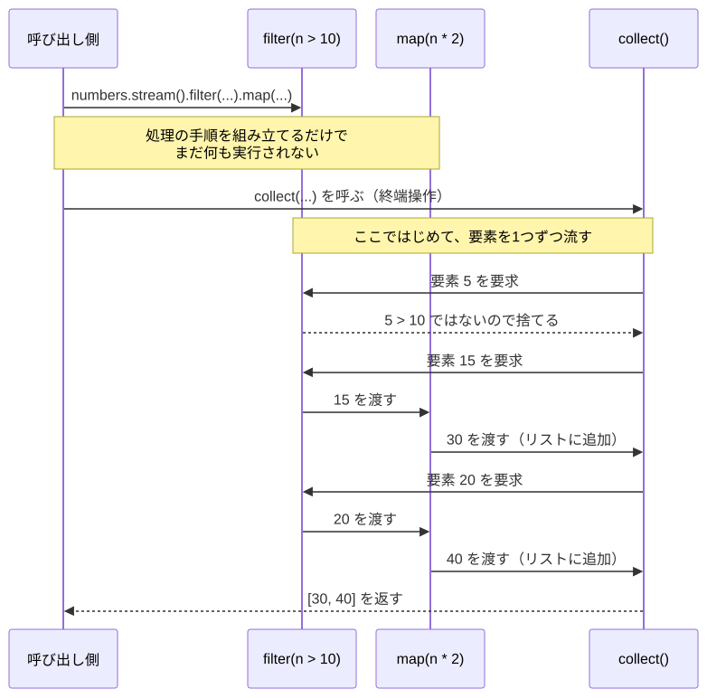

# <b>12章</b> <span>Stream APIと高度なコレクション操作</span> <small>宣言的なデータ処理技法を覚えよう</small>

## 本章の学習目標

### この章で学ぶこと

1. Stream APIの基本
    - 宣言的データ処理、中間操作と終端操作、遅延評価のしくみ
2. Optional型
    - nullになりうる値を型で示す方法、値の取り出し、map・flatMapによる連結
3. 高度なコレクション操作
    - フィルタリング、マッピング、リダクション、グルーピング
4. Collectorsの活用
    - 標準のCollectors、グルーピングを使った集計処理
5. 並列ストリーム
    - マルチコア環境での並列処理、性能向上と注意点

### この章を始める前に

第9章のコレクションフレームワーク、第10章のジェネリクス、第11章「ラムダ式と関数型インターフェイス」を理解していれば準備完了です。

List・Set・Mapの実装クラス（`ArrayList`と`LinkedList`、`HashSet`・`LinkedHashSet`・`TreeSet`など）の特徴と選び方は、第9章で学びました。
本章のサンプルで実装クラスの選び方に迷ったら、第9章の「コレクションの選択指針」を読み返してください。

## Stream APIによる現代的なコレクション操作

Java 8で導入されたStream APIは、コレクションの要素の集まりを「データの流れ（ストリーム）」<span class="footnote">Stream APIのストリームは、第14章で学ぶ`InputStream`などの入出力のストリームとは別のしくみです。</span>として扱い、その流れに対してさまざまな処理を連結（パイプライン化）していくしくみです。

### なぜStream APIが必要なのか？

従来のコレクション操作では、forループとif文を組み合わせた命令型のコードを書いていました。
この書き方では、ループが入れ子になったり条件分岐が複雑になったりすると、コードが何をしたいのかが読み取りにくくなります。
また、処理の中身がループの構造と一体になっているため、一部の処理だけを取り出して別の場所で使い回すのも困難です。
さらに、マルチコアCPUを生かして並列に処理しようとすると、スレッドを自分で管理する複雑なコードが必要でした。

Stream APIは、関数型プログラミングの考え方を取り入れて、これらの課題を解決します。
データ処理を「変換のパイプライン」として表現するので、何をするのかが読み取りやすい宣言的なコードになります<span class="footnote">nullチェックがコードのあちこちに散らばり、NullPointerExceptionの危険が残る問題は、Stream APIではなく本章で後に学ぶ`Optional`が扱います。</span>。

### 遅延評価のしくみ

Stream APIの重要な特徴の1つが遅延評価（Lazy Evaluation）です<span class="footnote">Haskellのように、遅延評価を言語全体の基本にしている言語もあります。C言語の`&&`と`||`が、左辺で結果が決まると右辺を評価しないのも、必要になるまで計算しないという点で似た考え方です。</span>。
中間操作（filter、mapなど）は、終端操作（collect、forEachなど）が呼ばれるまで実際には実行されません。
実際に必要になるまで計算しないので、結果に使われない要素の計算を避けられます。
メモリ効率がよくなるのも利点です。
また、要素が無限に続くストリームでも、必要な分だけを取り出して処理できます。

この遅延評価の動作を具体的なコードで見てみましょう。以下のコードは、遅延評価がどのタイミングで実行されるかを実際に確認できる例です。

<span class="listing-number">**サンプルコード12-1**</span>

```java
// この時点ではまだフィルタリングは実行されない
Stream<Integer> stream = numbers.stream()
    .filter(n -> {
        IO.println("Filtering: " + n);
        return n > 10;
    });

// collect()が呼ばれてはじめてフィルタリングが実行される
List<Integer> result = stream.collect(Collectors.toList());
```

次の図は、`numbers`が`[5, 15, 20]`のときに`filter`と`map`をつないだ場合の動きです。終端操作の`collect`を呼ぶまで何も実行されず、呼んだあとは要素が1つずつ、すべての操作を通っていきます。

<div class="figure">



</div>

### Stream操作の基本パターン

Stream操作の基本の形は`コレクション.stream().中間操作1().中間操作2()...終端操作()`です。

<div class="figure">



</div>

#### ストリーム処理の3つのフェーズ

ストリーム処理は、生成、中間操作、終端操作の3つのフェーズで構成されます。

1つ目のフェーズはストリームの生成です。
主な生成方法は次のとおりです。

- `list.stream()`
    + コレクションからストリームを生成する
- `Arrays.stream(array)`
    + 配列からストリームを生成する
- `Stream.of(値1, 値2, ...)`
    + 個別の値からストリームを生成する
- `Stream.generate()`、`Stream.iterate()`
    + 無限ストリームを生成する

2つ目のフェーズは中間操作（Intermediate Operations）です。
中間操作は新しいストリームを返すため、メソッドチェインで連結できます。
主な中間操作は次のとおりです。

- `filter(Predicate)`
    + 条件に合う要素のみを通過させる
- `map(Function)`
    + 各要素を別の形に変換する
- `flatMap(Function)`
    + ネストした構造を平坦化する
- `sorted()`
    + 要素をソートする
- `distinct()`
    + 重複を除去する
- `limit(n)`
    + 最初のn個の要素に制限する
- `skip(n)`
    + 最初のn個の要素をスキップする

3つ目のフェーズは終端操作（Terminal Operations）です。
終端操作はストリームを「消費」し、結果を生成します。終端操作が呼ばれてはじめて、すべての処理が実行されます。
主な終端操作は次のとおりです。

- `collect(Collector)`
    + 結果を収集する（もっとも柔軟な終端操作）
- `forEach(Consumer)`
    + 各要素に対して処理を実行する
- `count()`
    + 要素数を返す
- `reduce(BinaryOperator)`
    + 要素を集約して単一の結果を生成する
- `anyMatch(Predicate)`
    + いずれかの要素が条件を満たすかを判定する
- `allMatch(Predicate)`
    + すべての要素が条件を満たすかを判定する
- `findFirst()`、`findAny()`
    + 最初の要素、または任意の要素を取得する

### `filter`: 条件に合う要素だけを抽出

`filter`は、条件（`Predicate`）に一致する要素だけを残します。学生のリストから高得点者を抽出する例で確認してみましょう。以下のコードは、filter操作の基本的な使い方を示しています。
`Student`は名前・点数・身長を持つクラスで、定義はサンプルコード12-4で示します。

<span class="listing-number">**サンプルコード12-2**</span>

```java
List<Student> list = ...;
// 点数が90点以上の生徒だけを抽出
List<Student> highScorers = list.stream()
    .filter(s -> s.getScore() >= 90)
    .collect(Collectors.toList());
```

結果をリストに集めるには、終端操作の`collect`に`Collectors.toList()`を渡します<span class="footnote">Java 16以降は、`collect(Collectors.toList())`の代わりに`toList()`とも書けます。`toList()`が返すリストには、要素を追加したり変更したりできません。</span>。

### `map`: 要素を別の形に変換

`map`は、各要素に関数（`Function`）を適用し、別の値に変換します。学生オブジェクトから名前だけを抽出する例です。以下のコードは、map操作を使った型変換の実例を示しています。
`list`はサンプルコード12-2と同じ`Student`のリストです。

<span class="listing-number">**サンプルコード12-3**</span>

```java
// 生徒のリストから、名前のリストを生成
List<String> names = list.stream()
    .map(Student::getName)
    .collect(Collectors.toList());
```

### `sorted`による並べ替え

`sorted`は、要素を並べ替えたストリームを返す中間操作です。
引数なしの`sorted()`は自然な順序（文字列ならアルファベット順）<span class="footnote">正確には、文字列は文字コード（UTF-16）の値の順に並びます。そのため大文字は小文字より前に並び、漢字は読みの順になりません。</span>で並べ、`Comparator`を渡すとその比較条件で並べます。
`Comparator`をラムダ式やメソッド参照で組み立てる方法（`comparing`・`thenComparing`・`reversed`）は、第11章で学びました。
次のサンプルでは、本章で使う`Student`クラス（名前・点数・身長）を定義し、Streamで並べ替えます。

<span class="listing-number">**サンプルコード12-4**　AdvancedSortExample.java</span>

```java
import java.util.ArrayList;
import java.util.Comparator;
import java.util.List;
import java.util.stream.Collectors;

class Student {
    String name;
    int score;
    int height;
    public Student(String name, int score, int height) { this.name = name; this.score = score; this.height = height; }
    public String getName() { return name; }
    public int getScore() { return score; }
    public int getHeight() { return height; }
    @Override public String toString() { return name + "(score:" + score + ", height:" + height + ")"; }
}

public class AdvancedSortExample {
    public static void main(String[] args) {
        List<Student> students = new ArrayList<>();
        students.add(new Student("Bob", 92, 170));
        students.add(new Student("Alice", 85, 165));
        students.add(new Student("Charlie", 92, 180));

        // 点数が高い順、同じ点数の場合は身長が高い順に並べる
        List<Student> sorted = students.stream()
            .sorted(Comparator.comparingInt(Student::getScore).reversed()
                .thenComparing(Comparator.comparingInt(Student::getHeight).reversed()))
            .collect(Collectors.toList());

        IO.println(sorted);
        IO.println("元のリスト: " + students); // 元のリストの並びは変わらない
    }
}
```

実行結果：

```
[Charlie(score:92, height:180), Bob(score:92, height:170), Alice(score:85, height:165)]
元のリスト: [Bob(score:92, height:170), Alice(score:85, height:165), Charlie(score:92, height:180)]
```

`List`の`sort`メソッドはリストそのものを並べ替えます。
一方、`sorted`は元のリストを変えず、並べ替えた結果を新しいリストとして受け取ります。
`Student`クラスは、本章のこの後のサンプルでも使います。

### 組み合わせた例

実際のStream APIの威力は、複数の操作を組み合わせたときに発揮されます。以下は、複数の条件でフィルタリングし、変換、ソートを順次実行する例です。

<span class="listing-number">**サンプルコード12-5**　StreamExample.java</span>

```java
import java.util.ArrayList;
import java.util.List;
import java.util.stream.Collectors;

public class StreamExample {
    public static void main(String[] args) {
        List<Student> students = new ArrayList<>();
        students.add(new Student("Bob", 92, 170));
        students.add(new Student("Alice", 85, 165));
        students.add(new Student("David", 75, 170));
        students.add(new Student("Charlie", 92, 180));

        // 点数が80点より高く、身長が170cm以上の生徒の名前を、アルファベット順で取得する
        List<String> result = students.stream() // 1. ストリームを生成
            .filter(s -> s.getScore() > 80)      // 2. 点数でフィルタリング
            .filter(s -> s.getHeight() >= 170)   // 3. 身長でフィルタリング
            .map(Student::getName)               // 4. 名前に変換
            .sorted()                            // 5. アルファベット順にソート
            .collect(Collectors.toList());       // 6. 結果をリストに集約

        IO.println(result);
        // 出力: [Bob, Charlie]
    }
}
```
従来の`for`ループと`if`文を組み合わせるよりも、処理の流れが明確で読みやすいコードになるのがStream APIの大きな利点です。

## Optional型による安全なnull処理

### null参照の問題

JavaプログラミングにおいてNullPointerException（NPE）はもっとも頻繁に遭遇する実行時エラーの1つです。Tony Hoareは自身が発明したnull参照を「10億ドルの過ち」と呼びました。従来のJavaコードでは、nullチェックが至るところに散在し、コードの可読性と保守性を著しく低下させていました。

### Optional型の概念

Java 8で導入されたOptionalクラス<span class="footnote">同じ考え方の型は、HaskellのMaybeやScalaのOptionなど、ほかの言語にもあります。</span>は、「値が存在する場合と存在しない場合がある」という概念を型レベルで表現します。

メソッドの戻り値を`Optional`にすると、値が存在しない場合があることを型で示せます。
戻り値が`String`のままでは、nullが返るかどうかはドキュメントを読まないとわかりません。
また、`Optional`から値を取り出すには`orElse`などのメソッドを呼ぶので、値がない場合をどう扱うかを書く側が意識するようになります。
さらに、`map`、`filter`、`flatMap`などの操作をチェインして、値がある場合の処理をつなげて書けます。

### Optionalの作成

Optionalの基本的な使い方を理解するために、まずはOptionalオブジェクトの作成方法を見てみましょう。
Optionalオブジェクトは、`Optional.of()`・`Optional.ofNullable()`・`Optional.empty()`の3つのメソッドで作ります。

<span class="listing-number">**サンプルコード12-6**　OptionalCreationExample.java</span>

```java
import java.util.Optional;

public class OptionalCreationExample {
    public static void main(String[] args) {
        // 1. of() - null以外の値を持つOptionalを作成
        // nullを渡すとNullPointerExceptionが発生する
        Optional<String> presentValue = Optional.of("Hello");
        IO.println("of(): " + presentValue);  // Optional[Hello]
        
        // 2. ofNullable() - nullの可能性がある値をラップ
        // nullの場合は空のOptionalを返す
        String nullableString = null;
        Optional<String> nullableValue = Optional.ofNullable(nullableString);
        IO.println("ofNullable(null): " + nullableValue);  // Optional.empty
        
        String nonNullString = "World";
        Optional<String> nonNullValue = Optional.ofNullable(nonNullString);
        IO.println("ofNullable(\"World\"): " + nonNullValue);  // Optional[World]
        
        // 3. empty() - 空のOptionalを作成
        Optional<String> emptyValue = Optional.empty();
        IO.println("empty(): " + emptyValue);  // Optional.empty
    }
}
```

### 値の取得方法

Optionalから値を取得する方法は、安全性のレベルに応じて複数用意されています。以下のコードは、各種の値取得メソッドの使い方とその特徴を示しています。

<span class="listing-number">**サンプルコード12-7**　OptionalRetrievalExample.java（4〜42行目）</span>

```java
public class OptionalRetrievalExample {
    public static void main(String[] args) {
        Optional<String> present = Optional.of("Hello");
        Optional<String> empty = Optional.empty();
        
        // 1. get() - 値が存在しない場合はNoSuchElementExceptionを投げる
        // 空のときに例外になるので避ける（同じ働きの引数なしのorElseThrow()がJava 10で加わった）
        try {
            String value1 = present.get();
            IO.println("get() with value: " + value1);  // Hello
            
            String value2 = empty.get();  // 例外発生！
        } catch (NoSuchElementException e) {
            IO.println("get() on empty: " + e.getMessage());
        }
        
        // 2. orElse() - 値が存在しない場合のデフォルト値を指定
        String value3 = present.orElse("Default");
        String value4 = empty.orElse("Default");
        IO.println("orElse() with value: " + value3);     // Hello
        IO.println("orElse() on empty: " + value4);       // Default
        
        // 3. orElseGet() - 値が存在しない場合にSupplierから値を生成
        // orElseの引数は値があっても必ず評価されるが、Supplierは値がないときだけ呼ばれる
        String value5 = empty.orElseGet(() -> {
            IO.println("Generating default value...");
            return "Generated Default";
        });
        IO.println("orElseGet(): " + value5);  // Generated Default
        
        // 4. orElseThrow() - 値が存在しない場合に指定した例外を投げる
        try {
            String value6 = empty.orElseThrow(() -> 
                new IllegalStateException("値が存在しません"));
        } catch (IllegalStateException e) {
            IO.println("orElseThrow(): " + e.getMessage());
        }
    }
}
```

### 値の存在確認と条件付き処理

値の存在を確認し、存在する場合だけ処理を実行する方法を見ていきます。以下のコードは、Optionalの存在確認メソッドを使った条件付き処理の例です。

<span class="listing-number">**サンプルコード12-8**　OptionalPresenceExample.java</span>

```java
import java.util.Optional;

public class OptionalPresenceExample {
    public static void main(String[] args) {
        Optional<String> present = Optional.of("Hello");
        Optional<String> empty = Optional.empty();
        
        // 1. isPresent() - 値が存在するかをboolean値で返す
        if (present.isPresent()) {
            IO.println("isPresent: " + present.get());
        }
        
        // 2. isEmpty() - 値が存在しないかをboolean値で返す（Java 11以降）
        if (empty.isEmpty()) {
            IO.println("isEmpty: 値が存在しません");
        }
        
        // 3. ifPresent() - 値が存在する場合のみ処理を実行（関数型スタイル）
        present.ifPresent(value -> 
            IO.println("ifPresent: " + value));
        
        empty.ifPresent(value -> 
            IO.println("この行は実行されません"));
        
        // 4. ifPresentOrElse() - 値の有無で処理を分岐（Java 9以降）
        present.ifPresentOrElse(
            value -> IO.println("値あり: " + value),
            () -> IO.println("値なし")
        );
        
        empty.ifPresentOrElse(
            value -> IO.println("この行は実行されません"),
            () -> IO.println("空のOptional")
        );
    }
}
```

1の`isPresent()`で確かめてから`get()`で取り出す書き方は、nullチェックと変わらず、確かめ忘れると例外になります。
値を使う処理は、3の`ifPresent()`や4の`ifPresentOrElse()`で書くようにします（後の「アンチパターンと注意点」でも取り上げます）。

### Optionalの変換操作

Optionalは関数型プログラミングのコンテナーとして、map、flatMap、filterなどの操作をサポートします。以下のコードは、Optional内の値を安全に変換・操作する方法を示しています。

<span class="listing-number">**サンプルコード12-9**　OptionalTransformationExample.java（3〜6、13〜16、18〜49行目）</span>

```java
public class OptionalTransformationExample {
    static class User {
        private final String name;
        private final String email;  // メールアドレスがないときはnull
        // ...
        public String getName() { return name; }
        // フィールドはOptionalにせず、戻り値で「値がないかもしれない」ことを示す
        public Optional<String> getEmail() { return Optional.ofNullable(email); }
    }
    // ...
    public static void main(String[] args) {
        Optional<User> user = Optional.of(new User("Alice", "alice@example.com"));
        Optional<User> userWithoutEmail = Optional.of(new User("Bob", null));
        
        // 1. map() - 値が存在する場合に変換を適用
        Optional<String> userName = user.map(User::getName);
        IO.println("map: " + userName);  // Optional[Alice]
        
        // ネストしたmapの例
        Optional<Integer> nameLength = user
            .map(User::getName)
            .map(String::length);
        IO.println("Nested map: " + nameLength);  // Optional[5]
        
        // 2. flatMap() - Optional<Optional<T>>を平坦化
        // getEmailはOptional<String>を返すので、mapではOptional<Optional<String>>になる
        Optional<String> email = user.flatMap(u -> u.getEmail());
        IO.println("flatMap: " + email);  // Optional[alice@example.com]
        
        Optional<String> noEmail = userWithoutEmail.flatMap(u -> u.getEmail());
        IO.println("flatMap (no email): " + noEmail);  // Optional.empty
        
        // 3. filter() - 条件を満たす場合のみ値を保持
        Optional<User> longNameUser = user
            .filter(u -> u.getName().length() > 3);
        IO.println("filter (passed): " + longNameUser.isPresent());  // true
        
        Optional<User> shortNameUser = user
            .filter(u -> u.getName().length() > 10);
        IO.println("filter (failed): " + shortNameUser.isPresent());  // false
    }
}
```

実行結果：

```
map: Optional[Alice]
Nested map: Optional[5]
flatMap: Optional[alice@example.com]
flatMap (no email): Optional.empty
filter (passed): true
filter (failed): false
```

### Stream APIとの連携

OptionalはStream APIと密接に連携し、ストリーム処理の結果としてよく使用されます。以下のコードは、Stream操作でOptionalを活用する実践的な例です。

<span class="listing-number">**サンプルコード12-10**　OptionalStreamExample.java（7〜8、19、21〜22、27〜59、60行目）</span>

```java
public class OptionalStreamExample {
    static class Product {
    // ...
    }
    // ...
    public static void main(String[] args) {
        List<Product> products = Arrays.asList(
        // ...
        );
        
        // findFirst() - 最初の要素をOptionalで返す
        Optional<Product> firstExpensive = products.stream()
            .filter(p -> p.getPrice() > 100)
            .findFirst();
        
        firstExpensive.ifPresent(p -> 
            IO.println("最初の高額商品: " + p.getName()));
        
        // findAny() - 任意の要素をOptionalで返す（並列処理に最適）
        Optional<Product> anyProduct = products.parallelStream()
            .filter(p -> p.getPrice() < 50)
            .findAny();
        
        IO.println("安価な商品: " + 
            anyProduct.map(Product::getName).orElse("なし"));
        
        // max/min - 最大値・最小値をOptionalで返す
        Optional<Product> mostExpensive = products.stream()
            .max((p1, p2) -> Double.compare(p1.getPrice(), p2.getPrice()));
        
        mostExpensive.ifPresent(p -> 
            IO.println("最高額商品: " + p.getName() + " ($" + p.getPrice() + ")"));
        
        // OptionalをStreamに変換（Java 9以降）
        List<String> expensiveProductNames = products.stream()
            .map(p -> p.getPrice() > 500 ? Optional.of(p.getName()) : Optional.<String>empty())
            .flatMap(Optional::stream)  // Optional -> Stream変換
            .collect(Collectors.toList());
        
        IO.println("高額商品リスト: " + expensiveProductNames);
    }
}
```

実行結果：

```
最初の高額商品: Laptop
安価な商品: Mouse
最高額商品: Laptop ($1200.0)
高額商品リスト: [Laptop]
```

### 実践的な使用例

実際のアプリケーションでOptionalを効果的に使用する例を見てみましょう。以下のコードは、データベース検索や設定値取得といった実用的なシナリオでのOptional活用例です。

<span class="listing-number">**サンプルコード12-11**　OptionalPracticalExample.java（5〜8、15〜19、21、34〜37、39、48〜59、61〜90行目）</span>

```java
public class OptionalPracticalExample {
    // データベースの代わりとなるメモリ内ストレージ
    static class UserRepository {
        private Map<Long, User> users = new HashMap<>();
        // ...
        // Optionalを返すことで、ユーザーが見つからない可能性を明示
        public Optional<User> findById(Long id) {
            return Optional.ofNullable(users.get(id));
        }
    }
    // ...
    static class User {
        // ...
        public Optional<String> getEmail() { 
            return Optional.ofNullable(email); 
        }
    }
    // ...
    static class ConfigService {
        // ...
        // 設定値の取得（存在しない可能性を考慮）
        public Optional<String> getConfig(String key) {
            return Optional.ofNullable(config.get(key));
        }
        
        // タイムアウト値の取得（デフォルト値付き）
        public int getTimeout() {
            return getConfig("app.timeout")
                .map(Integer::parseInt)
                .orElse(30);  // デフォルト30秒
        }
    }
    // ...
    public static void main(String[] args) {
        UserRepository repo = new UserRepository();
        ConfigService config = new ConfigService();
        
        // データベース検索の例
        Long userId = 1L;
        String emailDomain = repo.findById(userId)
            .flatMap(User::getEmail)
            .map(email -> email.substring(email.indexOf("@") + 1))
            .orElse("ドメインなし");
        
        IO.println("ユーザー " + userId + " のメールドメイン: " + emailDomain);
        
        // 存在しないユーザーの処理
        Long nonExistentId = 999L;
        repo.findById(nonExistentId)
            .ifPresentOrElse(
                user -> IO.println("ユーザー名: " + user.getName()),
                () -> IO.println("ユーザーID " + nonExistentId + " は存在しません")
            );
        
        // 設定値の取得
        String appName = config.getConfig("app.name")
            .orElse("Unknown App");
        IO.println("アプリケーション名: " + appName);
        
        int timeout = config.getTimeout();
        IO.println("タイムアウト値: " + timeout + "秒");
    }
}
```

実行結果：

```
ユーザー 1 のメールドメイン: example.com
ユーザーID 999 は存在しません
アプリケーション名: MyApp
タイムアウト値: 30秒
```

### アンチパターンと注意点

Optionalを使う際に避けるべき間違いと、その代わりの書き方を示します。

<span class="listing-number">**サンプルコード12-12**　OptionalAntiPatternsExample.java（5〜58、67〜68行目）</span>

```java
public class OptionalAntiPatternsExample {
    static class BadExample {
        // アンチパターン1: フィールドにOptionalを使用（避けるべき）
        private Optional<String> name = Optional.empty();  // 悪い例
        
        // アンチパターン2: メソッド引数にOptionalを使用（避けるべき）
        public void processUser(Optional<String> userName) {  // 悪い例
            // 処理...
        }
        
        // アンチパターン3: コレクションをOptionalで包んで返す（避けるべき）
        public Optional<List<String>> getNames() {  // 悪い例
            // 空のリストを返すべき
            return Optional.empty();
        }
    }
    
    static class GoodExample {
        // 良い例1: フィールドは通常の型で、getterでOptionalを返す
        private String name;  // nullableフィールド
        
        public Optional<String> getName() {
            return Optional.ofNullable(name);
        }
        
        // 良い例2: メソッド引数は通常の型で、内部でOptionalに変換
        public void processUser(String userName) {
            Optional.ofNullable(userName)
                .filter(name -> !name.isEmpty())
                .ifPresent(name -> IO.println("Processing: " + name));
        }
        
        // 良い例3: コレクションは空のコレクションを返す
        public List<String> getNames() {
            // nullの代わりに空のリストを返す
            return names != null ? names : new ArrayList<>();
        }
        
        private List<String> names;
    }
    
    public static void main(String[] args) {
        // アンチパターン4: get()の過度な使用
        Optional<String> optional = Optional.of("value");
        
        // 悪い例：isPresentとgetの組み合わせ
        if (optional.isPresent()) {
            String value = optional.get();
            IO.println(value.toUpperCase());
        }
        
        // 良い例：mapを使用
        optional.map(String::toUpperCase)
            .ifPresent(IO::println);
            // ...
    }
}
```

### Optionalのベストプラクティス

ここまでの内容を、Optionalを使うときの心得としてまとめます。

まず、nullを返す可能性のあるメソッドは、戻り値の型を`Optional`にして、そのことを呼び出し側に明示します。
受け取った`Optional`は、`map`、`flatMap`、`filter`をつないで、何をするのかが読み取れる宣言的なコードで処理します。
値がないときのデフォルト値は`orElse`か`orElseGet`で与えます。
`orElse`の引数は値があっても必ず評価されるので、デフォルト値を作るのに時間がかかる場合は、値がないときだけ呼ばれる`orElseGet`を使います。
値が存在しない場合の処理は、後回しにせず早い段階で済ませます。
また、Stream APIと組み合わせると、Optionalを返す操作の結果をそのまま次の処理へつなげられます。

Optionalをメソッドの戻り値やチェイン操作で使うと、NullPointerExceptionを防ぎ、安全で読みやすいコードを書けます。

## 並列ストリームによるパフォーマンス向上

### マルチコア時代のプログラミング

現代のCPUは複数のコアを持ち、複数の処理を同時に実行できます。しかし、従来のループ処理はシングルスレッドで実行されるため、1つのコアしか使用しません。Stream APIの並列ストリームを使うと、データ処理を自動的に複数のコアに分散して実行できます。

並列ストリームの内部では複数のスレッドが動きます。
スレッドと、複数のスレッドから安全にデータを扱うための考え方（スレッドセーフティ）は、第15章「マルチスレッドプログラミング」で詳しく学びます。

### 並列ストリームの使い方

並列ストリームの使用は非常に簡単で、`.stream()`の代わりに`.parallelStream()`を使うだけです。

<span class="listing-number">**サンプルコード12-13**</span>

```java
List<Integer> numbers = List.of(1, 2, 3, 4, 5, 6, 7, 8, 9, 10);

// シーケンシャル（直列）処理: 偶数の2乗の合計
long sum = numbers.stream()
    .filter(n -> n % 2 == 0)
    .mapToLong(n -> n * n)
    .sum();
IO.println("シーケンシャル処理の結果: " + sum);

// 並列処理
long sumParallel = numbers.parallelStream()
    .filter(n -> n % 2 == 0)
    .mapToLong(n -> n * n)
    .sum();
IO.println("並列処理の結果: " + sumParallel);
```

実行結果：

```
シーケンシャル処理の結果: 220
並列処理の結果: 220
```

### 並列ストリームの内部動作

並列ストリームは、JavaのFork/Joinフレームワーク<span class="footnote">Fork/JoinフレームワークはJava 7で加わったしくみで、第15章で学びます。並列ストリームは共通のスレッドプール（`ForkJoinPool.commonPool()`）を使い、そのスレッド数は既定でCPUのコア数より1少ない数です。</span>を使用して実装されています。処理の流れは以下のようになります。

1. 分割（Split）
    + データを複数の小さなチャンクに分割
2. 処理（Process）
    + 各チャンクを異なるスレッドで並列に処理
3. 統合（Combine）
    + 各スレッドの結果を統合して最終結果を生成

<div class="figure">



</div>

<span class="listing-number">**サンプルコード12-14**　ParallelStreamExample.java</span>

```java
import java.util.stream.IntStream;
import java.time.Duration;
import java.time.Instant;

public class ParallelStreamExample {
    public static void main(String[] args) {
        int size = 100_000_000;
        
        // シーケンシャル処理の計測
        Instant start = Instant.now();
        double sumSeq = IntStream.range(0, size)
            .mapToDouble(Math::sqrt)
            .sum();
        Duration seqTime = Duration.between(start, Instant.now());
        
        // 並列処理の計測
        start = Instant.now();
        double sumPar = IntStream.range(0, size)
            .parallel()
            .mapToDouble(Math::sqrt)
            .sum();
        Duration parTime = Duration.between(start, Instant.now());
        
        IO.println("シーケンシャル: " + seqTime.toMillis() + "ms");
        IO.println("並列: " + parTime.toMillis() + "ms");
        IO.println("高速化率: %.1f倍".formatted(
            (double) seqTime.toMillis() / parTime.toMillis()));
    }
}
```

実行結果：

```
シーケンシャル: 304ms
並列: 62ms
高速化率: 4.9倍
```

計測した時間と高速化率は、CPUのコア数や実行のたびに変わります<span class="footnote">先に測る直列の処理には、JITコンパイラーがコードを最適化する前の遅い時間も含まれるため、高速化率が大きめに出ることがあります。正確に比べるには、同じ処理を何度か実行してから測ります。</span>。

### 並列ストリームの注意点

並列ストリームは強力な機能ですが、すべての状況で性能が向上するわけではありません。

#### オーバーヘッドの問題
並列ストリームでは、データの分割や結果の統合、スレッドどうしの処理の受け渡しに手間がかかります。データ量が少ない場合、このオーバーヘッドが並列化の利点を上回ることがあります。

#### スレッドセーフティ
並列処理では、複数のスレッドが同じデータにアクセスする可能性があるため、スレッドセーフでない操作は避ける必要があります。

<span class="listing-number">**サンプルコード12-15**</span>

```java
// スレッドセーフでない例（避けるとよい）
List<Integer> unsafeResults = new ArrayList<>();  // スレッドセーフでない
numbers.parallelStream()
    .forEach(n -> unsafeResults.add(n * 2));  // データ競合の危険！

// スレッドセーフな代替方法
List<Integer> safeResults = numbers.parallelStream()
    .map(n -> n * 2)
    .collect(Collectors.toList());  // スレッドセーフ
```

#### 順序の保証
並列ストリームでは、`forEach`で要素を処理する順序や`findAny`が返す要素は、実行のたびに変わることがあります。
一方、`collect`や`forEachOrdered`は、並列ストリームでも元の要素の順序を保ちます。
サンプルコード12-15の`collect(Collectors.toList())`の結果も、元のリストと同じ順に並びます。

### 並列ストリームを使うとよい場合

以下の条件がそろった場合に、並列ストリームの使用を検討しましょう。

1. 大量のデータ
    + 数千以上の要素を処理する場合
2. CPU集約的な処理
    + 各要素の処理に計算コストがかかる場合
3. 状態を共有しない処理
    + 各要素が独立して処理できる場合
4. 要素の順序に縛られない処理
    + `findFirst`や`limit`のように順序を守る操作は、並列では順序をそろえる手間がかかり、速くなりにくい

## 高度なStream操作

### flatMapによる複雑なデータ変換

`flatMap`は、ネストした構造を平坦化するために使用される重要な操作です。各要素をストリームに変換し、それらをすべて結合して1つのストリームにします。これは、リストのリストを単一のリストに変換する場合や、文字列を単語に分割する場合などにとくに有用です。

<div class="figure">



</div>

<span class="listing-number">**サンプルコード12-16**　FlatMapExample.java</span>

```java
import java.util.Arrays;
import java.util.List;
import java.util.stream.Collectors;

public class FlatMapExample {
    public static void main(String[] args) {
        List<List<String>> nestedList = Arrays.asList(
            Arrays.asList("Java", "Python"),
            Arrays.asList("JavaScript", "Go"),
            Arrays.asList("Rust", "C++")
        );
        
        // flatMapを使ってネストしたリストを平坦化する
        // この例では、リストのリストから単一の文字列リストを作成
        List<String> flatList = nestedList.stream()
            .flatMap(List::stream)  // 各内部リストをストリームに変換して結合
            .collect(Collectors.toList());
        
        IO.println(flatList);
        // 出力: [Java, Python, JavaScript, Go, Rust, C++]
        
        // 文字列を単語に分割する例
        List<String> sentences = Arrays.asList(
            "Hello world",
            "Java programming",
            "Stream API"
        );
        
        // 各文字列を単語に分割し、すべての単語を1つのリストにまとめる
        List<String> words = sentences.stream()
            .flatMap(sentence -> Arrays.stream(sentence.split(" ")))
            .collect(Collectors.toList());
        
        IO.println(words);
        // 出力: [Hello, world, Java, programming, Stream, API]
    }
}
```

実行結果：

```
[Java, Python, JavaScript, Go, Rust, C++]
[Hello, world, Java, programming, Stream, API]
```

`flatMap`は、一対多の関係を持つデータを処理する際に非常に強力です。各学生が複数の科目を履修している場合など、実世界のデータ構造でよく遭遇するパターンを簡潔に処理できます。

### reduceによる集約処理

`reduce`操作<span class="footnote">mapとreduceは、Lispなどの関数型言語で古くから使われてきた名前です。Googleが2004年に発表した大規模データ処理のしくみMapReduceも、この2つの関数から名前を取っています。</span>は、ストリームの要素を単一の結果に集約するための柔軟な方法を提供します。合計、最大値、最小値の計算や、文字列の結合など、カスタムの集約処理を実装できます。

<span class="listing-number">**サンプルコード12-17**　ReduceExample.java（5〜25、39〜40行目）</span>

```java
public class ReduceExample {
    public static void main(String[] args) {
        List<Integer> numbers = Arrays.asList(1, 2, 3, 4, 5);
        
        // 基本的なreduce操作：数値の合計を計算
        // reduce(初期値, 二項演算子)の形式
        int sum = numbers.stream()
            .reduce(0, (a, b) -> a + b);  // 初期値0から開始し、各要素を加算
        IO.println("合計: " + sum); // 出力: 合計: 15
        
        // より複雑な例：最大値を求める（初期値なし）
        // この場合、空のストリームの可能性があるためOptionalが返される
        Optional<Integer> max = numbers.stream()
            .reduce((a, b) -> a > b ? a : b);
        max.ifPresent(value -> IO.println("最大値: " + value)); // 出力: 最大値: 5
        
        // 文字列の結合例
        List<String> words = Arrays.asList("Java", "is", "awesome");
        String sentence = words.stream()
            .reduce("", (result, word) -> result.isEmpty() ? word : result + " " + word);
        IO.println(sentence); // 出力: Java is awesome
        // ...
    }
}
```

実行結果：

```
合計: 15
最大値: 5
Java is awesome
平均点: 85.0
```

`reduce`は非常に強力ですが、多くの一般的な集約操作には専用のメソッド（`sum()`, `max()`, `min()`など）や`collect()`操作が用意されているため、それらを優先して使用することが推奨されます<span class="footnote">`reduce`を並列ストリームで使うときは、渡す演算が結合法則を満たす（`(a + b) + c`と`a + (b + c)`が等しい）ことが条件です。初期値には、足し算なら0のように、結果を変えない値を渡します。</span>。

### Collectorsによる高度なデータ収集

`Collectors`クラスは、ストリームの要素をさまざまな形で収集するための豊富なメソッドを提供します。単純なリスト作成から、複雑なグループ化や統計処理まで対応できます。

<span class="listing-number">**サンプルコード12-18**　CollectorsExample.java</span>

```java
import java.util.Arrays;
import java.util.List;
import java.util.Map;
import java.util.stream.Collectors;

public class CollectorsExample {
    public static void main(String[] args) {
        List<Student> students = Arrays.asList(
            new Student("Alice", 85, 165),
            new Student("Bob", 92, 170),
            new Student("Charlie", 78, 180),
            new Student("David", 92, 175),
            new Student("Eve", 88, 160)
        );
        
        // 基本的なcollect操作：リストへの収集
        // 高得点（85点以上）の学生の名前をリストで取得
        List<String> highScorers = students.stream()
            .filter(s -> s.getScore() >= 85)
            .map(Student::getName)
            .collect(Collectors.toList());
        IO.println("高得点者: " + highScorers);
        
        // グループ化の例：点数でグループ分け
        // 同じ点数の学生をグループ化する実用的な例
        Map<Integer, List<Student>> scoreGroups = students.stream()
            .collect(Collectors.groupingBy(Student::getScore));
        IO.println("点数別グループ: " + scoreGroups);
        
        // より複雑な変換：条件による分類
        // 80点以上かどうかで学生を分類
        Map<Boolean, List<Student>> passFail = students.stream()
            .collect(Collectors.partitioningBy(s -> s.getScore() >= 80));
        IO.println("合格者: " + passFail.get(true).size() + "人");
        IO.println("不合格者: " + passFail.get(false).size() + "人");
    }
}
```

実行結果：

```
高得点者: [Alice, Bob, David, Eve]
点数別グループ: {85=[Alice(score:85, height:165)], 88=[Eve(score:88, height:160)], 92=[Bob(score:92, height:170), David(score:92, height:175)], 78=[Charlie(score:78, height:180)]}
合格者: 4人
不合格者: 1人
```

`Collectors.groupingBy()`は、データを特定の条件でグループ化する際に非常に強力で、データ分析やレポート作成において頻繁に使用されます。データベースのGROUP BY句<span class="footnote">SQL（Structured Query Language）は、データベースを操作するための言語です。`GROUP BY`句は、同じ値を持つ行をまとめて集計します。</span>に相当する処理をJavaのコード内で簡潔に実現できます。

### nullを含むデータの処理

要素に`null`が混ざったリストをStreamで処理するときは、`filter`で`null`を取り除いてから変換します。
`Objects::nonNull`は、`name -> name != null`と同じ判定をするメソッド参照です。
値が1つだけで、それが存在しない場合もあるときは、本章の「Optional型による安全なnull処理」で学んだ`Optional`を使います。

<span class="listing-number">**サンプルコード12-19**　NullSafeProcessingExample.java</span>

```java
import java.util.Arrays;
import java.util.List;
import java.util.Objects;
import java.util.stream.Collectors;

public class NullSafeProcessingExample {
    public static void main(String[] args) {
        // nullが混入する可能性があるデータ
        List<String> namesWithNull = Arrays.asList("Alice", null, "Bob", "", "Charlie");
        
        // nullや空文字列を取り除いてから変換する
        List<String> validNames = namesWithNull.stream()
            .filter(Objects::nonNull)           // nullを除外
            .filter(name -> !name.trim().isEmpty()) // 空文字列を除外
            .map(String::toUpperCase)           // 大文字に変換
            .collect(Collectors.toList());
        
        IO.println("有効な名前: " + validNames);
        // 出力: 有効な名前: [ALICE, BOB, CHARLIE]
    }
}
```

実行結果：

```
有効な名前: [ALICE, BOB, CHARLIE]
```

### 早期終了操作の活用

Stream APIには、すべての要素を処理せずに早期に結果を返す操作があります。これらは大量のデータを高速に処理する際に重要です。
次のサンプルの`peek`は、要素をそのまま次へ渡しながら途中の値を確かめる処理をはさむ中間操作で、主にデバッグに使います。

<span class="listing-number">**サンプルコード12-20**　ShortCircuitExample.java</span>

```java
import java.util.Arrays;
import java.util.List;
import java.util.stream.Collectors;

public class ShortCircuitExample {
    public static void main(String[] args) {
        List<Integer> numbers = Arrays.asList(1, 2, 3, 4, 5, 6, 7, 8, 9, 10);
        
        // 早期終了操作：allMatchは条件を満たさない要素が見つかった時点で処理を停止
        // すべての要素が偶数かチェック（1つでも奇数があればfalse）
        boolean allEven = numbers.stream()
            .peek(n -> IO.println("チェック中: " + n)) // 処理の流れを観察
            .allMatch(n -> n % 2 == 0);
        IO.println("すべて偶数: " + allEven);
        
        // いずれかの要素が条件を満たすかチェック
        boolean hasLargeNumber = numbers.stream()
            .anyMatch(n -> n > 7);
        IO.println("7より大きい数あり: " + hasLargeNumber);
        
        // 最初のn個に制限して処理
        List<Integer> firstThree = numbers.stream()
            .limit(3)  // 最初の3要素のみ処理
            .collect(Collectors.toList());
        IO.println("最初の3つ: " + firstThree);
    }
}
```

実行結果：

```
チェック中: 1
すべて偶数: false
7より大きい数あり: true
最初の3つ: [1, 2, 3]
```

早期終了操作は、とくに大量のデータや無限ストリームを扱う際に、パフォーマンスの向上とメモリ効率の最適化に大きく貢献します。

### 実用的なtoArray操作

ストリーム処理の結果を配列として取得したい場合、`toArray()`メソッドを使用します。引数なしの`toArray()`は`Object[]`を返します。
`String[]`のように要素の型に合った配列を受け取るには、`String[]::new`のような配列のコンストラクター参照を渡します。

<span class="listing-number">**サンプルコード12-21**　ToArrayExample.java</span>

```java
import java.util.Arrays;
import java.util.List;

public class ToArrayExample {
    public static void main(String[] args) {
        List<String> names = Arrays.asList("Alice", "Bob", "Charlie", "David");
        
        // toArrayの正しい使い方：型安全な配列を取得
        // String[]::newを指定することで、正しい型の配列が生成される
        String[] nameArray = names.stream()
            .filter(name -> name.length() > 3)  // 3文字より長い名前のみ
            .map(String::toUpperCase)           // 大文字に変換
            .toArray(String[]::new);            // String配列として取得
        
        IO.println("結果配列: " + Arrays.toString(nameArray));
        // 出力: 結果配列: [ALICE, CHARLIE, DAVID]
        
        // String[]::newは、配列の大きさを受け取って配列を作るラムダ式と同じ意味
        String[] sizedArray = names.stream()
            .toArray(size -> new String[size]);
        IO.println("サイズ指定配列: " + Arrays.toString(sizedArray));
    }
}
```

実行結果：

```
結果配列: [ALICE, CHARLIE, DAVID]
サイズ指定配列: [Alice, Bob, Charlie, David]
```

### 複雑な処理パイプラインの実装

実際のアプリケーションでは、複数のStream操作を組み合わせた複雑な処理パイプラインを構築することがよくあります。以下の例では、実用的なデータ処理シナリオを示します。

<span class="listing-number">**サンプルコード12-22**　ComplexProcessingExample.java（6〜8、16〜32、44〜45行目）</span>

```java
public class ComplexProcessingExample {
    public static void main(String[] args) {
        List<Student> students = Arrays.asList(
        // ...
        );
        
        // 複雑な処理：高得点者（85点以上）を身長でグループ化し、
        // 各グループで最高得点者の名前を取得
        Map<String, String> heightGroupTopScorers = students.stream()
            .filter(s -> s.getScore() >= 85)                    // 高得点者のみ
            .collect(Collectors.groupingBy(                     // 身長でグループ化
                s -> s.getHeight() >= 170 ? "高身長" : "標準身長",
                Collectors.collectingAndThen(                   // グループ内での最高得点者を取得
                    Collectors.maxBy((s1, s2) -> Integer.compare(s1.getScore(), s2.getScore())),
                    opt -> opt.map(Student::getName).orElse("該当者なし")
                )
            ));
        
        IO.println("身長グループ別最高得点者:");
        heightGroupTopScorers.forEach((group, name) -> 
            IO.println(group + ": " + name));
            // ...
    }
}
```

実行結果：

```
身長グループ別最高得点者:
標準身長: Grace
高身長: Bob

身長グループ別平均点:
標準身長: 89.3点
高身長: 86.0点
```

`groupingBy`が返す`Map`の種類は仕様で決められておらず（現在の実装は`HashMap`です）、グループの表示順は保証されません。
順序をそろえたい場合は、`groupingBy`の2番目の引数に`TreeMap::new`を渡します<span class="footnote">`Map`の種類を指定できるのは3つの引数をとる`groupingBy`で、3番目の引数にはグループごとの集め方（`Collectors.toList()`など）を渡します。</span>。

このような複雑な処理も、Stream APIを使用することで、従来のネストしたループや一時的な変数を使った処理よりもはるかに読みやすく、保守しやすいコードとして実装できます。

## よくあるエラーと対処法

Stream APIのエラーは、コンパイルエラーよりも、実行はできるのに期待した結果にならない誤りとして現れることが多いです。本章の内容に関連して出会いやすい誤りは次のとおりです。

- 中間操作の順序の誤り
    + `map()`で値を変換したあとに、変換前の値を前提にした`filter()`を書いてしまう
- 終端操作の書き忘れ
    + Streamは遅延評価なので、終端操作がないと中間操作は実行されない
- 並列ストリームでの共有データの変更
    + `parallelStream()`のなかから`ArrayList`などへ追加すると、結果が壊れる。`collect()`を使う
- `Optional`の誤用
    + `isPresent()`と`get()`の組み合わせではなく、`orElse()`や`ifPresent()`を使う
- 同じ処理の繰り返しによる性能の低下
    + 同じフィルタリングを何度も実行するなど、Streamの組み立て方で処理量が増える
- ラムダ式のなかでの検査例外
    + `Files.readString()`のような例外をスローするメソッドは、そのままではStreamのなかで使えない

エラーの例と問題点、修正したコード、共通の対処戦略は、GitHubリポジトリにまとめています。<br>
`https://github.com/Nagatani/techbook-java-primer/blob/main/appendix/h-common-errors/chapters/chapter12.md`

## まとめ

本章では、コレクションフレームワークの応用的な側面と、それを操るための現代的な手法を学びました。

- Stream API
    + `filter`, `map`, `sorted`, `collect`などの操作を連結することで、複雑なコレクション操作を直感的に記述できる
    + `sorted`に第11章で学んだ`Comparator`を渡すと、元のリストを変えずに並べ替えた結果を得られる
- Optional型
    + 値が存在しない場合があることを型で示し、その場合の扱い忘れによるNullPointerExceptionを減らす
- 並列ストリーム
    + マルチコアCPUを活用した並列処理により、大量データの高速処理が可能になる
- 高度なStream操作
    + `flatMap`によるデータ平坦化、`reduce`による集約処理、早期終了操作など、実用的な高度技術を習得できる

これらの知識を身につけることで、簡潔で、保守性が高く、そして読みやすいJavaコードを書くことが可能になります。

## 章末演習

### 演習課題へのアクセス
本章の演習課題は、GitHubリポジトリで提供されています。<br>
`https://github.com/Nagatani/techbook-java-primer/tree/main/exercises/chapter12/`

### 課題構成
- 本章の基本概念の理解確認
- 応用的な実装練習
- 実践的な総合問題

詳細な課題内容と実装のヒントは、各課題フォルダー内のREADME.mdを参照してください<span class="footnote">各課題フォルダーは`https://github.com/Nagatani/techbook-java-primer/tree/main/exercises/chapter12/`の下の`basic/`・`advanced/`・`challenge/`です。</span>。
