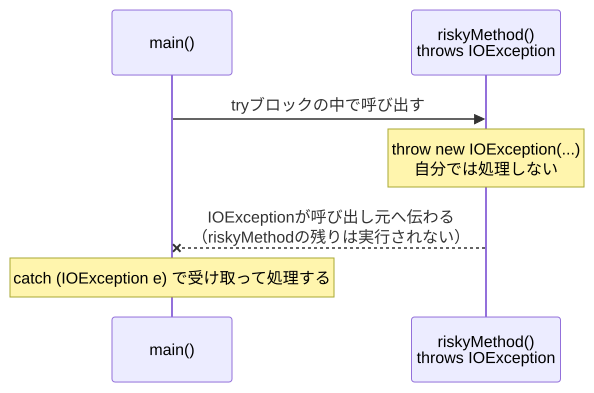

# <b>13章</b> <span>例外処理</span> <small>障害に強いプログラムの構築</small>

## 本章の学習目標

### この章で学ぶこと

1. 例外処理の基本
    - try-catch-finally構文、検査例外と非検査例外、例外の階層構造
2. リソース管理
    - try-with-resources、AutoCloseableインターフェイス、リソースリークの防止
3. カスタム例外
    - 独自の例外クラス設計、ビジネスロジックへの対応、例外の伝搬
4. 堅牢なシステム設計
    - リトライとサーキットブレーカー、ビジネス例外とシステム例外の分離、ログ記録

### この章を始める前に

第12章までの内容を理解していれば準備完了です。
後半の実践的なパターンでは、第10章「ジェネリクス」で学んだ型パラメーターと、第11章「ラムダ式と関数型インターフェイス」で学んだラムダ式も使います。

## エラーの種類と対処法

### ソフトウェアの信頼性とエラー処理

現代のソフトウェア開発では、システムの信頼性がきわめて重要です。
銀行システム、医療機器、自動運転など、プログラムの不具合が重大な結果を招く分野が増えています。
このような背景から、エラーの事前予測と組織的な管理、体系的な処理は、単なる技術的なスキルを超えて、ソフトウェアエンジニアの基本的な責任となっています。

プログラムを作成するうえで、予期しない状況やエラーへの対応は避けて通れません。
エラーは主に3つの種類に分けられます。

1つ目は構文エラー（Syntax Error）で、コードの文法的な誤りを指します。
コンパイラーがコンパイル時に見つけるので、修正しないとプログラムを実行できません。
2つ目は実行時エラー（Runtime Error）で、プログラムの実行中に起きる異常事態です。
本章で学ぶ「例外（Exception）」も、この実行時エラーの一種です。
3つ目は論理エラー（Logic Error）です。
プログラムはエラーなく動作しますが、実行結果が意図どおりになりません。
論理エラーは、デバッグで原因を特定し、ロジックを修正して直します。

本章では、とくに「実行時エラー」に焦点を当て、Javaの例外処理のしくみを学びます。

## 例外処理の基本: `try-catch-finally`

例外処理の基本的な流れは以下のようになります。

1. メソッド内で例外が発生すると、通常の処理フローが中断される
2. プログラムは呼び出しスタックをさかのぼり、例外の型に一致する例外ハンドラーを探す
3. 例外の型に一致する`catch`ブロックが見つかると、そこで例外が処理される
4. `finally`ブロックがあれば、必ず実行される

Javaでは、プログラム実行中に発生する「例外的状況」を例外 (Exception) オブジェクトとして表現し、これに対処するための専用の構文を提供しています<span class="footnote">C言語には例外のしくみがなく、関数の戻り値や`errno`でエラーを伝えるのが一般的です。呼び出し側が戻り値を確かめ忘れると、エラーに気づかないまま処理が進みます。</span>。例外が発生することを「例外がスローされる（投げられる）」と言います。

### `try-catch`ブロック

例外が発生する可能性のある処理は、`try`ブロックで囲みます。
`try`ブロックのなかで特定の型の例外が発生すると、その型に対応する`catch`ブロックが例外を捕捉（キャッチ）します。
`catch`ブロックには、捕捉した例外への対応を記述します。
`catch`ブロックは複数並べて書けるので、より具体的な例外から順に書きます。

以下のコードは、NullPointerExceptionが発生する状況とその対処方法を示しています。null参照に対してメソッドを呼び出すと例外が発生しますが、catch句でその例外を捕捉し、プログラムのクラッシュを防いで処理を継続させています。

<span class="listing-number">**サンプルコード13-1**　TryCatchSample.java</span>

```java
public class TryCatchSample {
    public static void main(String[] args) {
        try {
            String str = null;
            IO.println(str.length()); // ここでNullPointerExceptionが発生
            IO.println("この行は実行されません。");
        } catch (NullPointerException e) {
            System.err.println("NullPointerExceptionをキャッチしました！");
            e.printStackTrace(); // 開発中はスタックトレースを出力するとデバッグに役立つ
        } catch (Exception e) {
            System.err.println("その他の予期せぬ例外をキャッチしました。");
        }
        IO.println("プログラムは処理を継続しています。");
    }
}
```

実行結果：

```
NullPointerExceptionをキャッチしました！
java.lang.NullPointerException: Cannot invoke "String.length()" because "<local1>" is null
	at TryCatchSample.main(TryCatchSample.java:5)
プログラムは処理を継続しています。
```

この例は、例外が起きたときに処理が`catch`ブロックへ移るしくみを見るためのものです。
`NullPointerException`<span class="footnote">実行結果のように、nullだった式を示す詳しいメッセージはJava 14で加わり、Java 15から既定で表示されます。変数名が`<local1>`となるのは、クラスファイルにローカル変数の名前が残っていないためで、`javac -g`でコンパイルすると`str`と表示されます。</span>のような非検査例外は、本来は`catch`で受け止めるのではなく、nullのまま使わないようにコードを直して防ぎます（このあとの「検査例外と非検査例外」で説明します）。

### `finally`ブロック

`finally`ブロックは、`try`ブロック内で例外が発生したかどうかにかかわらず、必ず実行される処理を記述します。主に、ファイルやネットワーク接続などのリソースを解放する後片付け処理に使われます。

<div class="figure">



</div>

<span class="listing-number">**サンプルコード13-2**</span>

```java
// ...
try {
    // リソースを使う処理
} catch (Exception e) {
    // 例外発生時の処理
} finally {
    // 例外の有無にかかわらず、必ず実行される後片付け処理
    IO.println("finallyブロックが実行されました。");
}
```

### `try-with-resources`文 (推奨)

ファイルやネットワーク接続などのリソースは、使い終わったら必ず閉じます（closeします）。
閉じ忘れると、OSが管理するファイルの数などの資源を使い続けるリソースリークが起きます。
`finally`ブロックで閉じる書き方では、`close`メソッド自体も例外を投げうるため、`finally`のなかにさらに`try-catch`を書くことになり、コードが長くなります。

そこでJava 7で導入されたのが`try-with-resources`文です。
`AutoCloseable`インターフェイスを実装したリソース（ファイルストリームなど）を`try`の後ろの括弧内で宣言すると、`try`ブロックを抜けるときに`close`メソッドが自動的に呼ばれます。
例外で抜けた場合も同じです。
次のコードでは、ファイルを1行読み込む`BufferedReader`を自動的に閉じています。
ファイルを読み書きするクラスの使い方は、第14章「ファイルI/O」で詳しく学びます。

<span class="listing-number">**サンプルコード13-3**　TryWithResourcesSample.java</span>

```java
import java.io.BufferedReader;
import java.io.FileReader;
import java.io.IOException;

public class TryWithResourcesSample {
    public static void readFile(String path) {
        // try()の括弧内でリソースを初期化する
        try (BufferedReader br = new BufferedReader(new FileReader(path))) {
            IO.println(br.readLine());
        } catch (IOException e) {
            System.err.println("ファイル読み込みエラー: " + e.getMessage());
        }
        // tryブロックを抜ける際にbrが自動的にクローズされる
    }
}
```

実行結果：

```
存在するファイルを読み込み:
これはテストファイルです。

存在しないファイルを読み込み:
ファイル読み込みエラー: non_existent.txt (No such file or directory)
```

この実行結果は、テスト用のファイルと存在しないファイル`non_existent.txt`を順に`readFile`へ渡したときのものです。
`readFile`を呼び出す`main`メソッドは、全文の`TryWithResourcesDemo.java`にあります<span class="footnote">`https://github.com/Nagatani/techbook-java-primer/tree/main/sample-code/chapter13/13-03/`</span>。
例外のメッセージ（`No such file or directory`の部分）は、OSによって異なります。

`finally`ブロックに閉じる処理を書く必要はありません。
複数のリソースをまとめて宣言する書き方と、自作のクラスを`try-with-resources`で使えるようにする方法は、本章の「リソース管理の実践例」で学びます。

## 検査例外と非検査例外

### 例外クラスの階層構造

Javaの例外クラスは、`Throwable`クラスをルートとした階層構造を持っています。

<div class="figure">



</div>

この階層構造の設計には、「プログラマーが対処できる例外」と「システムレベルの重大なエラー」を区別するという明確な意図があります。

Javaの例外は、コンパイラーがその処理を強制するかどうかによって2種類に大別されます。

### 検査例外 (Checked Exception)

検査例外は、`IOException`や`SQLException`のように、`Exception`のサブクラスのうち`RuntimeException`の系統を除いたものです。
コンパイラーは、検査例外に対する処理（`try-catch`または`throws`）を強制します<span class="footnote">検査例外は、主要なプログラミング言語のなかではJavaに特有のしくみです。C#やKotlinには検査例外がなく、どの例外も処理を強制されません。</span>。
どちらも書かずに検査例外を発生させうるメソッドを呼ぶと、コンパイルエラーになります。
検査例外は主に、ファイル操作やネットワーク関連のエラーのように、呼び出し側が対処すれば回復できる可能性のある状況で使います。

#### `throws`による例外処理の委譲

メソッド内で発生した検査例外を自身で処理せず、そのメソッドの呼び出し元に処理を任せたい場合、メソッドシグネチャに`throws`を記述します。

<span class="listing-number">**サンプルコード13-4**　ThrowsExample.java</span>

```java
import java.io.IOException;

public class ThrowsExample {
    // このメソッドはIOExceptionを投げる可能性があることを宣言
    public static void riskyMethod() throws IOException {
        throw new IOException("I/Oエラーが発生しました");
    }

    public static void main(String[] args) {
        try {
            riskyMethod();
        } catch (IOException e) {
            System.err.println("mainメソッドで例外をキャッチ: " + e.getMessage());
        }
    }
}
```

実行結果：

```
mainメソッドで例外をキャッチ: I/Oエラーが発生しました
```

<div class="figure">



</div>

### 非検査例外 (Unchecked Exception)

非検査例外は、`RuntimeException`とそのサブクラス（`NullPointerException`、`ArrayIndexOutOfBoundsException`など）、および`Error`とそのサブクラスです<span class="footnote">`Error`の例には`OutOfMemoryError`（メモリ不足）や`StackOverflowError`（メソッドの呼び出しが深すぎる）があります。プログラムからは回復できないことが多いため、通常は`catch`しません。</span>。
コンパイラーは、非検査例外に対する処理を強制しません。
非検査例外の多くは、プログラムの論理的な誤り（バグ）が原因で発生します。
そのため原則として、`catch`で受け止めるのではなく、コードを修正して発生そのものを防ぎます。

## 独自例外と例外の連鎖

### 独自例外の作成とスロー

アプリケーション固有のエラー状況を表現するために、独自の例外クラスを作成できます。`Exception`または`RuntimeException`を継承して定義します。`throw`キーワードを使うと、任意の場所で意図的に例外を発生させることができます。

<span class="listing-number">**サンプルコード13-5**　BankAccount.java（1〜17、26行目）</span>

```java
// 独自の検査例外クラス
class InsufficientBalanceException extends Exception {
    public InsufficientBalanceException(String message) {
        super(message);
    }
}

// 使用例
public class BankAccount {
    private int balance;
    public void withdraw(int amount) throws InsufficientBalanceException {
        if (amount > balance) {
            // 意図的に例外をスローする
            throw new InsufficientBalanceException("残高が不足しています。");
        }
        this.balance -= amount;
    }
    // ...
}
```

実行結果：

```
初期残高: 1000円
500円を引き出します...
残高: 500円
600円を引き出します...
エラー: 残高が不足しています。
現在の残高: 500円
```

この実行結果は、1,000円を預けた口座から500円と600円を順に引き出したときのものです。
入金と残高の取得のメソッド、引き出しを試す`main`メソッド（`BankAccountDemo.java`）は、全文にあります<span class="footnote">`https://github.com/Nagatani/techbook-java-primer/tree/main/sample-code/chapter13/13-05/`</span>。

### 例外の連鎖 (Exception Chaining)

ある例外が別の例外を引き起こした際に、元の例外（原因）の情報を失わずに、新しい例外でラップしてスローするテクニックです。これにより、デバッグ時に根本原因を追跡しやすくなります。

次の例の`SQLException`は、データベースの操作で起きる検査例外です<span class="footnote">`SQLException`は、Javaからデータベースを操作するJDBC（Java Database Connectivity）の`java.sql`パッケージにあるクラスです。</span>。
ここではデータベースには接続せず、例外が起きたと仮定して投げています。

<div class="figure">



</div>

<span class="listing-number">**サンプルコード13-6**　UserService.java</span>

```java
class DataAccessException extends Exception {
    public DataAccessException(String message, Throwable cause) {
        super(message, cause); // 原因となった例外(cause)を渡す
    }
}

public class UserService {
    public void findUser(int userId) throws DataAccessException {
        try {
            // ... データベースアクセス処理 ...
            // SQLExceptionが発生したと仮定
            throw new java.sql.SQLException("DB接続エラー");
        } catch (java.sql.SQLException e) {
            // SQLExceptionをラップして、より抽象的なDataAccessExceptionをスロー
            throw new DataAccessException("ユーザー情報の取得に失敗しました", e);
        }
    }
}
```

本章の高度な内容については、付録B.12「例外処理のパフォーマンス」を参照してください<span class="footnote">`https://github.com/Nagatani/techbook-java-primer/tree/main/appendix/b12-exception-performance/`</span>。

## 実践的な例外処理パターン

実際のシステム開発では、単純な`try-catch`を超えた高度な例外処理パターンが必要になります。
ここでは、実践的な開発で頻繁に使われる重要なパターンを学びます。

### リトライパターン（一時的な障害への対処）

ネットワーク接続の一時的な問題やリソースの一時的な不足など、時間を置けば解決する可能性のあるエラーに対して、自動的に再試行を行うパターンです。

`Callable<T>`は、`T`型の値を返す処理を表す関数型インターフェイスで、`Runnable`と違って検査例外を投げられます。
`executeWithRetry`には、試したい処理をラムダ式で渡します（呼び出す`main`メソッドは全文にあります<span class="footnote">`https://github.com/Nagatani/techbook-java-primer/tree/main/sample-code/chapter13/13-07/`</span>）。
第2引数の`Class<? extends Exception>`には、再試行の対象にする例外の型を`IOException.class`のように渡します。

<span class="listing-number">**サンプルコード13-7**　RetryableOperation.java（4〜6、8〜24、33〜37、55行目）</span>

```java
public class RetryableOperation {
    private static final int MAX_RETRY_COUNT = 3;
    private static final long RETRY_DELAY_MS = 1000;
    // ...
    public static <T> T executeWithRetry(Callable<T> operation, 
                                       Class<? extends Exception> retryableException) 
                                       throws Exception {
        Exception lastException = null;
        
        for (int attempt = 1; attempt <= MAX_RETRY_COUNT; attempt++) {
            try {
                return operation.call();
            } catch (Exception e) {
                if (!retryableException.isInstance(e)) {
                    throw e; // リトライ対象外の例外は即座に再スロー
                }
                
                lastException = e;
                IO.println("試行 %d/%d 失敗: %s".formatted(
                    attempt, MAX_RETRY_COUNT, e.getMessage()));
                
                // ...
            }
        }
        
        throw new RuntimeException("最大リトライ回数に達しました", lastException);
    }
    // ...
}
```

次は実行結果の一例です<span class="footnote">ランダムな処理のため、実行のたびに結果が異なります。すべての試行が失敗した場合は「最終的に失敗: 最大リトライ回数に達しました」が出力されます。</span>。

```
試行 1/3 失敗: ネットワークエラー
試行 2/3 失敗: ネットワークエラー
結果: 成功
```

### サーキットブレーカーパターン（連続失敗への対処）

連続して失敗が発生した場合、一定時間処理をブロックすることで、障害の拡大を防ぐパターンです<span class="footnote">名前は、電流が流れすぎると回路を切る電気のブレーカー（circuit breaker）に由来します。ソフトウェアの設計パターンとしては、マイケル・ナイガード（マイケル・ナイガード）の書籍『Release It!』（2007年）で広く知られるようになりました。</span>。マイクロサービスアーキテクチャでとくに重要です。

<div class="figure">



</div>

<span class="listing-number">**サンプルコード13-8**　CircuitBreaker.java（3〜12、21〜55行目）</span>

```java
public class CircuitBreaker {
    private enum State {
        CLOSED,    // 通常状態
        OPEN,      // 遮断状態
        HALF_OPEN  // 半開状態（テスト中）
    }
    
    private State state = State.CLOSED;
    private int failureCount = 0;
    private long lastFailureTime = 0;
    // ...
    
    public <T> T execute(Callable<T> operation) throws Exception {
        if (state == State.OPEN) {
            if (System.currentTimeMillis() - lastFailureTime > timeout) {
                state = State.HALF_OPEN;
            } else {
                throw new RuntimeException("サーキットブレーカーが開いています");
            }
        }
        
        try {
            T result = operation.call();
            onSuccess();
            return result;
        } catch (Exception e) {
            onFailure();
            throw e;
        }
    }
    
    private void onSuccess() {
        failureCount = 0;
        state = State.CLOSED;
    }
    
    private void onFailure() {
        failureCount++;
        lastFailureTime = System.currentTimeMillis();
        
        if (failureCount >= failureThreshold) {
            state = State.OPEN;
            System.err.println("サーキットブレーカーを開きました");
        }
    }
}
```

### 例外の集約と報告

複数の処理を順に実行し、途中で失敗しても残りの処理を続けたい場合は、発生した例外を集めておき、最後にまとめて報告します。

<span class="listing-number">**サンプルコード13-9**　ExceptionAggregator.java（3〜28、38〜55行目）</span>

```java
public class ExceptionAggregator {
    private final List<Exception> exceptions = new ArrayList<>();
    
    public void addException(Exception e) {
        exceptions.add(e);
    }
    
    public void throwIfAny() throws AggregateException {
        if (!exceptions.isEmpty()) {
            throw new AggregateException(exceptions);
        }
    }
    
    // 集約例外クラス
    public static class AggregateException extends Exception {
        private final List<Exception> exceptions;
        
        public AggregateException(List<Exception> exceptions) {
            super(String.format("%d個の例外が発生しました", exceptions.size()));
            this.exceptions = new ArrayList<>(exceptions);
        }
        
        public List<Exception> getExceptions() {
            return Collections.unmodifiableList(exceptions);
        }
        
        // ...
    }
    
    // 使用例
    public static void processMultipleTasks(List<Runnable> tasks) 
            throws AggregateException {
        ExceptionAggregator aggregator = new ExceptionAggregator();
        
        for (Runnable task : tasks) {
            try {
                task.run();
            } catch (Exception e) {
                aggregator.addException(e);
            }
        }
        
        aggregator.throwIfAny();
    }
}
```

## リソース管理の実践例

### 複数リソースのtry-with-resources

実際の開発では、複数のリソースを同時に扱うことが多くあります。try-with-resourcesは複数のリソースを効率的に管理できます。

<span class="listing-number">**サンプルコード13-10**　MultiResourceExample.java（4〜22、51行目）</span>

```java
public class MultiResourceExample {
    public static void copyFile(String sourcePath, String destPath) 
            throws IOException {
        // 複数のリソースをセミコロンで区切って宣言
        try (FileInputStream fis = new FileInputStream(sourcePath);
             FileOutputStream fos = new FileOutputStream(destPath);
             BufferedInputStream bis = new BufferedInputStream(fis);
             BufferedOutputStream bos = new BufferedOutputStream(fos)) {
            
            byte[] buffer = new byte[1024];
            int bytesRead;
            
            while ((bytesRead = bis.read(buffer)) != -1) {
                bos.write(buffer, 0, bytesRead);
            }
            
        } // すべてのリソースが逆順（宣言と逆の順序）で自動的にクローズされる
    }
    
    // ...
}
```

### カスタムAutoCloseableの実装

独自のリソース管理クラスを作成する場合、`AutoCloseable`インターフェイスを実装することで、try-with-resourcesで使用できるようになります。

<span class="listing-number">**サンプルコード13-11**　ResourcePool.java（3〜6、14〜44、58行目）、ResourcePoolDemo.java</span>

```java
public class ResourcePool implements AutoCloseable {
    private final Queue<Resource> availableResources = new LinkedList<>();
    private final Set<Resource> usedResources = new HashSet<>();
    private boolean closed = false;
    // ...
    public Resource acquire() {
        if (closed) {
            throw new IllegalStateException("プールはクローズされています");
        }
        if (availableResources.isEmpty()) {
            throw new IllegalStateException("使えるリソースが残っていません");
        }
        
        Resource resource = availableResources.poll();
        usedResources.add(resource);
        return resource;
    }
    
    public void release(Resource resource) {
        if (usedResources.remove(resource)) {
            availableResources.offer(resource);
        }
    }
    
    @Override
    public void close() {
        closed = true;
        
        // すべてのリソースをクリーンアップ
        for (Resource resource : availableResources) {
            resource.cleanup();
        }
        for (Resource resource : usedResources) {
            resource.cleanup();
        }
    }
    // ...
}

public class ResourcePoolDemo {
    public static void main(String[] args) {
        // tryブロックを抜けると、pool.close()が自動的に呼ばれる
        try (ResourcePool pool = new ResourcePool(2)) {
            ResourcePool.Resource resource = pool.acquire();
            IO.println("リソースを借りました");
            pool.release(resource);
            IO.println("リソースを返しました");
        }
        IO.println("tryブロックを抜けました");
    }
}
```

実行結果：

```
リソースを借りました
リソースを返しました
リソース 1 をクリーンアップしました
リソース 0 をクリーンアップしました
tryブロックを抜けました
```

`try`ブロックを抜けた時点で`close`メソッドが呼ばれ、プールが持つリソースがすべて片付けられています。
このプールは1つのスレッドから使うことを前提にしています。
複数のスレッドから同時に借りたり返したりする場合は排他制御が必要になります。
排他制御は第15章「マルチスレッドプログラミング」で学びます。

## 例外処理とログ記録

### 効果的なログレベルの選択

ログ記録は例外処理の重要な要素です<span class="footnote">サンプルコード13-12の`Logger`と`Level`は、Java 1.4で標準ライブラリに加わった`java.util.logging`パッケージのクラスです。実務では、SLF4JやLog4j 2などのライブラリもよく使われます。</span>。目的に応じたログレベルを選択することで、問題の深刻度を正確に伝えることができます。

<span class="listing-number">**サンプルコード13-12**　ExceptionLogging.java（5〜47、68行目）</span>

```java
public class ExceptionLogging {
    private static final Logger logger = 
        Logger.getLogger(ExceptionLogging.class.getName());
    
    public void processUserRequest(String userId) {
        try {
            // ユーザー情報の取得
            User user = findUser(userId);
            
            // 処理の実行
            performBusinessLogic(user);
            
        } catch (UserNotFoundException e) {
            // ビジネス例外：警告レベル
            logger.log(Level.WARNING, 
                "ユーザーが見つかりません: " + userId, e);
            
        } catch (ValidationException e) {
            // 入力検証エラー：情報レベル（想定内のエラー）
            logger.log(Level.INFO, 
                "検証エラー: " + e.getMessage());
            
        } catch (DatabaseException e) {
            // システム例外：エラーレベル
            logger.log(Level.SEVERE, 
                "データベースエラーが発生しました", e);
            
            // アラート送信などの追加処理
            notifyAdministrator(e);
            
        } catch (Exception e) {
            // 予期せぬ例外：重大エラー
            logger.log(Level.SEVERE, 
                "予期せぬエラーが発生しました", e);
            
            // エラーIDを生成してユーザーに提示
            String errorId = generateErrorId();
            logger.severe("エラーID: " + errorId);
            
            throw new RuntimeException(
                "システムエラーが発生しました。エラーID: " + errorId, e);
        }
    }
    // ...
}
```

### 例外情報の構造化記録

本番環境では、例外情報を構造化して記録することで、ログ分析が容易になります。

<span class="listing-number">**サンプルコード13-13**　StructuredExceptionLogger.java（5〜21、62行目）</span>

```java
public class StructuredExceptionLogger {
    private static final Logger logger = 
        Logger.getLogger(StructuredExceptionLogger.class.getName());
    
    public static void logException(String operation, 
                                  Exception exception, 
                                  Map<String, Object> context) {
        // 構造化されたログエントリを作成
        LogRecord record = new LogRecord(Level.SEVERE, 
            createStructuredMessage(operation, exception, context));
        
        record.setThrown(exception);
        record.setSourceClassName(getCallerClassName());
        record.setSourceMethodName(getCallerMethodName());
        
        logger.log(record);
    }
    // ...
}
```

## 業務アプリケーションでの例外設計

### ビジネス例外とシステム例外の分離

大規模なアプリケーションでは、ビジネスロジックに関する例外とシステムレベルの例外を明確に分離することが重要です。
次のコードでは、検査例外の基底クラス`BusinessException`と、非検査例外の基底クラス`SystemException`を抽象クラスとして用意します。
サンプルコード13-5の`InsufficientBalanceException`は、ここでは`BusinessException`を継承する形に定義し直しています。

<span class="listing-number">**サンプルコード13-14**　BusinessException.java（4〜13、22〜24、30〜33行目）、InsufficientBalanceException.java（4〜13行目）、SystemException.java（4〜13、28行目）</span>

```java
// ビジネス例外の基底クラス
public abstract class BusinessException extends Exception {
    private final String errorCode;
    private final Map<String, Object> details;
    
    protected BusinessException(String errorCode, String message) {
        super(message);
        this.errorCode = errorCode;
        this.details = new HashMap<>();
    }
    // ...
    public String getErrorCode() {
        return errorCode;
    }
    // ...
    public void addDetail(String key, Object value) {
        details.put(key, value);
    }
}

// 具体的なビジネス例外
public class InsufficientBalanceException extends BusinessException {
    public InsufficientBalanceException(double currentBalance, 
                                      double requestedAmount) {
        super("ACC-001", "残高が不足しています");
        addDetail("currentBalance", currentBalance);
        addDetail("requestedAmount", requestedAmount);
        addDetail("shortage", requestedAmount - currentBalance);
    }
}

// システム例外の基底クラス
public abstract class SystemException extends RuntimeException {
    private final String errorId;
    private final Instant occurredAt;
    
    protected SystemException(String message, Throwable cause) {
        super(message, cause);
        this.errorId = generateErrorId();
        this.occurredAt = Instant.now();
    }
    // ...
}
```

### エラーコードとメッセージの管理

エラーコードとメッセージを一元管理することで、国際化<span class="footnote">国際化（internationalization）は、最初のiと最後のnのあいだに18文字あることから「i18n」とも書きます。</span>やメンテナンスが容易になります。

<span class="listing-number">**サンプルコード13-15**　ErrorCode.java（1〜5、15〜23、37行目）、ErrorResponse.java（4〜18、28〜29行目）</span>

```java
public enum ErrorCode {
    // アカウント関連エラー
    ACC_001("ACC-001", "残高が不足しています"),
    ACC_002("ACC-002", "アカウントが凍結されています"),
    ACC_003("ACC-003", "取引限度額を超えています"),
    // ...
    SYS_003("SYS-003", "データベース接続エラー");
    
    private final String code;
    private final String defaultMessage;
    
    ErrorCode(String code, String defaultMessage) {
        this.code = code;
        this.defaultMessage = defaultMessage;
    }
    // ...
}

// エラーレスポンスの統一フォーマット
public class ErrorResponse {
    private final String errorCode;
    private final String message;
    private final Map<String, Object> details;
    private final String timestamp;
    private final String path;
    
    public ErrorResponse(BusinessException e, String path) {
        this.errorCode = e.getErrorCode();
        this.message = e.getMessage();
        this.details = e.getDetails();
        this.timestamp = Instant.now().toString();
        this.path = path;
    }
    // ...
    // ゲッターメソッド省略
}
```

### 例外処理戦略の実装例

実際のアプリケーションでの例外処理戦略の実装例として、口座間の送金処理を示します。
入力の誤りや残高不足などのビジネス例外はそのまま呼び出し元に伝え、それ以外の予期しない例外は原因を保ったまま非検査例外に包んで投げ直します。
`Account`や`AccountRepository`などの補助の型と、送金を試す`main`メソッド（`TransferDemo.java`）は、全文にあります<span class="footnote">`https://github.com/Nagatani/techbook-java-primer/tree/main/sample-code/chapter13/13-16/`</span>。

<span class="listing-number">**サンプルコード13-16**　TransferService.java（3、13〜16、20〜41、52〜63、111行目）</span>

```java
public class TransferService {
    // ...
    public TransferResult transfer(String fromAccountId, 
                                 String toAccountId, 
                                 BigDecimal amount) 
            throws BusinessException {
            // ...
        try {
            // 入力検証
            validateTransferRequest(fromAccountId, toAccountId, amount);
            
            // アカウント取得
            Account fromAccount = accountRepository.findById(fromAccountId)
                .orElseThrow(() -> new AccountNotFoundException(fromAccountId));
            
            Account toAccount = accountRepository.findById(toAccountId)
                .orElseThrow(() -> new AccountNotFoundException(toAccountId));
            
            // ビジネスルールチェック
            checkBusinessRules(fromAccount, amount);
            
            // 送金実行
            fromAccount.withdraw(amount);
            toAccount.deposit(amount);
            
            // トランザクション記録
            Transaction transaction = new Transaction(
                fromAccountId, toAccountId, amount, TransactionType.TRANSFER);
            transactionRepository.save(transaction);
            // ...
        } catch (BusinessException e) {
            // ビジネス例外は呼び出し元に伝播
            System.err.println("送金処理でビジネスエラー: " + e.getMessage());
            throw e;
            
        } catch (Exception e) {
            // 予期せぬエラー（DataAccessExceptionなども含む）
            e.printStackTrace();
            // 非検査例外に包み、原因の例外を渡して投げ直す
            throw new RuntimeException("送金処理中に予期せぬエラーが発生しました", e);
        }
    }
    // ...
}
```

これらの実践的なパターンを理解し場面に応じて適用することで、エラーに強く、保守性の高いシステムを構築できます。

## 例外処理のベストプラクティス

ここまでの内容から、例外処理で守りたい心がけをまとめます。

まず、`catch`ブロックを空にしないでください。
例外を捕捉したら、少なくともログには記録しましょう。
また、`catch (Exception e)`で安易にすべての例外を捕捉せず、その場で対処できる具体的な例外だけを`catch`します。
ファイルなどのリソースを扱うときは、閉じ忘れを防ぐために`try-with-resources`を積極的に使いましょう。
最後に、エラーの伝え方は相手によって分けます。
ユーザーにはわかりやすいメッセージとエラーIDを示し、ログには原因究明のための詳細な情報（スタックトレースなど）を記録します。

体系的な例外処理を実装することは、信頼性の高いソフトウェアを開発するための必須スキルです。

## よくあるエラーと対処法

例外処理の誤りは、コンパイルエラーにならず、障害が起きたときに原因を追えなくなるという形で表面化します。本章の内容に関連して出会いやすい誤りは次のとおりです。

- try-catch文の範囲が広すぎる
    + すべての処理をひとつのtryで囲むと、どこで何が失敗したのかわからなくなる
- 例外の握りつぶし
    + 空のcatchブロックは、問題が起きた事実そのものを隠してしまう
- 例外の型の選び方の誤り
    + 呼び出し元が回復できる状況か、プログラムの誤りかによって、検査例外と非検査例外を使い分ける
- リソースの解放漏れ
    + finallyでの解放忘れを防ぐため、try-with-resources文を使う
- カスタム例外の設計の誤り
    + 原因となった例外（cause）を受け取るコンストラクターを用意しないと、スタックトレースが途切れる
- 再スロー時の情報の欠落
    + 新しい例外をスローするときは、元の例外をcauseとして渡す
- スレッドのなかで発生した例外
    + 別スレッドの例外は呼び出し元のcatchでは捕まえられない（スレッドは第15章で学ぶ）

誤ったコードと修正したコード（コンパイルできる全文を含む）、デバッグのヒントは、GitHubリポジトリにまとめています。<br>
`https://github.com/Nagatani/techbook-java-primer/blob/main/appendix/h-common-errors/chapters/chapter13.md`

## まとめ

本章では、プログラムの実行中に起きる異常に対処するための例外処理を学習しました。

- 例外処理の基本
    + `try-catch-finally`で例外を捕捉し、後始末を確実に行う
    + `try-with-resources`を使うと、リソースを自動的に閉じられる
- 例外の種類
    + 検査例外はコンパイラーが処理を強制し、非検査例外はプログラムの誤りを表すことが多い
    + 例外を`throws`で呼び出し元に伝えるか、その場で処理するかを判断する
- 独自例外と例外の連鎖
    + 業務上の異常は独自の例外クラスで表現する
    + 例外を包み直すときは原因の例外を渡し、根本原因を追跡できるようにする
- 実践的な例外処理
    + 例外を握りつぶさず、ログに十分な情報を記録する
    + 対処できる具体的な例外だけを捕捉し、利用者にはわかりやすいメッセージを示す

次章では、例外処理と組み合わせてファイルの読み書きを学習します。

## 章末演習

### 演習課題へのアクセス
本章の演習課題は、GitHubリポジトリで提供されています。<br>
`https://github.com/Nagatani/techbook-java-primer/tree/main/exercises/chapter13/`

### 課題構成
- 本章の基本概念の理解確認
- 応用的な実装練習
- 実践的な総合問題

1. 基礎課題
    + 基本的な例外処理とfinallyブロックの活用
2. 発展課題
    + カスタム例外クラスの設計と階層化
3. チャレンジ課題
    + 高度な例外処理パターンとリソース管理

詳細な課題内容と実装のヒントは、GitHubリポジトリの各課題フォルダー内のREADME.mdを参照してください<span class="footnote">各課題フォルダーは`https://github.com/Nagatani/techbook-java-primer/tree/main/exercises/chapter13/`の下の`basic/`・`advanced/`・`challenge/`です。</span>。

基礎課題が完了したら、第14章「ファイルI/O」に進みましょう。

各課題の説明と、解答例（テストコードを含む）は以下のディレクトリにあります。

```
exercises/chapter13/
├── README.md       # 演習全体の説明
├── basic/          # 基礎レベル課題
│   └── README.md
├── advanced/       # 応用・発展レベル課題
│   ├── README.md
│   ├── task1-library/  # 課題1の解答例
│   └── task2-config/   # 課題2の解答例
├── challenge/      # 挑戦レベル課題
│   ├── README.md
│   └── *.java      # 解答例
└── solutions/      # 解答例とテスト（実装完了後に参照）
    ├── README.md
    ├── CustomException.java
    ├── ExceptionChain.java
    ├── ResourceManager.java
    ├── ValidationHelper.java
    └── *Test.java  # 各解答例のテスト
```
