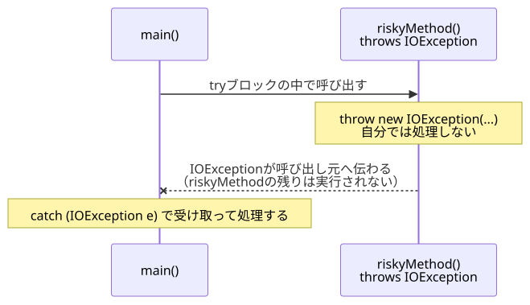

# <b>13章</b> <span>例外処理</span> <small>障害に強いプログラムの構築</small>

## 本章の学習目標

### この章で学ぶこと

1. try-catch-finally
    - 例外が起きうる処理を`try`で囲み、その場で対処できる例外だけを`catch`で受け止められる
    - スタックトレースを読み、例外が起きた行と原因をたどれる
2. 検査例外と非検査例外
    - 呼び出し元が対処できる誤りか、コードを直すべき誤りかで、検査例外と非検査例外を選べる
    - その場で対処できない例外を、`throws`で呼び出し元に伝えられる
3. 独自例外と例外の連鎖
    - 残高不足のような業務上の誤りを、独自の例外クラスで表せる
    - 例外を包み直すときに原因の例外を渡し、`getCause`で元の例外をたどれるようにできる
4. try-with-resources
    - `AutoCloseable`を実装したリソースを、`try-with-resources`で確実に閉じられる
5. 実践的な例外処理
    - 一時的な障害にリトライで対処し、利用者へのメッセージとログに残す情報を分けられる

### この章を始める前に

第12章までの内容を理解していれば準備完了です。
後半の実践的なパターンでは、第10章「ジェネリクス」で学んだ型パラメーターと、第11章「ラムダ式と関数型インターフェイス」で学んだラムダ式も使います。

## エラーの種類と対処法

### ソフトウェアの信頼性とエラー処理

C言語では、`fopen`でファイルを開けなかったことを、戻り値の`NULL`で知らせます。
戻り値を確かめ忘れたまま、その`NULL`を`fgets`などに渡すと、多くの環境ではセグメンテーション違反でプログラムが止まります。
止まるのは失敗した`fopen`の行ではなく、あとでポインターを使った行なので、原因を探すのに手間がかかります。
`errno`でエラーを伝える関数も同じで、呼び出し側が確かめなければ、エラーに気づかないまま処理が進みます。
Javaでは、こうした失敗を例外として知らせ、種類によっては、呼び出し側が対処を書かないとコンパイルエラーにできます。

プログラムを作成するうえで、予期しない状況やエラーへの対応は避けて通れません。
エラーは主に3つの種類に分けられます。

1つ目は構文エラー（Syntax Error）で、コードの文法的な誤りを指します。
コンパイラーがコンパイル時に見つけるので、修正しないとプログラムを実行できません。
2つ目は実行時エラー（Runtime Error）で、プログラムの実行中に起きる異常事態です。
本章で学ぶ「例外（Exception）」も、この実行時エラーの一種です。
3つ目は論理エラー（Logic Error）です。
プログラムはエラーなく動作しますが、実行結果が意図どおりになりません。
論理エラーは、デバッグで原因を特定し、ロジックを修正して直します。

本章では、とくに「実行時エラー」に焦点を当て、Javaの例外処理のしくみを学びます。

## 例外処理の基本：`try-catch-finally`

Javaでは、プログラム実行中に発生する「例外的状況」を例外（Exception）オブジェクトとして表現し、これに対処するための専用の構文を提供しています。例外が発生することを「例外がスローされる（投げられる）」と言います。

例外処理の基本的な流れは以下のようになります。

1. メソッド内で例外が発生すると、通常の処理フローが中断される
2. プログラムは呼び出しスタックをさかのぼり、例外の型に一致する`catch`ブロックを探す
3. 例外の型に一致する`catch`ブロックが見つかると、そこで例外が処理される
4. `finally`ブロックがあれば、必ず実行される

### `try-catch`ブロック

例外が発生する可能性のある処理は、`try`ブロックで囲みます。
`try`ブロックのなかで特定の型の例外が発生すると、その型に対応する`catch`ブロックが例外を捕捉（キャッチ）します。
`catch`ブロックには、捕捉した例外への対応を記述します。
`catch`ブロックは複数並べて書けます。
その場合は、より具体的な例外から順に書きます。
親クラスの例外（`Exception`など）を先に書くと、後ろにあるサブクラスの`catch`には処理が届かないため、コンパイルエラーになります。
複数の例外に同じ対応をするときは、`catch (IOException | ClassNotFoundException e)`のように、例外の型を`|`で区切って1つの`catch`にまとめられます（マルチキャッチ、Java 7以降）。

次のコードは、`NullPointerException`が発生する状況とその対処方法を示しています。null参照に対してメソッドを呼び出すと例外が発生しますが、`catch`ブロックでその例外を捕捉し、プログラムが異常終了しないようにして処理を続けています。

<span class="listing-number">**サンプルコード13-1**　TryCatchSample.java</span>

```java
public class TryCatchSample {
    public static void main(String[] args) {
        try {
            String str = null;
            IO.println(str.length()); // ここでNullPointerExceptionが発生
            IO.println("この行は実行されません。");
        } catch (NullPointerException e) {
            System.err.println("NullPointerExceptionをキャッチしました！");
            // 開発中はスタックトレースを出力するとデバッグに役立つ
            e.printStackTrace();
        } catch (Exception e) {
            System.err.println("その他の予期せぬ例外をキャッチしました。");
        }
        IO.println("プログラムは処理を継続しています。");
    }
}
```

実行結果：

```
NullPointerExceptionをキャッチしました！
java.lang.NullPointerException: Cannot invoke "String.length()" because "<local1>" is null
	at TryCatchSample.main(TryCatchSample.java:5)
プログラムは処理を継続しています。
```

この例は、例外が起きたときに処理が`catch`ブロックへ移るしくみを見るためのものです。
`NullPointerException`<span class="footnote">実行結果のように、nullだった式を示す詳しいメッセージはJava 14で加わり、Java 15から既定で表示されます。変数名が`<local1>`となるのは、クラスファイルにローカル変数の名前が残っていないためで、`javac -g`でコンパイルすると`str`と表示されます。</span>のような非検査例外は、本来は`catch`で受け止めるのではなく、nullのまま使わないようにコードを直して防ぎます（このあとの「検査例外と非検査例外」で説明します）。
例外を学んだばかりのころは、例外の出た行を`try`で囲み、`catch`で何もしないことで「直した」つもりになりがちです。
これでは例外の表示が消えるだけで、nullが入った原因は残り、あとの処理で別の誤りとして現れます。

### `finally`ブロック

`finally`ブロックは、`try`ブロック内で例外が発生したかどうかにかかわらず、必ず実行される処理を記述します<span class="footnote">`try`ブロックのなかで`System.exit`を呼んだときやJVMが強制的に止められたときは実行されません。</span>。主に、ファイルやネットワーク接続などのリソースを解放する後片付け処理に使われます。

<div class="figure">



</div>

<span class="listing-number">**サンプルコード13-2**</span>

```java
// ...
try {
    // リソースを使う処理
} catch (Exception e) {
    // 例外発生時の処理
} finally {
    // 例外の有無にかかわらず、必ず実行される後片付け処理
    IO.println("finallyブロックが実行されました。");
}
```

### `try-with-resources`文（推奨）

ファイルやネットワーク接続などのリソースは、使い終わったら必ず閉じます（closeします）。
閉じ忘れると、OSが管理するファイルの数などの資源を使い続けるリソースリークが起きます。
`finally`ブロックで閉じる書き方では、`close`メソッド自体も例外を投げうるため、`finally`のなかにさらに`try-catch`を書くことになり、コードが長くなります。

そこでJava 7で導入されたのが`try-with-resources`文です。
`AutoCloseable`インターフェイスを実装したリソース（ファイルストリームなど）を`try`の後ろの括弧内で宣言すると、`try`ブロックを抜けるときに`close`メソッドが自動的に呼ばれます。
例外で抜けた場合も同じです。
次のコードでは、ファイルを1行読み込む`BufferedReader`を自動的に閉じています。
ファイルを読み書きするクラスの使い方は、第14章「ファイルI/O」で詳しく学びます。

<span class="listing-number">**サンプルコード13-3**　TryWithResourcesSample.java</span>

```java
import java.io.BufferedReader;
import java.io.FileReader;
import java.io.IOException;

public class TryWithResourcesSample {
    public static void readFile(String path) {
        // try()の括弧内でリソースを初期化する
        try (BufferedReader br =
                new BufferedReader(new FileReader(path))) {
            IO.println(br.readLine());
        } catch (IOException e) {
            System.err.println("ファイル読み込みエラー: " + e.getMessage());
        }
        // tryブロックを抜ける際にbrが自動的にクローズされる
    }
}
```

実行結果：

```
存在するファイルを読み込み:
これはテストファイルです。

存在しないファイルを読み込み:
ファイル読み込みエラー: non_existent.txt (No such file or directory)
```

この実行結果は、テスト用のファイルと存在しないファイル`non_existent.txt`を順に`readFile`へ渡したときのものです。
`readFile`を呼び出す`main`メソッドは、全文の`TryWithResourcesDemo.java`にあります<span class="footnote">`https://github.com/Nagatani/techbook-java-primer/tree/main/sample-code/chapter13/13-03/`</span>。
例外のメッセージ（`No such file or directory`の部分）は、OSによって異なります。

`try-with-resources`文を使えば、`finally`ブロックに閉じる処理を書く必要はありません。
複数のリソースをまとめて宣言する書き方と、自作のクラスを`try-with-resources`で使えるようにする方法は、本章の「リソース管理の実践例」で学びます。

## 検査例外と非検査例外

### 例外クラスの階層構造

Javaの例外クラスは、`Throwable`クラスをルートとした階層構造を持っています。

<div class="figure">



</div>

この階層構造の設計には、「プログラマーが対処できる例外」と「システムレベルの重大なエラー」を区別するという明確な意図があります。

Javaの例外は、コンパイラーがその処理を強制するかどうかによって2種類に大別されます。

### 検査例外（Checked Exception）

検査例外は、`IOException`や`SQLException`のように、`Exception`のサブクラスのうち`RuntimeException`の系統を除いたものです。
コンパイラーは、検査例外に対する処理（`try-catch`または`throws`）を強制します<span class="footnote">検査例外はJavaの特徴的なしくみです。たとえばC#やKotlinには検査例外がなく、どの例外も処理を強制されません。</span>。
どちらも書かずに検査例外を発生させうるメソッドを呼ぶと、コンパイルエラーになります。
検査例外は主に、ファイル操作やネットワーク関連のエラーのように、呼び出し側が対処すれば回復できる可能性のある状況で使います。

本書では、自分で例外のクラスを作るときも同じ基準で選びます。
残高不足や学生IDの重複のように、呼び出し側が利用者に伝えて対処できる誤りは検査例外にします。
引数の誤りのように、コードを直すべき誤りは非検査例外にします。
検査例外を避けて非検査例外に寄せる流儀も広く使われていますが、本書では、対処を忘れるとコンパイラーが教えてくれることを優先します。
この選び方は、第25章で学生管理システムを例にもう一度考えます。

#### `throws`による例外処理の委譲

メソッド内で発生した検査例外を自身で処理せず、そのメソッドの呼び出し元に処理を任せたい場合、メソッドシグネチャに`throws`を記述します。
`main`メソッドに`throws`を付けると、例外は`main`を呼んだJVMに渡り、スタックトレースを表示してプログラムが終了します。
本書でも、ファイルを扱う短いサンプルでは`main`に`throws IOException`を付けることがありますが、実際のプログラムでは`main`の手前で受け止めて利用者にわかる形で知らせます。

次の`riskyMethod`は、第4章でも使った`throw`で例外を発生させています（`throw`は次の節で詳しく扱います）。

<span class="listing-number">**サンプルコード13-4**　ThrowsExample.java</span>

```java
import java.io.IOException;

public class ThrowsExample {
    // このメソッドはIOExceptionを投げる可能性があることを宣言
    public static void riskyMethod() throws IOException {
        throw new IOException("I/Oエラーが発生しました");
    }

    public static void main(String[] args) {
        try {
            riskyMethod();
        } catch (IOException e) {
            System.err.println("mainメソッドで例外をキャッチ: "
                    + e.getMessage());
        }
    }
}
```

実行結果：

```
mainメソッドで例外をキャッチ: I/Oエラーが発生しました
```

<div class="figure">



</div>

### 非検査例外（Unchecked Exception）

非検査例外は、`RuntimeException`とそのサブクラス（`NullPointerException`、`ArrayIndexOutOfBoundsException`など）、および`Error`とそのサブクラスです<span class="footnote">`Error`の例には`OutOfMemoryError`（メモリ不足）や`StackOverflowError`（メソッドの呼び出しが深すぎる）があります。プログラムからは回復できないことが多いため、通常は`catch`しません。</span>。
コンパイラーは、非検査例外に対する処理を強制しません。
非検査例外の多くは、プログラムの論理的な誤り（バグ）が原因で発生します。
そのため原則として、`catch`で受け止めるのではなく、コードを修正して発生そのものを防ぎます。

### オーバーライドと`throws`

第5章で学んだオーバーライドには、検査例外についての制約があります。
子クラスでメソッドをオーバーライドするとき、`throws`に書けるのは、親クラスのメソッドが宣言した検査例外か、その子クラスの例外だけです。
親が`void load() throws IOException`なら、子は`throws IOException`や`throws FileNotFoundException`と書けるほか、`throws`を書かないこともできます。
`throws Exception`のように、より広い検査例外を書くとコンパイルエラーになります。

親クラスの型で`load()`を呼ぶ側は、`IOException`だけを受け止める準備をしています。
子クラスがそれより広い例外を投げると、呼ぶ側が受け止められない例外が届いてしまいます。
この制約は、第5章で学んだリスコフ置換原則（親クラスの型で使う場所に子クラスを渡しても正しく動く）を、コンパイラーが検査しているものです。
非検査例外には、この制約はありません。

### ラムダ式のなかの検査例外

同じ制約は、ラムダ式にも当てはまります。
第11章で学んだ`Function`や`Consumer`などの標準の関数型インターフェイスは、メソッドに`throws`を宣言していません。
そのため、検査例外を投げるメソッドをラムダ式のなかで呼ぶと、その例外をラムダ式の外へ投げられず、コンパイルエラーになります。
第14章で使う`Files`のメソッドの多くは`IOException`を投げるので、Stream（第12章）の`map`などに渡すときに出会います。

対処のしかたは、ラムダ式のなかで`try-catch`を書き、検査例外を非検査例外に包み直すことです。
`IOException`には、包むための非検査例外`UncheckedIOException`が用意されています。

<span class="listing-number">**サンプルコード13-5**　LambdaCheckedException.java</span>

```java
import java.io.IOException;
import java.io.UncheckedIOException;
import java.util.List;

public class LambdaCheckedException {
    // ファイルを読む代わりに、名前が空ならIOExceptionを投げるメソッド
    static String load(String name) throws IOException {
        if (name.isEmpty()) {
            throw new IOException("名前が空です");
        }
        return name + "の内容";
    }

    public static void main(String[] args) {
        List<String> names = List.of("a.txt", "b.txt");

        // names.stream().map(n -> load(n))  // コンパイルエラー

        List<String> contents = names.stream()
                .map(n -> {
                    try {
                        return load(n);
                    } catch (IOException e) {
                        // 検査例外を非検査例外に包み直す
                        throw new UncheckedIOException(e);
                    }
                })
                .toList();
        IO.println(contents);
    }
}
```

実行結果：

```
[a.txtの内容, b.txtの内容]
```

コメントにした`map(n -> load(n))`のままでは、`例外IOExceptionは報告されません。スローするには、捕捉または宣言する必要があります`というコンパイルエラーになります。
包み直した`UncheckedIOException`は、`getCause()`で元の`IOException`を取り出せます（次の節「例外の連鎖」で学びます）。

## 独自例外と例外の連鎖

### 独自例外の作成とスロー

次のサンプルコード13-6の`withdraw`は、残高が足りないときに`IllegalArgumentException`を投げることもできます。
しかし、`IllegalArgumentException`は、負の金額を渡したといった入力の誤りにも使う例外です。
これを`catch`した呼び出し側は、残高不足なのか入力の誤りなのかを、例外の型で区別できません。
残高不足を表す`InsufficientBalanceException`を作っておけば、呼び出し側はこの例外だけを`catch`して「残高が足りません」と表示できます。

アプリケーション固有のエラー状況を表現するために、独自の例外クラスを作成できます。`Exception`または`RuntimeException`を継承して定義します。`throw`キーワードを使うと、任意の場所で意図的に例外を発生させることができます。

<span class="listing-number">**サンプルコード13-6**　BankAccount.java（1〜17、26行目）</span>

```java
// 独自の検査例外クラス
class InsufficientBalanceException extends Exception {
    public InsufficientBalanceException(String message) {
        super(message);
    }
}

public class BankAccount {
    private int balance;
    public void withdraw(int amount)
            throws InsufficientBalanceException {
        if (amount > balance) {
            // 意図的に例外をスローする
            throw new InsufficientBalanceException("残高が不足しています。");
        }
        this.balance -= amount;
    }
    // ...
}
```

実行結果：

```
初期残高: 1000円
500円を引き出します...
残高: 500円
600円を引き出します...
エラー: 残高が不足しています。
現在の残高: 500円
```

この実行結果は、1,000円を預けた口座から500円と600円を順に引き出したときのものです。
入金と残高の取得のメソッド、引き出しを試す`main`メソッド（`BankAccountDemo.java`）は、全文にあります<span class="footnote">`https://github.com/Nagatani/techbook-java-primer/tree/main/sample-code/chapter13/13-06/`</span>。

### 例外の連鎖（Exception Chaining）

例外の連鎖は、ある例外が別の例外を引き起こした際に、元の例外（原因）の情報を失わずに、新しい例外でラップしてスローするテクニックです。これにより、デバッグ時に根本原因を追跡しやすくなります。

次の例の`SQLException`は、データベースの操作で起きる検査例外です<span class="footnote">`SQLException`は、Javaからデータベースを操作するJDBC（Java Database Connectivity）の`java.sql`パッケージにあるクラスです。</span>。
ここではデータベースには接続せず、例外が起きたと仮定して投げています。

<div class="figure">



</div>

<span class="listing-number">**サンプルコード13-7**　UserService.java</span>

```java
class DataAccessException extends Exception {
    public DataAccessException(String message, Throwable cause) {
        super(message, cause); // 原因となった例外(cause)を渡す
    }
}

public class UserService {
    public void findUser(int userId) throws DataAccessException {
        try {
            // ... データベースアクセス処理 ...
            // SQLExceptionが発生したと仮定
            throw new java.sql.SQLException("DB接続エラー");
        } catch (java.sql.SQLException e) {
            // SQLExceptionを包み、より抽象的なDataAccessExceptionをスロー
            throw new DataAccessException(
                    "ユーザー情報の取得に失敗しました", e);
        }
    }
}
```

呼び出し側は、受け取った`DataAccessException`の`getCause()`で元の`SQLException`を取り出せます。
スタックトレースを出力すると、包んだ例外の下に`Caused by:`に続けて原因の例外も表示されます。

> **コラム：スタックトレースを読める人は強い**{.column-section}
>
> 初めてスタックトレースを見ると、英語と記号の並んだ長い文字列に圧倒されます。
> しかし、エラーの原因を調べるときに最初に手に入れたいのは、このスタックトレースです。
> 読み方さえ知っていれば、どこで何が起きたかの大半がそこに書いてあるからです。
> 「動きません」とだけ人に尋ねても、聞かれたほうはスタックトレースを見るまで何も言えません。
> 尋ねる前に下の手順で自分のクラスの行まで読み、尋ねるときはスタックトレースを丸ごと添えます。
> 次は、設定のポート番号に`80a`と書かれていたときに出る例です。
>
> ```
> Exception in thread "main" java.lang.IllegalStateException: 設定のポート番号が数字ではありません
> 	at ConfigLoader.readPort(ConfigLoader.java:7)
> 	at ConfigLoader.start(ConfigLoader.java:12)
> 	at ConfigLoader.main(ConfigLoader.java:17)
> Caused by: java.lang.NumberFormatException: For input string: "80a"
> 	at java.base/java.lang.NumberFormatException.forInputString(NumberFormatException.java:67)
> 	at java.base/java.lang.Integer.parseInt(Integer.java:565)
> 	at java.base/java.lang.Integer.parseInt(Integer.java:662)
> 	at ConfigLoader.readPort(ConfigLoader.java:5)
> 	... 2 more
> ```
>
> 読むときの手順は、おおむね次のとおりです。
>
> 1. 1行目で、例外のクラスとメッセージを見る
> 2. `Caused by:`があれば、最後の`Caused by:`まで下りる。根本の原因はいちばん下の例外にある
> 3. その例外の`at`の行を上から見て、自分が書いたクラスの最初の行を探す。標準ライブラリの行（`java.base/`で始まる行）は、多くの場合、原因ではなく通り道である
> 4. 見つけた行（ここでは`ConfigLoader.java`の5行目）を開き、そこへ渡ってきた値を考える
>
> 最後の`... 2 more`は、残りの呼び出しの履歴が、包んだほうの例外の履歴の下の2行と同じなので省いた、という意味です（APIドキュメントの`Throwable.printStackTrace`の説明）。
>
> 例外を包むときに原因を渡し忘れると、この`Caused by:`が消え、手がかりが途中で切れます。
> 「スタックトレースを最後まで残す」ことは、未来の自分や、障害を調べる誰かへの手紙でもあります。

## 実践的な例外処理パターン

この節（リトライ、呼び出しを止めるしくみ、例外の集約）は、初めて読むときは飛ばしてかまいません。
第25章で統合プロジェクトの例外を設計するときに戻ってください。

### リトライパターン（一時的な障害への対処）

リトライパターンは、ネットワーク接続の一時的な問題やリソースの一時的な不足など、時間を置けば解決する可能性のあるエラーに対して、自動的に再試行を行うパターンです。

第11章で見たとおり、`Callable<T>`は`T`型の値を返す処理を表す関数型インターフェイスです。
`Runnable`や`Supplier`と違って検査例外を投げられるので、ファイルやネットワークを扱う処理もそのまま渡せます。
`executeWithRetry`には、試したい処理をラムダ式で渡します（呼び出す`main`メソッドは全文にあります<span class="footnote">`https://github.com/Nagatani/techbook-java-primer/tree/main/sample-code/chapter13/13-08/`</span>）。
第2引数の`Class<? extends Exception>`には、再試行の対象にする例外の型を`IOException.class`のように渡します。
`retryableException.isInstance(e)`は、例外`e`がその型（またはその子クラス）のオブジェクトかどうかを調べます。
`instanceof`と同じ判定を、型を変数で受け取って行う書き方です。

<span class="listing-number">**サンプルコード13-8**　RetryableOperation.java（4〜6、8〜22、31〜36、54行目）</span>

```java
public class RetryableOperation {
    private static final int MAX_RETRY_COUNT = 3;
    private static final long RETRY_DELAY_MS = 1000;
    // ...
    public static <T> T executeWithRetry(Callable<T> operation,
            Class<? extends Exception> retryableException)
            throws Exception {
        Exception lastException = null;
        
        for (int attempt = 1; attempt <= MAX_RETRY_COUNT; attempt++) {
            try {
                return operation.call();
            } catch (Exception e) {
                if (!retryableException.isInstance(e)) {
                    throw e; // リトライ対象外の例外は即座に再スロー
                }
                lastException = e;
                IO.println("試行 %d/%d 失敗: %s".formatted(
                    attempt, MAX_RETRY_COUNT, e.getMessage()));
                    // ...
            }
        }
        
        throw new RuntimeException("最大リトライ回数に達しました",
                lastException);
    }
    // ...
}
```

次は実行結果の一例です<span class="footnote">ランダムな処理のため、実行のたびに結果が異なります。すべての試行が失敗した場合は「最終的に失敗: 最大リトライ回数に達しました」が出力されます。</span>。

```
試行 1/3 失敗: ネットワークエラー
試行 2/3 失敗: ネットワークエラー
結果: 成功
```

### 失敗が続いたら呼び出しを止める

リトライは一時的な障害には効きますが、相手が長く止まっているときに何度も呼び出すと、かえって相手と自分の負荷を増やします。
失敗が一定の回数続いたら、しばらくは相手を呼ばずにすぐ例外を投げます。
時間をおいてから試しに呼び直すこの設計を、サーキットブレーカーと呼びます<span class="footnote">名前は、電流が流れすぎると回路を切る電気のブレーカー（circuit breaker）に由来します。</span>。
多数のサービスがネットワーク越しに呼び合うシステムで使われます。
3つの状態（通常・遮断・試行）を切り替える実装の例は、付録Hで紹介しています。

### 例外の集約と報告

複数の処理を順に実行し、途中で失敗しても残りの処理を続けたい場合は、発生した例外を集めておき、最後にまとめて報告します。

<span class="listing-number">**サンプルコード13-9**　ExceptionAggregator.java（3〜27、38〜54行目）</span>

```java
public class ExceptionAggregator {
    private final List<Exception> exceptions = new ArrayList<>();
    
    public void addException(Exception e) {
        exceptions.add(e);
    }
    
    public void throwIfAny() throws AggregateException {
        if (!exceptions.isEmpty()) {
            throw new AggregateException(exceptions);
        }
    }
    
    public static class AggregateException extends Exception {
        private final List<Exception> exceptions;
        
        public AggregateException(List<Exception> exceptions) {
            super(String.format("%d個の例外が発生しました",
                    exceptions.size()));
            this.exceptions = new ArrayList<>(exceptions);
        }
        
        public List<Exception> getExceptions() {
            return Collections.unmodifiableList(exceptions);
        }
        // ...
    }
    
    public static void processMultipleTasks(List<Runnable> tasks) 
            throws AggregateException {
        ExceptionAggregator aggregator = new ExceptionAggregator();
        
        for (Runnable task : tasks) {
            try {
                task.run();
            } catch (Exception e) {
                aggregator.addException(e);
            }
        }
        
        aggregator.throwIfAny();
    }
}
```

`processMultipleTasks`は、タスクが例外を投げても次のタスクへ進み、例外を`addException`でためておきます。
すべてのタスクを終えたあと、`throwIfAny`が、ためた例外をまとめた`AggregateException`を1つ投げます。
呼び出し側は、`AggregateException`を`catch`して`getExceptions()`で個々の例外を取り出し、どのタスクがなぜ失敗したかを報告します。

## リソース管理の実践例

### 複数リソースのtry-with-resources

実際の開発では、複数のリソースを同時に扱うことが多くあります。`try-with-resources`では、複数のリソースを1つの`try`の括弧内にまとめて宣言できます。

<span class="listing-number">**サンプルコード13-10**　MultiResourceExample.java（4〜19、49行目）</span>

```java
public class MultiResourceExample {
    public static void copyFile(String sourcePath, String destPath) 
            throws IOException {
        // 複数のリソースをセミコロンで区切って宣言
        try (FileInputStream fis = new FileInputStream(sourcePath);
             FileOutputStream fos = new FileOutputStream(destPath);
             BufferedInputStream bis = new BufferedInputStream(fis);
             BufferedOutputStream bos = new BufferedOutputStream(fos)) {
            byte[] buffer = new byte[1024];
            int bytesRead;
            
            while ((bytesRead = bis.read(buffer)) != -1) {
                bos.write(buffer, 0, bytesRead);
            }
        } // すべてのリソースが逆順（宣言と逆の順序）で自動的にクローズされる
    }
    // ...
}
```

リソースは宣言と逆の順序で閉じられます。
後に宣言したリソースは先に宣言したリソースを使うことが多いので（`bis`は`fis`から読みます）、使う側から先に閉じるのが安全だからです。

`try`ブロックで例外が発生し、さらにリソースを閉じる`close`メソッドでも例外が発生することがあります。
このとき`try-with-resources`は、`try`ブロックで発生した例外を呼び出し元へ投げ、`close`の例外はその例外に「抑制された例外（suppressed exception）」として付け加えます。
付け加えられた例外は、捕まえた例外の`getSuppressed`メソッドで`Throwable`の配列として取り出せます。
`finally`ブロックで閉じる書き方では、`close`の例外が元の例外を上書きし、本当の原因がわからなくなることがあります。
この点も、`try-with-resources`を使う理由の1つです。

### カスタムAutoCloseableの実装

独自のリソース管理クラスを作成する場合、`AutoCloseable`インターフェイスを実装すると、`try-with-resources`で使えるようになります。

<span class="listing-number">**サンプルコード13-11**　ResourcePool.java（3〜7、15〜44、58行目）、ResourcePoolDemo.java</span>

```java
public class ResourcePool implements AutoCloseable {
    private final Queue<Resource> availableResources =
            new ArrayDeque<>();
    private final Set<Resource> usedResources = new HashSet<>();
    private boolean closed = false;
    // ...
    public Resource acquire() {
        if (closed) {
            throw new IllegalStateException("プールはクローズされています");
        }
        if (availableResources.isEmpty()) {
            throw new IllegalStateException("使えるリソースが残っていません");
        }
        
        Resource resource = availableResources.poll();
        usedResources.add(resource);
        return resource;
    }
    
    public void release(Resource resource) {
        if (usedResources.remove(resource)) {
            availableResources.offer(resource);
        }
    }
    
    @Override
    public void close() {
        closed = true;
        // すべてのリソースをクリーンアップ
        for (Resource resource : availableResources) {
            resource.cleanup();
        }
        for (Resource resource : usedResources) {
            resource.cleanup();
        }
    }
    // ...
}

public class ResourcePoolDemo {
    public static void main(String[] args) {
        // tryブロックを抜けると、pool.close()が自動的に呼ばれる
        try (ResourcePool pool = new ResourcePool(2)) {
            ResourcePool.Resource resource = pool.acquire();
            IO.println("リソースを借りました");
            pool.release(resource);
            IO.println("リソースを返しました");
        }
        IO.println("tryブロックを抜けました");
    }
}
```

実行結果：

```
リソースを借りました
リソースを返しました
リソース 1 をクリーンアップしました
リソース 0 をクリーンアップしました
tryブロックを抜けました
```

`try`ブロックを抜けた時点で`close`メソッドが呼ばれ、プールが持つリソースがすべて片付けられています。
このプールは1つのスレッドから使うことを前提にしています。
複数のスレッドから同時に借りたり返したりする場合は排他制御が必要になります。
排他制御は第15章「マルチスレッドプログラミング」で学びます。

## 例外処理とログ記録

### 効果的なログレベルの選択

ログ記録は例外処理の重要な要素です<span class="footnote">サンプルコード13-12の`Logger`と`Level`は、Java 1.4で標準ライブラリに加わった`java.util.logging`パッケージのクラスです。実務では、SLF4JやLog4j 2などのライブラリもよく使われます。</span>。目的に応じたログレベルを選ぶと、問題の深刻度を正確に伝えられます。

<span class="listing-number">**サンプルコード13-12**　ExceptionLogging.java（5〜37、58行目）</span>

```java
public class ExceptionLogging {
    private static final Logger logger = 
        Logger.getLogger(ExceptionLogging.class.getName());
    
    public void processUserRequest(String userId) {
        try {
            User user = findUser(userId);
            performBusinessLogic(user);
        } catch (UserNotFoundException e) {
            // ビジネス例外：警告レベル
            logger.log(Level.WARNING, 
                "ユーザーが見つかりません: " + userId, e);
        } catch (ValidationException e) {
            // 入力検証エラー：情報レベル（想定内のエラー）
            logger.log(Level.INFO, "検証エラー: " + e.getMessage());
        } catch (DatabaseException e) {
            // システム例外：エラーレベル
            logger.log(Level.SEVERE, 
                "データベースエラーが発生しました", e);
            
            // アラート送信などの追加処理
            notifyAdministrator(e);
        } catch (Exception e) {
            // 予期せぬ例外：重大エラー
            // ここで受け止めて終えるので、ログに書くのはこの1回だけ
            String errorId = generateErrorId();
            logger.log(Level.SEVERE,
                    "予期せぬエラーが発生しました。エラーID: " + errorId, e);

            // 利用者にはエラーIDだけを伝える
            IO.println("システムエラーが発生しました。エラーID: " + errorId);
        }
    }
    // ...
}
```

同じ例外を途中の層と呼び出し元の両方でログに書くと、二重に記録されます。
本書では、例外を最後に受け止める画面に近い層で1回だけログに書きます。
途中の層はログに書かず、原因を付けて投げ直すだけにします。
`processUserRequest`はそうした最後の層なので、最後の`catch`はログに書いたあと、投げ直さずに利用者へエラーIDを伝えています。
利用者への表示は`IO.println`、原因を調べるための記録は`java.util.logging`と分けます。

### 例外情報の構造化記録 {.advanced}

多数のサーバーのログを集めて検索・集計する本番環境では、例外のログを文章ではなく、操作名・例外の型・メッセージ・状況を項目に分けたJSON形式の1行として記録すると、例外の件数を機械で数えられます。
`java.util.logging`では、`LogRecord`にこのメッセージと例外を入れて`Logger`の`log`メソッドに渡します。
詳しい説明とコード例は付録I「オブジェクト指向と言語機能の発展的な内容」の「例外情報の構造化記録」にあります<span class="footnote">`https://github.com/Nagatani/techbook-java-primer/tree/main/appendix/i-language-advanced/`</span>。

## 業務アプリケーションでの例外設計

この節のエラーコードの管理も、初めて読むときは飛ばしてよく、第25章に進むときに戻れば足ります。

### ビジネス例外とシステム例外の分離

大規模なアプリケーションでは、ビジネスロジックに関する例外とシステムレベルの例外を明確に分離することが重要です。
次のコードでは、検査例外の基底クラス`BusinessException`と、非検査例外の基底クラス`SystemException`を抽象クラスとして用意します。
ビジネス例外は、残高不足のように利用者に知らせてやり直してもらえるものなので、呼び出し側に対処を強制する検査例外にします。
一方、データベースに接続できないといったシステムの異常は、業務の処理の途中では回復できず、途中のメソッドすべてに`throws`を書かせても対処できる場所がありません。
そこで非検査例外にして、画面に近い層でまとめて受け止め、記録してから利用者に知らせます。
節「検査例外（Checked Exception）」で、検査例外は回復できる可能性のある状況で使うと述べました。
同じI/Oの異常でも、その場で回復できる場所があるかどうかで、検査例外にするか非検査例外にするかを選びます（第25章でも、この方針で例外を設計します）。
サンプルコード13-6の`InsufficientBalanceException`は、ここでは`BusinessException`を継承する形に定義し直しています。

<span class="listing-number">**サンプルコード13-13**　BusinessException.java（4〜13、22、28〜31行目）、InsufficientBalanceException.java（3〜12行目）、SystemException.java（4〜13、28行目）</span>

```java
// ビジネス例外の基底クラス
public abstract class BusinessException extends Exception {
    private final String errorCode;
    private final Map<String, Object> details;
    
    protected BusinessException(String errorCode, String message) {
        super(message);
        this.errorCode = errorCode;
        this.details = new HashMap<>();
    }
    // ...
    public String getErrorCode() { return errorCode; }
    // ...
    public void addDetail(String key, Object value) {
        details.put(key, value);
    }
}

// 具体的なビジネス例外
public class InsufficientBalanceException extends BusinessException {
    public InsufficientBalanceException(BigDecimal currentBalance, 
                                      BigDecimal requestedAmount) {
        super("ACC-001", "残高が不足しています");
        addDetail("currentBalance", currentBalance);
        addDetail("requestedAmount", requestedAmount);
        addDetail("shortage", requestedAmount.subtract(currentBalance));
    }
}

// システム例外の基底クラス
public abstract class SystemException extends RuntimeException {
    private final String errorId;
    private final Instant occurredAt;
    
    protected SystemException(String message, Throwable cause) {
        super(message, cause);
        this.errorId = generateErrorId();
        this.occurredAt = Instant.now();
    }
    // ...
}
```

### エラーコードとメッセージの管理

エラーコードとメッセージを一元管理することで、国際化<span class="footnote">国際化（internationalization）は、最初のiと最後のnのあいだに18文字あることから「i18n」とも書きます。</span>やメンテナンスが容易になります。

<span class="listing-number">**サンプルコード13-14**　ErrorCode.java（1〜5、15〜23、37行目）、BusinessException.java（4〜5、15〜18、38行目）、InsufficientBalanceException.java（3〜12行目）、ErrorResponse.java（4〜18、28〜29行目）</span>

```java
public enum ErrorCode {
    // アカウント関連エラー
    ACC_001("ACC-001", "残高が不足しています"),
    ACC_002("ACC-002", "アカウントが凍結されています"),
    ACC_003("ACC-003", "取引限度額を超えています"),
    // ...
    SYS_003("SYS-003", "データベース接続エラー");
    
    private final String code;
    private final String defaultMessage;
    
    ErrorCode(String code, String defaultMessage) {
        this.code = code;
        this.defaultMessage = defaultMessage;
    }
    // ...
}

// ビジネス例外の基底クラス
public abstract class BusinessException extends Exception {
    // ...
    // ErrorCodeからコードと既定のメッセージを受け取る
    protected BusinessException(ErrorCode errorCode) {
        this(errorCode.getCode(), errorCode.getMessage());
    }
    // ...
}

// ErrorCodeを使って定義し直したビジネス例外
public class InsufficientBalanceException extends BusinessException {
    public InsufficientBalanceException(BigDecimal currentBalance, 
                                      BigDecimal requestedAmount) {
        super(ErrorCode.ACC_001);
        addDetail("currentBalance", currentBalance);
        addDetail("requestedAmount", requestedAmount);
        addDetail("shortage", requestedAmount.subtract(currentBalance));
    }
}

// エラーレスポンスの統一フォーマット
public class ErrorResponse {
    private final String errorCode;
    private final String message;
    private final Map<String, Object> details;
    private final String timestamp;
    private final String path;
    
    public ErrorResponse(BusinessException e, String path) {
        this.errorCode = e.getErrorCode();
        this.message = e.getMessage();
        this.details = e.getDetails();
        this.timestamp = Instant.now().toString();
        this.path = path;
    }
    // ...
    // ゲッターメソッド省略
}
```

`BusinessException`に`ErrorCode`を受け取るコンストラクターを足すと、サンプルコード13-13で`"ACC-001"`と文字列で書いていた部分を`ErrorCode.ACC_001`に置き換えられます。
コードとメッセージがenumの1か所にまとまるので、メッセージを変えるときもenumだけを直せば済みます。

### 例外処理戦略の実装例 {.advanced}

口座間の送金処理のような業務の処理では、入力の誤りや残高不足などのビジネス例外はログに記録してそのまま呼び出し元に伝え、それ以外の予期しない例外は原因を保ったまま非検査例外に包んで投げ直します。
包む先を`SystemException`を継承したクラスにすると、エラーIDや発生時刻もあわせて記録できます。
詳しい説明とコード例は付録I「オブジェクト指向と言語機能の発展的な内容」の「例外処理戦略の実装例」にあります<span class="footnote">`https://github.com/Nagatani/techbook-java-primer/tree/main/appendix/i-language-advanced/`</span>。

## 例外処理のベストプラクティス

ここまでの内容から、例外処理で守りたい心がけをまとめます。

空の`catch`ブロック、範囲の広すぎる`try`、リソースの解放漏れといった誤りは、次の「よくあるエラーと対処法」にまとめました。
そこに挙げていない心がけとして、`catch (Exception e)`で安易にすべての例外を捕捉せず、その場で対処できる具体的な例外だけを`catch`します。
また、エラーの伝え方は相手によって分けます。
ユーザーにはわかりやすいメッセージとエラーIDを示し、ログには原因究明のための詳細な情報（スタックトレースなど）を記録します。

どの心がけも、例外を握りつぶさず、失敗した事実と原因を呼び出し元に届けるためのものです。
例外を投げるコストなど、例外処理の性能面の詳細は、付録B.12「例外処理のパフォーマンス」で扱います<span class="footnote">`https://github.com/Nagatani/techbook-java-primer/tree/main/appendix/b12-exception-performance/`</span>。

## よくあるエラーと対処法

例外処理の誤りは、コンパイルエラーにならず、障害が起きたときに原因を追えなくなるという形で表面化します。本章の内容に関連して出会いやすい誤りは次のとおりです。

- try-catch文の範囲が広すぎる
    + すべての処理をひとつのtryで囲むと、どこで何が失敗したのかわからなくなる
- 例外の握りつぶし
    + 空のcatchブロックは、問題が起きた事実そのものを隠してしまう
    + `e.printStackTrace()`だけのcatchも、処理はそのまま続くので、出力を見落とすとあとで別の場所の誤りとして現れる
- 例外の型の選び方の誤り
    + 呼び出し元が回復できる状況か、プログラムの誤りかによって、検査例外と非検査例外を使い分ける
- リソースの解放漏れ
    + finallyでの解放忘れを防ぐため、try-with-resources文を使う
- カスタム例外の設計の誤り
    + 原因となった例外（cause）を受け取るコンストラクターを用意しないと、スタックトレースが途切れる
- 再スロー時の情報の欠落
    + 新しい例外をスローするときは、元の例外をcauseとして渡す
- スレッドのなかで発生した例外
    + 別スレッドの例外は呼び出し元のcatchでは捕まえられない（スレッドは第15章で学ぶ）

誤ったコードと修正したコード（コンパイルできる全文を含む）、デバッグのヒントは、GitHubリポジトリにまとめています。<br>
`https://github.com/Nagatani/techbook-java-primer/blob/main/appendix/e-common-errors/chapters/chapter13.md`

## まとめ

例外を受け止めるか呼び出し元に伝えるかに迷ったら、そのメソッドで意味のある対処ができるかを考えます。
対処できる具体的な例外だけを`catch`し、対処できないものは`throws`で呼び出し元に伝えます。
自分で例外のクラスを作るときは、利用者に伝えて対処できる誤りなら検査例外、コードを直すべき誤りなら非検査例外にします。
別の例外に包み直すときは、元の例外を原因として渡します。
ログは、例外を最後に受け止める画面に近い層で1回だけ書きます。
ファイルのように閉じる必要があるものは、`finally`で閉じずに`try-with-resources`で閉じます。

この章でいちばん持ち帰ってほしいのは、例外を握りつぶさず、失敗した事実と原因を呼び出し元に届けるということです。
発展課題のゲームの設定の読み込みで、行番号を持つ独自例外に元の例外を包み、`getCause`でたどれるようにするのは、そのためです。

ファイルの読み書きは、ファイルがない・読めないといった失敗が起きやすく、多くのメソッドが検査例外の`IOException`を投げるので、第14章でもこの章の`try-with-resources`と`throws`を使い続けます。

## 章末演習

### 演習課題へのアクセス
本章の演習課題は、GitHubリポジトリで提供されています。<br>
`https://github.com/Nagatani/techbook-java-primer/tree/main/exercises/chapter13/`

### 課題構成

演習は、次の課題で構成されています。

- 基礎課題（`basic/`）
    + try-catch-finally、独自例外と例外の連鎖、try-with-resources、失敗の知らせ方の使い分け
- 発展課題（`advanced/`）
    + 図書館の貸出と例外の階層、ゲームの設定の読み込みと例外の連鎖
- チャレンジ課題（`challenge/`）
    + 注文データの一括処理（例外の階層と連鎖、try-with-resources、リトライ、抑制された例外）

詳細な課題内容と実装のヒントは、各課題フォルダー内のREADME.mdを参照してください<span class="footnote">各課題フォルダーは`https://github.com/Nagatani/techbook-java-primer/tree/main/exercises/chapter13/`の下の`basic/`・`advanced/`・`challenge/`です。</span>。
