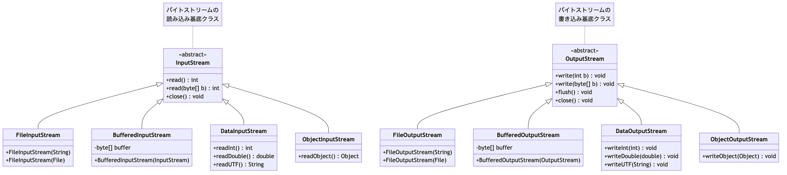
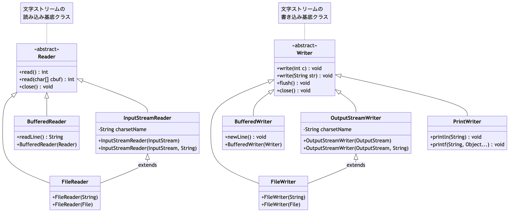

# <b>14章</b> <span>ファイルI/O</span> <small>外部データとの安全な連携</small>

## 本章の学習目標

### この章で学ぶこと

1. ファイルI/Oの基本
    - InputStream/OutputStreamとReader/Writerの使い分け
    - バイトストリームと文字ストリームの特性理解
    - try-with-resourcesによる確実なリソース管理
2. NIO.2による現代的ファイル操作
    - FilesクラスとPathインターフェイスの活用
    - より簡潔で安全なファイル操作の実装
    - ディレクトリ操作とファイル検索
3. 文字エンコーディングの扱い
    - UTF-8、Shift_JISなど各種エンコーディングへの対応
    - 国際化対応プログラムの実装
    - エンコーディング変換の実践
4. 大容量ファイルの処理
    - バッファリングとストリーミング技術
    - メモリを節約するデータ処理
    - CSV、JSON、XMLなど各種フォーマットへの対応

### この章を始める前に

第13章の例外処理とtry-with-resources、第12章までのコレクションとStream APIを理解していれば準備完了です。

## 完了確認チェックリスト

### 基礎レベル
- 基本的なファイル読み書きができている
- ディレクトリ操作とファイル検索ができている
- CSVデータの処理ができている
- ログファイルの解析ができている

### 技術要素
- NIO.2のFilesクラスを正しく使用できている
- 大容量ファイルのストリーミング処理ができている
- 文字エンコーディングを正しく処理できている
- try-with-resourcesでリソース管理ができている

### 応用レベル
- パフォーマンスを考慮した実装ができている
- 複雑なファイル処理システムが構築できている
- エラーハンドリングが包括的に実装できている
- 実用的なファイル処理ツールが作成できている

次のステップ： 基本課題が完了したら、advanced/の発展課題でより高度なファイル処理に挑戦しましょう！。

## ファイルI/Oの基礎とストリーム

プログラムが外部のファイルとデータをやりとりすることをファイル入出力（I/O）と呼びます。Javaでは、このデータの流れをストリーム (Stream) という統一された概念で扱います。

- 入力ストリーム
    + ファイルなどからプログラムへデータを読み込む流れ
- 出力ストリーム
    + プログラムからファイルなどへデータを書き出す流れ

ストリームには、データをバイト単位で扱うバイトストリームと、文字単位で扱うキャラクタストリームがあります。テキストファイルを扱う際は、文字コードを正しく解釈できるキャラクタストリームを使うのが基本です。

<div class="figure">



</div>

<div class="figure">



</div>

### `try-with-resources`による安全なリソース管理

ファイルなどの外部リソースは、使い終わったら必ず「閉じる（closeする）」必要があります。これを怠ると、リソースリークなどの問題を引き起こします。Java 7以降で導入された`try-with-resources`文を使うと、リソースのクローズ処理が自動的に行われ、安全かつ簡潔にコードを記述できます。

以下のコードは、try-with-resources構文の基本的な使い方を示しています。try括弧内で宣言されたリソース（BufferedReader）は、tryブロックを抜ける際に自動的にclose()メソッドが呼ばれます。これにより、finallyブロックでの明示的なクローズ処理が不要になり、コードがより簡潔で安全になります。

<span class="listing-number">**サンプルコード14-1**</span>

```java
// try()の括弧内でリソースを初期化する
try (BufferedReader br = new BufferedReader(new FileReader("file.txt"))) {
    // ... ファイル読み込み処理 ...
} catch (IOException e) {
    // ... エラー処理 ...
}
// tryブロックを抜ける際にbrが自動的にクローズされる
```

## テキストファイルの読み書き

### テキストファイルの読み込み

`java.nio.file.Files`クラスと`BufferedReader`を使うのが現代的な方法です。

### Scannerクラスによる柔軟な入力処理

`java.util.Scanner`クラスは、テキスト入力を解析するための便利なクラスです。ファイルだけでなく、標準入力や文字列からもデータを読み取れます。

<span class="listing-number">**サンプルコード14-2**　ScannerExample.java（8〜31、42〜43行目）</span>

```java
public class ScannerExample {
    public static void main(String[] args) {
        Path path = Paths.get("data.txt");
        
        // 1. 行単位の読み込み
        try (Scanner scanner = new Scanner(
                Files.newBufferedReader(path, StandardCharsets.UTF_8))) {
            System.out.println("--- Scannerによる行単位の読み込み ---");
            while (scanner.hasNextLine()) {
                String line = scanner.nextLine();
                System.out.println(line);
            }
        } catch (IOException e) {
            e.printStackTrace();
        }
        
        // 2. デリミターを使った読み込み
        String csvData = "リンゴ,150,赤\nバナナ,100,黄";
        try (Scanner scanner = new Scanner(csvData)) {
            scanner.useDelimiter(",|\\n");  // コンマまたは改行で区切る
            while (scanner.hasNext()) {
                System.out.println(scanner.next());
            }
        }
        // ...
    }
}
```

実行結果：
```
--- Scannerによる行単位の読み込み ---
Line 1: This is the first line.
Line 2: This is the second line.
Line 3: Java programming is fun!
100 200 300
apple banana cherry

--- デリミターを使った読み込み ---
リンゴ
150
赤
バナナ
100
黄

--- 型を指定した読み込み ---
整数: 100, 小数: 3.14, 真偽値: true
```

<span class="listing-number">**サンプルコード14-3**　TextFileReaderExample.java（9〜10、15〜28、31〜32、35〜43行目）</span>

```java
public class TextFileReaderExample {
    public static void main(String[] args) {
        // ...
        // 方法1: 1行ずつ読み込む (大きなファイルに最適)
        // BufferedReaderを使用することで、ファイルから効率的に行単位でデータを読み込めます。
        // 大容量ファイルでもメモリを節約しながら処理できるため、実用的なアプリケーションではもっとも推奨される方法です。
        System.out.println("--- 1行ずつ読み込み ---");
        try (BufferedReader reader = Files.newBufferedReader(
                filePath, StandardCharsets.UTF_8)) {
            String line;
            while ((line = reader.readLine()) != null) {
                System.out.println(line);
            }
        } catch (IOException e) {
            e.printStackTrace();
        }

        // ...
        // 方法2: 全行を一度に読み込む (小さなファイル向き)
        System.out.println("\n--- 全行を一度に読み込み ---");
        // ...
        try {
            List<String> lines = Files.readAllLines(
                    filePath, StandardCharsets.UTF_8);
            lines.forEach(System.out::println);
        } catch (IOException e) {
            e.printStackTrace();
        }
    }
}
```

実行結果：
```
--- 1行ずつ読み込み ---
Line 1
Line 2

--- 全行を一度に読み込み ---
Line 1
Line 2
```

### テキストファイルの書き込み

同様に`Files`クラスと`BufferedWriter`を使います。

<span class="listing-number">**サンプルコード14-4**　TextFileWriterExample.java</span>

```java
import java.io.BufferedWriter;
import java.io.IOException;
import java.nio.charset.StandardCharsets;
import java.nio.file.Files;
import java.nio.file.Path;
import java.nio.file.Paths;
import java.nio.file.StandardOpenOption;

public class TextFileWriterExample {
    public static void main(String[] args) {
        Path filePath = Paths.get("output.txt");

        // ファイルへの書き込み
        // BufferedWriterを使用してテキストデータを効率的にファイルに書き込みます。
        // CREATE: ファイルが存在しない場合は新規作成
        // TRUNCATE_EXISTING: 既存ファイルがある場合は内容を消去して上書き
        try (BufferedWriter writer = Files.newBufferedWriter(
                filePath, StandardCharsets.UTF_8,
                StandardOpenOption.CREATE, 
                StandardOpenOption.TRUNCATE_EXISTING)) {
            writer.write("最初の行。");
            writer.newLine(); // 改行
            writer.write("次の行。");
            System.out.println("ファイルに書き込みました。");
        } catch (IOException e) {
            e.printStackTrace();
        }
    }
}
```

実行結果：
```
ファイルに書き込みました。
```

作成された`output.txt`の内容は次のとおりです。

```
最初の行。
次の行。
```

`StandardOpenOption.APPEND`を指定すると、既存ファイルの内容を保持したまま末尾にデータを追記できます。
ログファイルへの記録のように、既存データを残したまま新しい情報を追加する場合に使用します。

### 文字エンコーディングの指定

テキストファイルを扱う際には、文字コード（エンコーディング）の指定が大切です。文字コードが異なると、文字化けが発生する可能性があります。

主要な文字エンコーディング。
- UTF-8: 現在もっとも広く使用される可変長エンコーディング
- Shift_JIS (MS932): Windows環境で使用される日本語エンコーディング
- ISO-8859-1: 西欧言語用の1バイトエンコーディング

<span class="listing-number">**サンプルコード14-5**　CharacterEncodingExample.java（10〜12、20〜41、44〜45行目）</span>

```java
public class CharacterEncodingExample {
    public static void main(String[] args) {
        Path path = Paths.get("japanese.txt");
        // ...
        
        // Shift_JISで読み込み（文字化けの例）
        // Files.newBufferedReaderは、解釈できないバイト列があると文字化けではなく例外を投げる
        System.out.println("--- Shift_JISで読み込み（文字化け） ---");
        try (BufferedReader reader = Files.newBufferedReader(
                path, Charset.forName("Shift_JIS"))) {
            System.out.println(reader.readLine());
        } catch (MalformedInputException e) {
            System.out.println("エラー: MalformedInputException - 文字エンコーディングの不一致");
        } catch (IOException e) {
            e.printStackTrace();
        }
        
        // UTF-8で正しく読み込み
        System.out.println("\n--- UTF-8で正しく読み込み ---");
        try (BufferedReader reader = Files.newBufferedReader(
                path, StandardCharsets.UTF_8)) {
            System.out.println(reader.readLine());
        } catch (IOException e) {
            e.printStackTrace();
        }
        
        // ...
    }
}
```

実行結果：
```
--- Shift_JISで読み込み（文字化け） ---
エラー: MalformedInputException - 文字エンコーディングの不一致

--- UTF-8で正しく読み込み ---
こんにちは、世界！

デフォルトエンコーディング: UTF-8
```

## バイナリファイルの高度な処理

### DataInputStream/DataOutputStreamによるプリミティブ型の読み書き

`DataInputStream`と`DataOutputStream`は、Javaのプリミティブデータ型（`int`, `double`, `boolean`など）や文字列を、プラットフォームに依存しないバイナリ形式で読み書きするために使用します。
数値を文字列に変換せずに保存するため、テキスト形式と比べてファイルサイズが小さくなり、変換処理も不要になります。

<span class="listing-number">**サンプルコード14-6**　DataStreamExample.java</span>

```java
import java.io.*;

public class DataStreamExample {
    public static void main(String[] args) throws IOException {
        String filename = "data.bin";
        
        // バイナリファイルの書き込み
        // DataOutputStreamを使用してプリミティブ型のデータをバイナリ形式で保存します。
        // この方法により、データの型情報を保持したまま効率的にファイルに保存できます。
        // データの書き込み
        try (DataOutputStream dos = new DataOutputStream(
                new BufferedOutputStream(new FileOutputStream(filename)))) {
            // プリミティブ型の書き込み
            dos.writeInt(12345);
            dos.writeLong(9876543210L);
            dos.writeDouble(3.14159);
            dos.writeBoolean(true);
            dos.writeUTF("こんにちは、世界！");  // 修正UTF-8形式
            
            System.out.println("データを書き込みました。");
        }
        
        // データの読み込み（書き込んだ順序と同じ順序で読む）
        try (DataInputStream dis = new DataInputStream(
                new BufferedInputStream(new FileInputStream(filename)))) {
            int intValue = dis.readInt();
            long longValue = dis.readLong();
            double doubleValue = dis.readDouble();
            boolean boolValue = dis.readBoolean();
            String strValue = dis.readUTF();
            
            System.out.printf("読み込んだデータ: %d, %d, %.5f, %b, %s%n",
                    intValue, longValue, doubleValue, 
                    boolValue, strValue);
        }
    }
}
```

実行結果：
```
データを書き込みました。
読み込んだデータ: 12345, 9876543210, 3.14159, true, こんにちは、世界！
```

大切な注意点。
1. 順序の一致
    + 書き込んだ順序と正確に同じ順序で読み込む必要がある
2. エンディアン
    + DataStream系は常にビッグエンディアン（ネットワークバイトオーダー）を使用
3. 文字列の制限
    + `writeUTF()`は最大65535バイトまでの文字列しか扱えません

### BufferedInputStream/BufferedOutputStreamの活用

これらのクラスは、内部バッファーを持つことで、`FileInputStream` や `FileOutputStream` のパフォーマンスを向上させます。ディスクアクセスの回数を減らせるため、とくに大量のデータを扱う場合に有効です。

## オブジェクトの直列化（シリアライズ）

Javaオブジェクトの状態をそのままバイト列に変換して保存するしくみを直列化（シリアライズ）、バイト列からオブジェクトを復元することを非直列化（デシリアライズ）と呼びます。オブジェクトの構造を保ったまま、簡単に保存・復元できる強力な機能です。

- 直列化したいクラスは`java.io.Serializable`インターフェイスを実装する必要がある
- `ObjectOutputStream`で直列化し、`ObjectInputStream`で非直列化する
- `transient`修飾子を付けたフィールドは直列化の対象外となります（パスワードなど）

<span class="listing-number">**サンプルコード14-7**　SerializationExample.java（4〜45行目）</span>

```java
// Serializableを実装したクラス
class UserProfile implements Serializable {
    private static final long serialVersionUID = 1L; // クラスのバージョン管理用
    String name;
    transient String password; // 直列化されない
    LocalDateTime registrationDate;
    public UserProfile(String name, String pw) { 
        this.name = name; 
        this.password = pw; 
        this.registrationDate = LocalDateTime.now(); 
    }
    public String toString() { 
        return "User[name=" + name + ", pw=" + password + 
               ", date=" + registrationDate + "]"; 
    }
}

public class SerializationExample {
    public static void main(String[] args) {
        UserProfile user = new UserProfile("testuser", "secret123");
        String filename = "user.ser";

        // ObjectOutputStreamを使用してJavaオブジェクトをバイナリ形式でファイルに保存します。
        // オブジェクトの構造や状態をそのまま保持できるため、データの永続化やキャッシュ機能に便利です。
        // 1. 直列化してファイルに保存
        try (ObjectOutputStream oos = new ObjectOutputStream(
                new FileOutputStream(filename))) {
            oos.writeObject(user);
            System.out.println("保存されたオブジェクト: " + user);
        } catch (IOException e) { e.printStackTrace(); }

        // ObjectInputStreamでファイルからオブジェクトを復元します。
        // オブジェクトの状態が完全に復元され、保存時と同じ構造とデータを持つオブジェクトが復元されます。
        // 2. ファイルから非直列化して復元
        try (ObjectInputStream ois = new ObjectInputStream(
                new FileInputStream(filename))) {
            UserProfile loadedUser = (UserProfile) ois.readObject();
            System.out.println("復元されたオブジェクト: " + loadedUser); 
            // passwordはnullになる
        } catch (IOException | ClassNotFoundException e) { e.printStackTrace(); }
    }
}
```

実行結果：
```
保存されたオブジェクト: User[name=testuser, pw=secret123, date=2025-08-01T20:58:13.831566]
復元されたオブジェクト: User[name=testuser, pw=null, date=2025-08-01T20:58:13.831566]
```

## ファイルシステムの操作 (NIO.2)

Java 7で導入された`java.nio.file`パッケージ（NIO.2）を使うと、よりモダンで高機能なファイル・ディレクトリ操作が可能です。

- `Path`
    + ファイルやディレクトリのパスを表現する
- `Paths`
    + `Path`オブジェクトを生成するためのユーティリティクラス
- `Files`
    + ファイル・ディレクトリの操作（作成、削除、コピー、移動など）を行うためのユーティリティクラス

<span class="listing-number">**サンプルコード14-8**　FileSystemExample.java（4〜37行目）</span>

```java
public class FileSystemExample {
    public static void main(String[] args) throws IOException {
        Path dir = Paths.get("my_temp_dir");
        Path file = dir.resolve("my_file.txt");

        // Files.createDirectory()は指定されたディレクトリを作成します。
        // createDirectories()を使用すると、必要に応じて親ディレクトリも同時に作成されます。
        // ディレクトリ作成
        if (Files.notExists(dir)) {
            Files.createDirectory(dir);
            System.out.println("ディレクトリを作成しました: " + dir);
        }

        // writeString()は小容量のテキストデータを簡単にファイルに保存できる便利メソッドです。
        // 内部的にはBufferedWriterが使用されており、効率的な書き込みが行われます。
        // ファイル作成と書き込み
        Files.writeString(file, "Hello, NIO.2!");
        System.out.println("ファイルを作成しました: " + file);

        // Files.copy()はファイルのコピーを行います。StandardCopyOptionで動作を制御できます。
        // REPLACE_EXISTING: 同名ファイルがある場合は上書き
        // COPY_ATTRIBUTES: ファイルの属性（作成日時、アクセス権など）もコピー
        // ファイルのコピー
        Path copiedFile = dir.resolve("my_file_copy.txt");
        Files.copy(file, copiedFile, StandardCopyOption.REPLACE_EXISTING);
        System.out.println("ファイルをコピーしました: " + copiedFile);

        // ファイルの削除
        Files.delete(copiedFile);
        Files.delete(file);
        Files.delete(dir);
        System.out.println("ファイルとディレクトリを削除しました。");
    }
}
```

実行結果：
```
ディレクトリを作成しました: my_temp_dir
ファイルを作成しました: my_temp_dir/my_file.txt
ファイルをコピーしました: my_temp_dir/my_file_copy.txt
ファイルとディレクトリを削除しました。
```

## 実践的なファイル処理例

### CSV ファイルの処理

CSV（Comma-Separated Values）形式は、表計算データやデータベースのエクスポート・インポートでよく使われるテキスト形式です。
基本的なCSV処理は標準ライブラリだけで実装できますが、値にカンマや改行を含むデータを扱う場合は、Apache Commons CSVなどの専用ライブラリを使用します。
以下は、基本的なCSV読み込み・書き込みの実装例です。

<span class="listing-number">**サンプルコード14-9**　CSVProcessingExample.java（6、21〜54、65行目）</span>

```java
public class CSVProcessingExample {
    // ...
    
    // CSVファイルの読み込み
    public static List<List<String>> readCSV(Path filePath) {
        List<List<String>> result = new ArrayList<>();
        try (BufferedReader reader = Files.newBufferedReader(filePath, StandardCharsets.UTF_8)) {
            String line;
            while ((line = reader.readLine()) != null) {
                List<String> row = parseCSVLine(line);
                result.add(row);
            }
        } catch (IOException e) {
            e.printStackTrace();
        }
        return result;
    }
    
    // 簡単なCSV行解析（引用符などの複雑なケースは考慮していません）
    private static List<String> parseCSVLine(String line) {
        return Arrays.asList(line.split(","));
    }
    
    // CSVファイルの書き込み
    public static void writeCSV(Path filePath, List<List<String>> data) {
        try (BufferedWriter writer = Files.newBufferedWriter(filePath, StandardCharsets.UTF_8)) {
            for (List<String> row : data) {
                writer.write(String.join(",", row));
                writer.newLine();
            }
            System.out.println("CSVファイルを書き込みました: " + filePath);
        } catch (IOException e) {
            e.printStackTrace();
        }
    }
    
    // ...
}
```

実行結果：
```
CSVファイルを書き込みました: sample.csv
読み込んだCSVデータ:
名前 | 年齢 | 職業
田中太郎 | 30 | エンジニア
佐藤花子 | 25 | デザイナー
鈴木一郎 | 35 | マネージャー
CSVファイルを書き込みました: output.csv
```

## 日付時刻処理について

ファイル操作でしばしば必要となる日付時刻処理については、Java 8で導入されたjava.time APIを使用することを強く推奨します。従来のjava.util.DateやCalendarクラスは多くの問題があるため、新しいAPIを使用してください。

java.time APIの詳細な使い方については、付録F: java.time API完全ガイドを参照してください。そこでは以下の内容を詳しく解説しています。

- レガシーDate/Calendarの問題点
- LocalDate、LocalTime、LocalDateTime、ZonedDateTimeの使い分け
- 日付時刻のフォーマットとパース
- 期間計算（PeriodとDuration）
- タイムゾーンの扱い
- ファイル操作での実践例
- レガシーAPIとの相互変換

本章では、ファイル操作に最低限必要な日付時刻処理のみを扱い、詳細な日付時刻処理は付録Fで学習してください。

## GUIでのファイル選択: `JFileChooser`

Swingアプリケーションでユーザーにファイルを選択させるには、`JFileChooser`を使います。

<span class="listing-number">**サンプルコード14-10**　FileChooserExample.java</span>

```java
import javax.swing.*;
import java.io.File;

public class FileChooserExample {
    public static void main(String[] args) {
        JFileChooser fileChooser = new JFileChooser();
        
        // ファイルを開くダイアログ
        int openResult = fileChooser.showOpenDialog(null);
        if (openResult == JFileChooser.APPROVE_OPTION) {
            File selectedFile = fileChooser.getSelectedFile();
            System.out.println("選択されたファイル（開く）: " + 
                    selectedFile.getAbsolutePath());
        }

        // ファイルを保存するダイアログ
        int saveResult = fileChooser.showSaveDialog(null);
        if (saveResult == JFileChooser.APPROVE_OPTION) {
            File fileToSave = fileChooser.getSelectedFile();
            System.out.println("保存するファイル: " + 
                    fileToSave.getAbsolutePath());
        }
    }
}
```

実行結果：
```
（ユーザーがファイル選択ダイアログで「/Users/username/documents/report.txt」を選択した場合）
選択されたファイル（開く）: /Users/username/documents/report.txt

（ユーザーが保存ダイアログで「/Users/username/desktop/output.txt」を指定した場合）
保存するファイル: /Users/username/desktop/output.txt
```

## Text Blocks - 複数行文字列の効率的な処理

Java 15で正式に導入されたText Blocksは、複数行にわたる文字列リテラルを簡潔で読みやすく記述するための機能です。とくにファイルI/Oにおいて、JSON、XML、SQL文、HTMLテンプレートなどの構造化されたテキストデータを扱う際に非常に有用です。

### 従来の文字列連結の問題点

Text Blocksが導入される前は、複数行の文字列を作成するために文字列連結やエスケープシーケンスを多用する必要がありました。

<span class="listing-number">**サンプルコード14-11**　TraditionalStringProblems.java</span>

```java
public class TraditionalStringProblems {
    public static void main(String[] args) {
        // 従来の方法：読みにくく、エラーが起きやすい
        String jsonData = "{\n" +
                "  \"name\": \"田中太郎\",\n" +
                "  \"age\": 30,\n" +
                "  \"address\": {\n" +
                "    \"city\": \"東京\",\n" +
                "    \"zipCode\": \"100-0001\"\n" +
                "  }\n" +
                "}";
        
        String sqlQuery = "SELECT u.name, u.email, p.title\n" +
                "FROM users u\n" +
                "INNER JOIN posts p ON u.id = p.user_id\n" +
                "WHERE u.created_at > '2024-01-01'\n" +
                "ORDER BY u.name";
        
        String htmlTemplate = "<html>\n" +
                "<head>\n" +
                "  <title>ユーザー情報</title>\n" +
                "</head>\n" +
                "<body>\n" +
                "  <h1>プロフィール</h1>\n" +
                "  <p>名前: %s</p>\n" +
                "  <p>年齢: %d</p>\n" +
                "</body>\n" +
                "</html>";
        
        System.out.println("=== 従来の方法の問題点 ===");
        System.out.println("1. エスケープシーケンス（\\n, \\\"）が多くて読みにくい");
        System.out.println("2. 文字列連結（+）によるエラーが起きやすい");
        System.out.println("3. インデントの管理が困難");
        System.out.println("4. 引用符のエスケープが煩雑");
    }
}
```

実行結果：
```
=== 従来の方法の問題点 ===
1. エスケープシーケンス（\n, \"）が多くて読みにくい
2. 文字列連結（+）によるエラーが起きやすい
3. インデントの管理が困難
4. 引用符のエスケープが煩雑
```

### Text Blocksの基本構文

Text Blocksは三重引用符（`"""`）を使用して複数行文字列を定義します。

<span class="listing-number">**サンプルコード14-12**　TextBlockBasics.java</span>

```java
public class TextBlockBasics {
    public static void main(String[] args) {
        // Text Blocksの基本構文
        String textBlock = """
                これは Text Block の例です。
                複数行にわたる文字列を
                簡潔に記述できます。
                """;
        
        System.out.println("=== Text Block の出力 ===");
        System.out.println(textBlock);
        
        // 従来の文字列との比較
        String traditional = "これは Text Block の例です。\n" +
                "複数行にわたる文字列を\n" +
                "簡潔に記述できます。\n";
        
        System.out.println("\n=== 従来の文字列との同等性 ===");
        System.out.println("同じ内容？: " + textBlock.equals(traditional));
        
        // 空のText Block
        String empty = """
                """;
        System.out.println("空のText Block: '" + empty + "'");
        
        // 1行のText Block
        String singleLine = """
                単一行のText Block
                """;
        System.out.println("1行のText Block: " + singleLine);
    }
}
```

実行結果：
```
=== Text Block の出力 ===
これは Text Block の例です。
複数行にわたる文字列を
簡潔に記述できます。


=== 従来の文字列との同等性 ===
同じ内容？: true
空のText Block: ''
1行のText Block: 単一行のText Block
```

### インデントの自動処理

Text Blocksのもっとも重要な特徴の1つは、共通インデントの自動除去です。

<span class="listing-number">**サンプルコード14-13**　TextBlockIndentation.java（1〜16、29〜38、49〜50行目）</span>

```java
public class TextBlockIndentation {
    public static void main(String[] args) {
        // インデントの自動処理
        String codeExample = """
                public class Example {
                    public void method() {
                        System.out.println("Hello");
                        if (true) {
                            System.out.println("Nested");
                        }
                    }
                }
                """;
        
        System.out.println("=== インデント自動処理の例 ===");
        System.out.println(codeExample);
        // ...
        // もっとも左にある行でインデントが決まる
        String mixedIndent = """
                    深いインデント
                中程度のインデント
            浅いインデント
                    再び深いインデント
            """;
        
        System.out.println("\n=== 混合インデント（もっとも浅い行が基準） ===");
        System.out.println(mixedIndent);
        // ...
    }
}
```

実行結果：
```
=== インデント自動処理の例 ===
public class Example {
    public void method() {
        System.out.println("Hello");
        if (true) {
            System.out.println("Nested");
        }
    }
}


=== カスタムインデント ===
レベル1
    レベル2
        レベル3
レベル1に戻る


=== 混合インデント（もっとも浅い行が基準） ===
        深いインデント
    中程度のインデント
浅いインデント
        再び深いインデント


=== 手動stripIndent() ===
これは深いインデントです
    さらに深いインデント
元のレベル
```

### エスケープシーケンスの簡略化

Text Blocksでは多くのエスケープシーケンスが不要になります。

<span class="listing-number">**サンプルコード14-14**　TextBlockEscaping.java（1〜11、22〜31、42〜43行目）</span>

```java
public class TextBlockEscaping {
    public static void main(String[] args) {
        // 引用符のエスケープが不要
        String dialogue = """
                "こんにちは"と彼は言った。
                '時は金なり'という諺があります。
                "引用符をエスケープする必要がない"
                """;
        
        System.out.println("=== 引用符のエスケープ不要 ===");
        System.out.println(dialogue);
        // ...
        // 三重引用符を含む場合（エスケープが必要）
        String codeWithTripleQuotes = """
                Text Blockの構文:
                String text = \"""
                    複数行文字列
                    \""";
                """;
        
        System.out.println("\n=== 三重引用符のエスケープ ===");
        System.out.println(codeWithTripleQuotes);
        // ...
    }
}
```

実行結果：
```
=== 引用符のエスケープ不要 ===
"こんにちは"と彼は言った。
'時は金なり'という諺があります。
"引用符をエスケープする必要がない"


=== バックスラッシュの処理 ===
Windowsのパス: C:\Users\Name\Documents
正規表現: \d+\.\d+


=== 三重引用符のエスケープ ===
Text Blockの構文:
String text = """
    複数行文字列
    """;


=== 行末の制御 ===
'この行の末尾にスペースがある    
この行は普通の改行
この行は改行なし'
```

### 実践例：構造化データの処理

Text BlocksはJSON、XML、SQL、HTMLなどの構造化データを扱う際にとくに威力を発揮します。

<span class="listing-number">**サンプルコード14-15**　TextBlockStructuredData.java（8〜40、172〜173行目）</span>

```java
public class TextBlockStructuredData {
    public static void main(String[] args) throws IOException {
        // 1. JSON データの生成
        String userName = "田中太郎";
        int userAge = 30;
        String timestamp = LocalDateTime.now()
                .format(DateTimeFormatter.ISO_LOCAL_DATE_TIME);
        
        String jsonData = """
                {
                  "user": {
                    "name": "%s",
                    "age": %d,
                    "timestamp": "%s",
                    "preferences": {
                      "language": "Japanese",
                      "theme": "dark",
                      "notifications": true
                    }
                  },
                  "metadata": {
                    "version": "1.0",
                    "created": "%s"
                  }
                }
                """.formatted(userName, userAge, timestamp, timestamp);
        
        // JSONファイルとして保存
        Path jsonFile = Paths.get("user_data.json");
        Files.writeString(jsonFile, jsonData);
        System.out.println("=== JSON データを保存しました ===");
        System.out.println(jsonData);
        
        // ...
    }
}
```

実行結果：
```
=== JSON データを保存しました ===
{
  "user": {
    "name": "田中太郎",
    "age": 30,
    "timestamp": "2025-08-01T21:02:54.993907",
    "preferences": {
      "language": "Japanese",
      "theme": "dark",
      "notifications": true
    }
  },
  "metadata": {
    "version": "1.0",
    "created": "2025-08-01T21:02:54.993907"
  }
}


=== SQL クエリを保存しました ===
SELECT
    u.id,
    u.name,
    u.email,
    u.created_at,
    p.title AS latest_post,
    COUNT(c.id) AS comment_count
FROM users u
LEFT JOIN posts p ON u.id = p.user_id
    AND p.created_at = (
        SELECT MAX(created_at)
        FROM posts
        WHERE user_id = u.id
    )
LEFT JOIN comments c ON p.id = c.post_id
WHERE u.created_at > '2024-01-01'
GROUP BY u.id, u.name, u.email, u.created_at, p.title
ORDER BY u.created_at DESC
LIMIT 100;


=== HTML テンプレートを保存しました ===
ファイル: /home/user/work/user_profile.html

=== XML 設定ファイルを保存しました ===

=== 生成されたファイル一覧 ===
app_config.xml       (706 bytes)
user_data.json       (305 bytes)
user_profile.html    (1177 bytes)
user_query.sql       (449 bytes)
```

HTMLファイルのパスは、プログラムを実行したディレクトリによって変わります。
ファイル一覧の順序は、OSやファイルシステムによって異なることがあります。

### ファイルI/Oでの活用例

Text Blocksをファイル読み書きと組み合わせた実践的な使用例。

<span class="listing-number">**サンプルコード14-16**　TextBlockFileIO.java（8、23〜50、232行目）</span>

```java
public class TextBlockFileIO {
    // ...
    private static void generateLogTemplate() throws IOException {
        String logTemplate = """
                # アプリケーションログ設定
                # 生成日時: %s
                
                ## ログレベル設定
                root.level=INFO
                com.example.app=DEBUG
                com.example.db=WARN
                
                ## 出力先設定
                console.enabled=true
                file.enabled=true
                file.path=logs/app-%s.log
                file.maxSize=10MB
                file.maxHistory=30
                
                ## フォーマット設定
                pattern.console=%%d{HH:mm:ss} [%%thread] %%-5level %%logger{0} - %%msg%%n
                pattern.file=%%d{yyyy-MM-dd HH:mm:ss.SSS} [%%thread] %%-5level %%logger{36} - %%msg%%n
                """.formatted(
                LocalDateTime.now().format(DateTimeFormatter.ISO_LOCAL_DATE_TIME),
                LocalDateTime.now().format(DateTimeFormatter.ofPattern("yyyyMMdd")));
        
        Path logConfigPath = Paths.get("log_config.properties");
        Files.writeString(logConfigPath, logTemplate);
        System.out.println("ログ設定ファイルを生成しました: " + logConfigPath);
    }
    // ...
}
```

実行結果：
```
ログ設定ファイルを生成しました: log_config.properties
デフォルト設定ファイルを作成しました
HTMLレポートを生成しました: user_report.html
生成しました: README.md
生成しました: TODO.md
生成しました: project.json

=== 一括ファイル処理完了 ===
```

### Text Blocksのベストプラクティス

1. 構造化データでの活用
    + JSON、XML、SQL、HTMLなどの複雑な構造を持つテキストでText Blocksの真価が発揮される
2. 正しいインデント管理
    + もっとも左の行がインデントの基準となることを理解して使用しましょう
3. 文字列フォーマッティングとの組み合わせ
    + `formatted()`メソッドや`String.format()`と組み合わせることで、動的なコンテンツ生成が可能である
4. ファイルテンプレートとしての利用
    + 設定ファイル、レポート、コード生成のテンプレートとして活用できる
5. 可読性の向上
    + 従来のエスケープシーケンスを多用した文字列と比較して、コードの見た目がそのまま実際の出力に対応するため可読性が向上する

Text Blocksは、とくにファイルI/O処理において構造化されたテキストデータを扱う際の強力なツールです。
JSON APIの応答処理、SQLクエリの構築、HTMLテンプレートの生成など、現代的なJavaアプリケーション開発において欠かせない機能となっています。

※ 本章の高度な内容については、付録B.13「NIO.2の高度な機能」を参照してください。
（`https://github.com/Nagatani/techbook-java-primer/tree/main/appendix/b13-nio2-advanced/`）

## まとめ

- JavaのファイルI/Oはストリームベースである
- リソース管理には`try-with-resources`を使い、安全性を高めましょう
- テキストファイルはキャラクタストリーム（`Reader`/`Writer`）、バイナリファイルはバイトストリーム（`InputStream`/`OutputStream`）で扱う
- オブジェクト直列化は、オブジェクトの状態を簡単に保存・復元する強力な手段である
- NIO.2 (`java.nio.file`) を使うと、モダンで高機能なファイルシステム操作が可能である
- GUIでは`JFileChooser`を使って、ユーザーにファイルを選択させることができる

## よくあるエラーと対処法

ファイルI/Oのエラーの多くは、プログラムの外にあるファイルシステムやOSの状態が原因で起こります。そのため、開発した環境では動いたのに、別の環境では動かないという形で現れることがあります。本章の内容に関連して出会いやすい問題は次のとおりです。

- ファイルパスの問題
    + 相対パスは実行時の作業ディレクトリが基準になるため、ファイルが見つからないことがある
- 文字エンコーディングの問題
    + 文字コードを指定せずに読み書きすると、環境によって文字化けする
- ファイルのロックとアクセス権限
    + 他のプロセスが使用中のファイルや、権限のないファイルは操作できない
- メモリの使いすぎ
    + 大きなファイルを一度に読み込むと`OutOfMemoryError`になる。1行ずつ処理する
- OSによる違い
    + パスの区切り文字やファイル名に使える文字はOSごとに異なる。`Path`を使って組み立てる
- 複数のスレッドからの同時アクセス
    + 同じファイルへの同時書き込みで内容が壊れる
- 一時ファイルの削除忘れ
    + 作成した一時ファイルを削除しないと、ディスクを圧迫する

問題のあるコードと修正したコード、デバッグのヒントは、GitHubリポジトリにまとめています。<br>
`https://github.com/Nagatani/techbook-java-primer/blob/main/appendix/h-common-errors/chapters/chapter14.md`

## 章末演習

### 演習課題へのアクセス
本章の演習課題は、GitHubリポジトリで提供されています。<br>
`https://github.com/Nagatani/techbook-java-primer/tree/main/exercises/chapter14/`

### 課題構成
- 本章の基本概念の理解確認
- 応用的な実装練習
- 実践的な総合問題

詳細な課題内容と実装のヒントは、各課題フォルダ内のREADME.mdを参照してください。
