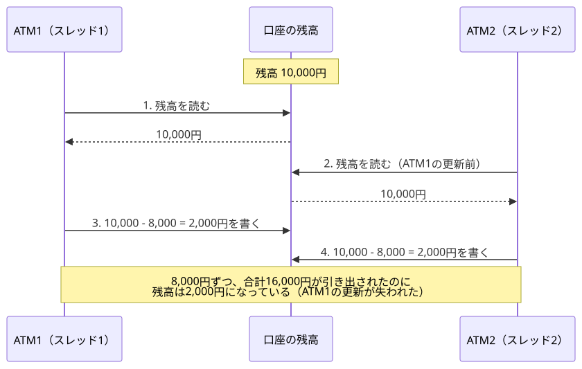
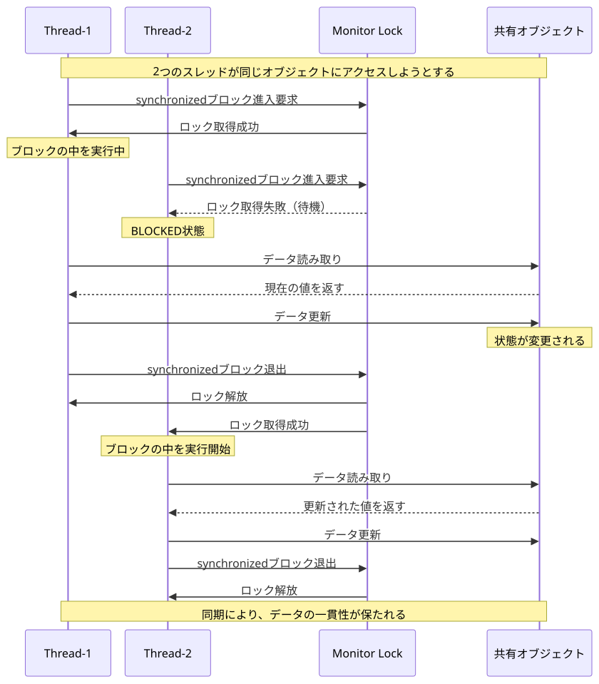

# <b>15章</b> <span>マルチスレッドプログラミング</span> <small>並行処理と同期制御の実践</small>

## 本章の学習目標

### この章で学ぶこと

1. スレッドの作成
    - `Runnable`でタスクを書き、`Thread`の`start`で実行し、`join`で終わりを待てる
2. 競合状態と同期
    - 複数のスレッドで同じ変数を増やすと値が狂う理由を説明し、`synchronized`や`AtomicInteger`で直せる
    - `volatile`で保証されることと保証されないことを説明できる
    - ロックを取る順序をそろえて、デッドロックを防げる
3. スレッドプールと非同期処理
    - `ExecutorService`にタスクを渡して`Future`で結果を受け取り、終わったら`shutdown`できる
    - `CompletableFuture`で、非同期の処理をつないで結果をまとめられる
4. 並行コレクションとスレッド間の協調
    - 複数のスレッドで共有するマップに、`ConcurrentHashMap`を選べる
    - `BlockingQueue`で、プロデューサー・コンシューマーパターンを書ける
5. 並列化の効果
    - 並列にした処理が速くなったかを、時間を測って確かめられる

### この章を始める前に

第13章までのJavaアプリケーション開発能力、とくに例外処理とコレクションフレームワークを理解していれば準備完了です。

本章では、基本的な並行処理プログラムを安全に書くところから始めます。
その後、ExecutorServiceを使った非同期処理の実装、デッドロックの回避、並列処理による処理時間の変化を測って確かめるところまでを学びます。

最低限持ち帰ってほしいのは、`count++`の途中にもほかのスレッドが割り込むこと、それを`synchronized`で防ぐこと、スレッドは`ExecutorService`に任せて最後に`shutdown()`を呼ぶことの3つです。
プロデューサー・コンシューマーパターンの`wait()`と`notify()`、`Semaphore`、節「新しい並行処理のしくみ」は、初めて読むときは飛ばしてかまいません。

## 並行処理の世界への招待

### なぜマルチスレッドが必要なのか

これまでの章で学習してきたプログラムは、すべて「1つずつ順番に」処理を実行してきました。
しかし、現実のアプリケーションでは、複数の作業を同時に行いたい場面がよくあります。

たとえば、Webブラウザーを考えてみましょう。
- 画像をダウンロードしている
- HTMLを解析している
- JavaScriptを実行している
- ユーザーのクリックに反応している

これらすべてが「同時に」動いているように見えます。
もし1つずつ順番に処理していたら、画像のダウンロードが終わるまでページが表示されず、
とても使いづらいブラウザーになってしまいます。

自分で書くプログラムでも同じことが起きます。
第17章からのGUIのプログラムで、ボタンを押したときの処理に時間のかかる読み込みや通信をそのまま書くと、終わるまでウィンドウが固まります。
そのあいだは、ほかのボタンを押しても反応せず、画面の再描画も止まります。

### 身近な例で理解する並行処理

レストランの厨房を想像してください。

#### シングルスレッド（一人のシェフ）の場合

```
1. お客様Aの前菜を作る（5分）
2. お客様Aのメイン料理を作る（15分）
3. お客様Aのデザートを作る（5分）
4. お客様Bの前菜を作る（5分）... 
```
お客様Aの料理がすべて完成するまで25分かかり、お客様Bの料理はそれまで作り始められません。

#### マルチスレッド（複数のシェフ）の場合

前菜・メイン・デザートを別々のシェフが受け持ち、並行して作ります。複数のシェフが分担して働くことで、短時間で多くの料理を提供できます。次の図は、お客様AとBの料理を作り終えるまでの時間を比べたものです。
シェフが1人なら、Aの料理がそろうのは25分後、Bの料理は50分後です。
3人なら、Aの料理は15分後、Bの料理は30分後にそろいます。

<div class="figure">


</div>

### Javaでの簡単な例

まず、シングルスレッドの例を見てみましょう。

以下のコードは、朝食の準備を順番に行うシングルスレッドのプログラムです。コーヒー（3秒）、トースト（2秒）、卵（5秒）を順番に処理するため、合計10秒かかります。各処理が完了するまで次の処理を開始できないため、待ち時間が無駄になっています。

<span class="listing-number">**サンプルコード15-1**　SingleThreadExample.java（1〜24、28、36、42〜43行目）</span>

```java
public class SingleThreadExample {
    public static void main(String[] args) {
        IO.println("朝食の準備を開始");
        
        // コーヒーを淹れる（3秒かかる）
        makeCoffee();
        
        // トーストを焼く（2秒かかる）
        makeToast();
        
        // 卵を茹でる（5秒かかる）
        boilEgg();
        
        IO.println("朝食の準備完了！");
        // 合計: 10秒かかる
    }
    
    private static void makeCoffee() {
        IO.println("コーヒーを淹れています...");
        sleep(3000);
        IO.println("コーヒーができました");
    }
    
    private static void makeToast() {
    // ...
    }
    // ...
    private static void sleep(int milliseconds) {
    // ...
    }
}
```

実行結果：

```
朝食の準備を開始
コーヒーを淹れています...
コーヒーができました
トーストを焼いています...
トーストができました
卵を茹でています...
ゆで卵ができました
朝食の準備完了！
```

すべての処理が順番に実行されるため、完了までに約10秒かかります。

これをマルチスレッドで書き換えると、次のようになります。

<span class="listing-number">**サンプルコード15-2**　MultiThreadExample.java（1〜24、50行目）</span>

```java
public class MultiThreadExample {
    public static void main(String[] args) throws InterruptedException {
        IO.println("朝食の準備を開始");
        
        // それぞれ別々のスレッドで同時に実行
        Thread coffeeThread = new Thread(() -> makeCoffee());
        Thread toastThread = new Thread(() -> makeToast());
        Thread eggThread = new Thread(() -> boilEgg());
        
        // スレッドを開始
        coffeeThread.start();
        toastThread.start();
        eggThread.start();
        
        // すべてのスレッドが終了するのを待つ
        coffeeThread.join();
        toastThread.join();
        eggThread.join();
        
        IO.println("朝食の準備完了！");
        // 合計: 約5秒（もっとも時間のかかる卵の時間）で完了
    }
    
    // makeCoffee、makeToast、boilEgg、sleepメソッドはサンプルコード15-1と同じ
}
```

次は実行結果の一例です。

```
朝食の準備を開始
コーヒーを淹れています...
卵を茹でています...
トーストを焼いています...
トーストができました
コーヒーができました
ゆで卵ができました
朝食の準備完了！
```

3つのスレッドは同時に動くため、「〜しています」の3行の順序は実行のたびに変わることがあります。
「〜ができました」は、処理時間の短い順に、トースト（2秒）、コーヒー（3秒）、卵（5秒）の順で表示されます。
このように、マルチスレッドを使うことで、10秒かかっていた処理を約5秒に短縮できました。
最後の`join()`は、そのスレッドが終わるまで待つメソッドで、第11章のサンプルコード11-11でも使いました。
3つのスレッドが終わるのを待ってから「朝食の準備完了！」を表示しています。

## マルチスレッドプログラミングの基礎

スレッドとは、プログラム内での処理の流れを表す実行単位です。
通常、1つのプログラムは1つのスレッド（メインスレッド）で実行されます<span class="footnote">ここでは、プログラムのコードを実行するスレッドのことを言っています。JVMの内部では、起動した直後から、ガベージコレクションやJITコンパイラーのためのスレッドなども動いています。</span>。

マルチスレッドとは、1つのプログラム内で複数のスレッドを同時に実行し、処理を並行して進める技術です<span class="footnote">C言語の標準規格にスレッドの機能が入ったのはC11からで、それまではPOSIXスレッド（pthread）などOSが用意するライブラリを使っていました。Javaは最初の版から、スレッドを言語とライブラリに組み込んでいます。</span>。

### マルチスレッドが役立つ場面

「並行処理の世界への招待」では、朝食の準備を3つのスレッドに分けて、全体の時間を短くしました。
ここでは、マルチスレッドが役立つ場面を整理します。

現代のコンピューターは、複数のコアを持つCPU（マルチコアプロセッサー）を搭載するのが一般的です。
時間のかかる処理を複数のスレッドに分割すれば、複数のコアで同時に実行して、全体の処理時間を短縮できます。
GUIアプリケーションでは、時間のかかる処理をバックグラウンドのスレッドに任せることで、ユーザーインターフェイスが固まるのを防げます（GUIでのスレッドの扱いは第18章と第19章で学びます）。
サーバーアプリケーションでは、複数のクライアントからのリクエストを同時に処理することで、計算リソースを無駄なく使えます。

### スレッドの作成と実行

Javaでスレッドを作るときは、実行する処理（タスク）を`Runnable`として書き、`Thread`に渡して`start()`で開始します。

スレッドは生成されてから終了するまでに、次の図のような状態を遷移します。
`new Thread()`で作ったばかりのスレッドはNEWで、`start()`を呼ぶとRUNNABLEになって実行されます。
ロックを待つあいだはBLOCKED、`wait()`や`join()`で待つあいだはWAITING、`sleep()`のように時間を決めて待つあいだはTIMED_WAITINGになり、待つ理由がなくなるとRUNNABLEに戻ります<span class="footnote">`sleep()`や`join()`の待ちは、終わるとRUNNABLEに戻ります。`wait()`で待っていたスレッドは、`notify()`を受けたあと、ロックを取り直すまでBLOCKEDになります。図もこの点を省いています。</span>。
`run()`が終わるか例外で抜けると、TERMINATEDになります。
スレッドの今の状態は、`getState()`メソッドで調べられます。

<div class="figure">



</div>

### `Runnable`インターフェイスの実装（推奨）

`Runnable`は、スレッドが実行するタスク（処理内容）を定義するための関数型インターフェイスです。`run()`メソッドを1つだけ持ちます。

<span class="listing-number">**サンプルコード15-3**　Main.java</span>

```java
// Runnableを実装したクラス
class MyTask implements Runnable {
    @Override
    public void run() {
        IO.println("タスク実行中: " + Thread.currentThread().getName());
    }
}

public class Main {
    public static void main(String[] args) {
        MyTask task = new MyTask();
        Thread thread = new Thread(task);
        thread.start(); // スレッドを開始

        // ラムダ式を使えばさらに簡潔
        new Thread(() -> IO.println("ラムダ式でのタスク実行: "
                + Thread.currentThread().getName())).start();
    }
}
```

`Runnable`を利用する方法は、Javaがクラスの多重継承をサポートしないという制約を受けず、また「タスク（何をするか）」と「スレッド（どう実行するか）」を分離できるため、より柔軟な設計が可能です。

`Thread`クラスを継承して`run()`メソッドをオーバーライドする方法もあります。
ただし、その場合はほかのクラスを継承できなくなり、タスクとスレッドも1つのクラスに混ざります。
そのため、本書では`Runnable`かラムダ式でタスクを書きます。

どちらの方法でも、スレッドを開始するのは`start()`メソッドです。
`run()`を直接呼び出すと、新しいスレッドは作られず、呼び出したスレッドのなかでふつうのメソッドとして実行されます。
この書き間違いは、コンパイルエラーにも例外にもならず、処理の結果も正しいので気づきにくいものです。
並行させたつもりの処理が速くならないときは、`Thread.currentThread().getName()`を出力してみます。
`run()`を直接呼んでいると、`main`と表示されます。

## 共有リソースと同期制御

複数のスレッドが、同じデータ（オブジェクトや変数）に同時にアクセスすると、予期せぬ問題が発生することがあります。これを競合状態（Race Condition）と呼びます。
複数のスレッドから同時に使っても、このような問題が起きずに正しく動くことを、スレッドセーフといいます。

たとえば、銀行口座の残高を更新する処理を考えてみましょう。残高10,000円の口座から「2つのATMで同時に」8,000円を引き出そうとした場合を想定します。
同期制御がないと両方の引き出しが成功してしまい、引き出した金額と残高が合わなくなる可能性があります。これは、以下のような処理の流れで発生します。

1. ATM1が残高10,000円を読み取る
2. ATM2も残高10,000円を読み取る（まだATM1の処理は完了していない）
3. ATM1が「10,000円 - 8,000円 = 2,000円」と計算して更新
4. ATM2も「10,000円 - 8,000円 = 2,000円」と計算して更新

その結果、残高10,000円の口座から合計16,000円が引き出されてしまいます。

<div class="figure">



</div>

同じことは、変数の値を1増やすだけの単純な処理でも起こります。
次のカウンターを、複数のスレッドから同時に呼び出す場合を考えます。

<span class="listing-number">**サンプルコード15-4**　UnsafeCounter.java</span>

```java
class UnsafeCounter {
    private int count = 0;
    
    public void increment() {
        count++;  // ①
    }
}
```

①の`count++`は1行で書けますが、CPUが実行するときには次の3つの操作に分かれます<span class="footnote">3つに分かれるのはバイトコードの段階での説明です。JITコンパイラーが1つの命令にまとめることもありますが、ほかのコアから割り込まれうるので、アトミックでないことは変わりません（付録B.14で観察します）。</span>。

1. メモリからcountの現在値を読み込む
2. レジスターで値を1増やす
3. 増やした値をメモリに書き戻す

3つの操作のあいだに、ほかのスレッドの処理が割り込むことがあります。
2つのスレッドが同じ値を読み込み、それぞれ1を足して書き戻すと、2回増やしたはずの値が1しか増えません。
たとえば10個のスレッドがそれぞれ1,000回`increment`を呼ぶと、結果は10,000になるはずですが、それより小さい値になることがあります。
ATMの例と同じく、読み込んでから書き戻すまでのあいだに、ほかのスレッドが同じデータを書き換えてしまうのが原因です。
回数が少ないと、割り込みが起きないまま終わり、10,000が出ることもあります。
1回試して正しい値が出ても安全だとはいえず、競合のある処理は実行のたびに結果が変わりうる点に注意します。

### `synchronized`による排他制御

この問題を解決するために、Javaは`synchronized`キーワードによる排他制御のしくみを提供します。同じオブジェクトのロックで保護された`synchronized`のコードは、一度に1つのスレッドしか実行できないことが保証されます。

`synchronized`キーワードをメソッドに付けることで、そのメソッド全体が排他制御の対象となります。これにより、同じオブジェクトに対しては同時に1つのスレッドしかそのメソッドを実行できなくなり、データの整合性が保たれます。

<span class="listing-number">**サンプルコード15-5**　SynchronizedCounter.java</span>

```java
class SynchronizedCounter {
    private int count = 0;

    // synchronizedにより、このメソッドは同時に1つのスレッドしか実行できない
    // これにより、count++という複合操作（読み取り→インクリメント→書き込み）が
    // 原子的（アトミック）に実行されることが保証される
    public synchronized void increment() {
        count++;
    }

    // 読み取りもsynchronizedにして、ほかのスレッドが書いた最新の値を読む
    public synchronized int getCount() {
        return count;
    }
}
```

`synchronized`メソッドを実行するスレッドは、まずそのオブジェクトのロック（モニター）を取得します。
ほかのスレッドがロックを持っているあいだは、ロックが解放されるまでBLOCKEDの状態で待ちます。
ロックはオブジェクトごとにあるので、別々のオブジェクトの`synchronized`メソッドは、2つのスレッドが同時に実行できます。
次の図は、2つのスレッドが同じオブジェクトを順番に更新するようすです。

<div class="figure">



</div>

`synchronized`は手軽に排他制御を実現できますが、使い方には注意が必要です。
ロックの範囲が広すぎるとパフォーマンスの低下を招きます。
また、複数のロックが絡み合うとデッドロック（スレッドがお互いを待ち続けて処理が進まなくなる状態）を引き起こす危険性もあります。

<div class="figure">



</div>

デッドロックは、次の4つの条件（Coffman条件）<span class="footnote">1971年にE. G. Coffmanらが論文で示したことから、この名前で呼ばれます。</span>がすべてそろったときに起こります。

1. 相互排他
    + 1つのリソースを同時に使えるのは1つのスレッドだけである
2. 保持と待機
    + リソースを保持したまま、ほかのリソースを待つ
3. 横取り不可
    + ほかのスレッドが保持するリソースを強制的に解放させられない
4. 循環待機
    + スレッドどうしの待ちが輪になる

裏返せば、どれか1つの条件を崩せばデッドロックは起こりません<span class="footnote">Coffmanらの論文は、4つを「デッドロックが起こるのに必要な条件」として挙げています。4つそろえば必ず起こるという意味ではありません。どれか1つでも欠ければ起こらない、という意味です。</span>。
いちばん手軽なのは循環待機を崩す方法で、どのスレッドもロックを同じ順序で取得するように決めておきます。
図の例なら、2つのスレッドがどちらもlock1を取ってからlock2を取るようにします。
こうすると、lock1を取れなかったスレッドはlock2も持っていないので、待ちが輪になりません。

プログラムが何も出力しないまま止まったら、デッドロックを疑います。
`jps`で調べたプロセスIDを付けて`jstack プロセスID`を実行するとスレッドダンプが出て、各スレッドがどの行でどのロックを待っているかがわかります。
IntelliJ IDEAのデバッガーで実行してプログラムを一時停止しても、スレッドごとに止まっている行を確かめられます。

メソッド全体ではなく、特定のコードブロックだけを同期化したい場合は、`synchronized`ブロックを使用します。これにより、必要最小限の範囲だけをロックすることができ、パフォーマンスの向上につながります。

<span class="listing-number">**サンプルコード15-6**　BankAccount.java（1〜18、35行目）</span>

```java
class BankAccount {
    private double balance;
    private final Object lock = new Object(); // ロックオブジェクト
    
    public void deposit(double amount) {
        // 検証処理は同期化の外で実行（パフォーマンス向上）
        if (amount <= 0) {
            throw new IllegalArgumentException(
                    "入金額は正の数である必要があります");
        }
        
        // 残高の更新部分だけを同期化
        synchronized (lock) {
            IO.println("入金前残高: " + balance);
            balance += amount;
            IO.println("入金後残高: " + balance);
        }
    }
    // ...
}
```

残高を`double`で持っているのは、同期化の説明を簡単にするためです。
実際にお金を扱うプログラムでは、第6章で学んだ`BigDecimal`を使います。

同期化はデータを守る一方で、性能にも影響します。
いちばん大きな要因はロックの競合で、ロックを待つスレッドが増えるほど、単位時間に処理できる量（スループット）が下がります。
待たされたスレッドを切り替えるコンテキストスイッチにも、1回あたり数マイクロ秒程度の時間がかかります。
さらに、ロックの取得と解放では、CPUのキャッシュの内容をほかのコアと同期するコストも生じます<span class="footnote">ここで挙げたコストは一般的な傾向です。どれだけ効くかはCPU・JVMの実装やロックの競合の程度で変わるので、性能が問題になったら実際に測って確かめます。</span>。
こうした理由から、コア数を増やしても性能が比例して伸びるわけではありません。
サンプルコード15-6のように、ロックをかける範囲を必要な部分だけにとどめることが大切です。

### volatileキーワードによるメモリ可視性の保証

`volatile`キーワードは、あるスレッドが変数に書き込んだ値を、そのあとでその変数を読むほかのスレッドが必ず見られることを保証します（メモリの可視性）<span class="footnote">C言語にも`volatile`がありますが、意味は異なります。Cの`volatile`はコンパイラーが読み書きを省く最適化を止めるもので、スレッド間で値が見えることまでは保証しません。</span>。
`volatile`でない変数では、ほかのスレッドが書き込んだ値がいつまでも見えないことがあります。
仕様が決めているのは書き込みと読み取りの順序で、何ナノ秒で見えるかという時間ではありません（詳しくは付録B.14で扱います）。
主な用途は、スレッド間でのフラグの共有です。
`volatile`は`synchronized`より軽量ですが、できることも限られます<span class="footnote">一般にそう言われる、という意味です。どちらが速いかは使い方と実行環境で変わるので、必要なら実際に測って比べます（メモリモデルの詳細は付録B.14）。</span>。
アトミックになるのは単純な読み書きだけで、読み取り→計算→書き込みのような複合操作は保証しません。

<span class="listing-number">**サンプルコード15-7**　VolatileDemo.java</span>

```java
class ThreadStopExample {
    // volatileフラグによる安全なスレッド停止
    private volatile boolean stopRequested = false;
    
    public void startWorker() {
        Thread worker = new Thread(() -> {
            int count = 0;
            // volatileフラグを定期的にチェック
            while (!stopRequested) {
                count++;
                if (count % 1000000 == 0) {
                    IO.println("Working... count: " + count);
                }
            }
            IO.println("Worker stopped at count: " + count);
        });
        worker.start();
    }
    
    public void stopWorker() {
        // volatileにより、このあとでflagを読むほかのスレッドは、この変更を必ず見る
        stopRequested = true;
        IO.println("Stop requested");
    }
}

public class VolatileDemo {
    public static void main(String[] args) throws InterruptedException {
        ThreadStopExample example = new ThreadStopExample();
        example.startWorker();
        // 3秒間動作させる
        Thread.sleep(3000);
        example.stopWorker();
    }
}
```

カウンターのインクリメント（`count++`）のような複合操作には`volatile`を使えません。そのような場合は、次に説明する`AtomicInteger`などのアトミッククラスを使用してください。

### Atomicクラスによるロックフリーなアトミック操作

`java.util.concurrent.atomic`パッケージは、ロックを使わずにアトミックな操作を実現するクラス群を提供します。これらは内部でCAS（Compare-And-Swap）操作を使い、ロックを取得するために待つことなく値を更新します<span class="footnote">`compareAndSet`や`updateAndGet`はCASを使います。`incrementAndGet`のような加算は、JITコンパイラーによってCPUの不可分な加算の命令に置き換わることもあります（付録B.14）。</span>。

主なAtomicクラスは次のとおりです。

- `AtomicInteger`
    + int値のアトミック操作
- `AtomicLong`
    + long値のアトミック操作
- `AtomicBoolean`
    + boolean値のアトミック操作
- `AtomicReference<T>`
    + 参照型のアトミック操作

<span class="listing-number">**サンプルコード15-8**　AtomicCounterExample.java（3〜31、49行目）</span>

```java
public class AtomicCounterExample {
    // スレッドセーフなカウンター
    private final AtomicInteger counter = new AtomicInteger(0);
    
    public void performCounting() throws InterruptedException {
        Thread[] threads = new Thread[10];
        
        // 10スレッドが同時に1000回ずつインクリメント
        for (int i = 0; i < threads.length; i++) {
            threads[i] = new Thread(() -> {
                for (int j = 0; j < 1000; j++) {
                    // アトミックなインクリメント操作
                    int newValue = counter.incrementAndGet();
                    if (newValue % 1000 == 0) {
                        IO.println("Counter reached: " + newValue);
                    }
                }
            });
            threads[i].start();
        }
        
        // すべてのスレッドが終わるのを待つ
        for (Thread thread : threads) {
            thread.join();
        }
        
        IO.println("Final counter value: " + counter.get());
        // 常に正確に10,000になる
    }
    // ...
}
```

Atomicクラスはロックを使わないため、ロックが空くのを待ってスレッドが止まることがありません。
ただし、多数のスレッドが同じ変数を頻繁に更新すると、Atomicクラスでもコアのあいだで変数の奪い合いが起こり、スレッドを増やしても処理は速くなりません。
`synchronized`とどちらが速いかは、スレッドの数や更新の頻度、JITコンパイラーの最適化によって変わるので、実際に時間を測って確かめます。

本書では、迷ったら`synchronized`を使います。
「空いているか調べてから予約する」のような複数の操作を、まとめて守れるからです。
カウンターのように変数1つを増やすだけなら、`AtomicInteger`のほうが簡単に書けます。

### 並行処理用のコレクション

第9章「コレクションフレームワーク」で学んだ`ArrayList`や`HashMap`は、複数のスレッドから同時に更新されることを想定していません。
複数のスレッドで共有するコレクションには、`java.util.concurrent`パッケージ<span class="footnote">このパッケージはJava 5で加わりました。設計の中心になったのは、並行処理の研究者ダグ・リー（Doug Lea）です。</span>の並行処理用のコレクションを使います。
次の例は、スレッドセーフでない`HashMap`と、並行アクセスに対応した`ConcurrentHashMap`を並べたものです。

<span class="listing-number">**サンプルコード15-9**</span>

```java
// 危険：通常のHashMapの並行アクセス
Map<String, Integer> unsafeMap = new HashMap<>();  // ①

// 安全：ConcurrentHashMapの使用
Map<String, Integer> safeMap = new ConcurrentHashMap<>();  // ②
```

①の`HashMap`に複数のスレッドが同時に書き込むと、内部のデータ構造が同時に変更されて不正な状態になり、データが失われたり壊れたりすることがあります<span class="footnote">Java 7以前の`HashMap`では、内部の配列を広げる処理が同時に走ると連結リストが循環して`get`が永久に終わらなくなることもありました。いまの`HashMap`でも、同時に書き込むと内部の木構造が壊れ、`put`が終わらなくなることがあります。</span>。
また、あるスレッドが要素を順に取り出している最中にほかのスレッドが更新すると、`ConcurrentModificationException`が発生することがあります。

②の`ConcurrentHashMap`は、マップ全体を1つのロックで守るのではなく、書き込む位置（バケット）ごとに排他制御をします。
そのため、異なる位置への書き込みは並行して進みます。
読み取り操作はロックを取得しないので、読み取りが書き込みを待たされることもありません。
さらに、`putIfAbsent`、`replace`、`computeIfAbsent`のように、確認と更新を組み合わせた操作を1つのアトミックな操作として実行できます。
「キーがなければ追加する」という処理を`containsKey`と`put`に分けて書くと、そのあいだにほかのスレッドが割り込むので、こうしたメソッドを使います。

### スレッドセーフにする方法の整理

ここまでに見た方法を含め、複数のスレッドで共有するデータを守る方法は次のとおりです。

- 共有しない
    + データをスレッドごとに持たせ、そもそも複数のスレッドから触らないようにする
- 不変にする
    + 第6章で学んだ不変オブジェクトは、作ったあとに変わらないので、同期化なしで共有できる
- 排他制御をする
    + `synchronized`で、同時に1つのスレッドだけが処理するようにする
- アトミックな操作を使う
    + `AtomicInteger`などで、読み取りと更新を1つの操作として行う
- スレッドセーフなコレクションを使う
    + `ConcurrentHashMap`などの並行コレクションに、排他制御を任せる

上にあるものほど、考えることが少なく、誤りも起きにくくなります。
共有しない・不変にするで済むなら、それを先に考えます。

## Executorフレームワークと非同期処理

ここまでの例の多くは、タスクごとに`new Thread()`でスレッドを作りました。
タスクの数が少なければこれで十分ですが、大量のタスクを同じように扱うと問題が起こります。

<span class="listing-number">**サンプルコード15-10**</span>

```java
// アンチパターン：スレッドの無制限生成
for (int i = 0; i < 10000; i++) {
    new Thread(() -> processTask()).start();  // ①
}
```

①のコードは、タスクの数だけ、つまり10,000個のスレッドを作ります。
各スレッドは、スタック用のメモリ領域を確保します。
既定の大きさはOSとCPUで異なり、x64のLinuxとmacOSでは1MB、AArch64のLinuxとmacOSでは2MBです<span class="footnote">スタックの大きさは、`java`コマンドの`-Xss`オプションで変えられます。</span>。
1MBでも、10,000スレッドでは約10GBの領域を予約することになり、OSが許すスレッドの数やメモリの上限に達すると、スレッドを作れずに`OutOfMemoryError`が発生します。
メモリが足りたとしても、OSはこれだけのスレッドを切り替えなければならず、CPUは実際の作業よりもスレッドの切り替えに時間を使うようになります<span class="footnote">Java 21では、OSのスレッドより軽い仮想スレッド（virtual thread）が正式な機能になりました。仮想スレッドは、本章の最後の節「新しい並行処理のしくみ」で紹介します。</span>。

そこで、現代のJavaプログラミングではExecutorフレームワークを使用するのが一般的です。
これはスレッドの生成・管理を抽象化し、用意しておいたスレッド（スレッドプール）にタスクを割り当てて実行するしくみです。

### ExecutorServiceとスレッドプール

`ExecutorService`は、タスクの投入とスレッドプールの管理を行うためのインターフェイスです。スレッドプールは、あらかじめ作成された再利用可能なスレッドの集まりです。

スレッドプールはスレッドを使い回すので、タスクごとにスレッドを生成・破棄するコストがかかりません。
作るスレッドの数に上限を設けられるため、スレッドが増えすぎてシステムが不安定になることも防げます。
スレッドが空いていないときに届いたタスクは、キューで実行を待ちます。
また、タスクの実行時に例外が発生しても、スレッドプールはそのまま動作を続けます<span class="footnote">`execute`で渡したタスクが例外を投げるとそのスレッドは終わり、プールが代わりのスレッドを作ります。</span>。

<div class="figure">



</div>

主なExecutorServiceの種類は次のとおりです<span class="footnote">スレッド数をコア数程度にするのは一般的な目安で、よい数はタスクの中身や実行環境で変わるので、実際に測って決めます。`newCachedThreadPool`について、APIドキュメントは短い非同期のタスクを多く実行するプログラムに向くと説明しており、I/O待機の多いタスクはその一例です。</span>。

- `newFixedThreadPool(int)`
    + 固定数のスレッドを持つプール
    + CPUで計算し続けるタスクでは、スレッド数をCPUのコア数程度にする
- `newCachedThreadPool()`
    + 空いたスレッドがあれば再利用し、なければ新しく作るプール
    + I/O待機が多い短いタスクに向く
- `newSingleThreadExecutor()`
    + 単一スレッドで順次実行するプール
- `newScheduledThreadPool(int)`
    + 一定時間後や一定間隔でタスクを実行できるプール

<span class="listing-number">**サンプルコード15-11**　ExecutorExample.java</span>

```java
import java.util.concurrent.ExecutorService;
import java.util.concurrent.Executors;
import java.util.concurrent.TimeUnit;

public class ExecutorExample {
    public static void main(String[] args) {
        // 3つのスレッドを持つスレッドプールを作成
        ExecutorService executor = Executors.newFixedThreadPool(3);

        for (int i = 0; i < 10; i++) {
            final int taskId = i;
            executor.execute(() -> {
                IO.println("Task " + taskId + " is being executed by " + 
                    Thread.currentThread().getName());
                try {
                    Thread.sleep(1000); // 1秒の処理をシミュレート
                } catch (InterruptedException e) {
                    Thread.currentThread().interrupt();
                }
            });
        }

        executor.shutdown();
        try {
            if (!executor.awaitTermination(15, TimeUnit.SECONDS)) {
                executor.shutdownNow();
            }
        } catch (InterruptedException e) {
            executor.shutdownNow();
        }
    }
}
```

3つのスレッドで10個のタスクを処理するので、タスクは3つずつ実行され、残りはキューで順番を待ちます。
`shutdown()`を呼ぶと、新しいタスクを受け付けなくなり、投入済みのタスクを終えてからスレッドプールが停止します。
`awaitTermination`は停止を指定した時間だけ待ち、時間内に終わらなければ`shutdownNow()`で実行中のタスクに割り込みます。
`shutdown()`を呼ばないと、スレッドプールのスレッドが残り、プログラムが終了しません。
IntelliJ IDEAで実行していれば、最後の出力のあとも停止ボタンが押せる状態のまま残ります。

ここでいう割り込み（interrupt）は、スレッドに「止まってほしい」と頼むしくみです。
`shutdownNow()`や`Thread`の`interrupt()`を呼ぶと、対象のスレッドに割り込みの印が付きます。
`Thread.sleep()`などで待っているスレッドは、割り込まれると待つのをやめ、`InterruptedException`を投げます。
タスクのなかで`catch (InterruptedException e)`のあとに`Thread.currentThread().interrupt()`を呼んでいるのは、例外を受け取ったときに消える割り込みの印を付け直し、呼び出し元にも「止まってほしいと頼まれた」ことを伝えるためです。
サンプルコード15-7の`volatile`のフラグによる停止と同じく、割り込みも、止まるかどうかはスレッドの側のコードが決めます。

### スレッドプールの設計 {.advanced}

スレッドプールを設計するときは、まずスレッド数を決めます。
目安は、リトルの法則（Little's Law）<span class="footnote">1961年にジョン・リトル（John D. C. Little）が証明したことから、この名前で呼ばれます。</span>の式N = λ × Wで見積もれます。
λは単位時間あたりに届くタスクの数、Wは1つのタスクにかかる時間で、Nは同時に処理中になるタスクの数です。
たとえば1秒に20個のタスクが届き、1つに0.5秒かかるなら、同時に10個のタスクを処理できるスレッドが要ります。

次に、スレッドが空くのを待つタスクを入れるキューの大きさを決めます。
キューを大きくすると多くのタスクを待たせられますが、その分メモリを使い、タスクが終わるまでの待ち時間（レイテンシ）も長くなります。
`Executors.newFixedThreadPool`が使うキューには上限がないため、タスクが届く速さに処理が追いつかないと、キューがメモリを使い続けます<span class="footnote">正確には、容量は`Integer.MAX_VALUE`（約21億）です。その前にメモリが尽きるので、APIドキュメントも上限のないキュー（unbounded queue）と呼んでいます。</span>。

キューの大きさを決めたいときは、`ThreadPoolExecutor`のコンストラクターでスレッド数とキューを指定してプールを作ります。
このとき、キューがあふれたタスクの扱いを拒否ポリシーで決めます。
`AbortPolicy`（既定）は`RejectedExecutionException`をスローし、`CallerRunsPolicy`はタスクを投入したスレッド自身にそのタスクを実行させます。
`CallerRunsPolicy`では投入する側が実行で手いっぱいになるので、タスクを投入する速さが自然に落ちます。

### FutureとCallableを使った非同期処理

第11章と第13章で使った`Callable`は、`Runnable`と同じくタスクを定義するインターフェイスですが、戻り値のない`Runnable`と違って値を返せます。
また、`Callable`は検査例外をスローできます。
`Callable`のタスクを`ExecutorService`に投入すると、`Future`が返ります。
`Future`インターフェイスは非同期処理の結果を表すオブジェクトで、結果を保持し、処理の完了を待てます。
タスクが例外を投げたときは、その例外が`Future`に入り、`get()`を呼んだときに`ExecutionException`に包まれて届きます。
実行中のタスクをキャンセルすることもできます。

<span class="listing-number">**サンプルコード15-12**　FutureCallableExample.java（5、7〜8、15〜24、30〜63行目）</span>

```java
public class FutureCallableExample {
    // ...
    // 計算に時間がかかるタスク
    static class CalculationTask implements Callable<Long> {
        // ...
        @Override
        public Long call() throws Exception {
            IO.println("計算開始: フィボナッチ数列の第" + n + "項");
            long start = System.nanoTime();
            long result = fibonacci(n);
            long timeMs = (System.nanoTime() - start) / 1_000_000;
            IO.println("計算完了: F(%d) = %d (所要時間: %dms)"
                    .formatted(n, result, timeMs));
            return result;
        }
        // ...
    }
    
    public static void main(String[] args) throws Exception {
        ExecutorService executor = Executors.newFixedThreadPool(4);
        List<Future<Long>> futures = new ArrayList<>();
        
        // 複数の計算タスクを非同期で実行
        int[] numbers = {35, 38, 40, 42};
        for (int n : numbers) {
            Future<Long> future =
                    executor.submit(new CalculationTask(n));
            futures.add(future);
        }
        
        // 他の処理を実行できる
        IO.println("計算中に他の処理を実行...");
        Thread.sleep(100);
        
        // 結果を取得（必要になったタイミングで）
        IO.println("\n=== 計算結果 ===");
        for (int i = 0; i < futures.size(); i++) {
            try {
                // get()は結果が得られるまでブロック
                Long result = futures.get(i).get(10, TimeUnit.SECONDS);
                IO.println("F(" + numbers[i] + ") = " + result);
            } catch (TimeoutException e) {
                IO.println("F(" + numbers[i] + ") = タイムアウト");
                futures.get(i).cancel(true); // タスクをキャンセル
            }
        }
        
        executor.shutdown();
    }
}
```

### CompletableFutureによる非同期処理

`CompletableFuture`は、Java 8で導入された非同期処理のためのクラスです。
従来の`Future`では結果を受け取るまで待つしかありませんでしたが、`CompletableFuture`では結果を受け取ったあとの処理をラムダ式で続けて書けます<span class="footnote">`Future`でも、`isDone()`で終わったかを調べることはできます。結果が出たあとに続けて行う処理を登録できないのが、`CompletableFuture`との違いです。</span>。

`CompletableFuture.supplyAsync(処理)`は、値を返す処理を別のスレッドで始め、すぐに`CompletableFuture`を返します。
実行するスレッドを指定しなければ、共通のスレッドプール（`ForkJoinPool.commonPool()`）のスレッドで実行します。
返された`CompletableFuture`に対して、結果が出たあとに行う処理を次のメソッドで登録します。

- `thenApply()`
    + 結果を変換する。前の処理を終えたスレッドで続けて実行する
- `thenApplyAsync()`
    + 結果を別のスレッド（スレッドプール）で変換する
- `thenCompose()`
    + 結果を受け取って、別の`CompletableFuture`を返す処理（別の非同期処理）につなぐ
- `thenCombine()`
    + 2つの`CompletableFuture`の結果を組み合わせる
- `thenAccept()`
    + 結果を受け取って使う（戻り値なし）
- `exceptionally()`、`handle()`
    + 例外が起きたときの処理を書く
- `allOf()`、`anyOf()`
    + 複数の`CompletableFuture`がすべて終わるまで、またはどれか1つが終わるまで待つ
- `orTimeout()`
    + 決めた時間内に終わらない処理を例外にする

最初から全部を覚える必要はありません。
まず`supplyAsync`で処理を開始し、`thenApply`でつなぎ、`join`で結果を受け取る3つを覚えれば十分です<span class="footnote">`join()`は`get()`と同じく結果が出るまで待ちますが、検査例外を投げないので、ラムダ式のなかでも`try`で囲まずに呼べます。</span>。
残りのメソッドは、必要になったときにこの一覧から探します。

サンプルコード15-13は、`supplyAsync`で始めた処理を`thenApply`で変換し（1・2）、3つの都市の気温と湿度を並行して取得して`thenCombine`で組み合わせ（3）、時間のかかる処理を`orTimeout`で打ち切ります（4）。
`WeatherService`の`getTemperature`と`getHumidity`は、1〜2秒待ってから値を返す処理を`supplyAsync`で始めるメソッドで、全文にあります<span class="footnote">`https://github.com/Nagatani/techbook-java-primer/tree/main/sample-code/chapter15/15-13/`</span>。

<span class="listing-number">**サンプルコード15-13**　CompletableFutureExample.java（6、41〜96行目）</span>

```java
public class CompletableFutureExample {
    // ...
    public static void main(String[] args) throws Exception {
        // 1. 単純な非同期処理
        CompletableFuture<String> future1 = CompletableFuture
            .supplyAsync(() -> {
                IO.println("非同期タスク開始");
                try {
                    Thread.sleep(1000);
                } catch (InterruptedException e) {
                    Thread.currentThread().interrupt();
                }
                return "処理完了";
            });
        
        // 2. チェーン処理
        CompletableFuture<String> chainedFuture = future1
            .thenApply(result -> result + " -> 変換処理")
            .thenApply(result -> result + " -> 最終処理");
        
        IO.println("チェーン結果: " + chainedFuture.get());
        
        // 3. 複数の非同期処理を組み合わせる
        String[] cities = {"東京", "大阪", "名古屋"};
        
        // 各都市の気温と湿度を並行して取得
        CompletableFuture<?>[] allWeatherData = Arrays.stream(cities)
        .map(city -> {
            CompletableFuture<String> temp =
                    WeatherService.getTemperature(city);
            CompletableFuture<String> humidity =
                    WeatherService.getHumidity(city);
            
            // 気温と湿度を組み合わせる
            return temp.thenCombine(humidity, (t, h) -> t + ", " + h);
        })
        .map(future -> future.thenAccept(IO::println))
        .toArray(CompletableFuture[]::new);
        
        // すべての処理が完了するまで待つ
        CompletableFuture.allOf(allWeatherData).get();
        
        // 4. タイムアウト処理
        CompletableFuture<String> timeoutFuture = CompletableFuture
            .supplyAsync(() -> {
                try {
                    Thread.sleep(5000); // 長時間かかる処理
                } catch (InterruptedException e) {
                    Thread.currentThread().interrupt();
                }
                return "遅い処理の結果";
            })
            .orTimeout(2, TimeUnit.SECONDS)
            .exceptionally(e -> "タイムアウトしました");
        
        IO.println("\nタイムアウト処理: " + timeoutFuture.get());
    }
}
```

次のサンプルコード15-14は、`thenCompose`で非同期処理を順につなぐ例です。

<span class="listing-number">**サンプルコード15-14**　AsyncChainingExample.java（4〜13、35〜47、56行目）</span>

```java
public class AsyncChainingExample {
    // ユーザー情報を取得
    static CompletableFuture<User> fetchUser(String userId) {
        return CompletableFuture.supplyAsync(() -> {
            IO.println("Fetching user: " + userId);
            // データベースアクセスをシミュレート
            sleep(1000);
            return new User(userId, "User-" + userId);
        });
    }
    // ...
    public static void main(String[] args) throws Exception {
        // 非同期処理を連鎖させる
        CompletableFuture<Integer> totalFuture = fetchUser("USER001")
            .thenCompose(user -> fetchOrders(user))  // 別の非同期処理に連鎖
            // 前の処理を終えたスレッドで続けて変換
            .thenApply(orders -> calculateTotal(orders))
            .exceptionally(ex -> {
                System.err.println("Error occurred: " + ex.getMessage());
                return 0;  // デフォルト値を返す
            });
        
        IO.println("Total amount: " + totalFuture.get());
    }
    // ...
}
```

この例では、ユーザー情報の取得→注文履歴の取得→合計金額の計算という一連の処理を、メソッドの連鎖でつないでいます。
ユーザー情報と注文履歴の取得は別のスレッドで非同期に実行され、合計金額の計算は注文履歴の取得を終えたスレッドで続けて実行されます<span class="footnote">`thenApply`を呼んだ時点で前の処理がすでに終わっていれば、`thenApply`を呼んだスレッドで変換します。この例では、注文履歴の取得に時間がかかるので、取得を終えたスレッドで変換します。</span>。
途中で例外が起きたときは、`exceptionally`で0を返します。

## スレッド間の協調

### プロデューサー・コンシューマーパターンの実装

プロデューサー・コンシューマーパターンは、スレッドどうしが協調して働くための、並行処理の古典的なデザインパターンです。
プロデューサー（生産者）がデータを生成し、コンシューマー（消費者）がそれを処理します。

データを作る側と使う側の速度は、たいてい一致しません。
このパターンでは、両者のあいだにバッファー（キュー）を置いて速度の差を吸収します。
バッファーがあるので、一時的にデータが急増しても受け止められます。
また、生産者と消費者はバッファーを介してやり取りするだけなので、互いに独立して作れます。
負荷に応じて、生産者や消費者のスレッドの数を別々に増減することもできます。

たとえばログを処理するシステムでは、アプリケーションのスレッド（生産者）がログのメッセージをキューに入れ、書き込み用のスレッド（消費者）がファイルに書きます。
アプリケーションはファイルへの書き込みを待たずに処理を続けられ、処理の速さとディスクの書き込みの速さの差をキューが吸収します。

Javaでは、このバッファーに`java.util.concurrent`パッケージの`BlockingQueue`を使います。
`put()`はキューが満杯なら空きができるまで待ち、`take()`はキューが空なら要素が入るまで待ちます。
次の例では、2つのプロデューサーと3つのコンシューマーが、容量10のキューを介して整数を受け渡します。

<span class="listing-number">**サンプルコード15-15**　ProducerConsumerExample.java（8〜18、27〜44、53〜80、86〜87行目）</span>

```java
public class ProducerConsumerExample {
    // 共有キュー
    private static final BlockingQueue<Integer> queue =
            new LinkedBlockingQueue<>(10);
    private static final AtomicInteger producedCount =
            new AtomicInteger(0);
    private static final AtomicInteger consumedCount =
            new AtomicInteger(0);
    
    // プロデューサー（生産者）
    static class Producer implements Runnable {
        // ...
        @Override
        public void run() {
            try {
                for (int i = 0; i < itemsToProduce; i++) {
                    int item = producedCount.incrementAndGet();
                    queue.put(item); // キューがいっぱいの場合はブロック
                    IO.println("%s produced: %d (queue size: %d)"
                            .formatted(name, item, queue.size()));
                    Thread.sleep(100); // 生産に時間がかかることをシミュレート
                }
            } catch (InterruptedException e) {
                Thread.currentThread().interrupt();
            }
        }
    }
    
    // コンシューマー（消費者）
    static class Consumer implements Runnable {
        // ...
        @Override
        public void run() {
            try {
                for (int i = 0; i < itemsToConsume; i++) {
                    Integer item = queue.take(); // キューが空の場合はブロック
                    consumedCount.incrementAndGet();
                    IO.println("%s consumed: %d (queue size: %d)"
                            .formatted(name, item, queue.size()));
                    Thread.sleep(200); // 消費に時間がかかることをシミュレート
                }
            } catch (InterruptedException e) {
                Thread.currentThread().interrupt();
            }
        }
    }
    
    public static void main(String[] args) throws InterruptedException {
        ExecutorService executor = Executors.newFixedThreadPool(5);
        
        // 2つのプロデューサーと3つのコンシューマーを作成
        executor.execute(new Producer("Producer-1", 10));
        executor.execute(new Producer("Producer-2", 10));
        executor.execute(new Consumer("Consumer-1", 7));
        executor.execute(new Consumer("Consumer-2", 7));
        executor.execute(new Consumer("Consumer-3", 6));
        
        executor.shutdown();
        executor.awaitTermination(30, TimeUnit.SECONDS);
        // ...
    }
}
```

プロデューサーは100ミリ秒ごとに、コンシューマーは200ミリ秒ごとに1つの要素を扱います。
生産と消費の速さが違っても、待ち合わせはキューの`put()`と`take()`がしてくれるので、プログラムで`synchronized`を書かずに済みます。

`BlockingQueue`には、用途に応じて次の実装クラスがあります<span class="footnote">「優先度の高い」は、自然順序か`Comparator`で決まる順序で先に来る要素のことです。整数なら小さい値から取り出します。</span>。

- `ArrayBlockingQueue`
    + 配列を使う固定容量のキュー
- `LinkedBlockingQueue`
    + 連結リストを使うキューで、容量を指定しなければ上限がない
- `PriorityBlockingQueue`
    + 優先度の高い要素から取り出すキュー（容量の上限はない）
- `SynchronousQueue`
    + 容量0のキューで、`put()`は相手の`take()`が来るまで待ち、要素を直接受け渡す

実際のシステムでは、容量に上限のないキューを使うと、消費が追いつかないあいだにデータがたまり続け、メモリが足りなくなる危険があります。
そこまでいかなくても、キューで待つ時間が積み重なって、データが処理されるまでの時間が長くなります。
サンプルコード15-15のようにキューの容量を決めておけば、キューが満杯のときに`put()`で生産者が待つので、生産の速さが消費の速さに合わせて抑えられます。
消費が追いつかないときは、コンシューマーの数を増やすか、データを1件ずつではなくまとめて処理するように変えます。

#### wait()とnotify()による待ち合わせ

`BlockingQueue`がしているような待ち合わせは、`Object`クラスの`wait()`と`notify()`でも書けます。
Javaの初期からある、スレッドどうしで条件を待ち合わせるための低レベルなしくみです。

- `wait()`
    + 現在のスレッドを待機状態にし、ロックを解放する
- `notify()`
    + 同じオブジェクトで待機中のスレッドを1つ起こす
- `notifyAll()`
    + 同じオブジェクトで待機中のスレッドをすべて起こす

これらのメソッドは、そのオブジェクトの`synchronized`ブロックの内側で呼び出します。
次の例は、条件が満たされるまで待つ処理の、誤った書き方と正しい書き方です。

<span class="listing-number">**サンプルコード15-16**</span>

```java
// 誤った実装例（危険）
synchronized(lock) {
    if (!condition) {  // ①
        lock.wait();
    }
}

// 正しい実装例（推奨）
synchronized(lock) {
    while (!condition) {  // ②
        lock.wait();
    }
}
```

①のように`if`文で条件を調べると、`wait()`から復帰したあとに条件をもう一度確かめません。
ところが、スレッドは通知を受けていないのに`wait()`から復帰することがあります。
これを偽の起床（Spurious Wakeup）と呼びます<span class="footnote">C言語でPOSIXスレッドの条件変数を待つ`pthread_cond_wait`も偽の起床を起こしうるので、同じようにループで囲んで呼び出します。</span>。
また、通知を受けて復帰した時点で、ほかのスレッドがすでに条件を変えている場合もあります。
どちらの場合も、①では条件が満たされていないまま処理を続けてしまいます。

②のように`while`文を使うと、`wait()`から復帰するたびに条件を評価し直し、条件が満たされるまで再び待機します。
`wait()`は必ずこの形のループで囲んで呼び出します。
ただし、正しく書くのは難しいので、ふだんは`BlockingQueue`のような`java.util.concurrent`パッケージのクラスを使います。

### Semaphoreによる同時実行数の制限

`java.util.concurrent.Semaphore`は、同時に使える資源の数を「許可証」の数で管理するクラスです<span class="footnote">セマフォは、オランダの計算機科学者エドガー・ダイクストラが1960年代に考案した同期のしくみです。名前は鉄道の腕木式信号機（semaphore）に由来します。</span>。
`new Semaphore(3)`で作ると許可証は3枚になり、`acquire()`で1枚受け取り、`release()`で1枚返します。
許可証が残っていないときに`acquire()`を呼んだスレッドは、ほかのスレッドが`release()`するまで待ちます。
データベースへの接続や外部サービスへの要求のように、同時に使える数に上限がある資源を守るときに使います。
`release()`の呼び忘れを防ぐため、`acquire()`の後の処理は`try`ブロックに書き、`release()`は`finally`ブロックで呼び出します。

## 並列化の効果を確かめる

複数のスレッドで処理を分けても、データ量や処理の内容によっては速くならないことがあります。
処理を分けて各スレッドへ受け渡す手間や、結果をまとめる手間がかかるからです。
効果は、`System.nanoTime()`で処理の前後の時刻を取り、実際に時間を測って確かめます（時間の比べ方は第12章の「並列ストリームによるパフォーマンス向上」）<span class="footnote">`System.nanoTime()`の値は時計の時刻ではなく、ある起点からの経過時間（ナノ秒）です。前後の値の差を取って使います。</span>。

大きな処理を小さく分けて並列に計算するしくみとして、Fork/Joinフレームワーク（`ForkJoinPool`と`RecursiveTask`）があります。
範囲が大きければ2つに分け、片方を別のスレッドに任せ（`fork`）、もう片方を自分で計算してから結果を待って合わせます（`join`）。
第12章の並列ストリームや`Arrays.parallelSort`も、内部ではこのしくみを使っています。

このほか、Fork/Joinによる合計の計算と並列ソートの時間の比較、スレッドセーフなシングルトンの書き方、段階に分けたデータ処理のパイプライン、複数のスレッドから使えるリトライとサーキットブレーカーの例を、付録Hで紹介しています。

## 新しい並行処理のしくみ

Javaには、本章で学んだスレッドとスレッドプールを使いやすくする新しいしくみが加わり続けています。
ここでは3つを紹介します。
どれも、本章のスレッド・`ExecutorService`・`synchronized`の考え方を土台にしています。
本章でスレッドプールから学んだのは、仮想スレッドもその考え方を土台にしているからです。

### 仮想スレッド

仮想スレッドは、JVMが管理する軽いスレッドで、Java 21で正式な機能になりました。
OSのスレッドは1つあたりのメモリと切り替えの負担が大きいので、本章ではスレッドプールで数を抑えました。
仮想スレッドはその負担がずっと小さいので、ネットワークの応答を待つような、待ち時間の長いタスクを数万個扱うときでも、タスクごとに1つずつ割り当てられます。
`Executors.newVirtualThreadPerTaskExecutor()`で作った`ExecutorService`を使えば、本章の`ExecutorService`のコードをほとんど変えずに試せます。
計算に時間のかかるタスクは、仮想スレッドにしても速くなりません。
ネットワークの応答を待つようなタスクを多数扱うプログラムを新しく書くときは、仮想スレッドを使ってください。

### 構造化並行性

構造化並行性（structured concurrency）は、1つの処理から始めた複数のタスクを、ひとまとまりとして扱うしくみです。
たとえば、利用者の情報と注文の一覧を別々のタスクで同時に取ってくるとき、片方が失敗したらもう片方も取り消し、両方が終わるまで待つ、という扱いをまとめて書けます。
`CompletableFuture`でも書けますが、失敗したときの後始末を自分で書く必要がありました。
Java 25の`StructuredTaskScope`は、まだプレビュー機能（正式になる前の試験的な機能で、`--enable-preview`を付けたときだけ使える）です。

### スコープ値

スコープ値（scoped value）は、ある処理の範囲のなかだけで、呼び出した先のメソッドに値を見せるしくみで、Java 25で正式な機能になりました。
たとえば、処理している利用者の名前を、引数で順に渡さなくても、その処理から呼んだメソッドのなかで`ScopedValue`の`get()`で取り出せます。
同じ目的で以前から使われてきた`ThreadLocal`と違い、値はあとから変えられず、範囲を抜けると自動で見えなくなるので、多数の仮想スレッドと組み合わせても扱いやすくなっています。

## よくあるエラーと対処法

マルチスレッドのエラーは、実行するたびに結果が変わったり、まれにしか発生しなかったりするため、再現と原因の特定が難しいのが特徴です。本章の内容に関連して出会いやすいエラーは次のとおりです。

- 競合状態（レースコンディション）
    + 複数のスレッドが同じデータを同時に更新すると、値が失われる
- デッドロック
    + 複数のスレッドが互いのロックの解放を待ち、処理が止まる。ロックを取得する順序をそろえて防ぐ
- スレッドセーフでないコレクションの使用
    + `ArrayList`や`HashMap`を複数のスレッドから更新すると、内容が壊れたり例外が発生したりする。`ConcurrentHashMap`などの並行処理用のコレクションを使う
- `ExecutorService`のシャットダウン忘れ
    + `shutdown()`を呼ばないと、スレッドプールが残ってプログラムが終了しない

エラーの例と修正したコード（コンパイルできる全文を含む）、デッドロックの検出などのデバッグのヒントは、GitHubリポジトリにまとめています。<br>
`https://github.com/Nagatani/techbook-java-primer/blob/main/appendix/e-common-errors/chapters/chapter15.md`

## まとめ

複数のスレッドで共有するデータの守り方に迷ったら、節「スレッドセーフにする方法の整理」に挙げた順に考えます。
まず、データをスレッドごとに持たせて共有せずに済むか、不変オブジェクトにして書き換えずに済むかを考えます。
どちらもできないときは、`synchronized`による排他制御を既定にします。
変数1つを増やすだけなら`AtomicInteger`、マップを共有するなら`ConcurrentHashMap`のような並行コレクションを使います。
ロックを使うときは、範囲を必要な部分だけにし、複数のロックは取る順序をそろえます。
スレッドはタスクごとに作らず、`ExecutorService`のスレッドプールに任せます。

この章でいちばん持ち帰ってほしいのは、複数のスレッドが同じデータを読み書きすると、1行に見える`count++`でも途中にほかのスレッドが割り込むということです。
発展課題の映画館の座席予約で、空いているか調べる処理と予約する処理を1つの`synchronized`メソッドにまとめるのは、そのためです。

第16章のサーバーは、接続してきたクライアントごとの処理をスレッドプールに任せるので、この章の`ExecutorService`が複数のクライアントを同時に相手にする土台になります。

## 章末演習

### 演習課題へのアクセス
本章の演習課題は、GitHubリポジトリで提供されています。<br>
`https://github.com/Nagatani/techbook-java-primer/tree/main/exercises/chapter15/`

### 課題構成

1. 基礎課題（`basic/`）
    + スレッドを作って待つ（Threadを継承する書き方とRunnableの比較、開始と待機）
    + データ競合と同期（synchronized、AtomicInteger、volatile）
    + スレッドプールと非同期の処理（ExecutorService、Future、ConcurrentHashMap、CompletableFuture）
    + 生産者と消費者（BlockingQueue、`Semaphore`による同時に使える数の制限）
2. 発展課題（`advanced/`）
    + 映画館の座席予約（synchronizedによる競合状態の防止、AtomicInteger）
    + 店舗の売上の並行集計（Future、ConcurrentHashMap、CompletableFuture）
3. チャレンジ課題（`challenge/`）
    + 学食の注文処理（BlockingQueue、Semaphore、スレッドの終わらせ方）

各課題の要求仕様・実行例・実装のヒントは、GitHubリポジトリの各課題フォルダー内のREADME.mdにあります。
基礎課題の解答例は`solutions/`に、発展課題とチャレンジ課題の解答例は各課題のフォルダーにあります<span class="footnote">基礎課題の解答例は`https://github.com/Nagatani/techbook-java-primer/tree/main/exercises/chapter15/solutions/`にあります。</span>。

基礎課題が完了したら、第16章「ネットワークプログラミング」に進みましょう。

本章の高度な内容については、付録B.14「Javaメモリモデル」を参照してください<span class="footnote">`https://github.com/Nagatani/techbook-java-primer/tree/main/appendix/b14-java-memory-model/`</span>。
