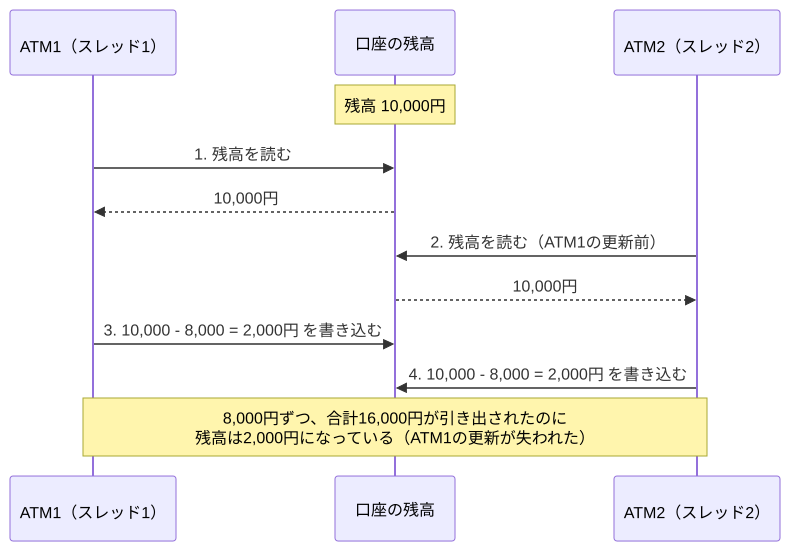
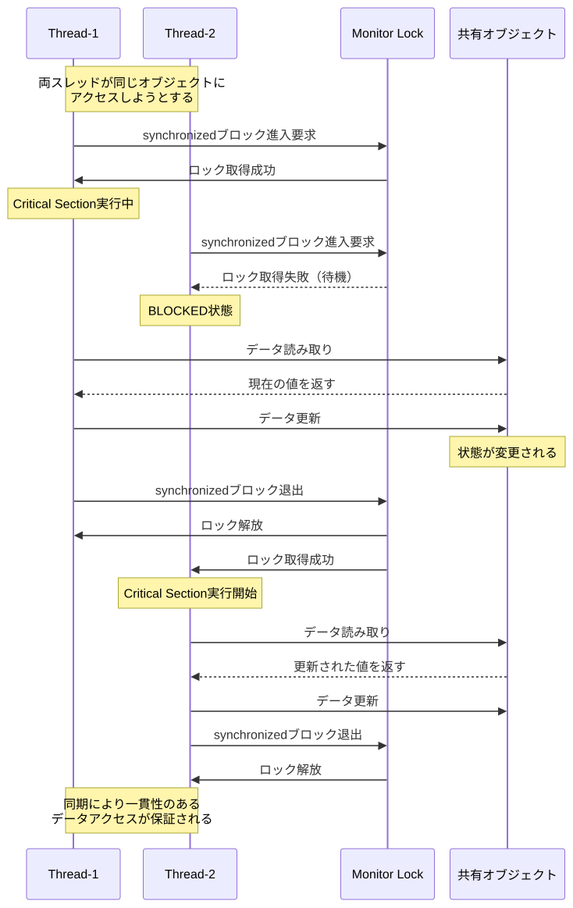

# <b>15章</b> <span>マルチスレッドプログラミング</span> <small>並行処理と同期制御の実践</small>

## 本章の学習目標

### この章で学ぶこと

1. マルチスレッドの基本
    - ThreadクラスとRunnableインターフェイスの使い分け
    - スレッドのライフサイクルと状態遷移
    - 競合状態（count++の非原子性）とデッドロック（Coffman条件）の理解と回避
2. 同期制御の技術
    - synchronizedキーワードによる排他制御と、同期化が性能に与える影響
    - volatileキーワードによるメモリ可視性の保証
    - Atomic変数によるロックフリーな同期化
3. ExecutorServiceとスレッドプール
    - スレッドを無制限に作る問題と、スレッドプールの種類・設計（スレッド数、キュー、拒否ポリシー）
    - タスクの投入とスレッドプールのシャットダウン
    - FutureとCompletableFutureによる非同期処理
4. 並行コレクションとスレッド間の協調
    - HashMapとConcurrentHashMapの違い
    - BlockingQueueによるプロデューサー・コンシューマーパターンと、wait/notifyをwhileで書く理由
5. 実践的な並行処理
    - parallelSortとFork/Joinによる処理時間の比較
    - スレッドセーフなシングルトンの書き方
    - パイプライン、リトライ、サーキットブレーカーの組み立て方

### この章を始める前に

第13章までのJavaアプリケーション開発能力、とくに例外処理とコレクションフレームワークを理解していれば準備完了です。

本章では、基本的な並行処理プログラムを安全に書くところから始めます。
その後、ExecutorServiceを使った非同期処理の実装、デッドロックの回避、並列処理による処理時間の変化を測って確かめるところまでを学びます。

## 並行処理の世界への招待

### なぜマルチスレッドが必要なのか

これまでの章で学習してきたプログラムは、すべて「1つずつ順番に」処理を実行してきました。
しかし、現実のアプリケーションでは、複数の作業を同時に行いたい場面がよくあります。

たとえば、Webブラウザーを考えてみましょう。
- 画像をダウンロードしている
- HTMLを解析している
- JavaScriptを実行している
- ユーザーのクリックに反応している

これらすべてが「同時に」動いているように見えます。
もし1つずつ順番に処理していたら、画像のダウンロードが終わるまでページが表示されず、
とても使いづらいブラウザーになってしまいます。

### 身近な例で理解する並行処理

レストランの厨房を想像してください。

#### シングルスレッド（一人のシェフ）の場合

```
1. お客様Aの前菜を作る（5分）
2. お客様Aのメイン料理を作る（15分）
3. お客様Aのデザートを作る（5分）
4. お客様Bの前菜を作る（5分）... 
```
お客様Aの料理がすべて完成するまで25分、お客様Bは最低でも25分待つことになります。

#### マルチスレッド（複数のシェフ）の場合

前菜・メイン・デザートを別々のシェフが受け持ち、並行して作ります。複数のシェフが並行して働くことで、短時間で多くの料理を提供できます。次の図は、お客様AとBの料理を作り終えるまでの時間を比べたものです。
シェフが1人なら、Aの料理がそろうのは25分後、Bの料理は50分後です。
3人なら、Aの料理は15分後、Bの料理は30分後にそろいます。

<div class="figure">


</div>

### Javaでの簡単な例

まず、シングルスレッドの例を見てみましょう。

以下のコードは、朝食の準備を順番に行うシングルスレッドのプログラムです。コーヒー（3秒）、トースト（2秒）、卵（5秒）を順番に処理するため、合計10秒かかります。各処理が完了するまで次の処理を開始できないため、待ち時間が無駄になっています。

<span class="listing-number">**サンプルコード15-1**　SingleThreadExample.java（1〜24、28、35〜36、42〜43行目）</span>

```java
public class SingleThreadExample {
    public static void main(String[] args) {
        IO.println("朝食の準備を開始");
        
        // コーヒーを淹れる（3秒かかる）
        makeCoffee();
        
        // トーストを焼く（2秒かかる）
        makeToast();
        
        // 卵を茹でる（5秒かかる）
        boilEgg();
        
        IO.println("朝食の準備完了！");
        // 合計: 10秒かかる
    }
    
    private static void makeCoffee() {
        IO.println("コーヒーを淹れています...");
        sleep(3000);
        IO.println("コーヒーができました");
    }
    
    private static void makeToast() {
    // ...
    }
    // ...
    
    private static void sleep(int milliseconds) {
    // ...
    }
}
```

実行結果：

```
朝食の準備を開始
コーヒーを淹れています...
コーヒーができました
トーストを焼いています...
トーストができました
卵を茹でています...
ゆで卵ができました
朝食の準備完了！
```

すべての処理が順番に実行されるため、完了までに約10秒かかります。

これをマルチスレッドで書き換えると、次のようになります。

<span class="listing-number">**サンプルコード15-2**　MultiThreadExample.java（1〜24、50行目）</span>

```java
public class MultiThreadExample {
    public static void main(String[] args) throws InterruptedException {
        IO.println("朝食の準備を開始");
        
        // それぞれ別々のスレッドで同時に実行
        Thread coffeeThread = new Thread(() -> makeCoffee());
        Thread toastThread = new Thread(() -> makeToast());
        Thread eggThread = new Thread(() -> boilEgg());
        
        // スレッドを開始
        coffeeThread.start();
        toastThread.start();
        eggThread.start();
        
        // すべてのスレッドが終了するのを待つ
        coffeeThread.join();
        toastThread.join();
        eggThread.join();
        
        IO.println("朝食の準備完了！");
        // 合計: 約5秒（もっとも時間のかかる卵の時間）で完了
    }
    
    // makeCoffee、makeToast、boilEgg、sleepメソッドはサンプルコード15-1と同じ
}
```

次は実行結果の一例です。

```
朝食の準備を開始
コーヒーを淹れています...
卵を茹でています...
トーストを焼いています...
トーストができました
コーヒーができました
ゆで卵ができました
朝食の準備完了！
```

3つのスレッドは同時に動くため、「〜しています」と「〜ができました」の順序は実行のたびに変わることがあります。
このように、マルチスレッドを使うことで、10秒かかっていた処理を約5秒に短縮できました。

## マルチスレッドプログラミングの基礎

スレッドとは、プログラム内での処理の流れを表す実行単位です。
通常、1つのプログラムは1つのスレッド（メインスレッド）で実行されます。

マルチスレッドとは、1つのプログラム内で複数のスレッドを同時に実行し、処理を並行して進める技術です<span class="footnote">C言語の標準規格にスレッドの機能が入ったのはC11からで、それまではPOSIXスレッド（pthread）などOSが用意するライブラリを使っていました。Javaは最初の版から、スレッドを言語とライブラリに組み込んでいます。</span>。

### なぜマルチスレッドが必要か

「並行処理の世界への招待」では、朝食の準備を3つのスレッドに分けて、全体の時間を短くしました。
ここでは、マルチスレッドが役立つ場面を整理します。

現代のコンピューターは、複数のコアを持つCPU（マルチコアプロセッサー）を搭載するのが一般的です。
時間のかかる処理を複数のスレッドに分割すれば、複数のコアで同時に実行して、全体の処理時間を短縮できます。
GUIアプリケーションでは、時間のかかる処理をバックグラウンドのスレッドに任せることで、ユーザーインターフェイスが固まるのを防げます（GUIでのスレッドの扱いは第18章と第19章で学びます）。
サーバーアプリケーションでは、複数のクライアントからのリクエストを同時に処理することで、計算リソースを無駄なく使えます。

### スレッドの作成と実行

Javaでスレッドを作成するには、主に`Runnable`インターフェイスを実装する方法が推奨されます。

スレッドは生成されてから終了するまでに、次の図のような状態を遷移します。
`new Thread()`で作ったばかりのスレッドはNEWで、`start()`を呼ぶとRUNNABLEになって実行されます。
ロックを待つあいだはBLOCKED、`wait()`や`join()`で待つあいだはWAITING、`sleep()`のように時間を決めて待つあいだはTIMED_WAITINGになり、待つ理由がなくなるとRUNNABLEに戻ります。
`run()`が終わるか例外で抜けると、TERMINATEDになります。
スレッドの今の状態は、`getState()`メソッドで調べられます。

<div class="figure">



</div>

### `Runnable`インターフェイスの実装（推奨）

`Runnable`は、スレッドが実行するタスク（処理内容）を定義するための関数型インターフェイスです。`run()`メソッドを1つだけ持ちます。

<span class="listing-number">**サンプルコード15-3**　Main.java</span>

```java
// Runnableを実装したクラス
class MyTask implements Runnable {
    @Override
    public void run() {
        IO.println("タスク実行中: " + Thread.currentThread().getName());
    }
}

public class Main {
    public static void main(String[] args) {
        MyTask task = new MyTask();
        Thread thread = new Thread(task);
        thread.start(); // スレッドを開始

        // ラムダ式を使えばさらに簡潔
        new Thread(() -> {
            IO.println("ラムダ式でのタスク実行: " + Thread.currentThread().getName());
        }).start();
    }
}
```

`Runnable`を利用する方法は、Javaがクラスの多重継承をサポートしないという制約を受けず、また「タスク（何をするか）」と「スレッド（どう実行するか）」を分離できるため、より柔軟な設計が可能です。

`Thread`クラスを継承して`run()`メソッドをオーバーライドする方法もあります。
ただし、その場合はほかのクラスを継承できなくなり、タスクとスレッドも1つのクラスに混ざります。
そのため、本書では`Runnable`かラムダ式でタスクを書きます。

どちらの方法でも、スレッドを開始するのは`start()`メソッドです。
`run()`を直接呼び出すと、新しいスレッドは作られず、呼び出したスレッドがふつうのメソッドとして実行されます。

### 共有リソースと同期制御

複数のスレッドが、同じデータ（オブジェクトや変数）に同時にアクセスすると、予期せぬ問題が発生することがあります。これを競合状態 (Race Condition) と呼びます。

たとえば、銀行口座の残高を更新する処理を考えてみましょう。残高10,000円の口座から「2つのATMで同時に」8,000円を引き出そうとした場合を想定します。
同期制御がないと両方の引き出しが成功してしまい、引き出した金額と残高が合わなくなる可能性があります。これは、以下のような処理の流れで発生します。

1. ATM1が残高10,000円を読み取る
2. ATM2も残高10,000円を読み取る（まだATM1の処理は完了していない）
3. ATM1が「10,000円 - 8,000円 = 2,000円」と計算して更新
4. ATM2も「10,000円 - 8,000円 = 2,000円」と計算して更新

その結果、残高10,000円の口座から合計16,000円が引き出されてしまいます。

<div class="figure">



</div>

同じことは、変数の値を1増やすだけの単純な処理でも起こります。
次のカウンターを、複数のスレッドから同時に呼び出す場合を考えます。

<span class="listing-number">**サンプルコード15-4**　UnsafeCounter.java</span>

```java
class UnsafeCounter {
    private int count = 0;
    
    public void increment() {
        count++;  // ①
    }
}
```

①の`count++`は1行で書けますが、CPUが実行するときには次の3つの操作に分かれます。

1. メモリからcountの現在値を読み込む
2. レジスターで値を1増やす
3. 増やした値をメモリに書き戻す

3つの操作のあいだに、ほかのスレッドの処理が割り込むことがあります。
2つのスレッドが同じ値を読み込み、それぞれ1を足して書き戻すと、2回増やしたはずの値が1しか増えません。
たとえば10個のスレッドがそれぞれ1,000回`increment`を呼ぶと、結果は10,000になるはずですが、それより小さい値になることがあります。
ATMの例と同じく、読み込んでから書き戻すまでのあいだに、ほかのスレッドが同じデータを書き換えてしまうのが原因です。

### `synchronized`による排他制御

この問題を解決するために、Javaは`synchronized`キーワードによる排他制御のしくみを提供します。`synchronized`で保護されたコードブロックは、一度に1つのスレッドしか実行できないことが保証されます。

`synchronized`キーワードをメソッドに付けることで、そのメソッド全体が排他制御の対象となります。これにより、同時に1つのスレッドしかそのメソッドを実行できなくなり、データの整合性が保たれます。

<span class="listing-number">**サンプルコード15-5**　SynchronizedCounter.java</span>

```java
class SynchronizedCounter {
    private int count = 0;

    // synchronizedキーワードにより、このメソッドは同時に1つのスレッドしか実行できない
    // これにより、count++という複合操作（読み取り→インクリメント→書き込み）が
    // 原子的（アトミック）に実行されることが保証される
    public synchronized void increment() {
        count++;
    }

    // 読み取りメソッドも一貫性のため、synchronizedにすることが推奨される
    public synchronized int getCount() {
        return count;
    }
}
```

`synchronized`メソッドを実行するスレッドは、まずそのオブジェクトのロック（モニター）を取得します。
ほかのスレッドがロックを持っているあいだは、ロックが解放されるまでBLOCKEDの状態で待ちます。
次の図は、2つのスレッドが同じオブジェクトを順番に更新するようすです。

<div class="figure">



</div>

`synchronized`は手軽に排他制御を実現できますが、使い方には注意が必要です。
ロックの範囲が広すぎるとパフォーマンスの低下を招きます。
また、複数のロックが絡み合うとデッドロック（スレッドがお互いを待ち続けて処理が進まなくなる状態）を引き起こす危険性もあります。

<div class="figure">



</div>

デッドロックは、次の4つの条件（Coffman条件）<span class="footnote">1971年にE. G. Coffmanらが論文で示したことから、この名前で呼ばれます。</span>がすべてそろったときに起こります。

1. 相互排他
    + 1つのリソースを同時に使えるのは1つのスレッドだけである
2. 保持と待機
    + リソースを保持したまま、ほかのリソースを待つ
3. 横取り不可
    + ほかのスレッドが保持するリソースを強制的に解放させられない
4. 循環待機
    + スレッドどうしの待ちが輪になる

裏返せば、どれか1つの条件を崩せばデッドロックは起こりません。
いちばん手軽なのは循環待機を崩す方法で、どのスレッドもロックを同じ順序で取得するように決めておきます。
図の例なら、2つのスレッドがどちらもlock1を取ってからlock2を取るようにします。
こうすると、lock1を取れなかったスレッドはlock2も持っていないので、待ちが輪になりません。

メソッド全体ではなく、特定のコードブロックだけを同期化したい場合は、`synchronized`ブロックを使用します。これにより、必要最小限の範囲だけをロックすることができ、パフォーマンスの向上につながります。

<span class="listing-number">**サンプルコード15-6**　BankAccount.java</span>

```java
class BankAccount {
    private double balance;
    private final Object lock = new Object(); // ロックオブジェクト
    
    public void deposit(double amount) {
        // 検証処理は同期化の外で実行（パフォーマンス向上）
        if (amount <= 0) {
            throw new IllegalArgumentException("入金額は正の数である必要があります");
        }
        
        // 残高の更新部分だけを同期化
        synchronized (lock) {
            IO.println("入金前残高: " + balance);
            balance += amount;
            IO.println("入金後残高: " + balance);
        }
    }
    
    public boolean withdraw(double amount) {
        if (amount <= 0) {
            return false;
        }
        
        synchronized (lock) {
            if (balance >= amount) {
                IO.println("引き出し前残高: " + balance);
                balance -= amount;
                IO.println("引き出し後残高: " + balance);
                return true;
            }
            return false;
        }
    }
}
```

同期化はデータを守る一方で、性能にも影響します。
いちばん大きな要因はロックの競合で、ロックを待つスレッドが増えるほど、単位時間に処理できる量（スループット）が下がります。
待たされたスレッドを切り替えるコンテキストスイッチにも、1回あたり数マイクロ秒程度の時間がかかります。
さらに、ロックの取得と解放では、CPUのキャッシュの内容をほかのコアと同期するコストも生じます。
こうした理由から、コア数を増やしても性能が比例して伸びるわけではありません。
サンプルコード15-6のように、ロックをかける範囲を必要な部分だけにとどめることが大切です。

### volatileキーワードによるメモリ可視性の保証

`volatile`キーワードは、あるスレッドが変数に書き込んだ値が、他のスレッドから即座に見えることを保証します（メモリの可視性）<span class="footnote">C言語にも`volatile`がありますが、意味は異なります。Cの`volatile`はコンパイラーが読み書きを省く最適化を止めるもので、スレッド間で値が見えることまでは保証しません。</span>。
主な用途は、スレッド間でのフラグの共有です。
`volatile`は`synchronized`より軽量ですが、できることも限られます。
アトミックになるのは単純な読み書きだけで、読み取り→計算→書き込みのような複合操作は保証しません。

<span class="listing-number">**サンプルコード15-7**　VolatileDemo.java</span>

```java
class ThreadStopExample {
    // volatileフラグによる安全なスレッド停止
    private volatile boolean stopRequested = false;
    
    public void startWorker() {
        Thread worker = new Thread(() -> {
            int count = 0;
            // volatileフラグを定期的にチェック
            while (!stopRequested) {
                count++;
                if (count % 1000000 == 0) {
                    IO.println("Working... count: " + count);
                }
            }
            IO.println("Worker stopped at count: " + count);
        });
        worker.start();
    }
    
    public void stopWorker() {
        // volatileにより、この変更は即座に他のスレッドから見える
        stopRequested = true;
        IO.println("Stop requested");
    }
}

// 使用例
public class VolatileDemo {
    public static void main(String[] args) throws InterruptedException {
        ThreadStopExample example = new ThreadStopExample();
        example.startWorker();
        
        // 3秒間動作させる
        Thread.sleep(3000);
        
        // ワーカーを停止
        example.stopWorker();
    }
}
```

カウンターのインクリメント（`count++`）のような複合操作には`volatile`を使えません。そのような場合は、次に説明する`AtomicInteger`などのアトミッククラスを使用してください。

### Atomicクラスによるロックフリーなアトミック操作

`java.util.concurrent.atomic`パッケージは、ロックを使わずにアトミックな操作を実現するクラス群を提供します。これらは内部でCAS（Compare-And-Swap）操作を使い、ロックを取得するために待つことなく値を更新します。

主なAtomicクラスは次のとおりです。

- `AtomicInteger`
    + int値のアトミック操作
- `AtomicLong`
    + long値のアトミック操作
- `AtomicBoolean`
    + boolean値のアトミック操作
- `AtomicReference<T>`
    + 参照型のアトミック操作

<span class="listing-number">**サンプルコード15-8**　AtomicCounterExample.java（3〜31、49行目）</span>

```java
public class AtomicCounterExample {
    // スレッドセーフなカウンター
    private final AtomicInteger counter = new AtomicInteger(0);
    
    public void performCounting() throws InterruptedException {
        Thread[] threads = new Thread[10];
        
        // 10スレッドが同時に1000回ずつインクリメント
        for (int i = 0; i < threads.length; i++) {
            threads[i] = new Thread(() -> {
                for (int j = 0; j < 1000; j++) {
                    // アトミックなインクリメント操作
                    int newValue = counter.incrementAndGet();
                    if (newValue % 1000 == 0) {
                        IO.println("Counter reached: " + newValue);
                    }
                }
            });
            threads[i].start();
        }
        
        // すべてのスレッドが終わるのを待つ
        for (Thread thread : threads) {
            thread.join();
        }
        
        IO.println("Final counter value: " + counter.get());
        // 常に正確に10,000になる
    }
    // ...
}
```

Atomicクラスはロックを使わないため、スレッドどうしの競合が少ない場合には`synchronized`より速く動くことが多いです。
一方、多数のスレッドが同じ変数を頻繁に更新すると、CASの失敗と再試行が増えて速さの差は小さくなります。
どちらが速いかは、実際に時間を測って確かめます。

### 並行処理用のコレクション

第9章「コレクションフレームワーク」で学んだ`ArrayList`や`HashMap`は、複数のスレッドから同時に更新されることを想定していません。
複数のスレッドで共有するコレクションには、`java.util.concurrent`パッケージ<span class="footnote">このパッケージはJava 5で加わりました。設計の中心になったのは、並行処理の研究者ダグ・リー（Doug Lea）です。</span>の並行処理用のコレクションを使います。
次の例は、スレッドセーフでない`HashMap`と、並行アクセスに対応した`ConcurrentHashMap`を並べたものです。

<span class="listing-number">**サンプルコード15-9**</span>

```java
// 危険：通常のHashMapの並行アクセス
Map<String, Integer> unsafeMap = new HashMap<>();  // ①

// 安全：ConcurrentHashMapの使用
Map<String, Integer> safeMap = new ConcurrentHashMap<>();  // ②
```

①の`HashMap`に複数のスレッドが同時に書き込むと、内部のデータ構造が同時に変更されて不正な状態になり、データが失われたり壊れたりします<span class="footnote">Java 7以前の`HashMap`では、内部の配列を広げる処理が同時に走るとリンクリストが循環して`get`が永久に終わらなくなることもありました。</span>。
また、あるスレッドが要素を順に取り出している最中にほかのスレッドが更新すると、`ConcurrentModificationException`が発生することがあります。

②の`ConcurrentHashMap`は、マップ全体を1つのロックで守るのではなく、書き込む位置（バケット）ごとに排他制御をします。
そのため、異なる位置への書き込みは並行して進みます。
読み取り操作はロックを取得しないので、読み取りが書き込みを待たされることもありません。
さらに、`putIfAbsent`、`replace`、`computeIfAbsent`のように、確認と更新を組み合わせた操作を1つのアトミックな操作として実行できます。
「キーがなければ追加する」という処理を`containsKey`と`put`に分けて書くと、そのあいだにほかのスレッドが割り込むので、こうしたメソッドを使います。

### Executorフレームワークによる高度なスレッド管理

ここまでの例の多くは、タスクごとに`new Thread()`でスレッドを作りました。
タスクの数が少なければこれで十分ですが、大量のタスクを同じように扱うと問題が起こります。

<span class="listing-number">**サンプルコード15-10**</span>

```java
// アンチパターン：スレッドの無制限生成
for (int i = 0; i < 10000; i++) {
    new Thread(() -> processTask()).start();  // ①
}
```

①のコードは、タスクの数だけ、つまり10,000個のスレッドを作ります。
各スレッドは、スタック用のメモリ領域（64ビット環境の既定では1MB程度）を確保します<span class="footnote">スタックの大きさは、`java`コマンドの`-Xss`オプションで変えられます。</span>。
10,000スレッドでは最大で約10GBの領域を予約することになり、OSが許すスレッドの数やメモリの上限に達すると、スレッドを作れずに`OutOfMemoryError`が発生します。
メモリが足りたとしても、OSはこれだけのスレッドを切り替えなければならず、CPUは実際の作業よりもスレッドの切り替えに時間を使うようになります<span class="footnote">Java 21では、OSのスレッドより軽い仮想スレッド（virtual thread）が正式な機能になりました。仮想スレッドなら、大量のタスクにそれぞれスレッドを割り当ててもメモリと切り替えの負担を抑えられます。</span>。

そこで、現代のJavaプログラミングではExecutorフレームワークを使用するのが一般的です。
これはスレッドの生成・管理を抽象化し、用意しておいたスレッド（スレッドプール）にタスクを割り当てて実行するしくみです。

#### ExecutorServiceとスレッドプール

`ExecutorService`は、タスクの投入とスレッドプールの管理を行うためのインターフェイスです。スレッドプールは、あらかじめ作成された再利用可能なスレッドの集まりです。

スレッドプールはスレッドを使い回すので、タスクごとにスレッドを生成・破棄するコストがかかりません。
作るスレッドの数に上限を設けられるため、スレッドが増えすぎてシステムが不安定になることも防げます。
スレッドが空いていないときに届いたタスクは、キューで実行を待ちます。
また、タスクの実行時に例外が発生しても、スレッドプールはそのまま動作を続けます。

<div class="figure">



</div>

主なExecutorServiceの種類は次のとおりです。

- `newFixedThreadPool(int)`
    + 固定数のスレッドを持つプール
    + CPUで計算し続けるタスクでは、スレッド数をCPUのコア数程度にする
- `newCachedThreadPool()`
    + I/O待機が多いタスク向けにスレッドを作成・再利用するプール
- `newSingleThreadExecutor()`
    + 単一スレッドで順次実行するプール
- `newScheduledThreadPool(int)`
    + 一定時間後や一定間隔でタスクを実行できるプール

<span class="listing-number">**サンプルコード15-11**　ExecutorExample.java</span>

```java
import java.util.concurrent.ExecutorService;
import java.util.concurrent.Executors;
import java.util.concurrent.TimeUnit;

public class ExecutorExample {
    public static void main(String[] args) {
        // 3つのスレッドを持つスレッドプールを作成
        ExecutorService executor = Executors.newFixedThreadPool(3);

        for (int i = 0; i < 10; i++) {
            final int taskId = i;
            executor.execute(() -> {
                IO.println("Task " + taskId + " is being executed by " + 
                    Thread.currentThread().getName());
                try {
                    Thread.sleep(1000); // 1秒の処理をシミュレート
                } catch (InterruptedException e) {
                    Thread.currentThread().interrupt();
                }
            });
        }

        // ExecutorServiceをシャットダウン
        executor.shutdown();
        try {
            if (!executor.awaitTermination(15, TimeUnit.SECONDS)) {
                executor.shutdownNow();
            }
        } catch (InterruptedException e) {
            executor.shutdownNow();
        }
    }
}
```

3つのスレッドで10個のタスクを処理するので、タスクは3つずつ実行され、残りはキューで順番を待ちます。
`shutdown()`を呼ぶと、新しいタスクを受け付けなくなり、投入済みのタスクを終えてからスレッドプールが停止します。
`awaitTermination`は停止を指定した時間だけ待ち、時間内に終わらなければ`shutdownNow()`で実行中のタスクに割り込みます。
`shutdown()`を呼ばないと、スレッドプールのスレッドが残り、プログラムが終了しません。

#### スレッドプールの設計

スレッドプールを設計するときは、まずスレッド数を決めます。
目安は、リトルの法則（Little's Law）<span class="footnote">1961年にジョン・リトル（John D. C. Little）が証明したことから、この名前で呼ばれます。</span>の式N = λ × Wで見積もれます。
λは単位時間あたりに届くタスクの数、Wは1つのタスクにかかる時間で、Nは同時に処理中になるタスクの数です。
たとえば1秒に20個のタスクが届き、1つに0.5秒かかるなら、同時に10個のタスクを処理できるスレッドが要ります。

次に、スレッドが空くのを待つタスクを入れるキューの大きさを決めます。
キューを大きくすると多くのタスクを待たせられますが、その分メモリを使い、タスクが終わるまでの待ち時間（レイテンシ）も長くなります。
`Executors.newFixedThreadPool`が使うキューには上限がないため、タスクが届く速さに処理が追いつかないと、キューがメモリを使い続けます。

キューの大きさを決めたいときは、`ThreadPoolExecutor`のコンストラクターでスレッド数とキューを指定してプールを作ります。
このとき、キューがあふれたタスクの扱いを拒否ポリシーで決めます。
`AbortPolicy`（既定）は例外をスローし、`CallerRunsPolicy`はタスクを投入したスレッド自身にそのタスクを実行させます。
`CallerRunsPolicy`では投入する側が実行で手いっぱいになるので、タスクを投入する速さが自然に落ちます。

### 実践的なマルチスレッドの例

#### プロデューサー・コンシューマーパターンの実装

プロデューサー・コンシューマーパターンは、スレッドどうしが協調して働くための、並行処理の古典的なデザインパターンです。
プロデューサー（生産者）がデータを生成し、コンシューマー（消費者）がそれを処理します。

データを作る側と使う側の速度は、たいてい一致しません。
このパターンでは、両者のあいだにバッファー（キュー）を置いて速度の差を吸収します。
バッファーがあるので、一時的にデータが急増しても受け止められます。
また、生産者と消費者はバッファーを介してやり取りするだけなので、互いに独立して作れます。
負荷に応じて、生産者や消費者のスレッドの数を別々に増減することもできます。

たとえばログを処理するシステムでは、アプリケーションのスレッド（生産者）がログのメッセージをキューに入れ、書き込み用のスレッド（消費者）がファイルに書きます。
アプリケーションはファイルへの書き込みを待たずに処理を続けられ、処理の速さとディスクの書き込みの速さの差をキューが吸収します。

Javaでは、このバッファーに`java.util.concurrent`パッケージの`BlockingQueue`を使います。
`put()`はキューが満杯なら空きができるまで待ち、`take()`はキューが空なら要素が入るまで待ちます。
次の例では、2つのプロデューサーと3つのコンシューマーが、容量10のキューを介して整数を受け渡します。

<span class="listing-number">**サンプルコード15-12**　ProducerConsumerExample.java（8〜18、27〜44、53〜80、87行目）</span>

```java
public class ProducerConsumerExample {
    // 共有キュー
    // BlockingQueueは、スレッド間でデータを安全に受け渡すための
    // 特殊なキューです。キューが満杯の時は生産者が自動的にブロックされ、
    // キューが空の時は消費者が自動的にブロックされます。
    private static final BlockingQueue<Integer> queue = new LinkedBlockingQueue<>(10);
    private static final AtomicInteger producedCount = new AtomicInteger(0);
    private static final AtomicInteger consumedCount = new AtomicInteger(0);
    
    // プロデューサー（生産者）
    static class Producer implements Runnable {
        // ...
        @Override
        public void run() {
            try {
                for (int i = 0; i < itemsToProduce; i++) {
                    int item = producedCount.incrementAndGet();
                    queue.put(item); // キューがいっぱいの場合はブロック
                    IO.println("%s produced: %d (queue size: %d)".formatted(
                        name, item, queue.size()));
                    Thread.sleep(100); // 生産に時間がかかることをシミュレート
                }
            } catch (InterruptedException e) {
                Thread.currentThread().interrupt();
            }
        }
    }
    
    // コンシューマー（消費者）
    static class Consumer implements Runnable {
        // ...
        @Override
        public void run() {
            try {
                for (int i = 0; i < itemsToConsume; i++) {
                    Integer item = queue.take(); // キューが空の場合はブロック
                    consumedCount.incrementAndGet();
                    IO.println("%s consumed: %d (queue size: %d)".formatted(
                        name, item, queue.size()));
                    Thread.sleep(200); // 消費に時間がかかることをシミュレート
                }
            } catch (InterruptedException e) {
                Thread.currentThread().interrupt();
            }
        }
    }
    
    public static void main(String[] args) throws InterruptedException {
        ExecutorService executor = Executors.newFixedThreadPool(5);
        
        // 2つのプロデューサーと3つのコンシューマーを作成
        executor.execute(new Producer("Producer-1", 10));
        executor.execute(new Producer("Producer-2", 10));
        executor.execute(new Consumer("Consumer-1", 7));
        executor.execute(new Consumer("Consumer-2", 7));
        executor.execute(new Consumer("Consumer-3", 6));
        
        executor.shutdown();
        executor.awaitTermination(30, TimeUnit.SECONDS);
        // ...
}
```

プロデューサーは100ミリ秒ごとに、コンシューマーは200ミリ秒ごとに1つの要素を扱います。
生産と消費の速さが違っても、待ち合わせはキューの`put()`と`take()`がしてくれるので、プログラムで`synchronized`を書かずに済みます。

`BlockingQueue`には、用途に応じて次の実装クラスがあります。

- `ArrayBlockingQueue`
    + 配列を使う固定容量のキュー
- `LinkedBlockingQueue`
    + 連結リストを使うキューで、容量を指定しなければ上限がない
- `PriorityBlockingQueue`
    + 優先度の高い要素から取り出すキュー（容量の上限はない）
- `SynchronousQueue`
    + 容量0のキューで、`put()`は相手の`take()`が来るまで待ち、要素を直接受け渡す

実際のシステムでは、容量に上限のないキューを使うと、消費が追いつかないあいだにデータがたまり続け、メモリが足りなくなる危険があります。
そこまでいかなくても、キューで待つ時間が積み重なって、データが処理されるまでの時間が長くなります。
サンプルコード15-12のようにキューの容量を決めておけば、キューが満杯のときに`put()`で生産者が待つので、生産の速さが消費の速さに合わせて抑えられます。
消費が追いつかないときは、コンシューマーの数を増やすか、データを1件ずつではなくまとめて処理するように変えます。

##### wait()とnotify()による待ち合わせ

`BlockingQueue`がしているような待ち合わせは、`Object`クラスの`wait()`と`notify()`でも書けます。
Javaの初期からある、スレッドどうしで条件を待ち合わせるための低レベルなしくみです。

- `wait()`
    + 現在のスレッドを待機状態にし、ロックを解放する
- `notify()`
    + 同じオブジェクトで待機中のスレッドを1つ起こす
- `notifyAll()`
    + 同じオブジェクトで待機中のスレッドをすべて起こす

これらのメソッドは、そのオブジェクトの`synchronized`ブロックの内側で呼び出します。
次の例は、条件が満たされるまで待つ処理の、誤った書き方と正しい書き方です。

<span class="listing-number">**サンプルコード15-13**</span>

```java
// 誤った実装例（危険）
synchronized(lock) {
    if (!condition) {  // ①
        lock.wait();
    }
}

// 正しい実装例（推奨）
synchronized(lock) {
    while (!condition) {  // ②
        lock.wait();
    }
}
```

①のように`if`文で条件を調べると、`wait()`から復帰したあとに条件をもう一度確かめません。
ところが、スレッドは通知を受けていないのに`wait()`から復帰することがあります。
これを偽の起床（Spurious Wakeup）と呼びます<span class="footnote">C言語でPOSIXスレッドの条件変数を待つ`pthread_cond_wait`も偽の起床を起こしうるので、同じようにループで囲んで呼び出します。</span>。
また、通知を受けて復帰した時点で、ほかのスレッドがすでに条件を変えている場合もあります。
どちらの場合も、①では条件が満たされていないまま処理を続けてしまいます。

②のように`while`文を使うと、`wait()`から復帰するたびに条件を評価し直し、条件が満たされるまで再び待機します。
`wait()`は必ずこの形のループで囲んで呼び出します。
ただし、正しく書くのは難しいので、ふだんは`BlockingQueue`のような`java.util.concurrent`パッケージのクラスを使います。

##### Semaphoreによる同時実行数の制限

`java.util.concurrent.Semaphore`は、同時に使える資源の数を「許可証」の数で管理するクラスです<span class="footnote">セマフォは、オランダの計算機科学者エドガー・ダイクストラが1960年代に考案した同期のしくみです。名前は鉄道の腕木式信号機（semaphore）に由来します。</span>。
`new Semaphore(3)`で作ると許可証は3枚になり、`acquire()`で1枚受け取り、`release()`で1枚返します。
許可証が残っていないときに`acquire()`を呼んだスレッドは、ほかのスレッドが`release()`するまで待ちます。
データベースへの接続や外部サービスへの要求のように、同時に使える数に上限がある資源を守るときに使います。
`release()`の呼び忘れを防ぐため、`acquire()`の後の処理は`try`ブロックに書き、`release()`は`finally`ブロックで呼び出します。

#### Future と Callable を使った非同期処理

`Callable`は`Runnable`と同じくタスクを定義するインターフェイスですが、戻り値のない`Runnable`と違って値を返せます。
また、`Callable`は検査例外をスローできます。
`Callable`のタスクを`ExecutorService`に投入すると、`Future`が返ります。
`Future`インターフェイスは非同期処理の結果を表すオブジェクトで、結果を保持し、処理の完了を待てます。
実行中のタスクをキャンセルすることもできます。

<span class="listing-number">**サンプルコード15-14**　FutureCallableExample.java（5、7〜8、15〜23、29〜61行目）</span>

```java
public class FutureCallableExample {
    // ...
    // 計算に時間がかかるタスク
    static class CalculationTask implements Callable<Long> {
        // ...
        @Override
        public Long call() throws Exception {
            IO.println("計算開始: フィボナッチ数列の第" + n + "項");
            long start = System.currentTimeMillis();
            long result = fibonacci(n);
            long time = System.currentTimeMillis() - start;
            IO.println("計算完了: F(%d) = %d (所要時間: %dms)".formatted(n, result, time));
            return result;
        }
        // ...
    }
    
    public static void main(String[] args) throws Exception {
        ExecutorService executor = Executors.newFixedThreadPool(4);
        List<Future<Long>> futures = new ArrayList<>();
        
        // 複数の計算タスクを非同期で実行
        int[] numbers = {35, 38, 40, 42};
        for (int n : numbers) {
            Future<Long> future = executor.submit(new CalculationTask(n));
            futures.add(future);
        }
        
        // 他の処理を実行できる
        IO.println("計算中に他の処理を実行...");
        Thread.sleep(100);
        
        // 結果を取得（必要になったタイミングで）
        IO.println("\n=== 計算結果 ===");
        for (int i = 0; i < futures.size(); i++) {
            try {
                // get()は結果が得られるまでブロック
                Long result = futures.get(i).get(10, TimeUnit.SECONDS);
                IO.println("F(" + numbers[i] + ") = " + result);
            } catch (TimeoutException e) {
                IO.println("F(" + numbers[i] + ") = タイムアウト");
                futures.get(i).cancel(true); // タスクをキャンセル
            }
        }
        
        executor.shutdown();
    }
}
```

#### CompletableFuture による高度な非同期処理

`CompletableFuture`は、Java 8で導入された非同期処理のためのクラスです。
従来の`Future`では結果を受け取るまで待つしかありませんでしたが、`CompletableFuture`では結果を受け取ったあとの処理をラムダ式で続けて書けます。

CompletableFutureの主な特徴は次のとおりです。

- 非同期処理の連鎖
    + `thenApply`、`thenCompose`などで処理を連鎖
- 例外処理
    + `exceptionally`、`handle`で例外が起きたときの処理を書く
- 複数の非同期処理の組み合わせ
    + `allOf`、`anyOf`で複数の処理を統合
- タイムアウト処理
    + `orTimeout`メソッドで、決めた時間内に終わらない処理を例外にする

<span class="listing-number">**サンプルコード15-15**　CompletableFutureExample.java（6、9、12〜24、38、40、52〜75、91〜92行目）</span>

```java
public class CompletableFutureExample {
    // ...
    static class WeatherService {
        // ...
        public static CompletableFuture<String> getTemperature(String city) {
            return CompletableFuture.supplyAsync(() -> {
                IO.println("気温取得中: " + city);
                // APIコールをシミュレート
                try {
                    Thread.sleep(1000 + random.nextInt(1000));
                } catch (InterruptedException e) {
                    Thread.currentThread().interrupt();
                }
                int temp = 20 + random.nextInt(15);
                return city + ": " + temp + "°C";
            });
        }
        // ...
    }
    // ...
    public static void main(String[] args) throws Exception {
        // ...
        // 2. チェーン処理
        CompletableFuture<String> chainedFuture = future1
            .thenApply(result -> result + " -> 変換処理")
            .thenApply(result -> result + " -> 最終処理");
        
        IO.println("チェーン結果: " + chainedFuture.get());
        
        // 3. 複数の非同期処理を組み合わせる
        String[] cities = {"東京", "大阪", "名古屋"};
        
        // 各都市の気温と湿度を並行して取得
        CompletableFuture<?>[] allWeatherData = Arrays.stream(cities)
        .map(city -> {
            CompletableFuture<String> temp = WeatherService.getTemperature(city);
            CompletableFuture<String> humidity = WeatherService.getHumidity(city);
            
            // 気温と湿度を組み合わせる
            return temp.thenCombine(humidity, (t, h) -> t + ", " + h);
        })
        .map(future -> future.thenAccept(IO::println))
        .toArray(CompletableFuture[]::new);
        
        // すべての処理が完了するまで待つ
        CompletableFuture.allOf(allWeatherData).get();
        // ...
    }
}
```

#### 非同期処理の連鎖と合成

`CompletableFuture`を使うと、複数の非同期処理をつないだり、組み合わせたりできます。
処理の手順をメソッドの連鎖で書けるため、いくつもの非同期処理が順に続く流れも読みやすく書けます。

主な連鎖メソッドは次のとおりです。

- `thenApply()`
    + 前の処理を終えたスレッドで、続けて結果を変換
- `thenApplyAsync()`
    + 別のスレッド（スレッドプール）で結果を変換
- `thenCompose()`
    + 別のCompletableFutureを返す関数を適用
- `thenCombine()`
    + 2つのCompletableFutureの結果を結合
- `thenAccept()`
    + 結果を消費（戻り値なし）

<span class="listing-number">**サンプルコード15-16**　AsyncChainingExample.java（4〜14、35〜48、56行目）</span>

```java
public class AsyncChainingExample {
    
    // ユーザー情報を取得
    static CompletableFuture<User> fetchUser(String userId) {
        return CompletableFuture.supplyAsync(() -> {
            IO.println("Fetching user: " + userId);
            // データベースアクセスをシミュレート
            sleep(1000);
            return new User(userId, "User-" + userId);
        });
    }
    // ...
    
    public static void main(String[] args) throws Exception {
        // 非同期処理を連鎖させる
        CompletableFuture<Integer> totalFuture = fetchUser("USER001")
            .thenCompose(user -> fetchOrders(user))  // 別の非同期処理に連鎖
            .thenApply(orders -> calculateTotal(orders))  // 前の処理を終えたスレッドで続けて変換
            .exceptionally(ex -> {
                System.err.println("Error occurred: " + ex.getMessage());
                return 0;  // デフォルト値を返す
            });
        
        IO.println("Total amount: " + totalFuture.get());
    }
    
    // ...
}
```

この例では、ユーザー情報の取得→注文履歴の取得→合計金額の計算という一連の処理を、メソッドの連鎖でつないでいます。
ユーザー情報と注文履歴の取得は別のスレッドで非同期に実行され、合計金額の計算は注文履歴の取得を終えたスレッドで続けて実行されます。
途中で例外が起きたときは、`exceptionally`で0を返します。

## 実践的なパフォーマンス測定とベンチマーク

複数のスレッドで処理を分けても、データ量や処理の内容によっては速くならないことがあります。
効果は実際に時間を測って確かめます。
サンプルコード15-17は、配列のソートを`Arrays.sort`と`Arrays.parallelSort`で比べ、`ForkJoinPool`で大きな配列の合計を求めます<span class="footnote">`ForkJoinPool`はJava 7で、`Arrays.parallelSort`はJava 8で加わりました。</span>。

`RecursiveTask`を継承したクラスの`compute`メソッドは、範囲が小さければ直接計算し、大きければ2つに分けます。
分けた片方を`fork`で別のスレッドに任せ、もう片方を自分で計算してから、`join`で結果を待って足し合わせます。
第12章「Stream APIと高度なコレクション操作」で学んだ並列ストリームも、内部ではこのFork/Joinのしくみで処理を分けています。
並列ストリームの使い方と、逐次処理との時間の比べ方は第12章の「並列ストリームによるパフォーマンス向上」を参照してください。

<span class="listing-number">**サンプルコード15-17**　ParallelPerformanceExample.java（5、20〜30、38〜44、51〜73、75〜84、101行目）</span>

```java
public class ParallelPerformanceExample {
        // ...
        
        // シングルスレッドソート
        long startTime = System.currentTimeMillis();
        Arrays.sort(array1);
        long singleThreadTime = System.currentTimeMillis() - startTime;
        
        // 並列ソート
        startTime = System.currentTimeMillis();
        Arrays.parallelSort(array2);
        long parallelTime = System.currentTimeMillis() - startTime;
        
        // ...
    
    // ForkJoinPoolを使った再帰的並列処理
    static class RecursiveSum extends RecursiveTask<Long> {
        private static final int THRESHOLD = 10_000;
        private final long[] array;
        private final int start, end;
        
        // ...
        @Override
        protected Long compute() {
            if (end - start <= THRESHOLD) {
                // 小さなタスクは直接計算
                long sum = 0;
                for (int i = start; i < end; i++) {
                    sum += array[i];
                }
                return sum;
            } else {
                // 大きなタスクは分割
                int mid = (start + end) / 2;
                RecursiveSum left = new RecursiveSum(array, start, mid);
                RecursiveSum right = new RecursiveSum(array, mid, end);
                
                left.fork(); // 左側を非同期実行
                long rightResult = right.compute(); // 右側を現在のスレッドで実行
                long leftResult = left.join(); // 左側の結果を待つ
                
                return leftResult + rightResult;
            }
        }
    }
    // ...
    public static void forkJoinExample() {
        int size = 100_000_000;
        long[] array = new long[size];
        Arrays.fill(array, 1);
        
        ForkJoinPool pool = new ForkJoinPool();
        
        long startTime = System.currentTimeMillis();
        Long result = pool.invoke(new RecursiveSum(array, 0, size));
        long time = System.currentTimeMillis() - startTime;
        // ...
}
```

## スレッドセーフなシングルトンパターン

シングルトンは、あるクラスのインスタンスを1つだけ作り、プログラム全体でそれを共有するデザインパターンです。
第8章「Javaの特殊なクラス形式」では、`enum`を使った書き方を学びました。
ここでは、複数のスレッドから同時に`getInstance()`を呼ばれても、インスタンスが1つだけになる書き方を比べます。

「インスタンスがまだなければ作る」という処理は、`count++`と同じく確認と更新の2段階に分かれます。
2つのスレッドが同時に`instance == null`を確かめると、両方がインスタンスを作ってしまいます。
全文の1つ目の方式は、`getInstance()`を`synchronized`メソッドにしてこれを防ぎます。
この方式には、インスタンスができたあとも呼び出すたびにロックを取るため遅くなるという欠点があります。
本文ではこの方式のコードを省略したので、全文で確かめてください。

<span class="listing-number">**サンプルコード15-18**　ThreadSafeSingletonExamples.java（3、18〜57、79行目）</span>

```java
public class ThreadSafeSingletonExamples {
    // ...
    
    // 2. ダブルチェックロッキング（高速だが複雑）
    static class DoubleCheckedSingleton {
        private static volatile DoubleCheckedSingleton instance;
        
        private DoubleCheckedSingleton() {}
        
        public static DoubleCheckedSingleton getInstance() {
            if (instance == null) {
                synchronized (DoubleCheckedSingleton.class) {
                    if (instance == null) {
                        instance = new DoubleCheckedSingleton();
                    }
                }
            }
            return instance;
        }
    }
    
    // 3. 静的内部クラスホルダー（推奨・遅延初期化）
    static class HolderSingleton {
        private HolderSingleton() {}
        
        private static class Holder {
            private static final HolderSingleton INSTANCE = new HolderSingleton();
        }
        
        public static HolderSingleton getInstance() {
            return Holder.INSTANCE;
        }
    }
    
    // 4. Enumシングルトン（もっとも安全）
    enum EnumSingleton {
        INSTANCE;
        
        public void doSomething() {
            IO.println("Enum singleton method");
        }
    }
    // ...
}
```

2つ目のダブルチェックロッキングは、ロックの外で一度`null`かどうかを確かめ、`null`のときだけロックを取ってもう一度確かめます。
インスタンスができたあとはロックを取らずに済みますが、`instance`に`volatile`を付けないと、ほかのスレッドが初期化の終わっていないオブジェクトを見てしまうことがあります<span class="footnote">`volatile`を付けたダブルチェックロッキングが正しく動くと保証されたのは、Javaのメモリモデルが改められたJava 5からです。</span>。
書き方を1か所でも間違えると正しく動かないので、ほかの方式で済むなら使いません。

3つ目は、静的な内部クラス`Holder`の`static final`フィールドにインスタンスを持たせる方式です。
JVMはクラスを最初に使うときに1回だけ初期化し、その初期化はスレッドセーフであることが保証されています。
そのため、`getInstance()`が初めて呼ばれて`Holder`クラスが使われたときに、インスタンスが1つだけ作られます。
ロックを書かずに、使うときまで作成を遅らせられるのが利点です。

4つ目の`enum`も、列挙子の初期化をJVMが1回だけ行うので、スレッドセーフです。
第8章で学んだとおり、もっとも簡潔に書けるので、遅延させる必要がなければこの方式を使います。

## 実践的な並行処理パターン

ここでは、これまでに学んだ`ExecutorService`、`CompletableFuture`、Atomicクラスを組み合わせた例を2つ見ます。
どちらもコードが長いので、本文には要点だけを載せ、動かせる全文はGitHubリポジトリに置いています<span class="footnote">全文は`https://github.com/Nagatani/techbook-java-primer/tree/main/sample-code/chapter15/`の`15-19/`と`15-20/`にあります。</span>。

### 並列データ処理パイプライン

データの取得・変換・保存のように、処理をいくつかの段階（ステージ）に分けて順に適用する構成をパイプラインと呼びます。
サンプルコード15-19は、ステージを`Stage`インターフェイスで表し、`addStage`で登録した順に1つずつ適用します。

<span class="listing-number">**サンプルコード15-19**　ParallelDataPipeline.java（5〜15、21〜37、41、43、70〜79、82〜83行目）</span>

```java
public class ParallelDataPipeline {
    
    // データ処理のステージ
    interface Stage<I, O> {
        O process(I input);
    }
    
    // 並列パイプライン
    static class Pipeline<T> {
        private final ExecutorService executor;
        private final List<Stage<?, ?>> stages;
        // ...
        
        public <O> Pipeline<O> addStage(Stage<T, O> stage) {
            stages.add(stage);
            return (Pipeline<O>) this;
        }
        
        public CompletableFuture<T> process(T input) {
            CompletableFuture<Object> result = CompletableFuture.completedFuture(input);
            
            for (Stage<?, ?> stage : stages) {
                result = result.thenApplyAsync(data -> 
                    ((Stage<Object, Object>) stage).process(data), executor);
            }
            
            return (CompletableFuture<T>) result;
        }
        
        // ...
    }
    // ...
    public static void main(String[] args) throws Exception {
        // ...
        // パイプライン構築
        CompletableFuture<String> future = pipeline
            .addStage(fetchStage)
            .addStage(transformStage)
            .addStage(saveStage)
            .process("http://example.com");
        
        // 結果取得
        String result = future.get();
        IO.println("Pipeline result: " + result);
        // ...
    }
}
```

`process`メソッドでは、`CompletableFuture.completedFuture`で入力を包み、ステージごとに`thenApplyAsync`をつなげます。
`thenApplyAsync`の第2引数にスレッドプールを渡しているので、各ステージはそのプールのスレッドで実行されます。
1つの入力については、前のステージが終わってから次のステージが動くので、順序は保たれます。
`process`を複数の入力について呼べば、それぞれの入力のステージが同じプールで並行して進みます。
`process`はすぐに`CompletableFuture`を返すので、呼び出した側は`get()`で結果を待つまで、ほかの処理を続けられます。

### リトライとサーキットブレーカーパターン

第13章「例外処理」では、一時的な障害に備えるリトライと、失敗が続いたときに呼び出しを止めるサーキットブレーカーを学びました。
サンプルコード15-20は、この2つを複数のスレッドから使える形にしたものです。

<span class="listing-number">**サンプルコード15-20**　ResiliencePatterns.java（4〜7、20〜43、58〜90、128行目）</span>

```java
public class ResiliencePatterns {
    
    // リトライパターン
    static class RetryExecutor {
        // ...
        private <T> CompletableFuture<T> executeWithRetry(Callable<T> task, int attempt) {
            return CompletableFuture.supplyAsync(() -> {
                try {
                    return task.call();
                } catch (Exception e) {
                    if (attempt < maxRetries) {
                        IO.println("Retry attempt " + (attempt + 1) + 
                            " after " + retryDelay + "ms");
                        try {
                            Thread.sleep(retryDelay);
                        } catch (InterruptedException ie) {
                            Thread.currentThread().interrupt();
                        }
                        return executeWithRetry(task, attempt + 1).join();
                    }
                    throw new CompletionException(e);
                }
            });
        }
    }
    
    // サーキットブレーカーパターン
    static class CircuitBreaker {
        enum State { CLOSED, OPEN, HALF_OPEN }
        // ...
        public <T> T execute(Callable<T> task) throws Exception {
            State currentState = state.get();
            
            if (currentState == State.OPEN) {
                if (System.currentTimeMillis() - lastFailureTime.get() > timeout) {
                    state.set(State.HALF_OPEN);
                    currentState = State.HALF_OPEN;
                    IO.println("Circuit breaker: HALF_OPEN");
                } else {
                    throw new RuntimeException("Circuit breaker is OPEN");
                }
            }
            
            try {
                T result = task.call();
                if (currentState == State.HALF_OPEN) {
                    state.set(State.CLOSED);
                    IO.println("Circuit breaker: CLOSED");
                }
                failureCount.set(0); // 成功したら、連続した失敗の回数を0に戻す
                return result;
            } catch (Exception e) {
                failureCount.incrementAndGet();
                lastFailureTime.set(System.currentTimeMillis());
                
                if (failureCount.get() >= failureThreshold) {
                    state.set(State.OPEN);
                    IO.println("Circuit breaker: OPEN");
                }
                throw e;
            }
        }
    }
    // ...
}
```

`RetryExecutor`は、タスクを`CompletableFuture.supplyAsync`で別のスレッドに任せます。
タスクが例外をスローすると、`retryDelay`ミリ秒だけ待ってから回数を1つ増やして自分自身を呼び出し、最大で`maxRetries`回までやり直します。
それでも失敗したら、例外を`CompletionException`に包んでスローし、呼び出した側の`get()`に失敗を伝えます。
なお、この例では簡単にするため、やり直しを待つあいだ（`sleep`と`join`）もスレッドを占有したままにしています。
同時に多くのタスクをやり直すとプールのスレッドが足りなくなるので、実際のシステムでは待つあいだスレッドを手放す書き方にします。
待つ時間を試すたびに2倍にする指数バックオフにすれば、障害が続いているときに相手へ送る要求を減らせます。

`CircuitBreaker`は、状態を`AtomicReference`、連続した失敗の回数を`AtomicInteger`、最後に失敗した時刻を`AtomicLong`で持ちます。
複数のスレッドから`execute`を呼ばれても、それぞれの値の読み書きが壊れないようにするためです。
タスクが成功すると、失敗の回数を0に戻します。
連続した失敗の回数が`failureThreshold`に達するとOPENになり、`timeout`ミリ秒が過ぎるまではタスクを呼ばずにすぐ例外をスローします。
時間が過ぎるとHALF_OPENにして1回だけ試し、成功すればCLOSEDに戻します。
ただし、状態の確認と変更は1つのアトミックな操作になっていないので、HALF_OPENのときに複数のスレッドが同時に試すことはあります。
これを防ぐには、`compareAndSet`で状態を変えられたスレッドだけが試すようにします。

## よくあるエラーと対処法

マルチスレッドのエラーは、実行するたびに結果が変わったり、まれにしか発生しなかったりするため、再現と原因の特定が難しいのが特徴です。本章の内容に関連して出会いやすいエラーは次のとおりです。

- 競合状態（レースコンディション）
    + 複数のスレッドが同じデータを同時に更新すると、値が失われる
- デッドロック
    + 複数のスレッドが互いのロックの解放を待ち、処理が止まる。ロックを取得する順序をそろえて防ぐ
- スレッドセーフでないコレクションの使用
    + `ArrayList`や`HashMap`を複数のスレッドから更新すると、内容が壊れたり例外が発生したりする。`ConcurrentHashMap`などの並行処理用のコレクションを使う
- `ExecutorService`のシャットダウン忘れ
    + `shutdown()`を呼ばないと、スレッドプールが残ってプログラムが終了しない

エラーの例と修正したコード（コンパイルできる全文を含む）、デッドロックの検出などのデバッグのヒントは、GitHubリポジトリにまとめています。<br>
`https://github.com/Nagatani/techbook-java-primer/blob/main/appendix/h-common-errors/chapters/chapter15.md`

## 本章のまとめ

本章では、マルチスレッドプログラミングの基礎から実践的な並行処理までを学習しました。

- スレッドの基本
    + `Runnable`でタスクを定義し、`Thread`の`start()`で実行する
    + `join`で他のスレッドの終了を待つ
- 同期制御
    + 共有データへの同時アクセスは競合状態を引き起こす。`count++`も3つの操作に分かれる
    + `synchronized`で排他制御し、`volatile`でメモリ可視性を保証する。`volatile`は複合操作をアトミックにしない
    + 単純なカウンターなどはAtomicクラスでロックを使わずに更新できる
    + デッドロックは4つの条件がそろうと起こる。ロックを取得する順序をそろえて循環待機を防ぐ
    + ロックの競合は性能を下げるので、ロックの範囲は必要な部分だけにする
- Executorフレームワーク
    + スレッドの生成と管理をスレッドプールに任せ、終わったら`shutdown()`を呼ぶ
    + スレッド数はリトルの法則で見積もり、キューの大きさと拒否ポリシーも決める
    + `Future`と`Callable`で結果を受け取り、`CompletableFuture`で非同期処理を連鎖させる
- 並行コレクションとスレッド間の協調
    + 複数のスレッドで共有するマップには`ConcurrentHashMap`を使う
    + `BlockingQueue`でプロデューサー・コンシューマーパターンを実装できる。キューには容量の上限を設ける
    + `wait()`は`while`のループで囲んで呼ぶ
- 実践的な並行処理
    + 並列ソートやForkJoinPoolの効果は、時間を測って確かめる（並列ストリームは第12章）
    + シングルトンはHolderクラスやenumでスレッドセーフに実装できる
    + パイプライン、リトライ、サーキットブレーカーなどのパターンを組み合わせて、障害に強い処理を作る

並行処理のバグは再現しにくいため、設計の段階で共有データとロックの範囲を明確にすることが大切です。

## 章末演習

### 演習課題へのアクセス
本章の演習課題は、GitHubリポジトリで提供されています。<br>
`https://github.com/Nagatani/techbook-java-primer/tree/main/exercises/chapter15/`

### 課題構成

1. 基礎課題（`basic/`）
    + スレッドを作って待つ（Threadを継承する書き方とRunnableの比較、開始と待機）
    + データ競合と同期（synchronized、AtomicInteger、volatile）
    + スレッドプールと非同期の処理（ExecutorService、Future、ConcurrentHashMap、CompletableFuture）
    + 生産者と消費者（BlockingQueue、`Semaphore`による同時に使える数の制限）
2. 発展課題（`advanced/`）
    + 映画館の座席予約（synchronizedによる競合状態の防止、AtomicInteger）
    + 店舗の売上の並行集計（Future、ConcurrentHashMap、CompletableFuture）
3. チャレンジ課題（`challenge/`）
    + 学食の注文処理（BlockingQueue、Semaphore、スレッドの終わらせ方）

各課題の要求仕様・実行例・実装のヒントは、GitHubリポジトリの各課題フォルダー内のREADME.mdにあります。
基礎課題の解答例は`solutions/`に、発展課題とチャレンジ課題の解答例は各課題のフォルダーにあります<span class="footnote">基礎課題の解答例は`https://github.com/Nagatani/techbook-java-primer/tree/main/exercises/chapter15/solutions/`にあります。</span>。

基礎課題が完了したら、第16章「ネットワークプログラミング」に進みましょう。

本章の高度な内容については、付録B.14「Javaメモリモデル」を参照してください<span class="footnote">`https://github.com/Nagatani/techbook-java-primer/tree/main/appendix/b14-java-memory-model/`</span>。
