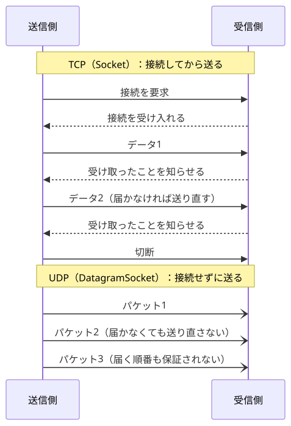
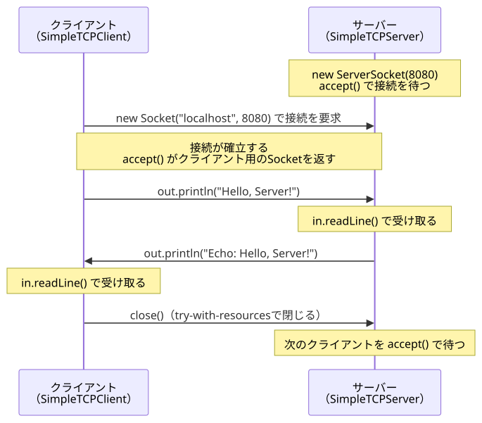

# <b>16章</b> <span>ネットワークプログラミング</span> <small>インターネット通信の実装技術</small>

## 本章の学習目標

### この章で学ぶこと

1. TCPとUDP
    - データの欠けが許されない通信にはTCP、遅れの少なさを優先する通信にはUDPを選べる
2. ソケット通信
    - `ServerSocket`と`Socket`で、受け取った文字列を返すエコーサーバーとクライアントを書ける
    - スレッドプールを使い、複数のクライアントを同時に相手にするチャットサーバーを書ける
    - `DatagramSocket`と`DatagramPacket`で、UDPのデータを送受信できる
3. HTTPとJSON
    - `HttpClient`でWeb APIにリクエストを送り、ステータスコードを確かめてから結果を使える
    - Gsonで、JSONの文字列とJavaのオブジェクトを変換できる
4. 安全な通信
    - 接続と応答にタイムアウトを設定し、応答しない相手を待ち続けないようにできる
    - TLSで暗号化した通信で、接続先が本物のサーバーかを証明書とホスト名で確かめるしくみを説明できる

### この章を始める前に

第14章のファイルI/Oとストリーム、第15章のマルチスレッドプログラミングを理解していれば準備完了です。

## はじめに

本章では、受け取った文字列をそのまま返すエコーサーバーからはじめ、第15章のスレッドプールを使って複数のクライアントを同時に扱うサーバー、UDPの通信、複数人で話せるチャットへと進みます。
後半では、Webのサーバーに要求を送るHTTPクライアントと、JSONのデータを受け取るAPIクライアント、通信を暗号化するTLSを扱います。

## ネットワークプログラミングの基礎

ネットワークで通信するプログラムを書く前に、通信を支えるしくみの全体像と、通信の相手を指定する方法を確かめておきます。

### TCP/IPの階層

インターネットの通信は、TCP/IPと呼ばれるプロトコル（通信の決まりごと）の組み合わせで成り立っています。
TCP/IPでは、通信に必要な仕事をいくつかの層に分け、層ごとに別のプロトコルが受け持ちます<span class="footnote">国際規格を定める団体ISOのOSI参照モデルは、通信を7つの層に分けて説明します。インターネットで実際に使われているのは、ここで扱うTCP/IPの組み合わせです。</span>。
この層の積み重なりをプロトコルスタックと呼びます。

| 層 | 主なプロトコル | 受け持つ仕事 | 本章で使うクラス |
|---|---|---|---|
| アプリケーション層 | HTTP、DNS、SMTP | やり取りする内容の形式を決める | `HttpClient`など |
| トランスポート層 | TCP、UDP | ポート番号で相手のアプリケーションへ届ける | `Socket`、`DatagramSocket` |
| インターネット層 | IP | IPアドレスで相手のコンピューターへ届ける | （OSが受け持つ。アドレスは`InetAddress`で表す） |
| ネットワークインターフェイス層 | イーサネット、Wi-Fi | つながった機器の間で信号を送る | （OSと機器が受け持つ） |

データを送る側では、アプリケーション層から下の層へ順にデータを渡し、各層が自分の仕事に必要な情報（宛先のポート番号やIPアドレスなど）を付け加えます。
受け取る側では逆に、下の層から上の層へデータを渡し、各層が付け加えられた情報を読んで取り除きます。
このしくみにより、各層は自分の仕事だけを受け持てばよくなります。
たとえばHTTPで通信するプログラムは、データがどの経路を通って届くかを気にせず、HTTPのリクエストとレスポンスの形式だけを考えて書けます。
Javaのプログラムが直接扱うのはトランスポート層から上で、インターネット層から下はOSが受け持ちます。

### TCPとUDP

トランスポート層の代表的なプロトコルが、TCPとUDPです。

TCP（Transmission Control Protocol）は、データを送る前に相手との接続を確立するプロトコルです。
受け取った側は届いたことを送った側へ知らせ、その知らせが来なければ、送った側は同じデータを送り直します（再送）。
また、データには順番を表す番号が付いており、受け取った側で送った順に並べ直します。
そのため、データは欠けることなく、送った順に届きます。

UDP（User Datagram Protocol）は、接続を確立せずに、データをパケット（データグラム）と呼ぶまとまりのまま送るプロトコルです。
届いたことの確認も再送もしないので、パケットが途中で失われたり、送った順と違う順に届いたりすることがあります。
その代わりに、接続や確認のやり取りがないぶん、少ない遅れでデータを送れます。

次の図は、2つのプロトコルの送り方の違いを示したものです。

<div class="figure">



</div>

違いをまとめると、次の表のようになります。

| 項目 | TCP | UDP |
|---|---|---|
| 接続 | 送る前に確立する | 確立しない |
| 届く順序 | 送った順に届く | 保証されない |
| 失われたデータ | 送り直す | 送り直さない |
| 遅れ | 確認と再送のぶん大きい | 小さい |
| Javaのクラス | `Socket`、`ServerSocket` | `DatagramSocket`、`DatagramPacket` |

データが少しでも欠けると困る通信には、TCPを使います。
Webページの取得（HTTP）、メール、ファイル転送などがその例です。
多少のデータが欠けても遅れなく届くことが大事な通信には、UDPを使います。
音声通話、動画の配信、オンラインゲームなどがその例です。
DNSの問い合わせのように、短い問い合わせと応答を1回ずつやり取りするだけの通信にもUDPが使われます。

本章では、「ソケットプログラミングの基礎」「マルチスレッドサーバーの実装」とチャットアプリケーションでTCPを、「UDP通信の実装」でUDPを使います。
HTTPはTCPを使って通信するアプリケーション層のプロトコルで、「HTTPクライアントの実装」で扱います。

### IPアドレスとポート番号

通信の相手は、IPアドレスとポート番号の組で指定します。

IPアドレスは、ネットワーク上のコンピューターを一意に識別する番号です。
IPv4では`192.168.1.1`のような32ビットの番号を、IPv6では`2001:db8::1`のような128ビットの番号を使います<span class="footnote">`192.168.`で始まるアドレスは家庭や組織の内部で使うプライベートアドレスです。`2001:db8::`で始まるアドレスは、説明に使うために予約されています。</span>。

1台のコンピューターでは、複数のアプリケーションが同時に通信します。
ポート番号は、そのうちのどのアプリケーションと通信するかを識別する番号で、0から65535までの値をとります。
ポート番号は、範囲によって次の3つに分かれます。

- Well-knownポート（0〜1023）
    + HTTP（80）、HTTPS（443）、FTP（21）など
- 登録済みポート（1024〜49151）
- 動的・私的ポート（49152〜65535）

### ソケットとクライアント・サーバー

ソケットは、プログラムがネットワークで通信するための出入り口です<span class="footnote">ソケットのAPIは、1983年に公開されたUNIXの一種である4.2BSDで、C言語向けに作られたもの（Berkeleyソケット）が元になっています。Javaの`Socket`クラスも、内部ではOSのこのしくみを使います。</span>。
1つのソケットは、IPアドレスとポート番号の組で表される通信の端点（エンドポイント）に対応します。
TCPの1本の接続は、自分と相手のIPアドレスとポート番号、合わせて4つの値で区別されます。
プログラムが自分のソケットへ書き込んだデータは、相手のソケットから読み出せます。
そのため、ファイルを読み書きするのと同じように、ストリームを使って通信できます。

通信する2つのプログラムは、クライアントとサーバーという役割に分かれます。
サーバーは、決まったポート番号で待ち受けて、クライアントからの要求に応える側です。
クライアントは、サーバーのIPアドレスとポート番号を指定して、通信を始める側です。
クライアント側のポート番号は、ふつうはOSが空いている大きな番号から自動で割り当てます<span class="footnote">WindowsやmacOSは動的・私的ポートの範囲（49152〜65535）から選びます。Linuxの既定の範囲は32768〜60999で、動的・私的ポートの範囲とは少し違います。</span>。
WebブラウザーとWebサーバーをはじめ、多くのネットワークアプリケーションはこの形で作られています。

Javaでは、TCPのサーバーは`ServerSocket`で待ち受け、接続してきたクライアントごとに`Socket`を得ます。
クライアントは`Socket`を作ってサーバーに接続します。
UDPでは、サーバーもクライアントも`DatagramSocket`を使います。

## ソケットプログラミングの基礎

TCPの通信では、サーバーが`ServerSocket`で接続を待ち、クライアントが`Socket`で接続します。接続が確立すると、両者はそれぞれの`Socket`から得たストリームでデータを送り合います。この節のクライアント（サンプルコード16-1）とサーバー（サンプルコード16-2）のやりとりは、次の図の順に進みます。

<div class="figure">



</div>

### 基本的なTCPクライアント

TCPクライアントは、Socketクラスを使用してサーバーに接続します。接続が確立されると、入力ストリームと出力ストリームを通じてデータの送受信を行います。

以下のコードは、TCPクライアントの基本的な実装例です。Socketオブジェクトを作成してサーバーに接続し、PrintWriterで文字列を送信し、BufferedReaderで応答を受信します。try-with-resources文を使用することで、通信終了時に自動的にソケットとストリームがクローズされます。

<span class="listing-number">**サンプルコード16-1**　SimpleTCPClient.java</span>

```java
import java.io.*;
import java.net.*;

public class SimpleTCPClient {
    public static void main(String[] args) {
        String serverAddress = "localhost";
        int serverPort = 8080;

        try (Socket socket = new Socket(serverAddress, serverPort);
             PrintWriter out = new PrintWriter(
                 socket.getOutputStream(), true);
             BufferedReader in = new BufferedReader(
                 new InputStreamReader(socket.getInputStream()))) {
            // サーバーにメッセージを送信
            out.println("Hello, Server!");

            // サーバーからの応答を受信
            String response = in.readLine();
            IO.println("サーバーからの応答: " + response);
        } catch (UnknownHostException e) {
            System.err.println("ホストが見つかりません: " + serverAddress);
        } catch (IOException e) {
            System.err.println("I/Oエラーが発生しました: "
                    + e.getMessage());
        }
    }
}
```

次は実行結果の一例です<span class="footnote">実行する前に、次のサンプルコード16-2のサーバーを起動しておきます。</span>。

```
サーバーからの応答: Echo: Hello, Server!
```

ソケットの`getInputStream()`と`getOutputStream()`が返すのは、第14章で学んだバイトストリームです。
受信側は、`InputStreamReader`でバイトを文字に変える文字ストリームにし、さらに`BufferedReader`で包んで`readLine()`で1行ずつ読めるようにしています<span class="footnote">`InputStreamReader`も`PrintWriter`も、文字コードを指定しないと実行環境の既定の文字コードを使います。Java 18以降の既定はUTF-8です。日本語を送り合うプログラムでは、`new InputStreamReader(in, StandardCharsets.UTF_8)`のように指定しておくと確実です。</span>。
送信側の`PrintWriter`は、文字列を`println`で書けるようにするクラスです。
第2引数の`true`は自動フラッシュの指定で、`println`を呼ぶたびにたまった文字をすぐ送り出します。
`true`を付けないと、文字は送り出されずにたまったままになり、相手が応答を待ち続けることがあります。

### 基本的なTCPサーバー

TCPサーバーは、ServerSocketを使用してクライアントからの接続を待ち受けます。ServerSocketは指定されたポートで待機し、クライアントが接続すると新しいSocketインスタンスを生成します。このSocketを使用して、個々のクライアントと通信を行います。

以下のコードは、基本的なTCPサーバーの実装例です。このサーバーは8080番ポート<span class="footnote">Linuxなどでは、1023番以下のポートで待ち受けるには管理者の権限が要ります。そのため、例では8080番のような大きな番号を使っています。</span>で待機し、クライアントから受信したメッセージをエコーバックします。accept()メソッドは新しい接続があるまでブロックし、接続が確立されると各クライアントとの通信を個別に処理します。

<span class="listing-number">**サンプルコード16-2**　SimpleTCPServer.java（4〜38行目）</span>

```java
public class SimpleTCPServer {
    public static void main(String[] args) {
        int port = 8080;

        try (ServerSocket serverSocket = new ServerSocket(port)) {
            IO.println("サーバーがポート " + port + " で起動しました");

            while (true) {
                // クライアントからの接続を待機
                Socket clientSocket = serverSocket.accept();
                IO.println("クライアントが接続しました: " + 
                    clientSocket.getInetAddress());
                handleClient(clientSocket);
            }
        } catch (IOException e) {
            System.err.println("サーバーエラー: " + e.getMessage());
        }
    }

    private static void handleClient(Socket clientSocket) {
        try (BufferedReader in = new BufferedReader(
                 new InputStreamReader(clientSocket.getInputStream()));
             PrintWriter out = new PrintWriter(
                 clientSocket.getOutputStream(), true)) {
            // クライアントからのメッセージを受信
            String message = in.readLine();
            IO.println("受信: " + message);

            // 応答を送信
            out.println("Echo: " + message);
        } catch (IOException e) {
            System.err.println("クライアント処理エラー: " + e.getMessage());
        }
    }
}
```

サーバー側の実行結果は次のとおりです。

```
サーバーがポート 8080 で起動しました
クライアントが接続しました: /127.0.0.1
受信: Hello, Server!
```

## マルチスレッドサーバーの実装

単一スレッドのサーバーでは、一度に1つのクライアントしか処理できません。実用的なサーバーでは、複数のクライアントを同時に処理します。

複数のクライアントを同時に処理できれば、各クライアントは、ほかのクライアントの処理が終わるのを待たずにサービスを利用できます。
1つのクライアントの処理に時間がかかっても、ほかのクライアントへの応答には影響しません。
クライアントの数が増えたときにも対応しやすくなります。
さらに、スレッドプールを使えば、スレッドの数に上限を設けて、メモリとCPUを無駄なく使えます。

### スレッドベースのサーバー

以下のコードは、マルチスレッドに対応したTCPサーバーの実装例です。ExecutorServiceを使用してスレッドプールを管理し、各クライアントの接続をプールのスレッドで処理します。
同時に処理できるのはスレッドプールの大きさ（この例では10）までです。
各接続はクライアントがQUITを送るまでスレッドを使い続けるので、11番目のクライアントは、どれかの接続が終わってスレッドが空くまで応答を受け取れません。
サーバーは簡単なプロトコルを実装しており、ECHO、TIME、QUITなどのコマンドに応答します。
サーバーを起動したあと、別の端末から`nc localhost 8080`（ncコマンドがあるmacOSやLinuxの場合）で接続し、`ECHO こんにちは`や`TIME`、`quit`を1行ずつ送ると試せます。

<div class="figure">



</div>

<span class="listing-number">**サンプルコード16-3**　MultiThreadedServer.java（5〜27、29、36〜59、68〜70行目）</span>

```java
public class MultiThreadedServer {
    private static final int PORT = 8080;
    private static final int THREAD_POOL_SIZE = 10;

    public static void main(String[] args) {
        ExecutorService executor = 
            Executors.newFixedThreadPool(THREAD_POOL_SIZE);

        try (ServerSocket serverSocket = new ServerSocket(PORT)) {
            IO.println("マルチスレッドサーバーが起動しました");

            while (true) {
                Socket clientSocket = serverSocket.accept();
                // 新しいクライアントの処理を別スレッドで実行
                executor.submit(new ClientHandler(clientSocket));
            }
        } catch (IOException e) {
            System.err.println("サーバーエラー: " + e.getMessage());
        } finally {
            executor.shutdown();
        }
    }
}
// ...
class ClientHandler implements Runnable {
    // ...
    @Override
    public void run() {
        try (BufferedReader in = new BufferedReader(
                 new InputStreamReader(clientSocket.getInputStream()));
             PrintWriter out = new PrintWriter(
                 clientSocket.getOutputStream(), true)) {
            String inputLine;
            while ((inputLine = in.readLine()) != null) {
                IO.println(Thread.currentThread().getName()
                        + " - 受信: " + inputLine);

                // 簡単なプロトコル処理
                if (inputLine.equalsIgnoreCase("quit")) {
                    out.println("Goodbye!");
                    break;
                } else if (inputLine.startsWith("ECHO ")) {
                    out.println(inputLine.substring(5));
                } else if (inputLine.equals("TIME")) {
                    out.println(java.time.LocalDateTime.now());
                } else {
                    out.println("Unknown command: " + inputLine);
                }
            }
        } catch (IOException e) {
        // ...
        }
    }
}
```

## HTTPクライアントの実装

### HTTPプロトコルの基礎

HTTPは、Webでもっとも広く使用されているアプリケーション層プロトコルです<span class="footnote">HTTPはHyperText Transfer Protocolの略です。1990年前後に、CERNのティム・バーナーズ＝リーがWebのしくみとともに考案しました。</span>。

HTTPリクエストは、次の形をしています。

```
GET /index.html HTTP/1.1
Host: www.example.com
User-Agent: Java/25
Accept: text/html
[空行]
[リクエストボディ（POSTの場合）]
```

HTTPレスポンスは、次の形をしています。

```
HTTP/1.1 200 OK
Content-Type: text/html
Content-Length: 1234
[空行]
[レスポンスボディ]
```

リクエストの1行目は、メソッド・パス・HTTPの版を並べたものです。
メソッドは、サーバーに何をしてほしいかを表します。
`GET`はデータを取得する要求、`POST`はデータを送って登録などをしてもらう要求です。
レスポンスの1行目は、HTTPの版・ステータスコード・その説明を並べたもので、ステータスコードの3桁の数字が結果を表します。

| ステータスコード | 意味 | 例 |
|---|---|---|
| 200番台 | 成功 | 200（OK）、201（Created：新しく作った） |
| 400番台 | クライアント側の誤り | 400（Bad Request：要求の形が誤り）、404（Not Found：見つからない） |
| 500番台 | サーバー側の誤り | 500（Internal Server Error） |

### 簡単なHTTPクライアント

ソケットを使用して直接HTTPプロトコルを話すクライアントの実装例です。この方法は教育的価値が高く、HTTPプロトコルの動作を理解するのに役立ちます。
実際の開発では、後述するHttpURLConnectionやHttpClientを使用することが一般的ですが、基礎となるしくみを理解することは重要です。

<span class="listing-number">**サンプルコード16-4**　SimpleHTTPClient.java（4〜21、26〜51行目）</span>

```java
public class SimpleHTTPClient {
    public static void main(String[] args) {
        String host = "www.example.com";
        int port = 80;
        String path = "/";

        try (Socket socket = new Socket(host, port);
             PrintWriter out = new PrintWriter(
                 socket.getOutputStream(), true);
             BufferedReader in = new BufferedReader(
                 new InputStreamReader(socket.getInputStream()))) {
            // HTTPリクエストを送信（HTTP/1.0で送ると、ボディが分割されずに届く）
            // HTTPの行の終わりはCRLF（\r\n）なので、printlnではなくprintで書く
            out.print("GET " + path + " HTTP/1.0\r\n");
            out.print("Host: " + host + "\r\n");
            out.print("Connection: close\r\n");
            out.print("\r\n"); // 空行でヘッダー終了
            out.flush();
            // ...
            String line;
            boolean isHeader = true;
            StringBuilder headers = new StringBuilder();
            StringBuilder body = new StringBuilder();

            while ((line = in.readLine()) != null) {
                if (isHeader) {
                    if (line.isEmpty()) {
                        isHeader = false;
                    } else {
                        headers.append(line).append("\n");
                    }
                } else {
                    body.append(line).append("\n");
                }
            }

            IO.println("=== Headers ===");
            IO.println(headers);
            IO.println("=== Body ===");
            IO.println(body);
        } catch (IOException e) {
            System.err.println("エラー: " + e.getMessage());
        }
    }
}
```

次は実行結果の一例です。
ヘッダーの項目や値は、接続先のサーバーや実行した日時によって変わります。

```
=== Headers ===
HTTP/1.1 200 OK
Date: Wed, 11 Nov 2026 03:43:02 GMT
Content-Type: text/html; charset=utf-8
Connection: close
Server: cloudflare
Last-Modified: Sun, 08 Nov 2026 18:05:34 GMT
...（中略）

=== Body ===
<!doctype html><html lang=en><head><meta charset=utf-8>...（以下省略）
```

リクエストをHTTP/1.1で送ると、サーバーがボディを複数のかたまり（チャンク）に分けて返すことがあります。
そのときは各かたまりの前にその大きさを表す16進数の行が入り、最後に大きさ0の行が付くため、この例ではHTTP/1.0でリクエストを送っています。

HTTPでは、リクエストの各行をCR（`\r`）とLF（`\n`）の2文字で終えると決まっています。
`PrintWriter`の`println()`が書く改行はOSによって異なり、macOSやLinuxでは`\n`だけになります。
そのため、この例では`print()`で行の終わりに`\r\n`を付け、最後に`flush()`で送り出しています。

### HttpURLConnectionの使用

Javaは、より高レベルなHTTP通信のためのAPIも提供しています。

以下のコードは、HttpURLConnectionを使用したHTTP GETリクエストの実装例です。このクラスはソケットレベルの詳細を隠蔽し、HTTPヘッダーの設定、レスポンスコードの取得、タイムアウトの設定などを簡単に行えます。この例では、GitHub APIにアクセスしてJSON形式のユーザー情報を取得しています<span class="footnote">認証なしでGitHub APIを呼び出せるのは、1つのIPアドレスから1時間に60回までです。回数を超えると、レスポンスコードが403や429になります。</span>。

<span class="listing-number">**サンプルコード16-5**　HttpURLConnectionExample.java（4〜33、39〜40行目）</span>

```java
public class HttpURLConnectionExample {
    public static void main(String[] args) {
        try {
            URL url = URI.create("https://api.github.com/users/github")
                    .toURL();
            HttpURLConnection conn = 
                (HttpURLConnection) url.openConnection();

            // リクエストの設定
            conn.setRequestMethod("GET");
            conn.setRequestProperty("Accept", "application/json");
            conn.setConnectTimeout(5000);
            conn.setReadTimeout(5000);

            // レスポンスコードの確認
            int responseCode = conn.getResponseCode();
            IO.println("Response Code: " + responseCode);

            if (responseCode == HttpURLConnection.HTTP_OK) {
                // レスポンスの読み取り
                try (BufferedReader reader = new BufferedReader(
                        new InputStreamReader(conn.getInputStream()))) {
                    String line;
                    StringBuilder response = new StringBuilder();
                    while ((line = reader.readLine()) != null) {
                        response.append(line);
                    }
                    IO.println("Response: " + response.toString());
                }
            }
            // ...
    }
}
```

次は実行結果の一例です<span class="footnote">JSONレスポンスの内容は、実行した時期によって異なる場合があります。</span>。

```
Response Code: 200
Response: {"login":"github","id":9919,"node_id":"MDEyOk9yZ2FuaXphdGlvbjk5MTk=","avatar_url":"https://avatars.githubusercontent.com/u/9919?v=4",...}
```

### 非同期HTTPクライアント（Java 11+） {.advanced}

Java 11で標準になったHTTPクライアントAPI（`java.net.http`パッケージ）<span class="footnote">このAPIはJava 9とJava 10で試験的なモジュール（incubator）として提供され、Java 11で正式な標準APIになりました。</span>は、非同期処理をサポートし、HTTP/2にも対応しています。CompletableFutureを使用することで、ノンブロッキングなHTTP通信が可能になります。

<span class="listing-number">**サンプルコード16-6**　AsyncHttpClientExample.java（8〜49行目）</span>

```java
public class AsyncHttpClientExample {
    public static void main(String[] args) throws Exception {
        // HTTPクライアントの作成
        HttpClient client = HttpClient.newBuilder()
            .version(HttpClient.Version.HTTP_2)
            .connectTimeout(Duration.ofSeconds(10))
            .build();

        // HTTPリクエストの作成
        HttpRequest request = HttpRequest.newBuilder()
            .uri(URI.create(
                    "https://jsonplaceholder.typicode.com/posts/1"))
            .timeout(Duration.ofMinutes(1))
            .header("Accept", "application/json")
            .GET()
            .build();

        // 非同期でリクエストを送信
        CompletableFuture<HttpResponse<String>> future = 
            client.sendAsync(request,
            HttpResponse.BodyHandlers.ofString());

        // 非同期処理の連鎖
        CompletableFuture<Void> done = future
            .thenApply(response -> {
                IO.println("Status: " + response.statusCode());
                return response.body();
            })
            .thenAccept(body -> IO.println("Response Body: " + body))
            .exceptionally(e -> {
                System.err.println("Error: " + e.getMessage());
                return null;
            });

        // 他の処理を並行して実行可能
        IO.println("他の処理を継続中...");

        // 連鎖させた処理がすべて終わるまで待つ（mainが先に終わるとプログラムが
        // 終了するため）
        done.join();
    }
}
```

次は実行結果の一例です。

```
他の処理を継続中...
Status: 200
Response Body: {
  "userId": 1,
  "id": 1,
  "title": "sunt aut facere repellat provident occaecati excepturi optio reprehenderit",
  "body": "quia et suscipit\nsuscipit recusandae consequuntur expedita et cum\nreprehenderit molestiae ut ut quas totam\nnostrum rerum est autem sunt rem eveniet architecto"
}
```

実行結果の1行目が「他の処理を継続中...」になっているのは、`sendAsync`がレスポンスを待たずに戻るためです。
このように非同期のHTTPクライアントでは、レスポンスを待つ間もほかの処理を続けられ、複数のリクエストを並行して送ることもできます。
受け取ったあとの処理やエラー処理は、CompletableFutureのメソッドで順につなげて書けます。
また、`HttpClient`はHTTP/2に対応しているため、サーバーも対応していれば、1つの接続で複数のリクエストを多重化して、通信の遅延を減らせます。

> **コラム：タイムアウトを設定しない通信は、いつか障害になる**{.column-section}
>
> この節のサンプルコードは、どれも`connectTimeout`や`timeout`でタイムアウトを設定しています。
> 設定しないとどうなるかというと、相手が応答しない限り、いつまでも待ち続けます。
> `HttpClient`は、接続のタイムアウトを指定しなければ既定の値を持たず、`HttpRequest`のタイムアウトを指定しないことは、APIドキュメントによれば無限の時間を指定したのと同じです。
> `HttpURLConnection`のタイムアウトも、既定は0（無限）です。
>
> 接続だけ受け付けて何も返さないサーバーを手元に作って試すと、タイムアウトのない要求は3秒たっても終わりません。
> `timeout(Duration.ofSeconds(1))`を付けた要求は、約1秒で`HttpTimeoutException`になります。
>
> 開発中は相手のサーバーがすぐ応答するので、この違いに気づきません。
> 問題が表に出るのは本番で、連携先のサーバーが混み合って応答が遅れたときです。
> 応答を待つスレッドが1つずつ止まっていき、やがてスレッドプールのスレッドがすべて待ちで埋まると、連携とは関係のない処理まで受け付けられなくなります。
> 1つのサーバーの遅れが、それを呼んでいるシステム全体の停止に広がるわけです。
>
> そのため現場では、外部との通信には必ずタイムアウトを設定し、その値を「この処理は何秒までなら待てるか」という業務の要件から決めます。
> タイムアウトしたときに、もう一度送るのか、エラーとして利用者に伝えるのかも、あらかじめ決めておきます。
> ネットワークの向こうの相手は、いつか必ず遅れたり止まったりする、という前提で作るのがエンジニアの考え方です。

## UDP通信の実装

「TCPとUDP」で見たように、UDPは接続を確立せず、届いたことの確認も再送もしないプロトコルです。
この節では、UDPでメッセージを送り返すエコーサーバーとクライアントを作ります。

### UDPサーバー

以下のコードは、UDPサーバーの実装例です。DatagramSocketを使用してUDPパケットを受信し、クライアントにエコーレスポンスを送信します。UDPはコネクションレスのため、各パケットにはデータだけでなく送信元のアドレスとポート情報も含まれています。

<span class="listing-number">**サンプルコード16-7**　UDPServer.java</span>

```java
import java.net.*;
import java.nio.charset.StandardCharsets;

public class UDPServer {
    private static final int PORT = 9999;

    public static void main(String[] args) {
        try (DatagramSocket socket = new DatagramSocket(PORT)) {
            IO.println("UDPサーバーがポート " + PORT + " で起動しました");

            byte[] buffer = new byte[1024];
            DatagramPacket packet =
                    new DatagramPacket(buffer, buffer.length);

            while (true) {
                // データを受信
                socket.receive(packet);

                String received = new String(packet.getData(), 0, 
                    packet.getLength(), StandardCharsets.UTF_8);
                IO.println("受信: " + received + " from " + 
                    packet.getAddress());

                // エコーレスポンスを送信
                String response = "Echo: " + received;
                byte[] responseData =
                        response.getBytes(StandardCharsets.UTF_8);
                DatagramPacket responsePacket = new DatagramPacket(
                    responseData, responseData.length,
                    packet.getAddress(), packet.getPort());
                socket.send(responsePacket);
            }
        } catch (Exception e) {
            e.printStackTrace();
        }
    }
}
```

サーバー側の実行結果は次のとおりです。

```
UDPサーバーがポート 9999 で起動しました
受信: Hello UDP Server! from /127.0.0.1
```

### UDPクライアント

以下のコードは、UDPクライアントの実装例です。このクライアントは、サーバーにメッセージを送信し、エコーレスポンスを受信します。UDP通信では、送信と受信の両方でDatagramPacketを使用し、パケット単位でデータをやり取りします。

<span class="listing-number">**サンプルコード16-8**　UDPClient.java</span>

```java
import java.net.*;
import java.nio.charset.StandardCharsets;

public class UDPClient {
    public static void main(String[] args) {
        try (DatagramSocket socket = new DatagramSocket()) {
            InetAddress serverAddress =
                    InetAddress.getByName("localhost");
            int serverPort = 9999;

            // データを送信
            String message = "Hello UDP Server!";
            byte[] buffer = message.getBytes(StandardCharsets.UTF_8);
            DatagramPacket packet = new DatagramPacket(
                buffer, buffer.length, serverAddress, serverPort);
            socket.send(packet);
            IO.println("送信: " + message);

            // レスポンスを受信
            byte[] responseBuffer = new byte[1024];
            DatagramPacket responsePacket = new DatagramPacket(
                responseBuffer, responseBuffer.length);
            socket.receive(responsePacket);

            String response = new String(responsePacket.getData(), 0,
                responsePacket.getLength(), StandardCharsets.UTF_8);
            IO.println("受信: " + response);
        } catch (Exception e) {
            e.printStackTrace();
        }
    }
}
```

クライアント側の実行結果は次のとおりです。

```
送信: Hello UDP Server!
受信: Echo: Hello UDP Server!
```

UDPでは、送ったパケットや応答のパケットが途中で失われることがあります。
このクライアントは応答が届かないと`receive()`で待ち続けるので、実用のプログラムでは`setSoTimeout()`で待つ時間に上限を設け、送り直すかどうかをプログラム側で決めます。
また、TCPと違って1対1の接続を作らないので、ブロードキャストやマルチキャストで複数の相手へ同時に送れます。

## 実践的な例：チャットアプリケーション

### チャットサーバー

以下のコードは、マルチクライアント対応のチャットサーバーの実装例です。このサーバーは、接続されたすべてのクライアントからメッセージを受信し、他のすべてのクライアントに転送します。各クライアントとの通信は独立したスレッドで処理されます。
接続が続くあいだスレッドを使い続けるので、第15章で学んだとおり上限のあるスレッドプール（`newFixedThreadPool`）を使い、上限を超えた接続はスレッドが空くまで待たせます。
クライアントの集合は、複数のスレッドが同時に追加・削除・反復しても安全な`ConcurrentHashMap.newKeySet()`で作ります<span class="footnote">`Collections.synchronizedSet`で包んだ集合も追加と削除は安全ですが、拡張for文で反復するあいだは、利用する側で`synchronized`ブロックを使って集合をロックしなければなりません。</span>。
各クライアントは、送信に使う`PrintWriter`を用意してから集合に加えます。
先に加えると、準備の済んでいないクライアントへほかのスレッドがメッセージを送ろうとして、`NullPointerException`が発生することがあります。

<span class="listing-number">**サンプルコード16-9**　ChatServer.java（6〜37、44、54〜77、92〜99行目）</span>

```java
public class ChatServer {
    private static final int PORT = 5000;
    // 同時に接続できるクライアントの上限
    private static final int MAX_CLIENTS = 20;
    // 複数のスレッドから追加・削除・反復しても安全な集合
    private static Set<ClientHandler> clients =
        ConcurrentHashMap.newKeySet();

    public static void main(String[] args) {
        ExecutorService executor =
                Executors.newFixedThreadPool(MAX_CLIENTS);

        try (ServerSocket serverSocket = new ServerSocket(PORT)) {
            IO.println("チャットサーバーが起動しました");

            while (true) {
                Socket clientSocket = serverSocket.accept();
                executor.submit(new ClientHandler(clientSocket));
            }
        } catch (IOException e) {
            System.err.println("サーバーエラー: " + e.getMessage());
        }
    }

    // すべてのクライアントにメッセージをブロードキャスト
    public static void broadcast(String message, ClientHandler sender) {
        for (ClientHandler client : clients) {
            if (client != sender) {
                client.sendMessage(message);
            }
        }
    }
    // ...
    static class ClientHandler implements Runnable {
        // ...
        @Override
        public void run() {
            try {
                in = new BufferedReader(
                    new InputStreamReader(socket.getInputStream()));
                out = new PrintWriter(socket.getOutputStream(), true);
                // 送信の準備ができてから、ブロードキャストの対象に加える
                clients.add(this);

                // ユーザー名を取得
                out.println("ユーザー名を入力してください:");
                username = in.readLine();

                // 入室メッセージをブロードキャスト
                broadcast(username + " が入室しました", this);

                // メッセージを受信してブロードキャスト
                String message;
                while ((message = in.readLine()) != null) {
                    if (message.equalsIgnoreCase("/quit")) {
                        break;
                    }
                    broadcast(username + ": " + message, this);
                }
                // ...
            }
        }

        public void sendMessage(String message) {
            out.println(message);
        }
    }
}
```

### チャットクライアント

以下のコードは、チャットクライアントの実装例です。このクライアントは、サーバーに接続し、別スレッドでメッセージの受信を処理しながら、メインスレッドでキーボードからの入力を受け付けます。この設計により、メッセージの送受信を同時に行えます。

<span class="listing-number">**サンプルコード16-10**　ChatClient.java（4、8〜45行目）</span>

```java
public class ChatClient {
    // ...
    public static void main(String[] args) {
        try (Socket socket = new Socket(SERVER_ADDRESS, SERVER_PORT);
             PrintWriter out = new PrintWriter(
                 socket.getOutputStream(), true);
             BufferedReader in = new BufferedReader(
                 new InputStreamReader(socket.getInputStream()))) {
            // 受信スレッドを開始
            Thread receiveThread = new Thread(() -> {
                try {
                    String message;
                    while ((message = in.readLine()) != null) {
                        IO.println(message);
                    }
                } catch (IOException e) {
                    System.err.println("受信エラー: " + e.getMessage());
                }
            });
            receiveThread.start();

            // メッセージ送信ループ（入力の終わりでIO.readlnはnullを返す）
            String userInput;
            while ((userInput = IO.readln()) != null) {
                out.println(userInput);
                if (userInput.equalsIgnoreCase("/quit")) {
                    break;
                }
            }

            // 受信側を閉じて受信スレッドのreadLine()を終わらせてから、資源を閉じる
            socket.shutdownInput();
            receiveThread.join();
        } catch (IOException e) {
            System.err.println("接続エラー: " + e.getMessage());
        } catch (InterruptedException e) {
            Thread.currentThread().interrupt();
        }
    }
}
```

このプログラムはチャットサーバー（ポート5000）への接続を試みます。
サーバーが起動していない場合は、次のような接続エラーが表示されます。

```
接続エラー: Connection refused
```

正常に接続できた場合は、メッセージの送受信が可能になり、`/quit`コマンドで終了できます。
サーバーは`/quit`を受け取ると、その接続を閉じて退室を知らせます。

終了するときは、try-with-resources文が資源を閉じる前に、`socket.shutdownInput()`で受信側を閉じ、受信スレッドの終了を`join()`で待っています。
受信スレッドは`in.readLine()`で読み込みを待っているあいだ`BufferedReader`のロックを持っています。
そのまま`BufferedReader`を閉じようとすると、メインスレッドがそのロックを待ち続けて終わらなくなります。
受信側を閉じると`readLine()`が`null`を返して受信スレッドが終わるため、そのあとで資源を閉じられます。

## JSON APIクライアントの実装

現代のWebアプリケーションでは、JSON形式でのデータ交換が標準的です。
JSONは、第7章の脚注で触れたとおり、`{"name": "田中", "age": 20}`のように名前と値の組でデータを書き表す文字列の形式です。
JavaでJSON APIを扱う方法を学びます。

以下のコードは、汎用的なJSON APIクライアントの実装例です。Gsonライブラリを使用してJSONのシリアライズ/デシリアライズを行い、Java 11のHttpClientでHTTPリクエストを送信します。このクライアントはGETとPOSTメソッドをサポートし、受け取る型を指定してJSONデータを扱えます。
POSTのメソッドは紙面では省いており、GitHubの全文に載せています<span class="footnote">全文は`https://github.com/Nagatani/techbook-java-primer/tree/main/sample-code/chapter16/16-11/`にあります。</span>。

GsonはJavaの標準APIではなく、外部ライブラリです。
このサンプルを動かすには、Gsonをプロジェクトに追加します。
外部ライブラリの追加方法とGsonの使い方は、第22章「ドキュメントと外部ライブラリ」で学びます。
ここでは、`Gson`の`fromJson`メソッドがJSONの文字列を指定した型のオブジェクトに変換する、とだけ押さえてコードを読んでください。

<span class="listing-number">**サンプルコード16-11**　JsonApiClient.java（7〜30、49〜58、80行目）</span>

```java
public class JsonApiClient {
    private final HttpClient client;
    private final Gson gson;

    public JsonApiClient() {
        this.client = HttpClient.newBuilder()
            .version(HttpClient.Version.HTTP_2)
            .build();
        this.gson = new Gson();
    }

    public <T> T get(String url, Class<T> responseType)
            throws Exception {
        HttpRequest request = HttpRequest.newBuilder()
            .uri(URI.create(url))
            .header("Accept", "application/json")
            .GET()
            .build();

        HttpResponse<String> response = client.send(request,
            HttpResponse.BodyHandlers.ofString());

        return readBody(response, responseType);
    }
    // ...
    // ステータスコードが成功（200番台）のときだけ、JSONをオブジェクトに変換する
    private <T> T readBody(HttpResponse<String> response,
            Class<T> responseType) throws Exception {
        int status = response.statusCode();
        if (status >= 200 && status < 300) {
            return gson.fromJson(response.body(), responseType);
        } else {
            throw new RuntimeException("HTTP error: " + status);
        }
    }
    // ...
}
```

JSONとJavaのオブジェクトとの変換（シリアライズとデシリアライズ）は自分で書かず、ライブラリに任せます。
本書では、設定を書かずにすぐ使えるGsonを使います。
`get`メソッドでは、受け取りたい型を`Class<T>`で渡すので、JSONの内容を型の決まったオブジェクトとして受け取れます。
リクエストには、送るデータの形式を表すContent-Typeヘッダーや、受け取りたい形式を表すAcceptヘッダーを正しく付けます。
また、レスポンスを使う前にHTTPステータスコードを確かめ、成功を表す200番台（200〜299）以外のときはエラーとして扱います。
POSTでデータを作ったときは、200ではなく201（Created）が返ることが多いため、`readBody`メソッドでは200番台をまとめて成功とみなしています。

## セキュリティの考慮事項

ネットワークプログラミングでは、セキュリティを常に意識してください。

### 基本的なセキュリティ対策

本章のコードに関わる対策は次のとおりです。

1. 受け取るデータの検証
    + 相手から届く行の長さや形式を確かめ、想定外のデータで処理が止まらないようにする
2. タイムアウト
    + `setSoTimeout`などで待つ時間に上限を設け、応答のない相手を待ち続けない
3. 接続数の上限
    + スレッドプールの大きさで、同時に扱う接続の数を限る（16-3・16-9）
4. 暗号化と相手の確認
    + TLSで通信を暗号化し、接続先が本物のサーバーかを証明書とホスト名で確かめる（次の16-12）

### セキュアな通信の実装 {.advanced}

SSL/TLS（Secure Sockets Layer/Transport Layer Security）は、ネットワーク通信を暗号化し、安全性を確保するプロトコルです<span class="footnote">SSLは1990年代半ばにNetscape社が開発したプロトコルで、後継のTLSに置き換わりました。SSLはどの版も使うべきでないとされていますが、名前は`SSLSocket`などのクラス名に残っています。</span>。
JavaではSSLSocketを使用してセキュアな通信を実装できます。

以下のコードは、SSLSocketを使用したセキュアなクライアント接続の実装例です。SSLSocketFactoryから生成されたSSLSocketは、通常のSocketと同様に使用できますが、内部的にはすべての通信がSSL/TLSプロトコルで暗号化されます。
この例では、使うプロトコルをTLS 1.2以上に限っています。
JDK 25の既定も同じですが、実行する環境の設定で古い版が使えるようになっていても、それを使わないように明示しています。

暗号化するだけでは、通信の相手が本物のサーバーかどうかはわかりません。
`SSLSocket`は、ハンドシェイクのときにサーバーの証明書が信頼できる認証局のものかを確かめます。
ただし、証明書が接続先のホスト名（ここでは`www.example.com`）のものかどうかは、既定では確かめません。
そこで、`SSLParameters`の`setEndpointIdentificationAlgorithm("HTTPS")`でホスト名の検証を有効にしています。
`HttpClient`や`HttpURLConnection`でHTTPSを使うときは、ホスト名の検証は自動で行われます。

<span class="listing-number">**サンプルコード16-12**　SSLClient.java</span>

```java
import javax.net.ssl.*;
import java.io.*;

public class SSLClient {
    public static void main(String[] args) {
        String host = "www.example.com";
        int port = 443;

        SSLSocketFactory factory =
            (SSLSocketFactory) SSLSocketFactory.getDefault();
        try (SSLSocket socket =
                (SSLSocket) factory.createSocket(host, port)) {
            // 使うプロトコルをTLS 1.2以上に限る（JDK 25の既定と同じ）
            socket.setEnabledProtocols(
                new String[] {"TLSv1.2", "TLSv1.3"});

            // 証明書が接続先のホスト名のものかを確かめる（既定では確かめない）
            SSLParameters params = socket.getSSLParameters();
            params.setEndpointIdentificationAlgorithm("HTTPS");
            socket.setSSLParameters(params);

            // ハンドシェイクを開始
            socket.startHandshake();
            SSLSession session = socket.getSession();
            IO.println("SSL接続が確立されました");
            IO.println("使用しているプロトコル: " + session.getProtocol());
            IO.println("暗号スイート: " + session.getCipherSuite());

            // 以降は通常のソケットと同様に使用
            PrintWriter out = new PrintWriter(
                socket.getOutputStream(), true);
            BufferedReader in = new BufferedReader(
                new InputStreamReader(socket.getInputStream()));

            // HTTPSのリクエストを送り、レスポンスのヘッダーを表示
            // HTTPの行の終わりはCRLF（\r\n）
            out.print("GET / HTTP/1.0\r\n");
            out.print("Host: " + host + "\r\n");
            out.print("\r\n");
            out.flush();
            String line;
            while ((line = in.readLine()) != null && !line.isEmpty()) {
                IO.println(line);
            }
        } catch (IOException e) {
            System.err.println("SSL接続エラー: " + e.getMessage());
        }
    }
}
```

次は実行結果の一例です。
プロトコル・暗号スイート・ヘッダーの内容は、接続先のサーバーや実行した日時によって変わります。

```
SSL接続が確立されました
使用しているプロトコル: TLSv1.3
暗号スイート: TLS_AES_256_GCM_SHA384
HTTP/1.1 200 OK
Date: Wed, 11 Nov 2026 03:47:19 GMT
Content-Type: text/html; charset=utf-8
Connection: close
...（以下省略）
```

## 多数の接続を1つのスレッドで扱う

本章のマルチスレッドサーバーは、接続ごとにスレッドプールのスレッドを1つ使います。
同時に接続するクライアントが数千に増えると、スレッドの数とメモリが足りなくなります。
`java.nio`パッケージの、待たずにすぐ戻る（ノンブロッキング）チャネルと`Selector`を使うと、1つのスレッドで多数の接続を扱えます。
`Selector`が、接続の受け付けや読み取りができるようになったチャネルを教えてくれるので、準備のできた接続だけを順に処理します。
`Selector`を使ったエコーサーバーの例は、付録Hで紹介しています。
Java 21以降は、第15章の節「新しい並行処理のしくみ」で紹介した仮想スレッドを使い、接続ごとに軽いスレッドを割り当てる方法もあります。

## よくあるエラーと対処法

ネットワークプログラムでは、相手のサーバーや通信経路といった、プログラムの外の要因によってエラーが起こります。本章の内容に関連して出会いやすいエラーは次のとおりです。

- 接続のエラー
    + 接続先のサーバーが起動していない、ポート番号が違う、ファイアウォールで遮断されているといった原因で`ConnectException`などが発生する。タイムアウトも設定する
- データの送受信のエラー
    + 送信側と受信側で文字エンコーディングがそろっていない、データを最後まで受信していないといった原因がある
- HTTPのステータスコードの確認漏れ
    + `HttpClient`は404や500のレスポンスでも例外をスローしないため、ステータスコードを確かめる。`HttpURLConnection`はエラーのレスポンスで`getInputStream()`が`IOException`をスローするので、先に`getResponseCode()`で確かめる
- リソースの解放漏れ
    + ソケットやストリームはtry-with-resources文で確実に閉じる

エラーの例と修正したコード、接続を診断するデバッグのヒントは、GitHubリポジトリにまとめています。<br>
`https://github.com/Nagatani/techbook-java-primer/blob/main/appendix/e-common-errors/chapters/chapter16.md`

## まとめ

通信を書くときは、まずデータが欠けてはいけないかどうかで、TCPとUDPのどちらを使うかを決めます。
Web APIのようにHTTPで話す相手なら、ソケットを直接使わずに`HttpClient`や`HttpURLConnection`を使います。
どの方法でも、接続と応答にはタイムアウトを設定し、その値は、この処理は何秒までなら待てるかという要件から決めます。
HTTPのレスポンスは、ステータスコードを確かめてから使います。
サーバーを書くときは、スレッドプールの大きさで同時に扱う接続の数を限り、受け取るデータの長さや形式を確かめます。

この章でいちばん持ち帰ってほしいのは、ネットワークの向こうの相手はいつか遅れたり止まったりする、という前提で書くということです。
基礎課題のHTTP通信で、接続と読み取りにタイムアウトを設定し、ステータスコードを確かめてから本文を読むのは、そのためです。

この章のプログラムは結果をコンソールに出すだけでしたが、第17章からは、ウィンドウに部品を並べて利用者が画面で操作するプログラムに進みます。

### 次のステップ

本章で学んだHTTPとソケットをもとにした技術として、次のようなものがあります。

- RESTful APIの設計と実装
    + REST（Representational State Transfer）はWeb APIの設計原則である
    + APIが扱うデータを「リソース」とみなしてURLで指し示し、GET（取得）・POST（作成）・PUT（更新）・DELETE（削除）のHTTPメソッドで操作する
    + 各リクエストは独立し、サーバーは前のリクエストの状態を覚えない（ステートレス）。レスポンスにはキャッシュしてよいかどうかを示す
    + 実装には、Spring BootやJAX-RS（Jersey）などのフレームワークを使うことが多い
- WebSocketを使用したリアルタイム通信
    + HTTPのアップグレードのしくみで接続を切り替え、接続を保ったまま双方向に通信するプロトコルである
    + 接続が続いている間はサーバーからもクライアントへデータを送れ（プッシュ）、メッセージごとにリクエストを送らないぶん遅延が小さい
    + チャット、ゲーム、株価配信などに向く。クライアントは標準APIの`HttpClient`の`newWebSocketBuilder()`や、Jettyなどのライブラリで作れる
- gRPCなどのRPCフレームワーク
- マイクロサービスアーキテクチャ

## 章末演習

### 演習課題へのアクセス
本章の演習課題は、GitHubリポジトリで提供されています。<br>
`https://github.com/Nagatani/techbook-java-primer/tree/main/exercises/chapter16/`

### 課題構成

演習は、次の課題で構成されています。

1. 基礎課題
    + TCPのエコーサーバーとクライアント、HttpURLConnectionによるWebページの取得、UDPの送受信、マルチスレッドのサーバー
2. 発展課題
    + チャットアプリケーション、ファイル転送、REST APIクライアントの開発
3. チャレンジ課題
    + 静的ファイルを配信する簡易Webサーバーの実装

詳細な課題内容と実装のヒントは、GitHubリポジトリの各課題フォルダー内のREADME.mdを参照してください<span class="footnote">各課題フォルダーは`https://github.com/Nagatani/techbook-java-primer/tree/main/exercises/chapter16/`の下の`basic/`・`advanced/`・`challenge/`です。</span>。

基礎課題が完了したら、第17章「GUIプログラミングの基礎」に進みましょう。

