# <b>17章</b> <span>GUIプログラミングの基礎</span> <small>Swingで作るデスクトップアプリ</small>

## 本章の学習目標

### この章で学ぶこと

1. Swingの基本
    - `SwingUtilities.invokeLater()`を使う定型で、ウィンドウを表示するプログラムを書ける
2. コンポーネント
    - `JLabel`・`JButton`・`JTextField`や選択のための部品を、入力する内容に合わせて選んで並べられる
3. レイアウトマネージャー
    - `BorderLayout`・`GridLayout`・`FlowLayout`から、作りたい配置に合うものを選べる
    - 画面を`JPanel`の区画に分け、区画ごとに別のレイアウトを使って組み立てられる
4. 独自の描画
    - `JPanel`を継承して`paintComponent()`をオーバーライドし、棒グラフのような図を描ける

本章では、画面を組み立てる方法に集中します。
ボタンのクリックなどの操作に応答するイベント処理は、第18章「基本的なイベント処理」で学びます。

本書がSwingを使うのは、JDKだけで動き、イベント駆動やモデルと表示の分け方を、追加の部品なしで学べるからです。
ここで学ぶ考え方は、JavaFXやWebの画面でも同じです。
本書を終えて新しく画面を作るなら、複数の人がブラウザーから使えるWebアプリケーション（Spring Bootなど）を勧めます（第26章の節「事例3：画面を何で作るか」）。

### この章を始める前に

第16章までのJavaプログラミングの知識、とくにクラスの継承（第5章）とインターフェイス（第7章）を理解していれば準備完了です。
GUIを組み立てる定型では、第11章で学んだラムダ式を使います。

## 基本コンポーネントとレイアウト

### はじめてのGUIプログラム

#### Hello Swing - ウィンドウを表示してみよう

まずはもっとも基本的なGUIプログラムから始めましょう<span class="footnote">C言語の標準ライブラリにはGUIの機能がなく、WindowsならWin32 API、LinuxならGTKのように、OSごとのライブラリを使って画面を作ります。SwingはJavaの標準ライブラリに含まれ、同じコードがWindows・macOS・Linuxで動きます。</span>。以下は、単純なウィンドウを表示するプログラムです。

<span class="listing-number">**サンプルコード17-1**　HelloSwing.java</span>

```java
import javax.swing.JFrame;

public class HelloSwing {
    public static void main(String[] args) {
        JFrame frame = new JFrame("はじめてのSwingアプリケーション"); // ①
        frame.setSize(400, 300);                          // ②
        frame.setDefaultCloseOperation(JFrame.EXIT_ON_CLOSE); // ③
        frame.setLocationRelativeTo(null);                // ④
        frame.setVisible(true);                           // ⑤
    }
}
```

実行結果：
このプログラムを実行すると、タイトルバーに「はじめてのSwingアプリケーション」と表示された400×300ピクセルのウィンドウが画面中央に表示されます。

このプログラムは、①〜⑤の順にウィンドウを準備して表示します。
各行を詳しく見ていきましょう。

①では、Swingでウィンドウを表す`JFrame`クラスのオブジェクトを作り、タイトルバーに表示する文字列を指定します。
`JFrame`は、すべてのSwingのGUIアプリケーションの土台になるクラスです<span class="footnote">Swingのクラス名の先頭の「J」は、Swingより前からあるGUIライブラリAWTの、同じ役割のクラス（`Frame`、`Button`、`Label`など）と区別するために付いています。</span>。
この時点では、ウィンドウはまだ画面に表示されません。

②の`setSize()`は、ウィンドウの幅と高さをピクセル単位で指定します。
ここでは横400ピクセル、縦300ピクセルです。
この大きさは、タイトルバーやウィンドウの枠を含む全体の大きさです。

③の`setDefaultCloseOperation()`は、ユーザーがウィンドウの×ボタンをクリックしたときの動作を決めます。
`EXIT_ON_CLOSE`を指定すると、ウィンドウを閉じると同時にJavaアプリケーション全体が終了します。
この行を書き忘れると既定の`HIDE_ON_CLOSE`になり、×ボタンでウィンドウは消えても、プログラムは動き続けます。
IDEで実行したときに、ウィンドウを閉じたのに実行中の表示が消えないなら、この指定を確かめます。

④の`setLocationRelativeTo(null)`は、ウィンドウの位置を決めます。
引数に`null`を渡すと、画面全体を基準にして、ウィンドウを画面の中央に置きます。

最後に⑤の`setVisible(true)`を呼ぶと、ここまでの設定を反映したウィンドウが画面に表示されます。
この呼び出しを忘れると、ウィンドウは表示されないままです。
反対に、部品を`add`する前に`setVisible(true)`を呼ぶと、あとから足した部品が表示されないことがあります。
`setVisible(true)`は、部品を並べ終えたあとの最後に呼びます。

#### GUIの組み立てはEDTに任せる

サンプルコード17-1はこのままでも動きますが、Swingには守るべき決まりがあります。
画面の部品は、イベントディスパッチスレッド（EDT）<span class="footnote">EDTはEvent Dispatch Threadの略です。dispatchは「送り出す、振り分ける」という意味で、起きたイベントをそれぞれの処理へ振り分けるスレッドであることを表しています。</span>というSwing専用のスレッドから操作する、という決まりです。
`main`メソッドを実行しているのはmainスレッドで、EDTではありません。
Swingの部品は、複数のスレッドから同時に触られることを想定して作られていません。
ウィンドウを表示するとEDTが描画を始めるので、mainスレッドが部品を触り続けると、2つのスレッドが同じ部品を同時に触ることがあります。
すると、まれに表示が崩れたり画面が固まったりしますが、毎回は起きないので原因を突き止めにくいのです。
そこで、GUIを組み立てる処理を`SwingUtilities.invokeLater()`に渡して、EDTで実行してもらいます。

<span class="listing-number">**サンプルコード17-2**　EDTBasicExample.java</span>

```java
import javax.swing.*;

public class EDTBasicExample {
    public static void main(String[] args) {
        // GUIの組み立てをEDT（イベントディスパッチスレッド）に任せる
        SwingUtilities.invokeLater(() -> createAndShowGUI());
    }

    // 画面を組み立てて表示する（EDT上で呼び出される）
    private static void createAndShowGUI() {
        JFrame frame = new JFrame("EDTでGUIを組み立てる");
        frame.setSize(300, 200);
        frame.setDefaultCloseOperation(JFrame.EXIT_ON_CLOSE);

        JLabel label = new JLabel("このGUIはEDT上で作成されました",
                JLabel.CENTER);
        frame.add(label);

        frame.setLocationRelativeTo(null);
        frame.setVisible(true);
    }
}
```

実行結果：
このプログラムを実行すると、「このGUIはEDT上で作成されました」というメッセージが中央に表示されたウィンドウが現れます。

`invokeLater()`に渡している`() -> createAndShowGUI()`は、第11章で学んだラムダ式です。
「`createAndShowGUI()`を呼び出す」という処理をEDTに渡し、EDTはその処理を順番が来たときに実行します。
`main`メソッドには決まった形の1行だけを書き、画面を組み立てるコードは`createAndShowGUI()`にまとめます。
本章のこれ以降のサンプルも、この形で書きます。
EDTの役割と、Swingがこの決まりを設けている理由は、第18章「基本的なイベント処理」で詳しく学びます。

#### ウィンドウの基本設定

`JFrame`オブジェクトのメソッドを呼び出すことで、ウィンドウのさまざまな設定が可能です。
次のサンプルコード17-3では、サンプルコード17-1で使ったメソッドに加えて、ウィンドウの大きさを変えられないようにする設定と、表示する位置を座標で指定する設定を使います。

<span class="listing-number">**サンプルコード17-3**　WindowSettings.java</span>

```java
import javax.swing.JFrame;
import javax.swing.SwingUtilities;

public class WindowSettings {
    public static void main(String[] args) {
        SwingUtilities.invokeLater(() -> createAndShowGUI());
    }

    private static void createAndShowGUI() {
        JFrame frame = new JFrame();
        frame.setTitle("カスタマイズされたウィンドウ");     // ①
        frame.setSize(500, 400);                      // ②
        frame.setResizable(false);                    // ③
        frame.setLocation(100, 50);                   // ④
        frame.setDefaultCloseOperation(JFrame.EXIT_ON_CLOSE); // ⑤
        frame.setVisible(true);                       // ⑥
    }
}
```

実行結果：
このプログラムを実行すると、「カスタマイズされたウィンドウ」というタイトルの500×400ピクセルのウィンドウが、画面左上から横100ピクセル、縦50ピクセルの位置に表示されます。ウィンドウのサイズは変更できないように設定されています。

各設定の意味は次のとおりです。

- ① タイトルバーの文字
    + ウィンドウ上部に表示されるアプリケーション名
- ② ウィンドウの大きさ
    + 幅500ピクセル、高さ400ピクセル
- ③ 大きさの変更の禁止
    + ユーザーがウィンドウの大きさを変えられないようにする
- ④ 位置の指定
    + 画面の左上から横100ピクセル、縦50ピクセルの位置に置く
- ⑤ 終了時の動作
    + ×ボタンをクリックしたときにアプリケーションを終了する
- ⑥ 表示
    + ウィンドウを画面に表示する

### 基本的なコンポーネントの配置

ウィンドウに部品を並べる前に、Swingの部品のクラスがどのような継承関係にあるかを確かめておきます。
次の図は、本章で使う主なクラスの継承階層です。

<div class="figure">



</div>

いちばん上の`Component`と、ほかの部品を中に入れられる`Container`は、AWT（`java.awt`パッケージ）のクラスです。
Swing（`javax.swing`パッケージ）のラベルやボタン、テキスト入力などの部品は、すべて`JComponent`を継承しています。
`JComponent`は`Container`の子クラスなので、`JPanel`のように部品を中に入れて並べられます。
一方、ウィンドウを表す`JFrame`は、AWTの`Window`と`Frame`を継承する別の系統で、部品を置く土台になるトップレベルコンテナーです。

#### JLabelで文字を表示する

JLabelは、テキストやアイコンを表示するための読み取り専用のコンポーネントです。
主な特徴は次のとおりです。

- テキスト、HTML、アイコンを表示できる
- テキストの配置を水平・垂直方向で細かく制御できる
- 他のコンポーネントのラベルとして使える

以下のコードは、JLabelを使ってウィンドウにテキストを表示する例です。この例では、ラベルを中央揃えに設定し、JFrameのコンテンツペインに追加しています<span class="footnote">コンテンツペインは、JFrameのなかでコンポーネントを置くための領域です。Java 5から、JFrameの`add()`と`setLayout()`はコンテンツペインへの操作として扱われるので、`frame.add()`と書くだけで済みます。</span>。

<span class="listing-number">**サンプルコード17-4**　HelloLabel.java</span>

```java
import javax.swing.JFrame;
import javax.swing.JLabel;
import javax.swing.SwingUtilities;

public class HelloLabel {
    public static void main(String[] args) {
        SwingUtilities.invokeLater(() -> createAndShowGUI());
    }

    private static void createAndShowGUI() {
        JFrame frame = new JFrame("ラベルの表示");
        frame.setSize(400, 300);
        frame.setDefaultCloseOperation(JFrame.EXIT_ON_CLOSE);

        // JLabelを作成して文字を設定
        JLabel label = new JLabel("Hello, Swing!");
        label.setHorizontalAlignment(JLabel.CENTER);  // 中央揃え
        frame.add(label);

        frame.setLocationRelativeTo(null);
        frame.setVisible(true);
    }
}
```

実行結果：
このプログラムを実行すると、「ラベルの表示」というタイトルの400×300ピクセルのウィンドウが画面中央に表示され、そのなかに「Hello, Swing!」というテキストが中央揃えで表示されます。

### レイアウトマネージャーの基礎

複数のコンポーネントを配置するには、レイアウトマネージャーを使います。

レイアウトマネージャーは、コンテナー内のコンポーネントの配置を自動的に管理するしくみです。
ウィンドウサイズの変更や異なる画面解像度に対応するため、絶対位置ではなく相対的な配置ルールを使います。

レイアウトマネージャーは、各コンポーネントの推奨サイズを考慮して配置を決めます。
そのため、異なるOSでも同じようにレイアウトでき、画面の文字サイズやDPI<span class="footnote">DPIはdots per inchの略で、1インチあたりに並ぶ点（画素）の数です。数字が大きいほどきめの細かい画面になります。</span>が変わってもそれに合わせて配置できます。
また、ユーザーがウィンドウの大きさを変えると、コンポーネントを自動的に配置し直します。

`setLayout(null)`にして`setBounds()`で部品を座標で並べる方法もありますが、課題の提出物ではレイアウトマネージャーを使ってください。
座標で並べた画面は、OSや文字の大きさが違うパソコンで崩れ、ウィンドウの大きさを変えても配置が追従しないからです。

#### BorderLayout - 5つの領域に配置

BorderLayoutは、画面を5つの領域（北、南、東、西、中央）に分割してコンポーネントを配置するレイアウトマネージャーです<span class="footnote">Java 1.4からは、方位の代わりに`PAGE_START`（上）や`LINE_START`（行の始まりの側）などの定数も使えます。アラビア語のように右から左へ書く言語の画面では、`LINE_START`が右側になります。</span>。多くのアプリケーションで使用される基本的なレイアウトパターンです。
JFrameのデフォルトのレイアウトもBorderLayoutです。
5つの領域の位置関係は、次の図のとおりです。

<div class="figure">



</div>

ここからのサンプルコードは、import文と`main`メソッド、ウィンドウを作って表示する行（サンプルコード17-4と同じ形）を省き、例ごとに変わる部分だけを載せます。
以下のコードは、BorderLayoutを使用した基本的なレイアウトの例です。各領域にボタンを配置することで、BorderLayoutの動作を視覚的に理解できます。ウィンドウサイズを変更すると、CENTER領域が伸縮し、他の領域はコンポーネントの推奨サイズに応じた動作をします。

<span class="listing-number">**サンプルコード17-5**　BorderLayoutExample.java（4、9、14〜22行目）</span>

```java
public class BorderLayoutExample {
    // ...
    private static void createAndShowGUI() {
        // ...
        // BorderLayoutはJFrameのデフォルトレイアウトマネージャー
        frame.setLayout(new BorderLayout());
        
        // 各領域にボタンを配置
        frame.add(new JButton("北 (NORTH)"), BorderLayout.NORTH);
        frame.add(new JButton("南 (SOUTH)"), BorderLayout.SOUTH);
        frame.add(new JButton("東 (EAST)"), BorderLayout.EAST);
        frame.add(new JButton("西 (WEST)"), BorderLayout.WEST);
        frame.add(new JButton("中央 (CENTER)"), BorderLayout.CENTER);
```

実行結果：
このプログラムを実行すると、5つのボタンがウィンドウの各領域に配置されます。

`setLayout(new BorderLayout())`は、フレームのレイアウトマネージャーにBorderLayoutを設定します。
デフォルトもBorderLayoutですが、明示的に設定するとコードの意図がはっきりします。
`add()`の第2引数で、部品を置く領域を指定します。
NORTHとSOUTHのボタンは横方向にいっぱいまで広がり、高さはボタンの推奨サイズのままです。
EASTとWESTのボタンは縦方向にいっぱいまで広がり、幅は推奨サイズのままです。
CENTERのボタンは残りのスペースをすべて占めるので、ウィンドウの大きさを変えたときにもっとも大きく伸び縮みします。
この配置で、典型的なアプリケーションの構造（ツールバー・メインエリア・ステータスバー）を作れます。

#### GridLayout - 格子状に配置

GridLayoutは、コンポーネントを同じサイズのセルに均等に配置するレイアウトマネージャーです。電卓のボタン配置や、カレンダーの日付表示など、規則的な配置が必要な場合に最適です。

GridLayoutには、次の特徴があります。

- すべてのセルが同じサイズに統一される
- コンポーネントは左から右、上から下へ順番に配置される
- ウィンドウサイズに応じてセルサイズが自動調整される
- セル間の間隔をピクセル単位で指定できる

<div class="figure">



</div>

以下のコードは、GridLayoutを使用してボタンを格子状に配置する例です。3行2列のグリッドを作成し、コンポーネント間の間隔を指定しています。

<span class="listing-number">**サンプルコード17-6**　GridLayoutExample.java（4、9、14〜20行目）</span>

```java
public class GridLayoutExample {
    // ...
    private static void createAndShowGUI() {
        // ...
        // 3行2列のグリッドレイアウト（行、列、水平間隔、垂直間隔）
        frame.setLayout(new GridLayout(3, 2, 5, 5));
        
        // ボタンを順番に配置
        for (int i = 1; i <= 6; i++) {
            frame.add(new JButton("ボタン " + i));
        }
```

実行結果：
このプログラムを実行すると、6つのボタンが3行2列の格子状に配置されます。すべてのボタンは同じサイズになり、ボタン間には5ピクセルの間隔が設定されます。ウィンドウのサイズを変更すると、各セルのサイズも均等に調整されます。

#### FlowLayout - 流れるような配置

`FlowLayout`は、コンポーネントを左から右へ並べ、行がいっぱいになったら次の行へ送ります。
各行はデフォルトでは中央揃えですが、左揃えや右揃えも指定できます。
コンポーネントどうしの間隔は、ピクセル単位で設定できます。
コンポーネントを推奨サイズのまま並べるので、ボタンやラベルなどの小さなコンポーネントの配置に向いています。

以下のコードは、FlowLayoutを使用したボタン配置の例です。コンポーネントは追加された順番に左から右へ配置され、ウィンドウ幅に収まらない場合は自動的に次の行に折り返されます。ウィンドウサイズの変更に柔軟に対応できるため、FlowLayoutはツールバーなどの実装に適しています。

<span class="listing-number">**サンプルコード17-7**　FlowLayoutExample.java（4、9、14〜23行目）</span>

```java
public class FlowLayoutExample {
    // ...
    private static void createAndShowGUI() {
        // ...
        // FlowLayoutを設定（中央揃え、水平間隔10px、垂直間隔5px）
        frame.setLayout(new FlowLayout(FlowLayout.CENTER, 10, 5));

        // さまざまなサイズのボタンを追加
        frame.add(new JButton("短い"));
        frame.add(new JButton("もう少し長いボタン"));
        frame.add(new JButton("OK"));
        frame.add(new JButton("キャンセル"));
        frame.add(new JButton("ヘルプ"));
        frame.add(new JButton("設定"));
```

実行結果：
このプログラムを実行すると、6つのボタンが中央揃えで左から右へ流れるように配置されます。ウィンドウの幅を狭めると、収まらないボタンは自動的に次の行に折り返されます。各ボタン間には水平方向に10ピクセル、垂直方向に5ピクセルの間隔が設定されています。

### さまざまなコンポーネント

レイアウトマネージャーで部品を並べられるようになったので、よく使う部品を順に見ていきます。
演習の基礎課題で使うのは、`JLabel`（HTMLの表示を含む）・`JButton`・`JTextField`・`JTextArea`・`JSpinner`・`JSlider`・`JCheckBox`・`JRadioButton`・`JComboBox`です。
`JPasswordField`と`JList`は演習で使わないので、名前と役割を知っていれば十分です。

#### JLabelでHTMLを表示する

以下のコードは、JLabelでHTMLを表示する例です。JLabelはHTMLタグをサポートしており、太字、斜体、色付き文字などのリッチテキストを表示できます<span class="footnote">HTMLとして扱うのは、文字列が`<html>`で始まるときだけです。使えるのはHTML 3.2相当の基本的なタグで、Webブラウザーと同じ表示になるとは限りません。</span>。また、HTMLの`<br>`タグを使えば、複数行のテキストも表示できます。

<span class="listing-number">**サンプルコード17-8**　AdvancedLabel.java（4、9、13〜27行目）</span>

```java
public class AdvancedLabel {
    // ...
    private static void createAndShowGUI() {
        // ...
        frame.setLayout(new FlowLayout());

        // テキストのみのラベル
        JLabel textLabel = new JLabel("通常のテキスト");
        // HTMLを使用したリッチテキスト
        JLabel htmlLabel = new JLabel(
            "<html><b>太字</b>と<i>斜体</i>と<font "
            + "color='red'>赤色</font></html>");
        // 複数行テキスト
        JLabel multiLineLabel =
                new JLabel("<html>複数行の<br>テキストを<br>表示</html>");

        frame.add(textLabel);
        frame.add(htmlLabel);
        frame.add(multiLineLabel);
```

実行結果：
このプログラムを実行すると、3つのラベルが横に並んで表示されます。最初のラベルには通常のテキスト、2番目のラベルには太字・斜体・赤色で装飾したテキスト、3番目のラベルには3行に分かれたテキストが表示されます。

#### JButtonの高度な使用

JButtonは、ユーザーのクリック操作を受け付けるコンポーネントです。
以下のコードは、JButtonのさまざまなカスタマイズ方法を示しています。ボタンの背景色と文字色（前景色）の変更、推奨サイズの指定、無効化の設定を順に試しています。

<span class="listing-number">**サンプルコード17-9**　AdvancedButton.java（4、9、13〜34行目）</span>

```java
public class AdvancedButton {
    // ...
    private static void createAndShowGUI() {
        // ...
        frame.setLayout(new FlowLayout());
        
        // 通常のボタン
        JButton normalButton = new JButton("通常のボタン");
        
        // 色付きボタン
        JButton coloredButton = new JButton("色付きボタン");
        coloredButton.setBackground(Color.BLUE);
        coloredButton.setForeground(Color.WHITE);
        
        // 大きなボタン
        JButton largeButton = new JButton("大きなボタン");
        largeButton.setPreferredSize(new Dimension(150, 50));
        
        // 無効化されたボタン
        JButton disabledButton = new JButton("無効なボタン");
        disabledButton.setEnabled(false);
        
        frame.add(normalButton);
        frame.add(coloredButton);
        frame.add(largeButton);
        frame.add(disabledButton);
```

実行結果：
このプログラムを実行すると、4つの異なるスタイルのボタンが表示されます。通常のボタン、青い背景に白い文字の色付きボタン、150×50ピクセルの大きなボタン、グレーアウトされたクリックできない無効化ボタンが並んで表示されます<span class="footnote">macOSの標準の見た目（ルックアンドフィール）では、ボタンの背景色が描かれず、色付きボタンが通常のボタンと同じに見えることがあります。</span>。

#### テキスト入力コンポーネント

テキスト入力はGUIアプリケーションの基本的な入力手段です。
Swingには、入力する内容に合わせて使い分ける、次のような入力コンポーネントがあります。

- JTextField
    + 1行のテキストを入力する（名前、メールアドレスなど）
- JPasswordField
    + パスワードを入力する（入力した文字は伏せ字で表示される）
- JTextArea
    + 複数行のテキストを入力する（コメント、説明文など）
- JSpinner
    + 矢印のボタンで値を増減して数値を入力する
- JSlider
    + つまみを動かして、決まった範囲から数値を選ぶ

以下のコードは、これらの入力コンポーネントを1つのウィンドウに並べる例です。

<span class="listing-number">**サンプルコード17-10**　TextInputComponents.java（4、9、13〜45行目）</span>

```java
public class TextInputComponents {
    // ...
    private static void createAndShowGUI() {
        // ...
        frame.setLayout(new GridLayout(5, 2, 5, 5));
        
        // 一行テキストフィールド
        frame.add(new JLabel("一行テキスト:"));
        JTextField textField = new JTextField("初期テキスト");
        frame.add(textField);
        
        // パスワードフィールド
        frame.add(new JLabel("パスワード:"));
        JPasswordField passwordField = new JPasswordField();
        frame.add(passwordField);
        
        // 複数行テキストエリア
        frame.add(new JLabel("複数行テキスト:"));
        JTextArea textArea = new JTextArea(3, 20);
        textArea.setLineWrap(true); // 自動改行
        textArea.setWrapStyleWord(true); // 単語境界で改行
        JScrollPane scrollPane = new JScrollPane(textArea);
        frame.add(scrollPane);
        
        // 数値スピナー
        frame.add(new JLabel("数値:"));
        JSpinner spinner = new JSpinner(
            new SpinnerNumberModel(0, 0, 100, 1));
        frame.add(spinner);
        
        // スライダー
        frame.add(new JLabel("スライダー:"));
        JSlider slider = new JSlider(0, 100, 50);
        slider.setMajorTickSpacing(25);
        slider.setPaintTicks(true);
        slider.setPaintLabels(true);
        frame.add(slider);
```

実行結果：
このプログラムを実行すると、5行2列のグリッドレイアウトでさまざまな入力コンポーネントが表示されます。一行テキストフィールドには「初期テキスト」が表示され、パスワードフィールドは入力文字がマスクされます。複数行テキストエリアは行が収まらなくなるとスクロールバーが表示され、数値スピナーは0から100まで調整でき、スライダーは25刻みの目盛り付きで表示されます。

#### 選択コンポーネント

チェックボックスは、複数の選択肢から任意の組み合わせを選択できるコンポーネントです。各項目は独立しており、オン/オフを自由に切り替えられます。設定画面のオプション選択や、アンケートの複数回答などに適しています。

ラジオボタンは、複数の選択肢から1つだけを選択する場合に使用します。ButtonGroupにグループ化することで、同一グループ内では1つのラジオボタンしか選択できなくなります。

コンボボックス（ドロップダウンリスト）は、限られたスペースで多くの選択肢を提供する場合に有効です。通常は1つの項目のみ表示され、クリックするとリストが展開されます。

JListは、複数の項目を一度に表示し、単一または複数選択を可能にするコンポーネントです。スクロール機能を追加することで、大量のデータも扱えます。

以下のコードは、チェックボックス、ラジオボタン、コンボボックス、リストの4種類の選択系コンポーネントを、4行2列のGridLayoutに並べる例です。ButtonGroupを使ったラジオボタンのグループ化は、どれか1つだけを選ばせる（相互排他的な選択）ための標準的な方法です。
複数のチェックボックスやラジオボタンは、`JPanel`（部品を入れる入れ物）にまとめてから1つのセルに置いています。
`JPanel`で部品をまとめる方法は、本章の「パネルを使った複雑なレイアウト」で詳しく学びます。

<span class="listing-number">**サンプルコード17-11**　SelectionComponents.java（4、9、13〜48行目）</span>

```java
public class SelectionComponents {
    // ...
    private static void createAndShowGUI() {
        // ...
        frame.setLayout(new GridLayout(4, 2, 5, 5));
        
        // チェックボックス
        frame.add(new JLabel("チェックボックス:"));
        JPanel checkBoxPanel = new JPanel(new FlowLayout());
        checkBoxPanel.add(new JCheckBox("オプション1"));
        checkBoxPanel.add(new JCheckBox("オプション2", true)); // 初期選択
        frame.add(checkBoxPanel);
        
        // ラジオボタン
        frame.add(new JLabel("ラジオボタン:"));
        JPanel radioPanel = new JPanel(new FlowLayout());
        ButtonGroup group = new ButtonGroup();
        JRadioButton radio1 = new JRadioButton("選択肢A");
        JRadioButton radio2 = new JRadioButton("選択肢B", true);
        group.add(radio1);
        group.add(radio2);
        radioPanel.add(radio1);
        radioPanel.add(radio2);
        frame.add(radioPanel);
        
        // コンボボックス
        frame.add(new JLabel("コンボボックス:"));
        String[] items = {"項目1", "項目2", "項目3"};
        JComboBox<String> comboBox = new JComboBox<>(items);
        frame.add(comboBox);
        
        // リスト
        frame.add(new JLabel("リスト:"));
        String[] listItems = {
            "アイテム1", "アイテム2", "アイテム3", "アイテム4", "アイテム5"
        };
        JList<String> list = new JList<>(listItems);
        list.setSelectionMode(ListSelectionModel.SINGLE_SELECTION);
        JScrollPane listScrollPane = new JScrollPane(list);
        frame.add(listScrollPane);
```

実行結果：
このプログラムを実行すると、4種類の選択コンポーネントが表示されます。チェックボックスでは「オプション2」が初期選択され、複数選択が可能です。ラジオボタンでは「選択肢B」が選択され、どちらか一方のみ選択できます。コンボボックスはドロップダウンリストから1つを選択でき、リストは5つのアイテムから1つを選択できるように設定されています。

`JList`の項目を入れておくモデルや、項目の表示方法を変えるレンダラーなど、`JList`の詳しい使い方は第20章「JTable・JList・JTree」で学びます。

### パネルを使った複雑なレイアウト

1つのレイアウトに収まらない画面は、次の手順で組み立てます。
まず、作りたい画面を紙に描き、ツールバー・入力欄・ボタンの列のような区画に分けます。
次に、外枠を`BorderLayout`にして、各区画を北・中央・南などに割り当てます。
最後に、区画ごとに`JPanel`を作り、部品を格子に並べるなら`GridLayout`、横に並べるだけなら`FlowLayout`を選びます。
Swingには`GridBagLayout`や`BoxLayout`もありますが、課題の画面はこの3つの組み合わせで作れるので、本書では扱いません。

#### JPanelで階層的なレイアウトを構築

JPanelは、Swingでもっとも頻繁に使われるコンテナーコンポーネントの1つです。
軽量<span class="footnote">Javaの最初のGUIライブラリであるAWT（Abstract Window Toolkit、JDK 1.0）は、OSが持つ部品をそのまま使う「重量」コンポーネントでした。後継のSwingはJ2SE 1.2（1998年）から標準になり、部品をJava自身が描くため「軽量」コンポーネントと呼ばれます。</span>なコンテナーで、ほかのコンポーネントを整理し、グループにまとめるために使います。

複雑な画面は、JPanelを使って役割ごとの区画に分けて組み立てます。
パネルに背景色や境界線を付ければ、どのコンポーネントが同じグループかが見た目でわかります。
また、`paintComponent()`メソッドをオーバーライドして独自の描画をしたり、パネル単位でイベントリスナーを設定したりもできます。
独自の描画は本章の「カスタムコンポーネントの作成」で、イベントリスナーは第18章で学びます。

以下のコードは、複数のJPanelと異なるレイアウトマネージャーを組み合わせて、テキストエディター風の画面を組み立てる例です。フレームのBorderLayoutの北にツールバー（FlowLayoutのパネル）、中央にメインエリア、南にステータスバーを置いています。
サンプルコード17-12には、メインエリアを組み立てる部分を載せています。メインエリアもBorderLayoutのパネルで、西にサイドバー、中央にテキストエリアを置いています。

<span class="listing-number">**サンプルコード17-12**　ComplexLayoutExample.java（4、9〜13、27〜49、59〜62行目）</span>

```java
public class ComplexLayoutExample {
    // ...
    private static void createAndShowGUI() {
        JFrame frame = new JFrame("複雑なレイアウトの例");
        frame.setSize(500, 400);
        frame.setDefaultCloseOperation(JFrame.EXIT_ON_CLOSE);
        frame.setLayout(new BorderLayout());
        // ...
        // メインエリア（中央）
        JPanel mainPanel = new JPanel(new BorderLayout());
        
        // 左側のサイドバー
        JPanel sidebarPanel = new JPanel(new BorderLayout());
        sidebarPanel.setBorder(
            BorderFactory.createTitledBorder("ファイル一覧"));
        String[] files = {"ファイル1.txt", "ファイル2.txt", "ファイル3.txt"};
        JList<String> fileList = new JList<>(files);
        sidebarPanel.add(new JScrollPane(fileList), BorderLayout.CENTER);
        sidebarPanel.setPreferredSize(new Dimension(150, 0));
        mainPanel.add(sidebarPanel, BorderLayout.WEST);
        
        // 中央のテキストエリア
        JTextArea textArea = new JTextArea();
        textArea.setLineWrap(true);
        textArea.setWrapStyleWord(true);
        JScrollPane textScrollPane = new JScrollPane(textArea);
        textScrollPane.setBorder(
            BorderFactory.createTitledBorder("エディター"));
        mainPanel.add(textScrollPane, BorderLayout.CENTER);
        
        frame.add(mainPanel, BorderLayout.CENTER);
        // ...
        frame.setLocationRelativeTo(null);
        frame.setVisible(true);
    }
}
```

実行結果：
このプログラムを実行すると、テキストエディター風のアプリケーションが表示されます。上部にツールバー（新規・開く・保存・切り取り・コピー・貼り付けボタン）、左側に「ファイル一覧」パネル（3つのファイル名のリスト）、中央に「エディター」パネル（テキスト入力エリア）、下部にステータスバー（「準備完了」と「行: 1, 列: 1」の表示）が配置されます。

#### レイアウトの組み合わせによる画面構築

区画のなかをさらに区画に分ければ、メニューやタブのある画面も同じ手順で組み立てられます。

以下のコードは、さらに高度なレイアウトの組み合わせ例を示しています。メニューバー、ツールバー、コンテンツエリア、サイドパネルなど、実際のアプリケーションでよく使われるパターンを、複数のレイアウトマネージャーを使って構築しています。
初めて読むときは眺めるだけでよく、チャレンジ課題の家計簿の画面を組むときに参照してください。

<span class="listing-number">**サンプルコード17-13**　CombinedLayoutExample.java（4、9〜25、33、42〜53、65〜73、82〜89、98行目）</span>

```java
public class CombinedLayoutExample {
    // ...
    private static void createAndShowGUI() {
        JFrame frame = new JFrame("レイアウト組み合わせの例");
        frame.setSize(600, 400);
        frame.setDefaultCloseOperation(JFrame.EXIT_ON_CLOSE);
        frame.setLayout(new BorderLayout());

        // 上部：ツールバーを置くパネル
        // （メニューバーはパネルではなく、setJMenuBarでフレームに付ける）
        JPanel topPanel = new JPanel(new BorderLayout());

        // メニューバー
        JMenuBar menuBar = new JMenuBar();
        JMenu fileMenu = new JMenu("ファイル");
        fileMenu.add(new JMenuItem("新規"));
        fileMenu.add(new JMenuItem("開く"));
        fileMenu.add(new JMenuItem("保存"));
        menuBar.add(fileMenu);
        // ...
        frame.setJMenuBar(menuBar);
        // ...
        frame.add(topPanel, BorderLayout.NORTH);

        // 中央：分割パネル
        JSplitPane splitPane = new JSplitPane(
            JSplitPane.HORIZONTAL_SPLIT);
        splitPane.setDividerLocation(200);

        // 左側パネル
        JPanel leftPanel = new JPanel(new BorderLayout());
        leftPanel.setBorder(
            BorderFactory.createTitledBorder("プロジェクト"));

        // ...
        splitPane.setLeftComponent(leftPanel);

        // 右側パネル（タブ付き）
        JTabbedPane tabbedPane = new JTabbedPane();

        // エディタータブ
        JTextArea editor = new JTextArea();
        editor.setFont(new Font(Font.MONOSPACED, Font.PLAIN, 12));
        tabbedPane.addTab("エディター", new JScrollPane(editor));
        // ...
        splitPane.setRightComponent(tabbedPane);

        frame.add(splitPane, BorderLayout.CENTER);

        // 下部：ステータスバー
        JPanel statusBar = new JPanel(new BorderLayout());
        statusBar.setBorder(BorderFactory.createLoweredBevelBorder());
        statusBar.add(new JLabel("準備完了"), BorderLayout.WEST);
        // ...
        frame.add(statusBar, BorderLayout.SOUTH);
```

実行結果：
このプログラムを実行すると、IDEのような複雑なレイアウトのアプリケーションが表示されます。上部にはメニューバー（ファイル・編集メニュー）とツールバー（新規・開く・保存ボタン）が並びます。中央は左右に分割され、左側に「プロジェクト」パネル（src/test/resourcesのリストと追加・削除ボタン）、右側にタブ付きパネル（エディタータブと黒い背景のコンソールタブ）が配置されます。下部はステータスバーで、「準備完了」と「行: 1 列: 1 エンコーディング: UTF-8」が表示されます。分割バーをドラッグすると左右のパネルの幅を調整できます。

このサンプルで新しく使った部品の役割は次のとおりです。

- `JMenuBar`・`JMenu`・`JMenuItem`
    + メニューバーに`JMenu`（「ファイル」などのメニュー）を並べ、各メニューに`JMenuItem`（選べる項目）を加える。メニューバーは`setJMenuBar`でフレームに付ける
- `JSplitPane`
    + 2つの部品を左右（または上下）に並べ、あいだの分割バーで幅を変えられるようにする。`setDividerLocation`で分割バーの最初の位置を決める
- `JTabbedPane`
    + `addTab(見出し, 部品)`で加えた部品を、タブで切り替えて表示する
- `JScrollPane`
    + 中に入れた部品が表示できる大きさを超えたときに、スクロールバーを付けて表示する

メニュー項目を選んだときの処理は、ボタンと同じく`ActionListener`で書きます（第18章）。

## カスタムコンポーネントの作成

### 基底クラスの選択

Swingに用意されたコンポーネントにない表示が必要なときは、既存のクラスを継承して独自のコンポーネントを作ります。
継承する基底クラスは、作りたいものに合わせて選びます。

- `JComponent`
    + 何もないところから独自の描画をするコンポーネントの基底クラス。背景は自分で塗る
- `JPanel`
    + 背景を塗る処理を持つ。図形やグラフを描く場所として、もっともよく使う
- `JButton`などの既存のコンポーネント
    + ボタンの見た目を変えるなど、既存の部品の機能を生かしたまま一部を変えるときに使う

### paintComponent()による独自の描画

コンポーネントに図形や文字を描くには、`paintComponent()`メソッドをオーバーライドします。
以下のコードは、`JPanel`を継承した`DrawingPanel`に、四角形・円・文字列を描く例です。
前半がimport文を除いた`DrawingPanel.java`で、後半は、このパネルをウィンドウに置いて表示する`DrawingPanelExample.java`の`createAndShowGUI()`メソッドです。

<span class="listing-number">**サンプルコード17-14**　DrawingPanel.java（7〜31行目）、DrawingPanelExample.java（9〜16行目）</span>

```java
public class DrawingPanel extends JPanel {
    public DrawingPanel() {
        setBackground(Color.WHITE);
    }

    @Override
    public Dimension getPreferredSize() {           // ①
        return new Dimension(300, 200);
    }

    @Override
    protected void paintComponent(Graphics g) {     // ②
        super.paintComponent(g);                    // ③

        g.setColor(Color.BLUE);                     // ④
        g.fillRect(20, 20, 100, 60);

        g.setColor(Color.RED);
        g.drawOval(150, 20, 120, 120);

        g.setColor(Color.BLACK);
        g.setFont(new Font("SansSerif", Font.BOLD, 16));
        g.drawString("Hello, Graphics!", 20, 170);
    }
}

    private static void createAndShowGUI() {
        JFrame frame = new JFrame("独自の描画");
        frame.setDefaultCloseOperation(JFrame.EXIT_ON_CLOSE);
        frame.add(new DrawingPanel());
        frame.pack();  // パネルの推奨サイズに合わせてウィンドウの大きさを決める
        frame.setLocationRelativeTo(null);
        frame.setVisible(true);
    }
```

実行結果：
このプログラムを実行すると、白い背景のウィンドウに、青く塗りつぶした四角形、赤い円の輪郭、「Hello, Graphics!」という黒い文字列が表示されます。

①の`getPreferredSize()`は、このコンポーネントの推奨サイズを返します。
レイアウトマネージャーや`pack()`は、この大きさをもとに配置とウィンドウの大きさを決めます。

②の`paintComponent()`は、コンポーネントを描く必要があるときにSwingが呼び出すメソッドです。
ウィンドウを最初に表示したときだけでなく、大きさを変えたときや、ほかのウィンドウに隠れたあとに再び表示されたときにも呼ばれます。
そのため、描く内容はすべて`paintComponent()`のなかに書き、呼ばれるたびに最初から描きます。
引数の`Graphics`は描画のための道具で、`setColor()`で色を選び、`fillRect()`（塗りつぶした四角形）、`drawOval()`（楕円の輪郭）、`drawString()`（文字列）などで描きます。
座標はコンポーネントの左上が原点（0, 0）で、xは右へ、yは下へ増えます。

③の`super.paintComponent(g)`は、親クラスの`JPanel`に背景を塗らせる呼び出しです。
これを省くと前の描画が消えずに残り、表示が乱れることがあります。

④以降は、色を選んでから図形や文字列を描いています。
`Graphics`は直前に選んだ色を覚えているので、色を変えたいときは描く前に`setColor()`を呼びます。

`paintComponent()`は自分で直接呼び出しません。
よくある誤りは、ボタンを押したときの処理などから、`getGraphics()`で受け取った`Graphics`に直接描くことです。
描けたように見えても、ウィンドウの大きさを変えたり隠したりすると`paintComponent()`が呼ばれ、描いたものは消えます。
描く内容（棒の長さなど）はフィールドに持ち、`paintComponent()`ではそのフィールドをもとに毎回描きます。
表示する内容を変えたときは`repaint()`を呼び、Swingに再描画を頼みます。
Swingは、頼まれた再描画をEDT上で`paintComponent()`を呼び出して行います。
マウスの操作に合わせて描き直すといった、イベントと組み合わせた描画は、第18章と第19章で学ぶイベント処理を使って実現します。

## よくあるエラーと対処法

GUIプログラムでは、例外が発生するよりも、画面が思ったとおりに表示されないという形で問題が現れることがほとんどです。本章の内容に関連して出会いやすい問題は次のとおりです。

- コンポーネントが表示されない
    + `setVisible(true)`のあとにコンポーネントを追加した場合は、`revalidate()`と`repaint()`を呼ぶ
- BorderLayoutでコンポーネントが重なる
    + 同じ領域に複数のコンポーネントを追加すると、最後のものだけが表示される
- JLabelの背景色が反映されない
    + JLabelは既定で透明なので、`setOpaque(true)`で不透明にしてから背景色を指定する
- JTextFieldが編集できない
    + `setEditable(false)`や`setEnabled(false)`になっていないかを確かめる
- イベントディスパッチスレッド（EDT）以外からの画面の更新
    + Swingのコンポーネントは、`SwingUtilities.invokeLater()`を使ってEDTから操作する
- コンポーネントのサイズが意図どおりにならない
    + `JTextArea`の行数の指定や、レイアウトマネージャーごとのサイズの扱いを確かめる
- 独自の描画で画面がちらつく
    + `JFrame`の`paint()`をオーバーライドして描いたり、`getGraphics()`で得た`Graphics`に直接描いたりすると、Swingのダブルバッファリングが働かない。描画は`JPanel`の`paintComponent()`に書き、描き直すときは`repaint()`を呼ぶ

問題のあるコードと修正したコード、コンポーネントの境界やEDTを確かめるデバッグのヒントは、GitHubリポジトリにまとめています。<br>
`https://github.com/Nagatani/techbook-java-primer/blob/main/appendix/e-common-errors/chapters/chapter17.md`

## まとめ

画面を組み立てるときは、部品の位置を座標で決めず、レイアウトマネージャーに配置を任せます。
上にツールバー、中央に主な表示、下にステータスバーを置く画面なら`BorderLayout`を選びます。
電卓のボタンのように同じ大きさの部品を格子に並べるなら`GridLayout`、ボタンやラベルを横に並べるだけなら`FlowLayout`です。
1つのレイアウトに収まらない画面は、`JPanel`で区画に分け、区画ごとにレイアウトを選んで組み合わせます。
用意された部品にない表示が要るときは、`JPanel`を継承して`paintComponent()`で描きます。

この章でいちばん持ち帰ってほしいのは、画面を区画に分け、区画ごとに配置の決まりを選ぶということです。
基礎課題の授業アンケートの入力画面を、部品の座標を1つも書かずに`JPanel`の入れ子で組み立てられるのは、そのためです。

この章の画面のボタンは押しても何も起きませんが、第18章では、クリックのような操作を受け取って処理を動かすイベント処理と、`invokeLater`で使ったEDTの働きを見ていきます。

## 章末演習

### 演習課題へのアクセス

本章の演習課題は、GitHubリポジトリで提供されています。<br>
`https://github.com/Nagatani/techbook-java-primer/tree/main/exercises/chapter17/`

### 課題構成

演習は、本章で学んだ画面の組み立てと独自の描画を使う次の課題で構成されています。
ボタンを押したときの処理は第18章で学ぶので、どの課題も画面を表示するところまでを作ります。

- 基礎課題
    + プロフィールカード（BorderLayout）、電卓の画面（GridLayout）、授業アンケートの入力画面（入力系・選択系のコンポーネント）、棒グラフ（paintComponent）
- 発展課題
    + 1か月分のカレンダー（GridLayoutのマス目）、アナログ時計の文字盤（円周上の点の計算と描画）
- チャレンジ課題
    + 家計簿の画面（メニューバー・タブ・分割ペイン・円グラフ）

各課題には、詳細な要件と実装のヒントが含まれています。
第18章を読んだあとで、これらの画面にイベント処理を付け足してみるのもよい練習になります。

本章の内容を理解できたら、第18章「基本的なイベント処理」に進みましょう。
