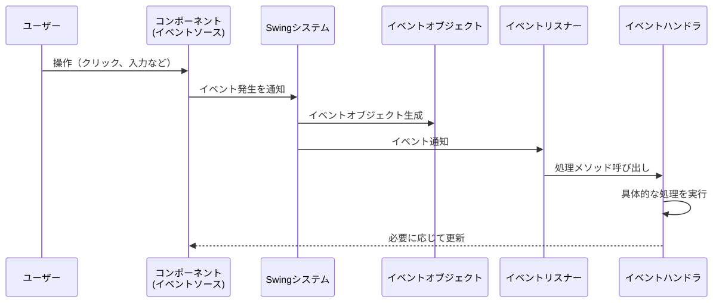

# <b>17章</b> <span>GUIプログラミングの基礎</span> <small>Swingで作るデスクトップアプリ</small>

## 本章の学習目標

### この章で学ぶこと

1. GUIプログラミングの基本概念
    - イベント駆動型プログラミングモデルの理解
    - Swingフレームワークのアーキテクチャ
    - イベントディスパッチスレッド（EDT）の役割
2. 基本的なGUIコンポーネント
    - JFrame、JButton、JTextField、JLabelの使い方
    - コンポーネントの階層構造と配置
    - ペイントシステムの理解
3. レイアウトマネージャー
    - BorderLayout、FlowLayout、GridLayoutの特徴
    - 画面サイズ変更への柔軟な対応
    - ネストされたレイアウトの設計
4. イベント処理の基礎
    - ActionListener、MouseListener、KeyListenerの実装
    - ラムダ式を使った簡潔なイベントハンドラ
    - ユーザー操作への応答性の実現

### この章を始める前に

第16章までの総合的なJavaプログラミング能力、とくにオブジェクト指向設計とイベント処理の基本概念を理解していれば準備完了です。

## 基本コンポーネントとレイアウト

### はじめてのGUIプログラム

#### Hello Swing - ウィンドウを表示してみよう

まずはもっとも基本的なGUIプログラムから始めましょう。以下は、単純なウィンドウを表示するプログラムです。


<span class="listing-number">**サンプルコード17-1**　HelloSwing.java</span>

```java
import javax.swing.JFrame;

public class HelloSwing {
    public static void main(String[] args) {
        JFrame frame = new JFrame("はじめてのSwingアプリケーション"); // ①
        
        frame.setSize(400, 300);                          // ②
        frame.setDefaultCloseOperation(JFrame.EXIT_ON_CLOSE); // ③
        frame.setLocationRelativeTo(null);                // ④
        frame.setVisible(true);                           // ⑤
    }
}
```

実行結果：
このプログラムを実行すると、タイトルバーに「はじめてのSwingアプリケーション」と表示された400×300ピクセルのウィンドウが画面中央に表示されます。

このプログラムは、①〜⑤の順にウィンドウを準備して表示します。
各行を詳しく見ていきましょう。

①では、Swingでウィンドウを表す`JFrame`クラスのオブジェクトを作り、タイトルバーに表示する文字列を指定します。
`JFrame`は、すべてのSwingのGUIアプリケーションの土台になるクラスです。
この時点では、ウィンドウはまだ画面に表示されません。

②の`setSize()`は、ウィンドウの幅と高さをピクセル単位で指定します。
ここでは横400ピクセル、縦300ピクセルです。
この大きさは、タイトルバーやウィンドウの枠を含む全体の大きさです。

③の`setDefaultCloseOperation()`は、ユーザーがウィンドウの×ボタンをクリックしたときの動作を決めます。
`EXIT_ON_CLOSE`を指定すると、ウィンドウを閉じると同時にJavaアプリケーション全体が終了します。

④の`setLocationRelativeTo(null)`は、ウィンドウの位置を決めます。
引数に`null`を渡すと、画面全体を基準にして、ウィンドウを画面の中央に置きます。

最後に⑤の`setVisible(true)`を呼ぶと、ここまでの設定を反映したウィンドウが画面に表示されます。
この呼び出しを忘れると、ウィンドウは表示されないままです。

#### ウィンドウの基本設定

`JFrame`オブジェクトのメソッドを呼び出すことで、ウィンドウのさまざまな設定が可能です。

ウィンドウの詳細設定例。

このコードは、ウィンドウの外観や動作をカスタマイズする方法を示しています。各設定はユーザーエクスペリエンスに直接影響します。

基本的なウィンドウ。

JFrameクラスは、Swingアプリケーションの基本となるトップレベルコンテナです。すべてのGUIアプリケーションは、少なくとも1つのJFrameを持ちます。
JFrameは、タイトルバー、境界線、メニューバー、およびコンテンツペインを含む完全なウィンドウフレームを提供します。

ウィンドウの設定では、サイズ、位置、動作などをカスタマイズできます。とくに重要なのは、setDefaultCloseOperation()メソッドで、ウィンドウの閉じるボタンがクリックされたときの動作を定義します。

<span class="listing-number">**サンプルコード17-2**　WindowSettings.java</span>

```java
import javax.swing.JFrame;

public class WindowSettings {
    public static void main(String[] args) {
        JFrame frame = new JFrame();
        
        frame.setTitle("カスタマイズされたウィンドウ");     // ①
        frame.setSize(500, 400);                      // ②
        frame.setResizable(false);                    // ③
        frame.setLocation(100, 50);                   // ④
        frame.setDefaultCloseOperation(JFrame.EXIT_ON_CLOSE); // ⑤
        frame.setVisible(true);                       // ⑥
    }
}
```

実行結果：
このプログラムを実行すると、「カスタマイズされたウィンドウ」というタイトルの500×400ピクセルのウィンドウが、画面左上から横100ピクセル、縦50ピクセルの位置に表示されます。ウィンドウのサイズは変更できないように設定されています。

各設定オプションの説明。
- ① タイトルバー文字 - ウィンドウ上部に表示されるアプリケーション名
- ② ウィンドウサイズ - 幅500ピクセル、高さ400ピクセルに固定
- ③ リサイズ禁止 - ユーザーがウィンドウサイズを変更できないように制限
- ④ 絶対位置指定 - スクリーン左上から横100px、縦50pxの位置に配置
- ⑤ 終了動作 - ×ボタンクリック時にアプリケーションを完全終了
- ⑥ 表示実行 - ウィンドウをスクリーンに表示

### 基本的なコンポーネントの配置

<div class="figure">



</div>

#### JLabelで文字を表示する

ボタンとラベル。

GUIアプリケーションの基本要素であるボタンとラベルは、ユーザーインターフェイスの中核をなすコンポーネントです。
JLabelはテキストやアイコンを表示するための読み取り専用コンポーネントで、JButtonはユーザーのクリック操作を受け付けるインタラクティブなコンポーネントです。

JLabelの特徴。
- テキスト、HTML、アイコンを表示可能
- テキストの配置を水平・垂直方向で細かく制御
- 他のコンポーネントのラベルとして使用可能

ウィンドウに文字を表示してみましょう。

以下のコードは、JLabelを使ってウィンドウにテキストを表示する例です。JLabelは最も基本的なGUIコンポーネントの1つで、静的なテキストやアイコンを表示するために使用されます。この例では、ラベルを中央揃えに設定し、JFrameのコンテンツペインに追加しています。

<span class="listing-number">**サンプルコード17-3**　HelloLabel.java</span>

```java
import javax.swing.JFrame;
import javax.swing.JLabel;

public class HelloLabel {
    public static void main(String[] args) {
        JFrame frame = new JFrame("ラベルの表示");
        frame.setSize(400, 300);
        frame.setDefaultCloseOperation(JFrame.EXIT_ON_CLOSE);
        
        // JLabelを作成して文字を設定
        JLabel label = new JLabel("Hello, Swing!");
        label.setHorizontalAlignment(JLabel.CENTER);  // 中央揃え
        
        // フレームにラベルを追加
        frame.add(label);
        
        frame.setLocationRelativeTo(null);
        frame.setVisible(true);
    }
}
```

実行結果：
このプログラムを実行すると、「ラベルの表示」というタイトルの400×300ピクセルのウィンドウが画面中央に表示され、そのなかに「Hello, Swing!」というテキストが中央揃えで表示されます。

#### 複数のコンポーネントを配置する

複数のコンポーネントを配置するには、レイアウトマネージャーを使います。

レイアウトマネージャーは、コンテナ内のコンポーネントの配置を自動的に管理する仕組みです。
ウィンドウサイズの変更や異なる画面解像度に対応するため、絶対位置ではなく相対的な配置ルールを使います。

レイアウトマネージャーは、各コンポーネントの推奨サイズを考慮して配置を決めます。
そのため、異なるOSでも同じようにレイアウトでき、画面の文字サイズやDPIが変わってもそれに合わせて配置できます。
また、ユーザーがウィンドウの大きさを変えると、コンポーネントを自動的に配置し直します。

BorderLayoutは、画面を5つの領域（北、南、東、西、中央）に分割してコンポーネントを配置するレイアウトマネージャです。多くのアプリケーションで使用される基本的なレイアウトパターンです。

<span class="listing-number">**サンプルコード17-4**　MultipleComponents.java</span>

```java
import javax.swing.*;
import java.awt.*;

public class MultipleComponents {
    public static void main(String[] args) {
        JFrame frame = new JFrame("複数のコンポーネント");
        frame.setSize(400, 300);
        frame.setDefaultCloseOperation(JFrame.EXIT_ON_CLOSE);
        
        frame.setLayout(new BorderLayout());  // ①
        
        frame.add(new JLabel("北", JLabel.CENTER), BorderLayout.NORTH);   // ②
        frame.add(new JLabel("南", JLabel.CENTER), BorderLayout.SOUTH);   // ②
        frame.add(new JLabel("東", JLabel.CENTER), BorderLayout.EAST);    // ②
        frame.add(new JLabel("西", JLabel.CENTER), BorderLayout.WEST);    // ②
        frame.add(new JLabel("中央", JLabel.CENTER), BorderLayout.CENTER); // ②
        
        frame.setLocationRelativeTo(null);
        frame.setVisible(true);
    }
}
```

実行結果：
このプログラムを実行すると、400×300ピクセルのウィンドウが画面中央に表示され、「北」「南」「東」「西」「中央」の各ラベルがそれぞれの領域に配置されます。中央の領域が最も大きなスペースを占め、各境界の領域はラベルのサイズに応じて調整されます。

①では、フレームのレイアウトマネージャーにBorderLayoutを設定しています。
JFrameのデフォルトのレイアウトもBorderLayoutですが、明示的に設定するとコードの意図がはっきりします。

②では、`add()`の第2引数で領域を指定して、5つのラベルを配置しています。
NORTHとSOUTHのラベルは横方向にいっぱいまで広がり、高さはラベルの推奨サイズのままです。
EASTとWESTのラベルは縦方向にいっぱいまで広がり、幅は推奨サイズのままです。
CENTERのラベルは残りのスペースをすべて占めるので、ウィンドウの大きさを変えたときにもっとも大きく伸び縮みします。

この配置方法により、典型的なアプリケーション構造（ツールバー・メインエリア・ステータスバー）を簡単に実現できます。

#### 基本コンポーネントの詳細な使用例

#### JLabelとアイコンの活用

以下のコードは、JLabelの高度な機能を示す例です。JLabelはHTMLタグをサポートしており、太字、斜体、色付き文字などのリッチテキストを表示できます。また、複数行のテキストもHTMLのbrタグを使用して簡単に実現できます。これらの機能により、単純なテキスト表示を超えた豊かな表現が可能になります。

<span class="listing-number">**サンプルコード17-5**　AdvancedLabel.java</span>

```java
import javax.swing.*;
import java.awt.*;

public class AdvancedLabel {
    public static void main(String[] args) {
        JFrame frame = new JFrame("高度なJLabel");
        frame.setSize(400, 200);
        frame.setDefaultCloseOperation(JFrame.EXIT_ON_CLOSE);
        frame.setLayout(new FlowLayout());
        
        // テキストのみのラベル
        JLabel textLabel = new JLabel("通常のテキスト");
        
        // HTMLを使用したリッチテキスト
        JLabel htmlLabel = new JLabel(
            "<html><b>太字</b>と<i>斜体</i>と<font color='red'>赤色</font></html>");
        
        // 複数行テキスト
        JLabel multiLineLabel = new JLabel("<html>複数行の<br>テキストを<br>表示</html>");
        
        frame.add(textLabel);
        frame.add(htmlLabel);
        frame.add(multiLineLabel);
        
        frame.setLocationRelativeTo(null);
        frame.setVisible(true);
    }
}
```

実行結果：
このプログラムを実行すると、3つのラベルが横に並んで表示されます。最初のラベルは通常のテキスト、2番目のラベルは太字・斜体・赤色の装飾されたテキスト、3番目のラベルは3行に分かれた複数行テキストが表示されます。

#### JButtonの高度な使用

以下のコードは、JButtonのさまざまなカスタマイズ方法を示しています。ボタンの背景色と前景色の変更、サイズの調整、無効化状態の設定など、ユーザーインターフェイスの要求に応じた外観と動作のカスタマイズが可能です。これらの技術を組み合わせることで、アプリケーションの統一感のあるデザインを実現できます。

<span class="listing-number">**サンプルコード17-6**　AdvancedButton.java</span>

```java
import javax.swing.*;
import java.awt.*;

public class AdvancedButton {
    public static void main(String[] args) {
        JFrame frame = new JFrame("高度なJButton");
        frame.setSize(400, 300);
        frame.setDefaultCloseOperation(JFrame.EXIT_ON_CLOSE);
        frame.setLayout(new FlowLayout());
        
        // 通常のボタン
        JButton normalButton = new JButton("通常のボタン");
        
        // 色付きボタン
        JButton coloredButton = new JButton("色付きボタン");
        coloredButton.setBackground(Color.BLUE);
        coloredButton.setForeground(Color.WHITE);
        
        // 大きなボタン
        JButton largeButton = new JButton("大きなボタン");
        largeButton.setPreferredSize(new Dimension(150, 50));
        
        // 無効化されたボタン
        JButton disabledButton = new JButton("無効なボタン");
        disabledButton.setEnabled(false);
        
        frame.add(normalButton);
        frame.add(coloredButton);
        frame.add(largeButton);
        frame.add(disabledButton);
        
        frame.setLocationRelativeTo(null);
        frame.setVisible(true);
    }
}
```

実行結果：
このプログラムを実行すると、4つの異なるスタイルのボタンが表示されます。通常のボタン、青い背景に白い文字の色付きボタン、150×50ピクセルの大きなボタン、グレーアウトされたクリックできない無効化ボタンが並んで表示されます。

#### テキスト入力コンポーネント

テキストフィールド。

テキスト入力はGUIアプリケーションの基本的な入力手段です。Swingはさまざまなテキスト入力コンポーネントを提供しており、用途に応じて選択できます。

1. JTextField: 一行テキスト入力（名前、メールアドレスなど）
2. JPasswordField: パスワード入力（文字がマスクされる）
3. JTextArea: 複数行テキスト入力（コメント、説明文など）
4. JFormattedTextField: 書式制限付き入力（日付、数値など）

以下のコードは、Swingが提供するさまざまなテキスト入力コンポーネントの実装例です。JTextField、JPasswordField、JTextAreaなどの基本的なテキスト入力に加え、JSpinnerやJSliderなどの数値入力専用コンポーネントも示しています。各コンポーネントは特定の用途に最適化されており、適切に選択することでユーザビリティの高いインターフェイスを構築できます。

<span class="listing-number">**サンプルコード17-7**　TextInputComponents.java（4〜5、11〜41、45〜46行目）</span>

```java
public class TextInputComponents {
    public static void main(String[] args) {
        // ...
        // 一行テキストフィールド
        frame.add(new JLabel("一行テキスト:"));
        JTextField textField = new JTextField("初期テキスト");
        frame.add(textField);
        
        // パスワードフィールド
        frame.add(new JLabel("パスワード:"));
        JPasswordField passwordField = new JPasswordField();
        frame.add(passwordField);
        
        // 複数行テキストエリア
        frame.add(new JLabel("複数行テキスト:"));
        JTextArea textArea = new JTextArea(3, 20);
        textArea.setLineWrap(true); // 自動改行
        textArea.setWrapStyleWord(true); // 単語境界で改行
        JScrollPane scrollPane = new JScrollPane(textArea);
        frame.add(scrollPane);
        
        // 数値スピナー
        frame.add(new JLabel("数値:"));
        JSpinner spinner = new JSpinner(
            new SpinnerNumberModel(0, 0, 100, 1));
        frame.add(spinner);
        
        // スライダー
        frame.add(new JLabel("スライダー:"));
        JSlider slider = new JSlider(0, 100, 50);
        slider.setMajorTickSpacing(25);
        slider.setPaintTicks(true);
        slider.setPaintLabels(true);
        frame.add(slider);
        // ...
    }
}
```

実行結果：
このプログラムを実行すると、5行2列のグリッドレイアウトでさまざまな入力コンポーネントが表示されます。一行テキストフィールドには「初期テキスト」が表示され、パスワードフィールドは入力文字がマスクされます。複数行テキストエリアにはスクロールバーが付き、数値スピナーは0から100まで調整でき、スライダーは25刻みの目盛り付きで表示されます。

#### 選択コンポーネント

チェックボックス。

チェックボックスは、複数の選択肢から任意の組み合わせを選択できるコンポーネントです。各項目は独立しており、オン/オフを自由に切り替えられます。設定画面のオプション選択や、アンケートの複数回答などに適しています。

ラジオボタン。

ラジオボタンは、複数の選択肢から1つだけを選択する場合に使用します。ButtonGroupにグループ化することで、同一グループ内では1つのラジオボタンしか選択できなくなります。

コンボボックス。

コンボボックス（ドロップダウンリスト）は、限られたスペースで多くの選択肢を提供する場合に有効です。通常は1つの項目のみ表示され、クリックするとリストが展開されます。

リスト。

JListは、複数の項目を一度に表示し、単一または複数選択を可能にするコンポーネントです。スクロール機能を追加することで、大量のデータも扱えます。

以下のコードは、チェックボックス、ラジオボタン、コンボボックス、リストなどの選択系コンポーネントの実装例です。これらのコンポーネントは、ユーザーが選択肢から項目を選ぶための重要なインターフェイス要素です。とくにButtonGroupを使ったラジオボタンのグループ化は、相互排他的な選択を実現する標準的な手法です。

<span class="listing-number">**サンプルコード17-8**　SelectionComponents.java（4〜5、11〜44、48〜49行目）</span>

```java
public class SelectionComponents {
    public static void main(String[] args) {
        // ...
        // チェックボックス
        frame.add(new JLabel("チェックボックス:"));
        JPanel checkBoxPanel = new JPanel(new FlowLayout());
        checkBoxPanel.add(new JCheckBox("オプション1"));
        checkBoxPanel.add(new JCheckBox("オプション2", true)); // 初期選択
        frame.add(checkBoxPanel);
        
        // ラジオボタン
        frame.add(new JLabel("ラジオボタン:"));
        JPanel radioPanel = new JPanel(new FlowLayout());
        ButtonGroup group = new ButtonGroup();
        JRadioButton radio1 = new JRadioButton("選択肢A");
        JRadioButton radio2 = new JRadioButton("選択肢B", true);
        group.add(radio1);
        group.add(radio2);
        radioPanel.add(radio1);
        radioPanel.add(radio2);
        frame.add(radioPanel);
        
        // コンボボックス
        frame.add(new JLabel("コンボボックス:"));
        String[] items = {"項目1", "項目2", "項目3"};
        JComboBox<String> comboBox = new JComboBox<>(items);
        frame.add(comboBox);
        
        // リスト
        frame.add(new JLabel("リスト:"));
        String[] listItems = {
            "アイテム1", "アイテム2", "アイテム3", "アイテム4", "アイテム5"
        };
        JList<String> list = new JList<>(listItems);
        list.setSelectionMode(ListSelectionModel.SINGLE_SELECTION);
        JScrollPane listScrollPane = new JScrollPane(list);
        frame.add(listScrollPane);
        // ...
    }
}
```

実行結果：
このプログラムを実行すると、4種類の選択コンポーネントが表示されます。チェックボックスでは「オプション2」が初期選択され、複数選択が可能です。ラジオボタンでは「選択肢B」が選択され、どちらか一方のみ選択できます。コンボボックスはドロップダウンリストから1つを選択でき、リストボックスは5つのアイテムから1つを選択できるように設定されています。

### レイアウトマネージャーの基礎

#### BorderLayout - 5つの領域に配置

BorderLayoutは、サンプルコード17-4で使ったレイアウトマネージャーで、JFrameのデフォルトのレイアウトでもあります。
ウィンドウを方位に基づいた5つの領域に分け、各領域は17-4の解説で述べたとおりに広がります。
5つの領域の位置関係は、次の図のとおりです。

<div class="figure">



</div>

以下のコードは、BorderLayoutを使用した基本的なレイアウトの例です。各領域にボタンを配置することで、BorderLayoutの動作を視覚的に理解できます。ウィンドウサイズを変更すると、CENTER領域が伸縮し、他の領域はコンポーネントの推奨サイズに応じた動作をします。

<span class="listing-number">**サンプルコード17-9**　BorderLayoutExample.java</span>

```java
import javax.swing.*;
import java.awt.*;

public class BorderLayoutExample {
    public static void main(String[] args) {
        JFrame frame = new JFrame("BorderLayoutの例");
        frame.setSize(400, 300);
        frame.setDefaultCloseOperation(JFrame.EXIT_ON_CLOSE);
        
        // BorderLayoutはJFrameのデフォルトレイアウトマネージャー
        frame.setLayout(new BorderLayout());
        
        // 各領域にボタンを配置
        frame.add(new JButton("北 (NORTH)"), BorderLayout.NORTH);
        frame.add(new JButton("南 (SOUTH)"), BorderLayout.SOUTH);
        frame.add(new JButton("東 (EAST)"), BorderLayout.EAST);
        frame.add(new JButton("西 (WEST)"), BorderLayout.WEST);
        frame.add(new JButton("中央 (CENTER)"), BorderLayout.CENTER);
        
        frame.setLocationRelativeTo(null);
        frame.setVisible(true);
    }
}
```

実行結果：
このプログラムを実行すると、5つのボタンがウィンドウの各領域に配置されます。北と南のボタンは水平方向に伸び、東と西のボタンは垂直方向に伸び、中央のボタンは残りのすべての領域を占めます。ウィンドウのサイズを変更すると、中央の領域が伸縮します。

#### GridLayout - 格子状に配置

GridLayoutの例。

GridLayoutは、コンポーネントを同じサイズのセルに均等に配置するレイアウトマネージャーです。電卓のボタン配置や、カレンダーの日付表示など、規則的な配置が必要な場合に最適です。

GridLayoutの特徴。
- すべてのセルが同じサイズに統一される
- コンポーネントは左から右、上から下へ順番に配置
- ウィンドウサイズに応じてセルサイズが自動調整
- セル間の間隔をピクセル単位で指定可能

<div class="figure">



</div>

`GridLayout`は、コンポーネントを格子状（行と列）に配置します。

以下のコードは、GridLayoutを使用してボタンを格子状に配置する例です。3行2列のグリッドを作成し、コンポーネント間の間隔を指定しています。GridLayoutは、電卓のボタン配置やカレンダーの日付表示など、規則的なレイアウトが必要な場面で非常に有効です。

<span class="listing-number">**サンプルコード17-10**　GridLayoutExample.java</span>

```java
import javax.swing.*;
import java.awt.*;

public class GridLayoutExample {
    public static void main(String[] args) {
        JFrame frame = new JFrame("GridLayoutの例");
        frame.setSize(300, 200);
        frame.setDefaultCloseOperation(JFrame.EXIT_ON_CLOSE);
        
        // 3行2列のグリッドレイアウト
        // 3行2列のグリッドレイアウト（行、列、水平間隔、垂直間隔）
        frame.setLayout(new GridLayout(3, 2, 5, 5));
        
        // ボタンを順番に配置
        for (int i = 1; i <= 6; i++) {
            frame.add(new JButton("ボタン " + i));
        }
        
        frame.setLocationRelativeTo(null);
        frame.setVisible(true);
    }
}
```

実行結果：
このプログラムを実行すると、6つのボタンが3行2列の格子状に配置されます。すべてのボタンは同じサイズになり、ボタン間には5ピクセルの間隔が設定されます。ウィンドウのサイズを変更すると、各セルのサイズも均等に調整されます。

#### FlowLayout - 流れるような配置

FlowLayoutの例。

FlowLayoutは、コンポーネントを流れるように配置するもっともシンプルなレイアウトマネージャーです。コンポーネントはコンテナの幅に応じて自動的に折り返されるため、ウィンドウサイズの変更に柔軟に対応します。

`FlowLayout`は、コンポーネントを左から右へ並べ、行がいっぱいになったら次の行へ送ります。
各行はデフォルトでは中央揃えですが、左揃えや右揃えも指定できます。
コンポーネントどうしの間隔は、ピクセル単位で設定できます。
コンポーネントを推奨サイズのまま並べるので、ボタンやラベルなどの小さなコンポーネントの配置に向いています。

以下のコードは、FlowLayoutを使用したボタン配置の例です。コンポーネントは追加された順番に左から右へ配置され、ウィンドウ幅に収まらない場合は自動的に次の行に折り返されます。この性質は、ウィンドウサイズの変更に柔軟に対応できるため、ツールバーなどの実装に適しています。

<span class="listing-number">**サンプルコード17-11**　FlowLayoutExample.java</span>

```java
import javax.swing.*;
import java.awt.*;

public class FlowLayoutExample {
    public static void main(String[] args) {
        JFrame frame = new JFrame("FlowLayoutの例");
        frame.setSize(400, 200);
        frame.setDefaultCloseOperation(JFrame.EXIT_ON_CLOSE);
        
        // FlowLayoutを設定（中央揃え、水平間隔10px、垂直間隔5px）
        frame.setLayout(new FlowLayout(
            FlowLayout.CENTER, 10, 5));
        
        // さまざまなサイズのボタンを追加
        frame.add(new JButton("短い"));
        frame.add(new JButton("もう少し長いボタン"));
        frame.add(new JButton("OK"));
        frame.add(new JButton("キャンセル"));
        frame.add(new JButton("ヘルプ"));
        frame.add(new JButton("設定"));
        
        frame.setLocationRelativeTo(null);
        frame.setVisible(true);
    }
}
```

実行結果：
このプログラムを実行すると、6つのボタンが中央揃えで左から右へ流れるように配置されます。ウィンドウの幅を狭めると、収まらないボタンは自動的に次の行に折り返されます。各ボタン間には水平方向に10ピクセル、垂直方向に5ピクセルの間隔が設定されています。

### パネルを使った複雑なレイアウト

#### JPanelで階層的なレイアウトを構築

JPanelは、Swingでもっとも頻繁に使われるコンテナコンポーネントの1つです。
軽量なコンテナで、ほかのコンポーネントを整理し、グループにまとめるために使います。

複雑な画面は、JPanelを使って役割ごとの区画に分けて組み立てます。
パネルに背景色や境界線を付ければ、どのコンポーネントが同じグループかが見た目でわかります。
また、`paintComponent()`メソッドをオーバーライドして独自の描画をしたり、パネル単位でイベントリスナーを設定したりもできます。

複雑なレイアウトを実現するには、`JPanel`を使って階層的にコンポーネントを組み合わせます。

以下のコードは、複数のJPanelと異なるレイアウトマネージャーを組み合わせて、テキストエディタ風のアプリケーションインターフェイスを構築する例です。ツールバー、サイドバー、メインエリア、ステータスバーといった一般的なアプリケーション構造を、BorderLayoutとFlowLayoutを巧みに組み合わせて実現しています。

<span class="listing-number">**サンプルコード17-12**　ComplexLayoutExample.java（4〜9、23〜45、55〜58行目）</span>

```java
public class ComplexLayoutExample {
    public static void main(String[] args) {
        JFrame frame = new JFrame("複雑なレイアウトの例");
        frame.setSize(500, 400);
        frame.setDefaultCloseOperation(JFrame.EXIT_ON_CLOSE);
        frame.setLayout(new BorderLayout());
        // ...
        // メインエリア（中央）
        JPanel mainPanel = new JPanel(new BorderLayout());
        
        // 左側のサイドバー
        JPanel sidebarPanel = new JPanel(new BorderLayout());
        sidebarPanel.setBorder(
            BorderFactory.createTitledBorder("ファイル一覧"));
        String[] files = {"ファイル1.txt", "ファイル2.txt", "ファイル3.txt"};
        JList<String> fileList = new JList<>(files);
        sidebarPanel.add(new JScrollPane(fileList), BorderLayout.CENTER);
        sidebarPanel.setPreferredSize(new Dimension(150, 0));
        mainPanel.add(sidebarPanel, BorderLayout.WEST);
        
        // 中央のテキストエリア
        JTextArea textArea = new JTextArea();
        textArea.setLineWrap(true);
        textArea.setWrapStyleWord(true);
        JScrollPane textScrollPane = new JScrollPane(textArea);
        textScrollPane.setBorder(
            BorderFactory.createTitledBorder("エディタ"));
        mainPanel.add(textScrollPane, BorderLayout.CENTER);
        
        frame.add(mainPanel, BorderLayout.CENTER);
        // ...
        frame.setLocationRelativeTo(null);
        frame.setVisible(true);
    }
}
```

実行結果：
このプログラムを実行すると、テキストエディタ風のアプリケーションが表示されます。上部にツールバー（新規・開く・保存・切り取り・コピー・貼り付けボタン）、左側に「ファイル一覧」パネル（3つのファイル名のリスト）、中央に「エディタ」パネル（テキスト入力エリア）、下部にステータスバー（「準備完了」と「行: 1, 列: 1」の表示）が配置されます。

#### レイアウトの組み合わせによる画面構築

レイアウトマネージャーを組み合わせることで、より柔軟な画面設計が可能です。

以下のコードは、さらに高度なレイアウトの組み合わせ例を示しています。メニューバー、ツールバー、コンテンツエリア、サイドパネルなど、実際のアプリケーションでよく使われるパターンを、複数のレイアウトマネージャーを使って構築しています。

<span class="listing-number">**サンプルコード17-13**　CombinedLayoutExample.java（4〜12、37〜42、59〜62、76〜84、93、97〜98行目）</span>

```java
public class CombinedLayoutExample {
    public static void main(String[] args) {
        JFrame frame = new JFrame("レイアウト組み合わせの例");
        frame.setSize(600, 400);
        frame.setDefaultCloseOperation(JFrame.EXIT_ON_CLOSE);
        frame.setLayout(new BorderLayout());
        
        // 上部：メニューバーとツールバー
        JPanel topPanel = new JPanel(new BorderLayout());
        // ...
        frame.add(topPanel, BorderLayout.NORTH);
        
        // 中央：分割パネル
        JSplitPane splitPane = new JSplitPane(
            JSplitPane.HORIZONTAL_SPLIT);
        splitPane.setDividerLocation(200);
        // ...
        splitPane.setLeftComponent(leftPanel);
        
        // 右側パネル（タブ付き）
        JTabbedPane tabbedPane = new JTabbedPane();
        // ...
        splitPane.setRightComponent(tabbedPane);
        
        frame.add(splitPane, BorderLayout.CENTER);
        
        // 下部：ステータスバー
        JPanel statusBar = new JPanel(new BorderLayout());
        statusBar.setBorder(
            BorderFactory.createLoweredBevelBorder());
        statusBar.add(new JLabel("準備完了"), BorderLayout.WEST);
        // ...
        frame.add(statusBar, BorderLayout.SOUTH);
        // ...
    }
}
```

実行結果：
このプログラムを実行すると、IDEのような複雑なレイアウトのアプリケーションが表示されます。上部にはメニューバー（ファイル・編集メニュー）とツールバー（新規・開く・保存ボタン）が並びます。中央は左右に分割され、左側に「プロジェクト」パネル（src/test/resourcesのリストと追加・削除ボタン）、右側にタブ付きパネル（エディタタブと黒い背景のコンソールタブ）が配置されます。下部はステータスバーで、「準備完了」と「行: 1 列: 1 エンコーディング: UTF-8」が表示されます。分割バーをドラッグすると左右のパネルの幅を調整できます。

## イベント処理入門

### イベント駆動プログラミングの概念

#### イベント駆動とは何か？

これまでのコンソールプログラムは、上から下へ順番に実行される「手続き型」でした。
しかし、GUIアプリケーションはユーザーがいつ、どのボタンを押すかわからないため、「ユーザーの操作（イベント）をきっかけに、特定の処理（リスナー）が動く」というイベント駆動（Event-Driven）というモデルを採用しています。

イベント駆動は、「何かが起きたら、これを実行する」というルールの集合でプログラムを構築する考え方です。

#### イベント駆動の3要素

Swingのイベント処理は、以下の3つの要素で構成されます。

1. イベントソース
    + イベントを発生させるコンポーネント（例： `JButton`, `JTextField`）
2. イベントオブジェクト
    + 発生したイベントの詳細情報を持つオブジェクト（例： `ActionEvent`はボタンがクリックされたことを示す）
3. イベントリスナー
    + イベントを監視し、イベントが発生したときに実行される処理を記述したオブジェクト（例： `ActionListener`）

処理の流れは、次の図の通りです。

<div class="figure">



</div>

### ボタンクリックに反応するプログラム

#### 基本的なボタンクリックイベント

もっとも基本的なイベント処理である、ボタンクリックの実装を見てみましょう。

以下のコードは、ボタンクリックイベントを処理する基本的な実装例です。ActionListenerインターフェイスを実装した匿名クラスを使用して、ボタンがクリックされたときの処理を定義しています。このパターンは、Swingプログラミングにおいてもっとも頻繁に使用されるイベント処理の基本形です。

<span class="listing-number">**サンプルコード17-14**　ButtonEventExample.java</span>

```java
import java.awt.FlowLayout;
import java.awt.event.ActionEvent;
import java.awt.event.ActionListener;
import javax.swing.JButton;
import javax.swing.JFrame;

public class ButtonEventExample {
    public static void main(String[] args) {
        JFrame frame = new JFrame("ボタンイベントの例");
        frame.setSize(300, 200);
        frame.setDefaultCloseOperation(JFrame.EXIT_ON_CLOSE);
        frame.setLayout(new FlowLayout());

        JButton button = new JButton("クリックしてね");

        // イベントリスナーを作成し、ボタンに登録
        // 匿名クラスを使用
        button.addActionListener(new ActionListener() {
            @Override
            public void actionPerformed(ActionEvent e) {
                // ボタンがクリックされたときの処理
                IO.println("ボタンがクリックされました！");
            }
        });

        frame.add(button);
        frame.setLocationRelativeTo(null);
        frame.setVisible(true);
    }
}
```

実行結果：
このプログラムを実行すると、「クリックしてね」というボタンが表示されます。ボタンをクリックするたびに、コンソールに「ボタンがクリックされました！」というメッセージが表示されます。

#### リスナーの登録

イベントソースに「このイベントが起きたら、このリスナーを呼び出してください」とお願いすることを「リスナーの登録」と呼びます。`addXXXListener`という形式のメソッド（例： `addActionListener`）を使用します。

#### テキストフィールドとの連携

ボタンが押されたタイミングで、`JTextField`に入力されているテキストを取得してみましょう。

以下のコードは、テキストフィールドとボタンを連携させたインタラクティブなアプリケーションの例です。ユーザーがテキストフィールドに名前を入力し、ボタンをクリックすると、その内容を取得してラベルに表示します。このパターンは、フォーム入力などで頻繁に使用される基本的なGUIプログラミング技術です。

<span class="listing-number">**サンプルコード17-15**　TextFieldEventExample.java</span>

```java
import java.awt.FlowLayout;
import java.awt.event.ActionEvent;
import java.awt.event.ActionListener;
import javax.swing.*;

public class TextFieldEventExample {
    public static void main(String[] args) {
        JFrame frame = new JFrame("テキストフィールドイベント");
        frame.setDefaultCloseOperation(JFrame.EXIT_ON_CLOSE);
        frame.setLayout(new FlowLayout());

        JTextField textField = new JTextField(15);
        JButton button = new JButton("表示");
        JLabel label = new JLabel("ここに結果が表示されます");

        button.addActionListener(new ActionListener() {
            @Override
            public void actionPerformed(ActionEvent e) {
                // テキストフィールドから入力された文字列を取得
                String inputText = textField.getText();
                // ラベルにその文字列を設定
                label.setText("こんにちは、" + inputText + "さん！");
            }
        });

        frame.add(new JLabel("名前を入力:"));
        frame.add(textField);
        frame.add(button);
        frame.add(label);
        
        frame.pack();
        frame.setLocationRelativeTo(null);
        frame.setVisible(true);
    }
}
```

実行結果：
このプログラムを実行すると、テキストフィールドと「表示」ボタンが表示されます。テキストフィールドに「田中」と入力して「表示」ボタンをクリックすると、「こんにちは、田中さん！」というメッセージがラベルに表示されます。

### ラムダ式による簡潔な記述

#### ラムダ式の基本

ラムダ式を使うと、匿名クラスよりも簡潔にイベントリスナーを記述できます。`ActionListener`のように、実装すべきメソッドが1つだけのインターフェイス（関数型インターフェイス）に対して使用できます。

先ほどのボタンクリックの例をラムダ式で書き換えてみましょう。

以下のコードは、同じイベント処理を匿名クラスとラムダ式で実装した比較例です。ラムダ式を使用することで、コードがより簡潔になり、可読性が向上します。とくに、処理が1行で済む場合は、中括弧も省略できるため、さらに簡潔に記述できます。

<span class="listing-number">**サンプルコード17-16**</span>

```java
// 匿名クラスのバージョン
button.addActionListener(new ActionListener() {
    @Override
    public void actionPerformed(ActionEvent e) {
        IO.println("ボタンがクリックされました！");
    }
});

// ラムダ式のバージョン
button.addActionListener(e -> {
    IO.println("ボタンがクリックされました！");
});

// 処理が1行の場合はさらに簡潔に
button.addActionListener(e -> IO.println("ボタンがクリックされました！"));
```

これらは構文の比較例です。すべて同じ動作をし、ボタンがクリックされると「ボタンがクリックされました！」とコンソールに出力されます。

#### ラムダ式を使った実用例

以下のコードは、ラムダ式を使った実用的なテキスト変換アプリケーションの例です。複数のボタンにそれぞれ異なる処理を割り当て、入力されたテキストを大文字・小文字に変換したり、クリアしたりする機能を実装しています。ラムダ式により、各ボタンのイベント処理が非常に読みやすく表現されています。

<span class="listing-number">**サンプルコード17-17**　LambdaEventExample.java（5〜6、12〜27、45〜46行目）</span>

```java
public class LambdaEventExample {
    public static void main(String[] args) {
        // ...
        JTextField inputField = new JTextField();
        JLabel resultLabel = new JLabel("結果が表示されます", JLabel.CENTER);
        JPanel buttonPanel = new JPanel();

        // 各ボタンにラムダ式でイベント処理を設定
        JButton upperButton = new JButton("大文字に変換");
        upperButton.addActionListener(e -> {
            String text = inputField.getText();
            resultLabel.setText(text.toUpperCase());
        });

        JButton lowerButton = new JButton("小文字に変換");
        lowerButton.addActionListener(e -> {
            String text = inputField.getText();
            resultLabel.setText(text.toLowerCase());
        });
        // ...
    }
}
```

実行結果：
このプログラムを実行すると、テキスト入力フィールドと3つのボタンが表示されます。「Hello World」と入力して「大文字に変換」ボタンをクリックすると「HELLO WORLD」が表示され、「小文字に変換」ボタンをクリックすると「hello world」が表示されます。「クリア」ボタンをクリックするとテキストフィールドが空になり、結果ラベルも初期状態に戻ります。

### カウンタアプリケーション

#### シンプルなカウンタの実装

実際に動作するアプリケーションとして、カウンタを作成してみましょう。

以下のコードは、増加、減少、リセット機能を持つシンプルなカウンタアプリケーションの実装例です。インスタンス変数としてカウント値を保持し、ラムダ式を使ったイベントハンドラで値を更新して表示をリフレッシュします。SwingUtilities.invokeLater()を使用して、GUIの作成をEvent Dispatch Thread上で実行している点にも注意してください。

<span class="listing-number">**サンプルコード17-18**　CounterApplication.java（6〜10、17〜37、54〜64行目）</span>

```java
public class CounterApplication {
    private int count = 0;
    private JLabel countLabel;
    
    public CounterApplication() {
        // ...
        // カウント表示ラベル
        countLabel = new JLabel(String.valueOf(count), JLabel.CENTER);
        countLabel.setFont(new Font("SansSerif", Font.BOLD, 24));
        frame.add(countLabel, BorderLayout.CENTER);
        
        // ボタンパネル
        JPanel buttonPanel = new JPanel(new FlowLayout());
        
        // 増加ボタン
        JButton incrementButton = new JButton("+1");
        incrementButton.addActionListener(e -> {
            count++;
            updateDisplay();
        });
        
        // 減少ボタン
        JButton decrementButton = new JButton("-1");
        decrementButton.addActionListener(e -> {
            count--;
            updateDisplay();
        });
        // ...
    }
    
    private void updateDisplay() {
        countLabel.setText(String.valueOf(count));
    }
    
    public static void main(String[] args) {
        // Event Dispatch Thread上でGUIを作成
        SwingUtilities.invokeLater(() -> new CounterApplication());
    }
}
```

実行結果：
このプログラムを実行すると、中央に大きく「0」と表示され、下部に「-1」「リセット」「+1」の3つのボタンが並んだウィンドウが表示されます。「+1」ボタンをクリックすると数値が増加し、「-1」ボタンで減少します。「リセット」ボタンをクリックすると0に戻ります。

#### 選択状態に応じた処理

`JCheckBox`や`JRadioButton`の選択状態を取得するイベント処理も実装してみましょう。

以下のコードは、チェックボックスとラジオボタンの選択状態に応じたイベント処理の実装例です。isSelected()メソッドを使用して選択状態を確認し、それに応じてラベルのテキストを動的に更新します。ラジオボタンはButtonGroupによってグループ化されているため、常に1つだけが選択される状態が保証されます。

<span class="listing-number">**サンプルコード17-19**　SelectionEventExample.java（5〜6、12〜22、24〜40、53〜54行目）</span>

```java
public class SelectionEventExample {
    public static void main(String[] args) {
        // ...
        // チェックボックス
        JCheckBox agreeCheckBox = new JCheckBox("利用規約に同意する");
        JLabel agreeLabel = new JLabel("同意状態: 未同意");
        
        agreeCheckBox.addActionListener(e -> {
            if (agreeCheckBox.isSelected()) {
                agreeLabel.setText("同意状態: 同意済み");
            } else {
                agreeLabel.setText("同意状態: 未同意");
            }
        });
        // ...
        // ラジオボタン
        JPanel radioPanel = new JPanel(new FlowLayout());
        ButtonGroup group = new ButtonGroup();
        JRadioButton beginnerRadio = new JRadioButton("初心者", true);
        JRadioButton intermediateRadio = new JRadioButton("中級者");
        JRadioButton advancedRadio = new JRadioButton("上級者");
        
        group.add(beginnerRadio);
        group.add(intermediateRadio);
        group.add(advancedRadio);
        
        JLabel levelLabel = new JLabel("レベル: 初心者");
        
        // 各ラジオボタンにリスナーを設定
        beginnerRadio.addActionListener(e -> levelLabel.setText("レベル: 初心者"));
        intermediateRadio.addActionListener(e -> levelLabel.setText("レベル: 中級者"));
        advancedRadio.addActionListener(e -> levelLabel.setText("レベル: 上級者"));
        // ...
    }
}
```

実行結果：
このプログラムを実行すると、チェックボックスとラジオボタンが表示されます。チェックボックスをクリックすると「同意状態: 同意済み」と「同意状態: 未同意」が切り替わります。ラジオボタンを選択すると、選択したレベル（初心者/中級者/上級者）がラベルに表示されます。初期状態では「初心者」が選択されています。

#### フォーム入力アプリケーション

複数のコンポーネントを組み合わせた、より実用的な例を作成してみましょう。

以下のコードは、完全なフォーム入力アプリケーションの実装例です。テキストフィールド、スピナー、ラジオボタン、コンボボックス、チェックボックスなど、さまざまな入力コンポーネントを統合しています。送信ボタンをクリックすると、すべての入力値を収集して結果エリアに表示し、クリアボタンですべての入力をリセットできます。

<span class="listing-number">**サンプルコード17-20**　FormApplication.java（4〜5、11〜35、57〜73、91〜92行目）</span>

```java
public class FormApplication {
    public static void main(String[] args) {
        // ...
        // 入力パネル
        JPanel inputPanel = new JPanel(new GridLayout(5, 2, 5, 5));
        inputPanel.setBorder(BorderFactory.createTitledBorder("個人情報入力"));

        // 名前入力
        inputPanel.add(new JLabel("名前:"));
        JTextField nameField = new JTextField();
        inputPanel.add(nameField);

        // 年齢入力
        inputPanel.add(new JLabel("年齢:"));
        JSpinner ageSpinner = new JSpinner(new SpinnerNumberModel(20, 0, 120, 1));
        inputPanel.add(ageSpinner);

        // 性別選択
        inputPanel.add(new JLabel("性別:"));
        JPanel genderPanel = new JPanel(new FlowLayout(FlowLayout.LEFT));
        ButtonGroup genderGroup = new ButtonGroup();
        JRadioButton maleRadio = new JRadioButton("男性", true);
        JRadioButton femaleRadio = new JRadioButton("女性");
        genderGroup.add(maleRadio);
        genderGroup.add(femaleRadio);
        genderPanel.add(maleRadio);
        genderPanel.add(femaleRadio);
        inputPanel.add(genderPanel);
        // ...
        // ボタンパネル
        JPanel buttonPanel = new JPanel(new FlowLayout());
        JButton submitButton = new JButton("送信");
        JButton clearButton = new JButton("クリア");

        submitButton.addActionListener(e -> {
            StringBuilder result = new StringBuilder();
            result.append("=== 入力内容 ===\n");
            result.append("名前: ").append(nameField.getText()).append("\n");
            result.append("年齢: ").append(ageSpinner.getValue()).append("歳\n");
            result.append("性別: ").append(maleRadio.isSelected() ? "男性" : "女性").append("\n");
            result.append("趣味: ").append(hobbyCombo.getSelectedItem()).append("\n");
            result.append("メルマガ: ").append(newsletterCheck.isSelected() ? "購読する" : "購読しない").append("\n");
            result.append("==================\n");
            
            resultArea.append(result.toString());
        });
        // ...
    }
}
```

実行結果：
このプログラムを実行すると、個人情報入力フォームが表示されます。名前を入力し、年齢をスピナーで選択、性別をラジオボタンで選択、趣味をドロップダウンから選択、メルマガ購読をチェックボックスで指定した後、「送信」ボタンをクリックすると、入力内容が下部の結果エリアに表示されます。「クリア」ボタンをクリックすると、すべての入力フィールドが初期状態に戻ります。

実行例：

```
名前: 山田太郎と入力
年齢: 25を選択
性別: 男性を選択
趣味: スポーツを選択
メルマガ: チェックあり

送信ボタンクリック後の表示：
=== 入力内容 ===
名前: 山田太郎
年齢: 25歳
性別: 男性
趣味: スポーツ
メルマガ: 購読する
==================
```

## EDT（Event Dispatch Thread）とスレッド安全性

### Event Dispatch Thread（EDT）の理解と実践

#### EDTとは何か

Event Dispatch Thread（EDT）は、Swingアプリケーションにおいてすべてのイベント処理とUI更新を担当する専用のスレッドです。
Swingのコンポーネントはスレッドセーフではないため、複数のスレッドから同時にアクセスされると、予期しない動作やクラッシュを引き起こす可能性があります。

##### EDTの重要性

SwingのGUIコンポーネントへのアクセス（表示の更新、プロパティの変更、イベント処理など）は、原則としてEDT上だけで行います。
コンポーネントを操作するスレッドがEDTの1つに限られるので、複数のスレッドが同じコンポーネントに同時にアクセスすることがなくなります。
画面の更新もEDTが1つずつ順に処理するため、描画の途中でほかのスレッドに状態を書き換えられて表示が食い違う、といった競合状態を防げます。

##### 正しいEDTの使用方法

以下のコードは、EDTの正しい使用方法を示す基本的な例です。SwingUtilities.invokeLater()メソッドを使用して、GUIの作成をEDT上で実行しています。これは、Swingアプリケーションを開発する際の基本的なパターンであり、スレッドセーフティを保証するために必須の技術です。

<span class="listing-number">**サンプルコード17-21**　EDTBasicExample.java</span>

```java
import javax.swing.*;

public class EDTBasicExample {
    public static void main(String[] args) {
        // 間違った方法：メインスレッドから直接GUI作成
        // JFrame frame = new JFrame("Bad Example");
        
        // 正しい方法：EDT上でGUI作成
        SwingUtilities.invokeLater(() -> {
            createAndShowGUI();
        });
    }
    
    private static void createAndShowGUI() {
        JFrame frame = new JFrame("正しいEDTの使用例");
        frame.setSize(300, 200);
        frame.setDefaultCloseOperation(JFrame.EXIT_ON_CLOSE);
        
        JLabel label = new JLabel("このGUIはEDT上で作成されました", JLabel.CENTER);
        frame.add(label);
        
        frame.setLocationRelativeTo(null);
        frame.setVisible(true);
    }
}
```

実行結果：
このプログラムを実行すると、「このGUIはEDT上で作成されました」というメッセージが中央に表示されたウィンドウが現れます。見た目は単純ですが、内部的にはSwingUtilities.invokeLater()を使用してGUIの作成がEvent Dispatch Thread上で安全に実行されています。

#### EDTの役割と仕組み

##### イベントキューの管理

EDTは内部的にイベントキューを管理しており、すべてのユーザー操作（マウスクリック、キー入力など）とプログラム的なイベントを順次処理します。

<div class="figure">



</div>

以下のコードは、現在のスレッドがEDTであるかを確認する方法を示しています。SwingUtilities.isEventDispatchThread()メソッドを使用して、イベントハンドラが正しくEDT上で実行されていることを検証します。このパターンは、デバッグ時やスレッドセーフティの確認に役立ちます。

<span class="listing-number">**サンプルコード17-22**　EventQueueExample.java（6〜8、14〜31、37〜39行目）</span>

```java
public class EventQueueExample {
    public static void main(String[] args) {
        SwingUtilities.invokeLater(() -> {
            // ...
            JButton button = new JButton("イベント確認");
            JLabel statusLabel = new JLabel("準備完了");
            
            button.addActionListener(new ActionListener() {
                @Override
                public void actionPerformed(ActionEvent e) {
                    // EDTの確認
                    if (SwingUtilities.isEventDispatchThread()) {
                        statusLabel.setText("正しくEDT上で実行されています");
                    } else {
                        statusLabel.setText("警告: EDT以外のスレッドで実行されています");
                    }
                    
                    // イベントキューの状況を表示
                    IO.println("現在のスレッド: " + Thread.currentThread().getName());
                    IO.println("EDT上での実行: " + SwingUtilities.isEventDispatchThread());
                }
            });
            // ...
        });
    }
}
```

実行結果：
このプログラムを実行すると、「イベント確認」ボタンと「準備完了」ラベルが表示されます。ボタンをクリックすると、ラベルが「正しくEDT上で実行されています」に変わり、コンソールには次のような出力が表示されます。

```
現在のスレッド: AWT-EventQueue-0
EDT上での実行: true
```

##### SwingWorkerによる非同期処理

長時間かかる処理をEDT上で実行すると、UIがフリーズしてしまいます。このような場合にはSwingWorkerを使用して背景スレッドで処理を実行します。

以下のコードは、SwingWorkerを使用した非同期処理の実装例です。doInBackground()メソッドで重い処理を実行し、process()メソッドで進捗を更新し、done()メソッドで完了処理を行います。このパターンにより、UIがフリーズすることなく、ユーザーに進捗状況を表示しながら長時間の処理を実行できます。

<span class="listing-number">**サンプルコード17-23**　SwingWorkerExample.java（6〜8、18〜55、63〜65行目）</span>

```java
public class SwingWorkerExample {
    public static void main(String[] args) {
        SwingUtilities.invokeLater(() -> {
            // ...
            startButton.addActionListener(new ActionListener() {
                @Override
                public void actionPerformed(ActionEvent e) {
                    startButton.setEnabled(false);
                    progressBar.setValue(0);
                    statusLabel.setText("処理中...");
                    
                    // SwingWorkerで背景処理を実行
                    SwingWorker<Void, Integer> worker = new SwingWorker<Void, Integer>() {
                        @Override
                        protected Void doInBackground() throws Exception {
                            // 重い処理のシミュレーション
                            for (int i = 0; i <= 100; i++) {
                                Thread.sleep(50); // 50msの遅延
                                publish(i); // 進捗を報告
                            }
                            return null;
                        }
                        
                        @Override
                        protected void process(java.util.List<Integer> chunks) {
                            // EDT上で進捗バーを更新
                            for (Integer progress : chunks) {
                                progressBar.setValue(progress);
                            }
                        }
                        
                        @Override
                        protected void done() {
                            // EDT上で完了処理
                            startButton.setEnabled(true);
                            statusLabel.setText("処理完了");
                        }
                    };
                    
                    worker.execute();
                }
            });
            // ...
        });
    }
}
```

実行結果：
このプログラムを実行すると、進捗バー、ステータスラベル、「長時間処理を開始」ボタンが表示されます。ボタンをクリックすると、進捗バーが0から100まで徐々に増加し、約5秒かけて処理が完了します。処理中もUIは応答性を保ち、ボタンは無効化されます。処理が完了すると、ステータスラベルが「処理完了」に変わり、ボタンが再び有効になります。

#### EDT関連のユーティリティメソッド

SwingUtilitiesクラスには、EDTを操作するための便利なメソッドが用意されています。

以下のコードは、SwingUtilitiesが提供する主要なEDT関連メソッドの使用例を示しています。invokeLater()とinvokeAndWait()の違いと、それぞれを使う場面を押さえてください。とくにinvokeAndWait()は、EDT上から呼び出すとエラーになり、ロックを持ったまま呼び出すとデッドロックを起こすことがあるため、注意して使います。

<span class="listing-number">**サンプルコード17-24**　EDTUtilityExample.java（4〜26、31〜39、44〜45行目）</span>

```java
public class EDTUtilityExample {
    public static void main(String[] args) {
        // 1. SwingUtilities.invokeLater() - EDT上で後で実行
        SwingUtilities.invokeLater(() -> {
            IO.println("invokeLater: " + Thread.currentThread().getName());
            createGUI();
        });
        
        // 2. SwingUtilities.invokeAndWait() - EDT上で実行し、完了まで待機
        try {
            SwingUtilities.invokeAndWait(() -> {
                IO.println("invokeAndWait: " + Thread.currentThread().getName());
                JOptionPane.showMessageDialog(null, "EDT上で実行され、完了まで待機しました");
            });
        } catch (Exception e) {
            e.printStackTrace();
        }
        
        // 3. SwingUtilities.isEventDispatchThread() - 現在のスレッドがEDTかチェック
        IO.println("メインスレッドはEDT？: " + SwingUtilities.isEventDispatchThread());
    }
    
    private static void createGUI() {
        // ...
        JButton checkThreadButton = new JButton("スレッドを確認");
        checkThreadButton.addActionListener(e -> {
            String threadInfo = String.format(
                "現在のスレッド: %s%nEDT上での実行: %s",
                Thread.currentThread().getName(),
                SwingUtilities.isEventDispatchThread()
            );
            JOptionPane.showMessageDialog(frame, threadInfo);
        });
        // ...
    }
}
```

実行結果：
このプログラムを実行すると、コンソールに次のような出力が表示されます。

```
メインスレッドはEDT？: false
invokeLater: AWT-EventQueue-0
invokeAndWait: AWT-EventQueue-0
```
同時に「EDT上で実行され、完了まで待機しました」というダイアログが表示され、その後「スレッドを確認」ボタンを持つウィンドウが表示されます。ボタンをクリックすると、現在のスレッド情報がダイアログで表示されます。

#### EDTに関するベストプラクティス

##### GUIの初期化

アプリケーションの起動時は、必ずEDT上でGUIを初期化します。

以下のコードは、GUIアプリケーションの正しい初期化の手順を示しています。Look&Feelの設定のようなシステム全体の設定はEDT外で行っても問題ありませんが、GUIコンポーネントの作成と表示は必ずEDT上で実行します。このパターンを守ることで、スレッドセーフティの問題を未然に防ぐことができます。

<span class="listing-number">**サンプルコード17-25**</span>

```java
public class ProperGUIInitialization {
    public static void main(String[] args) {
        // システムのLook&Feelを設定（EDT外でも可）
        try {
            UIManager.setLookAndFeel(UIManager.getSystemLookAndFeelClassName());
        } catch (Exception e) {
            e.printStackTrace();
        }
        
        // GUIの作成と表示はEDT上で
        SwingUtilities.invokeLater(() -> {
            new MyApplication().createAndShowGUI();
        });
    }
}

class MyApplication {
    public void createAndShowGUI() {
        JFrame frame = new JFrame("適切な初期化の例");
        frame.setDefaultCloseOperation(JFrame.EXIT_ON_CLOSE);
        
        // コンポーネントの作成と設定
        JPanel panel = new JPanel(new BorderLayout());
        panel.add(new JLabel("適切に初期化されたGUI", JLabel.CENTER));
        
        frame.add(panel);
        frame.pack();
        frame.setLocationRelativeTo(null);
        frame.setVisible(true);
    }
}
```

実行結果：
このプログラムを実行すると、システムのルック＆フィールが適用された「適切に初期化されたGUI」というラベルを持つウィンドウが表示されます。このプログラムは、GUI初期化の推奨パターンに従って実装されており、スレッドセーフティが保証されています。

##### 重い処理の扱い

EDT上では重い処理を避け、必要な場合はSwingWorkerを使用します。

以下のコードは、重い処理をSwingWorkerで実行する実用的な例です。doInBackground()で重い処理を実行しながら、publish()で途中経過を報告し、setProgress()で進捗バーを更新します。このアプローチにより、UIの応答性を保ちながら、ユーザーに処理の進捗を伝えることができます。

<span class="listing-number">**サンプルコード17-26**　HeavyProcessingExample.java（5〜7、21〜48、60〜72、80〜82行目）</span>

```java
public class HeavyProcessingExample {
    public static void main(String[] args) {
        SwingUtilities.invokeLater(() -> {
            // ...
            processButton.addActionListener(e -> {
                processButton.setEnabled(false);
                textArea.setText("");
                
                SwingWorker<String, String> worker = new SwingWorker<String, String>() {
                    @Override
                    protected String doInBackground() throws Exception {
                        StringBuilder result = new StringBuilder();
                        
                        // 重い処理のシミュレーション
                        for (int i = 1; i <= 10; i++) {
                            Thread.sleep(500); // 0.5秒の処理
                            
                            String message = "処理ステップ " + i + " 完了\n";
                            publish(message);
                            setProgress(i * 10);
                            result.append(message);
                        }
                        
                        return result.toString();
                    }
                    
                    @Override
                    protected void process(List<String> chunks) {
                        for (String chunk : chunks) {
                            textArea.append(chunk);
                        }
                    }
                    // ...
                };
                
                // 進捗バーとWorkerを連携
                worker.addPropertyChangeListener(evt -> {
                    if ("progress".equals(evt.getPropertyName())) {
                        int progress = (Integer) evt.getNewValue();
                        progressBar.setValue(progress);
                        progressBar.setString(progress + "%");
                    }
                });
                
                worker.execute();
            });
            // ...
        });
    }
}
```

実行結果：
このプログラムを実行すると、「データ処理開始」ボタン、テキストエリア、進捗バーが表示されます。ボタンをクリックすると、5秒かけて10個の処理ステップが実行され、各ステップ完了時にテキストエリアに「処理ステップ X 完了」が追加されます。同時に進捗バーが10%ずつ増加し、現在のパーセンテージが表示されます。処理中もUIは応答性を保ち、処理完了後にボタンが再び有効になります。

##### 定期的な処理

定期的なUI更新が必要な場合は、`javax.swing.Timer`を使用します。

以下のコードは、javax.swing.Timerを使用した定期的なUI更新の実装例です。TimerはEDT上で実行されるため、スレッドセーフティを気にせずにUIコンポーネントを更新できます。この例では、毎秒現在時刻を表示するデジタル時計を実装しています。

<span class="listing-number">**サンプルコード17-27**　TimerExample.java（6〜8、14〜35、42〜44行目）</span>

```java
public class TimerExample {
    public static void main(String[] args) {
        SwingUtilities.invokeLater(() -> {
            // ...
            JLabel timeLabel = new JLabel("", JLabel.CENTER);
            timeLabel.setFont(new Font("Monospaced", Font.BOLD, 18));
            
            JButton toggleButton = new JButton("開始");
            
            // javax.swing.Timerを使用（EDT上で実行される）
            Timer timer = new Timer(1000, e -> {
                // 定期的にEDT上で実行される処理
                LocalTime now = LocalTime.now();
                String timeText = now.format(DateTimeFormatter.ofPattern("HH:mm:ss"));
                timeLabel.setText(timeText);
            });
            
            toggleButton.addActionListener(e -> {
                if (timer.isRunning()) {
                    timer.stop();
                    toggleButton.setText("開始");
                } else {
                    timer.start();
                    toggleButton.setText("停止");
                }
            });
            // ...
        });
    }
}
```

実行結果：
このプログラムを実行すると、現在時刻を表示するラベルと「開始」ボタンが表示されます。「開始」ボタンをクリックすると、デジタル時計が動き始め、毎秒現在時刻（HH:mm:ss形式）が更新されます。ボタンのテキストは「停止」に変わり、再度クリックすると時計が止まります。

#### デッドロックと競合状態の回避

以下のコードは、マルチスレッド環境でのスレッドセーフティを確保する実装例です。volatileキーワードの使用、EDT上でのボタン状態の更新、SwingUtilities.invokeLater()によるスレッド間通信など、デッドロックや競合状態を回避するためのベストプラクティスを示しています。

<span class="listing-number">**サンプルコード17-28**　ThreadSafetyExample.java（6〜7、45〜80、87行目）</span>

```java
public class ThreadSafetyExample extends JFrame {
    private volatile boolean running = false;
    // ...
    }
    
    private void startProcessing() {
        running = true;
        startButton.setEnabled(false);
        stopButton.setEnabled(true);
        
        // バックグラウンド処理開始
        new Thread(() -> {
            int counter = 0;
            while (running) {
                try {
                    Thread.sleep(100);
                    final int currentCount = ++counter;
                    
                    // EDT上でUI更新
                    SwingUtilities.invokeLater(() -> {
                        statusLabel.setText("処理中... " + currentCount);
                    });
                } catch (InterruptedException e) {
                    break;
                }
            }
            
            // 処理終了時のUI更新
            SwingUtilities.invokeLater(() -> {
                statusLabel.setText("停止中");
                startButton.setEnabled(true);
                stopButton.setEnabled(false);
            });
        }).start();
    }
    
    private void stopProcessing() {
        running = false;
    }
    // ...
}
```

実行結果：
このプログラムを実行すると、「停止中」というステータスラベルと「開始」「停止」ボタンが表示されます。「開始」ボタンをクリックすると、別スレッドで処理が開始され、ステータスが「処理中」に変わり、カウンタが1秒ごとに増加します。「停止」ボタンをクリックすると処理が停止し、ステータスが「停止中」に戻ります。すべてのUI更新はEDT上で安全に実行されます。

## カスタムコンポーネントの作成

### 適切な基底クラスの選択

以下のコードは、カスタムコンポーネントを作成する際の基底クラスの選択例を示しています。JComponentは独自のカスタムコンポーネントを作成する際の基本クラス、JButtonやJPanelは既存の機能を拡張する際に使用します。一から描画する部品か、既存の部品の拡張かによって、基底クラスを選びます。

<span class="listing-number">**サンプルコード17-29**</span>

```java
// 単純な描画コンポーネント
public class MyComponent extends JComponent

// 既存コンポーネントを拡張
public class EnhancedButton extends JButton

// パネルとして使用
public class MyPanel extends JPanel
```

これらはカスタムコンポーネントを作成する際の基底クラス選択の例です。JComponentは独自の描画を行う場合、JButtonは既存ボタンを拡張する場合、JPanelは複数のコンポーネントをまとめる場合に使用します。

#### パフォーマンスの最適化

以下のコードは、カスタムコンポーネントのパフォーマンス最適化のテクニックを示しています。
重い描画の結果を画像に保存しておき、内容が変わったときだけ作り直すことで、スムーズなユーザーエクスペリエンスを提供できます。
とくに、複雑な形状のコンポーネントでは、contains()メソッドの最適化が重要です。

<span class="listing-number">**サンプルコード17-30**</span>

```java
private BufferedImage cache;   // 描画結果を保存しておく画像
private boolean dirty = true;  // 内容が変わったらtrueにする

@Override
protected void paintComponent(Graphics g) {
    super.paintComponent(g);
    int w = Math.max(1, getWidth());
    int h = Math.max(1, getHeight());

    // 内容かサイズが変わったときだけ、重い描画処理で画像を作り直す
    if (dirty || cache == null
            || cache.getWidth() != w || cache.getHeight() != h) {
        cache = new BufferedImage(w, h, BufferedImage.TYPE_INT_ARGB);
        Graphics2D g2 = cache.createGraphics();
        drawContent(g2);  // 重い描画処理
        g2.dispose();
        dirty = false;
    }
    // 画面には毎回、保存しておいた画像を描く
    g.drawImage(cache, 0, 0, null);
}

// 内容を変えたら、画像を作り直す印を付けて再描画を要求する
public void setData(List<Point> newData) {
    data = newData;
    dirty = true;
    repaint();
}

// 効率的な境界計算
@Override
public boolean contains(int x, int y) {
    // カスタムの境界判定
    return customBounds.contains(x, y);
}
```

これはパフォーマンス最適化のための実装パターンです。
paintComponentは、ウィンドウが隠れたあとに再び表示されたときなど、内容が変わっていなくても呼ばれます。
そのため、呼ばれるたびに何かを描く必要があり、描画を省くと画面が空白になります。
この例では、重い描画処理を画像の作り直しのときだけ行い、paintComponentでは毎回その画像を描くことで、不要な描画処理を防いでいます。
contains()メソッドでは、クリックされた座標が図形の内側かどうかを判定します。

#### アクセシビリティの考慮

以下のコードは、カスタムコンポーネントにアクセシビリティ機能を追加する方法を示しています。キーボードナビゲーションのサポート、スクリーンリーダーへの情報提供など、すべてのユーザーがアプリケーションを使用できるよう配慮することが重要です。

<span class="listing-number">**サンプルコード17-31**</span>

```java
public MyComponent() {
    // キーボードナビゲーション対応
    setFocusable(true);
    
    // アクセシビリティ情報を設定
    getAccessibleContext().setAccessibleName("カスタムコンポーネント");
    getAccessibleContext().setAccessibleDescription("説明");
}
```

これはアクセシビリティ機能を追加するコンストラクタの実装例です。フォーカス可能に設定し、スクリーンリーダー用の名前と説明を提供します。

#### イベント処理の標準化

以下のコードは、カスタムコンポーネントに標準的なイベントリスナーパターンを実装する方法を示しています。Swingのほかのコンポーネントと一貫性のあるAPIを提供することで、カスタムコンポーネントを使いやすくします。リスナーの追加、削除、イベントの発生のメソッドを標準的な命名規則に従って実装します。

<span class="listing-number">**サンプルコード17-32**</span>

```java
// 標準的なイベントリスナーパターンを実装
public void addMyComponentListener(MyComponentListener listener) {
    listeners.add(listener);
}

public void removeMyComponentListener(MyComponentListener listener) {
    listeners.remove(listener);
}

protected void fireMyComponentEvent(MyComponentEvent event) {
    for (MyComponentListener listener : listeners) {
        listener.componentChanged(event);
    }
}
```

これは標準的なイベントリスナーパターンの実装例です。リスナーの追加・削除メソッドと、全リスナーへのイベント通知メソッドを提供します。

## よくあるエラーと対処法

GUIプログラムでは、例外が発生するよりも、画面が思ったとおりに表示されないという形で問題が現れることがほとんどです。本章の内容に関連して出会いやすい問題は次のとおりです。

- コンポーネントが表示されない
    + `setVisible(true)`のあとにコンポーネントを追加した場合は、`revalidate()`と`repaint()`を呼ぶ
- BorderLayoutでコンポーネントが重なる
    + 同じ領域に複数のコンポーネントを追加すると、最後のものだけが表示される
- JPanelの背景色が反映されない
    + 背景色を表示するには、`setOpaque(true)`でパネルを不透明にする
- JTextFieldが編集できない
    + `setEditable(false)`や`setEnabled(false)`になっていないかを確かめる
- イベントディスパッチスレッド（EDT）以外からの画面の更新
    + Swingのコンポーネントは、`SwingUtilities.invokeLater()`を使ってEDTから操作する
- コンポーネントのサイズが意図どおりにならない
    + `JTextArea`の行数の指定や、レイアウトマネージャーごとのサイズの扱いを確かめる
- 画面のちらつき
    + コンポーネントをひとつずつ追加・削除するたびに画面へ反映されることが原因になる。更新をまとめてから`revalidate()`と`repaint()`を呼ぶ

問題のあるコードと修正したコード、コンポーネントの境界やEDTを確かめるデバッグのヒントは、GitHubリポジトリにまとめています。<br>
`https://github.com/Nagatani/techbook-java-primer/blob/main/appendix/h-common-errors/chapters/chapter17.md`

## まとめ

本章では、Swingを使ったGUIプログラミングの基礎を学習しました。

- 画面の組み立て
    + JFrameでウィンドウを作り、JLabel、JButton、JTextFieldなどのコンポーネントを配置する
    + BorderLayout、GridLayout、FlowLayoutの特徴を理解し、JPanelを入れ子にして複雑なレイアウトを作る
- イベント処理の入り口
    + イベントソース、イベントオブジェクト、イベントリスナーの3要素で操作に応答する
    + ActionListenerをラムダ式で簡潔に記述できる
- EDTとスレッド安全性
    + GUIの生成と更新は`SwingUtilities.invokeLater()`でEDT上で行う
    + 時間のかかる処理はSwingWorkerで別スレッドに任せ、画面が固まるのを防ぐ
- カスタムコンポーネント
    + 目的に合った基底クラスを選び、`paintComponent()`をオーバーライドして独自の描画を実装する
    + 描画の効率とアクセシビリティにも配慮する

次章では、マウスやキーボードを含むさまざまなイベントの処理を詳しく学習します。

## 章末演習

本章の演習課題は準備中です。準備ができしだい、GitHubリポジトリの次の場所で提供します。<br>
`https://github.com/Nagatani/techbook-java-primer/tree/main/exercises/chapter17/`

それまでは、本文のサンプルコードを動かし、値や部品を変えて動きの違いを確かめてください。コンパイルできる全文はGitHubリポジトリの`sample-code/chapter17/`にあります。

本章の内容を理解できたら、第18章「基本的なイベント処理」に進みましょう。
