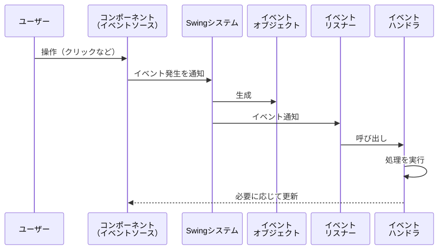

# <b>18章</b> <span>基本的なイベント処理</span> <small>ユーザー操作への応答の基礎</small>

## 本章の学習目標

### この章で学ぶこと

本章では、GUIアプリケーションの基本となるイベント処理について学習します。
具体的には以下の内容を扱います。

1. イベント駆動プログラミングの基本概念
    - イベント処理の3要素（ソース、オブジェクト、リスナー）
    - イベントディスパッチスレッド（EDT）の役割
2. 基本的なイベントリスナーの実装
    - ActionListenerによるボタンクリック処理
    - ラムダ式を使った簡潔な記述方法
3. 主要なイベントの種類と使い分け
    - ActionEvent、MouseEvent、KeyEvent、WindowEvent
    - ItemEvent、FocusEvent、ChangeEventの基本
    - 各イベントリスナーの基本的な使用方法
4. EDTを意識したイベント処理
    - リスナーが動くスレッドの確認と長時間処理の回避
    - `javax.swing.Timer`による定期的な画面の更新

### この章を始める前に

第17章のGUIプログラミングの基礎、とくにJFrame、JButton、JTextFieldなどの基本的なコンポーネントの使い方を理解していることが前提です。
また、第11章で学んだラムダ式と関数型インターフェイスを使って、イベント処理を短く書きます。

## イベント駆動プログラミングの理解

### 従来のプログラミングとの違い

前章で作成した画面は、まだ見た目だけの「静的」なものでした。GUIアプリケーションを「動かす」ためには、ユーザーの操作（イベント）に応じた処理（イベントハンドリング）を実装します。

従来の手続き型プログラミングでは、プログラムが処理の流れを制御します。一方、イベント駆動プログラミングでは、ユーザーの操作やシステムの状態変化がプログラムの流れを制御します<span class="footnote">C言語でWindowsのGUIプログラムを書くと、OSからメッセージ（イベント）を受け取って処理へ振り分けるループ（メッセージループ）を自分で書きます。Swingでは、このループの役目をEDTが受け持つので、プログラマーはリスナーを書くだけで済みます。</span>。

### イベント処理の3要素

Swingのイベント処理は、イベントソース、イベントオブジェクト、イベントリスナーの3つの要素で構成されます。

イベントソース（Event Source）は、イベントを発生させる部品です。
JButtonやJTextFieldのように、ユーザーが操作するGUIコンポーネントがこれにあたります。
イベントオブジェクト（Event Object）は、発生したイベントの詳細情報を持つオブジェクトで、ActionEvent、MouseEvent、KeyEventなどがあります。
イベントリスナー（Event Listener）は、イベントの発生を監視し、通知を受け取って処理を実行します。
ActionListener、MouseListener、KeyListenerなどがあります。

3つの要素は次の順に働きます。
ユーザーがイベントソースを操作すると、イベントオブジェクトが作られ、登録済みのイベントリスナーに渡されます。
通知を受けたリスナーは、自分のなかに書かれた処理を実行します。

<div class="figure">



</div>

### イベントディスパッチスレッド（EDT）

Swingのイベント処理は、イベントディスパッチスレッド（EDT: Event Dispatch Thread）と呼ばれる専用のスレッドで実行されます。
第17章では、GUIの組み立てを`SwingUtilities.invokeLater()`でEDTに任せる定型を使いました。
ここでは、そのEDTがどのように働くのかを見ていきます。

発生したイベントはイベントキューに入り、EDTというただ1つのスレッドが、キューに入った順（FIFO順）<span class="footnote">FIFOはFirst In, First Outの略で、先に入れたものから先に取り出すという意味です。</span>に1つずつ処理します。
ユーザーの操作だけでなく、画面の再描画の要求や`invokeLater()`で頼んだ処理も、同じキューに並びます。

<div class="figure">



</div>

Swingのコンポーネントはスレッドセーフではありません。
複数のスレッドから同時に操作すると、表示が食い違ったり、予期しない例外が起きたりします。
そこでSwingは、コンポーネントへのアクセス（表示の更新、プロパティの変更、イベント処理）をEDTだけで行う決まりにしています。
操作するスレッドが1つに限られるので、描画の途中でほかのスレッドに状態を書き換えられるといった競合状態が起こりません。
GUIコンポーネントを安全に更新できるのは、EDT上で操作したときだけです。

また、イベントを処理するスレッドが1つしかないため、イベント処理のなかで長時間の処理を実行すると、その間はほかのイベントを処理できません。
その結果、ボタンを押しても反応しないなど、UIがフリーズした状態になります。
この問題の避け方は、本章の「イベント処理のベストプラクティス」で学びます。

## ボタンクリックの実装

### ActionListenerの基本

もっとも基本的な、ボタンクリックイベントを処理してみましょう。ActionListenerは、ボタンのクリック、メニュー項目の選択、Enterキーの押下など、「アクション」として定義されるイベントを処理するためのリスナーです。

以下のコードは、ボタンクリックイベントを処理する基本的な実装例です。ActionListenerインターフェイスを実装した匿名クラスを作成し、actionPerformed()メソッドでクリック時の処理を定義します。addActionListener()メソッドでリスナーをボタンに登録することで、クリックイベントとの関連付けが完了します。
mainメソッドでは、第17章で学んだとおり`SwingUtilities.invokeLater()`を使い、GUIの組み立てをEDT上で行っています。

<span class="listing-number">**サンプルコード18-1**　ButtonEventExample.java</span>

```java
import java.awt.FlowLayout;
import java.awt.event.ActionEvent;
import java.awt.event.ActionListener;
import javax.swing.JButton;
import javax.swing.JFrame;
import javax.swing.JOptionPane;
import javax.swing.SwingUtilities;

public class ButtonEventExample {
    public static void main(String[] args) {
        // GUIの組み立てはEDT（イベントディスパッチスレッド）上で行う
        SwingUtilities.invokeLater(() -> createAndShowGUI());
    }

    private static void createAndShowGUI() {
        JFrame frame = new JFrame("ボタンイベントの例");
        frame.setDefaultCloseOperation(JFrame.EXIT_ON_CLOSE);
        frame.setLayout(new FlowLayout());

        JButton button = new JButton("クリックしてね");

        // 1. イベントリスナーを作成（匿名クラスを使用）
        ActionListener listener = new ActionListener() {
            // 2. ボタンがクリックされた時の処理を記述
            @Override
            public void actionPerformed(ActionEvent e) {
                // 3. 簡単なダイアログを表示
                JOptionPane.showMessageDialog(frame, "ボタンがクリックされました！");
            }
        };

        // 4. ボタン（イベントソース）にリスナーを登録
        button.addActionListener(listener);

        frame.add(button);
        frame.pack();
        frame.setLocationRelativeTo(null);
        frame.setVisible(true);
    }
}
```

実行すると、次のように表示されます。

```
ウィンドウが表示されます（大きさはpack()でボタンに合わせて決まります）
- 「クリックしてね」というラベルのボタンが中央に配置されています
- ボタンをクリックすると、「ボタンがクリックされました！」というメッセージダイアログが表示されます
- OKボタンでダイアログを閉じることができます
```

### リスナーの登録

イベントソースに「このイベントが起きたら、このリスナーを呼び出してください」と頼むことを、リスナーの登録と呼びます。
登録には、`addActionListener()`のような`addXXXListener()`という形の名前のメソッドを使います<span class="footnote">登録を外すときは、`removeActionListener()`のような`removeXXXListener()`という形のメソッドを使います。この名前の付け方は、JavaBeansという部品の仕様が定めた決まりにならっています。</span>。
登録していないリスナーは、イベントが起きても呼び出されません。
1つのイベントソースに複数のリスナーを登録することもでき、イベントが起きると登録したすべてのリスナーに通知が届きます。

### 匿名クラスの使用

上記の例では、ActionListenerインターフェイスを、第8章で学んだ匿名クラスで実装しています。匿名クラスは、クラス名を持たないクラスで、その場でインターフェイスを実装してインスタンスを作成できます。イベントリスナーのように、一度しか使わないクラスを定義する場合に便利です<span class="footnote">匿名クラスを含む内部クラスは、リスナーを使ういまのイベント処理の仕組みと同じJDK 1.1で、Javaに加わりました。リスナーを手軽に書けるようにすることが、内部クラスを加えた理由の1つでした。</span>。

## ラムダ式による簡潔な記述

### ラムダ式の導入

ActionListenerのように、実装すべきメソッドが1つだけのインターフェイス（関数型インターフェイス）は、ラムダ式を使って非常に簡潔に記述できます。
ラムダ式と関数型インターフェイスは、第11章「ラムダ式と関数型インターフェイス」で学びました。

以下のコードは、先ほどの匿名クラスをラムダ式で書き換えた例です。ラムダ式を使用することで、コードがより簡潔になり、イベント処理の本質に集中できます。ActionEventのパラメーターeはラムダ式内で参照できますが、この例では使用していません<span class="footnote">Java 22からは、使わない引数を`_`（アンダースコア）と書いて、使わないことを示せます（`_ -> ...`）。</span>。
2つ目のボタン`shortButton`には、処理が1行のときの短い書き方でリスナーを登録しています。

<span class="listing-number">**サンプルコード18-2**　LambdaButtonExample.java（7、12、17〜26、33〜34行目）</span>

```java
public class LambdaButtonExample {
    // ...
    private static void createAndShowGUI() {
        // ...
        JButton button = new JButton("クリックしてね");
        JButton shortButton = new JButton("こちらも押してね");

        // サンプルコード18-1の匿名クラスの部分をラムダ式で書き換える
        button.addActionListener(e -> {
            JOptionPane.showMessageDialog(frame, "ボタンがクリックされました！");
        });

        // 処理が1行なら波括弧も省略可能
        shortButton.addActionListener(e -> JOptionPane.showMessageDialog(frame, "ボタンがクリックされました！"));
        // ...
    }
}
```

イベント処理のように、あとで呼び出してもらう処理（コールバック）を渡す場面では、ラムダ式で書くのが標準的です。

### 簡単なアプリケーション：挨拶プログラム

テキストフィールドに入力された名前を使って、挨拶メッセージを表示するプログラムを作成しましょう。

以下のコードは、テキストフィールドとボタン、ラベルを組み合わせたインタラクティブな挨拶アプリケーションの例です。ラムダ式を使用して、ボタンクリック時にテキストフィールドから入力を取得し、ラベルに動的にメッセージを表示します。

<span class="listing-number">**サンプルコード18-3**　GreetingApp.java</span>

```java
import java.awt.FlowLayout;
import javax.swing.JButton;
import javax.swing.JFrame;
import javax.swing.JLabel;
import javax.swing.JTextField;
import javax.swing.SwingUtilities;

public class GreetingApp {
    public static void main(String[] args) {
        // GUIの組み立てはEDT（イベントディスパッチスレッド）上で行う
        SwingUtilities.invokeLater(() -> createAndShowGUI());
    }

    private static void createAndShowGUI() {
        JFrame frame = new JFrame("挨拶プログラム");
        frame.setDefaultCloseOperation(JFrame.EXIT_ON_CLOSE);
        frame.setLayout(new FlowLayout());

        JTextField nameField = new JTextField(15);
        JButton greetButton = new JButton("挨拶する");
        JLabel messageLabel = new JLabel("名前を入力してください");

        // ボタンにラムダ式でイベントリスナーを登録
        greetButton.addActionListener(e -> {
            // テキストフィールドから入力された文字列を取得
            String name = nameField.getText();
            // ラベルに挨拶メッセージを設定
            messageLabel.setText("こんにちは、" + name + "さん！");
        });

        frame.add(new JLabel("名前:"));
        frame.add(nameField);
        frame.add(greetButton);
        frame.add(messageLabel);
        
        frame.pack();
        frame.setLocationRelativeTo(null);
        frame.setVisible(true);
    }
}
```

実行すると、次のように表示されます。

```
ウィンドウが表示されます（タイトル: 挨拶プログラム）
- テキストフィールド（15文字幅）と「挨拶する」ボタンが配置されています
- 初期状態では「名前を入力してください」というメッセージが表示されています
- テキストフィールドに「太郎」と入力して「挨拶する」ボタンをクリックすると
  「こんにちは、太郎さん！」というメッセージに変わります
```

### 状態を持つアプリケーション：カウンター

ボタンを押した回数のように、イベントをまたいで値を覚えておきたいときは、その値をフィールドに持たせます。
増加、減少、リセットの3つのボタンを持つカウンターを作ってみましょう。

以下のコードでは、カウント値をフィールド`count`に持ち、3つのボタンのリスナーがそれぞれ値を変えてから`updateDisplay()`で表示を更新します。
GUIの組み立てはコンストラクターにまとめ、`main`メソッドでは`invokeLater()`でそのコンストラクターをEDT上で呼び出しています。

<span class="listing-number">**サンプルコード18-4**　CounterApplication.java（6〜10、17〜37、54〜64行目）</span>

```java
public class CounterApplication {
    private int count = 0;
    private JLabel countLabel;
    
    public CounterApplication() {
        // ...
        // カウント表示ラベル
        countLabel = new JLabel(String.valueOf(count), JLabel.CENTER);
        countLabel.setFont(new Font("SansSerif", Font.BOLD, 24));
        frame.add(countLabel, BorderLayout.CENTER);
        
        // ボタンパネル
        JPanel buttonPanel = new JPanel(new FlowLayout());
        
        // 増加ボタン
        JButton incrementButton = new JButton("+1");
        incrementButton.addActionListener(e -> {
            count++;
            updateDisplay();
        });
        
        // 減少ボタン
        JButton decrementButton = new JButton("-1");
        decrementButton.addActionListener(e -> {
            count--;
            updateDisplay();
        });
        // ...
    }
    
    private void updateDisplay() {
        countLabel.setText(String.valueOf(count));
    }
    
    public static void main(String[] args) {
        // Event Dispatch Thread上でGUIを作成
        SwingUtilities.invokeLater(() -> new CounterApplication());
    }
}
```

実行結果：
このプログラムを実行すると、中央に大きく「0」と表示され、下部に「-1」「リセット」「+1」の3つのボタンが並んだウィンドウが表示されます。「+1」ボタンをクリックすると数値が増加し、「-1」ボタンで減少します。「リセット」ボタンをクリックすると0に戻ります。

## 代表的なイベントの種類

### イベントとリスナーの対応

Swingにはさまざまなイベントがあります。目的に応じて必要なリスナーを使い分けましょう。

| イベント | 説明 | 主なリスナー |
| --- | --- | --- |
| ActionEvent | ボタンクリックなど、明確なアクション | ActionListener |
| MouseEvent | マウスのクリック、カーソルの出入り | MouseListener |
| KeyEvent | キーボードのキー操作 | KeyListener |
| WindowEvent | ウィンドウが開く、閉じるなどの状態変化 | WindowListener |
| ItemEvent | チェックボックスなどの項目選択状態の変化 | ItemListener |
| FocusEvent | コンポーネントがフォーカスを得る/失う | FocusListener |
| ChangeEvent | スライダーなど、コンポーネントの内部状態の連続的な変化 | ChangeListener |

### WindowListenerで終了確認

ウィンドウを閉じる際に確認ダイアログを表示する例です。WindowListenerインターフェイスには多くのメソッドがありますが、WindowAdapterクラスを継承することで、必要なメソッドだけをオーバーライドして実装できます。

以下のコードは、WindowAdapterを使用してウィンドウ閉じる際の終了確認を実装する例です。setDefaultCloseOperation(JFrame.DO_NOTHING_ON_CLOSE)でデフォルトの閉じる動作を無効化し、windowClosing()メソッドでカスタム処理を実行します。

<span class="listing-number">**サンプルコード18-5**　WindowEventExample.java</span>

```java
import javax.swing.*;
import java.awt.event.WindowAdapter;
import java.awt.event.WindowEvent;

public class WindowEventExample {
    public static void main(String[] args) {
        // GUIの組み立てはEDT（イベントディスパッチスレッド）上で行う
        SwingUtilities.invokeLater(() -> createAndShowGUI());
    }

    private static void createAndShowGUI() {
        JFrame frame = new JFrame("終了確認");
        // デフォルトの閉じる操作を無効化
        frame.setDefaultCloseOperation(JFrame.DO_NOTHING_ON_CLOSE);

        // WindowAdapterを匿名クラスで実装して登録
        frame.addWindowListener(new WindowAdapter() {
            @Override
            public void windowClosing(WindowEvent e) {
                int option = JOptionPane.showConfirmDialog(frame, "本当に終了しますか？");
                if (option == JOptionPane.YES_OPTION) {
                    System.exit(0); // 「はい」ならプログラムを終了
                }
            }
        });

        frame.setSize(300, 200);
        frame.setLocationRelativeTo(null);
        frame.setVisible(true);
    }
}
```

実行すると、次のように表示されます。

```
ウィンドウが表示されます（タイトル: 終了確認、サイズ: 300x200）
- ウィンドウの「×」ボタンをクリックすると、確認ダイアログが表示されます
- ダイアログ: 「本当に終了しますか？」
  - 「はい」を選択 → アプリケーションが終了します
  - 「いいえ」を選択 → ダイアログが閉じ、ウィンドウは開いたままです
  - 「キャンセル」を選択 → 同様にウィンドウは開いたままです
```

### 基本的なマウスイベント

マウスのクリックと、マウスカーソルの出入りを検出する基本的な例です。

以下のコードは、`MouseAdapter`を`addMouseListener()`で登録して、マウスのイベントを処理する例です。
`MouseAdapter`は`MouseListener`の空の実装を持つクラスで、必要なメソッドだけをオーバーライドできます。
マウスのクリックとパネルへの出入りを検出し、ステータスラベルに現在の状態を表示します。
マウスの移動やドラッグ（`MouseMotionListener`）、ダブルクリックの判定、右クリックメニューは、第19章「高度なイベント処理パターン」のサンプルコード19-1で学びます。

<span class="listing-number">**サンプルコード18-6**　BasicMouseEventExample.java（5、9、24〜46、53、60行目）</span>

```java
public class BasicMouseEventExample extends JFrame {
    // ...
    public BasicMouseEventExample() {
        // ...
        // マウスリスナーの追加
        clickPanel.addMouseListener(new MouseAdapter() {
            @Override
            public void mouseClicked(MouseEvent e) {
                String button = switch (e.getButton()) {
                    case MouseEvent.BUTTON1 -> "左";
                    case MouseEvent.BUTTON2 -> "中央";
                    case MouseEvent.BUTTON3 -> "右";
                    default -> "不明な";
                };
                statusLabel.setText(button + "ボタンがクリックされました: " + e.getPoint());
            }
            
            @Override
            public void mouseEntered(MouseEvent e) {
                clickPanel.setBackground(Color.YELLOW);
            }
            
            @Override
            public void mouseExited(MouseEvent e) {
                clickPanel.setBackground(Color.LIGHT_GRAY);
            }
        });
        // ...
    }
    // ...
}
```

実行すると、次のように表示されます。

```
ウィンドウが表示されます（タイトル: マウスイベントの例）
- 灰色のパネル（200x200）が中央に配置されています
- マウスの動作に応じて以下のような反応があります：
  - パネルにマウスを乗せる → 背景が黄色に変わります
  - パネルからマウスを離す → 背景が灰色に戻ります
  - パネル内でクリック → ステータスバーに「左ボタンがクリックされました: java.awt.Point[x=XX,y=YY]」と表示
  - 右クリック → 「右ボタンがクリックされました」と表示
  - 中クリック → 「中央ボタンがクリックされました」と表示
```

### 基本的なキーボードイベント

キーボード入力を検出する基本的な例です。

以下のコードは、KeyListenerを使用してキーボードイベントを処理する例です。キーの押下を検出し、押されたキーの情報を表示します。また、Ctrl+Sのようなショートカットキーの検出方法も示しています<span class="footnote">macOSでは、保存などのショートカットにCtrlではなくCommandキーを使うのが一般的です。Javaでは、Commandキーが押されているかを`isMetaDown()`で調べます。</span>。consume()メソッドを使用することで、デフォルトのキー動作をキャンセルできます。
複数のキーの同時押しや、`InputMap`と`ActionMap`によるキーバインディングは、第19章のサンプルコード19-2で学びます。

<span class="listing-number">**サンプルコード18-7**　BasicKeyEventExample.java（5、9、23〜37、44、51行目）</span>

```java
public class BasicKeyEventExample extends JFrame {
    // ...
    public BasicKeyEventExample() {
        // ...
        // キーリスナーの追加
        inputArea.addKeyListener(new KeyAdapter() {
            @Override
            public void keyPressed(KeyEvent e) {
                String keyText = KeyEvent.getKeyText(e.getKeyCode());
                statusLabel.setText("押されたキー: " + keyText);
                
                // Ctrl+Sのショートカット検出
                if (e.isControlDown() && e.getKeyCode() == KeyEvent.VK_S) {
                    JOptionPane.showMessageDialog(BasicKeyEventExample.this, 
                        "保存ショートカットが押されました");
                    e.consume(); // デフォルトの動作をキャンセル
                }
            }
        });
        // ...
    }
    // ...
}
```

### ItemListenerによる選択状態の監視

チェックボックスやラジオボタンの選択状態の変化を監視する例です。

以下のコードは、ItemListenerを使用してチェックボックスとラジオボタンの選択状態を監視する例です。ItemEventを通じて、選択がされたか解除されたかを判定し、現在の選択状態をリアルタイムで更新・表示します。

<span class="listing-number">**サンプルコード18-8**　ItemListenerExample.java（5、10、22〜34、52〜61、82、97行目）</span>

```java
public class ItemListenerExample extends JFrame {
    // ...
    public ItemListenerExample() {
        // ...
        ItemListener checkListener = new ItemListener() {
            @Override
            public void itemStateChanged(ItemEvent e) {
                JCheckBox source = (JCheckBox) e.getSource();
                String status = e.getStateChange() == ItemEvent.SELECTED ? "選択" : "解除";
                statusLabel.setText(source.getText() + " が" + status + "されました");
                updateSelection();
            }
        };
        
        checkBox1.addItemListener(checkListener);
        checkBox2.addItemListener(checkListener);
        checkBox3.addItemListener(checkListener);
        // ...
        ItemListener radioListener = e -> {
            if (e.getStateChange() == ItemEvent.SELECTED) {
                JRadioButton source = (JRadioButton) e.getSource();
                statusLabel.setText("サイズ: " + source.getText() + " が選択されました");
            }
        };
        
        radio1.addItemListener(radioListener);
        radio2.addItemListener(radioListener);
        radio3.addItemListener(radioListener);
        // ...
    }
    // ...
}
```

### FocusListenerによるフォーカス管理

コンポーネントがフォーカスを得る・失うタイミングを検出する例です。

以下のコードは、FocusListenerを使用してテキストフィールドのフォーカス状態を管理する例です。フォーカスを取得したフィールドの背景色を変更し、フォーカスを失った際には入力内容の検証を行います。この仕組みを使用することで、ユーザーフレンドリーなフォーム入力インターフェイスを実装できます。

<span class="listing-number">**サンプルコード18-9**　FocusListenerExample.java（5、9、21〜45、71、85行目）</span>

```java
public class FocusListenerExample extends JFrame {
    // ...
    public FocusListenerExample() {
        // ...
        // FocusListenerの作成
        FocusListener focusListener = new FocusListener() {
            @Override
            public void focusGained(FocusEvent e) {
                JTextField source = (JTextField) e.getSource();
                source.setBackground(Color.YELLOW);
                statusLabel.setText("フォーカスを取得: " + getFieldName(source));
            }
            
            @Override
            public void focusLost(FocusEvent e) {
                JTextField source = (JTextField) e.getSource();
                source.setBackground(Color.WHITE);
                
                // バリデーションの例
                if (source == field1 && source.getText().isEmpty()) {
                    statusLabel.setText("名前を入力してください");
                    source.setBackground(Color.PINK);
                }
            }
        };
        
        field1.addFocusListener(focusListener);
        field2.addFocusListener(focusListener);
        field3.addFocusListener(focusListener);
        // ...
    }
    // ...
}
```

### ChangeListenerによる値の変更監視

スライダーやスピナーなどの値の変化を監視する例です。

以下のコードは、ChangeListenerを使用してスライダーとスピナーの値の変化を監視し、連動させる例です。getValueIsAdjusting()メソッドを使用することで、スライダーのドラッグ中とドラッグ終了時を区別し、パフォーマンスを最適化できます。

<span class="listing-number">**サンプルコード18-10**　ChangeListenerExample.java（5、11、28〜40、50〜55、84、91行目）</span>

```java
public class ChangeListenerExample extends JFrame {
    // ...
    public ChangeListenerExample() {
        // ...
        slider.addChangeListener(new ChangeListener() {
            @Override
            public void stateChanged(ChangeEvent e) {
                int value = slider.getValue();
                valueLabel.setText("現在の値: " + value);
                progressBar.setValue(value);
                
                // ドラッグ終了時のみ処理
                if (!slider.getValueIsAdjusting()) {
                    IO.println("最終値: " + value);
                }
            }
        });
        // ...
        spinner.addChangeListener(e -> {
            int value = (Integer) spinner.getValue();
            slider.setValue(value);
            progressBar.setValue(value);
            valueLabel.setText("現在の値: " + value);
        });
        // ...
    }
    // ...
}
```

## イベント処理のベストプラクティス

### EDT上での実行

SwingのすべてのGUI操作はイベントディスパッチスレッド上で実行します。
`main`メソッドは、EDTではなくmainスレッドで動きます。
そのため、本書のサンプルは第17章で学んだとおり、GUIの組み立てを`SwingUtilities.invokeLater()`でEDTに任せています。
一方、リスナーの処理はSwingがEDT上で呼び出すので、リスナーのなかではそのままコンポーネントを操作できます。

以下のコードは、リスナーがどのスレッドで動いているかを確かめる例です。
`SwingUtilities.isEventDispatchThread()`は、呼び出したスレッドがEDTならtrueを返します。
コンポーネントを操作するコードがEDT上で動いているかを確かめたいときに使えます。

<span class="listing-number">**サンプルコード18-11**　EventQueueExample.java（6〜8、14〜31、37〜39行目）</span>

```java
public class EventQueueExample {
    public static void main(String[] args) {
        SwingUtilities.invokeLater(() -> {
            // ...
            JButton button = new JButton("イベント確認");
            JLabel statusLabel = new JLabel("準備完了");
            
            button.addActionListener(new ActionListener() {
                @Override
                public void actionPerformed(ActionEvent e) {
                    // EDTの確認
                    if (SwingUtilities.isEventDispatchThread()) {
                        statusLabel.setText("正しくEDT上で実行されています");
                    } else {
                        statusLabel.setText("警告: EDT以外のスレッドで実行されています");
                    }
                    
                    // イベントキューの状況を表示
                    IO.println("現在のスレッド: " + Thread.currentThread().getName());
                    IO.println("EDT上での実行: " + SwingUtilities.isEventDispatchThread());
                }
            });
            // ...
        });
    }
}
```

実行結果：
このプログラムを実行すると、「イベント確認」ボタンと「準備完了」ラベルが表示されます。ボタンをクリックすると、ラベルが「正しくEDT上で実行されています」に変わり、コンソールには次のような出力が表示されます<span class="footnote">SwingはAWTのイベントキューを土台にしています。EDTもAWTが用意するスレッドなので「AWT-EventQueue-0」という名前になっています。</span>。

```
現在のスレッド: AWT-EventQueue-0
EDT上での実行: true
```

EDTに処理を頼むメソッドには、`invokeLater()`のほかに`SwingUtilities.invokeAndWait()`があります。
`invokeLater()`は処理をイベントキューに入れるとすぐに戻り、呼び出したスレッドはそのまま先へ進みます。
`invokeAndWait()`は、EDTがその処理を終えるまで呼び出したスレッドを待たせます。
`invokeAndWait()`をEDT上から呼び出すと`Error`が発生し、ロックを持ったまま呼び出すとデッドロックを起こすことがあります。
ふだんは`invokeLater()`を使い、EDTでの処理の結果を待ってから先へ進む必要があるときだけ`invokeAndWait()`を使います。

### 長時間処理の回避

イベントハンドラー内で長時間かかる処理を実行すると、UIがフリーズします。

以下のコードは、イベントハンドラー内で長時間の処理を実行した場合の問題と、その解決法を示しています。
よい例では、長時間の処理を第15章で学んだ`Thread`で別のスレッドに任せ、処理が終わったらラベルの更新を`SwingUtilities.invokeLater`でEDTに任せています。
こうすると、処理の間もEDTはほかのイベントを処理できるので、UIは固まりません。
「悪い例」のボタンを押すと、3秒間はウィンドウを動かすこともほかのボタンを押すこともできません。
「よい例」のボタンを押すと、ラベルが「処理中...」に変わり、3秒後に「完了」になるまでの間も画面は反応します。
進捗の表示やキャンセルにも対応できる`SwingWorker`は、第19章で学びます。

<span class="listing-number">**サンプルコード18-12**　FreezeExample.java（7、12、17〜44、52〜53行目）</span>

```java
public class FreezeExample {
    // ...
    private static void createAndShowGUI() {
        // ...
        JButton badButton = new JButton("悪い例");
        JButton goodButton = new JButton("よい例");
        JLabel label = new JLabel("待機中");

        // 悪い例：UIがフリーズする
        badButton.addActionListener(e -> {
            // 長時間かかる処理（3秒待機）
            try {
                Thread.sleep(3000);
            } catch (InterruptedException ex) {
                ex.printStackTrace();
            }
            label.setText("完了");
        });

        // よい例：別スレッドで実行
        goodButton.addActionListener(e -> {
            label.setText("処理中...");
            new Thread(() -> {
                try {
                    Thread.sleep(3000);
                    // UI更新はEDT上で行う
                    SwingUtilities.invokeLater(() -> label.setText("完了"));
                } catch (InterruptedException ex) {
                    ex.printStackTrace();
                }
            }).start();
        });
        // ...
    }
}
```

### 定期的な処理：javax.swing.Timer

時計の表示のように、一定の間隔で画面を更新したいときは、`javax.swing.Timer`を使います。
`Timer`は、指定した間隔（ミリ秒）ごとに`ActionListener`を呼び出します。
呼び出しはEDT上で行われるので、リスナーのなかでそのままコンポーネントを更新できます<span class="footnote">`java.util.Timer`という同じ名前のクラスもあります。こちらはEDTとは別のスレッドで動くため、Swingの画面の更新には使いません。</span>。

以下のコードは、1秒ごとに現在時刻を表示するデジタル時計です。
`start()`で動かし、`stop()`で止め、`isRunning()`で動いているかを調べます。
リスナーの処理が長いとEDTを止めてしまうので、`Timer`で呼び出す処理は短く保ちます。

<span class="listing-number">**サンプルコード18-13**　TimerExample.java（6〜8、14〜35、42〜44行目）</span>

```java
public class TimerExample {
    public static void main(String[] args) {
        SwingUtilities.invokeLater(() -> {
            // ...
            JLabel timeLabel = new JLabel("", JLabel.CENTER);
            timeLabel.setFont(new Font("Monospaced", Font.BOLD, 18));
            
            JButton toggleButton = new JButton("開始");
            
            // javax.swing.Timerを使用（EDT上で実行される）
            Timer timer = new Timer(1000, e -> {
                // 定期的にEDT上で実行される処理
                LocalTime now = LocalTime.now();
                String timeText = now.format(DateTimeFormatter.ofPattern("HH:mm:ss"));
                timeLabel.setText(timeText);
            });
            
            toggleButton.addActionListener(e -> {
                if (timer.isRunning()) {
                    timer.stop();
                    toggleButton.setText("開始");
                } else {
                    timer.start();
                    toggleButton.setText("停止");
                }
            });
            // ...
        });
    }
}
```

実行結果：
このプログラムを実行すると、現在時刻を表示するラベルと「開始」ボタンが表示されます。「開始」ボタンをクリックすると、デジタル時計が動き始め、毎秒現在時刻（HH:mm:ss形式）が更新されます。ボタンのテキストは「停止」に変わり、再度クリックすると時計が止まります。

## まとめ

本章では、GUIプログラミングの基本となるイベント処理について学習しました。

### 重要なポイント
- イベント駆動プログラミングの3要素（ソース、オブジェクト、リスナー）
- ActionListenerによる基本的なボタンクリック処理
- ラムダ式を使った簡潔なイベントハンドラーの記述
- 各種イベントリスナーの基本的な使い方
- リスナーはEDT上で呼び出され、長時間の処理は別のスレッドに任せる
- 定期的な画面の更新には`javax.swing.Timer`を使う

### 次のステップ
基本的なイベント処理を理解したので、次章では、より高度なイベント処理パターンについて学習します。DocumentListenerによるテキスト監視、カスタムイベントの作成、パフォーマンスを考慮したイベント処理などを扱います。

## 章末演習

### 演習課題へのアクセス

本章の演習課題は、GitHubリポジトリで提供されています。<br>
`https://github.com/Nagatani/techbook-java-primer/tree/main/exercises/chapter18/`

### 課題構成

演習は、本章で学んだイベント処理を組み合わせて使う次の課題で構成されています。

- 基礎課題
    + 入室カウンター（ActionListener）、ピザの注文（ItemListener）、色の調合（ChangeListener）、会員登録フォーム（FocusListener・MouseAdapter・WindowAdapter）
- 発展課題
    + ストップウォッチ（javax.swing.Timer）、長さの単位換算（入力の検査とエラー表示）
- チャレンジ課題
    + 制限時間つきクイズ（ボタンとキーでの回答、制限時間、終了時の確認）

各課題には、詳細な要件と実装のヒントが含まれています。
