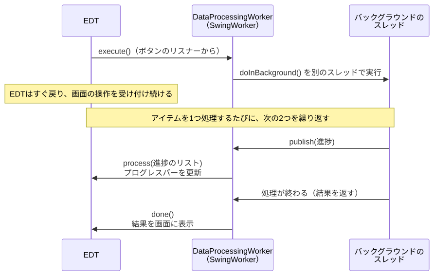

# <b>19章</b> <span>高度なイベント処理パターン</span> <small>プロフェッショナルなGUIアプリケーションの実装</small>

## 本章の学習目標

### この章で学ぶこと

本章では、プロフェッショナルレベルのGUIアプリケーションを実装するための高度なイベント処理技術を学習します。
具体的には以下の内容を扱います。

1. 複雑なイベント処理の実装
    - マウスイベントの完全な処理とドラッグ&ドロップ
    - キーボードイベントの高度な処理とショートカット
    - DocumentListenerによるテキスト変更の監視
2. カスタムイベントとパターン
    - JavaBeansイベントモデルの実装
    - Observerパターンによるイベント通知
    - カスタムイベントの作成と活用
3. パフォーマンスの最適化
    - イベント処理の最適化技術
    - 非同期処理とSwingWorker
    - メモリ効率を考慮した実装

### この章を始める前に

前章の基本的なイベント処理の知識に加え、デザインパターン（とくにObserverパターン）の概念的理解があると、より深くカスタムイベントの設計を理解できます。

## 詳細なイベント処理の実装

### マウスイベントの完全な処理

第18章のサンプルコード18-6では、`MouseAdapter`でマウスのクリックとカーソルの出入りを検出しました。
実際のアプリケーションでは、ドラッグや右クリックメニューなど、より複雑なマウス操作が必要になります。
本節では、マウスの移動とドラッグを受け取る`addMouseMotionListener()`の登録も加えます。

以下のコードは、マウスイベントの完全な処理を実装した例です。クリック、ダブルクリック、ドラッグ、右クリックメニューなど、実際のアプリケーションで必要となるさまざまなマウス操作を処理しています。MouseAdapterを使用して必要なメソッドだけをオーバーライドし、イベントの詳細情報をログに記録します。

<span class="listing-number">**サンプルコード19-1**　MouseEventCompleteExample.java（5、11、36〜63、77〜82、97〜100、122、134行目）</span>

```java
public class MouseEventCompleteExample extends JFrame {
    // ...
    public MouseEventCompleteExample() {
        // ...
        // マウスリスナーの追加
        MouseAdapter mouseHandler = new MouseAdapter() {
            @Override
            public void mouseClicked(MouseEvent e) {
                String button = getButtonName(e.getButton());
                int clickCount = e.getClickCount();
                log("クリック: " + button + " (回数: " + clickCount + ") at " + 
                    e.getPoint());
                
                // ダブルクリックの検出
                if (clickCount == 2) {
                    log("ダブルクリック検出！");
                }
            }
            
            @Override
            public void mousePressed(MouseEvent e) {
                startPoint = e.getPoint();
                log("マウス押下: " + getButtonName(e.getButton()) + " at " + startPoint);
            }
            
            @Override
            public void mouseReleased(MouseEvent e) {
                log("マウス解放: " + getButtonName(e.getButton()) + " at " + e.getPoint());
                startPoint = null;
                currentPoint = null;
                drawPanel.repaint();
            }
            // ...
            @Override
            public void mouseDragged(MouseEvent e) {
                currentPoint = e.getPoint();
                drawPanel.repaint();
                log("ドラッグ中: " + currentPoint);
            }
            // ...
        };
        
        drawPanel.addMouseListener(mouseHandler);
        drawPanel.addMouseMotionListener(mouseHandler);
        // ...
    }
    // ...
}
```

実行すると、「マウスイベント完全例」というウィンドウが開きます。白い描画パネルでクリック、ボタンの押下と解放、ドラッグをすると、下のログエリアにイベントの種類と座標が記録されます。ドラッグ中は押した位置から現在の位置まで青い線を描き、右クリックすると「切り取り」「コピー」「貼り付け」のメニューを表示します。

### キーボードイベントの高度な処理

第18章のサンプルコード18-7では、`KeyAdapter`で押されたキーを表示し、Ctrl+Sを検出しました。
本節では、それに加えて複数キーの同時押しと、`InputMap`と`ActionMap`によるキーバインディングを扱います。

以下のコードは、高度なキーボードイベント処理の実装例です。単一キーの押下だけでなく、複数キーの同時押し検出、ショートカットキーの実装、InputMapとActionMapを使用したより洗練されたキーバインディングの設定方法を示しています。HashSetを使用して現在押されているキーを追跡し、複雑なキーコンビネーションを検出できます。

<span class="listing-number">**サンプルコード19-2**　KeyboardEventAdvancedExample.java（7、12、26〜50、66、78〜90、100、155行目）</span>

```java
public class KeyboardEventAdvancedExample extends JFrame {
    // ...
    public KeyboardEventAdvancedExample() {
        // ...
        // キーリスナーの追加
        textArea.addKeyListener(new KeyAdapter() {
            @Override
            public void keyPressed(KeyEvent e) {
                pressedKeys.add(e.getKeyCode());
                updateStatus(e, "押下");
                
                // ショートカットキーの検出
                if (e.isControlDown() && e.getKeyCode() == KeyEvent.VK_S) {
                    saveDocument();
                    e.consume(); // デフォルトの動作をキャンセル
                } else if (e.isControlDown() && e.getKeyCode() == KeyEvent.VK_A) {
                    textArea.selectAll();
                    e.consume();
                } else if (e.getKeyCode() == KeyEvent.VK_F1) {
                    showHelp();
                }
                
                // 複数キーの同時押し検出
                if (pressedKeys.contains(KeyEvent.VK_CONTROL) && 
                    pressedKeys.contains(KeyEvent.VK_SHIFT) && 
                    pressedKeys.contains(KeyEvent.VK_D)) {
                    duplicateLine();
                }
            }
            // ...
        });
        // ...
    private void setupKeyBindings() {
        InputMap inputMap = textArea.getInputMap(JComponent.WHEN_FOCUSED);
        ActionMap actionMap = textArea.getActionMap();
        
        // Ctrl+Dで行削除
        inputMap.put(KeyStroke.getKeyStroke(KeyEvent.VK_D, InputEvent.CTRL_DOWN_MASK), 
            "delete-line");
        actionMap.put("delete-line", new AbstractAction() {
            @Override
            public void actionPerformed(ActionEvent e) {
                deleteLine();
            }
        });
        // ...
    }
    // ...
}
```

実行すると、「高度なキーボードイベント処理」というウィンドウが開きます。キーを押したり離したりするたびに、下のステータスラベルに修飾キーとキーの名前を表示します。Ctrl+Sで保存のダイアログ、F1でヘルプを表示し、Ctrl+Aで全選択、Ctrl+Dで現在の行の削除、Ctrl+Shift+Dで現在の行の複製、F5で内容のクリアを行います。

### DocumentListenerによるテキスト変更の監視

テキストフィールドやテキストエリアの内容変更をリアルタイムで監視する例です。

以下のコードは、DocumentListenerを使用してテキスト入力のリアルタイムバリデーションを実装する例です。メールアドレスの形式チェック、パスワードの強度判定、確認パスワードの一致チェックなど、実際のフォーム入力で必要となる検証を、ユーザーが入力するたびに即座に実行します。これにより、優れたユーザーエクスペリエンスを提供できます。

<span class="listing-number">**サンプルコード19-3**　DocumentListenerExample.java（7、66〜110、147〜149、178行目）</span>

```java
public class DocumentListenerExample extends JFrame {
    // ...
    
    private void setupDocumentListeners() {
        // Emailフィールドのリスナー
        emailField.getDocument().addDocumentListener(new DocumentListener() {
            @Override
            public void insertUpdate(DocumentEvent e) { validateForm(); }
            @Override
            public void removeUpdate(DocumentEvent e) { validateForm(); }
            @Override
            public void changedUpdate(DocumentEvent e) { validateForm(); }
        });
        
        // パスワードフィールドのリスナー
        DocumentListener passwordListener = new DocumentListener() {
            @Override
            public void insertUpdate(DocumentEvent e) { validateForm(); }
            @Override
            public void removeUpdate(DocumentEvent e) { validateForm(); }
            @Override
            public void changedUpdate(DocumentEvent e) { validateForm(); }
        };
        
        passwordField.getDocument().addDocumentListener(passwordListener);
        confirmField.getDocument().addDocumentListener(passwordListener);
    }
    
    private void validateForm() {
        StringBuilder status = new StringBuilder();
        boolean isValid = true;
        
        // Emailの検証
        String email = emailField.getText();
        if (email.isEmpty()) {
            status.append("× Emailを入力してください\n");
            emailField.setBackground(Color.PINK);
            isValid = false;
        } else if (!isValidEmail(email)) {
            status.append("× 有効なEmailアドレスを入力してください\n");
            emailField.setBackground(Color.PINK);
            isValid = false;
        } else {
            status.append("✓ Email: OK\n");
            emailField.setBackground(Color.WHITE);
        }
        
        // ...
        statusArea.setText(status.toString());
        submitButton.setEnabled(isValid);
    }
    // ...
}
```

実行すると、「DocumentListenerによるバリデーション」というウィンドウが開きます。Email、パスワード、確認の各欄に入力するたびに、下のステータスエリアに検証結果を表示し、条件を満たさない欄の背景をピンクにします。パスワードは8文字以上で強度（弱い・普通・強い）も表示し、すべての条件を満たすと「送信」ボタンが押せるようになります。

## カスタムイベントとObserverパターン

### カスタムイベントの作成

独自のイベントを作成して、コンポーネント間の疎結合な通信を実現します。

以下のコードは、JavaのEventObjectを継承したカスタムイベントの実装例です。温度センサーの値が変化したときにイベントを発生させ、複数のリスナーに通知する仕組みを構築しています。このパターンを使用することで、モデル（センサー）とビュー（表示部分）を疎結合に保ち、メンテナンス性の高いアプリケーションを開発できます。

<div class="figure">



</div>

<span class="listing-number">**サンプルコード19-4**　CustomEventExample.java（6〜33、43〜55、58、64、94〜102、128〜129、156、163行目）</span>

```java
// カスタムイベントクラス
class TemperatureChangeEvent extends EventObject {
    private final double oldTemperature;
    private final double newTemperature;
    
    public TemperatureChangeEvent(Object source, double oldTemp, double newTemp) {
        super(source);
        this.oldTemperature = oldTemp;
        this.newTemperature = newTemp;
    }
    
    public double getOldTemperature() { return oldTemperature; }
    public double getNewTemperature() { return newTemperature; }
}

// カスタムリスナーインターフェイス
interface TemperatureChangeListener extends EventListener {
    void temperatureChanged(TemperatureChangeEvent e);
}

// 温度センサーモデル
class TemperatureSensor {
    private double temperature = 20.0;
    private List<TemperatureChangeListener> listeners = new ArrayList<>();
    
    public void addTemperatureChangeListener(TemperatureChangeListener listener) {
        listeners.add(listener);
    }
    // ...
    public void setTemperature(double newTemperature) {
        double oldTemperature = this.temperature;
        this.temperature = newTemperature;
        fireTemperatureChanged(oldTemperature, newTemperature);
    }
    
    protected void fireTemperatureChanged(double oldTemp, double newTemp) {
        TemperatureChangeEvent event = new TemperatureChangeEvent(this, oldTemp, newTemp);
        for (TemperatureChangeListener listener : new ArrayList<>(listeners)) {
            listener.temperatureChanged(event);
        }
    }
}
// ...
public class CustomEventExample extends JFrame {
    // ...
    public CustomEventExample() {
        // ...
        // 温度変化リスナーを登録
        sensor.addTemperatureChangeListener(new TemperatureChangeListener() {
            @Override
            public void temperatureChanged(TemperatureChangeEvent e) {
                double newTemp = e.getNewTemperature();
                double oldTemp = e.getOldTemperature();
                
                // 表示を更新
                temperatureLabel.setText(String.format("%.1f°C", newTemp));
                // ...
            }
        });
        // ...
    }
    // ...
}
```

### JavaBeansイベントモデルの実装

より高度なイベント管理のためのJavaBeansパターンの実装例です。

以下のコードは、JavaBeansのPropertyChangeSupportを使用した高度なイベント管理の実装例です。株価データの変更を自動的に複数のビューコンポーネントに通知し、リアルタイムで更新される株価モニターアプリケーションを実現しています。PropertyChangeSupportにより、プロパティごとに異なるリスナーを登録でき、より柔軟なイベント処理が可能になります。

<span class="listing-number">**サンプルコード19-5**　JavaBeansEventExample.java（7〜11、18〜20、34〜42、64〜79、95〜100、151〜162、175行目）</span>

```java
// モデルクラス（PropertyChangeSupport を使用）
class StockPrice {
    private String symbol;
    private double price;
    private PropertyChangeSupport pcs = new PropertyChangeSupport(this);
    // ...
    public void addPropertyChangeListener(PropertyChangeListener listener) {
        pcs.addPropertyChangeListener(listener);
    }
    // ...
    public void setPrice(double newPrice) {
        double oldPrice = this.price;
        this.price = newPrice;
        pcs.firePropertyChange("price", oldPrice, newPrice);
    }
}

// 株価表示コンポーネント
class StockPricePanel extends JPanel implements PropertyChangeListener {
        // ...
        previousPrice = stock.getPrice();
        stock.addPropertyChangeListener("price", this);
    }
    
    @Override
    public void propertyChange(PropertyChangeEvent evt) {
        if ("price".equals(evt.getPropertyName())) {
            double newPrice = (Double) evt.getNewValue();
            double oldPrice = (Double) evt.getOldValue();
            
            priceLabel.setText(String.format("$%.2f", newPrice));
            
            double change = newPrice - oldPrice;
            double changePercent = (change / oldPrice) * 100;
            
            changeLabel.setText(String.format("%+.2f (%+.2f%%)", change, changePercent));
            // ...
        }
    }
}

// メインアプリケーション
public class JavaBeansEventExample extends JFrame {
    // ...
    private void startPriceUpdates() {
        updateTimer = new Timer(1000, e -> {
            Random random = new Random();
            for (StockPrice stock : stocks.values()) {
                // ランダムな価格変動（-2%～+2%）
                double change = (random.nextDouble() - 0.5) * 0.04;
                double newPrice = stock.getPrice() * (1 + change);
                stock.setPrice(newPrice);
            }
        });
        updateTimer.start();
    }
    // ...
}
```

## ドラッグ&ドロップの実装

### 基本的なドラッグ&ドロップ

コンポーネント間でのドラッグ&ドロップ機能の実装例です。

以下のコードは、Swingのドラッグ&ドロップAPIを使用した実装例です。リスト間でのアイテムの移動と、外部からのファイルドロップの両方に対応しています。TransferHandlerとDropTargetを組み合わせることで、直感的なユーザーインターフェイスを実現できます。ファイルドロップ時にはファイル情報を表示し、実践的なアプリケーションでの活用例を示しています。

このサンプルで使う`JList`と`DefaultListModel`は、第20章「JTableとJListの基礎」で詳しく学びます。
ここでは、`DefaultListModel`に要素を追加・削除すると`JList`の表示が更新される、という点だけを押さえてください。

<span class="listing-number">**サンプルコード19-6**　DragAndDropExample.java（9、34〜39、69〜103、125〜146、151〜152、162、169行目）</span>

```java
public class DragAndDropExample extends JFrame {
        // ...
        // ドラッグ機能の設定
        sourceList.setDragEnabled(true);
        sourceList.setTransferHandler(new ListTransferHandler());
        
        // ドロップ機能の設定
        targetList.setTransferHandler(new ListTransferHandler());
        // ...
    // リスト用のTransferHandler
    class ListTransferHandler extends TransferHandler {
        @Override
        public boolean canImport(TransferSupport support) {
            return support.isDataFlavorSupported(DataFlavor.stringFlavor);
        }
        
        @Override
        public boolean importData(TransferSupport support) {
            if (!canImport(support)) {
                return false;
            }
            
            JList<String> list = (JList<String>) support.getComponent();
            DefaultListModel<String> model = (DefaultListModel<String>) list.getModel();
            
            try {
                String data = (String) support.getTransferable()
                    .getTransferData(DataFlavor.stringFlavor);
                
                JList.DropLocation dl = (JList.DropLocation) support.getDropLocation();
                int index = dl.getIndex();
                
                if (index == -1) {
                    model.addElement(data);
                } else {
                    model.add(index, data);
                }
                
                return true;
            } catch (Exception e) {
                e.printStackTrace();
                return false;
            }
        }
        // ...
    }
    
    // ファイルドロップ用のリスナー
    class FileDropTargetListener extends DropTargetAdapter {
        @Override
        public void drop(DropTargetDropEvent dtde) {
            try {
                dtde.acceptDrop(DnDConstants.ACTION_COPY);
                Transferable transferable = dtde.getTransferable();
                
                if (transferable.isDataFlavorSupported(DataFlavor.javaFileListFlavor)) {
                    List<File> files = (List<File>) transferable
                        .getTransferData(DataFlavor.javaFileListFlavor);
                    
                    for (File file : files) {
                        dropArea.append("ドロップされたファイル: " + file.getAbsolutePath() + "\n");
                        dropArea.append("  サイズ: " + file.length() + " bytes\n");
                        dropArea.append("  更新日時: " + new Date(file.lastModified()) + "\n\n");
                    }
                }
                
                dtde.dropComplete(true);
                // ...
        }
        
        // ...
    }
    // ...
}
```

## パフォーマンスの最適化

### イベント処理の最適化技術

高頻度で発生するイベントの最適化例です。

以下のコードは、マウス移動のような高頻度イベントを効率的に処理するための最適化技術を示しています。デバウンス（一定時間イベントが発生しなくなってから処理）とスロットル（一定間隔でのみ処理）の両方を実装し、パフォーマンスを改善しています。これらの技術は、リアルタイム検索や自動保存などの機能でも活用できます。

<span class="listing-number">**サンプルコード19-7**　EventOptimizationExample.java（5、10〜13、43〜44、47〜59、61〜65、80〜96、110行目）</span>

```java
public class EventOptimizationExample extends JFrame {
    // ...
    private Timer debounceTimer;
    private long lastThrottleTime = 0;
    private static final int DEBOUNCE_DELAY = 300; // ミリ秒
    private static final int THROTTLE_DELAY = 100; // ミリ秒
        // ...
        // マウス移動イベント（位置の表示は毎回、描画とログはデバウンスとスロットルで間引く）
        drawPanel.addMouseMotionListener(new MouseMotionAdapter() {
            // ...
            @Override
            public void mouseMoved(MouseEvent e) {
                eventCount++;
                statusLabel.setText(String.format("マウス位置: (%d, %d) - イベント数: %d", 
                    e.getX(), e.getY(), eventCount));
                
                // デバウンス処理
                debounceMouseMove(e.getPoint());
                
                // スロットル処理
                throttleMouseMove(e.getPoint());
            }
        });
        // ...
        // デバウンスタイマーの初期化
        debounceTimer = new Timer(DEBOUNCE_DELAY, e -> {
            log("デバウンス: マウス移動が停止しました - " + currentMousePos);
        });
        debounceTimer.setRepeats(false);
        // ...
    }
    
    // デバウンス: 最後のイベントから一定時間後に処理
    private void debounceMouseMove(Point point) {
        currentMousePos = point;
        debounceTimer.restart();
    }
    
    // スロットル: 一定間隔で処理
    private void throttleMouseMove(Point point) {
        long currentTime = System.currentTimeMillis();
        if (currentTime - lastThrottleTime >= THROTTLE_DELAY) {
            lastThrottleTime = currentTime;
            drawPanel.repaint();
            log("スロットル: 描画更新 - " + point);
        }
    }
    // ...
}
```

### SwingWorkerによる非同期処理

第18章のサンプルコード18-12では、長時間の処理を`Thread`で別のスレッドに任せ、結果の表示を`invokeLater()`でEDTに頼みました。
進捗を途中で表示したり、処理を途中で止めたりしたいときは、この組み立てを自分で書くと複雑になります。
`javax.swing.SwingWorker`は、バックグラウンドのスレッドでの処理と、EDTでの画面の更新を分けて書けるようにしたクラスです。

`SwingWorker<T, V>`を継承し、次のメソッドをオーバーライドします。
型パラメーターの`T`は処理の最終結果の型、`V`は途中経過として渡すデータの型です。

- `doInBackground()`
    + バックグラウンドのスレッドで実行する重い処理を書く。戻り値（`T`型）が最終結果になる。ここではコンポーネントを操作しない
- `process(List<V> chunks)`
    + `doInBackground()`のなかで`publish()`に渡した途中経過を、EDT上で受け取る。続けて呼ばれた`publish()`の値はまとめて渡されることがあるので、リストで受け取る
- `done()`
    + 処理が終わったあとにEDT上で呼ばれる。`get()`で最終結果を受け取り、画面に反映する

処理は`execute()`で開始します。
`cancel(true)`で中断を頼むと、`doInBackground()`のなかの`isCancelled()`がtrueを返すようになるので、それを見て処理を打ち切ります。
進捗の割合（0〜100）だけを知らせたいときは、`publish()`の代わりに`setProgress()`を使い、`addPropertyChangeListener()`で登録したリスナーで`"progress"`プロパティの変化を受け取る方法もあります。

以下のコードは、SwingWorkerを使用してUIをフリーズさせることなく長時間の処理を実行する実装例です。進捗状況のリアルタイム更新、処理のキャンセル機能、EDT上での安全なUI更新など、実践的なアプリケーションで必要となる機能を網羅しています。大量データの処理、ネットワーク通信、ファイル操作などで活用できます。

<div class="figure">



</div>

<span class="listing-number">**サンプルコード19-8**　SwingWorkerExample.java（7、70〜75、79〜82、91〜97、99〜115、121〜127、145行目）</span>

```java
public class SwingWorkerExample extends JFrame {
    // ...
    // SwingWorkerの実装
    class DataProcessingWorker extends SwingWorker<String, ProgressInfo> {
        private static final int TOTAL_ITEMS = 100;
        
        @Override
        protected String doInBackground() throws Exception {
            // ...
            for (int i = 0; i < TOTAL_ITEMS; i++) {
                if (isCancelled()) {
                    return "処理がキャンセルされました";
                }
                // ...
                // 進捗を公開
                int progress = (i + 1) * 100 / TOTAL_ITEMS;
                publish(new ProgressInfo(progress, "処理中: アイテム " + (i + 1) + "/" + TOTAL_ITEMS));
            }
            
            return result.toString();
        }
        // ...
        @Override
        protected void process(List<ProgressInfo> chunks) {
            // 最新の進捗情報を使用
            ProgressInfo latest = chunks.get(chunks.size() - 1);
            progressBar.setValue(latest.progress);
            progressBar.setString(latest.message);
            resultArea.append(latest.message + "\n");
        }
        
        @Override
        protected void done() {
            startButton.setEnabled(true);
            cancelButton.setEnabled(false);
            
            try {
                if (!isCancelled()) {
                    String result = get();
                    // ...
                }
            } catch (InterruptedException | ExecutionException e) {
                resultArea.append("エラーが発生しました: " + e.getMessage() + "\n");
                e.printStackTrace();
            }
        }
    }
    // ...
}
```

## よくあるエラーと対処法

高度なイベント処理では、スレッドの使い分けや、リスナーの登録と解除の管理を誤ることで問題が起こります。本章の内容に関連して出会いやすい問題は次のとおりです。

- SwingWorkerから直接UIを更新する
    + `doInBackground()`はEDT以外で動くため、UIの更新は`process()`や`done()`で行う
- DocumentListenerのなかでのテキストの変更
    + リスナーのなかでドキュメントを変更すると、例外や無限ループの原因になる。`invokeLater()`で変更を後回しにする
- リスナーの削除忘れによるメモリリーク
    + 不要になったリスナーを削除しないと、オブジェクトがガベージコレクションで回収されない
- ドロップが受け入れられない
    + `drop()`のなかで`acceptDrop()`を呼び出していない、ドロップされたデータの形式（`DataFlavor`）に対応していないといった原因がある

問題のあるコードと修正したコード、EDT違反の検出などのデバッグのヒントは、GitHubリポジトリにまとめています。<br>
`https://github.com/Nagatani/techbook-java-primer/blob/main/appendix/h-common-errors/chapters/chapter19.md`

## まとめ

本章では、プロフェッショナルレベルのGUIアプリケーションを実装するための高度なイベント処理技術について学習しました。

### 重要なポイント
- マウスとキーボードイベントの完全な処理方法
- DocumentListenerによるリアルタイムテキスト監視
- カスタムイベントとJavaBeansイベントモデル
- ドラッグ&ドロップの実装
- パフォーマンス最適化（デバウンス、スロットル）
- SwingWorkerによる非同期処理

### 実践での活用
これらの技術を組み合わせることで、応答性が高く、ユーザーフレンドリーなGUIアプリケーションを開発できます。とくに、長時間処理とUI更新の分離、イベント処理の最適化は、実務での開発において重要な技術です。

## 章末演習

本章の演習課題は準備中です。準備ができしだい、GitHubリポジトリの次の場所で提供します。<br>
`https://github.com/Nagatani/techbook-java-primer/tree/main/exercises/chapter19/`

それまでは、本文のサンプルコードを動かし、値や部品を変えて動きの違いを確かめてください。コンパイルできる全文はGitHubリポジトリの`sample-code/chapter19/`にあります。

本章の内容を理解できたら、第20章「JTableとJListの基礎」に進みましょう。
