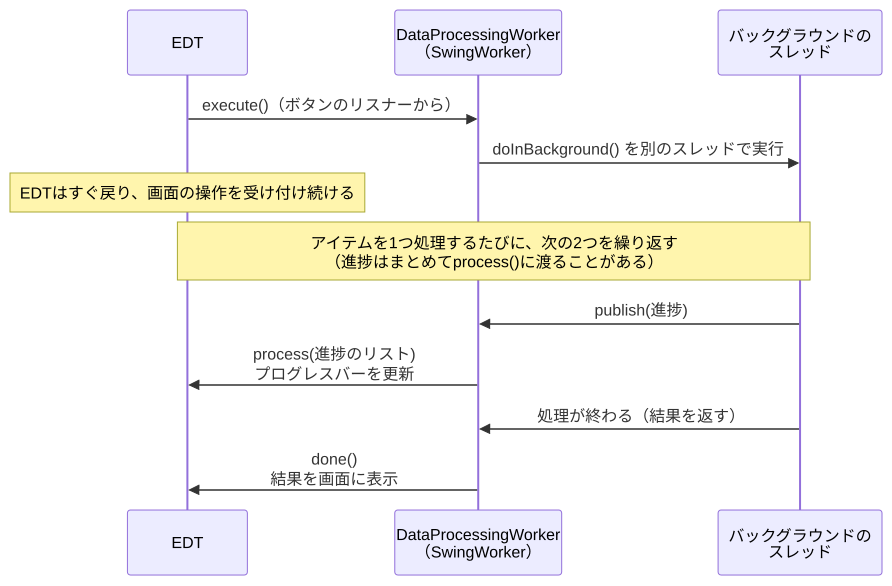

# <b>19章</b> <span>高度なイベント処理パターン</span> <small>マウス・キーボードの詳細とバックグラウンドの処理</small>

## 本章の学習目標

### この章で学ぶこと

1. マウスとキーボードの詳しい操作
    - 1つの`MouseAdapter`でドラッグと右クリックのメニューを扱い、お絵かきパネルを作れる
    - ショートカットキーを、`InputMap`と`ActionMap`によるキーバインディングで登録できる
2. 入力の監視
    - DocumentListenerで、入力のたびに文字数を数えたり形式を確かめたりできる
3. カスタムイベント
    - `EventObject`と`EventListener`で独自のイベントを作り、モデルが画面のクラスを知らずに変化を知らせられる
4. 時間のかかる処理と頻繁なイベント
    - SwingWorkerで、画面を固めずに処理を進め、進捗の表示とキャンセルを付けられる
    - `javax.swing.Timer`で、入力が止まってから処理するデバウンスを書ける

### この章を始める前に

第18章で学んだ基本的なイベント処理（リスナーの登録、EDT、`javax.swing.Timer`）を前提にします。
カスタムイベントの節で使うObserverパターンの考え方は、その節で説明します。

## 詳細なイベント処理の実装

### マウスイベントの詳しい処理

第18章のサンプルコード18-6では、`MouseAdapter`でマウスのクリックとカーソルの出入りを検出しました。
実際のアプリケーションでは、ドラッグや右クリックメニューなど、より複雑なマウス操作が必要になります。
第18章までの知識でお絵かきを作ろうとすると、クリックした点は描けても、ボタンを押したまま動かした跡の線が描けずに行き詰まりがちです。
クリックを受け取る`MouseListener`には、押したまま動かしたことを知らせるメソッドがないためです。
本節では、マウスの移動とドラッグを受け取る`addMouseMotionListener()`の登録も加えます。

以下のコードは、クリック、ダブルクリック、ドラッグ、右クリックメニューを1つのパネルで処理する例です。
`MouseAdapter`は`MouseListener`と`MouseMotionListener`の両方を実装しています。
そのため、必要なメソッドだけをオーバーライドした1つのオブジェクトを、`addMouseListener()`と`addMouseMotionListener()`の両方に登録できます。
各メソッドでは、イベントの種類と座標をログに記録します。
右クリックメニューは、リスナーではなく`setComponentPopupMenu()`でパネルに付けます。
メニューを開く操作がボタンを押したときか離したときかはOSによって違いますが、この方法ならどちらの場合もメニューを表示できます。

<span class="listing-number">**サンプルコード19-1**　MouseEventCompleteExample.java（5〜6、12、36〜64、78〜83、98〜101、118、134行目）</span>

```java
public class MouseEventCompleteExample {
    private final JFrame frame = new JFrame("マウスイベント完全例");
    // ...
    public MouseEventCompleteExample() {
        // ...
        MouseAdapter mouseHandler = new MouseAdapter() {
            @Override
            public void mouseClicked(MouseEvent e) {
                String button = getButtonName(e.getButton());
                int clickCount = e.getClickCount();
                log("クリック: " + button + " (回数: " + clickCount
                        + ") at " + e.getPoint());
                
                // ダブルクリックの検出
                if (clickCount == 2) {
                    log("ダブルクリック検出！");
                }
            }
            
            @Override
            public void mousePressed(MouseEvent e) {
                startPoint = e.getPoint();
                log("マウス押下: " + getButtonName(e.getButton())
                        + " at " + startPoint);
            }
            
            @Override
            public void mouseReleased(MouseEvent e) {
                log("マウス解放: " + getButtonName(e.getButton())
                        + " at " + e.getPoint());
                startPoint = null;
                currentPoint = null;
                drawPanel.repaint();
            }
            // ...
            @Override
            public void mouseDragged(MouseEvent e) {
                currentPoint = e.getPoint();
                drawPanel.repaint();
                log("ドラッグ中: " + currentPoint);
            }
            // ...
        };
        
        drawPanel.addMouseListener(mouseHandler);
        drawPanel.addMouseMotionListener(mouseHandler);
        // ...
    }
    // ...
}
```

実行すると、「マウスイベント完全例」というウィンドウが開きます。白い描画パネルにカーソルを入れると十字の形に変わり、パネルへの出入り、クリック、ボタンの押下と解放、ドラッグのたびに、下のログエリアにイベントの種類（出入り以外は座標も）を記録します。ドラッグ中は押した位置から現在の位置まで青い線を描き、右クリックすると「切り取り」「コピー」「貼り付け」のメニューを表示します<span class="footnote">右クリックメニューを作る部分と描画の部分は、本文では省いています。全文は`https://github.com/Nagatani/techbook-java-primer/tree/main/sample-code/chapter19/19-01/`にあります。</span>。

### キーボードイベントの高度な処理

第18章のサンプルコード18-7では、`KeyAdapter`で押されたキーを表示し、Ctrl+Sを検出しました。
本節では、それに加えて複数キーの同時押しと、`InputMap`と`ActionMap`によるキーバインディングを扱います。

以下のコードは、押されているキーを`HashSet`で追跡して同時押しを検出し、`InputMap`と`ActionMap`でショートカットキーを設定する例です。
2つの書き方を比べるため、Ctrl+S・Ctrl+A・F1は第18章と同じ`KeyListener`の`if`文で処理し、Ctrl+DとF5はキーバインディングで登録しています。
Ctrl+Shift+Dは、押されているキーの集合で同時押しを調べる例です。
同時押しの検出では、`keyPressed()`でキーコードを集合に加え、`keyReleased()`で取り除きます。
ダイアログが開くなどしてフォーカスが移ると、キーを離したイベントがテキストエリアに届かず、集合にキーが残ってしまいます。
そのため、フォーカスが外れたとき（`focusLost()`）に集合を空にしています。

<span class="listing-number">**サンプルコード19-2**　KeyboardEventAdvancedExample.java（7〜8、13、26〜51、67〜76、86、88〜101、111、170行目）</span>

```java
public class KeyboardEventAdvancedExample {
    private final JFrame frame = new JFrame("高度なキーボードイベント処理");
    // ...
    public KeyboardEventAdvancedExample() {
        // ...
        textArea.addKeyListener(new KeyAdapter() {
            @Override
            public void keyPressed(KeyEvent e) {
                pressedKeys.add(e.getKeyCode());
                updateStatus(e, "押下");
                
                // ショートカットキーの検出
                if (e.isControlDown()
                        && e.getKeyCode() == KeyEvent.VK_S) {
                    saveDocument();
                    e.consume(); // デフォルトの動作をキャンセル
                } else if (e.isControlDown()
                        && e.getKeyCode() == KeyEvent.VK_A) {
                    textArea.selectAll();
                    e.consume();
                } else if (e.getKeyCode() == KeyEvent.VK_F1) {
                    showHelp();
                }
                
                // 複数キーの同時押し検出
                if (pressedKeys.contains(KeyEvent.VK_CONTROL) && 
                    pressedKeys.contains(KeyEvent.VK_SHIFT) && 
                    pressedKeys.contains(KeyEvent.VK_D)) {
                    duplicateLine();
                }
            }
            // ...
        });
        
        // フォーカスが外れたら、押されているキーの記録を消す
        // （ダイアログが開くと、キーを離したイベントはテキストエリアに届かない）
        textArea.addFocusListener(new FocusAdapter() {
            @Override
            public void focusLost(FocusEvent e) {
                pressedKeys.clear();
            }
        });
        // ...
    }
    // ...
    private void setupKeyBindings() {
        InputMap inputMap =
                textArea.getInputMap(JComponent.WHEN_FOCUSED);
        ActionMap actionMap = textArea.getActionMap();
        
        // Ctrl+Dで行削除
        inputMap.put(KeyStroke.getKeyStroke(KeyEvent.VK_D,
                InputEvent.CTRL_DOWN_MASK), "delete-line");
        actionMap.put("delete-line", new AbstractAction() {
            @Override
            public void actionPerformed(ActionEvent e) {
                deleteLine();
            }
        });
        // ...
    }
    // ...
}
```

実行すると、「高度なキーボードイベント処理」というウィンドウが開きます。キーを押したり離したりするたびに、下のステータスラベルに修飾キーとキーの名前を表示します。Ctrl+Sで保存のダイアログ、F1でヘルプを表示し、Ctrl+Aで全選択、Ctrl+Dで現在の行の削除、Ctrl+Shift+Dで現在の行の複製、F5で内容のクリアを行います。

キーバインディングでは、2つの対応表を使います。
`InputMap`は、キーの組み合わせ（`KeyStroke`）と、処理に付けた名前を対応づけます。
`ActionMap`は、その名前と、実行する処理（`Action`。ここでは`AbstractAction`を継承した匿名クラス）を対応づけます。
`getInputMap()`の引数の`JComponent.WHEN_FOCUSED`は、その部品がフォーカスを持っているときだけキーを受け付けるという指定です<span class="footnote">ほかに、部品を含むウィンドウがフォーカスを持っていれば受け付ける`WHEN_IN_FOCUSED_WINDOW`などがあります。</span>。
テキストのコピーや貼り付けなど、Swingの部品が既定で持つキー操作も、このしくみで登録されています。
ショートカットキーは、`KeyListener`で`if`文を並べるより、キーバインディングで登録するほうが、キーと処理の対応を管理しやすくなります。
なお、Ctrl・Shift・Altなどの修飾キーとの組み合わせは、`isControlDown()`・`isShiftDown()`や、`KeyStroke`の修飾キーの指定で調べられます。
押されているキーを集合で追跡する方法が必要になるのは、矢印キーを2つ同時に押すような、修飾キー以外のキーの組み合わせです。

`KeyListener`でゲームを作ると、画面のボタンをクリックしたとたんにキーが効かなくなる、ということがよく起きます。
キーのイベントはフォーカスを持つ部品にしか届かず、クリックでフォーカスがボタンに移ったためです。
ゲームの操作は、`WHEN_IN_FOCUSED_WINDOW`を指定したキーバインディングで登録すると、ウィンドウのどの部品にフォーカスがあっても受け取れます。

### DocumentListenerによるテキスト変更の監視

`DocumentListener`を使うと、テキストフィールドやテキストエリアの内容が変わるたびに処理を実行できます。
リスナーはテキスト部品そのものではなく、`getDocument()`で取り出した`Document`（部品が表示する文字列を保持するオブジェクト）に登録します。
`insertUpdate()`は文字が挿入されたとき、`removeUpdate()`は文字が削除されたときに呼ばれます。
`changedUpdate()`は文字の書式（属性）が変わったときに呼ばれるメソッドで、書式を持たない`JTextField`や`JPasswordField`では呼ばれません。
この例では、どの変更でも同じ検証を行うので、3つのメソッドから同じ`validateForm()`を呼んでいます。
以下のコードは、入力のたびにメールアドレスの形式、パスワードの長さと強度、確認用パスワードの一致を検証する例です。

<span class="listing-number">**サンプルコード19-3**　DocumentListenerExample.java（7〜8、68〜117、154〜156、189行目）</span>

```java
public class DocumentListenerExample {
    private final JFrame frame = new JFrame();
    // ...
    private void setupDocumentListeners() {
        // Emailフィールドのリスナー
        emailField.getDocument()
                .addDocumentListener(new DocumentListener() {
            @Override
            public void insertUpdate(DocumentEvent e) { validateForm(); }
            @Override
            public void removeUpdate(DocumentEvent e) { validateForm(); }
            @Override
            public void changedUpdate(DocumentEvent e) {
                validateForm();
            }
        });
        
        // パスワードフィールドのリスナー
        DocumentListener passwordListener = new DocumentListener() {
            @Override
            public void insertUpdate(DocumentEvent e) { validateForm(); }
            @Override
            public void removeUpdate(DocumentEvent e) { validateForm(); }
            @Override
            public void changedUpdate(DocumentEvent e) {
                validateForm();
            }
        };
        
        passwordField.getDocument()
                .addDocumentListener(passwordListener);
        confirmField.getDocument().addDocumentListener(passwordListener);
    }
    
    private void validateForm() {
        StringBuilder status = new StringBuilder();
        boolean isValid = true;
        
        // Emailの検証
        String email = emailField.getText();
        if (email.isEmpty()) {
            status.append("× Emailを入力してください\n");
            emailField.setBackground(Color.PINK);
            isValid = false;
        } else if (!isValidEmail(email)) {
            status.append("× 有効なEmailアドレスを入力してください\n");
            emailField.setBackground(Color.PINK);
            isValid = false;
        } else {
            status.append("✓ Email: OK\n");
            emailField.setBackground(Color.WHITE);
        }
        
        // ...
        statusArea.setText(status.toString());
        submitButton.setEnabled(isValid);
    }
    // ...
}
```

実行すると、「DocumentListenerによるバリデーション」というウィンドウが開きます。Email、パスワード、確認の各欄に入力するたびに、下のステータスエリアに検証結果を表示し、条件を満たさない欄の背景をピンクにします。パスワードは8文字以上で強度（弱い・普通・強い）も表示し、すべての条件を満たすと「送信」ボタンが押せるようになります。

この例は、DocumentListenerが打つたびに呼ばれることを確かめるために、検証結果を毎回文章で表示しています。
実際の入力画面で入力のたびにエラーを出すと、打ち終わる前から「形式が違います」と言われてうるさく感じます。
DocumentListenerは文字数の表示や欄の色、送信ボタンを押せるかどうかのような目印に使い、誤りを確定して伝えるのは送信ボタンを押したときにします（第18章の節「FocusListenerによるフォーカス管理」と同じ考え方です）。

## カスタムイベントとObserverパターン

### カスタムイベントの作成

温度センサーのクラスが、値が変わるたびに画面のラベルを直接書き換えているとします。
グラフにも温度を表示したくなったら、センサーのクラスを開いてグラフを書き換える処理を足すことになり、表示を増やすたびにセンサーのクラスを直し続けます。
センサーは「値が変わった」と知らせるだけにし、表示する側が自分で受け取るようにすれば、表示を増やしてもセンサーのクラスは変わりません。
この形に名前を付けたのがObserverパターンです。

Observerパターンは、あるオブジェクトの状態が変わったことを、それに関心のある複数のオブジェクトへ知らせるためのデザインパターン（よく使われる設計の型）です。
状態を持ち、変化を知らせる側をSubject（観察される側）、知らせを受け取る側をObserver（観察する側）と呼びます。
Subjectは、Observerを登録する一覧と、変化があったときに一覧の全員を呼び出す処理を持ちます。
SubjectはObserverをインターフェイスとしてだけ知っているので、受け取る側の種類が増えてもSubjectのコードは変わりません。
これまで使ってきた`addActionListener()`などのリスナーのしくみも、ボタンをSubject、リスナーをObserverとするObserverパターンです。

Swingの部品が用意するイベントだけでなく、独自のイベントを作ってこのしくみを自分のクラスに組み込むこともできます。
以下のコードは、`EventObject`を継承したカスタムイベントの例です<span class="footnote">標準ライブラリには`java.util.Observer`と`java.util.Observable`もありますが、Java 9で非推奨になりました。独自のイベントは、このように`java.util`の`EventObject`と`EventListener`を使って作ります。</span>。
温度センサーの値が変化したときにイベントを発生させ、登録された複数のリスナーに通知します。
センサーがSubject、リスナーがObserverに当たり、センサー（モデル）は表示部分（ビュー）のクラスを直接参照しません。

<div class="figure">



</div>

<span class="listing-number">**サンプルコード19-4**　CustomEventExample.java（6〜36、46〜61、64〜65、71、100〜108、134〜135、162、173行目）</span>

```java
// カスタムイベントクラス
class TemperatureChangeEvent extends EventObject {
    private final double oldTemperature;
    private final double newTemperature;
    
    public TemperatureChangeEvent(Object source, double oldTemp,
            double newTemp) {
        super(source);
        this.oldTemperature = oldTemp;
        this.newTemperature = newTemp;
    }
    
    public double getOldTemperature() { return oldTemperature; }
    public double getNewTemperature() { return newTemperature; }
}

// カスタムリスナーインターフェイス
interface TemperatureChangeListener extends EventListener {
    void temperatureChanged(TemperatureChangeEvent e);
}

// 温度センサーモデル
class TemperatureSensor {
    private double temperature = 20.0;
    private List<TemperatureChangeListener> listeners =
            new ArrayList<>();
    
    public void addTemperatureChangeListener(
            TemperatureChangeListener listener) {
        listeners.add(listener);
    }
    // ...
    public void setTemperature(double newTemperature) {
        double oldTemperature = this.temperature;
        this.temperature = newTemperature;
        fireTemperatureChanged(oldTemperature, newTemperature);
    }
    
    protected void fireTemperatureChanged(double oldTemp,
            double newTemp) {
        TemperatureChangeEvent event =
                new TemperatureChangeEvent(this, oldTemp, newTemp);
        for (TemperatureChangeListener listener
                : new ArrayList<>(listeners)) {
            listener.temperatureChanged(event);
        }
    }
}
// ...
public class CustomEventExample {
    private final JFrame frame = new JFrame("カスタムイベントの例");
    // ...
    public CustomEventExample() {
        // ...
        // 温度変化リスナーを登録
        sensor.addTemperatureChangeListener(
                new TemperatureChangeListener() {
            @Override
            public void temperatureChanged(TemperatureChangeEvent e) {
                double newTemp = e.getNewTemperature();
                double oldTemp = e.getOldTemperature();
                
                temperatureLabel.setText("%.1f°C".formatted(newTemp));
                // ...
            }
        });
        // ...
    }
    // ...
}
```

実行すると、「カスタムイベントの例」というウィンドウが開きます。
スライダーで温度を変えて離すと、上の温度表示と背景色が変わり、下のログに「温度上昇: 20.0°C → 25.0°C」のような変化と、最高・最低温度の更新を記録します。
40°Cを超えるか-10°Cを下回ると、警告のダイアログを表示します。
全文では、表示とログを更新するリスナーのほかに、最高・最低温度を記録する2つ目のリスナーも登録しています。
2つのリスナーは互いを知らず、センサーからの通知をそれぞれ受け取っています。

### 標準のしくみを使う：PropertyChangeSupport {.advanced}

サンプルコード19-4では、イベントクラス、リスナーインターフェイス、リスナーの一覧をすべて自分で書きました。
JavaBeansの`java.beans.PropertyChangeSupport`を使うと、リスナーの一覧の管理と通知をこのクラスに任せられます。
値を変えるメソッドで`firePropertyChange("プロパティ名", 古い値, 新しい値)`を呼ぶと、登録した`PropertyChangeListener`の`propertyChange`が呼ばれ、`PropertyChangeEvent`から名前と新旧の値を取り出せます。
株価の変化を複数の表示パネルに通知する例は、付録Fで紹介しています。

## ドラッグ&ドロップ {.advanced}

Swingの部品どうしのドラッグ&ドロップは、`TransferHandler`で実装します。
`JList`や`JTextArea`などの部品は`setDragEnabled(true)`でドラッグを始められ、受け取る側の`TransferHandler`が、ドロップされたデータを受け入れるか（`canImport`）と、どう取り込むか（`importData`）を決めます。
デスクトップからのファイルのドロップは、`DropTarget`で受け付けます。
2つのリストの間でアイテムを移動し、ファイルのドロップを受け付ける例は、付録Fで紹介しています。

## パフォーマンスの最適化

### イベントの処理回数を減らす {.advanced}

マウスの移動やキー入力のように短い間隔で大量に発生するイベントでは、イベントごとに重い処理をすると画面の反応が遅くなります。
処理の回数を減らす方法として、デバウンスとスロットルがあります。

- デバウンス
    + イベントが一定時間発生しなくなってから、1回だけ処理する。入力が止まってから検索する機能や自動保存に使う
- スロットル
    + 前回の処理から一定時間がたつまでのイベントは処理せず、一定の間隔でだけ処理する

操作が止まってからの1回で足りるならデバウンス、マウスの追跡のように動いているあいだも一定の間隔で反応させたいならスロットルを選びます。
デバウンスは、第18章で学んだ`javax.swing.Timer`を`setRepeats(false)`にし、イベントのたびに`restart()`すれば実現できます。
マウスの移動に両方を実装した例は、付録Fで紹介しています。

### SwingWorkerによる非同期処理

第18章のサンプルコード18-12では、長時間の処理を`Thread`で別のスレッドに任せ、結果の表示を`invokeLater()`でEDTに頼みました。
進捗を途中で表示したり、処理を途中で止めたりしたいときは、この組み立てを自分で書くと複雑になります。
`javax.swing.SwingWorker`<span class="footnote">`SwingWorker`がJavaの標準ライブラリに入ったのはJava 6からです。</span>は、バックグラウンドのスレッドでの処理と、EDTでの画面の更新を分けて書けるようにしたクラスです。

`SwingWorker<T, V>`を継承し、次のメソッドをオーバーライドします。
型パラメーターの`T`は処理の最終結果の型、`V`は途中経過として渡すデータの型です。

- `doInBackground()`
    + バックグラウンドのスレッドで実行する重い処理を書く。戻り値（`T`型）が最終結果になる。ここではコンポーネントを操作しない
- `process(List<V> chunks)`
    + `doInBackground()`のなかで`publish()`に渡した途中経過を、EDT上で受け取る。続けて呼ばれた`publish()`の値はまとめて渡されることがあるので、リストで受け取る
- `done()`
    + 処理が終わったあとにEDT上で呼ばれる。`get()`で最終結果を受け取り、画面に反映する。`doInBackground()`で例外が起きていたときは、`get()`がその例外を`ExecutionException`に包んで投げる

処理は`execute()`で開始します。
`cancel(true)`で中断を頼むと、`doInBackground()`のなかの`isCancelled()`がtrueを返すようになるので、それを見て処理を打ち切ります。
引数の`true`は、処理中のスレッドに割り込みをかけるという指定です。
割り込まれると、`Thread.sleep()`などで待っている処理は`InterruptedException`で終わります。
キャンセルしたあとは`get()`で結果を受け取れない（`CancellationException`が発生する）ので、`done()`では`isCancelled()`を確かめてから`get()`を呼びます。
よくある誤りは、`execute()`のすぐあとで`get()`を呼び、結果を受け取ろうとすることです。
`get()`は処理が終わるまで待つので、EDTで呼ぶと第18章の悪い例と同じく画面が固まります。
結果は`done()`のなかで受け取ります。

以下のコードは、SwingWorkerで100件のデータを順に処理し、`publish()`と`process()`で進捗を表示する例です<span class="footnote">進捗の割合（0〜100）だけを知らせたいときは、`publish()`の代わりに`setProgress()`を使う方法もあります。`addPropertyChangeListener()`で登録したリスナーが、`"progress"`プロパティの変化として受け取ります。</span>。
処理中も画面は操作でき、「キャンセル」ボタンで処理を中断できます。
この例の途中経過の型`V`は、進捗の割合とメッセージを持つ`ProgressInfo`クラスです。

<div class="figure">



</div>

<span class="listing-number">**サンプルコード19-5**　SwingWorkerExample.java（7〜8、70〜76、80〜85、94〜101、103〜133、155行目）</span>

```java
public class SwingWorkerExample {
    private final JFrame frame = new JFrame("SwingWorkerによる非同期処理");
    // ...
    // SwingWorkerの実装
    class DataProcessingWorker extends SwingWorker<String,
            ProgressInfo> {
        private static final int TOTAL_ITEMS = 100;
        
        @Override
        protected String doInBackground() throws Exception {
            // ...
            for (int i = 0; i < TOTAL_ITEMS; i++) {
                if (isCancelled()) {
                    // キャンセルしたあとはget()で結果を受け取れないので、
                    // 戻り値は使われない
                    return null;
                }
                // ...
                // 進捗を公開
                int progress = (i + 1) * 100 / TOTAL_ITEMS;
                publish(new ProgressInfo(progress, "処理中: アイテム "
                        + (i + 1) + "/" + TOTAL_ITEMS));
            }
            
            return result.toString();
        }
        // ...
        @Override
        protected void process(List<ProgressInfo> chunks) {
            // 最新の進捗情報を使用
            ProgressInfo latest = chunks.get(chunks.size() - 1);
            progressBar.setValue(latest.progress);
            progressBar.setString(latest.message);
            resultArea.append(latest.message + "\n");
        }
        
        @Override
        protected void done() {
            startButton.setEnabled(true);
            cancelButton.setEnabled(false);
            
            try {
                if (!isCancelled()) {
                    String result = get();
                    resultArea.append("\n処理が完了しました。\n");
                    resultArea.append("結果のサマリー:\n");
                    resultArea.append("処理したアイテム数: "
                            + result.lines().count() + "\n");
                    progressBar.setValue(100);
                    progressBar.setString("完了");
                }
            } catch (InterruptedException | ExecutionException e) {
                resultArea.append("エラーが発生しました: "
                        + e.getMessage() + "\n");
                e.printStackTrace();
            }
        }
    }
    // ...
}
```

実行して「処理開始」ボタンを押すと、プログレスバーが0%から100%へ進み、下のエリアに「処理中: アイテム 1/100」のような進捗を表示します。
`process()`は、まとめて渡された進捗のうち最新の1件だけを書くので、番号が飛ぶことがあります。
処理は約5秒かかりますが、そのあいだもウィンドウの移動や「キャンセル」ボタンの操作ができます。
最後まで進むと「処理が完了しました。」と結果のサマリー（処理したアイテム数）を表示します。
途中でキャンセルすると、「キャンセル」ボタンのリスナーが「処理がキャンセルされました。」と表示します。

## よくあるエラーと対処法

高度なイベント処理では、スレッドの使い分けや、リスナーの登録と解除の管理を誤ることで問題が起こります。本章の内容に関連して出会いやすい問題は次のとおりです。

- SwingWorkerから直接UIを更新する
    + `doInBackground()`はEDT以外で動くため、UIの更新は`process()`や`done()`で行う
- DocumentListenerのなかでのテキストの変更
    + 通知を受けているあいだに同じドキュメントを変更すると、`IllegalStateException`（Attempt to mutate in notification）が発生する。入力を書き換えるときは`DocumentFilter`を使うか、`invokeLater()`で変更を後回しにする
- リスナーの削除忘れによるメモリリーク
    + 不要になったリスナーを削除しないと、オブジェクトがガベージコレクションで回収されない
    + 本書の演習の規模では起きにくく、画面を何度も作っては捨てる大きなアプリケーションで問題になる
- ドロップが受け入れられない
    + 受け取る側の`TransferHandler`の`canImport`が`false`を返している。受け取るデータの形式を確かめる条件が、ドラッグ元のデータと合っているかを確かめる（`DropTarget`を使う場合の注意は付録Fの例にある）

問題のあるコードと修正したコード、EDT違反の検出などのデバッグのヒントは、GitHubリポジトリにまとめています。<br>
`https://github.com/Nagatani/techbook-java-primer/blob/main/appendix/e-common-errors/chapters/chapter19.md`

## まとめ

時間のかかる処理を画面から切り離すとき、結果を表示するだけなら、第18章の`Thread`と`invokeLater()`の組み合わせで書けます。
進捗を途中で表示したり、処理を途中で止めたりしたくなったら、SwingWorkerを使います。
ショートカットキーは、KeyListenerに`if`文を並べるより、キーバインディングで登録するほうが、キーと処理の対応を管理しやすくなります。
キーを集合で追跡するのは、修飾キー以外の同時押しを調べるときだけです。

この章でいちばん持ち帰ってほしいのは、EDTで動く処理と、EDTの外で動く処理を分けて書くということです。
SwingWorkerの`doInBackground()`から部品に触らず、画面の更新を`process()`と`done()`に置くのも、素数を数える発展課題で画面が固まらないのも、この分け方によります。

温度センサーのモデルが表示のクラスを知らずに変化を知らせた形は、次の第20章の表やリストで、データを持つモデルと表示する部品の分担として何度も出てきます。

## 章末演習

### 演習課題へのアクセス

本章の演習課題は、GitHubリポジトリで提供されています。<br>
`https://github.com/Nagatani/techbook-java-primer/tree/main/exercises/chapter19/`

### 課題構成

演習は、本章で学んだイベント処理の応用を使う次の課題で構成されています。

- 基礎課題
    + お絵かきパネル（マウスのドラッグと右クリックのメニュー）、矢印キーで四角を動かす（キーバインディング）、文字数を数えながら書く投稿画面（DocumentListener）、在庫の変化を知らせる（カスタムイベント）
- 発展課題
    + 入力が止まってから検索する（デバウンス）、素数を数える（SwingWorkerによる進捗の表示とキャンセル）
- チャレンジ課題
    + タスクボード（ドラッグ&ドロップ・キーバインディング・PropertyChangeSupport）

各課題には、詳細な要件と実装のヒントが含まれています。
第18章と第19章の内容をまとめて使う大きめのプログラムも、同じ場所の`examples/`に置いています。

本章の内容を理解できたら、第20章「JTable・JList・JTree」に進みましょう。
