# <b>20章</b> <span>JTableとJListの基礎</span> <small>表形式データの表示</small>

## 本章の学習目標

### この章で学ぶこと

この章では、データを効率的に表示するためのSwingコンポーネントについて学習します。
具体的には以下のトピックを扱います。

1. JTableとJListの基本的な使い方
2. 表形式データの表示と操作
3. リストコンポーネントの活用
4. 基本的なテーブル操作（選択、クリック）
5. 簡単なデータ表示アプリケーションの作成

本章では、表やリストの形でデータを表示するSwingのコンポーネントであるJTableとJListについて学習します。
階層構造のデータを表示するJTreeも、あわせて扱います。

JTableは表形式のデータを表示するためのコンポーネントで、表計算ソフトのような見た目でデータを表示できます。
単純なデータ表示から、編集可能なセル、カスタムレンダラー、ソート機能まで、さまざまな機能を提供します。

JListは項目のリストを表示するコンポーネントで、選択可能な項目の一覧を作成できます。
単一選択、複数選択、項目の表示の作り込みなどができます。

これらのコンポーネントは、MVCアーキテクチャに基づいて設計されており、データ（Model）、表示（View）、制御（Controller）が分離されています<span class="footnote">SwingはViewとControllerを1つの部品（UIデリゲート）にまとめた変形のMVCを採っています。MVCという考え方の由来は、第3章で触れました。</span>。
この設計により、データの管理と表示を独立して扱えるので、データの持ち方を変えても表示のコードを書き換えずに済みます。

### この章を始める前に

この章を学習する前に、事前に習得しておくべき知識があります。
とくに重要なのは以下の内容です。

- 第17章のGUIプログラミングの基礎（Swing、AWT、基本コンポーネント）
- 第18章・第19章のイベント処理（ActionListener、MouseListener等）
- 第9章のコレクションフレームワーク（List、Set、Map）
- 第7章の抽象クラスとインターフェイス

次の知識もあると、より理解しやすくなります。

- 第8章のRecord（データ表現）
- MVCアーキテクチャパターンの基本概念
- 第19章で学んだObserverパターン
- 第18章で学んだEDT（`SwingUtilities.invokeLater`）と、第19章で学んだSwingWorker

## JTableの詳細な実装

### 基本的なJTableの作成

JTableは、表形式のデータを表示・編集するためのコンポーネントです。
まず、基本的な使い方から見ていきましょう。

<div class="figure">



</div>

以下のコードは、JTableのもっとも基本的な使用例です。
2次元配列でデータを定義し、列名を指定してテーブルを作成します。
`JScrollPane`に入れることで、データが多い場合にスクロールできるようになります。
この方法は簡単ですが、表示したあとに行を追加・削除する用途には向いていません。

<span class="listing-number">**サンプルコード20-1**　BasicTableExample.java</span>

```java
import javax.swing.*;
import javax.swing.table.DefaultTableModel;
import java.awt.*;

public class BasicTableExample extends JFrame {
    public BasicTableExample() {
        setTitle("基本的なJTableの例");
        setDefaultCloseOperation(JFrame.EXIT_ON_CLOSE);
        
        // 列名の定義
        String[] columnNames = {"ID", "名前", "年齢", "メールアドレス"};
        
        // データの定義
        Object[][] data = {
            {1, "田中太郎", 25, "tanaka@example.com"},
            {2, "鈴木花子", 30, "suzuki@example.com"},
            {3, "佐藤次郎", 28, "sato@example.com"},
            {4, "山田美咲", 22, "yamada@example.com"}
        };
        
        // JTableの作成
        JTable table = new JTable(data, columnNames);
        
        // スクロールペインに追加
        JScrollPane scrollPane = new JScrollPane(table);
        add(scrollPane, BorderLayout.CENTER);
        
        setSize(600, 300);
        setLocationRelativeTo(null);
    }
    
    public static void main(String[] args) {
        SwingUtilities.invokeLater(() -> {
            new BasicTableExample().setVisible(true);
        });
    }
}
```

実行すると、次のように表示されます。

```
ウィンドウが表示されます（タイトル: 基本的なJTable、サイズ: 600x300）
- 社員データを表示するテーブルが表示されます
- 列: ID、名前、部署、給与、入社日
- 4人の社員データが表示されています
- スクロールバーが利用可能です（データが多い場合）
```

## テーブルのソートとフィルタリング

JTableは組み込みのソート機能を提供しています<span class="footnote">ソートとフィルタリングを受け持つ`TableRowSorter`は、Java 6で加わりました。サンプルコード20-2の`regexFilter`は入力を正規表現として扱い、先頭の`(?i)`は大文字と小文字を区別しない指定です。</span>。

以下のコードは、`TableRowSorter`を使用してテーブルのソートとフィルタリングを実装する例です。
ヘッダーをクリックすると列の値で行を並べ替え、フィルターフィールドに入力した文字列を名前に含む行だけを表示します。
表のデータは、`AbstractTableModel`を継承した`PersonTableModel`が持ちます。
このクラスは、行数・列数・各セルの値を返すメソッドと、行を追加・削除するメソッドを持ちます。
全文はGitHubリポジトリの`sample-code/chapter20/20-02/`にあります<span class="footnote">`https://github.com/Nagatani/techbook-java-primer/tree/main/sample-code/chapter20/20-02/`</span>。

<span class="listing-number">**サンプルコード20-2**　SortableTableExample.java（5、10、14〜36、70、77行目）</span>

```java
public class SortableTableExample extends JFrame {
    // ...
    public SortableTableExample() {
        // ...
        // モデルとテーブルの作成
        model = new PersonTableModel();
        table = new JTable(model);
        
        // ソーターの設定
        sorter = new TableRowSorter<>(model);
        table.setRowSorter(sorter);
        
        // フィルタリング機能の追加
        JPanel filterPanel = new JPanel(new FlowLayout(FlowLayout.LEFT));
        JLabel filterLabel = new JLabel("フィルター:");
        JTextField filterField = new JTextField(20);
        JButton filterButton = new JButton("適用");
        
        filterButton.addActionListener(e -> {
            String text = filterField.getText();
            if (text.trim().length() == 0) {
                sorter.setRowFilter(null);
            } else {
                // 名前列でフィルタリング
                sorter.setRowFilter(RowFilter.regexFilter("(?i)" + text, 1));
            }
        });
        // ...
    }
    // ...
}
```

実行すると、次のように表示されます。

```
ウィンドウが表示されます（タイトル: ソート可能なテーブル、サイズ: 700x400）
- 上部: フィルタ入力フィールド「フィルタ:」
- 中央: 社員データテーブル（列ヘッダーをクリックでソート可能）
- 下部: 「新しい行を追加」「選択した行を削除」ボタン
- 機能:
  - フィルタ欄に文字を入力すると、該当行のみ表示
  - 列ヘッダークリックで昇順/降順ソート
  - 行を選択して削除ボタンで削除可能
  - 追加ボタンで新しいデータ行を追加
```

## JTreeの実装

### 基本的なJTreeの作成

JTreeは階層構造のデータを表示するコンポーネントです。

以下のコードは、`DefaultMutableTreeNode`を使用してツリー構造を構築する基本的な例です。
ルートノードから子ノードを階層的に追加し、ファイルシステムのような構造を表現しています。
`setShowsRootHandles(true)`により、展開・折りたたみのハンドルが表示されます。

<span class="listing-number">**サンプルコード20-3**　BasicTreeExample.java（6〜7、11〜28、34〜36、44、51行目）</span>

```java
public class BasicTreeExample extends JFrame {
    public BasicTreeExample() {
        // ...
        // ルートノードの作成
        DefaultMutableTreeNode root = new DefaultMutableTreeNode("プロジェクト");
        
        // 子ノードの追加
        DefaultMutableTreeNode src = new DefaultMutableTreeNode("src");
        DefaultMutableTreeNode lib = new DefaultMutableTreeNode("lib");
        DefaultMutableTreeNode doc = new DefaultMutableTreeNode("doc");
        
        root.add(src);
        root.add(lib);
        root.add(doc);
        
        // srcフォルダの中身
        DefaultMutableTreeNode main = new DefaultMutableTreeNode("main");
        DefaultMutableTreeNode test = new DefaultMutableTreeNode("test");
        src.add(main);
        src.add(test);
        
        // ...
        // JTreeの作成
        JTree tree = new JTree(root);
        tree.setShowsRootHandles(true);
        // ...
    }
    // ...
}
```

### 動的なツリー操作

ユーザーの操作に応じてツリーノードを動的に追加・削除する実装例です。

以下のコードは、右クリックメニューからノードを追加・削除できるツリーの例です。
ポップアップメニュー、名前を編集できるノード、カスタムレンダラーを組み合わせ、ファイルエクスプローラーのような操作を実現しています。
ノードの追加・削除は`DefaultTreeModel`を通して行い、ツリー構造の変更をビューに通知します<span class="footnote">表示したあとに`DefaultMutableTreeNode`の`add`で直接ノードを足すと、モデルが変更を知らないため、画面のツリーに反映されません。その場合は、`DefaultTreeModel`の`reload`などで変更を伝えます。</span>。

<span class="listing-number">**サンプルコード20-4**　DynamicTreeExample.java（5〜6、9、13〜15、26〜30、86〜116、153行目）</span>

```java
public class DynamicTreeExample extends JFrame {
    private DefaultTreeModel treeModel;
    // ...
    public DynamicTreeExample() {
        // ...
        // ルートノードとモデルの作成
        DefaultMutableTreeNode root = new DefaultMutableTreeNode("ファイルシステム");
        treeModel = new DefaultTreeModel(root);
        // ...
        // JTreeの作成
        tree = new JTree(treeModel);
        tree.setEditable(true); // ノード名の編集を許可
        tree.getSelectionModel().setSelectionMode(
            TreeSelectionModel.SINGLE_TREE_SELECTION);
            // ...
    }
    
    private void addNode(String name, boolean isFolder) {
        DefaultMutableTreeNode parentNode = null;
        TreePath parentPath = tree.getSelectionPath();
        
        if (parentPath == null) {
            parentNode = (DefaultMutableTreeNode) treeModel.getRoot();
        } else {
            parentNode = (DefaultMutableTreeNode) parentPath.getLastPathComponent();
        }
        
        DefaultMutableTreeNode newNode = new DefaultMutableTreeNode(name);
        newNode.setAllowsChildren(isFolder);
        treeModel.insertNodeInto(newNode, parentNode, parentNode.getChildCount());
        
        // 新しいノードを表示
        tree.scrollPathToVisible(new TreePath(newNode.getPath()));
    }
    
    private void deleteNode() {
        TreePath currentSelection = tree.getSelectionPath();
        if (currentSelection != null) {
            DefaultMutableTreeNode currentNode = 
                (DefaultMutableTreeNode) currentSelection.getLastPathComponent();
            MutableTreeNode parent = (MutableTreeNode) currentNode.getParent();
            if (parent != null) {
                treeModel.removeNodeFromParent(currentNode);
            }
        }
    }
    // ...
}
```

## JListの高度な使用法

### カスタムレンダラーを使ったJList

第17章のサンプルコード17-9では、文字列の配列から`JList`を作り、`setSelectionMode()`で選択のしかたを決めました。
本節では、`JList`の項目をモデルで管理し、カスタムレンダラーで項目の表示を作り込みます。

以下のコードは、JListにカスタムレンダラーを実装してタスク管理リストを作成する例です。
各タスクは複数の情報（タイトル、説明、期限、完了状態）を持ち、レンダラーがそれらを1つのリスト項目にまとめて表示します<span class="footnote">レンダラーは項目ごとに部品を作らず、1つの部品の内容を書き換えながら、スタンプのように全項目を順に描きます。そのため、選択状態などに応じた表示を、呼ばれるたびにすべて設定し直します。</span>。
項目をダブルクリックすると、タスクの完了状態が切り替わります。

<span class="listing-number">**サンプルコード20-5**　AdvancedListExample.java（29、42〜55、67〜70、101〜117、128〜130、133、137、141〜145、196、203行目）</span>

```java
class TaskListModel extends AbstractListModel<Task> {
    // ...
    @Override
    public int getSize() {
        return tasks.size();
    }
    
    @Override
    public Task getElementAt(int index) {
        return tasks.get(index);
    }
    
    public void addTask(Task task) {
        tasks.add(task);
        fireIntervalAdded(this, tasks.size() - 1, tasks.size() - 1);
    }
    // ...
}

// カスタムレンダラー
class TaskListCellRenderer extends JPanel implements ListCellRenderer<Task> {
    // ...
    @Override
    public Component getListCellRendererComponent(JList<? extends Task> list,
            Task task, int index, boolean isSelected, boolean cellHasFocus) {
        
        titleLabel.setText(task.getTitle());
        descriptionLabel.setText(task.getDescription());
        dueDateLabel.setText("期限: " + task.getDueDate().format(formatter));
        completedCheckBox.setSelected(task.isCompleted());
        
        // 選択状態の表示
        if (isSelected) {
            setBackground(list.getSelectionBackground());
            setForeground(list.getSelectionForeground());
        } else {
            setBackground(list.getBackground());
            setForeground(list.getForeground());
        }
        // ...
        return this;
    }
}
// ...
public class AdvancedListExample extends JFrame {
    // ...
    public AdvancedListExample() {
        // ...
        // モデルとリストの作成
        model = new TaskListModel();
        taskList = new JList<>(model);
        taskList.setCellRenderer(new TaskListCellRenderer());
        taskList.setSelectionMode(ListSelectionModel.SINGLE_SELECTION);
        // ...
    }
    // ...
}
```

## カスタムセルエディターの実装

### JTableのカスタムエディター

テーブルセルに特殊な入力コンポーネントを使用する例です。

以下のコードは、JTableにカスタムセルエディターとレンダラーを実装する例です。
色の列はカラーピッカー、優先度の列はコンボボックス、完了の列はチェックボックスで編集でき、列のデータ型に合った入力部品を使います。

<span class="listing-number">**サンプルコード20-6**　CustomEditorExample.java（7〜41、74〜79、82〜83、109〜116、128、135行目）</span>

```java
// カラーセルエディター
class ColorCellEditor extends AbstractCellEditor implements TableCellEditor {
    private JButton button;
    private Color currentColor;
    
    public ColorCellEditor() {
        button = new JButton();
        button.setActionCommand("edit");
        button.addActionListener(e -> {
            if ("edit".equals(e.getActionCommand())) {
                // カラーチューザーを表示
                Color newColor = JColorChooser.showDialog(
                    button, "色を選択", currentColor);
                if (newColor != null) {
                    currentColor = newColor;
                }
                fireEditingStopped();
            }
        });
        button.setBorderPainted(false);
    }
    
    @Override
    public Component getTableCellEditorComponent(JTable table, Object value,
            boolean isSelected, int row, int column) {
        currentColor = (Color) value;
        button.setBackground(currentColor);
        return button;
    }
    
    @Override
    public Object getCellEditorValue() {
        return currentColor;
    }
}
// ...
// コンボボックスエディター
class PriorityCellEditor extends DefaultCellEditor {
    public PriorityCellEditor() {
        super(new JComboBox<>(new String[]{"低", "中", "高", "緊急"}));
    }
}
// ...
public class CustomEditorExample extends JFrame {
    public CustomEditorExample() {
        // ...
        // テーブルの作成
        JTable table = new JTable(model);
        table.setRowHeight(30);
        
        // カスタムエディターとレンダラーの設定
        table.getColumnModel().getColumn(1).setCellEditor(new PriorityCellEditor());
        table.getColumnModel().getColumn(2).setCellRenderer(new ColorCellRenderer());
        table.getColumnModel().getColumn(2).setCellEditor(new ColorCellEditor());
        // ...
    }
    // ...
}
```

## 実践的なアプリケーション例

### 統合型データ管理アプリケーション

JTable、JTree、JListを組み合わせた総合的なアプリケーションの例です。

以下のコードは、JTable、JTree、JListを組み合わせたプロジェクト管理システムの実装例です。
`JSplitPane`で画面を分割し、左側のツリーでプロジェクトを選択すると、右側のテーブルとリストにタスクとメンバー情報が表示されます。
「ファイル」「編集」「表示」のメニューを持つメニューバーも備えています。

<span class="listing-number">**サンプルコード20-7**　IntegratedDataManagementApp.java（32、85、108〜125、163〜177、222〜231、239、294行目）</span>

```java
public class IntegratedDataManagementApp extends JFrame {
    // ...
    private void createProjectTree() {
        // ...
        projectTree = new JTree(root);
        projectTree.addTreeSelectionListener(new TreeSelectionListener() {
            @Override
            public void valueChanged(TreeSelectionEvent e) {
                DefaultMutableTreeNode node = (DefaultMutableTreeNode)
                    projectTree.getLastSelectedPathComponent();
                if (node == null) return;
                
                // プロジェクトノードが選択された場合
                if (node.getLevel() == 1) {
                    String projectName = node.getUserObject().toString();
                    currentProject = projects.get(projectName);
                    updateTaskTable();
                    updateMemberList();
                }
            }
        });
    }
    // ...
    private void updateTaskTable() {
        DefaultTableModel model = (DefaultTableModel) taskTable.getModel();
        model.setRowCount(0);
        
        if (currentProject != null) {
            for (Task task : currentProject.getTasks()) {
                model.addRow(new Object[]{
                    task.getTitle(),
                    task.getDescription(),
                    task.getDueDate().format(java.time.format.DateTimeFormatter.ofPattern("yyyy/MM/dd")),
                    task.isCompleted()
                });
            }
        }
    }
        // ...
        // 分割ペインの設定
        rightSplitPane = new JSplitPane(JSplitPane.VERTICAL_SPLIT,
            topRightPanel, bottomRightPanel);
        rightSplitPane.setDividerLocation(400);
        
        mainSplitPane = new JSplitPane(JSplitPane.HORIZONTAL_SPLIT,
            leftPanel, rightSplitPane);
        mainSplitPane.setDividerLocation(300);
        
        add(mainSplitPane, BorderLayout.CENTER);
        // ...
    }
    // ...
}
```

## よくあるエラーと対処法

JTableやカスタム描画を使った画面では、描画のしくみやスレッドの扱いを誤ると、表示の乱れや動作の遅さとして問題が現れます。本章の内容に関連して出会いやすい問題は次のとおりです。

- paintComponent()で描画した内容が表示されない、ちらつく
    + `super.paintComponent(g)`の呼び出し忘れや、`paint()`のオーバーライドが原因になる
- 背景スレッドからのGUIの更新
    + EDT以外からコンポーネントを操作すると、例外や表示の乱れが起こる。`SwingWorker`や`invokeLater()`を使う
- 大量の画像によるメモリ不足
    + 画像を必要な大きさに縮小し、使わなくなった画像への参照を残さない
- 大量のデータを表示するJTableの動作が遅い
    + すべてのデータを一度に読み込まず、表示に必要な行だけを読み込む
- 動的にコンポーネントを追加・削除すると配置が崩れる
    + 追加・削除のあとに`revalidate()`と`repaint()`を呼ぶ
- カスタムレンダラーで選択状態が表示されない
    + `isSelected`の値に応じて背景色と文字色を切り替える

`paintComponent()`による描画の基本は第17章「GUIプログラミングの基礎」の「カスタムコンポーネントの作成」で、EDTは第18章、SwingWorkerは第19章で学びました。
問題のあるコードと修正したコード（コンパイルできる全文を含む）、描画やメモリを確かめるデバッグのヒントは、GitHubリポジトリにまとめています。<br>
`https://github.com/Nagatani/techbook-java-primer/blob/main/appendix/h-common-errors/chapters/chapter20.md`

## まとめ

本章では、表・リスト・ツリーの形でデータを表示するSwingのコンポーネントについて学習しました。

### 学習した内容

1. JTableの活用
    + モデル・レンダラー・エディター・ソーターの役割分担
    + TableRowSorterによるソートとフィルタリング
    + カスタムセルレンダラーとエディターの作成
2. JTreeの実装
    + DefaultMutableTreeNodeとDefaultTreeModelによる階層データの表現
    + 動的なノードの追加・削除
    + カスタムツリーセルレンダラーの作成
3. JListの高度な使用法
    + AbstractListModelを継承したモデルの実装
    + 複数の情報を1項目にまとめるセルレンダラー
    + マウスイベントとの連携
4. MVCパターンの実践
    + モデル・ビュー・コントローラーの分離
    + モデルの変更をビューへ通知する更新処理
5. 統合アプリケーションの開発
    + 複数のコンポーネントの連携
    + 分割ペインによるレイアウト
    + メニューバーの実装

これらの部品を組み合わせると、データの一覧・詳細・階層を同時に扱うデスクトップアプリケーションを作れます。
次章では、プログラムの品質を確かめるためのユニットテストについて学習します。

## 章末演習

### 演習課題へのアクセス
本章の演習課題は、GitHubリポジトリで提供されています。<br>
`https://github.com/Nagatani/techbook-java-primer/tree/main/exercises/chapter20/`

### 課題構成
- 本章の基本概念の理解確認
- 応用的な実装練習
- 実践的な総合問題

1. 基礎課題
    + 高度なテーブル操作システムの実装
2. 発展課題
    + 並べ替えと絞り込みができる成績一覧表の作成
    + 本棚の分類ツリーの作成
3. チャレンジ課題
    + 分類の一覧とタスクの表を組み合わせたToDoリストの構築

詳細な課題内容と実装のヒントは、GitHubリポジトリの各課題フォルダー内のREADME.mdを参照してください<span class="footnote">各課題フォルダーは`https://github.com/Nagatani/techbook-java-primer/tree/main/exercises/chapter20/`の下の`basic/`・`advanced/`・`challenge/`です。</span>。

基礎課題が完了したら、第21章「ユニットテストと品質保証」に進みましょう。
