# <b>20章</b> <span>JTable・JList・JTree</span> <small>表・リスト・階層データの表示</small>

## 本章の学習目標

### この章で学ぶこと

この章では、多くのデータを表・リスト・ツリーの形で表示するSwingのコンポーネントについて学習します。
具体的には以下のトピックを扱います。

1. JTableによる表形式データの表示（テーブルモデル、行の選択）
2. TableRowSorterによるテーブルのソートとフィルタリング
3. セルの編集に使う部品の変え方（セルエディターのコード例は付録F）
4. JTreeによる階層データの表示と、ノードの追加・削除（ツリーの動的な操作のコード例は付録F）
5. JListのモデルとカスタムレンダラー
6. 表・リスト・ツリーを組み合わせたデータ管理アプリケーションの作成

これらのコンポーネントは、MVCアーキテクチャに基づいて設計されており、データ（Model）、表示（View）、制御（Controller）が分離されています<span class="footnote">SwingはViewとControllerを1つの部品（UIデリゲート）にまとめた変形のMVCを採っています。MVCという考え方の由来は、第3章で触れました。</span>。
この設計により、データの管理と表示を独立して扱えるので、データの持ち方を変えても表示のコードを書き換えずに済みます。

### この章を始める前に

この章を学習する前に、習得しておくべき知識があります。
とくに重要なのは以下の内容です。

- 第17章のGUIプログラミングの基礎（Swing、AWT、基本コンポーネント）
- 第18章・第19章のイベント処理（ActionListener、MouseListener等）
- 第9章のコレクションフレームワーク（List、Set、Map）
- 第7章の抽象クラスとインターフェイス

次の知識もあると、より理解しやすくなります。

- 第8章のRecord（データ表現）
- MVCアーキテクチャパターンの基本概念
- 第19章で学んだObserverパターン
- 第17章の`SwingUtilities.invokeLater`、第18章で学んだEDT、第19章で学んだSwingWorker

## JTableのしくみと基本

### 基本的なJTableの作成

JTableは、表形式のデータを表示・編集するためのコンポーネントで、仕事を複数の部品に分けています。
セルの値は`TableModel`が持ち、セルの描画は`TableCellRenderer`、セルの編集は`TableCellEditor`、並べ替えと絞り込みは`TableRowSorter`が受け持ちます。
JTableはこれらを組み合わせて表を表示します。
まず、基本的な使い方から見ていきましょう。

<div class="figure">



</div>

以下のコードは、JTableのもっとも基本的な使用例です。
2次元配列でデータを定義し、列名を指定してテーブルを作成します。
`JScrollPane`に入れることで、データが多い場合にスクロールできるようになります。
この方法は簡単ですが、表示したあとに行を追加・削除する用途には向いていません。

<span class="listing-number">**サンプルコード20-1**　BasicTableExample.java（4〜23、30行目）</span>

```java
public class BasicTableExample extends JFrame {
    public BasicTableExample() {
        setTitle("基本的なJTableの例");
        setDefaultCloseOperation(JFrame.EXIT_ON_CLOSE);

        String[] columnNames = {"ID", "名前", "年齢", "メールアドレス"};
        Object[][] data = {
            {1, "田中太郎", 25, "tanaka@example.com"},
            {2, "鈴木花子", 30, "suzuki@example.com"},
            {3, "佐藤次郎", 28, "sato@example.com"},
            {4, "山田美咲", 22, "yamada@example.com"}
        };

        JTable table = new JTable(data, columnNames);
        JScrollPane scrollPane = new JScrollPane(table);
        add(scrollPane, BorderLayout.CENTER);
        
        setSize(600, 300);
        setLocationRelativeTo(null);
    }
    // ...
}
```

実行すると、次のように表示されます。

```
ウィンドウが表示されます（タイトル: 基本的なJTableの例、サイズ: 600x300）
- 人物のデータを表示するテーブルが表示されます
- 列: ID、名前、年齢、メールアドレス
- 4人分のデータが表示されています
- 行がウィンドウに収まらないときはスクロールバーが表示されます
- セルをダブルクリックすると値を編集できます
```

## テーブルのソートとフィルタリング

JTableは組み込みのソート機能を提供しています<span class="footnote">ソートとフィルタリングを受け持つ`TableRowSorter`は、Java 6で加わりました。</span>。

以下のコードは、`TableRowSorter`を使用してテーブルのソートとフィルタリングを実装する例です。
ヘッダーをクリックすると列の値で行を並べ替え、フィルターフィールドに文字列を入力して「適用」ボタンを押すと、その文字列を名前に含む行だけを表示します。
サンプルコード20-1のように2次元配列を`JTable`に渡すと、あとから行を足したり消したりできません。
そこで、表のデータを自分で作ったテーブルモデルに持たせます。
この例では、`AbstractTableModel`を継承した`PersonTableModel`が、`Person`（第8章で学んだRecord）のリストを持ちます。
全文はGitHubリポジトリの`sample-code/chapter20/20-02/`にあります<span class="footnote">`https://github.com/Nagatani/techbook-java-primer/tree/main/sample-code/chapter20/20-02/`</span>。

<span class="listing-number">**サンプルコード20-2**　PersonTableModel.java（6、15〜16、18〜19、30〜39、50〜59行目）、SortableTableExample.java（6、11、15〜37、57〜63、71、78行目）</span>

```java
public class PersonTableModel extends AbstractTableModel {
    // ...
    @Override
    public int getRowCount() { return people.size(); }
    // ...
    @Override
    public int getColumnCount() { return columnNames.length; }
    // ...
    @Override
    public Object getValueAt(int row, int column) {
        Person p = people.get(row);
        return switch (column) {
            case 0 -> p.id();
            case 1 -> p.name();
            case 2 -> p.age();
            default -> p.email();
        };
    }
    // ...
    public void addPerson(Person person) {
        people.add(person);
        fireTableRowsInserted(people.size() - 1, people.size() - 1);
    }

    public void removePerson(int row) {
        people.remove(row);
        fireTableRowsDeleted(row, row);
    }
}

public class SortableTableExample extends JFrame {
    // ...
    public SortableTableExample() {
        // ...
        model = new PersonTableModel();
        table = new JTable(model);
        
        // ソーターの設定
        sorter = new TableRowSorter<>(model);
        table.setRowSorter(sorter);
        
        // フィルタリング機能の追加
        JPanel filterPanel = new JPanel(new FlowLayout(FlowLayout.LEFT));
        JLabel filterLabel = new JLabel("フィルター:");
        JTextField filterField = new JTextField(20);
        JButton filterButton = new JButton("適用");
        
        filterButton.addActionListener(e -> {
            String text = filterField.getText();
            if (text.trim().length() == 0) {
                sorter.setRowFilter(null);
            } else {
                // 名前列でフィルタリング（入力した記号も文字として探す）
                sorter.setRowFilter(RowFilter.regexFilter(
                        "(?i)" + Pattern.quote(text), 1));
            }
        });
        // ...
        deleteButton.addActionListener(e -> {
            int selectedRow = table.getSelectedRow();
            if (selectedRow != -1) {
                int modelRow = table.convertRowIndexToModel(selectedRow);
                model.removePerson(modelRow);
            }
        });
        // ...
    }
    // ...
}
```

`JTable`は、表を描くときにモデルの`getRowCount()`で行数を、`getColumnCount()`で列数を、`getValueAt(行, 列)`で各セルの値を問い合わせます。
`AbstractTableModel`を継承したクラスは、この3つのメソッドを実装するだけでテーブルモデルになります<span class="footnote">列の見出しを返す`getColumnName`と、列の値の型を返す`getColumnClass`も、全文ではオーバーライドしています。`getColumnClass`で年齢の列を`Integer`と知らせると、その列は文字列ではなく数値として並べ替えられます。</span>。
`JTable`はモデルのデータを写し取らず、描くたびにモデルへ問い合わせるので、データはモデルの1か所にだけあります。

ただし、モデルのリストを書き換えただけでは、`JTable`はデータが変わったことに気づきません。
`addPerson`と`removePerson`は、リストを変えたあとに`fireTableRowsInserted(最初の行, 最後の行)`や`fireTableRowsDeleted(最初の行, 最後の行)`を呼んで、変わった行を`JTable`に知らせます。
知らせを受けた`JTable`は、その行を描き直します。
データを変えたら変更を知らせるというこの形は、第19章で学んだObserverパターンです。

`RowFilter.regexFilter(正規表現, 列の番号)`は、指定した列の値が正規表現に当てはまる行だけを残すフィルターを作ります。
入力を`Pattern.quote`で囲むと、`(`や`.`などの記号も正規表現の記号ではなく、ただの文字として探します。
先頭の`(?i)`は、大文字と小文字を区別しない指定です。

並べ替えや絞り込みをした表では、画面での行の順番とモデルでの行の順番が一致しません。
`getSelectedRow()`が返すのは画面での行番号なので、「削除」ボタンのリスナーでは`convertRowIndexToModel()`でモデルの行番号に変換してから削除しています。

実行すると、次のように表示されます。

```
ウィンドウが表示されます（タイトル: ソート可能なテーブル、サイズ: 700x400）
- 上部: 「フィルター:」の入力欄と「適用」ボタン
- 中央: 人物のデータのテーブル（列: ID、名前、年齢、メールアドレス）
- 下部: 「追加」「削除」ボタン
- 機能:
  - 入力欄に文字を入れて「適用」を押すと、名前にその文字を含む行だけを表示
  - 入力欄を空にして「適用」を押すと、すべての行を表示
  - 列ヘッダーのクリックで昇順/降順に並べ替え
  - 行を選択して「削除」を押すと、その行を削除
  - 「追加」を押すと、「新規ユーザー」の行を追加
```

## セルの編集に使う部品を変える

`JTable`のセルを編集するときの入力部品は、列ごとに変えられます。
選択肢から選ばせる列には`new DefaultCellEditor(new JComboBox<>(選択肢))`を、`TableColumn`の`setCellEditor`で設定します。
列の型が`Boolean`なら、`getColumnClass`で`Boolean.class`を返すだけで、チェックボックスで編集できます。
色を選ぶダイアログのように、標準にない部品で編集する場合は、`AbstractCellEditor`を継承し`TableCellEditor`を実装したクラスを作ります。
3種類のエディターを組み合わせた例は、付録Fで紹介しています。

## JTreeの実装

### 基本的なJTreeの作成

JTreeは階層構造のデータを表示するコンポーネントです。

以下のコードは、`DefaultMutableTreeNode`を使用してツリー構造を構築する基本的な例です。
ルートノードから子ノードを階層的に追加し、ファイルシステムのような構造を表現しています。
子を持つノードには、展開・折りたたみのハンドルが表示されます。
`setShowsRootHandles(true)`は、いちばん上のルートノードにもハンドルを表示する指定です。

<span class="listing-number">**サンプルコード20-3**　BasicTreeExample.java（6〜7、11〜27、34〜36、44、51行目）</span>

```java
public class BasicTreeExample extends JFrame {
    public BasicTreeExample() {
        // ...
        // ルートノードの作成
        DefaultMutableTreeNode root =
                new DefaultMutableTreeNode("プロジェクト");
        
        // 子ノードの追加
        DefaultMutableTreeNode src = new DefaultMutableTreeNode("src");
        DefaultMutableTreeNode lib = new DefaultMutableTreeNode("lib");
        DefaultMutableTreeNode doc = new DefaultMutableTreeNode("doc");
        root.add(src);
        root.add(lib);
        root.add(doc);
        
        // srcフォルダーの中身
        DefaultMutableTreeNode main = new DefaultMutableTreeNode("main");
        DefaultMutableTreeNode test = new DefaultMutableTreeNode("test");
        src.add(main);
        src.add(test);
        // ...
        // JTreeの作成
        JTree tree = new JTree(root);
        tree.setShowsRootHandles(true);
        // ...
    }
    // ...
}
```

### 表示したあとにノードを追加・削除する

表示したあとのツリーにノードを追加・削除するときは、`DefaultMutableTreeNode`を直接変えずに、`DefaultTreeModel`のメソッドを通します。
`insertNodeInto(新しいノード, 親, 位置)`と`removeNodeFromParent(ノード)`は、ノードを変えたうえで、変更をツリーの表示に知らせます<span class="footnote">`DefaultMutableTreeNode`の`add`で直接ノードを足すと、モデルが変更を知らないため、画面のツリーに反映されません。その場合は、`DefaultTreeModel`の`reload`などで変更を伝えます。</span>。
ノードの名前を変えたときは`nodeChanged(ノード)`で知らせます。
右クリックのメニューからノードを追加・削除できるツリーの例は、付録Fで紹介しています。

## JListの高度な使用法

### カスタムレンダラーを使ったJList

第17章のサンプルコード17-11では、文字列の配列から`JList`を作り、`setSelectionMode()`で選択のしかたを決めました。
本節では、`JList`の項目をモデルで管理し、カスタムレンダラーで項目の表示を作り込みます。

以下のコードは、JListにカスタムレンダラーを実装してタスク管理リストを作成する例です。
各タスクは複数の情報（タイトル、説明、期限、完了状態）を持ち、レンダラーがそれらを1つのリスト項目にまとめて表示します<span class="footnote">レンダラーは項目ごとに部品を作らず、1つの部品の内容を書き換えながら、スタンプのように全項目を順に描きます。そのため、選択状態などに応じた表示を、呼ばれるたびにすべて設定し直します。</span>。
項目をダブルクリックすると、タスクの完了状態が切り替わります。

`JList`は、表示する項目をモデル（`ListModel`）から受け取ります。
`TaskListModel`は`AbstractListModel`を継承し、項目の数を返す`getSize()`と、指定した位置の項目を返す`getElementAt()`を実装します。
項目を追加・削除・変更したときは、`fireIntervalAdded()`・`fireIntervalRemoved()`・`fireContentsChanged()`を呼び、変わった範囲をリストに知らせます。
知らせを受けたリストは、その範囲を描き直します。
これらを呼ばずにデータだけを変えると、画面のリストは古いままです。
文字列などを並べるだけなら、標準の`DefaultListModel`を使えます。
`DefaultListModel`の`addElement()`や`remove()`は、内部でこの知らせを送るので、自分で`fire〜`メソッドを呼ぶ必要はありません（サンプルコード20-5で使います）。

レンダラーの`TaskListCellRenderer`は、`JPanel`にラベルとチェックボックスを並べた部品です。
`JPanel`は既定で自分の背景を塗るため、中のパネルを`setOpaque(false)`で透明にし、外側のパネルに設定した選択色が見えるようにしています。
文字色も、選択状態に合わせて中の部品ごとに設定します。
表のセルやツリーのノードの表示も、同じ考え方のレンダラー（`TableCellRenderer`・`TreeCellRenderer`）で変えられます。
ツリーでは、標準のレンダラー`DefaultTreeCellRenderer`を継承して`getTreeCellRendererComponent`をオーバーライドするのが手軽です。
最初に`super.getTreeCellRendererComponent(...)`を呼ぶと、選択したときの色や、フォルダーとファイルのアイコンを標準のとおりに設定してくれます。
そのあとで、ノードが持つオブジェクトに合わせて`setText`で表示する文字だけを変えます。
`DefaultTreeCellRenderer`は`JLabel`を継承しているので、`setText`や`setIcon`をそのまま呼べます。
作ったレンダラーは、ツリーの`setCellRenderer`で設定します。

<span class="listing-number">**サンプルコード20-4**　AdvancedListExample.java（29、42〜51、63〜67、74、86〜87、95〜96、100〜135、138、142、146〜149、200、207行目）</span>

```java
class TaskListModel extends AbstractListModel<Task> {
    // ...
    @Override
    public int getSize() { return tasks.size(); }

    @Override
    public Task getElementAt(int index) { return tasks.get(index); }
    
    public void addTask(Task task) {
        tasks.add(task);
        fireIntervalAdded(this, tasks.size() - 1, tasks.size() - 1);
    }
    // ...
}

// カスタムレンダラー
class TaskListCellRenderer extends JPanel
        implements ListCellRenderer<Task> {
        // ...
    public TaskListCellRenderer() {
        // ...
        // 中のパネルは透明にして、外側のパネルの背景色（選択色）を見せる
        textPanel.setOpaque(false);
        // ...
        rightPanel.setOpaque(false);
        completedCheckBox.setOpaque(false);
        // ...
    }
    
    @Override
    public Component getListCellRendererComponent(
            JList<? extends Task> list,
            Task task, int index, boolean isSelected,
            boolean cellHasFocus) {
        titleLabel.setText(task.getTitle());
        descriptionLabel.setText(task.getDescription());
        dueDateLabel.setText("期限: " + task.getDueDate()
                .format(formatter));
        completedCheckBox.setSelected(task.isCompleted());
        
        // 選択状態の表示
        if (isSelected) {
            setBackground(list.getSelectionBackground());
            setForeground(list.getSelectionForeground());
        } else {
            setBackground(list.getBackground());
            setForeground(list.getForeground());
        }
        
        // 中の部品の文字色も選択状態に合わせる（選択していない完了タスクの
        // 題名と説明は灰色）
        Color textColor = isSelected ? list.getSelectionForeground()
                : list.getForeground();
        Color doneColor = task.isCompleted() && !isSelected ? Color.GRAY
                : textColor;
        titleLabel.setForeground(doneColor);
        descriptionLabel.setForeground(doneColor);
        dueDateLabel.setForeground(textColor);
        completedCheckBox.setForeground(textColor);
        
        return this;
    }
}
// ...
public class AdvancedListExample extends JFrame {
    // ...
    public AdvancedListExample() {
        // ...
        model = new TaskListModel();
        taskList = new JList<>(model);
        taskList.setCellRenderer(new TaskListCellRenderer());
        taskList.setSelectionMode(ListSelectionModel.SINGLE_SELECTION);
        // ...
    }
    // ...
}
```

## 実践的なアプリケーション例

### 統合型データ管理アプリケーション

JTable、JTree、JListを組み合わせた総合的なアプリケーションの例です。

以下のコードは、JTable、JTree、JListを組み合わせたプロジェクト管理システムの実装例です。
`JSplitPane`で画面を分割し、左側のツリーでプロジェクトを選択すると、右側のテーブルとリストにタスクとメンバー情報が表示されます。
タスクの表は表示専用で、プロジェクトのタスクを`DefaultTableModel`に1行ずつ入れ直して表示します。
メニューバーには、アプリケーションを終了する「ファイル」メニューと、画面下のステータスバーの表示・非表示を切り替える「表示」メニューがあります。
ステータスバーには、選択中のプロジェクト名が表示されます。

<span class="listing-number">**サンプルコード20-5**　IntegratedDataManagementApp.java（33、89、112〜131、158〜174、187、203〜212、220、257行目）</span>

```java
public class IntegratedDataManagementApp extends JFrame {
    // ...
    private void createProjectTree() {
        // ...
        projectTree = new JTree(root);
        projectTree.addTreeSelectionListener(
                new TreeSelectionListener() {
            @Override
            public void valueChanged(TreeSelectionEvent e) {
                DefaultMutableTreeNode node = (DefaultMutableTreeNode)
                    projectTree.getLastSelectedPathComponent();
                if (node == null) return;
                
                // プロジェクトノードが選択された場合
                if (node.getLevel() == 1) {
                    String projectName = node.getUserObject().toString();
                    currentProject = projects.get(projectName);
                    updateTaskTable();
                    updateMemberList();
                    statusLabel.setText("選択中: " + projectName);
                }
            }
        });
    }
    // ...
    private void updateTaskTable() {
        DefaultTableModel model =
                (DefaultTableModel) taskTable.getModel();
        model.setRowCount(0);
        
        if (currentProject != null) {
            for (Task task : currentProject.getTasks()) {
                model.addRow(new Object[]{
                    task.getTitle(),
                    task.getDescription(),
                    task.getDueDate().format(DateTimeFormatter
                            .ofPattern("yyyy/MM/dd")),
                    task.isCompleted()
                });
            }
        }
    }
    // ...
    private void setupLayout() {
        // ...
        // 分割ペインの設定
        rightSplitPane = new JSplitPane(JSplitPane.VERTICAL_SPLIT,
            topRightPanel, bottomRightPanel);
        rightSplitPane.setDividerLocation(400);
        
        mainSplitPane = new JSplitPane(JSplitPane.HORIZONTAL_SPLIT,
            leftPanel, rightSplitPane);
        mainSplitPane.setDividerLocation(300);
        
        add(mainSplitPane, BorderLayout.CENTER);
        // ...
    }
    // ...
}
```

## よくあるエラーと対処法

表・リスト・ツリーの部品では、モデルとビューの役割分担を誤ると、表示が変わらなかったり別の行を操作したりする問題が起きます。本章の内容に関連して出会いやすい問題は次のとおりです。

- 並べ替えた表で、選択したのと違う行が削除・変更される
    + `getSelectedRow()`は画面の順での行番号を返す。モデルを操作する前に`convertRowIndexToModel()`で変換する
- 自作のテーブルモデルでデータを変えても、表示が変わらない
    + `AbstractTableModel`を継承したモデルでは、データを変えたあとに`fireTableRowsInserted()`などで変更を知らせる
- JTreeにノードを追加しても、ツリーに表示されない
    + ノードの`add()`ではなく、`DefaultTreeModel`の`insertNodeInto()`で追加する
- JTableの列の見出しが表示されない
    + JTableを`JScrollPane`に入れる
- セルの編集中にボタンを押すと、入力した値が保存されない
    + 保存の前に`getCellEditor().stopCellEditing()`で編集を確定させる
- カスタムレンダラーで選択状態が表示されない
    + `isSelected`の値に応じて背景色と文字色を切り替える
- 大量のデータを表示するJTableの動作が遅い
    + データをそろえてからモデルに1回で設定するか、表示に必要な行だけを読み込むモデルにする

問題のあるコードと修正したコード（コンパイルできる全文を含む）、行番号やモデルの変更の知らせを確かめるデバッグのヒントは、GitHubリポジトリにまとめています。<br>
`https://github.com/Nagatani/techbook-java-primer/blob/main/appendix/e-common-errors/chapters/chapter20.md`

## まとめ

本章では、表・リスト・ツリーの形でデータを表示するSwingのコンポーネントについて学習しました。

### 学習した内容

1. JTableの活用
    + モデル・レンダラー・エディター・ソーターの役割分担
    + TableRowSorterによるソートとフィルタリング
    + セルの編集に使う部品の変え方
2. JTreeの実装
    + DefaultMutableTreeNodeとDefaultTreeModelによる階層データの表現
    + `DefaultTreeModel`を通したノードの追加・削除（コード例は付録F）
3. JListの高度な使用法
    + AbstractListModelを継承したモデルの実装
    + 複数の情報を1項目にまとめるセルレンダラー
4. MVCパターンの実践
    + データを持つモデルと、表示する部品の分離
    + モデルの変更をビューへ通知する更新処理
5. 統合アプリケーションの開発
    + 複数のコンポーネントの連携
    + 分割ペインによるレイアウト
    + メニューバーの実装

これらの部品を組み合わせると、データの一覧・詳細・階層を同時に扱うデスクトップアプリケーションを作れます。
次章では、プログラムの品質を確かめるためのユニットテストについて学習します。

## 章末演習

### 演習課題へのアクセス

本章の演習課題は、GitHubリポジトリで提供されています。<br>
`https://github.com/Nagatani/techbook-java-primer/tree/main/exercises/chapter20/`

### 課題構成

演習は、本章で学んだ表・リスト・ツリーを使う次の課題で構成されています。

1. 基礎課題
    + 学生名簿の表、ファイルの一覧、書籍管理とMVC、データのグラフ
2. 発展課題
    + 並べ替えと絞り込みができる成績一覧表の作成
    + 本棚の分類ツリーの作成
3. チャレンジ課題
    + 分類の一覧とタスクの表を組み合わせたToDoリストの構築

詳細な課題内容と実装のヒントは、GitHubリポジトリの各課題フォルダー内のREADME.mdを参照してください<span class="footnote">各課題フォルダーは`https://github.com/Nagatani/techbook-java-primer/tree/main/exercises/chapter20/`の下の`basic/`・`advanced/`・`challenge/`です。</span>。

基礎課題が完了したら、第21章「ユニットテストと品質保証」に進みましょう。
