# <b>21章</b> <span>ユニットテストと品質保証</span> <small>信頼性の高いソフトウェアを作る</small>

## 本章の学習目標

### この章で学ぶこと

この章では、高品質なソフトウェア開発に不可欠なテスト技術について学習します。
具体的には以下のトピックを扱います。

1. 単体テストの重要性と品質保証における役割
2. JUnitを使った単体テストの作成と実行方法
3. テスト駆動開発（TDD）の思想と実践方法
4. 疎結合設計とDependency Injection（DI）の概念
5. モックオブジェクトを活用したテストの分離技術

### この章を始める前に

この章を学習する前に、事前に習得しておくべき知識があります。
とくに重要なのは以下の内容です。

- 第4章のクラスとインスタンス（メソッド、コンストラクター）
- 第7章の抽象クラスとインターフェイス（依存関係の理解）
- 第13章の例外処理（try-catch、例外の種類）
- 基本的なJavaプログラミング経験

次の知識もあると、より理解しやすくなります。

- 第11章のラムダ式（JUnitの`assertThrows`で使う）
- ソフトウェア開発プロセスの基本理解

## 単体テストの基礎

### 単体テストとは

単体テスト（ユニットテスト）とは、ソフトウェアを構成する最小単位（クラスやメソッドなど）が、それぞれ意図通りに正しく動作するかを検証するテストです。部品一つひとつの品質を保証する、品質管理の第一歩です。

### 品質の高いソフトウェアのための4つのメリット

単体テストは、単にバグを見つけるだけの作業ではありません。品質の高いソフトウェアを効率的に生み出すための、積極的な活動です。

#### バグの早期発見

開発の初期段階でバグを発見できれば、修正は比較的簡単です。
バグが見つかるのが遅いほど、原因を探す範囲が広がり、修正の影響もほかの部分に及ぶため、手戻りのコストは大きくなります。
単体テストは、コードを書いた直後に品質を検証するので、修正しやすいうちにバグを見つけられます。

次の例では、平均を求めるメソッドを書いた直後に、結果を確かめています。

<span class="listing-number">**サンプルコード21-1**　AverageCheck.java</span>

```java
public class AverageCheck {
    // 2つの整数の平均を求める（この書き方には誤りがある）
    static double average(int a, int b) {
        return (a + b) / 2;
    }

    public static void main(String[] args) {
        // 書いた直後に確かめれば、原因はこのメソッドの中だとすぐにわかる
        double result = average(1, 2);
        IO.println("average(1, 2) = " + result);
        IO.println(result == 1.5 ? "OK" : "NG：1.5になるはず");
    }
}
```

実行結果：

```
average(1, 2) = 1.0
NG：1.5になるはず
```

期待した1.5ではなく1.0になったことから、`(a + b) / 2`がint同士の割り算になっている誤りに気付けます。
`(a + b) / 2.0`と書けば1.5になります。
なお、1.5は2進数で誤差なく表せる値なので、ここでは`==`で比べています。
誤差が出る値の比べ方は、章末の「よくあるエラーと対処法」で触れます。
同じ誤りに、このメソッドを使う画面や集計の処理が完成してから気付くと、どこで値がずれたのかを探す手間がかかります。

#### 変更を恐れないための「安全網」

一度作成したコードの構造を、後からよりよく改善する作業をリファクタリングと呼びます。単体テストという安全網があれば、「動いているコードを壊してしまう」という恐怖心なく、安心してリファクタリングに挑戦できます。

#### 動く「仕様書」

テストコードは「このメソッドは、こういう入力に対して、こう動作するとよい」という仕様をコードで表現したものです。常に最新の正しい仕様を示す「生きたドキュメント」として機能します。

#### 開発サイクルの高速化

手動での動作確認は、時間がかかり、ミスも発生しやすい作業です。自動化された単体テストは、何百もの検証を自動かつ一瞬で完了させ、開発のリズムを向上させます。

## テストの基本形（AAAパターン）

テストコードは、AAA（Arrange-Act-Assert）という3ステップのパターンで記述するのが基本です。これにより、テストの意図が明確になります。

- Arrange（準備）
    + テストに必要な条件を整える
- Act（実行）
    + テストしたいメソッドを呼び出す
- Assert（検証）
    + 実行結果が期待通りかを確認する

シンプルな`Calculator`クラスを例に、テストの基本形を見てみましょう。

### テスト対象のクラス

<span class="listing-number">**サンプルコード21-2**　Calculator.java</span>

```java
// Calculator.java
public class Calculator {
    public int add(int a, int b) {
        return a + b;
    }
}
```

このクラスにはmainメソッドがないため、単体では実行できません。
次のサンプルコード21-3で、このクラスをテストします。

`add`メソッドは2つの整数を受け取り、その和を返すだけです。
また、`Calculator`クラスはフィールドを持たず、他のクラスにも依存しません。

### テストコードの実践

以下の例では、JUnitを使わずに手動でテストを実装して、AAAパターンの構造を示します<span class="footnote">Javaにも、C言語の`assert`マクロに似た`assert`文（Java 1.4から）があります。ただし既定では無効で、`java -ea`のように指定したときだけ検査するため、単体テストにはJUnitなどのテストフレームワークを使います。</span>。
準備・実行・検証の各ステップをコメントで区切っているので、何を確かめるテストなのかを読み取りやすくなります。

<span class="listing-number">**サンプルコード21-3**　CalculatorManualTest.java</span>

```java
// CalculatorManualTest.java
public class CalculatorManualTest {
    public static void main(String[] args) {
        // Arrange（準備）
        Calculator calculator = new Calculator();
        int inputA = 2;
        int inputB = 3;
        int expected = 5;

        // Act（実行）
        int actual = calculator.add(inputA, inputB);

        // Assert（検証）
        if (actual == expected) {
            IO.println("○ テスト成功！");
        } else {
            System.err.println("× テスト失敗！");
        }
    }
}
```

実行結果：

```
○ テスト成功！
```

この`Calculator`のように、他に依存しない自己完結したクラスは非常にテストしやすいです。

## テストを妨げる「依存関係」

問題は、クラスが他のクラスに依存している場合です。とくに、あるクラスが別の具体的なクラスを内部で直接生成している状態（密結合）は、テストを著しく困難にします。

### テストしにくいコードの例

以下の例では、密結合によってテストが困難になる典型的なケースを示します。UserServiceがUserRepositoryを内部で直接生成しているため、テスト時にデータベース接続が必要となってしまいます。

<span class="listing-number">**サンプルコード21-4**　UserRepository.java、UserService.java</span>

```java
// UserRepository.java - DBからユーザー情報を取得するクラス
public class UserRepository {
    public String findById(String id) {
        // データベースへの接続と検索処理が行われます
        IO.println("...データベースに接続中...");
        return "Taro Yamada";
    }
}

// UserService.java - ビジネスロジックを担当するクラス
public class UserService {
    // 内部で直接UserRepositoryを生成しています（密結合）
    private final UserRepository userRepository = new UserRepository();

    public String getUserProfile(String id) {
        String name = userRepository.findById(id);
        return "【Profile】" + name;
    }
}
```

### なぜ密結合コードはテストが難しいのか？

この`UserService`を単体テストしようとして`getUserProfile`を呼ぶと、内部で生成した`UserRepository`の`findById`が、必ずデータベースに接続してしまいます。
これでは、`UserService`のロジック（文字列を連結する処理）だけを独立して検証できません。
テスト対象をその依存先から切り離せないことが、問題の根源です。

## 疎結合設計（Dependency Injection）

### 解決策としての「疎結合」

よい単体テストのためには、クラス同士の関係が緩やかである疎結合な設計が必要です。疎結合を実現する鍵は、具体的な実装クラスに依存するのではなく、その「役割」を定義したインターフェイスに依存することです。

### Dependency Injection (DI) とは

Dependency Injection (DI)は、疎結合を実現するための具体的な設計テクニックです<span class="footnote">Dependency Injectionという名前は、マーチン・ファウラーが2004年の記事「Inversion of Control Containers and the Dependency Injection pattern」で広めたものです。</span>。
その原則は、「あるオブジェクトが必要とする別のオブジェクト（依存オブジェクト）を、内部で生成するのではなく、外部から与える（注入する）」というものです。

この考え方は、制御の反転 (Inversion of Control - IoC)という、より大きな設計原則にもとづいています。
制御の反転とは、どのオブジェクトを作って使うかを、使う側のクラス自身ではなく外側（呼び出し元やフレームワーク）が決めるという考え方です。

<div class="figure">



</div>

### DIの主な種類

依存性を注入するには、主に3つの方法があります。

#### コンストラクターインジェクション（推奨）

コンストラクターの引数を通じて依存性を注入します。もっとも推奨される方法です。

以下の例では、UserServiceがUserRepositoryを外部から受け取るように変更しています。
次の節で`UserRepository`をインターフェイスにすると、テスト時にはテスト用の代わりの実装（スタブやモック）を、本番時には実際の実装を注入できるようになります。

<span class="listing-number">**サンプルコード21-5**</span>

```java
public class UserService {
    private final UserRepository userRepository;

    // コンストラクターで依存性を受け取ります
    public UserService(UserRepository userRepository) {
        this.userRepository = userRepository;
    }
}
```

この方法では、フィールドに`final`キーワードを付けられるため、一度受け取った依存関係はあとから変わりません。
また、依存性はコンストラクターの引数なので、オブジェクトを生成した時点で必要な依存性がすべて揃っています。

#### セッターインジェクション

セッターメソッドを通じて依存性を注入します。

<span class="listing-number">**サンプルコード21-6**</span>

```java
public class UserService {
    private UserRepository userRepository;

    public void setUserRepository(UserRepository userRepository) {
        this.userRepository = userRepository;
    }
}
```

セッターを呼ぶかどうかは利用する側が決めるため、依存性の注入を任意（オプショナル）にできます。
オブジェクトを生成したあとで、別の依存性に差し替えることもできます。
その反面、依存性を注入しないままメソッドを呼ぶと、`userRepository`が`null`のままなので`NullPointerException`が発生します。
そのため、オプショナルな依存性やあとから変更したい依存性には便利ですが、必須の依存性には向いていません。

#### フィールドインジェクション

クラスのフィールドに直接依存性を注入します。この方法は主にフレームワークが利用するもので、手動での利用は推奨されません<span class="footnote">たとえばSpring Frameworkでは、フィールドに`@Autowired`アノテーションを付けると、フレームワークがオブジェクトを生成したあとでそのフィールドに依存オブジェクトを入れます。</span>。

## DIによるテスト容易性の向上

### 依存関係の差し替え

DIの核心は、依存関係を外部から制御できる点にあります。これにより、アプリケーションの実行時には本番用の実装を、単体テストの実行時にはテスト用の偽物（スタブ）を、同じクラスに注入できます。

#### DIを適用したサービスクラス

以下の例では、UserRepositoryをインターフェイスとして定義し、UserServiceが具体的な実装ではなく抽象に依存するように変更しています。これが疎結合設計の核心です。

<span class="listing-number">**サンプルコード21-7**　UserRepository.java、UserService.java</span>

```java
// UserRepository.java - インターフェイス
public interface UserRepository {
    String findById(String id);
}

// UserService.java - DIを適用
public class UserService {
    private final UserRepository userRepository;

    public UserService(UserRepository userRepository) {
        this.userRepository = userRepository;
    }

    public String getUserProfile(String id) {
        String name = userRepository.findById(id);
        return "【Profile】" + name;
    }
}
```

### スタブを使った単体テストの実践

スタブ<span class="footnote">スタブやモックのように、テストで本物の代わりに使うオブジェクトをまとめてテストダブル（test double）と呼びます。映画で俳優の代わりに危険な場面を演じるスタントダブルに由来する言葉です。</span>（偽物オブジェクト）を使用することで、データベースに接続することなくUserServiceのロジックをテストできます。以下の例では、テスト用の偽物リポジトリを作成し、それを使ってUserServiceをテストしています。

<span class="listing-number">**サンプルコード21-8**　UserRepositoryStub.java、UserServiceManualTest.java</span>

```java
// UserRepositoryStub.java - テスト用の偽物リポジトリ
public class UserRepositoryStub implements UserRepository {
    @Override
    public String findById(String id) {
        // DBには接続せず、テスト用の固定値を返します
        return "Test User";
    }
}

// UserServiceManualTest.java
public class UserServiceManualTest {
    public static void main(String[] args) {
        // Arrange（準備）
        UserRepository stub = new UserRepositoryStub();
        UserService userService = new UserService(stub);

        // Act（実行）
        String actual = userService.getUserProfile("123");

        // Assert（検証）
        String expected = "【Profile】Test User";
        if (expected.equals(actual)) {
            IO.println("○ テスト成功！");
        } else {
            System.err.println("× テスト失敗！");
        }
    }
}
```

実行結果：

```
○ テスト成功！
```

`UserService`のコードを一切変更することなく、その振る舞いをDBから切り離してテストできました。

## テスト駆動開発（TDD）

### TDDの基本サイクル

テスト駆動開発（TDD）とは、プロダクトコードを実装する前に、まずテストコードを書く開発手法です<span class="footnote">TDDはTest-Driven Developmentの略です。ケント・ベックが1990年代にエクストリーム・プログラミング（XP）の実践の1つとして広め、2002年に書籍『Test-Driven Development: By Example』にまとめました。</span>。

TDDでは、以下の短いサイクルを繰り返します。

1. Red
    + これから実装する機能に対する、失敗するテストコードを書く
2. Green
    + そのテストを成功させるための最小限のコードを実装する
3. Refactoring
    + テストが成功する状態を保ったまま、コードをより綺麗に、効率的に書き直す

<div class="figure">


</div>

### TDDの実践例

#### ステップ1: Red - 失敗するテストを書く

TDDの最初のステップでは、まだ存在しないクラスやメソッドに対してテストを書きます。
`StringCalculator`クラスがまだないので、このテストはコンパイルできません。
TDDでは、コンパイルできないこともRed（失敗）に含めます。
この失敗するテストが、「何を実装すべきか」を明確にする仕様となります。

テストは、JUnitというテストフレームワークを使って書きます。
`@Test`はテストメソッドに付ける印で、`assertEquals(期待値, 実際の値)`は2つの値が等しいことを確かめるメソッドです。
JUnitの導入方法と使い方は、この章の後半で説明します。

<span class="listing-number">**サンプルコード21-9**</span>

```java
public class StringCalculatorTest {
    @Test
    public void testAdd_EmptyString_ReturnsZero() {
        // まだ存在しないクラスとメソッドのテストを書く
        StringCalculator calc = new StringCalculator();
        assertEquals(0, calc.add(""));
    }
}
```

#### ステップ2: Green - テストを通す最小限のコード

次に、テストが通る最小限の実装を行います。この段階では、ハードコーディングでも構いません。重要なのは、テストを緑（成功）にすることです。

<span class="listing-number">**サンプルコード21-10**　StringCalculator.java</span>

```java
public class StringCalculator {
    public int add(String numbers) {
        return 0; // 最小限の実装
    }
}
```

#### ステップ3: Refactoring - 必要に応じてコードを改善

この段階ではとくにリファクタリングは不要です。次のテストに進みます。

#### ステップ4: Red - 次の要求をテストで表す

1回目のサイクルで、空文字列を渡すと0を返す`add`メソッドができました。
2回目のサイクルでは、「カンマで区切った2つの数を渡すと、その合計を返す」という要求を加えます。
まず、この要求をテストで表します。
`StringCalculatorTest`に、`"1,2"`を渡すと3が返ることを確かめるテストを加えます。

<span class="listing-number">**サンプルコード21-11**　StringCalculatorTest.java（4、11〜16行目）</span>

```java
public class StringCalculatorTest {
    // ...
    @Test
    public void testAdd_TwoNumbers_ReturnsSum() {
        StringCalculator calc = new StringCalculator();
        assertEquals(3, calc.add("1,2"));
    }
}
```

いまの`add`メソッドは常に0を返すので、このテストは`expected: <3> but was: <0>`というメッセージで失敗します。
1回目のサイクルで書いたテストは、成功したままです。

#### ステップ5: Green - 2つのテストを通す

次に、2つのテストがどちらも成功する最小限のコードを書きます。
空文字列なら0を返し、それ以外はカンマで分けた2つの数を足します。

<span class="listing-number">**サンプルコード21-12**　StringCalculator.java</span>

```java
public class StringCalculator {
    public int add(String numbers) {
        if (numbers.isEmpty()) {
            return 0;
        }
        String[] parts = numbers.split(",");
        return Integer.parseInt(parts[0]) + Integer.parseInt(parts[1]);
    }
}
```

テストを実行し、2つのテストがどちらも成功することを確かめます。

#### ステップ6: Refactoring - テストを保ったまま書き直す

`parts[0]`と`parts[1]`を足す書き方は、数がちょうど2つのときにしか使えません。
テストが成功する状態を保ったまま、カンマで分けた数をループで合計する形に書き直します。

<span class="listing-number">**サンプルコード21-13**　StringCalculator.java</span>

```java
public class StringCalculator {
    public int add(String numbers) {
        if (numbers.isEmpty()) {
            return 0;
        }
        int sum = 0;
        for (String part : numbers.split(",")) {
            sum += Integer.parseInt(part);
        }
        return sum;
    }
}
```

書き直したら、もう一度テストを実行し、2つのテストがどちらも成功することを確かめます。
テストがあるので、書き直しで振る舞いを壊していないことをすぐに確かめられます。
この書き方は1つの数や3つ以上の数も合計できますが、その振る舞いはまだテストで確かめていません。
次のサイクルでは、たとえば`add("5")`が5を返すテストを書くところから始めます。

## JUnitによる効率的なテスト

### JUnitの基本的な使い方

実際の開発では、JUnitのようなテストフレームワークを使用します<span class="footnote">JUnitは、ケント・ベックとエリック・ガンマが1990年代の終わりに作ったJava用のテストフレームワークです。ベックがSmalltalk用に作ったSUnitが元になっており、ほかの言語にも同じ形のフレームワーク（xUnitと総称します）が広がりました。</span>。

JUnitはJDKに含まれていない外部ライブラリなので、使う前にプロジェクトへ追加します。
IntelliJ IDEAでは、テストクラスに`@Test`を書くと、JUnitがまだないため`@Test`が赤く表示されます。
`@Test`にカーソルを置いて`Alt+Enter`（macOSでは`Option+Enter`）を押し、表示された一覧からJUnit 5をクラスパスに追加する項目を選びます。
項目の文言はIntelliJ IDEAの版によって異なります。
選ぶとJUnitがダウンロードされ、使えるようになります。
テストを実行するには、テストクラスやテストメソッドの左に表示される実行ボタンを押します。
このあと使うMockitoは、`File` → `Project Structure...` → `Libraries` → `+` → `From Maven...`で`org.mockito:mockito-junit-jupiter`を検索して追加します。
実際の開発では、Mavenなどのビルドツールの設定ファイルに依存関係として書くのが一般的です。
外部ライブラリとクラスパスの関係や、Mavenでの依存関係の書き方は、第22章「ドキュメントと外部ライブラリ」で学びます。

JUnit 5（Jupiter）<span class="footnote">JUnit 5は、テストを実行する基盤のJUnit Platform、テストを書くためのJUnit Jupiter、古いJUnitのテストを動かすJUnit Vintageからなります。Jupiter（木星）は太陽系の5番目の惑星で、JUnit 5の「5」にちなんだ名前です。</span>を使用した基本的なテストの例を示します。
`@Test`アノテーションでテストメソッドを示し、`@BeforeEach`で各テストの前に実行する初期化処理を定義し、`Assertions`クラスのメソッドで検証します。
テスト対象は、サンプルコード21-2の`Calculator`に、整数の割り算をする`divide`メソッド（`return a / b;`）を加えたものです。
整数を0で割ると`ArithmeticException`が発生するので、`assertThrows`でその例外が投げられることを確かめます。

<span class="listing-number">**サンプルコード21-14**　CalculatorTest.java</span>

```java
import org.junit.jupiter.api.Test;
import org.junit.jupiter.api.BeforeEach;
import static org.junit.jupiter.api.Assertions.*;

public class CalculatorTest {
    private Calculator calculator;
    
    @BeforeEach
    void setUp() {
        calculator = new Calculator();
    }
    
    @Test
    void testAdd() {
        assertEquals(5, calculator.add(2, 3));
    }
    
    @Test
    void testDivide() {
        assertEquals(2, calculator.divide(10, 5));
    }
    
    @Test
    void testDivideByZero() {
        assertThrows(ArithmeticException.class, () -> {
            calculator.divide(10, 0);
        });
    }
}
```

### モックフレームワークの活用

Mockitoなどのモックフレームワークを使うと、より柔軟なテストが可能になります。

モックは、スタブと同じく本物の代わりに使うオブジェクトです。
スタブが決まった値を返すだけなのに対し、モックは自分のメソッドがどの引数で何回呼ばれたかを記録しています。
そのため、テスト対象が依存先のメソッドを正しく呼んだかどうかも、あとから検証できます。
サンプルコード21-8では`UserRepositoryStub`クラスを自分で書きましたが、Mockitoを使うと、インターフェイスからモックを自動で作れます。

Mockitoを使用すると、モックオブジェクトの振る舞いを詳細に制御でき、メソッド呼び出しの検証もできます。
以下の例では、`@Mock`アノテーションでモックを宣言し、`when().thenReturn()`で振る舞いを定義し、`verify()`でメソッド呼び出しを検証しています。
`@Mock`を付けたフィールドにモックを作って入れるのは、クラスに付けた`@ExtendWith(MockitoExtension.class)`です。
これを付け忘れるとフィールドが`null`のままになり、テストは`NullPointerException`で失敗します。
JDK 21以降でMockitoを使うテストを実行すると、警告が表示されます。
警告は「Mockito is currently self-attaching」や「WARNING: A Java agent has been loaded dynamically」で始まります<span class="footnote">Mockitoがモックを作るために、実行中のJVMへエージェント（クラスの読み込みに手を加えるしくみ）を後から組み込むためです。JDKは、この組み込み方を将来の版で既定では禁止する予定で、そのことを警告しています。MavenやGradleの設定でMockitoをエージェントとして指定すると、警告は出なくなります。</span>。
これは警告で、テストの結果が「成功」と表示されていれば、テストは成功しています。

<span class="listing-number">**サンプルコード21-15**　UserServiceTest.java</span>

```java
import org.junit.jupiter.api.Test;
import org.junit.jupiter.api.extension.ExtendWith;
import org.mockito.Mock;
import org.mockito.junit.jupiter.MockitoExtension;
import static org.junit.jupiter.api.Assertions.assertEquals;
import static org.mockito.Mockito.*;

@ExtendWith(MockitoExtension.class)
public class UserServiceTest {
    @Mock
    private UserRepository mockRepository;
    
    @Test
    void testGetUserProfile() {
        // モックの振る舞いを定義
        when(mockRepository.findById("123"))
            .thenReturn("Test User");
        
        UserService service = new UserService(mockRepository);
        String profile = service.getUserProfile("123");
        
        assertEquals("【Profile】Test User", profile);
        verify(mockRepository).findById("123"); // 呼び出しを検証
    }
}
```

## テストのベストプラクティス

### よいテストの特徴（FIRST原則）

- Fast（高速）
    + テストは素早く実行される
- Independent（独立）
    + 各テストは他のテストに依存しない
- Repeatable（再現可能）
    + どの環境でも同じ結果が得られる
- Self-Validating（自己検証）
    + 成功/失敗が自動的に判定される
- Timely（適時）
    + プロダクトコードと同時、または先に書かれる

### テストの構造化

JUnit 5の@Nestedアノテーションを使用すると、テストを論理的にグループ化できます。
@DisplayNameを使用することで、テストレポートに読みやすい説明を表示できます。
以下の例では、正常系と異常系のテストを明確に分離しています。

<span class="listing-number">**サンプルコード21-16**</span>

```java
public class PaymentServiceTest {
    
    @Nested
    @DisplayName("正常系のテスト")
    class SuccessfulPayments {
        @Test
        @DisplayName("クレジットカードでの支払いが成功する")
        void testCreditCardPayment() {
            // テスト実装
        }
    }
    
    @Nested
    @DisplayName("異常系のテスト")
    class FailedPayments {
        @Test
        @DisplayName("残高不足の場合は例外が発生する")
        void testInsufficientBalance() {
            // テスト実装
        }
    }
}
```

## 継続的インテグレーション（CI）との統合

### 自動テストの重要性

継続的インテグレーション（CI）では、コードがリポジトリにプッシュされるたびに自動的にテストが実行されます。
次の例は、ビルドツールのMavenを使うプロジェクトで、GitHub Actionsが`mvn -B verify`によってテストを実行する設定です。
`mvn verify`は、コンパイル、テストの実行、JARファイルの作成などを順に行い、テストが1つでも失敗するとビルドを失敗させます。
`-B`は、対話的な入力を求めずに実行するバッチモードの指定で、CIのように人が操作しない環境で使います。
GitHub Actionsの`ubuntu-latest`の環境にはMavenが入っているので、そのまま`mvn`コマンドを使えます。
Mavenの使い方と`pom.xml`の書き方は、第22章「ドキュメントと外部ライブラリ」で学びます。
ここでは、CIがテストを自動で実行するという流れをつかんでください。

<span class="listing-number">**サンプルコード21-17**</span>

```yaml
# .github/workflows/test.yml（GitHub Actions の例）
name: Java CI

on: [push, pull_request]

jobs:
  test:
    runs-on: ubuntu-latest

    steps:
      - uses: actions/checkout@v7
      - name: Set up JDK 25
        uses: actions/setup-java@v6
        with:
          distribution: 'temurin'
          java-version: '25'
      - name: Build and test with Maven
        run: mvn -B verify
```

`actions/setup-java`では、`distribution`でJDKの配布元（ここではEclipse Temurin）を、`java-version`で版を指定します<span class="footnote">Eclipse TemurinはEclipse FoundationのAdoptiumプロジェクトが配布するOpenJDKのビルドです。以前はAdoptOpenJDKという名前でした。Temurinは「runtime」の文字を並べ替えた名前です。</span>。

### テストカバレッジ

テストカバレッジは、コードのどの部分がテストされているかを示す指標です。
たとえば行カバレッジは、プロダクトコードの行のうち、テストの実行中に通った行の割合です。
次の例は、Mavenの`pom.xml`に、テストを実行するmaven-surefire-pluginと、カバレッジを測るjacoco-maven-pluginを書いたものです。
`pom.xml`のうち`<build>`の部分だけを示します。
JUnitは、`<dependencies>`に`test`スコープの依存関係（`org.junit.jupiter:junit-jupiter`）として加えておきます。

<span class="listing-number">**サンプルコード21-18**</span>

```xml
<build>
    <plugins>
        <!-- mvn test でJUnit 5のテストを実行する -->
        <plugin>
            <groupId>org.apache.maven.plugins</groupId>
            <artifactId>maven-surefire-plugin</artifactId>
            <version>3.6.1</version>
        </plugin>
        <!-- JaCoCoでカバレッジを測る -->
        <plugin>
            <groupId>org.jacoco</groupId>
            <artifactId>jacoco-maven-plugin</artifactId>
            <version>0.8.16</version>
            <executions>
                <execution>
                    <!-- テストの実行中に通った行を記録する -->
                    <goals>
                        <goal>prepare-agent</goal>
                    </goals>
                </execution>
                <execution>
                    <!-- HTMLとXMLのレポートを作る -->
                    <id>report</id>
                    <goals>
                        <goal>report</goal>
                    </goals>
                </execution>
                <execution>
                    <!-- 行カバレッジが80%に満たないとビルドを失敗させる -->
                    <id>check</id>
                    <goals>
                        <goal>check</goal>
                    </goals>
                    <configuration>
                        <rules>
                            <rule>
                                <element>BUNDLE</element>
                                <limits>
                                    <limit>
                                        <counter>LINE</counter>
                                        <value>COVEREDRATIO</value>
                                        <minimum>0.80</minimum>
                                    </limit>
                                </limits>
                            </rule>
                        </rules>
                    </configuration>
                </execution>
            </executions>
        </plugin>
    </plugins>
</build>
```

JaCoCo<span class="footnote">JaCoCoは「Java Code Coverage」を縮めた名前です。</span>の`prepare-agent`ゴールは、テストの実行中にどの行を通ったかを記録する準備をします。
`report`ゴールは、その記録から`target/site/jacoco/`にHTMLとXMLのレポートを作ります。
`index.html`をブラウザーで開くと、クラスやメソッドごとに、テストで通った行と通らなかった行を確かめられます。
`check`ゴールは、プロジェクト全体（`BUNDLE`）の行カバレッジが80%に満たないとビルドを失敗させます。
これらのゴールは`mvn verify`の途中で実行されるので、サンプルコード21-17のワークフローでもカバレッジが検査されます。

## よくあるエラーと対処法

テストの誤りは、テストが成功しているのにバグを見逃している、という形で現れるため気づきにくいものです。本章の内容に関連して出会いやすい誤りは次のとおりです。

- テストケースの不足
    + 期待どおりの入力だけでなく、境界値や異常値もテストする
- アサーションの使い方の誤り
    + 浮動小数点数を比較するときは、誤差の許容範囲を指定する
- モックの設定不足
    + 振る舞いを設定していないメソッドは`null`や0を返す。テストに必要なメソッドの振る舞いは、モックに設定しておく
    + 逆に、使わない振る舞いを設定すると、`MockitoExtension`の既定では`UnnecessaryStubbingException`でテストが失敗する
- テスト間の依存
    + テストの実行順序に依存しないよう、各テストの前に状態を初期化する

問題のあるテストと修正したテストは、GitHubリポジトリにまとめています。<br>
`https://github.com/Nagatani/techbook-java-primer/blob/main/appendix/h-common-errors/chapters/chapter21.md`

## まとめ

本章では、単体テストの重要性から始まり、テストしやすいコードの設計、Dependency Injection、テスト駆動開発、そして実践的なテストフレームワークの使い方まで学習しました。

### 重要なポイント

1. 単体テストは品質保証の基盤
    + バグの早期発見、安全なリファクタリング、生きたドキュメント
2. 疎結合設計の重要性
    + テストしやすいコードはよい設計のコード
3. DIによる依存関係の管理
    + 外部から依存を注入することで柔軟性を確保
4. TDDのサイクル
    + Red-Green-Refactoringによる着実な開発
5. ツールの活用
    + JUnit、Mockitoなどでテストコードの記述量を削減し、モックを使った独立性の高いテストを作成

品質の高いソフトウェアを開発するためには、テストは必要です。本章で学んだ知識を活用して、堅牢で保守しやすいコードを書く習慣を身につけてください。

## 章末演習

### 演習課題へのアクセス
本章の演習課題は、GitHubリポジトリで提供されています。<br>
`https://github.com/Nagatani/techbook-java-primer/tree/main/exercises/chapter21/`

### 課題構成
- 本章の基本概念の理解確認
- 応用的な実装練習
- 実践的な総合問題

1. 基礎課題
    + JUnitの基本的な使い方とテストケース作成
2. 発展課題
    + TDDサイクルを使った機能実装
3. チャレンジ課題
    + モックフレームワークを使った高度なテスト

詳細な課題内容と実装のヒントは、GitHubリポジトリの各課題フォルダー内のREADME.mdを参照してください<span class="footnote">各課題フォルダーは`https://github.com/Nagatani/techbook-java-primer/tree/main/exercises/chapter21/`の下の`basic/`・`advanced/`・`challenge/`です。</span>。

基礎課題が完了したら、第22章「ドキュメントと外部ライブラリ」に進みましょう。
