# <b>22章</b> <span>ドキュメントと外部ライブラリ</span> <small>チーム開発を支える技術</small>

## 本章の学習目標

### この章で学ぶこと

この章では、チーム開発を支える重要な技術について学習します。
具体的には以下のトピックを扱います。

1. Javadocによるドキュメント生成の仕組みと重要性
2. クラス、メソッド、フィールドを説明するJavadocコメントの記述
3. 外部ライブラリの選択基準とライセンスの考慮事項
4. Mavenを例にしたビルドツールの役割と概念
5. 依存関係管理の原則と版数管理の重要性

### この章を始める前に

この章を学習する前に、事前に習得しておくべき知識があります。
とくに重要なのは以下の内容です。

- 第4章のクラスとインスタンス（基本的なOOPの概念）
- 第13章の例外処理（try-catch、例外の種類）
- 第14章のファイル入出力（基本的なI/O操作）
- HTMLの基礎知識

推奨される知識：

- 第21章のユニットテスト（テストコードの作成）
- JSONデータ形式の理解
- ソフトウェア開発プロセスの基本理解

## Javadocによるドキュメント

Javaには、ソースコード内に記述した特定の形式のコメントから、API仕様書（HTML形式）を自動生成する
Javadocというツールが標準で備わっています。
Oracleが提供するJavaの公式APIドキュメントも、このJavadocによって生成されています。


### Javadocコメントの書き方

Javadocコメントは `/**` で始まり、`*/` で終わります。クラス、フィールド、コンストラクタ、メソッドなどの宣言の直前に記述します。

以下の例では、メソッドに対する完全なJavadocコメントの記述方法を示します。最初の行は概要説明、HTMLタグを使った詳細説明、そしてさまざまなJavadocタグによる構造化された情報が含まれています。

<span class="listing-number">**サンプルコード22-1**</span>

```java
/**
 * 2つの整数の和を計算して返す
 * <p>
 * このメソッドは、nullを許容せず、オーバーフローも考慮しません
 * </p>
 *
 * @param a 加算する最初の整数
 * @param b 加算する2番目の整数
 * @return 2つの整数の和
 * @throws ArithmeticException 計算結果がオーバーフローした場合（この例では発生しないが記述例として）
 * @see Math#addExact(int, int)
 * @since 1.0
 * @author Taro Yamada
 */
public int add(int a, int b) {
    return a + b;
}
```

### 主要なJavadocタグ

コメント内では`@`で始まるJavadocタグを使い、構造化された情報を記述します。

| タグ | 説明 |
| :--- | :--- |
| `@param` | メソッドの引数を説明します。`@param 引数名 説明`の形式で記述します |
| `@return` | メソッドの戻り値を説明します |
| `@throws` | メソッドがスローする可能性のある例外を説明します。`@throws 例外クラス名 説明`の形式で記述します |
| `@author` | クラスやインターフェイスの作成者を記述します |
| `@version` | バージョン情報を記述します |
| `@since` | この機能が追加されたバージョンを記述します |
| `@see` | 関連するクラスやメソッドへのリンクを生成します |
| `@deprecated` | 非推奨のAPIであることを示し、代替手段を案内します |

### 実践的なJavadocの例

以下は、実際のプロジェクトで使用されるような、詳細で実用的なJavadocコメントの例です。クラスレベルのコメント、各フィールド、コンストラクタ、メソッドに至るまで、包括的なドキュメントを提供しています。

<span class="listing-number">**サンプルコード22-2**　Task.java（1〜21、59〜67、79、136〜146、160行目）</span>

```java
/**
 * タスク管理システムのコアクラスである
 * <p>
 * このクラスは、ToDoリストアプリケーションのタスクを表現し、
 * タスクの作成、更新、完了状態の管理を行う
 * </p>
 * 
 * <h2>使用例</h2>
 * <pre>{@code
 * TaskManager manager = new TaskManager();
 * Task task = manager.createTask("買い物", Priority.HIGH);
 * task.setCompleted(true);
 * }</pre>
 * 
 * @author Taro Yamada
 * @version 2.0
 * @since 1.0
 * @see TaskManager
 * @see Priority
 */
public class Task {
    // ...
    /**
     * 指定されたタイトルと優先度で新しいタスクを作成する
     * 
     * @param title タスクのタイトル（null不可、空文字不可）
     * @param priority タスクの優先度（null不可）
     * @throws IllegalArgumentException titleがnullまたは空文字、
     *         またはpriorityがnullの場合
     */
    public Task(String title, Priority priority) {
    // ...
    }
    // ...
    /**
     * タスクを文字列表現に変換する
     * 
     * @return タスクの文字列表現
     * @deprecated {@link #toDetailedString()} を使用してください
     */
    @Deprecated(since = "2.0", forRemoval = true)
    @Override
    public String toString() {
        return String.format("Task[id=%d, title='%s']", id, title);
    }
    // ...
}
```

### Javadocの生成方法

#### コマンドライン (javac)

<span class="listing-number">**サンプルコード22-3**</span>

```bash
# 基本的な使用方法
javadoc -d doc -author -version -private MyClass.java

# 複数ファイル、パッケージ指定
javadoc -d doc -sourcepath src -subpackages com.example -author -version

# 文字エンコーディング指定（日本語対応）
javadoc -d doc -encoding UTF-8 -charset UTF-8 -author -version *.java

# カスタムタイトルとウィンドウタイトル
javadoc -d doc -windowtitle "タスク管理API" -doctitle "タスク管理システム API仕様書" *.java
```

#### IntelliJ IDEA
メニューの `Tools` -> `Generate JavaDoc...` から生成できます。
- Output directory: `doc` または `javadoc`
- Other command LINE arguments: `-encoding UTF-8 -charset UTF-8`
- 著者情報やバージョン情報を含める場合は `-author`、`-version` オプションを追加

## 外部ライブラリの利用

現代のソフトウェア開発では、車輪の再発明を避け、高品質な外部ライブラリを活用するのが一般的です。Javaの世界には、さまざまな機能を提供する膨大な数のオープンソースライブラリが存在します。

### オープンソースエコシステムの歴史

Javaのオープンソースエコシステムは、1998年のApache Software Foundationの設立とともに本格化しました。

重要なマイルストーンは次の通りです。

1. 1999年
    + Apache Commons プロジェクト開始
2. 2003年
    + Maven Central Repository の設立
3. 2004年
    + Spring Framework 1.0 リリース
4. 2009年
    + GitHub の普及によるソーシャルコーディングの加速

### ライブラリ利用の技術的利点

外部ライブラリを使うと、すでに誰かが書いたコードを再利用できます。
同じ処理を自分で書き直さずに済むので、DRY原則（Don't Repeat Yourself）に沿ったプログラムになります。
しかも、広く使われているライブラリは多くの開発者がテストし、レビューしているため、自分で一から書いたコードより品質を保ちやすくなります。

実装済みの機能をすぐに使えるので、開発の速度も上がります。
また、業界で標準となっている方法やパターンをそのまま取り入れられるので、開発の進め方をそろえやすくなります（標準化）。

保守の面でも利点があります。
ライブラリにバグやセキュリティ上の問題が見つかると、提供元が修正版を公開します。
利用する側はライブラリのバージョンを上げるだけで、その修正を取り込めます。

### クラスパスとは

Java仮想マシン（JVM）がプログラムの実行時に必要なクラスファイル（`.class`ファイルや`.jar`ファイル）を
探すための場所（ディレクトリやファイルのパス）をクラスパスと呼びます。
外部ライブラリを利用するには、そのライブラリのJARファイルをクラスパスに含める必要があります。
JARファイルは、多数のクラスファイルを1つにまとめたファイルで、ライブラリはふつうこの形で配布されます。
自分のプログラムをJARファイルにまとめる方法は、第23章「ビルドとデプロイ」で学びます。

### 依存関係管理ツール：Maven

手動でJARファイルをダウンロードし、クラスパスを設定するのは非常に手間がかかり、管理も煩雑です。そこで、MavenやGradleといった依存関係管理ツール（ビルドツール）を使うのが現代の標準的な開発スタイルです。

#### Mavenの技術的アーキテクチャ

Mavenは2002年にJason van Zylが開発しました。
その設計は、いくつかの明確な原則に基づいています。

1つめは「Convention over Configuration」（設定より規約）です。
ファイルの置き場所などをMavenの決めた規約に従わせることで、プロジェクトごとに書く設定を減らします。
2つめは「Declarative Build」（宣言的なビルド）です。
ビルドの手順を1つずつ書くのではなく、何を作りたいかを`pom.xml`に宣言します。

3つめは依存関係の管理（Dependency Management）です。
Mavenは、推移的な依存関係（依存ライブラリがさらに依存するライブラリ）も自動で解決します。
4つめはリポジトリ（Repository Pattern）です。
ライブラリなどの成果物（アーティファクト）を中央のリポジトリで集中して管理し、各プロジェクトはそこから取得します。

#### 依存関係解決のアルゴリズム

Mavenは、依存関係を次の順に解決します。

1. `pom.xml`に書いた直接の依存関係を集める
2. それらがさらに依存するライブラリ（推移的な依存関係）をたどって集める
    + 除外の設定（`exclusions`）で指定したライブラリはたどらない
3. 同じライブラリの異なるバージョンが見つかったら、1つに決める
    + 依存関係の木で自分のプロジェクトにもっとも近いものを選ぶ（nearest wins）。近さが同じなら、`pom.xml`で先に書かれたほうを選ぶ
4. スコープ（compile、runtime、test、provided）に応じて、コンパイル・実行・テストのそれぞれで使うライブラリを決める

Mavenは、`pom.xml`という設定ファイルに利用したいライブラリの名前とバージョンを記述するだけで、
ライブラリの管理が完結します。
必要なJARファイルはMaven Central Repositoryなどのリポジトリから自動的にダウンロードされ、
クラスパスの設定も自動で行ってくれます。

<div class="figure">



</div>

#### `pom.xml`での依存関係の記述

たとえば、Googleが開発したJSONライブラリであるGsonを利用したい場合、`pom.xml`の`<dependencies>`セクションに以下のように記述します。

<span class="listing-number">**サンプルコード22-4**</span>

```xml
<dependencies>
    <!-- 他の依存関係... -->

    <dependency>
        <groupId>com.google.code.gson</groupId>
        <artifactId>gson</artifactId>
        <version>2.10.1</version>
    </dependency>
</dependencies>
```
`groupId`, `artifactId`, `version`は、ライブラリを一意に識別するための座標（coordinates）です。これらの情報は、Maven Centralなどのリポジトリサイトで検索できます。

### 外部ライブラリの利用例 (Gson)

`pom.xml`に上記の設定を追加すると、IntelliJ IDEAは自動的にGsonライブラリをダウンロードします。その後は、自分のコードから`import`してライブラリの機能を利用できます。

次の例では、`@SerializedName`アノテーションによるJSONのフィールド名の指定、`transient`によるフィールドの除外、`GsonBuilder`による整形出力の設定を示します。

<span class="listing-number">**サンプルコード22-5**　Task.java（9〜19、32行目）、GsonAdvancedExample.java（8〜18、30〜43行目）</span>

```java
// Gsonの高度な使用例
public class Task {
    @SerializedName("task_title")  // JSONのフィールド名を指定
    private String title;
    
    private boolean completed;
    
    private transient String internalId;  // transientを付けたフィールドはJSONに含めない
    
    private String createdAt;
    private List<String> tags;
    // ...
}

public class GsonAdvancedExample {
    public static void main(String[] args) {
        // 1. カスタマイズされたGsonインスタンスの作成
        Gson gson = new GsonBuilder()
            .setPrettyPrinting()  // 整形された出力
            .create();
        
        // 2. オブジェクトのシリアライズ
        Task task = new Task("買い物", false);
        String json = gson.toJson(task);
        IO.println("Pretty JSON:\n" + json);
        // ...
        // 4. 複雑なデシリアライズ
        String complexJson = """
            {
                "task_title": "プログラミング",
                "completed": false,
                "createdAt": "2024-01-20 10:30:00",
                "tags": ["study", "java", "important"]
            }
            """;
        
        Task loadedTask = gson.fromJson(complexJson, Task.class);
        IO.println("\nLoaded Task: " + loadedTask.getTitle());
    }
}
```

実行結果：

```
Pretty JSON:
{
  "task_title": "買い物",
  "completed": false,
  "createdAt": "2026-11-08 19:58:50",
  "tags": [
    "work",
    "important"
  ]
}

Tasks JSON:
[
  {
    "task_title": "買い物",
    "completed": false,
    "createdAt": "2026-11-08 19:58:50",
    "tags": [
      "work",
      "important"
    ]
  },
  {
    "task_title": "勉強",
    "completed": true,
    "createdAt": "2026-11-08 19:58:50",
    "tags": [
      "work",
      "important"
    ]
  },
  {
    "task_title": "運動",
    "completed": false,
    "createdAt": "2026-11-08 19:58:50",
    "tags": [
      "work",
      "important"
    ]
  }
]

Loaded Task: プログラミング
```

`createdAt`には実行した日時が入るため、実行するたびに値が変わります。

### Jackson - 高性能JSONライブラリ

Jacksonは、Gsonと並んで人気の高いJSONライブラリです。ストリーミングAPIによるメモリ使用量を最小限に抑えた処理とアノテーションベースの柔軟なマッピングが特徴です。

#### Mavenの依存関係

<span class="listing-number">**サンプルコード22-6**</span>

```xml
<dependency>
    <groupId>com.fasterxml.jackson.core</groupId>
    <artifactId>jackson-databind</artifactId>
    <version>2.15.2</version>
</dependency>
```

#### Jacksonの使用例

Jacksonはエンタープライズアプリケーションで広く使われている高性能JSONライブラリです。
以下の例では、@JsonPropertyによるフィールド名のマッピング、@JsonIgnoreによる特定フィールドの除外、
TypeReferenceを使ったジェネリック型のデシリアライズなど、実践的な機能を紹介します。

<span class="listing-number">**サンプルコード22-7**　JacksonExample.java（7〜21、36、38〜50、64〜65、80〜81行目）</span>

```java
public class JacksonExample {
    
    // データモデルクラス
    static class Product {
        @JsonProperty("product_id")
        private int id;
        
        private String name;
        private double price;
        
        @JsonIgnore  // JSONに含めない
        private String internalCode;
        
        private Map<String, String> attributes;
        
        // ...
    }
    // ...
    public static void main(String[] args) throws Exception {
        ObjectMapper mapper = new ObjectMapper();
        
        // 1. オブジェクトからJSONへ
        Product product = new Product(1, "ノートPC", 98000.0);
        String json = mapper.writeValueAsString(product);
        IO.println("JSON: " + json);
        
        // 2. 整形されたJSON出力
        String prettyJson = mapper.writerWithDefaultPrettyPrinter()
            .writeValueAsString(product);
        IO.println("\nPretty JSON:\n" + prettyJson);
        
        // ...
        Product loaded = mapper.readValue(jsonInput, Product.class);
        IO.println("\nLoaded: " + loaded.getName());
        // ...
    }
}
```

実行結果：

```
JSON: {"name":"ノートPC","price":98000.0,"attributes":{},"product_id":1}

Pretty JSON:
{
  "name" : "ノートPC",
  "price" : 98000.0,
  "attributes" : { },
  "product_id" : 1
}

Loaded: マウス

Loaded products count: 2
```

### Apache Commons - ユーティリティライブラリ集

Apache Commonsは、Javaプログラミングでよく使われる機能を提供するライブラリ群です。

#### Commons Langの例

<span class="listing-number">**サンプルコード22-8**</span>

```xml
<dependency>
    <groupId>org.apache.commons</groupId>
    <artifactId>commons-lang3</artifactId>
    <version>3.12.0</version>
</dependency>
```

Apache Commons LangはJava標準APIを補完する便利なユーティリティメソッドを提供します。以下の例では、文字列操作、null安全な処理、数値ユーティリティなど、日常的に必要になる機能を示します。

<span class="listing-number">**サンプルコード22-9**　CommonsLangExample.java（11〜13、22〜25、36、38〜56、75〜76行目）</span>

```java
public class CommonsLangExample {
    
    static class Person {
        // ...
        @Override
        public String toString() {
            return ToStringBuilder.reflectionToString(this);
        }
        // ...
    }
    // ...
    public static void main(String[] args) {
        // 1. StringUtils - 文字列操作
        String text = "  Hello World  ";
        IO.println("Original: '" + text + "'");
        IO.println("Trimmed: '" + StringUtils.trim(text) + "'");
        IO.println("Is blank?: " + StringUtils.isBlank("   "));
        IO.println("Reverse: " + StringUtils.reverse("Hello"));
        IO.println("Capitalize: " + StringUtils.capitalize("java"));
        
        // 空文字列の安全な処理
        String nullStr = null;
        IO.println("Default: " + StringUtils.defaultString(nullStr, "デフォルト値"));
        
        // 2. ArrayUtils - 配列操作
        int[] numbers = {1, 2, 3, 4, 5};
        IO.println("\nArray contains 3?: " + ArrayUtils.contains(numbers, 3));
        int[] reversed = ArrayUtils.clone(numbers);
        ArrayUtils.reverse(reversed);
        IO.println("Reversed: " + ArrayUtils.toString(reversed));
        // ...
    }
}
```

次は実行結果の一例です。ランダムな文字列と日時は実行するたびに変わります。

```
Original: '  Hello World  '
Trimmed: 'Hello World'
Is blank?: true
Reverse: olleH
Capitalize: Java
Default: デフォルト値

Array contains 3?: true
Reversed: {5,4,3,2,1}

Random alphabetic: KJqMGBribR
Random numeric: 654594
Random alphanumeric: qUPX37y9

Date formats:
ISO: 2026-11-08T19:58:50
Custom: 2026年11月08日 19:58:50

Person: CommonsLangExample$Person@b97c004[age=30,name=田中太郎]
```

#### Commons I/Oの例

<span class="listing-number">**サンプルコード22-10**</span>

```xml
<dependency>
    <groupId>commons-io</groupId>
    <artifactId>commons-io</artifactId>
    <version>2.11.0</version>
</dependency>
```

Apache Commons I/Oは、ファイルやストリームの操作を簡潔なメソッドで実現するライブラリです。
Java標準APIでは何行も必要なファイル操作が、1行で実装できます。
以下の例では、ファイルの読み書き、コピー、ディレクトリ操作、パス操作など、
実務で頻繁に使用される機能を紹介します。

<span class="listing-number">**サンプルコード22-11**　CommonsIOExample.java（9〜28、43〜48、64〜65行目）</span>

```java
public class CommonsIOExample {
    public static void main(String[] args) throws IOException {
        // 1. FileUtils - ファイル操作の簡略化
        File file = new File("example.txt");
        
        // ファイルへの書き込み（1行で完了）
        FileUtils.writeStringToFile(file, "Hello, Commons IO!\n", 
            StandardCharsets.UTF_8);
        
        // ファイルへの追記
        FileUtils.writeStringToFile(file, "追加のテキスト\n", 
            StandardCharsets.UTF_8, true);
        
        // ファイルの読み込み（1行で完了）
        String content = FileUtils.readFileToString(file, StandardCharsets.UTF_8);
        IO.println("File content:\n" + content);
        
        // 行単位での読み込み
        List<String> lines = FileUtils.readLines(file, StandardCharsets.UTF_8);
        IO.println("Lines count: " + lines.size());
        // ...
        // 4. FilenameUtils - パス操作
        String filePath = "/home/user/documents/report.pdf";
        IO.println("\nFile path analysis:");
        IO.println("Base name: " + FilenameUtils.getBaseName(filePath));
        IO.println("Extension: " + FilenameUtils.getExtension(filePath));
        IO.println("Full path: " + FilenameUtils.getFullPath(filePath));
        // ...
    }
}
```

実行結果：

```
File content:
Hello, Commons IO!
追加のテキスト

Lines count: 2
Current directory size: 5 KB

File path analysis:
Base name: report
Extension: pdf
Full path: /home/user/documents/

Stream copy result: Stream processing example
```

### OkHttp - モダンなHTTPクライアント

OkHttpは、接続プーリング、HTTP/2サポート、リトライ機能を備えたHTTP通信ライブラリです。

<span class="listing-number">**サンプルコード22-12**</span>

```xml
<dependency>
    <groupId>com.squareup.okhttp3</groupId>
    <artifactId>okhttp</artifactId>
    <version>4.11.0</version>
</dependency>
```

OkHttpはSquare社が開発した高性能なHTTPクライアントライブラリで、
コネクションプーリング、レスポンスキャッシュ、HTTP/2サポートなどの機能を提供します。
以下の例では、同期・GET/POSTリクエスト、非同期リクエストの実装方法を示します。

<span class="listing-number">**サンプルコード22-13**　OkHttpExample.java（5〜28、51〜72、84〜85行目）</span>

```java
public class OkHttpExample {
    public static void main(String[] args) throws IOException {
        // OkHttpClientの設定
        OkHttpClient client = new OkHttpClient.Builder()
            .connectTimeout(10, TimeUnit.SECONDS)
            .writeTimeout(10, TimeUnit.SECONDS)
            .readTimeout(30, TimeUnit.SECONDS)
            .build();
        
        // 1. GETリクエスト
        Request getRequest = new Request.Builder()
            .url("https://api.github.com/users/github")
            .header("User-Agent", "OkHttp Example")
            .build();
        
        try (Response response = client.newCall(getRequest).execute()) {
            if (!response.isSuccessful()) {
                throw new IOException("Unexpected code " + response);
            }
            
            IO.println("GET Response:");
            IO.println("Status: " + response.code());
            IO.println("Body: " + response.body().string());
        }
        // ...
        // 3. 非同期リクエスト
        Request asyncRequest = new Request.Builder()
            .url("https://httpbin.org/delay/2")
            .build();
        
        client.newCall(asyncRequest).enqueue(new Callback() {
            @Override
            public void onFailure(Call call, IOException e) {
                e.printStackTrace();
            }
            
            @Override
            public void onResponse(Call call, Response response) throws IOException {
                try (ResponseBody responseBody = response.body()) {
                    if (!response.isSuccessful()) {
                        throw new IOException("Unexpected code " + response);
                    }
                    IO.println("\nAsync Response received!");
                    IO.println("Thread: " + Thread.currentThread().getName());
                }
            }
        });
        // ...
    }
}
```

次は実行結果の一例です。インターネットに接続できる環境で実行してください。レスポンスの本文は長いため一部を省略しています。

```
GET Response:
Status: 200
Body: {"login":"github","id":9919,"type":"Organization", ...（以下省略）

POST Response:
Status: 200
Body: {
  "args": {},
  ...（以下省略）

Async Response received!
Thread: OkHttp https://httpbin.org/...
```

### Lombok - ボイラープレートコードの削減

Lombokは、アノテーションを使ってゲッタ、セッタ、コンストラクタなどを自動生成します。

<span class="listing-number">**サンプルコード22-14**</span>

```xml
<dependency>
    <groupId>org.projectlombok</groupId>
    <artifactId>lombok</artifactId>
    <version>1.18.28</version>
    <scope>provided</scope>
</dependency>
```

Lombokはコンパイル時にアノテーションを処理し、
ボイラープレートコードを自動生成する革新的なライブラリです。
@Dataアノテーション1つでゲッタ、セッタ、equals、hashCode、toStringメソッドが自動生成されます。
以下の例では、主要なアノテーションの使用方法を示します。

<span class="listing-number">**サンプルコード22-15**</span>

```java
import lombok.Data;
import lombok.AllArgsConstructor;
import lombok.NoArgsConstructor;
import lombok.Builder;
import lombok.extern.slf4j.Slf4j;
import lombok.NonNull;
import lombok.Getter;
import lombok.Setter;
import lombok.ToString;
import lombok.EqualsAndHashCode;

// @Data = @Getter + @Setter + @ToString + @EqualsAndHashCode + @RequiredArgsConstructor
@Data
@AllArgsConstructor
@NoArgsConstructor
@Builder
public class User {
    @NonNull
    private String username;
    
    private String email;
    
    private int age;
    
    @ToString.Exclude  // toStringから除外
    private String password;
}

// ログ機能付きクラス
@Slf4j
public class LombokExample {
    public static void main(String[] args) {
        // 1. Builderパターンでインスタンス作成
        User user = User.builder()
            .username("tanaka")
            .email("tanaka@example.com")
            .age(25)
            .password("secret123")
            .build();
        
        // 2. 自動生成されたメソッドの使用
        IO.println("User: " + user);  // toStringが自動生成
        IO.println("Username: " + user.getUsername());  // getterが自動生成
        
        user.setAge(26);  // setterが自動生成
        
        // 3. equalsの動作確認
        User sameUser = User.builder()
            .username("tanaka")
            .email("tanaka@example.com")
            .age(26)
            .password("different")
            .build();
        
        IO.println("Equals: " + user.equals(sameUser));
        
        // 4. ログ出力（SLF4J）
        log.info("User created: {}", user.getUsername());
        log.debug("Debug information: {}", user);
        
        // 5. @NonNullの動作確認
        try {
            User invalidUser = new User(null, "email@example.com", 20, "pass");
        } catch (NullPointerException e) {
            log.error("Null username not allowed", e);
        }
    }
}
```

実行結果：

```
=== Lombok ライブラリ使用例（デモンストレーション） ===

1. Builderパターンでインスタンス作成:

2. 自動生成されたメソッドの使用:
User: User(username=tanaka, email=tanaka@example.com, age=25)
Username: tanaka
Updated age: 26

3. equalsの動作確認:
Equals (different password): false
Equals (same password): true

4. ログ出力（SLF4J simulation）:
[INFO] LombokExample: User created: tanaka
[DEBUG] LombokExample: Debug information: User(username=tanaka, email=tanaka@example.com, age=26)

5. @NonNullの動作確認:
[ERROR] LombokExample: Null username not allowed
  Exception: NullPointerException: username cannot be null

6. 個別のアノテーション使用例:
Product: Product(id=0, name=ノートPC, price=15000.0)

7. Lombokの主な特徴:
- @Dataで基本メソッド（getter/setter/toString/equals/hashCode）を自動生成
- @BuilderでBuilderパターンを自動実装
- @Slf4jでロガーフィールドを自動生成
- @NonNullでnullチェックを自動挿入
- @ToString.Excludeで特定フィールドをtoStringから除外
- ボイラープレートコードを大幅に削減

※ 実際の使用には pom.xml に Lombok の依存関係を追加する必要があります:
<dependency>
  <groupId>org.projectlombok</groupId>
  <artifactId>lombok</artifactId>
  <version>1.18.28</version>
  <scope>provided</scope>
</dependency>
```

<span class="listing-number">**サンプルコード22-16**</span>

```java
// 個別のアノテーション使用例
class Product {
    @Getter @Setter
    private String name;
    
    @Getter
    private final double price;  // finalフィールドはsetterなし
    
    @ToString.Include(name = "id")  // toStringでの名前を指定
    private long productId;
    
    public Product(double price) {
        this.price = price;
    }
}
```

### Guava - Google製のコアライブラリ

GoogleのGuavaライブラリは、コレクション、キャッシュ、文字列処理などの高度な機能を提供します。

<span class="listing-number">**サンプルコード22-17**</span>

```xml
<dependency>
    <groupId>com.google.guava</groupId>
    <artifactId>guava</artifactId>
    <version>32.1.1-jre</version>
</dependency>
```

GuavaはGoogleが開発した、Javaの標準ライブラリを強化する多機能なライブラリです。
不変コレクション、Multimap、BiMap、Table、強力な文字列処理、キャッシュ機能など、
実用的な機能が豊富に含まれています。
以下の例では、これらの主要機能の使用方法を示します。

<span class="listing-number">**サンプルコード22-18**　GuavaExample.java（7〜28、48〜59、61〜71、82〜83行目）</span>

```java
public class GuavaExample {
    public static void main(String[] args) throws Exception {
        // 1. 不変コレクション
        ImmutableList<String> immutableList = ImmutableList.of("A", "B", "C");
        ImmutableMap<String, Integer> immutableMap = ImmutableMap.of(
            "one", 1,
            "two", 2,
            "three", 3
        );
        
        IO.println("Immutable list: " + immutableList);
        IO.println("Immutable map: " + immutableMap);
        
        // 2. Multimap - 1つのキーに複数の値
        Multimap<String, String> multimap = ArrayListMultimap.create();
        multimap.put("fruits", "apple");
        multimap.put("fruits", "banana");
        multimap.put("fruits", "orange");
        multimap.put("vegetables", "carrot");
        
        IO.println("\nMultimap:");
        IO.println("Fruits: " + multimap.get("fruits"));
        // ...
        // 5. 文字列処理
        String input = "  hello,  world,  java  ";
        List<String> parts = Splitter.on(',')
            .trimResults()
            .omitEmptyStrings()
            .splitToList(input);
        IO.println("\nSplit result: " + parts);
        
        String joined = Joiner.on(" | ")
            .skipNulls()
            .join("A", null, "B", "C");
        IO.println("Joined: " + joined);
        // ...
        // 6. キャッシュ
        LoadingCache<String, String> cache = CacheBuilder.newBuilder()
            .maximumSize(100)
            .expireAfterWrite(10, TimeUnit.MINUTES)
            .build(new CacheLoader<String, String>() {
                @Override
                public String load(String key) {
                    // 実際のデータ取得処理
                    return "Value for " + key;
                }
            });
            // ...
    }
}
```

実行結果：

```
Immutable list: [A, B, C]
Immutable map: {one=1, two=2, three=3}

Multimap:
Fruits: [apple, banana, orange]

BiMap:
Key for 2: two

Table:
Tokyo 2024: 14100000
All Tokyo data: {2023=14000000, 2024=14100000}

Split result: [hello, world, java]
Joined: A | B | C

Cache:
First call: Value for key1
Second call (cached): Value for key1

Optional:
Is present: true
Value: Hello
```

### 外部ライブラリ選定の指針

ライブラリの選定では、機能性、信頼性、保守性、ライセンスの4つの観点から評価します。

#### ライブラリの成熟度と信頼性
- リリース履歴
    + 安定版がリリースされているか（1.0以上）
- 更新頻度
    + 定期的にメンテナンスされているか
- コミュニティ
    + 活発なコミュニティが存在するか
- 採用実績
    + 大規模プロジェクトでの採用実績

#### ライセンスの確認
<span class="listing-number">**サンプルコード22-19**</span>

```java
// pom.xmlでライセンスを確認
<licenses>
    <license>
        <name>Apache License, Version 2.0</name>
        <url>http://www.apache.org/licenses/LICENSE-2.0.txt</url>
    </license>
</licenses>
```

ライセンスによって、ライブラリを使うときの条件が変わります。
Apache License 2.0は商用で利用でき、特許の扱いを定めた条項を含みます。
MIT Licenseは、主要なライセンスのなかでもっとも制限が少ないライセンスです。

注意が要るのはGPLです。
GPLのライブラリを組み込んだプログラムを配布するときは、そのプログラムのソースコードも公開する義務があるため、商用の製品に使うときは慎重に判断します。
LGPLはこの義務を緩めたもので、ライブラリをリンクして使うだけなら、自分のプログラムのソースコードを公開する義務はありません。

#### 依存関係の管理

第21章で使ったJUnitやMockitoのように、テストのときだけ使うライブラリは、`<scope>test</scope>`を指定して依存関係に加えます。
次の例では、ライブラリのバージョンを`<properties>`にまとめて管理しています。

<span class="listing-number">**サンプルコード22-20**</span>

```xml
<!-- バージョン管理のベストプラクティス -->
<properties>
    <!-- バージョンを一元管理 -->
    <jackson.version>2.15.2</jackson.version>
    <commons.lang.version>3.12.0</commons.lang.version>
    <junit.version>5.9.3</junit.version>
</properties>

<dependencies>
    <dependency>
        <groupId>com.fasterxml.jackson.core</groupId>
        <artifactId>jackson-databind</artifactId>
        <version>${jackson.version}</version>
    </dependency>
    
    <!-- テスト用ライブラリはscopeを指定 -->
    <dependency>
        <groupId>org.junit.jupiter</groupId>
        <artifactId>junit-jupiter</artifactId>
        <version>${junit.version}</version>
        <scope>test</scope>
    </dependency>
</dependencies>
```

#### セキュリティの考慮事項

<span class="listing-number">**サンプルコード22-21**</span>

```xml
<!-- 依存関係の脆弱性チェックプラグイン -->
<plugin>
    <groupId>org.owasp</groupId>
    <artifactId>dependency-check-maven</artifactId>
    <version>8.3.1</version>
    <executions>
        <execution>
            <goals>
                <goal>check</goal>
            </goals>
        </execution>
    </executions>
</plugin>
```

#### ライブラリの組み合わせ例

Webアプリケーション開発でよく使われる組み合わせを、Mavenの座標（groupId:artifactId）で示します。
pom.xmlには、それぞれを前述の`<dependency>`要素として書きます。

| 用途 | ライブラリ（groupId:artifactId） | バージョン |
|------|------|------|
| Webフレームワーク | org.springframework.boot:spring-boot-starter-web | 3.1.0 |
| JSON処理 | com.fasterxml.jackson.core:jackson-databind | 2.15.2 |
| データベースアクセス | org.springframework.boot:spring-boot-starter-data-jpa | 3.1.0 |
| ユーティリティ | org.apache.commons:commons-lang3 | 3.12.0 |
| ログ | ch.qos.logback:logback-classic | 1.4.8 |
| テスト（scopeはtest） | org.junit.jupiter:junit-jupiter | 5.9.3 |
| テスト（scopeはtest） | org.mockito:mockito-core | 5.4.0 |

### 実践的な開発フロー

<span class="listing-number">**サンプルコード22-22**</span>

```java
// 1. プロジェクトの初期化（Maven）
mvn archetype:generate -DgroupId=com.example -DartifactId=myapp

// 2. 依存関係の追加（pom.xmlを編集後）
mvn clean install

// 3. 依存関係ツリーの確認
mvn dependency:tree

// 4. 不要な依存関係の検出
mvn dependency:analyze

// 5. 最新バージョンの確認
mvn versions:display-dependency-updates

// 6. ローカルリポジトリのクリア（ダウンロードしたファイルが壊れたとき）
mvn dependency:purge-local-repository
```

## よくあるエラーと対処法

ドキュメントの生成や外部ライブラリの利用では、コードそのものではなく、コメントの書き方や依存関係、クラスパスの設定が原因でエラーが起こります。本章の内容に関連して出会いやすいエラーは次のとおりです。

- Javadocの生成エラー
    + タグの構文やHTMLタグの誤り、文字エンコーディングの指定漏れ（`-encoding UTF-8`）が原因になる
- 依存関係の競合
    + 同じライブラリの異なるバージョンが、直接または推移的な依存として混在する
    + `mvn dependency:tree`でどの版が選ばれたかを確かめ、使う版を`pom.xml`に直接書くか、`<exclusions>`で推移的な依存を除く
- ライブラリのバージョン管理の問題
    + 脆弱性のある古いバージョンを使い続けたり、バージョン範囲の指定で予期しない版が選ばれたりする
    + バージョンの一元管理（サンプルコード22-20）と脆弱性のチェック（サンプルコード22-21）で防ぐ
- APIの非互換性
    + 新しい版で加わったメソッドを使ったコードを古い版で実行すると`NoSuchMethodError`が発生する。廃止予定のAPIは将来の版で削除される
- クラスパスの問題
    + コンパイル時と実行時のクラスパスが異なると、`NoClassDefFoundError`や`ClassNotFoundException`が発生する
- 設定ファイルの読み込みと型変換のエラー
    + 設定ファイルが見つからない、設定値を期待する型に変換できないといった原因がある
- ライブラリの組み合わせの問題
    + 複数のログフレームワークやJSONライブラリが混在すると、動作が不安定になる

エラーの例とエラーメッセージ、修正したコードや設定（コンパイルできる全文を含む）は、GitHubリポジトリにまとめています。<br>
`https://github.com/Nagatani/techbook-java-primer/blob/main/appendix/h-common-errors/chapters/chapter22.md`

## まとめ

### 本章で学んだ技術の核心

- Javadoc
    + ソースコード内のコメントからAPI仕様書を自動生成する標準ツール。文芸的プログラミングの思想に基づき、コードとドキュメントの一体化を実現
- 外部ライブラリ
    + 同じ処理を自分で書き直さずに済み（DRY原則）、コミュニティによって検証された高品質なコードの再利用を促進
- 依存関係管理
    + Mavenが推移的な依存関係を解決するしくみにより、複雑なライブラリ間の依存関係を自動的に管理
- エコシステム
    + Maven Central Repositoryを中心とした巨大なJavaエコシステムが、40万以上のアーティファクトを提供

### ドキュメント化の技術的価値

ドキュメントを整えたコードには、次のような効果があります。

1. 保守コストの削減
    + 新しく参加した開発者が、短い時間でコードを理解できる
2. バグの低減
    + APIの誤用による欠陥を防げる
3. 開発速度の向上
    + 既存のコードを再利用しやすくなる
4. 技術的負債の抑制
    + 設計の意図が記録として残る

### 依存関係管理の進化

依存関係管理ツールは、次のように進化してきました。

1. 第1世代
    + 手動でのJAR管理（1995-2002）
2. 第2世代
    + Maven/Ivy による自動化（2002-2009）
3. 第3世代
    + Gradle による柔軟な設定（2009-現在）
4. 次世代
    + モジュールシステム（JPMS）との統合

### セキュリティとコンプライアンス

現代の開発では、複数の重要な観点があります。

特に重要な観点は次の通りです。

1. 脆弱性管理
    + OWASP Dependency Checkによる自動スキャン
2. ライセンス遵守
    + 商用利用可能なライセンスの選択
3. サプライチェーンセキュリティ
    + 依存関係の信頼性検証
4. コンプライアンス
    + GDPR、SOC2などの規制への対応

## 章末演習

### 演習課題へのアクセス
本章の演習課題は、GitHubリポジトリで提供されています。<br>
`https://github.com/Nagatani/techbook-java-primer/tree/main/exercises/chapter22/`

### 課題構成
- 本章の基本概念の理解確認
- 応用的な実装練習
- 実践的な総合問題

1. 基礎課題
    + Javadocコメントの記述とHTML文書の生成
2. 発展課題
    + Mavenプロジェクトの作成と外部ライブラリの統合
3. チャレンジ課題
    + 複数のライブラリを組み合わせた実用的なアプリケーション開発

詳細な課題内容と実装のヒントは、GitHubリポジトリの各課題フォルダ内のREADME.mdを参照してください。

次のステップ： 基礎課題が完了したら、第23章「ビルドとデプロイ」に進みましょう。
