# <b>24章</b> <span>データベースプログラミング</span> <small>JDBCで実現するデータの永続化</small>

## 本章の学習目標

### この章で学ぶこと

第14章では、データをファイルに保存する方法を学びました。
本章では、Javaのプログラムからリレーショナルデータベースを操作する標準API「JDBC」を学びます。
データベースを使うと、大量のデータの検索や、複数の更新をまとめて確定・取り消しする処理を、データベースに任せられます。
具体的には以下のトピックを扱います。

1. SQLの基本（表の定義、行の追加・検索・更新・削除）
2. JDBCのしくみと、データベースへの接続
3. `PreparedStatement`による行の操作と、SQLインジェクションの防ぎ方
4. DAOパターンによる、データアクセスの処理の分離
5. 日付と時刻の列を`java.time`のクラスで扱う方法
6. トランザクションによる、複数の更新の確定と取り消し
7. コネクションプールとバッチ処理

本章の例は、Javaで書かれた組み込み型のデータベースH2で動かします。
JDBCの使い方は、MySQLやPostgreSQLなどほかのデータベースでも同じです。

### この章を始める前に

この章を学習する前に、事前に習得しておくべき知識があります。
とくに重要なのは以下の内容です。

- 第3章・第4章のクラスと、第8章のRecord（表の1行をオブジェクトにする）
- 第6章の日付と時刻（`java.time`。SQLの日付の型と対応させる）
- 第9章のコレクションと、第12章の`Optional`（検索の結果を返す）
- 第13章の例外処理とtry-with-resources（`SQLException`と接続の後始末）
- 第22章のクラスパスとMaven（JDBCドライバーのJARを加える）

SQLを学んだことがなくても読めるように、本章で使うSQLは最初に説明します。

## データベースを使う準備

### なぜデータベースを使うのか

第14章のようにデータをファイルに保存する方法は、手軽で、追加の部品も要りません。
しかし、データが増えて使い方が複雑になると、次のような処理を自分で書くことになります。

- 条件に合う行だけを探す、並べ替える、件数を数える
- 複数の変更を「すべて成功したら確定し、途中で失敗したらすべて取り消す」
- 書き込みの途中でプログラムが止まっても、データを壊さない

リレーショナルデータベースは、これらを引き受けるソフトウェアです。
プログラムは、SQLという言語で「何がほしいか」を伝え、検索や更新のやり方はデータベースに任せます。

### H2を使う

本章では、H2というデータベースを使います。
H2はすべてJavaで書かれていて、JARファイルを1つクラスパスに加えるだけで使えます。
データベースのサーバーを別に用意する必要はありません。

Mavenを使う場合は、第22章で学んだとおり、`pom.xml`に依存を加えます（版は2026年11月時点の最新版です）。

<span class="listing-number">**サンプルコード24-1**</span>

```xml
<dependency>
    <groupId>com.h2database</groupId>
    <artifactId>h2</artifactId>
    <version>2.5.252</version>
</dependency>
```

ビルドツールを使わない場合は、Maven Centralから`h2-2.5.252.jar`を取得して、コンパイルと実行のクラスパスに加えます。
Windowsでは、クラスパスの区切りを`:`ではなく`;`にします。

```bash
javac -cp h2-2.5.252.jar *.java
java -cp .:h2-2.5.252.jar ConnectExample
```

データベースの場所は、接続URLという文字列で指定します。
H2のURLには、次の形があります。
本章の例は、メモリ上のデータベースを使います。
ユーザー名は`sa`、パスワードは空文字列です。

| 接続URL | データの置き場所 |
|---|---|
| `jdbc:h2:mem:testdb` | メモリ上。最後の接続を閉じると消える |
| `jdbc:h2:mem:testdb;DB_CLOSE_DELAY=-1` | メモリ上。プログラムが終わるまで残る |
| `jdbc:h2:./testdb` | 今いるディレクトリの`testdb.mv.db`ファイル。プログラムを終えても残る |

ほかのデータベースを使うときは、そのデータベースのJDBCドライバーをクラスパスに加え、接続URLを変えます。

| データベース | Mavenの座標（2026年11月時点の最新版） | 接続URLの形 |
|---|---|---|
| MySQL | `com.mysql:mysql-connector-j:26.10.0` | `jdbc:mysql://localhost:3306/testdb` |
| PostgreSQL | `org.postgresql:postgresql:42.7.14` | `jdbc:postgresql://localhost:5432/testdb` |
| SQLite | `org.xerial:sqlite-jdbc:3.54.1.0` | `jdbc:sqlite:testdb.db` |

SQLの細かな書き方（方言）は、データベースごとに少しずつ違います。
本章のSQLは、H2で確かめたものです。

## SQLの基本

### 表を定義する

リレーショナルデータベースは、データを表（テーブル）に保存します。
表は列（カラム）の並びで形が決まり、1件のデータが1つの行になります。
表の作成・変更・削除には、データ定義言語（DDL）の文を使います。

<span class="listing-number">**サンプルコード24-2**</span>

```sql
-- ユーザーの表
CREATE TABLE users (
    -- 番号を自動で振る
    id INT GENERATED BY DEFAULT AS IDENTITY PRIMARY KEY,
    -- 空にできず、重複できない
    username VARCHAR(50) NOT NULL UNIQUE,
    email VARCHAR(100) NOT NULL,
    -- 省略すると今の日時
    created_at TIMESTAMP DEFAULT CURRENT_TIMESTAMP
);

-- 投稿の表。user_idはusersのidを参照する（外部キー）
CREATE TABLE posts (
    id INT GENERATED BY DEFAULT AS IDENTITY PRIMARY KEY,
    title VARCHAR(200) NOT NULL,
    -- ユーザーを消すと投稿も消える
    user_id INT REFERENCES users(id) ON DELETE CASCADE
);
```

`PRIMARY KEY`（主キー）は、行を1つに決める列です。
`NOT NULL`や`UNIQUE`のような制約を付けておくと、条件に合わないデータをデータベースが受け付けません。
`REFERENCES`は外部キーで、存在しないユーザーを指す投稿を作れなくします。
IDを自動で振る列の書き方は、データベースによって違います。
ここでは標準SQLの`GENERATED BY DEFAULT AS IDENTITY`を使いましたが、MySQLでは`AUTO_INCREMENT`、SQLiteでは`INTEGER PRIMARY KEY AUTOINCREMENT`と書きます。

### 行を追加・検索・更新・削除する

行の操作には、データ操作言語（DML）の4つの文を使います。
追加（Create）・検索（Read）・更新（Update）・削除（Delete）の頭文字を取って、CRUDと呼びます。

<span class="listing-number">**サンプルコード24-3**</span>

```sql
-- 追加（Create）
INSERT INTO users (username, email)
    VALUES ('tanaka', 'tanaka@example.com');
INSERT INTO posts (title, user_id)
    VALUES ('はじめての投稿', 1), ('JDBCのメモ', 1);

-- 検索（Read）。条件・並べ替え・集計・結合
SELECT username, email FROM users WHERE username LIKE 't%'
    ORDER BY username;
SELECT user_id, COUNT(*) AS post_count FROM posts GROUP BY user_id;
SELECT u.username, p.title FROM users u JOIN posts p ON u.id = p.user_id;

-- 更新（Update）。WHEREを忘れると、すべての行が変わる
UPDATE users SET email = 'tanaka@example.org' WHERE username = 'tanaka';

-- 削除（Delete）
DELETE FROM users WHERE username = 'tanaka';
```

`SELECT`の`WHERE`で行を絞り、`ORDER BY`で並べ替え、`GROUP BY`と`COUNT`などの集計関数でまとめます。
`LIKE 't%'`は「tで始まる値」という条件で、`%`は0文字以上の任意の文字列を表します。
`COUNT(*) AS post_count`の`AS`は結果の列に名前を付ける書き方で、`users u`のように表の名前の後ろに書いた`u`は、その表を短く指す別名です。
`JOIN`は、2つの表を列の値で結び付けて、1つの表のように取り出します。
`UPDATE`と`DELETE`は、`WHERE`を書かないと表のすべての行が対象になるので注意します。

## JDBCのしくみ

### JDBCとドライバー

JDBC（Java Database Connectivity）は、Javaのプログラムからリレーショナルデータベースを使うための標準APIです。
`java.sql`パッケージに、接続（`Connection`）、SQL文（`Statement`・`PreparedStatement`）、検索の結果（`ResultSet`）などのインターフェイスがあります。

これらのインターフェイスを実装するのは、データベースごとに用意されたJDBCドライバーです。
プログラムはインターフェイスだけを使って書くので、ドライバーと接続URLを替えれば、同じコードでほかのデータベースを使えます。
第9章の`List`や第21章の依存性の注入で見た、実装のクラスではなくインターフェイスに依存して書く考え方が、そのまま生かされています。

<div class="figure">



</div>

`DriverManager`は、接続URLを見て、クラスパスにあるドライバーのなかから使うものを選びます。
ドライバーはJARファイルのなかの設定によって自動で登録されるので、古い資料にある`Class.forName("org.h2.Driver")`のような準備は要りません<span class="footnote">JDBC 4.0（Java 6）から、ドライバーのJARの`META-INF/services/java.sql.Driver`に書かれたクラスが自動で読み込まれるようになりました。</span>。

### データベースに接続する

接続は`DriverManager.getConnection`で作ります。
`Connection`は使い終わったら閉じる必要がある資源なので、第13章で学んだtry-with-resourcesで扱います。

<span class="listing-number">**サンプルコード24-4**　ConnectExample.java</span>

```java
// ConnectExample.java - H2のメモリ上のデータベースに接続する
import java.sql.Connection;
import java.sql.DatabaseMetaData;
import java.sql.DriverManager;
import java.sql.SQLException;

public class ConnectExample {
    public static void main(String[] args) {
        // メモリ上のデータベース（接続を閉じると消える）
        String url = "jdbc:h2:mem:testdb";
        String user = "sa";
        String password = "";

        // ConnectionはAutoCloseableなので、try-with-resourcesで閉じる
        try (Connection conn =
                DriverManager.getConnection(url, user, password)) {
            DatabaseMetaData meta = conn.getMetaData();
            IO.println("接続しました: " + meta.getDatabaseProductName()
                + " " + meta.getDatabaseProductVersion());
        } catch (SQLException e) {
            System.err.println("接続できません: " + e.getMessage());
        }
    }
}
```

実行結果：

```
接続しました: H2 2.5.252 (2026-09-23)
```

接続できないとき（URLの誤り、ドライバーのJARがクラスパスにない、など）は、`SQLException`が発生します。
ドライバーが見つからない場合のメッセージは「No suitable driver found」です。

## 行を操作する

### PreparedStatementでCRUDを書く

SQL文の実行には、`PreparedStatement`を使います。
SQL文の値を入れる位置に`?`を書いておき、`setString`や`setInt`で値を渡してから実行します。

- 行を変える文（`INSERT`・`UPDATE`・`DELETE`）
    + `executeUpdate`で実行する。戻り値は変わった行の数
- 検索（`SELECT`）
    + `executeQuery`で実行し、結果を`ResultSet`で受け取る

表の作成のように値を含まないSQL文は、`Statement`（`conn.createStatement()`）の`execute`でも実行できます。
GitHubの全文では、表の作成に`Statement`を使っています<span class="footnote">`https://github.com/Nagatani/techbook-java-primer/tree/main/sample-code/chapter24/24-05/`です。</span>。

<span class="listing-number">**サンプルコード24-5**　CrudExample.java（36〜80行目）</span>

```java
    // 追加（Create）。値は?の位置にsetXxxで渡す
    static void insert(Connection conn, String username, String email)
            throws SQLException {
        String sql = "INSERT INTO users (username, email) VALUES (?, ?)";
        try (PreparedStatement ps = conn.prepareStatement(sql)) {
            ps.setString(1, username);
            ps.setString(2, email);
            ps.executeUpdate();
        }
    }

    // 検索（Read）。ResultSetを1行ずつ進めて列の値を取り出す
    static void printAll(Connection conn) throws SQLException {
        String sql = "SELECT id, username, email FROM users ORDER BY id";
        try (PreparedStatement ps = conn.prepareStatement(sql);
             ResultSet rs = ps.executeQuery()) {
            while (rs.next()) {
                IO.println("%d %s %s".formatted(
                    rs.getInt("id"), rs.getString("username"),
                    rs.getString("email")));
            }
        }
    }

    // 更新（Update）。戻り値は変わった行の数
    static int updateEmail(Connection conn, String username,
            String email) throws SQLException {
        String sql = "UPDATE users SET email = ? WHERE username = ?";
        try (PreparedStatement ps = conn.prepareStatement(sql)) {
            ps.setString(1, email);
            ps.setString(2, username);
            return ps.executeUpdate();
        }
    }

    // 削除（Delete）
    static int delete(Connection conn, String username)
            throws SQLException {
        try (PreparedStatement ps = conn.prepareStatement(
                "DELETE FROM users WHERE username = ?")) {
            ps.setString(1, username);
            return ps.executeUpdate();
        }
    }
}
```

全文の`main`は、`tanaka`と`sato`を追加して一覧を表示し、`sato`のメールアドレスを変えます。
そのあと`tanaka`と、登録していない`suzuki`を削除してから、もう一度一覧を表示します。

実行結果：

```
1 tanaka tanaka@example.com
2 sato sato@example.com
更新した行: 1
削除した行: 1
削除した行: 0
2 sato sato@example.org
```

`ResultSet`は、検索の結果の表を1行ずつ指すカーソルです。
最初は1行目の手前を指していて、`next`を呼ぶたびに次の行へ進みます。
行がなくなると`next`が`false`を返すので、`while`文で全行を読めます。
列の値は、`getInt("id")`や`getString("email")`のように、列の名前と型を指定して取り出します。

`executeUpdate`の戻り値を見れば、条件に合う行があったかどうかがわかります。
存在しないユーザーを削除しようとした2回目の`delete`では、例外にはならず、変わった行の数が0になります。

### SQLインジェクションを防ぐ

利用者の入力を文字列の連結でSQL文に埋め込むと、入力によってSQL文の意味が変わってしまいます。
この攻撃をSQLインジェクションと呼びます。
次の例は、ログインの判定を2つの方法で書いたものです。
この例の`users`表は、説明を短くするため、ユーザー名とパスワードのハッシュの列だけを持つ表として別に作っています。

<span class="listing-number">**サンプルコード24-6**　LoginExample.java（22〜47行目）</span>

```java
    // 危険な例。入力をSQL文に直接つないでいる
    static boolean unsafeLogin(Connection conn, String username,
            String passwordHash)
            throws SQLException {
        String sql = "SELECT * FROM users WHERE username = '" + username
            + "' AND password_hash = '" + passwordHash + "'";
        try (Statement stmt = conn.createStatement();
             ResultSet rs = stmt.executeQuery(sql)) {
            return rs.next(); // 1行でも見つかればログイン成功とみなす
        }
    }

    // 安全な例。入力は?の位置に「値」として渡り、SQL文の一部にはならない
    static boolean safeLogin(Connection conn, String username,
            String passwordHash)
            throws SQLException {
        String sql = "SELECT * FROM users WHERE username = ? AND "
                + "password_hash = ?";
        try (PreparedStatement ps = conn.prepareStatement(sql)) {
            ps.setString(1, username);
            ps.setString(2, passwordHash);
            try (ResultSet rs = ps.executeQuery()) {
                return rs.next();
            }
        }
    }
```

実行結果：

```
文字列をつないだ場合: true
PreparedStatementの場合: false
```

パスワードの欄に`' OR '1'='1`を入力すると、文字列をつないだ方法では、SQL文の条件が次のようになります。

```
WHERE username = 'x' AND password_hash = '' OR '1'='1'
```

`AND`は`OR`より先に評価されるので、この条件はどの行でも真になります。
ユーザー名もパスワードも知らないのに、ログインできてしまいます。

`PreparedStatement`では、`?`に渡した値は、SQL文の一部ではなく、ただの値として扱われます。
`'`を含む文字列のパスワードとして比べるだけなので、ログインは失敗します。
利用者の入力をSQL文に含めるときは、必ず`PreparedStatement`の`?`を使います<span class="footnote">この例は対策を示すために単純にしています。実際のシステムでは、パスワードをbcryptやArgon2などのパスワード用のハッシュ関数で保存し、ライブラリを使って照合します。</span>。

> **コラム：SQLインジェクションはなぜなくならないのか**{.column-section}
>
> SQLインジェクションは古くから知られている攻撃で、防ぎ方も`PreparedStatement`の`?`を使うだけとはっきりしています。
> それでも、Webアプリケーションの代表的な危険をまとめたOWASP Top 10の2025年版で、インジェクションは5位に入っています（2021年版の3位から2つ下がりました）。
> OWASPによれば、調べたアプリケーションのすべてが、何らかのインジェクションについて検査されていました。
>
> なくならない理由の1つは、`?`で渡せるのが値だけだからです。
> 表の名前や列の名前は`?`にできません。
> `SELECT * FROM ?`は準備の段階で`SQLException`になり、`ORDER BY ?`に列の名前を渡しても、列の名前としては扱われません。
> そのため、「利用者が選んだ列で並べ替える」機能を作ろうとして、列の名前だけは文字列の連結に戻ってしまう、ということが起きます。
>
> こうした場面では、受け取った列の名前を、あらかじめ許した名前の一覧（`title`・`price`など）と照らし合わせ、一覧にあるときだけSQL文に入れます。
> 入力を「危ない文字を取り除けば安全」と考えるのではなく、「許したものだけを通す」と考えるのが、守りの基本です。
>
> もう1つの理由は、急いでいるときほど、文字列の連結が手軽に見えることです。
> 「社内でしか使わないから」「入力するのは管理者だけだから」という前提は、いつか崩れます。
> 現場のエンジニアは、利用者の入力は信用しない、という前提を、例外を作らずに守り続けます。

## DAOパターン

### SQLを1か所に集める

サンプルコード24-5のように、SQLを書いた処理がプログラムのあちこちに散らばると、表の列を変えたときに直す場所がわかりにくくなります。
そこで、データベースとのやり取りを1つのクラスに集めます。
この設計をDAO（Data Access Object）パターンと呼びます。

DAOパターンは、次の3つの部品で組み立てます。

- エンティティ
    + 表の1行を表すクラス。ここではRecord`User`にする
- DAOのインターフェイス
    + 保存と検索の操作を宣言する。使う側はこのインターフェイスだけを知る
- DAOの実装
    + インターフェイスをJDBCで実装し、SQLを書くのはこのクラスだけにする

<span class="listing-number">**サンプルコード24-7**　User.java、UserDao.java（6〜13行目）</span>

```java
// User.java - usersの表の1行に対応するRecord（エンティティ）
import java.time.LocalDateTime;

public record User(int id, String username, String email,
        LocalDateTime createdAt) {
    // まだ保存していない（IDと登録日時をデータベースが決める）ユーザー
    public static User newUser(String username, String email) {
        return new User(0, username, email, null);
    }

    public User withEmail(String newEmail) {
        return new User(id, username, newEmail, createdAt);
    }
}

public interface UserDao {
    // 追加して、IDと登録日時の付いたUserを返す
    User create(User user) throws SQLException;
    Optional<User> findById(int id) throws SQLException;
    List<User> findAll() throws SQLException;
    boolean update(User user) throws SQLException;       // 更新したらtrue
    boolean delete(int id) throws SQLException;          // 削除したらtrue
}
```

`User`のIDと登録日時は、データベースが決めます。
まだ保存していないユーザーは、IDを0、登録日時を`null`にして作ります（`newUser`）。
Recordは不変なので、メールアドレスを変えるときは`withEmail`で新しい`User`を作ります。

### JDBCで実装する

DAOの実装クラスでは、各メソッドでSQLを実行し、`ResultSet`の行を`User`に変換します。

<span class="listing-number">**サンプルコード24-8**　JdbcUserDao.java（12〜36、79〜85行目）、DaoExample.java（19〜33行目）</span>

```java
public class JdbcUserDao implements UserDao {
    private final Connection conn;

    public JdbcUserDao(Connection conn) {
        this.conn = conn;
    }

    @Override
    public User create(User user) throws SQLException {
        String sql = "INSERT INTO users (username, email) VALUES (?, ?)";
        // RETURN_GENERATED_KEYSで、データベースが振ったIDを受け取れるようにする
        try (PreparedStatement ps = conn.prepareStatement(sql,
                Statement.RETURN_GENERATED_KEYS)) {
            ps.setString(1, user.username());
            ps.setString(2, user.email());
            ps.executeUpdate();
            try (ResultSet keys = ps.getGeneratedKeys()) {
                if (!keys.next()) {
                    throw new SQLException("IDを取得できません");
                }
                // 登録日時もデータベースが付けるので、読み直して返す
                return findById(keys.getInt(1)).orElseThrow();
            }
        }
    }
    // ...
    // ResultSetの今の行をUserにする（列とフィールドの対応をここに集める）
    private User toUser(ResultSet rs) throws SQLException {
        return new User(rs.getInt("id"), rs.getString("username"),
                rs.getString("email"),
                rs.getObject("created_at", LocalDateTime.class));
    }
}

            UserDao dao = new JdbcUserDao(conn);

            User tanaka = dao.create(User.newUser("tanaka",
                    "tanaka@example.com"));
            dao.create(User.newUser("sato", "sato@example.com"));
            IO.println("作成: id=" + tanaka.id() + "、登録日時あり="
                    + (tanaka.createdAt() != null));

            dao.update(tanaka.withEmail("tanaka@example.org"));
            dao.delete(2);
            for (User u : dao.findAll()) {
                IO.println("%d %s %s"
                        .formatted(u.id(), u.username(), u.email()));
            }
            IO.println("id=2を検索: " + dao.findById(2).isPresent());
```

実行結果：

```
作成: id=1、登録日時あり=true
1 tanaka tanaka@example.org
id=2を検索: false
```

`create`では、`prepareStatement`の2つ目の引数に`Statement.RETURN_GENERATED_KEYS`を渡しておき、データベースが振ったIDを`getGeneratedKeys`で受け取ります。
登録日時もデータベースが付けるので、そのIDで行を読み直して返します。
該当する行がない場合のある検索（`findById`）は、第12章で学んだ`Optional`で結果を返します。

`ResultSet`の行を`User`に変える処理は、`toUser`メソッドにまとめました。
表に列を加えたときに直すのは、この1か所とSQLだけです。
使う側の`DaoExample`には、SQLが1行も出てきません。
同じ考え方は、第25章でリポジトリのインターフェイスとして、もう一度取り上げます。

## 日付と時刻の列とjava.time

日付と時刻の列は、`java.time`パッケージのクラスで直接読み書きできます<span class="footnote">JDBC 4.2（Java 8）から使えます。古い`java.sql.Date`と`java.sql.Timestamp`は、可変の`java.util.Date`を継承したクラスなので、新しく書くコードでは使いません。`java.time`の使い方は第6章で学びました。</span>。

| SQLの型 | Javaのクラス |
|---|---|
| `DATE` | `LocalDate` |
| `TIME` | `LocalTime` |
| `TIMESTAMP` | `LocalDateTime` |
| `TIMESTAMP WITH TIME ZONE` | `OffsetDateTime` |

書き込むときは`PreparedStatement`の`setObject`に値を渡し、読み出すときは`ResultSet`の`getObject(列名, クラス)`で受け取ります。
次の例は、4月の予定を検索します。

<span class="listing-number">**サンプルコード24-9**　DateRangeExample.java（21〜38行目）</span>

```java
            // 4月の予定（4月1日0時以上、5月1日0時未満）
            LocalDateTime from = LocalDate.of(2026, 4, 1).atStartOfDay();
            String sql = "SELECT * FROM events WHERE starts_at >= ? "
                    + "AND starts_at < ? ORDER BY starts_at";
            try (PreparedStatement ps = conn.prepareStatement(sql)) {
                // LocalDateTimeをTIMESTAMPとして渡す
                ps.setObject(1, from);
                ps.setObject(2, from.plusMonths(1));
                try (ResultSet rs = ps.executeQuery()) {
                    while (rs.next()) {
                        LocalDateTime at = rs.getObject("starts_at",
                                LocalDateTime.class);
                        IO.println(at.toLocalDate()
                                + " " + at.toLocalTime() + " "
                                + rs.getString("title"));
                    }
                }
            }
```

実行結果：

```
2026-04-03 10:00 入学式
2026-04-14 17:00 履修登録の締め切り
```

期間の条件は「4月1日0時以上、5月1日0時未満」と書いています。
「4月30日23時59分59秒以下」と書くと、その後の1秒未満の時刻を取りこぼすおそれがあるからです。

`TIMESTAMP`型の列には、タイムゾーンの情報が残りません。
複数のタイムゾーンで使うシステムでは、`TIMESTAMP WITH TIME ZONE`型と`OffsetDateTime`を使うか、UTCにそろえて保存するなど、時刻の基準を決めておきます。

## トランザクション

### 複数の更新をまとめて確定する

口座1から口座2へ送金するには、口座1の残高を減らす更新と、口座2の残高を増やす更新の2つが必要です。
1つ目だけが成功して2つ目が失敗すると、お金が消えてしまいます。
複数の操作を「すべて成功したら確定し、1つでも失敗したらすべて取り消す」ひとまとまりとして扱うしくみを、トランザクションと呼びます<span class="footnote">トランザクションが満たすべき性質は、原子性（Atomicity）・一貫性（Consistency）・独立性（Isolation）・永続性（Durability）の頭文字を取ってACID特性と呼ばれます。</span>。

JDBCの接続は、最初は自動コミットの状態で、SQL文を1つ実行するたびに変更が確定します。
`setAutoCommit(false)`にすると、`commit`を呼ぶまで変更は確定せず、`rollback`で取り消せます。

<span class="listing-number">**サンプルコード24-10**　TransferExample.java（33〜59行目）</span>

```java
    static void transfer(Connection conn, int from, int to,
            BigDecimal amount) throws SQLException {
        conn.setAutoCommit(false); // commitを呼ぶまで変更を確定しない
        try {
            update(conn, "UPDATE accounts SET balance = balance - ? "
                    + "WHERE id = ?", amount, from);
            update(conn, "UPDATE accounts SET balance = balance + ? "
                    + "WHERE id = ?", amount, to);
            conn.commit();         // 2つの更新をまとめて確定する
        } catch (SQLException e) {
            conn.rollback();       // どちらかが失敗したら、両方を取り消す
            throw e;
        } finally {
            conn.setAutoCommit(true);
        }
    }

    static void update(Connection conn, String sql, BigDecimal amount,
            int id) throws SQLException {
        try (PreparedStatement ps = conn.prepareStatement(sql)) {
            ps.setBigDecimal(1, amount);
            ps.setInt(2, id);
            if (ps.executeUpdate() == 0) {
                throw new SQLException("口座" + id + "がありません");
            }
        }
    }
```

実行結果：

```
残高: 口座1=3500.00 口座2=2500.00
送金を取り消しました: 口座3がありません
残高: 口座1=3500.00 口座2=2500.00
```

2回目の送金では、存在しない口座3への加算が失敗します。
このとき、すでに成功していた口座1からの減額も`rollback`で取り消されるので、口座1の残高は3500.00のまま残ります。
金額の列は誤差の出ない`DECIMAL`型にし、Javaの側では`double`ではなく`BigDecimal`で扱っています<span class="footnote">`double`は2進数の浮動小数点数なので、0.1のような値を正確に表せません。金額の計算に`double`を使うと、合計が1円ずれるといった誤りが起こります。`BigDecimal`の計算の書き方は、第6章で学びました。</span>。

`finally`で自動コミットを元に戻しているのは、同じ接続をあとで使う処理が、自動コミットのつもりでSQLを実行するからです。
戻し忘れると、その処理の変更がいつまでも確定しません。

## コネクションプールとバッチ処理

### コネクションプール

データベースへの接続を作る処理には、時間がかかります。
とくにサーバー型のデータベースでは、ネットワークでの通信や認証が伴います。
処理のたびに接続を作り直さず、作っておいた接続を使い回すしくみを、コネクションプールと呼びます。

Javaでよく使われるコネクションプールのライブラリに、HikariCPがあります（Mavenの座標は`com.zaxxer:HikariCP:7.1.0`、2026年11月時点の最新版）。
HikariCPはログの出力にSLF4J（`org.slf4j:slf4j-api`）を使うので、JARを手で集める場合はそれもクラスパスに加えます。
SLF4Jはログを出す窓口だけを決めるライブラリで、実際にどこへ出力するかは別のJARで選びます（第26章で扱います）。

<span class="listing-number">**サンプルコード24-11**　PoolExample.java（13〜44行目）</span>

```java
        HikariConfig config = new HikariConfig();
        // DB_CLOSE_DELAY=-1: 接続がすべてプールに戻っても、メモリ上の
        // データベースを消さない
        config.setJdbcUrl("jdbc:h2:mem:testdb;DB_CLOSE_DELAY=-1");
        config.setUsername("sa");
        config.setPassword("");
        config.setMaximumPoolSize(5); // 用意しておく接続の数

        // HikariDataSourceはAutoCloseable。閉じるとプールの接続をすべて切る
        try (HikariDataSource pool = new HikariDataSource(config)) {
            // プールから借りる
            try (Connection conn = pool.getConnection();
                 Statement stmt = conn.createStatement()) {
                stmt.execute("CREATE TABLE visits (page VARCHAR(50))");
                // ブロックを出るときのcloseは、切断ではなくプールへ返す
            }
            for (String page : new String[] {"top", "news", "top"}) {
                try (Connection conn = pool.getConnection();
                     PreparedStatement ps = conn.prepareStatement(
                             "INSERT INTO visits VALUES (?)")) {
                    ps.setString(1, page);
                    ps.executeUpdate();
                }
            }
            try (Connection conn = pool.getConnection();
                 Statement stmt = conn.createStatement();
                 ResultSet rs = stmt.executeQuery(
                         "SELECT COUNT(*) FROM visits")) {
                rs.next();
                IO.println("記録した訪問: " + rs.getInt(1) + "件");
            }
        }
```

実行結果：

```
SLF4J(W): No SLF4J providers were found.
SLF4J(W): Defaulting to no-operation (NOP) logger implementation
SLF4J(W): See https://www.slf4j.org/codes.html#noProviders for further details.
記録した訪問: 3件
```

プールから借りた接続の`close`は、接続を切らずにプールへ返す動作になります。
そのため、使う側のコードは、これまでと同じようにtry-with-resourcesで接続を閉じればよいのです。
最初の3行は、SLF4Jのログの出力先（`slf4j-simple`など）をクラスパスに加えていないときに、標準エラー出力へ出る警告です。
ログを出さないだけで、プールの動作には影響しません。

### バッチ処理

大量の行を追加するときは、`addBatch`でSQLをためておき、`executeBatch`でまとめてデータベースへ送ります。
1件ずつ送るよりも、データベースとの通信の往復が減ります。

<span class="listing-number">**サンプルコード24-12**　BatchExample.java（18〜39行目）</span>

```java
            LocalDate first = LocalDate.of(2025, 1, 1);
            conn.setAutoCommit(false);
            try (PreparedStatement ps = conn.prepareStatement(
                    "INSERT INTO daily_steps VALUES (?, ?)")) {
                for (int i = 0; i < 3650; i++) {      // 10年分の歩数
                    ps.setObject(1, first.plusDays(i));
                    ps.setInt(2, 5000 + (i * 37) % 6000);
                    // すぐには送らず、ためておく
                    ps.addBatch();
                    if ((i + 1) % BATCH_SIZE == 0) {
                        // 1000件ずつまとめて送る
                        ps.executeBatch();
                    }
                }
                ps.executeBatch();                    // 残りを送る
                conn.commit();
            } catch (SQLException e) {
                conn.rollback();
                throw e;
            } finally {
                conn.setAutoCommit(true);
            }
```

実行結果：

```
3650件を追加しました（最後の日: 2034-12-29）
```

ためすぎるとメモリを使うので、この例では1000件ごとに送っています。
すべてをトランザクションのなかで行い、途中で失敗したら、それまでに送った分も取り消します。
どれだけ速くなるかは、データベースや件数、ネットワークの環境によって変わります<span class="footnote">MySQLのドライバーは、接続URLに`rewriteBatchedStatements=true`を付けないと1件ずつ送るため、バッチの効果がほとんど出ません。</span>。

## よくあるエラーと対処法

データベースを使うプログラムで出会いやすいエラーと、その原因は次のとおりです。

- `No suitable driver found`
    + JDBCドライバーのJARがクラスパスにないか、接続URLの書き方が誤っている
- `Table "USERS" not found`
    + 表を作る前に使っている。メモリ上のデータベースは、最後の接続を閉じると表ごと消える
- 一意性制約・外部キー制約の違反
    + `UNIQUE`の列に同じ値を追加した、存在しない行を外部キーで指した
- SQLの文法エラー
    + 方言の違いや予約語（`day`・`user`など）を列の名前にしている
- 変更が保存されない
    + `setAutoCommit(false)`のあとで`commit`を呼び忘れている
- 接続を閉じ忘れる
    + try-with-resourcesを使わずに`Connection`や`ResultSet`を作り、資源が残り続ける

エラーメッセージの例と修正したコード（コンパイルできる全文を含む）は、GitHubリポジトリにまとめています。<br>
`https://github.com/Nagatani/techbook-java-primer/blob/main/appendix/e-common-errors/chapters/chapter24.md`

## まとめ

本章では、JDBCを使ってJavaのプログラムからデータベースを操作する方法を学びました。

### 本章で学んだ技術の核心

1. SQL
    + DDLで表を定義し、DMLの`INSERT`・`SELECT`・`UPDATE`・`DELETE`で行を操作する
2. JDBC
    + `java.sql`のインターフェイスだけを使って書き、ドライバーと接続URLを替えればほかのデータベースでも動く
3. `PreparedStatement`
    + 値を`?`に渡して、SQLインジェクションを防ぐ
4. DAOパターン
    + SQLを1つのクラスに集め、使う側はインターフェイスだけを知る
5. `java.time`との連携
    + `setObject`と`getObject`で、日付と時刻の列を直接扱う
6. トランザクション
    + `setAutoCommit(false)`・`commit`・`rollback`で、複数の更新をまとめて確定・取り消しする
7. コネクションプールとバッチ処理
    + 接続を使い回し、大量の行をまとめて送る

### 次の章へ

第25章と第26章では、本書で学んだ技術を組み合わせて、学生管理システムを作る統合プロジェクトに取り組みます。
本章のJDBCは、学生と成績をデータベースに保存する部分で使います。

## 章末演習

### 演習課題へのアクセス

本章の演習課題は、GitHubリポジトリで提供されています。<br>
`https://github.com/Nagatani/techbook-java-primer/tree/main/exercises/chapter24/`

### 課題構成

1. 基礎課題
    + 接続と表の作成、ToDoリストのCRUD、図書の検索とSQLインジェクション、ResultSetからオブジェクトへの変換、座席のまとめ予約とトランザクション
2. 発展課題
    + 予定表のDAOと`java.time`、1年分の歩数のバッチ処理
3. チャレンジ課題
    + 図書の貸出管理（結合、トランザクション、自分の例外クラス、延滞の計算）

どの課題も、H2のメモリ上のデータベースで動かせます。
詳細な課題内容と実装のヒントは、GitHubリポジトリの各課題フォルダー内のREADME.mdを参照してください<span class="footnote">各課題フォルダーは`https://github.com/Nagatani/techbook-java-primer/tree/main/exercises/chapter24/`の下の`basic/`・`advanced/`・`challenge/`です。</span>。
