# <b>24章</b> <span>統合プロジェクトの設計</span> <small>学生管理システムで考える設計の進め方</small>

## 本章の学習目標

### この章で学ぶこと

ここまでの章では、Javaの機能を1つずつ学んできました。
最後の2つの章では、学んだ機能を組み合わせて1つのアプリケーションを作る「統合プロジェクト」に取り組みます。
本章では、コードを書く前と書きながら考える「設計」に焦点を当てます。
具体的には以下のトピックを扱います。

1. 作るものの要求を言葉にし、作らないものを決める方法
2. 設計の判断を、選択肢と理由とともに記録する方法
3. 継承と合成のどちらを使うかを決める考え方
4. 計算で求められる値を保存するかどうかの判断
5. 層に分けて依存の向きを決め、保存の方法を差し替えられるようにする設計
6. 例外をどこで投げ、どこで受け止めるかの決め方
7. 動くものを保ちながら段階的に作る計画の立て方

本章のコードは「完成品」ではありません。
1つの正解を示すのではなく、選択肢を並べて比べ、理由をつけて選ぶ過程を示します。
同じ要求でも、前提が変われば別の答えを選ぶことがあります。

### この章を始める前に

この章では、本書のほぼすべての章の内容を使います。
とくに重要なのは以下の章で扱った内容です。

- 第3〜5章のクラス設計・継承・ポリモーフィズム
- 第7章のインターフェイスと、第8章のRecord・sealedインターフェイス
- 第9章のコレクションと、第12章のStream API
- 第13章の例外処理
- 第21章のユニットテスト

GUI（第17〜20章）とデータベース（付録E）の知識は、第25章で使います。

## 統合プロジェクトの全体像

### 題材：学生管理システム

統合プロジェクトの題材は、大学で学生の情報と成績を管理するデスクトップアプリケーションです。
教務の担当者が学生を登録し、成績を入力し、GPAを確かめる場面を想定します。

完成時のおもな機能は次のとおりです。

- 学生の登録と削除
- 成績の追加と削除、GPAの計算
- 氏名・学生IDによる検索と、学部による絞り込み
- CSVファイルからの取り込みと、CSVファイルへの書き出し
- データベースへの保存（次に起動したときも残る）
- Swingによる画面

### 6つのフェーズと本書の章

このアプリケーションは、一度に作らず、6つのフェーズに分けて少しずつ育てます。
各フェーズでは、本書のいくつかの章で学んだ技術を1つの層として加えます。

| フェーズ | 加えるもの | 使う章 |
|---|---|---|
| 1 | 学生のクラス（カプセル化と値の検査） | 第3・4章 |
| 2 | 人・学生・大学院生の継承階層と、成績のインターフェイス | 第5〜7章 |
| 3 | 学生の一覧を管理するリポジトリと、検索・集計 | 第9〜12章 |
| 4 | 独自の例外と、CSVファイルの読み書き | 第13・14章 |
| 5 | Swingの画面（一覧表・ダイアログ） | 第17〜20章 |
| 6 | SQLiteデータベースへの保存 | 付録E |

各フェーズのソースコードは、付録Dで紹介するGitHubリポジトリの`appendix/d-integrated-project/`にあります<span class="footnote">`https://github.com/Nagatani/techbook-java-primer/tree/main/appendix/d-integrated-project/`です。各フェーズのディレクトリだけでコンパイル・実行できます。</span>。
フェーズごとのコードは、その時点までに学んだ機能だけで書いた「初版」です。
初版には、あとのフェーズで困ることになる設計がいくつか残っています。
本章では、その箇所を事例として取り上げ、どう考えれば避けられたか、どう直すかを検討します。

### 本章と第25章の分担

統合プロジェクトの解説は2つの章に分けました。

- 第24章（本章）
    + 要求の整理、クラスの責務、継承と合成、層の分け方、例外の設計、段階的な計画
- 第25章
    + ライブラリやデータベースの選び方、作ったものを動かしながら直す進め方、振り返り

本章で示す改善版のコードは、設計の考え方を示すための見本です。
全文はサンプルコードとしてGitHubで公開しています<span class="footnote">`https://github.com/Nagatani/techbook-java-primer/tree/main/sample-code/chapter24/`です。各ディレクトリは単独でコンパイル・実行できます。</span>。
初版のアプリケーション全体を改善版に書き換えることは、章末演習の課題にしています。

## 要求を整理する

### 「何を作るか」を言葉にする

設計は、クラス図を描くことから始まるのではありません。
まず、誰が・何のために・何をするのかを言葉にします。
言葉にすると、自分が何をわかっていないかが見えてきます。

要求を短く書く形として、ユーザーストーリーがあります<span class="footnote">アジャイル開発で広く使われる書き方です。「〈役割〉として、〈目的〉のために、〈機能〉がほしい」の3つの要素をそろえます。</span>。
学生管理システムの要求を、この形で書くと次のようになります。

1. 教務の担当者として、新入生を一覧に加えるために、学生を1人ずつ登録したい
2. 教務の担当者として、入学手続きの名簿をまとめて取り込むために、CSVファイルから学生を登録したい
3. 教務の担当者として、学期末に成績を記録するために、学生ごとに科目の成績を入力したい
4. 教務の担当者として、奨学金の候補を選ぶために、GPAの高い順に学生を並べたい
5. 教務の担当者として、翌日も作業を続けるために、入力したデータを保存したい

「目的」の部分が、設計の判断に効いてきます。
たとえば4の目的から「GPAの値は、学生の間で比べられる計算方法でなければならない」ことがわかります。
5の目的から「アプリケーションを終了してもデータが残る」ことが必須だとわかります。

### 機能の要求と、それ以外の要求

「学生を登録できる」のように、システムが何をするかを表す要求を機能要求と呼びます。
一方で、「どのくらいの量を」「どんな環境で」「誰が使うか」を表す要求を非機能要求と呼びます。
非機能要求は、言われないと見落としやすく、しかも技術の選択に大きく効きます。

学生管理システムでは、非機能要求を次のように決めました。

- 扱う量
    + 学生は数百〜数千人、1人あたりの成績は数十科目
- 利用者
    + 教務の担当者1人が、自分のパソコンで使う（同時に複数人で使わない）
- 環境
    + Windows・macOS・Linuxのどれでも動く。サーバーは用意しない
- 配布
    + ファイルをコピーするだけで使い始められる

「学生は数千人」と決めると、データをすべてメモリに読み込んでも問題ないとわかります。
「同時に複数人で使わない」と決めると、同時に更新したときの競合を考えなくて済みます。
これらの数字は、第25章でデータの保存先を選ぶときの根拠になります。

### 作らないものを決める

要求を整理するときは、作るものと同じくらい「作らないもの」を決めることが大切です。
決めておかないと、作業の途中で機能が際限なく増えていきます。

初版では、次の機能を作らないと決めました。

- 登録した学生の氏名・学部を変更する機能
- ログインなどの認証と、利用者ごとの権限
- 複数のパソコンでのデータの共有
- 履修登録や時間割の管理

「作らない」は「永久に作らない」ではありません。
「この版では作らない」と書いておけば、あとで追加するときに、どこを変えるかを考える手がかりになります。

### 曖昧な言葉を確かめる：GPAの例

要求のなかの言葉は、人によって意味が違うことがあります。
曖昧なまま実装すると、動くけれども求められたものと違うプログラムができます。

学生管理システムの「GPA」がその例です。
初版の`GradeableStudent`は、科目の評価点を単純に平均してGPAとしています。
しかし、多くの大学のGPAは、科目の単位数で重み付けした平均です<span class="footnote">GPAの算出方法は大学によって異なります。評価点の段階（4段階か5段階か）や、不合格の科目を含めるかどうかも大学ごとに決まっています。</span>。

2つの計算方法では、同じ成績でも結果が変わります。

- 2単位の科目で4.0、4単位の科目で3.0を取った場合
    + 単純な平均は(4.0 + 3.0) ÷ 2 = 3.50
    + 単位数で重み付けした平均は(4.0 × 2 + 3.0 × 4) ÷ 6 = 3.33

どちらが正しいかは、プログラマーではなく、システムを使う人が決めることです。
このような点に気づいたら、自分で決めずに利用者に確かめます。
確かめた結果は、次の節で説明する設計判断記録に残します。
本章の改善版では、単位数で重み付けした平均を採用しました。

## 設計判断を記録する

### 設計判断記録の書き方

設計では、いくつもの選択肢から1つを選ぶ場面が続きます。
選んだ結果はコードに残りますが、「なぜそれを選んだか」「ほかに何を考えたか」はコードからは読み取れません。
半年後の自分やほかの人がコードを変えようとしたとき、理由がわからないと、同じ検討を一からやり直すことになります。

そこで、重要な判断を短い文書に残します。
この文書を設計判断記録（ADR、Architecture Decision Record）と呼びます<span class="footnote">ソフトウェア開発者のMichael Nygardが2011年に提案した書き方が広まりました。形式に決まりはなく、チームごとに項目を調整します。</span>。
本書では、次の5つの項目で書きます。

1. 状況
    + 何を決める必要があるのか、その背景と制約
2. 選択肢
    + 検討した案と、それぞれの長所と短所
3. 決定
    + 選んだ案
4. 理由
    + その案を選んだ根拠。要求のどの部分に基づくか
5. 影響
    + 決定によって生じる制約や、あとで見直すきっかけ

1つの記録は1ページに収まる程度の長さにします。
記録はソースコードと同じリポジトリに、`docs/adr/0001-gpa-calculation.md`のような名前で置くと、コードと一緒に版を管理できます。

### 記録の例：GPAの計算方法

前の節のGPAの判断を、この形式で書くと次のようになります。

- 状況
    + GPAは学生を比べるために使う（ユーザーストーリー4）。初版は評価点の単純な平均だった
- 選択肢
    + 案Aは評価点の単純な平均。実装は簡単だが、単位数の多い科目の重みを反映しない
    + 案Bは単位数で重み付けした平均。成績ごとに単位数を持つ必要がある
- 決定
    + 案Bを採用する
- 理由
    + 教務の担当者に確かめたところ、大学の規程が単位数による重み付けだった
- 影響
    + 成績の入力に単位数が加わる。CSVの形式と画面の入力欄も変わる。規程が変わったら計算方法を見直す

「影響」の欄が、あとで変更するときの道しるべになります。
この例では、計算方法を変えると、成績のクラスだけでなくCSVと画面にまで影響が及ぶことがわかります。

## 事例1：クラスの候補を見つけて責務を割り当てる

### 名詞と動詞から候補を拾う

要求を書いたら、その文章からクラスの候補を拾います。
簡単な方法は、名詞をクラスや属性の候補に、動詞をメソッドの候補にすることです。

ユーザーストーリーから拾った名詞は、学生・学生ID・氏名・学部・成績・科目・単位数・評価点・GPA・名簿（CSVファイル）などです。
動詞は、登録する・取り込む・入力する・並べる・保存するなどです。

拾った名詞は、すべてがクラスになるわけではありません。
次のように振り分けます。

- 独立した存在として扱い、複数の値をまとめて持つもの
    + クラスにする（学生、成績）
- ほかのものの性質を表す1つの値
    + 属性にする（氏名、学部、単位数）
- ほかの値から計算で求められるもの
    + メソッドにする候補（GPA。事例3で検討する）

### 責務を割り当てる

次に、拾った動詞を、どのクラスの仕事にするかを決めます。
このとき役に立つのが、「その仕事に必要な情報を持っているクラスに、仕事を任せる」という考え方です<span class="footnote">オブジェクト指向設計の指針をまとめたGRASPでは、これを「情報エキスパート」と呼びます。設計原則の背景は付録Cで扱います。</span>。

たとえば「GPAを計算する」には、その学生の成績がすべて必要です。
成績を持っているのは学生（または学生の成績表）なので、GPAの計算はそこに置きます。
画面のクラスで成績を取り出してGPAを計算すると、同じ計算が画面とCSVの書き出しの両方に散らばります。

一方、「学生IDが重複していないかを確かめて登録する」には、登録済みの学生全員の情報が必要です。
これは1人の学生のクラスには置けません。
学生の一覧を管理するクラスか、登録の手順をまとめるクラスの仕事になります。
この分け方は、事例4の層の設計につながります。

## 事例2：継承か合成か

### 初版の継承階層

フェーズ2の初版では、第5章で学んだ継承を使って、人・学生・大学院生の関係を表しました。
成績を持つ学生は、成績を扱うインターフェイス`Gradeable`を実装した`GradeableStudent`という別のクラスにしました。

<div class="figure">



</div>

一見すると、「大学院生は学生の一種」「成績を持つ学生は学生の一種」なので、自然な設計に見えます。

### 問題が表に出たのはフェーズ6

この設計の問題は、フェーズ2の時点では表に出ませんでした。
表に出たのは、フェーズ6でデータベースに保存する段階です。

`GraduateStudent`と`GradeableStudent`は、どちらも`Student`の子クラスで、互いに関係がありません。
そのため、大学院生は成績を持てません。
成績を持つ大学院生を表すには、`GradeableGraduateStudent`のような、さらに別のクラスが必要になります。
初版のフェーズ6では、この問題を避けるために、保存の対象を`GradeableStudent`だけに限定しました。
つまり、大学院生はデータベースに保存できません。

この問題の根は、「大学院生かどうか」と「成績を持つかどうか」という、互いに独立した2つの性質を、1本の継承の木で表そうとしたことにあります。
独立した性質が2つあれば、組み合わせは4通りになり、性質が3つなら8通りになります。
継承でこれを表そうとすると、組み合わせの数だけ子クラスが増えます。

### 判断の分かれ目

継承と合成のどちらを使うかを決めるとき、よく使われる目安が「is-a」と「has-a」です。

- is-a（〜は〜の一種である）
    + 継承の候補。子クラスは親クラスの代わりにどこでも使えなければならない
- has-a（〜は〜を持つ）
    + 合成の候補。別のオブジェクトをフィールドに持ち、仕事を任せる

ただし、日本語の文として「〜の一種」と言えても、継承が向いているとは限りません。
次の3つの問いで確かめます。

1. その性質は、オブジェクトを作ったあとで変わるか
    + 継承で表した種類は、あとから変えられない。学部生が大学院に進学すると、別のオブジェクトを作り直すことになる
2. ほかの性質と独立に組み合わさるか
    + 独立した性質を継承で表すと、組み合わせの数だけクラスが増える
3. 親クラスの操作が、子クラスでもすべて意味を持つか
    + 子クラスで「この操作は使えない」という例外を投げるなら、継承は向いていない

学生管理システムでは、「成績を持つかどうか」は2の問いに当たります。
成績は学部生も大学院生も持つので、在籍区分とは独立です。
そこで、成績は継承ではなく、成績表のオブジェクトを持つ「合成」で表すことにしました。

### 合成による設計

改善版では、学生のクラスを1つにし、性質ごとに別のオブジェクトに任せます。

- 在籍区分（学部生か大学院生か）
    + 第8章で学んだsealedインターフェイス`Enrollment`と、区分ごとのRecordで表す
- 成績
    + 成績表のクラス`Transcript`に任せる。学生は成績表を1つ持つ

<div class="figure">



</div>

<span class="listing-number">**サンプルコード24-1**　Enrollment.java、Undergraduate.java、Graduate.java、Student.java（5〜10、31〜44行目）</span>

```java
// Enrollment.java
// 在籍区分。学部生と大学院生で持つ情報が違うので、区分ごとにレコードを分ける
public sealed interface Enrollment permits Undergraduate, Graduate {
}

// Undergraduate.java - 学部生（入学年度を持つ）
public record Undergraduate(int admissionYear) implements Enrollment {
}

// Graduate.java - 大学院生（研究分野と指導教員を持つ）
public record Graduate(String researchField, String advisor) implements Enrollment {
}

public final class Student {
    private final String id;
    private final String name;
    private final String department;
    private final Enrollment enrollment;
    private final Transcript transcript = new Transcript();
    // ...
    // 成績の操作はTranscriptに任せる（呼び出し側はTranscriptを知らなくてよい）
    public void recordGrade(Grade grade) { transcript.record(grade); }
    public boolean removeGrade(String course) { return transcript.remove(course); }
    public List<Grade> getGrades() { return transcript.grades(); }
    public double gpa() { return transcript.gpa(); }

    // 在籍区分ごとの説明。区分を足すと、ここがコンパイルエラーになって気づける
    public String describeEnrollment() {
        return switch (enrollment) {
            case Undergraduate u -> "学部生（" + u.admissionYear() + "年度入学）";
            case Graduate g -> "大学院生（研究分野: " + g.researchField() + "）";
        };
    }
}
```

`Student`は、在籍区分にかかわらず成績を持てます。
在籍区分ごとに違う情報（学部生の入学年度、大学院生の研究分野）は、区分ごとのRecordが持ちます。

`describeEnrollment`のswitch式は、sealedインターフェイスの子をすべて書き並べているので、`default`がありません。
将来「研究生」のような区分を加えると、このswitch式がコンパイルエラーになります。
区分を加えたときに直すべき箇所を、コンパイラーが教えてくれるわけです。

成績の操作は、`Student`のメソッドから`Transcript`に任せています。
`Student`を使う側は、`Transcript`の存在を知らなくても成績を記録できます。
成績表の中身の持ち方を変えても、`Student`を使う側のコードは変わりません。

### 継承が向いている場面

合成を選んだからといって、継承が悪いわけではありません。
次のような場面では、継承が素直な選択です。

- 種類があとから変わらず、ほかの性質と組み合わさらない
    + 第17章のSwingの部品（`JButton`は`JComponent`の一種）のように、フレームワークが継承を前提に作られている
- 親クラスの処理の流れを固定し、一部だけを子クラスで変えたい
    + 第7章で学んだ抽象クラスによる処理の共通化

迷ったら、まず合成で考えます。継承でなければ表せない理由があるときに継承を選ぶと、あとで困ることが減ります<span class="footnote">「継承より合成を選ぶ」という指針は、1994年の書籍『オブジェクト指向における再利用のためのデザインパターン』（通称GoF本）で広く知られるようになりました。</span>。

## 事例3：計算で求められる値を保存するか

### 初版のGPAの持ち方

初版の`Student`は、GPAを`gpa`フィールドに保存していました。
`GradeableStudent`は、成績を追加するたびにGPAを計算し直して、このフィールドに書き込みます。
さらに、データベースの`students`表にも`gpa`列があり、同じ値を保存しています。

この設計では、同じ情報が3か所（成績の一覧、`gpa`フィールド、データベースの`gpa`列）にあります。
3か所のどれか1つだけを変えると、値が食い違います。
実際、初版の`Student`には公開の`setGpa`メソッドがあり、成績と関係のない値を書き込めてしまいます。

### 計算して返す設計

改善版では、GPAを保存せず、求められるたびに成績から計算します。

<span class="listing-number">**サンプルコード24-2**　Grade.java、Transcript.java（6〜8、23〜33行目）、DesignDemo.java（10〜17行目）</span>

```java
// Grade.java - 1科目の成績（科目名・単位数・評価点）
public record Grade(String course, int credits, double point) {
    public Grade {
        if (course == null || course.isBlank()) {
            throw new IllegalArgumentException("科目名が空です");
        }
        if (credits <= 0) {
            throw new IllegalArgumentException("単位数は1以上にします: " + credits);
        }
        if (point < 0.0 || point > 4.0) {
            throw new IllegalArgumentException("評価点は0.0〜4.0にします: " + point);
        }
    }
}

public class Transcript {
    // 科目名から成績を引く。登録した順に並べる
    private final Map<String, Grade> grades = new LinkedHashMap<>();
    // ...
    // 単位数で重み付けした平均（成績がなければ0.0）
    public double gpa() {
        int totalCredits = 0;
        double weightedSum = 0.0;
        for (Grade grade : grades.values()) {
            totalCredits += grade.credits();
            weightedSum += grade.point() * grade.credits();
        }
        return totalCredits == 0 ? 0.0 : weightedSum / totalCredits;
    }
}

        taro.recordGrade(new Grade("プログラミング演習", 2, 4.0));
        taro.recordGrade(new Grade("線形代数", 4, 3.0));
        hanako.recordGrade(new Grade("情報理論特論", 2, 3.5)); // 大学院生も成績を持てる

        for (Student s : List.of(taro, hanako)) {
            IO.println("%s %s %s GPA=%.2f".formatted(
                s.getId(), s.getName(), s.describeEnrollment(), s.gpa()));
        }
```

実行結果：

```
S001 山田太郎 学部生（2025年度入学） GPA=3.33
G001 佐藤花子 大学院生（研究分野: 機械学習） GPA=3.50
```

GPAの値は`gpa`メソッドを呼んだときに成績から計算するので、成績と食い違うことがありません。
成績の値の検査は、Record`Grade`のコンパクトコンストラクターに集めました。
範囲外の評価点を持つ`Grade`は、そもそも作れません。

なお、改善版の`Student`は年齢も持っていません。
年齢は生年月日と今日の日付から計算で求められる値で、保存すると毎年食い違いが生じるからです。
年齢が必要になったら、生年月日を保存し、年齢を計算するメソッドを加えます<span class="footnote">日付の計算には`java.time`パッケージの`LocalDate`と`Period`を使います。付録Fで扱います。</span>。

### 保存したほうがよい場合

計算で求められる値を、あえて保存することもあります。
判断の目安は次のとおりです。

- 計算に時間がかかり、何度も使う
    + 数千人のGPAを毎回計算しても一瞬で終わるので、学生管理システムでは当てはまらない
- 過去のある時点の値を残したい
    + 「卒業時のGPA」は、あとで成績が訂正されても変えたくない。これは計算の結果ではなく、記録すべき事実になる
- ほかのシステムやツールが、その値を直接読む
    + データベースを表計算ソフトから直接読むなら、`gpa`列があると便利なことがある

保存すると決めた場合は、値を書き込む場所を1か所に限り、元の値と食い違わないしくみを用意します。
初版のように、誰でも`setGpa`を呼べる状態にはしません。

## 事例4：層に分けて依存の向きを決める

### 初版の層構造

初版は、フェーズ3からフェーズ6にかけて、クラスを役割ごとに分けていきました。

- 画面（`StudentManagementGUI`）
    + 入力を受け付け、結果を表示する
- サービス（`StudentService`）
    + 登録・成績の記録・検索・CSVの取り込みなどの手順をまとめる
- リポジトリ（`StudentRepository`）
    + 学生の一覧をメモリ上で管理する
- データベース（`DatabaseManager`）
    + SQLiteへの保存と読み込みを行う（フェーズ6）

このように役割ごとにクラスをまとめた単位を層（レイヤー）と呼びます。
層に分けると、画面を変えても計算の手順に影響せず、保存の方法を変えても画面に影響しない、という状態を目指せます。
そのためには、どの層がどの層を呼んでよいか（依存の向き）を決めておきます。
原則は、画面からサービス、サービスから保存の層へと、一方向にだけ呼ぶことです。
保存の層が画面のクラスを呼ぶような逆向きの依存があると、層に分けた効果がなくなります。

### 初版のフェーズ6で起きたこと

初版のフェーズ6では、データベースへの保存を加えるときに、`StudentService`が2つのものを同時に扱うようになりました。
メモリ上のリポジトリと、データベースの`DatabaseManager`です。
学生を登録するときは、まずリポジトリに加え、次にデータベースに保存します。
データベースへの保存に失敗したら、リポジトリに加えた学生を取り除いて元に戻します。

この方法は動きますが、操作のたびに「メモリを変える」「データベースを変える」「失敗したらメモリを戻す」の3つを書く必要があります。
登録・削除・成績の記録・成績の削除のすべてに、この元に戻す処理が並びました。
戻し忘れがあると、画面に表示される内容とデータベースの内容が食い違います。

原因は、`StudentService`が保存の方法を知りすぎていることにあります。
`StudentService`の本来の仕事は「重複を確かめて登録する」という手順であり、「メモリとデータベースの両方を更新する」ことではありません。

### 保存の方法を差し替えられるようにする

改善版では、保存の窓口をインターフェイスにします。
`StudentService`はインターフェイス`StudentRepository`だけを知り、その裏で何に保存しているかを知りません。

<div class="figure">



</div>

<span class="listing-number">**サンプルコード24-3**　StudentRepository.java（5〜16行目）、InMemoryStudentRepository.java（7〜9行目）、StudentService.java（6〜19行目）</span>

```java
public interface StudentRepository {
    // 学生を保存する（同じIDの学生がいれば置き換える）
    void save(Student student);

    Optional<Student> findById(String id);

    // 登録した順に返す
    List<Student> findAll();

    // 削除したらtrueを返す
    boolean deleteById(String id);
}

public class InMemoryStudentRepository implements StudentRepository {
    // IDで引けて、登録した順も保てるLinkedHashMapを1つだけ使う
    private final Map<String, Student> students = new LinkedHashMap<>();

public class StudentService {
    private final StudentRepository repository;

    // どのリポジトリを使うかは、外から渡す
    public StudentService(StudentRepository repository) {
        this.repository = repository;
    }

    public void register(Student student) throws DuplicateStudentException {
        if (repository.findById(student.getId()).isPresent()) {
            throw new DuplicateStudentException(student.getId());
        }
        repository.save(student);
    }
```

`StudentService`は、どの実装を使うかをコンストラクターの引数で受け取ります。
メモリ上に保存する`InMemoryStudentRepository`を渡せば、データベースがなくても動きます。
第25章で作る`JdbcStudentRepository`を渡せば、同じ`StudentService`のままデータベースに保存できます。
使う実装を外から渡すこの方法を依存性の注入と呼び、第21章でテストのために学びました。

インターフェイスに分けると、テストも書きやすくなります。
`StudentService`の規則（重複したIDは登録できない、など）は、データベースを用意しなくても、メモリ上の実装と組み合わせて確かめられます。
この例は第25章のサンプルコード25-4で示します。

### データ構造の選択：MapとListの二重管理

初版の`StudentRepository`は、学生をIDで引くための`HashMap`と、登録した順に並べるための`ArrayList`の2つを持っていました。
学生を加えるときも削除するときも、2つのコレクションを両方とも更新します。
2つのうち片方だけを更新する誤りが入りやすく、`ArrayList`からの削除は要素数に比例する時間がかかります。

この「IDで引けて、登録した順も保ちたい」という要求には、第9章で学んだ`LinkedHashMap`がそのまま当てはまります。
`LinkedHashMap`は、`HashMap`と同じく、キーで引く処理をO(1)で行い、しかも要素を加えた順に並べて返します。
改善版の`InMemoryStudentRepository`は、`LinkedHashMap`を1つだけ使っています。

データ構造を選ぶときは、まず必要な操作（キーで引く・順に並べる・重複を除くなど）を書き出します。
そのうえで、第9章の「コレクションの選択指針」を見ながら、1つのコレクションで満たせるものがないかを探します。
同じデータを2つのコレクションに持つのは、1つでは満たせないと確かめてからにします。

## 事例5：例外をどこで投げ、どこで受け止めるか

### 誤りの種類を分ける

アプリケーションで起きる「うまくいかない状況」は、性質の違う3種類に分けて考えると、扱い方を決めやすくなります。

1. 利用者が直せる誤り
    + 重複した学生ID、数値でない入学年度など。利用者に理由を伝え、入力し直してもらう
2. プログラムの誤り
    + 存在しない学生に成績を記録しようとした、nullを渡した、など。正しく作れば起きないはずの状況で、直すのはプログラマー
3. 環境の異常
    + データベースのファイルが壊れている、ディスクがいっぱい、など。利用者にもプログラマーにも、その場では直せない

第13章で学んだ検査例外と非検査例外は、この分類に対応させると選びやすくなります。

| 種類 | 例外の種類 | 学生管理システムでの例 |
|---|---|---|
| 利用者が直せる誤り | 検査例外（呼び出し側に対処を強制する） | `DuplicateStudentException` |
| プログラムの誤り | 非検査例外（`IllegalArgumentException`など） | `Grade`の範囲外の評価点、存在しない学生ID |
| 環境の異常 | 非検査例外で包み、画面の近くでまとめて受け止める | 第25章の`RepositoryException` |

改善版の`StudentService`では、学生IDの重複を検査例外`DuplicateStudentException`にしました。
重複は利用者の入力で起こり、画面では「別のIDを入力してください」と伝える必要があるからです。
検査例外にしておけば、呼び出し側で対処を忘れるとコンパイルエラーになります。

一方、成績を記録するときに学生が見つからない場合は、`IllegalArgumentException`にしました。
画面では一覧から選んだ学生に成績を記録するので、見つからないのはプログラムの誤りだからです。

### 1件の失敗で全体を止めない

CSVファイルから学生を取り込むときは、1行の誤りで処理全体を止めるべきではありません。
1,000行の名簿の途中に1行だけ誤りがあったとき、利用者がほしいのは「残りの999行の取り込み」と「誤りのある行の場所と理由」です。

初版のフェーズ4は、誤りをログに書き、成功とエラーの件数だけを返していました。
これでは、画面には「エラー3件」としか表示できず、どの行が悪いのかはログを見なければわかりません。
改善版では、失敗した行の行番号と理由を集めて、結果として返します。

<span class="listing-number">**サンプルコード24-4**　ImportReport.java（4〜7行目）、StudentCsvImporter.java（14〜31行目）、ImportDemo.java（9〜21行目）</span>

```java
public record ImportReport(int successCount, List<ImportError> errors) {
    public ImportReport {
        errors = List.copyOf(errors);
    }

    public ImportReport importLines(List<String> lines) {
        int successCount = 0;
        List<ImportError> errors = new ArrayList<>();
        for (int i = 1; i < lines.size(); i++) {
            int lineNumber = i + 1; // ファイルの行番号（ヘッダーが1行目）
            String line = lines.get(i);
            try {
                service.register(parse(line));
                successCount++;
            } catch (IllegalArgumentException e) {
                // 列の数・数値の形式・空の項目など、行の内容の誤り
                errors.add(new ImportError(lineNumber, line, e.getMessage()));
            } catch (DuplicateStudentException e) {
                errors.add(new ImportError(lineNumber, line, e.getMessage()));
            }
        }
        return new ImportReport(successCount, errors);
    }

        List<String> lines = List.of(
            "学生ID,氏名,学部,入学年度",
            "S001,山田太郎,工学部,2025",
            "S002,佐藤花子,理学部,二〇二五",
            "S003,鈴木一郎,工学部",
            "S001,田中次郎,文学部,2024",
            "S004,高橋美咲,文学部,2024");

        ImportReport report = importer.importLines(lines);
        IO.println("成功: " + report.successCount() + "件");
        for (ImportError error : report.errors()) {
            IO.println("行%d: %s".formatted(error.lineNumber(), error.reason()));
        }
```

実行結果：

```
成功: 2件
行3: 入学年度が数値ではありません: 二〇二五
行4: 列の数が4ではありません（3列）
行5: 学生IDが重複しています: S001
```

取り込みの結果をRecordで返しているので、画面は結果を受け取って一覧表示するだけで済みます。
ログに書くかどうか、画面にどう表示するかは、呼び出し側が決められます。

この例のCSVの読み方は、`split(",")`で列に分けるだけの簡単なものです。
氏名にカンマを含む行は正しく読めません。
この問題と、CSVを読むライブラリを使うかどうかの判断は、第25章で検討します。

### 受け止める場所

例外は、対処できる場所まで伝えてから受け止めます。
学生管理システムでは、対処とは多くの場合「利用者に伝える」ことなので、受け止める場所は画面のクラスになります。

- サービスやリポジトリでは、例外を握りつぶさない
    + catchしてログに書くだけで処理を続けると、画面は失敗に気づけない
- 環境の異常は、画面の近くの1か所でまとめて受け止める
    + 「保存に失敗しました。ディスクの空きを確かめてください」と表示し、詳細はログに残す
- 例外を包み直すときは、元の例外を原因として渡す
    + 第13章で学んだ例外の連鎖を使い、調べるときの手がかりを失わない

## 段階的に作る計画を立てる

### 動くものを保ちながら育てる

統合プロジェクトを6つのフェーズに分けたのは、各フェーズの終わりに必ず「動くもの」があるようにするためです。
すべての部品を作り終えてから初めて動かすと、うまく動かないときに原因の候補が多すぎて、どこから調べればよいかわかりません。
1つのフェーズで加えるものを限れば、問題が起きたときに疑う範囲も限られます。

フェーズの切り方には、次のような考え方があります。

- 技術の層ごとに切る
    + 本書の初版のフェーズ分け。モデル→コレクション→例外とファイル→画面→データベースの順に加える
- 機能ごとに縦に切る
    + 「学生の登録」を画面からデータベースまで一通り作り、次に「成績の入力」を一通り作る

本書は章の順に技術を学ぶため、技術の層ごとに切りました。
実際の開発では、機能ごとに縦に切ることが多くあります。
画面からデータベースまでを細く一通りつないでおくと、層の間のつなぎ目の問題に早く気づけるからです。

### 確認のプログラムを残す

初版の各フェーズには、`Phase3Test`や`Phase4Test`のような、動作を確かめるプログラムがあります。
フェーズ6のディレクトリには、フェーズ2からのすべての確認のプログラムが残っています。
新しいフェーズを加えたら、前のフェーズの確認のプログラムも実行し、壊れていないことを確かめます。

この確認を手で行うのは、フェーズが増えると負担になります。
第21章で学んだJUnitのテストにしておけば、すべての確認を1回のコマンドで実行できます。
第25章では、改善版の`StudentService`のテストをJUnitで書きます。

## 設計でよくある失敗

学生管理システムのような小さなアプリケーションでも、設計の段階で次のような失敗が起こりがちです。

- 要求を確かめずに作り始める
    + GPAの例のように、言葉の意味が人によって違う。動くものができてから作り直すことになる
- 独立した性質を継承で表す
    + 組み合わせの数だけクラスが増え、あとから性質を加えられなくなる
- 計算で求められる値を、複数の場所に保存する
    + 書き換え忘れで値が食い違う
- 画面のクラスに計算や保存の処理を書く
    + 同じ処理が画面のあちこちに散らばり、テストもしにくくなる
- 例外をcatchしてログに書くだけで処理を続ける
    + 失敗したことが利用者に伝わらず、データが欠けたまま保存される
- すべて作ってから初めて動かす
    + 問題が起きたときに、原因の候補が多すぎて絞り込めない

## まとめ

本章では、学生管理システムを題材に、コードを書く前と書きながら考える設計の進め方を学びました。

### 本章で学んだ設計の考え方

1. 要求の整理
    + 誰が・何のために・何をするかを言葉にし、非機能要求と作らないものも決める
2. 設計判断記録
    + 選択肢・決定・理由・影響を短く残し、あとで変えるときの手がかりにする
3. 継承と合成
    + 独立した性質やあとで変わる性質は、合成で表す
4. 計算で求められる値
    + 原則として保存せず計算する。保存するなら書き込む場所を1か所に限る
5. 層と依存の向き
    + サービスはインターフェイスに依存させ、保存の実装を差し替えられるようにする
6. 例外の設計
    + 利用者が直せる誤り・プログラムの誤り・環境の異常に分け、画面に近い場所で受け止める
7. 段階的な開発
    + 各段階の終わりに動くものを保ち、確認をテストとして残す

### 第25章へ

本章では、保存の方法を差し替えられる設計にしました。
しかし、実際に何に保存するのか、CSVを読むのにライブラリを使うのか、といった技術の選択はまだ決めていません。
第25章では、これらの技術を選ぶ基準と、作ったものを動かしながら直していく進め方を学びます。

## 章末演習

### 演習課題へのアクセス

本章の演習課題は、GitHubリポジトリで提供されています。<br>
`https://github.com/Nagatani/techbook-java-primer/tree/main/exercises/chapter24/`

### 課題構成

1. 基礎課題
    + 図書の貸し出しを管理するシステムの要求を整理し、設計判断記録を1つ書く
    + 改善版の学生管理システムに、成績の訂正の履歴を残す機能を加える
2. 発展課題
    + 付録Dのフェーズ3のコードに、リポジトリのインターフェイスを導入する
3. チャレンジ課題
    + 付録Dのフェーズ6のアプリケーションで、大学院生も成績を持ち、保存できるようにする

詳細な課題内容と実装のヒントは、GitHubリポジトリの各課題フォルダー内のREADME.mdを参照してください<span class="footnote">各課題フォルダーは`https://github.com/Nagatani/techbook-java-primer/tree/main/exercises/chapter24/`の下の`basic/`・`advanced/`・`challenge/`です。</span>。
