# <b>26章</b> <span>統合プロジェクトの技術選定と実装</span> <small>ライブラリを選び、作り、振り返る</small>

## 本章の学習目標

### この章で学ぶこと

第25章では、学生管理システムの要求を整理し、クラスと層の設計を考えました。
本章では、その設計を実際に動かすための技術を選び、作ったものを直しながら仕上げる過程を学びます。
具体的には以下のトピックを扱います。

1. ライブラリを使う前に、標準APIと自作の可能性を確かめる手順
2. 候補を観点ごとに比べてライブラリを選ぶ方法
3. 選んだライブラリを呼ぶ場所を1つのクラスに閉じ込める設計
4. データの保存先・CSVの読み書き・GUI・ログ・テストの道具を選んだ事例
5. 動くものを壊さずに、初版のコードを改善版へ移す手順
6. 作ったものを振り返り、次に直す点を見つける方法

技術の選択に、どんな場合にも通用する正解はありません。
本章の事例では、第25章で決めた要求（扱う量・利用者・環境・配布）を根拠にして選びます。
要求が違えば、同じ観点で比べても別の答えになります。

### この章を始める前に

この章を学習する前に、習得しておくべき知識があります。
とくに重要なのは以下の内容です。

- 第25章の統合プロジェクトの設計（要求、層構造、`StudentRepository`インターフェイス）
- 第14章のファイル入出力
- 第21章のユニットテスト（JUnit）
- 第22章の外部ライブラリとMaven（とくに「外部ライブラリ選定の指針」）
- 第24章のJDBC（接続、`PreparedStatement`、DAOパターン、トランザクション）

## 技術を選ぶ前に考えること

### 標準APIで足りるかを先に調べる

ライブラリを探し始める前に、まずJavaの標準APIで足りるかを調べます。
Javaの標準APIは、JDKを入れればどこでも使え、版を上げても互換性が長く保たれます。
外部のライブラリには、この2つの保証がありません。

標準APIで足りる例として、次のようなものがあります。

- 日付と時刻の計算
    + `java.time`パッケージ（第6章）。かつて広く使われたJoda-Timeの考え方を取り入れて、Java 8で標準になった
- HTTPの通信
    + `java.net.http.HttpClient`（Java 11から）。単純なリクエストならライブラリは要らない
- ログの出力
    + `java.util.logging`。小さなアプリケーションなら標準のままで足りる
- 標準入出力
    + 本書で使ってきた`IO`クラス（Java 25から）

一方、JSONの読み書きのように、標準APIにない機能もあります。
その場合でも、自分で書くか、ライブラリを使うかを考えます。

### 依存を1つ増やすことの重さ

ライブラリを1つ加えると、手間が減る代わりに、次のような負担を引き受けることになります。

- 更新の追跡
    + 脆弱性が見つかったら、版を上げなければならない。上げると動作が変わることがある
- 推移的な依存
    + ライブラリが別のライブラリに依存していると、それらもまとめて入ってくる
- ライセンス
    + 配布するときに、ライセンスの条件（著作権表示を含めるなど）を守る必要がある
- 配布の大きさ
    + 第23章で学んだ実行可能JARやインストーラーが大きくなる
- 学ぶ手間
    + チームの全員が、そのライブラリの使い方を覚える必要がある

これらの負担は、ライブラリを入れたときではなく、何年も使い続けるうちに効いてきます。
数十行で書ける処理のためにライブラリを入れるのは、割に合わないことがあります。
逆に、仕様が複雑で誤りやすい処理を自作するのも、割に合いません。

### 選定の流れ

本書では、次の流れで技術を選びます。

<div class="figure">



</div>

最初の「やりたいことを具体的に書く」が、もっとも大切な一歩です。
「CSVを読みたい」では曖昧で、比べる基準になりません。
「Excelで保存したUTF-8のCSVを読み、氏名にカンマや引用符を含む行も正しく扱いたい」と書けば、候補が満たすべき条件がはっきりします。

### 評価の観点と確かめ方

候補のライブラリを比べるときの観点は、第22章の「外部ライブラリ選定の指針」で学びました。
ここでは、それぞれの観点を「どこを見て確かめるか」と組にして整理します。

| 観点 | 確かめる場所・方法 |
|---|---|
| 目的に合うか | 公式のドキュメントの機能一覧。小さな試作で、自分の入力データを実際に読ませる |
| 保守が続いているか | Maven Centralの版の一覧と公開日。GitHubなどでのIssueへの対応 |
| ライセンス | ライブラリのpom.xmlの`<licenses>`（サンプルコード22-11） |
| 推移的な依存 | ライブラリのpom.xmlの`<dependencies>`、`mvn dependency:tree` |
| 大きさ | Maven CentralにあるJARファイルの大きさ（依存を含めて合計する） |
| Javaの版 | 動作するJavaの版。新しいJavaで警告が出ないか |
| 脆弱性 | OWASP Dependency-Check（サンプルコード22-13）などのツール |
| 取り替えやすさ | 呼び出す場所を1つのクラスに閉じ込められるか |

人気やダウンロード数は参考になりますが、それだけで選ぶのは避けます。
自分の要求に合うかどうかは、自分の入力で試さないとわかりません。

## 事例1：データをどこに保存するか

### 要求から観点を決める

第25章で決めた非機能要求のうち、保存先の選択に効くのは次の4つです。

1. 学生は数千人、1人あたりの成績は数十科目
2. 1人が自分のパソコンで使い、同時に複数人で使わない
3. サーバーを用意しない
4. 保存の途中でアプリケーションが異常終了しても、データが壊れない

4は第25章では書いていませんでした。
保存先の候補を比べているうちに、「途中で止まったらどうなるか」という観点が必要だと気づいたので、要求に書き足しました。
このように、技術を比べる作業が、要求の抜けを見つけるきっかけになることがあります。

### 候補を比べる

保存先の候補と、それぞれの長所と短所は次のとおりです。

| 候補 | 長所 | 短所 |
|---|---|---|
| CSVファイル | 表計算ソフトで開ける。追加の部品が要らない | 学生と成績のような入れ子のデータを表しにくい。書き込みの途中で止まるとファイルが壊れる |
| JSONファイル（Jacksonなど） | 入れ子のデータを表せる（第22章） | 変更のたびにファイル全体を書き直す。書き込みの途中で止まると壊れる |
| Javaの直列化 | 追加の部品が要らない | クラスを変えると古いファイルを読めなくなりやすい。ほかのツールで中身を見られない |
| 組み込み型のデータベース（SQLite・H2） | サーバーが要らない。トランザクションで途中の失敗を取り消せる。SQLで検索できる | JDBCとSQLを学ぶ必要がある。ドライバーのJARが必要 |
| サーバー型のデータベース（PostgreSQLなど） | 複数人で同時に使える | サーバーの導入と管理が必要 |

サーバー型のデータベースは、要求の2と3から外れます。
CSV・JSON・直列化は、要求の4を満たすには、一時ファイルに書いてから置き換えるなどの工夫が必要です。
組み込み型のデータベースは、トランザクションによって、要求の4をそのまま満たします。
そこで、組み込み型のデータベースに絞り、SQLiteとH2を比べました。

### SQLiteとH2を比べる

どちらも、Javaから使える組み込み型のデータベースで、JDBCの使い方は同じです。

| 観点 | SQLite（sqlite-jdbc 3.54.1.0） | H2（2.5.252） |
|---|---|---|
| しくみ | C言語で書かれたデータベースを、JARに含めたネイティブライブラリで動かす | すべてJavaで書かれている |
| JARの大きさ | 約12MB（主要なOS向けのネイティブライブラリを含む） | 約2.7MB |
| ライセンス | ドライバーはApache License 2.0。SQLite本体はパブリックドメイン | MPL 2.0とEPL 1.0のデュアルライセンス |
| データのファイル | 1つのファイル。`sqlite3`コマンドなど多くのツールで開ける | 1つのファイル。主にH2自身のツールで開く |
| Java 25での注意 | ネイティブライブラリを読み込むので、`--enable-native-access=ALL-UNNAMED`を付けないと警告が出る | とくになし |

どちらを選んでも、学生管理システムの要求は満たせます。
初版のフェーズ6では、データのファイルをほかのツールで開いて確かめやすいことを重視して、SQLiteを選びました。
第24章では、すべてJavaで動き手軽に試せるH2を使いました。

この判断を設計判断記録に書くと、「影響」の欄は次のようになります。

- 配布するファイルが約12MB大きくなる
- 起動のコマンドに`--enable-native-access=ALL-UNNAMED`を付ける（第23章のjpackageでは`--java-options`で指定する）
- 将来、複数人で共有する要求が出たら、サーバー型のデータベースへの移行を検討する

### 保存先を取り替えられる形で実装する

第25章で、保存の窓口を`StudentRepository`インターフェイスにしました。
SQLiteに保存する実装は、このインターフェイスを実装するクラスとして書きます。
JDBCを使うのはこのクラスだけにし、`StudentService`は変えません。
実行結果は、全文の`JdbcDemo`で、メモリ上のSQLiteのデータベースに学生と成績を保存し、読み直してから1人を削除したものです。

<span class="listing-number">**サンプルコード26-1**　JdbcStudentRepository.java（13〜15、53〜59、73〜87、173〜191行目）</span>

```java
public class JdbcStudentRepository implements StudentRepository,
        AutoCloseable {
    private final Connection connection;
    // ...
    @Override
    public void save(Student student) {
        inTransaction(() -> {
            upsertStudent(student);
            replaceGrades(student);
        });
    }
            // ...
            // 在籍区分ごとに、使う列が違う
            switch (s.getEnrollment()) {
                case Undergraduate u -> {
                    ps.setString(4, "UNDERGRADUATE");
                    ps.setInt(5, u.admissionYear());
                    ps.setNull(6, Types.VARCHAR);
                    ps.setNull(7, Types.VARCHAR);
                }
                case Graduate g -> {
                    ps.setString(4, "GRADUATE");
                    ps.setNull(5, Types.INTEGER);
                    ps.setString(6, g.researchField());
                    ps.setString(7, g.advisor());
                }
            }
            // ...

    // 途中で失敗したら、それまでの変更をすべて取り消す
    private void inTransaction(SqlWork work) {
        try {
            connection.setAutoCommit(false);
            try {
                work.run();
                connection.commit();
            } catch (SQLException e) {
                connection.rollback();
                throw e;
            } finally {
                connection.setAutoCommit(true);
            }
        } catch (SQLException e) {
            throw new RepositoryException(
                    "データベースの更新に失敗しました", e);
        }
    }
```

実行結果：

```
S001 山田太郎 学部生（2025年度入学） 科目数=2 GPA=3.33
G001 佐藤花子 大学院生（研究分野: 機械学習） 科目数=1 GPA=3.50
S001を削除: true
残り: 1人
```

このクラスには、次の3つの判断が含まれています。

- 例外の変換
    + JDBCの`SQLException`は検査例外だが、`StudentRepository`のメソッドは例外を宣言していない。保存先の異常は利用者にもサービスにも直せないので、非検査例外`RepositoryException`に包んで投げる（第25章の「誤りの種類を分ける」）
- 在籍区分の表し方
    + sealedインターフェイスの子ごとに使う列が違うので、`kind`列で区分を見分け、使わない列にはNULLを入れる
- トランザクション
    + 学生の行と成績の行は、`inTransaction`のなかでまとめて確定する。途中で失敗したら、両方を取り消す

初版のフェーズ6では、`StudentService`がメモリとデータベースの両方を更新し、失敗したらメモリを元に戻していました。
改善版では、データベースが唯一の保存先なので、元に戻す処理は`rollback`の1か所だけです。
そのかわり、学生を読むたびにデータベースへ問い合わせます。
第25章で決めた「数千人」という量なら、この問い合わせは問題になりません。

## 事例2：CSVを自分で読むか、ライブラリを使うか

### 初版の読み方が崩れる場面

初版のフェーズ4と第25章のサンプルコード25-4は、CSVの行を`split(",")`で列に分けています。
この方法は、簡単なデータなら動きますが、次のような行で崩れます。

<span class="listing-number">**サンプルコード26-2**　SplitProblemDemo.java（4〜19行目）</span>

```java
        String[] lines = {
            "S001,山田太郎,工学部,2025",
            "S002,\"Smith, John\",理学部,2025",        // 氏名にカンマを含む
            "S003,\"佐藤 \"\"ハナ\"\" 花子\",文学部,2024" // 氏名に引用符を含む
        };
        for (String line : lines) {
            String[] cols = line.split(",");
            IO.println(cols.length + "列: " + String.join(" | ", cols));
        }

        // Excelで「CSV UTF-8」形式を選んで保存すると、ファイルの先頭にBOM（U+FEFF）が付く
        String withBom = "\uFEFFS004,鈴木一郎,工学部,2025";
        String id = withBom.split(",")[0];
        IO.println("S004と等しいか: " + id.equals("S004")
                + "（長さ" + id.length()
                + "、1文字目はU+%04X）".formatted((int) id.charAt(0)));
```

実行結果：

```
4列: S001 | 山田太郎 | 工学部 | 2025
5列: S002 | "Smith |  John" | 理学部 | 2025
4列: S003 | "佐藤 ""ハナ"" 花子" | 文学部 | 2024
S004と等しいか: false（長さ5、1文字目はU+FEFF）
```

CSVでは、カンマや引用符を含む項目を引用符（`"`）で囲み、項目のなかの引用符は2つ重ねて書く決まりがあります<span class="footnote">CSVの書き方は、RFC 4180という文書にまとめられています。ただし、RFC 4180は広く使われていた書き方を記録したもので、すべてのソフトウェアがこれに従っているわけではありません。</span>。
`split(",")`はこの決まりを知らないので、引用符のなかのカンマでも列を分けてしまいます。
引用符で囲んだ項目には、改行を含めることもできます。
その場合は、ファイルの1行がCSVの1行に対応しなくなります。

実行結果の最後の行は、Excelで「CSV UTF-8」形式を選んで保存したファイルで起こる問題です。
ファイルの先頭にBOM（バイトオーダーマーク）という目に見えない文字が付き、最初の項目の一部として読まれます。
学生ID「S004」と等しくならないので、検索しても見つからない学生ができます。

### やりたいことを具体的に書く

選定の流れの最初の一歩に従って、CSVの読み込みでやりたいことを書き出します。

- Excelで作ったUTF-8のCSVファイルを読む（先頭にBOMがあってもよい）
- 引用符で囲んだ項目（カンマ・引用符・改行を含む）を正しく扱う
- 1行目の見出しを使い、「学生ID」のように列の名前で値を取り出す
- エラーを報告するために、ファイル上の行番号がわかる

標準APIには、CSVを読むクラスはありません。
そこで、自分で書くか、ライブラリを使うかを比べます。

### 候補を比べる

候補は、引用符の扱いを加えて自作する案と、広く使われている2つのライブラリです。

| 観点 | 自作 | Apache Commons CSV 1.14.1 | OpenCSV 5.12.0 |
|---|---|---|---|
| ライセンス | なし | Apache License 2.0 | Apache License 2.0 |
| 推移的な依存 | なし | commons-io、commons-codec | commons-lang3、commons-text、commons-beanutils、commons-collections4 |
| JARの大きさ | なし | 約60KB（依存を含めて約1MB） | 約240KB（依存は別） |
| 引用符・改行を含む項目 | 自分で実装し、テストする | 対応 | 対応 |
| 列の名前で値を取り出す | 自分で実装する | 対応 | 対応 |
| 列をクラスのフィールドに対応づける | 自分で書く | なし | アノテーションで対応づけられる |
| 最新版の公開 | なし | 2025年7月 | 2025年7月 |

自作する案は、依存が増えない点が魅力です。
しかし、引用符と改行の扱いを正しく実装し、さまざまな入力でテストするのは、数十行では済みません。
誤りがあると、名簿の一部の学生が別の列にずれて登録される、という気づきにくい不具合になります。

OpenCSVは、CSVの列をクラスのフィールドに対応づける機能が便利です。
ただし、学生管理システムでは、CSVの行から`Student`を作るときに独自の検査をしたいので、この機能は使いません。
使わない機能のために、4つのライブラリへの依存を引き受けることになります。

そこで、依存が少なく、必要な機能をすべて持つApache Commons CSVを選びました。

### 試作で確かめる

選んだライブラリは、本番のコードに組み込む前に、自分の入力データで試します。
試作では、崩れる例に挙げた行をすべて含むCSVを読ませます。

<span class="listing-number">**サンプルコード26-3**　StudentCsvReader.java（15〜40行目）、CsvReaderDemo.java（8〜20行目）</span>

```java
public class StudentCsvReader {
    // 1行目を見出しとして読み、データの行には含めない
    private static final CSVFormat FORMAT = CSVFormat.DEFAULT.builder()
        .setHeader()
        .setSkipHeaderRecord(true)
        .setTrim(true)
        .get();

    // UTF-8のCSVを読む。先頭にBOMがあれば取り除く
    public List<CsvRow> read(InputStream in) throws IOException {
        InputStream withoutBom = BOMInputStream.builder()
                .setInputStream(in).get();
        try (Reader reader = new InputStreamReader(withoutBom,
                StandardCharsets.UTF_8);
             CSVParser parser = FORMAT.parse(reader)) {
            List<CsvRow> rows = new ArrayList<>();
            for (CSVRecord record : parser) {
                // 見出しを1行目とした行の番号（改行を
                // 含む項目がなければファイルの行番号と同じ）
                rows.add(new CsvRow(record.getRecordNumber() + 1,
                        record.toMap()));
            }
            return rows;
        }
    }
}

        String csv = """
            \uFEFF学生ID,氏名,学部,入学年度
            S001,山田太郎,工学部,2025
            S002,"Smith, John",理学部,2025
            S003,"佐藤 ""ハナ"" 花子",文学部,2024
            """;
        var in = new ByteArrayInputStream(
                csv.getBytes(StandardCharsets.UTF_8));

        for (CsvRow row : new StudentCsvReader().read(in)) {
            IO.println("行%d: %s / %s".formatted(
                row.lineNumber(), row.get("学生ID"), row.get("氏名")));
        }
```

実行結果：

```
行2: S001 / 山田太郎
行3: S002 / Smith, John
行4: S003 / 佐藤 "ハナ" 花子
```

引用符で囲んだ項目は、カンマや引用符を含めて正しく読めています。
一方、試作の途中で、Commons CSVはBOMを取り除かないことがわかりました。
BOMを取り除かずに読むと、最初の列の見出しが「学生ID」ではなく、BOMの付いた別の文字列になります。
その結果、`row.get("学生ID")`が「列がありません」という例外を投げました。
そこで、commons-ioの`BOMInputStream`を使ってBOMを取り除いています。
commons-ioはCommons CSVが依存しているライブラリなので、依存は増えません。

このように、ドキュメントを読むだけではわからない振る舞いが、試作で見つかります。
試作は、自分の要求に合うかを確かめる、もっとも確実な方法です。

### ライブラリを1つのクラスに閉じ込める

サンプルコード26-3では、Commons CSVのクラス（`CSVFormat`・`CSVParser`・`CSVRecord`）を使うのは`StudentCsvReader`だけです。
`StudentCsvReader`は、読んだ結果を自分で定義したRecord`CsvRow`にして返します。
呼び出し側は`CsvRow`だけを知り、Commons CSVの存在を知りません。

このように閉じ込めておくと、次のような利点があります。

- ライブラリを取り替えるときに、直すのは1つのクラスだけで済む
- ライブラリの版を上げてAPIが変わっても、影響が1つのクラスに収まる
- 呼び出し側のテストに、ライブラリが要らない

第25章で保存の方法をインターフェイスの裏に隠したのと、同じ考え方です。
外部のライブラリやデータベースのように、自分では変えられないものとの境目には、自分で定義した型を置きます。

## 事例3：画面を何で作るか

学生管理システムの画面の作り方には、次の候補がありました。

| 候補 | 長所 | 短所 |
|---|---|---|
| Swing | JDKに含まれ、追加の部品が要らない。本書の第17〜20章で学んだ | 見た目が古く感じられることがある。新しい機能の追加はほとんどない |
| JavaFX | 新しい部品やCSSによる見た目の調整がある | JDKに含まれず（Oracle JDKもJava 11で同梱をやめた）、OpenJFXを別に入れる必要がある |
| Webアプリケーション | ブラウザーから使え、インストールが要らない | サーバーとHTML・JavaScriptの知識が必要。要求の「サーバーを用意しない」に反する |

要求の「サーバーを用意しない」から、Webアプリケーションは外れます。
SwingとJavaFXはどちらも要求を満たしますが、追加の部品が要らないことと、本書で学んだ知識だけで作れることを重視して、Swingを選びました。

画面の技術を選んだあとは、画面のクラスに計算や保存の処理を書かないことが大切です。
第25章の層構造に従って、画面は`StudentService`を呼ぶだけにしておけば、将来ほかの技術に替えるときにも、サービスより下の層はそのまま使えます。

なお、画面の処理を長く止めると、ウィンドウが固まったように見えます。
初版では、データベースへの保存をイベントディスパッチスレッド（EDT）のなかで行っています。
数千人の学生を扱う範囲では、保存は一瞬で終わるので、この方法で問題ありません。
CSVの取り込みに1秒以上かかるようになったら、第19章で学んだ`SwingWorker`で別のスレッドに移します<span class="footnote">利用者は0.1秒程度の遅れなら即座の反応と感じ、1秒を超えると待たされていると感じる、という目安がよく使われます。ヤコブ・ニールセンが1993年の書籍『Usability Engineering』で示したものです。</span>。
推測で別のスレッドに移すと、コードが複雑になるだけで効果がないことがあります。
実際に遅いと確かめてから直します。

## 事例4：ログを何で出すか

初版のフェーズ4からは、`java.util.logging`でログを出しています。
ログの出し方の候補は次のとおりです。

- `IO.println`や`System.err.println`
    + もっとも簡単。ただし、出力先や出す量（重要なものだけ、すべて）を、コードを変えずに切り替えられない
- `java.util.logging`
    + JDKに含まれる。ログの重要度（`SEVERE`・`WARNING`・`INFO`など）を付け、設定ファイルで出力先や出す量を変えられる
- `System.Logger`（Java 9から）
    + JDKに含まれるログの窓口。既定では`java.util.logging`に出力し、設定で別のログのしくみにつなぎ替えられる
- SLF4JとLogback
    + 多くのライブラリやフレームワーク（Spring Bootなど）が使う組み合わせ。依存が2つ増える

学生管理システムは単独で動くアプリケーションで、ほかのプログラムに組み込まれることはありません。
そこで、依存を増やさずに重要度と出力先を扱える`java.util.logging`を選びました。

ただし、作ったものをほかのアプリケーションに組み込むライブラリとして配る場合は、事情が変わります。
ライブラリが特定のログのしくみを使うと、組み込む側のアプリケーションが別のしくみを使っていたときに、ログの出力先がばらばらになります。
ライブラリとして配るなら、SLF4Jのようなログの窓口だけに依存し、実際の出力先の選択は組み込む側に任せます。
同じ「ログを出す」でも、作るものが単独のアプリケーションかライブラリかで、選ぶものが変わる例です。

## 事例5：テストに何を使うか

### テストの道具を選ぶ

初版の確認のプログラム（`Phase3Test`など）は、`main`メソッドで結果を表示し、目で確かめる形でした。
改善版では、第21章で学んだJUnitでテストを書き、結果を自動で判定します。

テストの道具には、JUnitのほかに、モックを作るMockito（第21章）や、検証の書き方を読みやすくするAssertJなどがあります。
学生管理システムでは、次の理由でJUnitだけを使うことにしました。

- 検証は、JUnitの`assertEquals`と`assertThrows`で足りる
- リポジトリには、第25章で作ったメモリ上の実装がある。Mockitoでモックを作らなくても、本物と同じように振る舞う代わりの実装として使える

### メモリ上の実装でサービスをテストする

`StudentService`のテストに、データベースは要りません。
第25章で作った`InMemoryStudentRepository`を渡せば、サービスの規則だけを確かめられます。

<span class="listing-number">**サンプルコード26-4**　StudentServiceTest.java（10〜49行目）</span>

```java
class StudentServiceTest {
    private StudentService service;

    @BeforeEach
    void setUp() throws DuplicateStudentException {
        // データベースを用意しなくても、サービスの規則を検査できる
        service = new StudentService(new InMemoryStudentRepository());
        service.register(new Student("S001", "山田太郎", "工学部",
                new Undergraduate(2025)));
    }

    // 同じ学生IDでは登録できない
    @Test
    void rejectsDuplicateId() {
        Student same = new Student("S001", "田中次郎", "文学部",
                new Undergraduate(2024));
        assertThrows(DuplicateStudentException.class,
                () -> service.register(same));
    }

    // GPAは単位数で重み付けした平均になる
    @Test
    void gpaIsWeightedByCredits() {
        service.recordGrade("S001",
                new Grade("プログラミング演習", 2, 4.0));
        service.recordGrade("S001", new Grade("線形代数", 4, 3.0));
        assertEquals(20.0 / 6, service.find("S001").orElseThrow().gpa(),
                1e-9);
    }

    // 学部で絞り込める
    @Test
    void filtersByDepartment() throws DuplicateStudentException {
        service.register(new Student("S002", "佐藤花子", "理学部",
                new Undergraduate(2024)));
        List<Student> result = service.findByDepartment("工学部");
        assertEquals(List.of("S001"), result.stream()
                .map(Student::getId).toList());
    }
}
```

テストのたびにデータベースを用意しないので、テストは速く終わり、どの環境でも同じ結果になります。
このように、本物の代わりに使う簡単な実装をフェイクと呼びます。
モックが「どのメソッドがどう呼ばれたか」を確かめるのに対し、フェイクは本物と同じように状態を持って振る舞います。

一方、`JdbcStudentRepository`のSQLが正しいかどうかは、本物のデータベースで確かめる必要があります。
SQLiteは`jdbc:sqlite::memory:`でメモリ上にデータベースを作れます。
サンプルコード26-1の全文の`JdbcDemo`と同じように、テストのたびに空のデータベースを作って確かめられます。
サービスの規則はフェイクで、SQLは本物のデータベースで、と確かめる対象を分けると、どちらのテストも短く保てます。

## 初版から改善版へ移す

### 一度に書き換えない

第25章と本章で示した改善版は、初版とクラスの構成が大きく違います。
しかし、初版のアプリケーションをいったん捨てて、改善版を一から書き直すのは危険です。
書き直している間は、動くアプリケーションがなくなります。
さらに、初版で直してきた細かな不具合（CSVの行番号の数え方など）を、書き直しのなかで再び入れてしまうことがあります。

そこで、動くアプリケーションを保ったまま、小さな手順を積み重ねて移します。
コードの振る舞いを変えずに構造を改善することをリファクタリングと呼びます。

### 移す手順の例

保存の方法をインターフェイスの裏に移す作業は、たとえば次の手順で進めます。
各手順の終わりで、コンパイルし、テストを実行し、画面を少し操作して確かめます。

1. 今の振る舞いを確かめるテストを書く
    + 初版の`StudentService`の登録・削除・成績の記録について、今の振る舞いをJUnitのテストにする
2. インターフェイスを取り出す
    + 初版の`StudentRepository`クラスの公開メソッドから、インターフェイスを作る。初版のクラスはその実装にする
3. サービスをインターフェイスに依存させる
    + `StudentService`のフィールドの型をインターフェイスにし、実装をコンストラクターで受け取る
4. データベースの実装を加える
    + `JdbcStudentRepository`を作り、手順1のテストをメモリ上の実装とデータベースの実装の両方で実行する
5. 元に戻す処理を消す
    + `StudentService`から`DatabaseManager`とメモリを元に戻す処理を取り除き、データベースの実装だけを使う
6. 画面をつなぎ替える
    + 画面の起動の処理で、`JdbcStudentRepository`を作って`StudentService`に渡す

手順を小さくすると、テストが失敗したときに、直前の手順で変えた部分だけを調べれば済みます。
Gitを使っているなら、各手順の終わりにコミットしておくと、うまくいかなかったときにその手順の前に戻れます。

### 移している間の画面とデータ

移す作業の途中でも、利用者がアプリケーションを使い続けることがあります。
とくに、データベースの表の構造を変えるときは注意が必要です。
初版の`students`表と改善版の`students`表は、列が違います（改善版には`gpa`列がなく、`kind`列などがあります）。

表の構造を変えるときは、次のどれかを選び、設計判断記録に残します。

- 古いデータベースのファイルを捨て、CSVで書き出したデータを取り込み直す
- 起動時に表の構造の版を確かめ、古ければ新しい構造に書き換えるSQLを実行する
- 新しい表を別に作り、古い表からデータを写す

学生管理システムのように利用者が1人なら、CSVで書き出して取り込み直す方法が簡単です。
利用者が多いシステムでは、表の構造の変更を自動で適用するツール（FlywayやLiquibaseなど）を使うことがあります。

## 作ったものを振り返る

### 振り返りの観点

アプリケーションが動いたら、作業を終える前に振り返ります。
振り返りは、うまくいかなかった点を責める場ではなく、次に同じものを作るとき、または次に直すときの手がかりを集める作業です。

次の観点で、作ったものを見直します。

- 要求を満たしているか
    + 第25章のユーザーストーリーを1つずつ実際に操作して確かめる
- 変えにくい箇所はどこか
    + 「この機能を加えるとしたら、何か所を直すか」を考える。直す箇所が多い機能は、設計を見直す候補になる
- テストのない箇所はどこか
    + とくに、エラーの処理（CSVの誤り、保存の失敗）がテストされているか
- 設計判断記録の「影響」は、そのとおりになったか
    + 予想と違った点は、記録に追記する

### 初版に残る課題

学生管理システムの初版を、この観点で見直すと、次のような課題が残っています。
第25章と本章で扱ったものと、扱っていないものがあります。

1. 大学院生が成績を持てず、保存もできない
    + 継承階層の問題（第25章の事例2）。改善版では合成で解決した
2. GPAが単純な平均で、フィールドとデータベースの列にも重ねて保存している
    + 第25章の事例3。改善版では単位数で重み付けし、計算して返す
3. CSVの読み込みが、引用符とBOMを扱えない
    + 本章の事例2。Commons CSVで解決できる
4. 登録した学生の情報を変更できない
    + 「作らないもの」として決めた機能。要求が出たら、変更の画面と`StudentService`のメソッドを加える
5. 画面の`StudentManagementGUI`が400行を超えている
    + 一覧・入力・CSVの操作を、それぞれ別のクラスに分ける余地がある

1〜3は、本章までに示した改善版のコードで直し方を示しました。
4と5を含め、これらの課題を実際のアプリケーションに反映することは、章末演習の課題にしています。

### 次に学ぶこと

本書で学んだ技術は、ここで終わりではありません。
学生管理システムを発展させる方向として、次のようなものがあります。

- Webアプリケーションにする
    + Spring BootなどのWebフレームワークを使い、ブラウザーから複数人で使えるようにする。サービスより下の層は、そのまま活かせる
- 認証と権限を加える
    + 教務の担当者と教員で、操作できる範囲を分ける
- 自動テストと自動ビルドを整える
    + 第21章のテストと第22章のMavenを組み合わせ、変更のたびにすべてのテストを実行する

どの方向に進むときも、第25章と本章で学んだ考え方が使えます。
要求を言葉にして選択肢を並べて比べ、理由とともに選び、動くものを保ちながら少しずつ育てるという考え方です。

## よくある失敗と対処法

技術の選定と実装の進め方では、次のような失敗が起こりがちです。

- 人気だけでライブラリを選ぶ
    + 自分の入力データで試作し、要求に合うかを確かめてから選ぶ
- 数行で済む処理のためにライブラリを入れる
    + 標準APIで足りないか、自作の手間と比べてから決める
- ライブラリのクラスを、アプリケーションのあちこちから直接使う
    + 呼ぶ場所を1つのクラスに閉じ込め、自分で定義した型で結果を返す
- 遅いと推測して、複雑な対策を先に入れる
    + 実際に動かして遅いと確かめてから、`SwingWorker`などで対策する
- 動くアプリケーションを捨てて、一から書き直す
    + テストを先に書き、小さな手順で移す
- データベースの表の構造を、古いデータのことを考えずに変える
    + データの移し方を決め、設計判断記録に残してから変える

SQLiteのドライバーやネイティブアクセスの警告、BOMによる見出しの不一致など、ライブラリを組み込むときのエラーメッセージの例と対処法は、GitHubリポジトリにまとめています。<br>
`https://github.com/Nagatani/techbook-java-primer/blob/main/appendix/e-common-errors/chapters/chapter26.md`

## まとめ

本章では、学生管理システムを題材に、技術を選ぶ基準と、作ったものを直しながら仕上げる進め方を学びました。

### 本章で学んだ技術選定の考え方

1. 標準APIを先に調べる
    + 標準APIは、どこでも使え、互換性が長く保たれる
2. 依存の重さを知る
    + ライブラリを1つ加えると、更新・推移的な依存・ライセンス・大きさ・学ぶ手間を引き受ける
3. やりたいことを具体的に書き、観点ごとに比べる
    + 第25章の要求を根拠にして、候補を2〜3個に絞って比べる
4. 試作で確かめる
    + ドキュメントからはわからない振る舞い（Commons CSVのBOMなど）が見つかる
5. 閉じ込める
    + ライブラリやデータベースを使う場所を1つのクラスにまとめ、自分で定義した型を境目に置く
6. 小さな手順で移す
    + テストを先に書き、動くものを保ったまま構造を改善する
7. 振り返る
    + 要求・変えにくさ・テストの有無・判断の影響を見直し、次に直す点を見つける

### 本書を終えるにあたって

本書では、Javaの文法からはじめ、オブジェクト指向、モダンJavaの機能、外部システムとの連携、テストとビルドまでを学びました。
最後の2つの章では、それらを組み合わせて1つのアプリケーションを作るときに、どのように考え、どのように選ぶかを学びました。

プログラミング言語の機能やライブラリは、時代とともに変わります。
一方で、要求を確かめて選択肢を比べ、理由を残して小さく作って確かめるという進め方は、言語や時代が変わっても使えます。
本書で身につけた知識と考え方を土台に、自分の作りたいものを作ってみてください。

## 章末演習

### 演習課題へのアクセス

本章の演習課題は、GitHubリポジトリで提供されています。<br>
`https://github.com/Nagatani/techbook-java-primer/tree/main/exercises/chapter26/`

### 課題構成

1. 基礎課題
    + JSONを読み書きするライブラリの候補を、本章の観点で調べて比べる
    + Apache Commons CSVを使って、成績のCSVファイルを読み込むクラスを作る
2. 発展課題
    + `StudentRepository`を実装し、H2データベースに保存するクラスを作る
3. チャレンジ課題
    + 初版のフェーズ6のアプリケーションに、学生の情報を変更する機能を加える

詳細な課題内容と実装のヒントは、GitHubリポジトリの各課題フォルダー内のREADME.mdを参照してください<span class="footnote">各課題フォルダーは`https://github.com/Nagatani/techbook-java-primer/tree/main/exercises/chapter26/`の下の`basic/`・`advanced/`・`challenge/`です。</span>。
