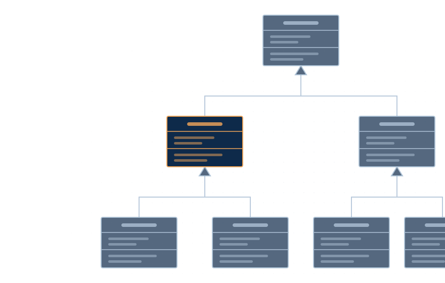

  

    
大学実習教材

    
ALPHA VERSION執筆途中

  

  

    
大学2年生のための実践的プログラミング入門

    <h1 class="cover-title">オブジェクト指向言語 Java</h1>
    
クラスの設計からGUI、並行処理、テストまで

  

  

  

    

      
この本の対象読者

      <ul>
        <li>手続き型のプログラミング言語（Cなど）で基礎を学び終えた人</li>
        <li>より実践的なプログラミング手法を学ぼうとしている人</li>
        <li>プログラミングの基礎から次のステップに進みたい人</li>
      </ul>
    

    
Hidehiro Nagatani著

  

